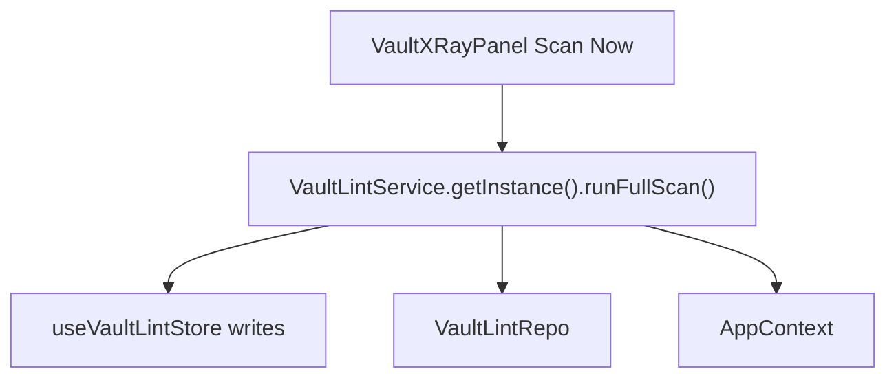
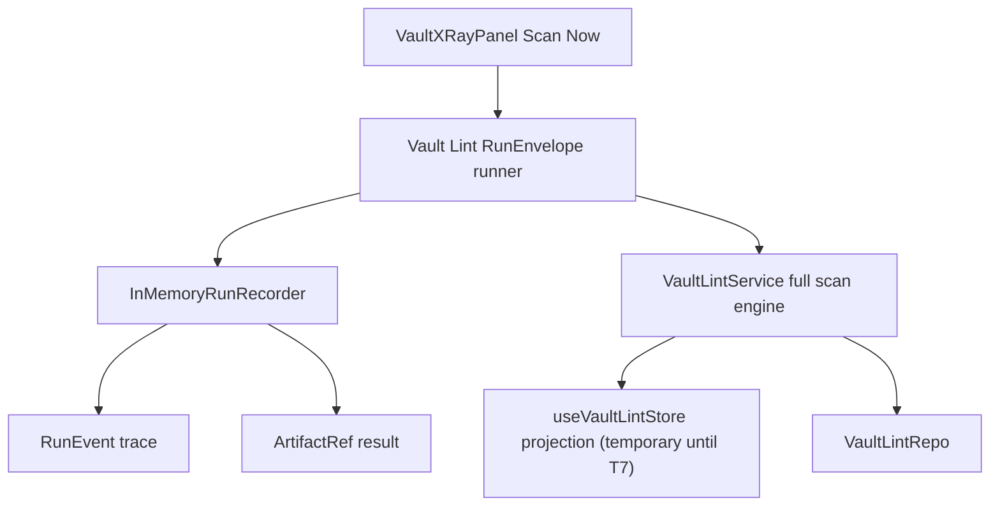

# Peak Assistant Modernization Handoff: T4 Vault Lint RunEnvelope Vertical Slice

## 中文摘要

这一步在全局架构里的位置：
- 进入 `T4 Capability Replacement`。
- 这不是继续清 `Notice`，也不是再加一个孤立类型。
- T4 的目标是让第一个真实 capability，也就是 Vault Lint manual scan，开始通过 `RunEnvelope` 跑。

为什么现在做它：
- T1 已经有 `VaultLintContract`。
- T3A 已经有 `RunSession` / `RunEvent` / `ArtifactRef` / deterministic recorder。
- Vault Lint 面积小、用户入口清楚、测试面已有，适合做第一个真实纵切。

本轮要换挡：
- 允许改 5-15 个相关文件。
- 允许改真实运行入口。
- 允许保留 UI store 作为临时 projection，不要求 T7 一次完成。
- 不允许顺手扩到 Chat / Search / Copilot / Ambient。

允许 Claude Code 改什么：
- `VaultLintService` 的 manual full scan 路径。
- 新增一个 Vault Lint capability runner / envelope adapter。
- 修改 `VaultXRayPanel` 的 `Scan Now` 入口，让它走新 runner。
- 新增 focused tests 和 source guards。
- 如有真实需要，可以给 `RunEnvelope` 新增非常小的 T4 字段或 helper，但必须由 Vault Lint 真实需求驱动。

明确不允许改什么：
- 不重写 Vault Lint UI。
- 不删除 `useVaultLintStore`；T7 再做 UI projection。
- 不重构所有 AppContext / SQLite / detector dependencies。
- 不改 Chat、Quick Search、Ambient Push、Command Gateway。
- 不批量处理其它 `Notice`。
- 不新增 singleton registry。
- 不新增 module-level mutable default。
- 不把 `src/service/capabilities/CapabilityRegistry.ts` 当执行 registry。

做完后用户应该看什么：
- 新的 Vault Lint runner / adapter。
- `VaultLintService.runFullScan` 如何记录 `RunEvent`。
- `VaultXRayPanel` 是否从 direct service call 变成新 capability runner call。
- 新测试里是否能看到 deterministic event trace。

## Review Entry Points

| Review item | Status | Why open it |
| --- | --- | --- |
| This T4 handoff | Ready to send | 给 Claude Code 的中等批量任务包。 |
| [`2026-06-13-t3a-owner-review-packet.md`](../audits/2026-06-13-t3a-owner-review-packet.md) | Previous packet | 说明 T3A 已接受，可以接真实能力。 |
| [`2026-06-12-t1-owner-review-packet.md`](../audits/2026-06-12-t1-owner-review-packet.md) | Contract evidence | Vault Lint 的 contract/inventory 来源。 |
| [`architecture-scorecard.md`](./architecture-scorecard.md) | Current score ledger | T4 完成后再更新分数。 |

## Send To Claude Code

````md
# Peak Assistant Modernization: T4 Vault Lint RunEnvelope Vertical Slice

Branch:
codex/peak-modernization-refactor

Source-of-truth docs:
- docs/superpowers/specs/2026-06-01-peak-system-architecture-modernization-handbook.html
- docs/superpowers/audits/2026-06-13-t3a-owner-review-packet.md
- docs/superpowers/audits/2026-06-12-t1-owner-review-packet.md
- docs/superpowers/refactor-ops/README.md
- docs/superpowers/refactor-ops/t4-vault-lint-run-envelope-vertical-slice-handoff.md

Current operating rules:
- Codex owns architecture reports, diagrams, task design, and review packets.
- Claude Code owns implementation.
- Owner-facing explanations should be Chinese-first.
- This is now a medium-size vertical slice. Do not shrink it into another one-file cleanup.
- Still do not broaden it into Chat / Search / Copilot / Ambient.

## Goal

Make Vault Lint manual full scan run through `RunEnvelope` while preserving current UI behavior.

The new path should be:

```text
VaultXRayPanel Scan Now
-> Vault Lint capability runner
-> InMemoryRunRecorder start(VAULT_LINT_CAPABILITY_ID)
-> VaultLintService full scan engine
-> RunEvent progress / log / artifact / status
-> existing useVaultLintStore projection remains for now
```

## Execution Mode

To move faster, you may do the read-only investigation and implementation in one Claude session:

1. First output a compact read-only checkpoint.
2. If no stop condition is found and the proposed file list matches this handoff, continue to implementation.
3. If a stop condition is found, stop before editing.

## Required First Section From Claude Code

```md
## Read-only checkpoint — T4 Vault Lint RunEnvelope Vertical Slice

中文摘要:
- 这一步在全局架构里的位置:
- 你建议本轮实际改哪些文件:
- 哪些旧路径本轮故意保留:
- 是否发现 stop condition:

Current path:


Proposed path:


Expected files:
- Runtime:
- UI entry:
- Tests:
- Docs:
```

## Implementation Requirements

Required:
- Add a Vault Lint runner / adapter, probably under `src/service/lint/`.
- Use `VAULT_LINT_CAPABILITY_ID`.
- Use `InMemoryRunRecorder`.
- The manual scan should emit at least:
  - initial status event;
  - running status event;
  - progress event for `init`;
  - progress event for `scanning`;
  - progress event for `cleared`;
  - artifact event for the `LintScanResult`;
  - completed status event;
  - error event + failed status when the full scan throws.
- `ArtifactRef.kind` should be `result`.
- The scan result itself may stay in existing repo/store; `ArtifactRef` is only a reference.
- `VaultXRayPanel` should stop calling `VaultLintService.getInstance().runFullScan()` directly.
- Existing UI behavior should remain: `useVaultLintStore` still drives `isScanning`, `currentScan`, and trend display.
- Preserve `VaultLintService.getInstance()` and `initRegistry()` compatibility for now.

Allowed:
- Extend `VaultLintService.runFullScan` with an optional envelope/recorder callbacks object.
- Extract a small internal helper if it makes the old service readable.
- Add source-scan tests proving the UI entry goes through the new runner.
- Add deterministic tests for the runner by faking the scanner function if direct `VaultLintService` execution would require full Obsidian/AppContext setup.

Not allowed:
- Do not remove `useVaultLintStore` yet.
- Do not replace Vault Lint UI.
- Do not rewrite detectors.
- Do not change SQLite schema.
- Do not change findings/health score semantics.
- Do not expand `RunEnvelope` with generic ports unless the read-only checkpoint proves it is necessary.
- Do not touch Chat / Search / Copilot / Ambient / Command Gateway.
- Do not add singleton registry or module-level mutable default.

## Suggested Implementation Shape

One acceptable shape:

```ts
// src/service/lint/VaultLintRun.ts
export interface VaultLintRunResult {
  result: LintScanResult;
  session: RunSession;
  events: readonly RunEvent[];
  artifact: ArtifactRef;
}

export async function runVaultLintManualScan(options?: {
  recorder?: InMemoryRunRecorder;
  scan?: (callbacks: VaultLintRunCallbacks) => Promise<LintScanResult>;
}): Promise<VaultLintRunResult>
```

The `scan` option is for tests. Production can call `VaultLintService.getInstance().runFullScan(...)`.

The service can accept callbacks:

```ts
export interface VaultLintRunCallbacks {
  onProgress?: (event: VaultLintProgressEvent) => void;
  onDetectorWarning?: (detectorId: string, error: unknown) => void;
}
```

Do not overfit these names; adjust if local code reads better.

## Tests To Add Or Update

Required test coverage:

- deterministic runner happy path:
  - fake recorder clock/id;
  - fake scan result;
  - assert `runId`, `capabilityId`, status events, progress events, artifact event.
- failure path:
  - fake scan throws;
  - assert error event + failed status;
  - assert error is rethrown or returned exactly as implementation documents.
- UI source guard:
  - `VaultXRayPanel.tsx` no longer imports `VaultLintService`.
  - it imports/calls the new Vault Lint runner.
- service callback guard:
  - `VaultLintService.runFullScan` still writes current store for now.
  - it also exposes progress to runner via callbacks.
- boundary guard:
  - new runner must not import UI store directly.
  - new runner must not import AppContext directly unless there is no alternative and it is explained.

Keep existing tests passing:
- `npm run test -- test/run-envelope-core.test.ts`
- `npm run test -- test/vault-lint-contract.test.ts`
- `npm run test -- test/vault-lint-structural.test.ts`
- `npm run test -- test/vault-lint-repo.test.ts`

## Required Verification

Run:
- `npm run build`
- new T4 tests
- `npm run test -- test/run-envelope-core.test.ts`
- `npm run test -- test/vault-lint-contract.test.ts`
- `npm run test -- test/vault-lint-structural.test.ts`
- `npm run test -- test/vault-lint-repo.test.ts`
- `node scripts/audit/boundary-baseline.mjs --out /tmp/t4-vault-lint-boundary-baseline.md`

Required `rg` checks:
- `rg -n "VaultLintService.getInstance\\(\\)\\.runFullScan" src/ui src/app src/service`
- `rg -n "runVaultLintManualScan|VaultLintRun" src test`
- `rg -n "VAULT_LINT_CAPABILITY_ID|InMemoryRunRecorder|RunEvent|ArtifactRef" src/service/lint test`
- `rg -n "from ['\"]obsidian['\"]|@/ui/|AppContext|getInstance\\(" src/service/lint/*Run* src/service/lint/*runner* 2>/dev/null || true`
- `rg -n "let default|static instance|getInstance\\(" src/service/lint/*Run* src/service/lint/*runner* 2>/dev/null || true`

Expected boundary direction:
- This may not reduce all boundary counts yet because `VaultLintService` still writes UI store until T7.
- It must not increase `service -> ui` beyond any intentional existing `VaultLintService` edge.
- It should improve single runtime path for manual Vault Lint scan: UI no longer calls `VaultLintService.runFullScan` directly.

## Implementation Note Required From Claude Code

After implementation and commit, report:

```md
## Implementation note

中文摘要:
- 本轮在全局架构里的位置:
- 为什么做这个:
- 用户可见行为是否变化:
- 最重要的边界变化:
- 还没有解决的旧路径:
- 下一步建议:

Commit:
- <hash and message>

Changed files grouped by purpose:
- Runner / RunEnvelope:
- Vault Lint service:
- UI entry:
- Tests:
- Docs:

Code reading guide:
- Read first:
- Then read:
- Optional / only if debugging:
- Main symbols to inspect:
- Files intentionally not changed:

Runtime path:
- Before:
- After:

Mutable global state:
- New module-level mutable defaults introduced:
- Existing module-level mutable defaults preserved:
- Any singleton use preserved:
- Why preserved singleton/store writes are temporary:

Old path reduced:
- ...

Verification:
- ...

Boundary audit delta:
- total flagged edges:
- service -> ui:
- service -> app:
- service/core -> Obsidian side-effect:
- core -> upstream:

Known remaining old paths:
- UI store projection remains until T7.
- AppContext remains in VaultLintService until ports are extracted.
- ProgressReporterPort.defaultReporter remains until progress-notification adopters are envelope-wired.

Suggested next task:
- ...
```
````

## Codex Review Focus After Claude Code Finishes

Codex should check:

1. Does `Scan Now` go through the new runner?
2. Does the runner produce meaningful `RunEvent` trace and `ArtifactRef`?
3. Is current UI behavior preserved?
4. Did the implementation avoid a new singleton registry?
5. Did it avoid over-expanding `RunEnvelope`?
6. Is `VaultLintService` now closer to engine/projection split, even if UI store writes remain?
7. Are tests deterministic and readable to the owner?
8. Did boundary audit avoid regressions?

## T4 Is Complete When

- Vault Lint manual scan has a `RunEnvelope` trace.
- `VaultXRayPanel` no longer directly calls `VaultLintService.runFullScan`.
- Existing UI still works through `useVaultLintStore`.
- Tests prove happy path and failure path.
- No singleton/global-default pattern is added.
- Codex writes a T4 Owner Review Packet with a code reading guide.
