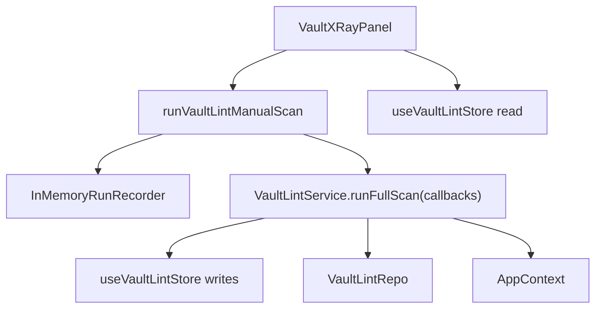
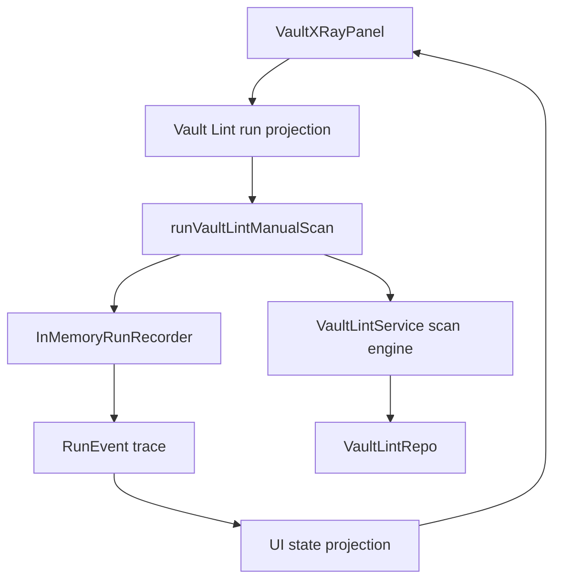

# Peak Assistant Modernization Handoff: T5 Vault Lint Runtime Closure Wave

## 中文摘要

这一步在全局架构里的位置：
- 进入真正的 closure wave。
- T4 已经让 Vault Lint manual scan 通过 `RunEnvelope` 跑。
- T5 不再只是“接一条新路”，而是要关闭旧路：让 UI 状态从 run trace / runner result 投影，移除 `VaultLintService -> useVaultLintStore` 反向依赖。

为什么现在做它：
- T4 后新旧两套 truth 并存：`RunEnvelope` 有 events，但 UI 仍读 `useVaultLintStore`。
- 如果继续给更多 capability 加 wrapper，债会越攒越多。
- 现在应该先把 Vault Lint 这一条能力闭环做完整，让它成为后续 capability 的样板。

本轮要加大粒度：
- 允许改 10-25 个相关文件。
- 允许同时改 runner、recorder、service、Vault X-Ray UI、局部 hook/store、tests、contract inventory。
- 必须删除或退役至少一条旧路径。
- 不接受只新增 adapter / hook / types，而旧 UI store 继续做 runtime truth 的实现。

允许 Claude Code 改什么：
- `src/service/run-envelope/*`：如果实时 UI projection 需要 per-run event observer，可以做最小扩展。
- `src/service/lint/*`：runner、service、contract inventory、types。
- `src/ui/view/vault-lint/*`：panel、components、局部 hook。
- `src/ui/store/vaultLintStore.ts`：优先删除；如果不能删，必须降级成纯 UI preference store，并解释为什么。
- `test/*vault-lint*` 和 `test/run-envelope-core.test.ts`。
- refactor-ops / audit docs，如果实现需要更新 handoff evidence。

明确不允许改什么：
- 不改 Chat、Quick Search、Copilot、Ambient Push、Command Gateway。
- 不重写 detector 算法。
- 不改 SQLite schema。
- 不做 Vault X-Ray 视觉 redesign。
- 不新增全局 singleton registry。
- 不新增 module-level mutable default。
- 不引入第二套长期 runtime。

做完后用户应该看什么：
- `VaultLintService.ts` 不再 import `@/ui/store/vaultLintStore`。
- `VaultXRayPanel.tsx` 或新的 hook 从 `RunEvent` / `runVaultLintManualScan()` projection 管 UI 状态。
- `src/ui/store/vaultLintStore.ts` 被删除，或只保留明显的 UI preference。
- `boundary audit` 至少在 `service -> ui` 或相关 metric 上出现真实下降。
- 测试里有 source guard 防止 service 再写 UI store。

## Review Entry Points

| Review item | Status | Why open it |
| --- | --- | --- |
| This T5 handoff | Ready to send | 给 Claude Code 的加大粒度任务包。 |
| [`2026-06-13-t4-owner-review-packet.md`](../audits/2026-06-13-t4-owner-review-packet.md) | Previous packet | 说明为什么 T4 接受但粒度不够。 |
| [`t4-vault-lint-run-envelope-vertical-slice-handoff.md`](./t4-vault-lint-run-envelope-vertical-slice-handoff.md) | Previous handoff | T4 的原始范围。 |
| [`architecture-scorecard.md`](./architecture-scorecard.md) | Current score ledger | T5 完成后必须更新分数。 |

## Send To Claude Code

````md
# Peak Assistant Modernization: T5 Vault Lint Runtime Closure Wave

Branch:
codex/peak-modernization-refactor

Source-of-truth docs:
- docs/superpowers/specs/2026-06-01-peak-system-architecture-modernization-handbook.html
- docs/superpowers/audits/2026-06-13-t4-owner-review-packet.md
- docs/superpowers/refactor-ops/README.md
- docs/superpowers/refactor-ops/t5-vault-lint-runtime-closure-wave-handoff.md

Current operating rules:
- Codex owns architecture reports, diagrams, task design, and review packets.
- Claude Code owns implementation.
- Owner-facing explanations should be Chinese-first.
- This is a closure wave, not a micro-slice.
- Do not shrink it into another adapter-only task.

## Goal

Close the Vault Lint runtime loop by making Vault X-Ray UI state come from the `RunEnvelope` runner/projection instead of `VaultLintService` writing `useVaultLintStore`.

Target path:

```text
VaultXRayPanel Scan Now
-> runVaultLintManualScan({ event observer / projection callback })
-> InMemoryRunRecorder emits RunEvent trace
-> VaultLintService full scan engine emits callbacks only
-> UI local projection derives isScanning/currentScan/progress from events + result
-> VaultLintRepo remains persistence/history
```

## Execution Mode

Do a compact read-only checkpoint first. If the file list stays inside this handoff and no stop condition is found, continue implementation in the same Claude session.

This task is intentionally larger than T4:
- expected production files: roughly 6-15;
- expected tests/docs files: roughly 4-10;
- total changed files may be 10-25;
- smaller is acceptable only if old-path deletion still happens.

## Required First Section From Claude Code

```md
## Read-only checkpoint — T5 Vault Lint Runtime Closure Wave

中文摘要:
- 这一步在全局架构里的位置:
- T4 后新旧 truth 分别在哪里:
- 本轮要删除或退役哪条旧路径:
- 你建议本轮实际改哪些文件:
- 哪些旧路径本轮故意保留:
- 是否发现 stop condition:

Current path:


Proposed path:


Expected files:
- RunEnvelope / recorder:
- Runner / service:
- UI projection:
- Deleted or retired old store:
- Tests:
- Docs:
```

## Required Closure Outcomes

The implementation is not complete unless all required outcomes are met:

1. `VaultLintService.ts` no longer imports `@/ui/store/vaultLintStore`.
2. `VaultLintService.runFullScan` no longer calls `store.setScanProgress` or `store.setScanResult`.
3. `VaultXRayPanel` no longer reads scan runtime state from `useVaultLintStore`.
4. Runtime scan state is projected from runner/envelope data:
   - `isScanning`;
   - current progress phase / detector / counts if still shown;
   - final `LintScanResult`;
   - error state if scan throws.
5. `showInfoFindings` is moved to local component state or a tiny UI-only preference, not mixed with scan runtime truth.
6. `src/ui/store/vaultLintStore.ts` is deleted if no longer needed. If kept, it must not contain scan result/progress truth.
7. Tests or source guards prove the service cannot re-import the UI store.
8. Boundary audit must not regress. Expected improvement: `service -> ui` should drop by at least one edge. If it does not, explain exactly why.

## Allowed Design Shapes

Acceptable shape A — runner-level event observer:

```ts
export interface VaultLintRunOptions {
  onEvent?: (event: RunEvent, snapshot: readonly RunEvent[]) => void;
}
```

The runner calls `onEvent` after each recorder mutation. UI hook uses it to project progress.

Acceptable shape B — per-recorder event sink:

```ts
new InMemoryRunRecorder({ clock, idFactory, onEvent })
```

Use this only if it remains per-instance and does not create a global event bus.

Acceptable shape C — UI hook:

```ts
function useVaultLintRunState() {
  return { currentScan, isScanning, progress, error, events, startScan };
}
```

The hook may live under `src/ui/view/vault-lint/hooks/` and may import the runner. It must not make `VaultLintService` a UI dependency.

Do not overfit these names. Use local style if a clearer shape exists.

## Required Tests / Guards

Add or update tests so they prove:

- `VaultLintService.ts` has no import from `@/ui/` or `useVaultLintStore`.
- `VaultLintService.ts` has no `setScanProgress` / `setScanResult`.
- `VaultXRayPanel.tsx` does not import `useVaultLintStore`.
- `PriorityActionsList.tsx` does not import `useVaultLintStore`.
- If `src/ui/store/vaultLintStore.ts` remains, it contains no scan runtime fields: `currentScan`, `isScanning`, `scanProgress`, `trendHistory`.
- Runner event observer emits enough events for live UI progress.
- Failure path clears scanning state and exposes an error.
- Existing T4 event trace semantics still pass.

Keep existing tests passing:
- `npm run test -- test/vault-lint-runner.test.ts`
- `npm run test -- test/run-envelope-core.test.ts`
- `npm run test -- test/vault-lint-contract.test.ts`
- `npm run test -- test/vault-lint-structural.test.ts`
- `npm run test -- test/vault-lint-repo.test.ts`

## Required Verification

Run:
- `npm run build`
- new/updated T5 tests
- `npm run test -- test/vault-lint-runner.test.ts`
- `npm run test -- test/run-envelope-core.test.ts`
- `npm run test -- test/vault-lint-contract.test.ts`
- `npm run test -- test/vault-lint-structural.test.ts`
- `npm run test -- test/vault-lint-repo.test.ts`
- `node scripts/audit/boundary-baseline.mjs --out /tmp/t5-vault-lint-runtime-closure-boundary-baseline.md`

Required `rg` checks:
- `rg -n "useVaultLintStore|setScanProgress|setScanResult" src/service/lint src/ui/view/vault-lint src/ui/store test`
- `rg -n "from ['\"]@/ui/|@/ui/store" src/service/lint`
- `rg -n "runVaultLintManualScan|onEvent|RunEvent|VaultLintRun" src/service/lint src/ui/view/vault-lint test`
- `rg -n "let default|static instance|getInstance\\(" src/service/lint/*Run* src/ui/view/vault-lint src/service/run-envelope 2>/dev/null || true`

Expected boundary direction:
- `service -> ui` should decrease.
- Total flagged edges should decrease or remain flat with a clear explanation.
- No new `service -> app` or `core -> upstream` edge should appear.

## Hard Acceptance Bar

This task is rejected if:

- it only adds another wrapper/hook while `VaultLintService` still writes `useVaultLintStore`;
- it leaves old and new scan state truth co-owning runtime behavior;
- it introduces a global event bus or module-level mutable default;
- it expands into Chat / Ambient / Command Gateway;
- it cannot explain the new debug path in 5 minutes.

## Implementation Note Required From Claude Code

After implementation and commit, report:

```md
## Implementation note

中文摘要:
- 本轮在全局架构里的位置:
- 为什么这次是 closure wave 而不是 micro-slice:
- 用户可见行为是否变化:
- 最重要的旧路径删除:
- 最重要的新状态 truth:
- 还没有解决的旧路径:
- 下一步建议:

Commit:
- <hash and message>

Changed files grouped by purpose:
- RunEnvelope / event projection:
- Runner / service:
- UI state / components:
- Deleted or retired old store:
- Tests:
- Docs:

Code reading guide:
- Read first:
- Then read:
- Optional / only if debugging:
- Main symbols to inspect:
- Files intentionally not changed:

Runtime path:
- Before:
- After:

State truth:
- Before:
- After:
- Why this is no longer dual truth:

Old path deletion evidence:
- Deleted imports:
- Deleted store writes:
- Deleted files or retired fields:
- rg evidence:

Mutable global state:
- New module-level mutable defaults introduced:
- Existing module-level mutable defaults preserved:
- Any singleton use preserved:
- Why preserved singleton/store-like code is temporary:

Verification:
- ...

Boundary audit delta:
- total flagged edges:
- service -> ui:
- service -> app:
- service/core -> Obsidian side-effect:
- core -> upstream:

Known remaining old paths:
- AppContext remains in VaultLintService until T6 ports extraction, unless you also safely extracted it here.
- SignalRegistry.getInstance remains until detector registry closure.
- VaultDigestService still reads cached lint repo.

Suggested next task:
- ...
```
````

## Stop Conditions

Stop before editing if:

- Keeping live progress would require a global singleton event bus.
- Removing `useVaultLintStore` would require rewriting unrelated UI surfaces outside Vault X-Ray.
- The task needs more than 30 production files.
- It requires SQLite schema changes.
- It requires changing detector semantics or health score math.
- It requires touching Chat, Quick Search, Copilot, Ambient Push, or Command Gateway.

Do not stop merely because the task is larger than T4. This handoff intentionally allows a larger, coherent closure wave.
