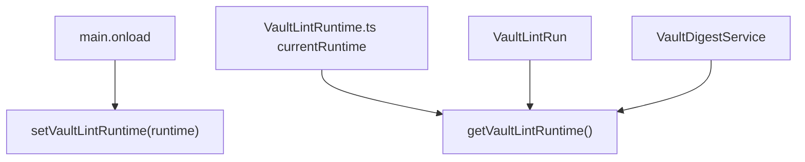
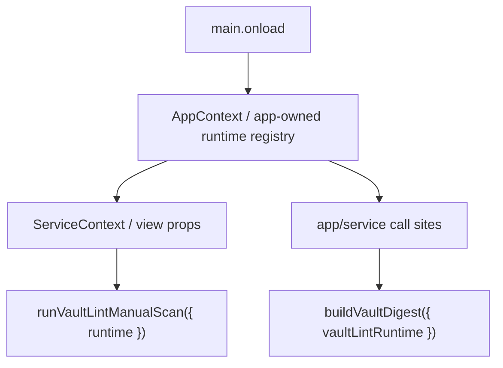

# Peak Assistant Modernization Handoff: T6R Runtime Ownership + Config Defaults Governance

## 中文摘要

这一步是 T6 的 review fix，不是新 capability。

要修两件事：

1. `VaultLintRuntime.ts` 里还有 `let currentRuntime: VaultLintRuntime | null = null`。
   - 这仍然是 module-level runtime singleton。
   - T6 把散落 service-locator 收敛成一个 binding，可以作为中间态接受。
   - 但 owner 明确指出：不能让这种模式扩散到每个 capability。
   - T6R 要把 runtime ownership 上移到 app-level，比如 `AppContext` 或一个 app-owned runtime registry。

2. `DEFAULT_VAULT_LINT_CONFIG` 还在 `VaultLintService.ts`。
   - 这些是 domain config，不应该放在 engine 文件里。
   - 项目已有 `templates/config/vault-lint-config.json`。
   - T6R 要把 compiled fallback 移到专门的 defaults/config 文件，并补文档和测试。

本轮粒度：
- 允许改 8-20 个相关文件。
- 允许改 AppContext / ServiceContext / VaultXRay hook / VaultReviewSession / VaultDigestService / VaultLintRuntime / VaultLintService / tests / docs。
- 不允许继续 T7 detector context，先把 T6 review fix 收干净。

## Review Entry Points

| Review item | Status | Why open it |
| --- | --- | --- |
| This T6R handoff | Ready to send | 给 Claude Code 的 review-fix 任务。 |
| [`2026-06-13-t6-review-fix-owner-note.md`](../audits/2026-06-13-t6-review-fix-owner-note.md) | Owner note | 记录为什么 T6 后还要先修这两点。 |
| [`config-defaults-governance.md`](./config-defaults-governance.md) | Rule doc | 配置默认值归档规则。 |
| [`t7-vault-lint-detector-context-closure-handoff.md`](./t7-vault-lint-detector-context-closure-handoff.md) | Paused next task | T6R 完成后再继续。 |

## Send To Claude Code

````md
# Peak Assistant Modernization: T6R Runtime Ownership + Config Defaults Governance

Branch:
codex/peak-modernization-refactor

Source-of-truth docs:
- docs/superpowers/specs/2026-06-01-peak-system-architecture-modernization-handbook.html
- docs/superpowers/audits/2026-06-13-t6-owner-review-packet.md
- docs/superpowers/audits/2026-06-13-t6-review-fix-owner-note.md
- docs/superpowers/refactor-ops/config-defaults-governance.md
- docs/superpowers/refactor-ops/t6-review-fix-runtime-ownership-config-defaults-handoff.md

Current operating rules:
- Codex owns architecture reports, diagrams, task design, and review packets.
- Claude Code owns implementation.
- Owner-facing explanations should be Chinese-first.
- This is a T6 review fix. Do not start T7 detector context yet.

## Goal

Fix two T6 owner-review issues:

1. Remove module-level runtime singleton ownership from `src/service/lint/VaultLintRuntime.ts`.
2. Move `DEFAULT_VAULT_LINT_CONFIG` out of `VaultLintService.ts` and put Vault Lint defaults under documented config governance.

## Read-only Checkpoint Required First

```md
## Read-only checkpoint — T6R Runtime Ownership + Config Defaults

中文摘要:
- 当前 runtime binding 在哪里:
- 哪些 consumers currently call getVaultLintRuntime():
- 推荐把 VaultLintRuntime ownership 放到哪里:
- service layer 如何避免 import AppContext:
- DEFAULT_VAULT_LINT_CONFIG 当前在哪里:
- templates/config/vault-lint-config.json 与 compiled fallback 如何对齐:
- 本轮建议实际改哪些文件:
- 是否发现 stop condition:

Current runtime path:


Target runtime path:


Expected files:
- Runtime ownership:
- UI/AppContext wiring:
- VaultDigest wiring:
- Config defaults:
- Tests:
- Docs:
```

## Required Runtime Ownership Outcomes

The implementation is not complete unless these are true:

1. `src/service/lint/VaultLintRuntime.ts` no longer has:
   - `let currentRuntime`
   - `setVaultLintRuntime`
   - `getVaultLintRuntime`
   - `clearVaultLintRuntimeForTests`
2. `VaultLintRuntime.ts` may remain as a pure type/interface file.
3. Runtime ownership lives in app-level composition:
   - preferred: `AppContext` owns `vaultLintRuntime`;
   - acceptable: one app-owned runtime registry under `src/app/runtime/`;
   - not acceptable: another service-layer module singleton.
4. `src/service/lint/VaultLintRun.ts` does not import `AppContext`.
5. Production callers pass runtime explicitly:
   - UI hook can get runtime through `ServiceContext` / props / AppContext-owned value;
   - `VaultDigestService` should accept runtime as a dependency or be called from an app/service owner that passes runtime.
6. `main.ts` still composes the runtime after sqlite is ready.
7. unload still releases references through app-level ownership.
8. Tests/source guards prove no per-capability module-level runtime binding remains.

## Suggested Runtime Shape

One acceptable shape:

```ts
// AppContext.ts
public vaultLintRuntime: VaultLintRuntime | null = null;

public setVaultLintRuntime(runtime: VaultLintRuntime): void
public getVaultLintRuntime(): VaultLintRuntime
public clearVaultLintRuntime(): void
```

Then:

```ts
// main.ts after sqlite init
this.appContext.setVaultLintRuntime(composeVaultLintRuntime());

// React ServiceContext
vaultLintRuntime: appContext.getVaultLintRuntime()

// useVaultLintRunState
const { vaultLintRuntime } = useServiceContext();
runVaultLintManualScan({ runtime: vaultLintRuntime, onEvent: ... })

// VaultLintRun
export interface VaultLintRunOptions {
  runtime?: VaultLintRuntime;
  scan?: ...
}
```

Do not make `VaultLintRun.ts` call `AppContext.getInstance()`.

For `VaultDigestService`, acceptable:

```ts
export async function buildVaultDigest(options?: {
  vaultLintRuntime?: VaultLintRuntime;
}): Promise<VaultDigest | null>
```

Then the caller that already imports `AppContext` passes `AppContext.getInstance().getVaultLintRuntime()`.

## Required Config Defaults Outcomes

The implementation is not complete unless these are true:

1. `DEFAULT_VAULT_LINT_CONFIG` is removed from `VaultLintService.ts`.
2. Vault Lint compiled fallback lives in a dedicated config/defaults file, for example:
   - `src/service/lint/config/VaultLintDefaults.ts`
3. The defaults file documents that it mirrors:
   - `templates/config/vault-lint-config.json`
4. `VaultLintService.ts` imports the fallback, but does not own the config table.
5. Add/extend tests proving:
   - service file has no inline `dimensionWeights` / `thresholds` default object;
   - compiled defaults are shape-compatible with `templates/config/vault-lint-config.json`;
   - missing/throwing config adapter still falls back safely.
6. Keep `templates/config/vault-lint-config.json` as the editable config source.
7. Record the config ownership in the governance doc or an adjacent inventory row:
   - editable source;
   - compiled fallback;
   - loader / adapter;
   - drift guard test.
8. Update docs if the implementation chooses a different fallback path.

## Required Tests / Guards

Add/update tests so they prove:

- no `currentRuntime` binding remains in `src/service/lint`;
- no `setVaultLintRuntime` / `getVaultLintRuntime` functions remain in service/lint runtime file;
- `VaultLintRun.ts` does not import `AppContext`;
- `VaultLintRun.ts` can run with injected fake runtime;
- UI hook obtains runtime from app/service context or props, not service singleton;
- `VaultDigestService` no longer imports `getVaultLintRuntime`;
- `VaultLintService.ts` no longer defines `DEFAULT_VAULT_LINT_CONFIG` inline;
- compiled Vault Lint defaults match the template JSON shape.

Keep existing tests passing:
- `npm run test -- test/vault-lint-service-ports.test.ts`
- `npm run test -- test/vault-lint-runner.test.ts`
- `npm run test -- test/vault-lint-contract.test.ts`
- `npm run test -- test/vault-lint-structural.test.ts`
- `npm run test -- test/vault-lint-repo.test.ts`
- `npm run test -- test/run-envelope-core.test.ts`

## Required Verification

Run:
- `npm run build`
- new/updated T6R tests
- `npm run test -- test/vault-lint-service-ports.test.ts`
- `npm run test -- test/vault-lint-runner.test.ts`
- `npm run test -- test/vault-lint-contract.test.ts`
- `npm run test -- test/vault-lint-structural.test.ts`
- `npm run test -- test/vault-lint-repo.test.ts`
- `npm run test -- test/run-envelope-core.test.ts`
- `node scripts/audit/boundary-baseline.mjs --out /tmp/t6r-runtime-config-boundary-baseline.md`

Required `rg` checks:
- `rg -n "let currentRuntime|setVaultLintRuntime|getVaultLintRuntime|clearVaultLintRuntimeForTests" src/service/lint src/app src/ui test main.ts`
- `rg -n "DEFAULT_VAULT_LINT_CONFIG|dimensionWeights|stubMaxChars|fullScanIntervalHours" src/service/lint src/app/lint test templates/config/vault-lint-config.json`
- `rg -n "from ['\"]@/app/context/AppContext" src/service/lint src/ui/view/vault-lint src/service/copilot/vault`
- `rg -n "let default|static instance|getInstance\\(" src/service/lint src/service/run-envelope 2>/dev/null || true`

Expected boundary direction:
- boundary counts may stay flat.
- The acceptance target is ownership cleanup, not necessarily fewer edges.
- Must not increase `service -> app` or `service -> ui`.

## Hard Acceptance Bar

Reject the task if:

- `currentRuntime` remains in a service-layer file;
- runtime ownership moves to another module-level singleton outside app-level ownership;
- `VaultLintRun.ts` imports `AppContext`;
- `VaultLintService.ts` still owns the default config object;
- config defaults are moved but undocumented;
- tests do not guard against regression.

## Implementation Note Required From Claude Code

After implementation and commit, report:

```md
## Implementation note

中文摘要:
- 本轮修了 T6 的哪两个 owner-review 问题:
- 用户可见行为是否变化:
- runtime ownership 现在在哪里:
- config defaults 现在在哪里:
- 为什么这不再是 scattered singleton/config:
- 还没有解决的旧路径:
- 下一步建议:

Commit:
- <hash and message>

Changed files grouped by purpose:
- Runtime ownership:
- AppContext / ServiceContext / consumers:
- Config defaults:
- Tests:
- Docs:

Code reading guide:
- Read first:
- Then read:
- Optional / only if debugging:
- Main symbols to inspect:
- Files intentionally not changed:

Runtime ownership:
- Before:
- After:
- Why service layer no longer owns the binding:

Config defaults:
- Before:
- After:
- Template source:
- Compiled fallback:
- Config inventory entry:
- Drift guard:

Mutable global state:
- New module-level mutable defaults introduced:
- Removed module-level mutable defaults:
- Existing mutable globals preserved:
- Why preserved ones are temporary or centralized:

Verification:
- ...

Boundary audit delta:
- ...

Known remaining old paths:
- Detector files still import AppContext/sqlite until T7, unless you also safely fixed them.

Suggested next task:
- T7 Detector Context Closure.
```
````

## Stop Conditions

Stop before editing if:

- runtime cannot move to app-level ownership without rewriting unrelated Chat/Search infrastructure;
- moving config defaults requires changing TemplateManager behavior;
- implementation would touch more than 25 production files;
- the fix would start T7 detector context work.

Do not stop merely because this requires touching AppContext and ServiceContext. That is the point of this review fix.
