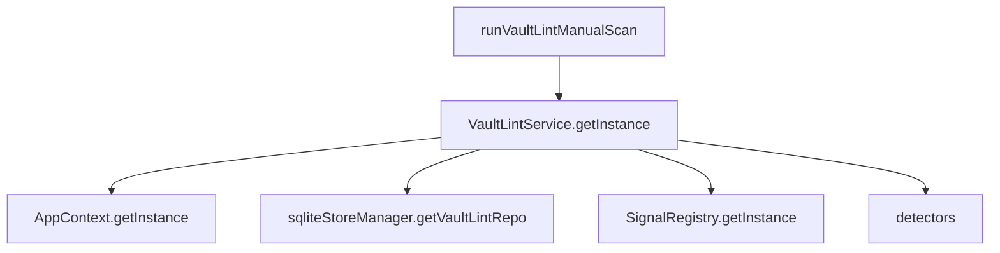
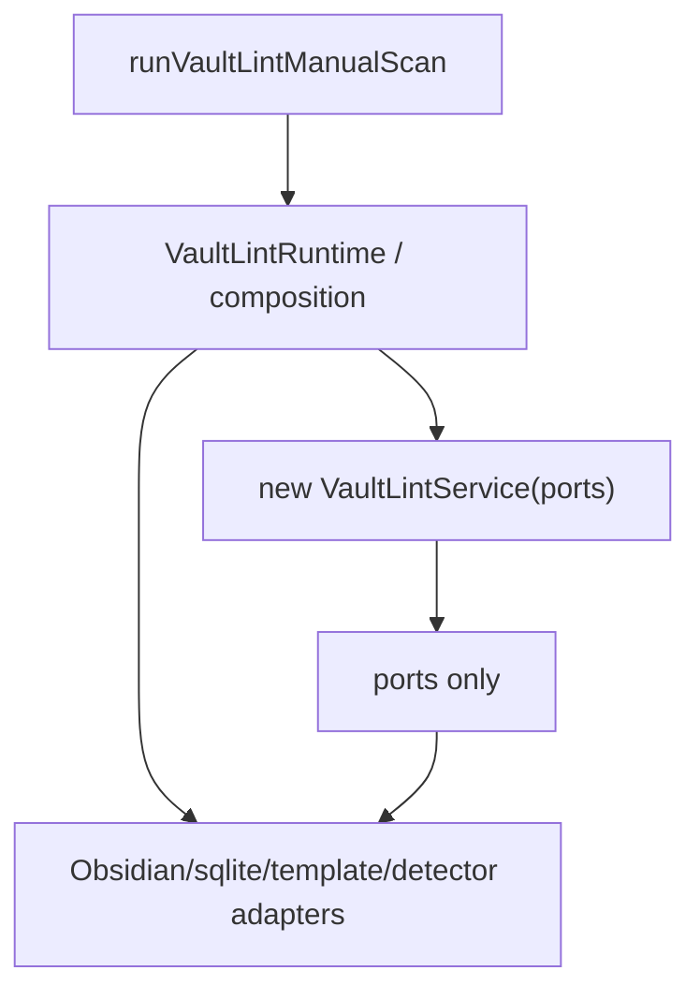

# Peak Assistant Modernization Handoff: T6 Vault Lint Ports Extraction + Service-as-Plain-Class

## 中文摘要

这一步在全局架构里的位置：
- T5 已经把 Vault Lint 的 UI runtime truth 收敛到 `RunEnvelope`。
- T6 继续在同一个 capability 内加大粒度，把 `VaultLintService` 从 singleton/service-locator 形态改成可注入、可 fake、可读的 scan engine。
- 目标是降低 `service -> app` / service locator 依赖，而不是再做 UI store 清理。

为什么现在做它：
- T5 之后，最大的旧路径不再是 UI store，而是 `VaultLintService` 内部自己 resolve 环境：
  - `AppContext.getInstance().manager.getTemplateManager()`
  - `AppContext.getInstance().app.vault.getMarkdownFiles()`
  - `sqliteStoreManager.getVaultLintRepo()`
  - `SignalRegistry.getInstance()`
  - `VaultLintService.getInstance()`
- 这些让 service 很难被 fake，也让 capability 的依赖不透明。
- T6 要把这些依赖变成清楚的 ports，并把 runtime 组装集中到一个地方。

本轮粒度：
- 允许改 12-30 个相关文件。
- 允许新增 ports/adapters/runtime composition。
- 允许迁移 `openVaultXRay`、`VaultDigestService`、`VaultLintRun` 的 lint runtime 获取方式。
- 不接受只新增 interface 但 service 仍然直接 `AppContext.getInstance()` 的实现。

允许 Claude Code 改什么：
- `src/service/lint/*`
- `src/service/lint/ports/*` 或同等局部目录
- `src/app/commands/PeakCommandActions.ts`
- `src/service/copilot/vault/VaultDigestService.ts`
- `src/core/storage/sqlite/repositories/VaultLintRepo.ts` 的类型引用如果必须调整
- `test/*vault-lint*`
- `docs/superpowers/refactor-ops/*` / `docs/superpowers/audits/*` 仅用于 implementation evidence

明确不允许改什么：
- 不改 Vault Lint detector 语义和 health score math。
- 不改 SQLite schema。
- 不改 Vault X-Ray visual design。
- 不改 Chat、Quick Search、Ambient Push、Command Gateway。
- 不引入新的 module-level mutable default。
- 不新增另一个全局 registry 来替代旧 registry。

做完后用户应该看什么：
- `VaultLintService.ts` constructor 接收 ports。
- `runFullScan()` 不再调用 `AppContext.getInstance()` / `sqliteStoreManager.getVaultLintRepo()` / `SignalRegistry.getInstance()`。
- 有一个明确 runtime/composition 文件负责把 Obsidian/AppContext/sqlite/detectors 适配成 ports。
- `VaultLintRun.ts` 通过这个 runtime/composition 获取 scan engine，而不是直接调用 `VaultLintService.getInstance().runFullScan()`。
- Tests 用 fake ports 跑 service，不需要 Obsidian/AppContext/sqlite。

## Review Entry Points

| Review item | Status | Why open it |
| --- | --- | --- |
| This T6 handoff | Ready to send | 给 Claude Code 的更大粒度后端 closure wave。 |
| [`2026-06-13-t5-owner-review-packet.md`](../audits/2026-06-13-t5-owner-review-packet.md) | Previous packet | 说明 T5 已关闭 UI store truth，可以继续抽 ports。 |
| [`t5-vault-lint-runtime-closure-wave-handoff.md`](./t5-vault-lint-runtime-closure-wave-handoff.md) | Previous handoff | T5 的原任务边界。 |
| [`architecture-scorecard.md`](./architecture-scorecard.md) | Current score ledger | T6 完成后必须更新分数。 |

## Send To Claude Code

````md
# Peak Assistant Modernization: T6 Vault Lint Ports Extraction + Service-as-Plain-Class

Branch:
codex/peak-modernization-refactor

Source-of-truth docs:
- docs/superpowers/specs/2026-06-01-peak-system-architecture-modernization-handbook.html
- docs/superpowers/audits/2026-06-13-t5-owner-review-packet.md
- docs/superpowers/refactor-ops/README.md
- docs/superpowers/refactor-ops/t6-vault-lint-ports-service-plain-class-handoff.md

Current operating rules:
- Codex owns architecture reports, diagrams, task design, and review packets.
- Claude Code owns implementation.
- Owner-facing explanations should be Chinese-first.
- This is a larger closure wave, not a micro-slice.
- Do not shrink it into interface-only cleanup.

## Goal

Turn Vault Lint from a singleton service-locator runtime into a plain scan engine with explicit ports and one runtime composition point.

Current path:

```text
runVaultLintManualScan()
-> VaultLintService.getInstance().runFullScan(callbacks)
   -> AppContext.getInstance().manager.getTemplateManager()
   -> AppContext.getInstance().app.vault.getMarkdownFiles()
   -> sqliteStoreManager.getVaultLintRepo()
   -> SignalRegistry.getInstance().getNonLlm()
   -> detector.detect(...)
```

Target path:

```text
runVaultLintManualScan()
-> getVaultLintRuntime().runFullScan(callbacks)
   -> VaultLintService constructed with ports
      -> configPort.loadConfig()
      -> vaultPort.getMarkdownFiles()
      -> persistencePort.loadActiveDismissals/saveScanResult/getLastFullScanTimestamp/loadLatestScan?
      -> detectorRegistry.getNonLlm()
      -> idFactory.nextScanId()
```

The exact names can differ. The architectural outcome cannot.

## Execution Mode

Do a compact read-only checkpoint first. If no stop condition is found and the file list stays inside this handoff, continue implementation in the same Claude session.

This task is intentionally larger than T5:
- expected production files: roughly 10-20;
- expected tests/docs files: roughly 5-10;
- total changed files may be 12-30;
- smaller is acceptable only if all service-locator exits are actually removed from `VaultLintService`.

## Required First Section From Claude Code

```md
## Read-only checkpoint — T6 Vault Lint Ports Extraction

中文摘要:
- T5 后 Vault Lint 的 runtime truth 在哪里:
- T6 要删除哪些 service-locator 路径:
- 本轮建议新增哪些 ports:
- 本轮建议新增哪个 runtime/composition 文件:
- 哪些 singleton 本轮会删除、哪些会临时集中保留:
- 是否发现 stop condition:

Current dependency path:


Proposed dependency path:


Expected files:
- Ports / adapters:
- Runtime composition:
- Service rewrite:
- Command / digest consumers:
- Tests:
- Docs:
```

## Required Closure Outcomes

The implementation is not complete unless these are true:

1. `VaultLintService.runFullScan()` does not call `AppContext.getInstance()`.
2. `VaultLintService.runFullScan()` does not call `sqliteStoreManager.getVaultLintRepo()`.
3. `VaultLintService.runFullScan()` does not call `SignalRegistry.getInstance()`.
4. `VaultLintService` can be constructed with fake ports in tests.
5. `VaultLintService.getInstance()` is deleted or reduced to a thin compatibility shim that does not own dependency construction.
6. `runVaultLintManualScan()` does not directly call `VaultLintService.getInstance().runFullScan()`.
7. `openVaultXRay()` and `VaultDigestService` use the new runtime/composition point for registry/init/latest scan needs.
8. Tests or source guards prove the old service-locator calls do not return.
9. Boundary audit must not regress. Expected improvement: `service -> app` should drop if `AppContext` leaves `VaultLintService`.

## Suggested Port Shape

Use narrow ports. Do not pass `AppContext` itself.

Example shape:

```ts
export interface VaultLintConfigPort {
  loadConfig(): Promise<Partial<VaultLintConfig> | null>;
}

export interface VaultLintVaultPort {
  getMarkdownFileCount(): number;
  // Or getMarkdownFiles() if detector context needs files later.
}

export interface VaultLintPersistencePort {
  loadActiveDismissals(): Promise<LintDismissal[]>;
  getLastFullScanTimestamp(): Promise<number | null>;
  saveScanResult(result: LintScanResult): Promise<void>;
  loadLatestScan?(): Promise<LintScanResult | null>;
}

export interface VaultLintDetectorRegistryPort {
  ensureInitialized(config: VaultLintConfig): void;
  getNonLlm(): LintSignalDetector[];
}

export interface VaultLintIdPort {
  nextScanId(): string;
}

export interface VaultLintClockPort {
  now(): number;
}
```

Adjust names if local style reads better.

## Runtime Composition Guidance

One acceptable shape:

```ts
// src/service/lint/VaultLintRuntime.ts
export function getVaultLintRuntime(): VaultLintRuntime
export function resetVaultLintRuntimeForTests(): void

export interface VaultLintRuntime {
  runFullScan(callbacks?: VaultLintRunCallbacks): Promise<LintScanResult>;
  initRegistry(): void;
  loadLatestScan(): Promise<LintScanResult | null>;
}
```

But avoid a new scattered mutable global. If a cached runtime is necessary, centralize it and document why:

- acceptable transitional location: one Vault Lint runtime composition file;
- not acceptable: new `let defaultX = null` in random port files;
- if runtime captures app/sqlite objects, it must have an unload/reset path or be reconstructible from `AppContext` safely.

Even better if the runtime can be constructed per call without meaningful cost.

## Required Tests / Guards

Add/update tests proving:

- `VaultLintService` can run with fake ports and no AppContext/sqlite/signal singleton.
- service source has no `AppContext.getInstance`.
- service source has no `sqliteStoreManager`.
- service source has no `SignalRegistry.getInstance`.
- runner source has no `VaultLintService.getInstance().runFullScan`.
- command/digest consumers go through the new runtime/composition point.
- detector registry initialization still happens exactly once per runtime or is idempotent.
- existing T5 state projection still passes.

Keep existing tests passing:
- `npm run test -- test/run-envelope-core.test.ts`
- `npm run test -- test/vault-lint-runner.test.ts`
- `npm run test -- test/vault-lint-contract.test.ts`
- `npm run test -- test/vault-lint-structural.test.ts`
- `npm run test -- test/vault-lint-repo.test.ts`

## Required Verification

Run:
- `npm run build`
- new T6 tests
- `npm run test -- test/run-envelope-core.test.ts`
- `npm run test -- test/vault-lint-runner.test.ts`
- `npm run test -- test/vault-lint-contract.test.ts`
- `npm run test -- test/vault-lint-structural.test.ts`
- `npm run test -- test/vault-lint-repo.test.ts`
- `node scripts/audit/boundary-baseline.mjs --out /tmp/t6-vault-lint-ports-boundary-baseline.md`

Required `rg` checks:
- `rg -n "AppContext|getInstance\\(|sqliteStoreManager|SignalRegistry" src/service/lint`
- `rg -n "VaultLintService\\.getInstance\\(\\)\\.runFullScan|new VaultLintService|getVaultLintRuntime|VaultLintRuntime" src test`
- `rg -n "from ['\"]@/app/|from ['\"]@/ui/" src/service/lint`
- `rg -n "let default|static instance|getInstance\\(" src/service/lint src/service/run-envelope 2>/dev/null || true`

Expected boundary direction:
- `service -> app` should decrease if `VaultLintService` no longer imports AppContext.
- `service -> ui` should stay at or below T5.
- Total flagged edges should decrease or remain flat with explanation.
- No new core upstream dependency should appear.

## Hard Acceptance Bar

Reject the task if:

- it only defines port interfaces but `VaultLintService` still directly calls AppContext/sqliteStoreManager/SignalRegistry;
- it creates a second long-lived runtime path;
- it introduces another hidden singleton registry;
- fake-port service tests are missing;
- it expands into unrelated capability work.

## Implementation Note Required From Claude Code

After implementation and commit, report:

```md
## Implementation note

中文摘要:
- 本轮在全局架构里的位置:
- 为什么这是 closure wave 而不是 interface-only cleanup:
- 用户可见行为是否变化:
- 最重要的旧路径删除:
- 最重要的新 dependency/composition truth:
- 还没有解决的旧路径:
- 下一步建议:

Commit:
- <hash and message>

Changed files grouped by purpose:
- Ports:
- Runtime composition:
- Service rewrite:
- Runner / command / digest consumers:
- Tests:
- Docs:

Code reading guide:
- Read first:
- Then read:
- Optional / only if debugging:
- Main symbols to inspect:
- Files intentionally not changed:

Runtime path:
- Before:
- After:

Dependency truth:
- Before:
- After:
- Why this is no longer service-locator driven:

Old path deletion evidence:
- Deleted imports:
- Deleted getInstance/service locator calls:
- Thin shims, if any:
- rg evidence:

Mutable global state:
- New module-level mutable defaults introduced:
- Existing module-level mutable defaults preserved:
- Any singleton use preserved:
- Why preserved singleton/runtime cache is temporary or centralized:

Verification:
- ...

Boundary audit delta:
- total flagged edges:
- service -> ui:
- service -> app:
- service/core -> Obsidian side-effect:
- core -> upstream:

Known remaining old paths:
- ...

Suggested next task:
- ...
```
````

## Stop Conditions

Stop before editing if:

- extracting ports requires changing detector algorithms;
- the runtime composition needs to touch more than 30 production files;
- SQLite schema changes are required;
- command/digest consumers cannot move without changing visible behavior;
- the implementation would add a global event bus or broad capability registry.

Do not stop merely because this is larger than T5. This handoff intentionally asks for a larger backend closure wave.
