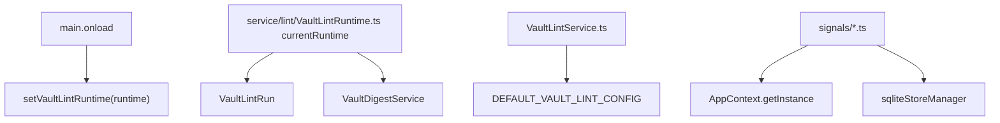
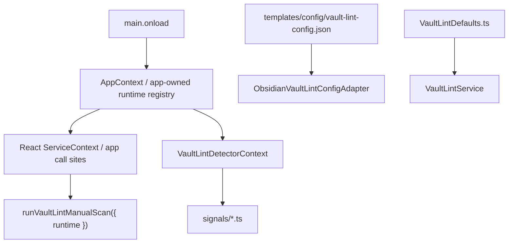

# Peak Assistant Modernization Handoff: T6R+T7 Vault Lint Foundation Closure

Status:
- Paused future scale draft.
- Do not send while T6R is already in flight.
- Current active handoff is [`t6-review-fix-runtime-ownership-config-defaults-handoff.md`](./t6-review-fix-runtime-ownership-config-defaults-handoff.md).
- After T6R owner review, rewrite the next closure wave with a larger scope than this draft if the evidence supports it.

## 中文摘要

这是一份未来大粒度任务草稿，不是当前要发送给 Claude Code 的 handoff。

它原本把 T6R 和 T7 合并成一个 closure wave；但当前 T6R 已经在进行中，所以不应临时改任务边界。先完成 T6R，再根据 T6R owner review 设计下一轮更大粒度的 closure wave。

Draft idea:

把原本拆开的 T6R 和 T7 合并成一个更大粒度的 closure wave。

为什么合并：

- T6R 修的是 Vault Lint runtime ownership 和 config defaults。
- T7 修的是 Vault Lint detectors 仍然自己找 `AppContext` / sqlite。
- 这三件事都属于同一个 capability 的运行时地基，不需要让 owner 来回粘贴两个小任务。

目标不是“多改文件”本身，而是一次性关掉一组相连旧路径：

1. service-layer `currentRuntime` binding 退出。
2. `DEFAULT_VAULT_LINT_CONFIG` 退出 `VaultLintService.ts`。
3. `signals/*` detector 退出 `AppContext` / `sqliteStoreManager` service-locator。

未来重写时的粒度方向：

- 这份草稿原来的 18-45 个文件范围偏保守。
- T6R 之后如果要做真正的大粒度 closure wave，目标应接近 30-80 个相关文件。
- 可以允许 production files 约 20-50 个，tests/docs 约 8-25 个，只要仍然有一个清晰的 code reading guide。
- 允许碰 AppContext / ServiceContext / app lint composition / Vault Lint runtime / detectors / ports / tests / docs。
- 不允许碰 Chat、Quick Search、Ambient Push、Command Gateway、SQLite schema、Vault X-Ray 视觉重做。

## Review Entry Points

| Review item | Status | Why open it |
| --- | --- | --- |
| This combined handoff | Ready to send | 给 Claude Code 的大粒度 Vault Lint 地基闭环任务。 |
| [`t6-review-fix-runtime-ownership-config-defaults-handoff.md`](./t6-review-fix-runtime-ownership-config-defaults-handoff.md) | Component task | T6R 的 runtime/config 详细约束。 |
| [`t7-vault-lint-detector-context-closure-handoff.md`](./t7-vault-lint-detector-context-closure-handoff.md) | Component task | T7 的 detector context 详细约束。 |
| [`config-defaults-governance.md`](./config-defaults-governance.md) | Rule doc | 配置默认值归档规则。 |
| [`2026-06-13-t6-review-fix-owner-note.md`](../audits/2026-06-13-t6-review-fix-owner-note.md) | Owner note | 为什么 T6 后必须先修这两类治理问题。 |

## Send To Claude Code

Do not send this block as-is while T6R is in flight. If this draft is reused after T6R, rewrite the file list and scope using the latest T6R owner review, and use the larger 30-80 file closure-wave target when justified.

````md
# Peak Assistant Modernization: T6R+T7 Vault Lint Foundation Closure

Branch:
codex/peak-modernization-refactor

Source-of-truth docs:
- docs/superpowers/specs/2026-06-01-peak-system-architecture-modernization-handbook.html
- docs/superpowers/refactor-ops/README.md
- docs/superpowers/refactor-ops/config-defaults-governance.md
- docs/superpowers/refactor-ops/t6r-t7-vault-lint-foundation-closure-handoff.md
- docs/superpowers/refactor-ops/t6-review-fix-runtime-ownership-config-defaults-handoff.md
- docs/superpowers/refactor-ops/t7-vault-lint-detector-context-closure-handoff.md

Current operating rules:
- Codex owns architecture reports, diagrams, task design, and review packets.
- Claude Code owns implementation.
- Owner-facing explanations should be Chinese-first.
- This is intentionally a larger closure wave. Do not shrink it into a tiny adapter-only slice.
- You may do T6R first and then T7 in the same Claude session/commit if no stop condition appears.

## Goal

Close the Vault Lint foundation path in one coherent implementation package:

1. Move Vault Lint runtime ownership out of service-layer module singleton state and into app-level ownership.
2. Move Vault Lint compiled config defaults out of `VaultLintService.ts` into documented config/defaults ownership.
3. Move detector environment access out of `src/service/lint/signals/*` and into explicit detector context/ports supplied by runtime composition.

## Execution Mode

Do a read-only checkpoint first, then continue implementation in the same Claude session if:

- no stop condition appears;
- proposed changed files stay inside Vault Lint/app lint/tests/docs;
- production file count is roughly 20-50;
- total changed file count is roughly 30-80.

Do not stop merely because this is bigger than previous slices. This task is supposed to be a coherent closure wave.

## Read-only Checkpoint Required First

```md
## Read-only checkpoint — T6R+T7 Vault Lint Foundation Closure

中文摘要:
- 当前 runtime binding 在哪里:
- 当前 config defaults 在哪里:
- detectors 当前分别读取哪些环境数据:
- 本轮会删除哪些旧路径:
- 本轮建议新增哪些 runtime/context/defaults files:
- 预计 changed files 数量:
- 是否发现 stop condition:

Current old path:


Target path:


Expected file groups:
- Runtime ownership:
- App/UI wiring:
- Config defaults:
- Detector context / ports:
- App detector adapters:
- Detector rewrites:
- Tests / guards:
- Docs:
```

## Required Closure Outcomes

Runtime ownership:

1. `src/service/lint/VaultLintRuntime.ts` no longer has `let currentRuntime`, `setVaultLintRuntime`, `getVaultLintRuntime`, or `clearVaultLintRuntimeForTests`.
2. Runtime ownership lives in app-level composition:
   - preferred: `AppContext`;
   - acceptable: one app-owned runtime registry under `src/app/runtime/`;
   - not acceptable: another service-layer module singleton.
3. `src/service/lint/VaultLintRun.ts` does not import `AppContext`.
4. Production callers pass runtime explicitly through app/UI context or app-owned composition.
5. unload/teardown clears app-owned runtime references.

Config defaults:

1. `DEFAULT_VAULT_LINT_CONFIG` is removed from `VaultLintService.ts`.
2. Compiled fallback lives in a dedicated file such as `src/service/lint/config/VaultLintDefaults.ts`.
3. The fallback file documents that it mirrors `templates/config/vault-lint-config.json`.
4. Config ownership is recorded in `config-defaults-governance.md` or adjacent inventory.
5. Tests prove template JSON and compiled fallback stay shape-compatible.

Detector context:

1. `src/service/lint/signals/structural.ts` has no `AppContext` import.
2. `src/service/lint/signals/structural.ts` has no `sqliteStoreManager` import.
3. `src/service/lint/signals/content.ts` has no `AppContext` import.
4. `src/service/lint/signals/tags.ts` has no `AppContext` import.
5. Detector environment access is carried by `LintScanContext` or a nested detector context/port object.
6. App/sqlite adapters live outside `signals/*`, preferably under `src/app/lint/` or runtime composition.
7. Existing detector semantics remain the same.
8. Tests can run detectors with fake context and no Obsidian/AppContext/sqlite boot.

## Current Detector Environment Reads

Read these before editing:

- `src/service/lint/signals/structural.ts`
  - `sqliteStoreManager.getMobiusEdgeRepo()`
  - `sqliteStoreManager.getMobiusNodeRepo()`
  - `AppContext.getInstance().app.metadataCache.unresolvedLinks`
  - `getSemanticNeighbors(...)`
- `src/service/lint/signals/content.ts`
  - `AppContext.getInstance().app.vault.getMarkdownFiles()`
  - `app.vault.cachedRead(file)`
- `src/service/lint/signals/tags.ts`
  - `AppContext.getInstance().app.vault.getMarkdownFiles()`
  - `app.metadataCache.getFileCache(file)`

## Behavior Preservation

Do not rewrite Vault Lint product behavior broadly.

Keep:

- detector ids, severities, dimensions, signal weights, fix actions;
- broken link grouping behavior;
- empty note detection;
- stub note detection and configured threshold semantics;
- untagged note detection;
- finding id shapes unless an existing test already proves instability.

Allowed:

- extract helper functions so detector logic accepts plain data;
- add fake context builders in tests;
- move AppContext/sqlite access into app-layer adapters;
- update stale comments/docs that now misdescribe runtime/config ownership.

## Required Tests / Guards

Add/update tests proving:

- no service-layer `currentRuntime` binding remains;
- no service-lint runtime set/get/clear functions remain;
- `VaultLintRun.ts` has no `AppContext` import;
- `VaultLintRun.ts` can run with injected fake runtime;
- UI hook obtains runtime from app/service context or props, not service singleton;
- `VaultDigestService` no longer imports `getVaultLintRuntime`;
- `VaultLintService.ts` no longer defines `DEFAULT_VAULT_LINT_CONFIG` inline;
- compiled Vault Lint defaults match `templates/config/vault-lint-config.json` shape;
- each detector can run with fake context and no AppContext/sqliteStoreManager;
- `signals/*.ts` has no `AppContext` / `sqliteStoreManager` imports;
- `VaultLintService` still runs with fake ports;
- `InMemoryDetectorRegistry` still initializes built-in detectors.

Keep existing tests passing:

- `npm run test -- test/vault-lint-service-ports.test.ts`
- `npm run test -- test/vault-lint-runner.test.ts`
- `npm run test -- test/vault-lint-contract.test.ts`
- `npm run test -- test/vault-lint-structural.test.ts`
- `npm run test -- test/vault-lint-repo.test.ts`
- `npm run test -- test/run-envelope-core.test.ts`

## Required Verification

Run:

- `npm run build`
- new/updated T6R+T7 tests
- `npm run test -- test/vault-lint-service-ports.test.ts`
- `npm run test -- test/vault-lint-runner.test.ts`
- `npm run test -- test/vault-lint-contract.test.ts`
- `npm run test -- test/vault-lint-structural.test.ts`
- `npm run test -- test/vault-lint-repo.test.ts`
- `npm run test -- test/run-envelope-core.test.ts`
- `node scripts/audit/boundary-baseline.mjs --out /tmp/t6r-t7-vault-lint-foundation-boundary-baseline.md`

Required `rg` checks:

- `rg -n "let currentRuntime|setVaultLintRuntime|getVaultLintRuntime|clearVaultLintRuntimeForTests" src/service/lint src/app src/ui test main.ts`
- `rg -n "DEFAULT_VAULT_LINT_CONFIG|dimensionWeights|stubMaxChars|fullScanIntervalHours" src/service/lint src/app/lint test templates/config/vault-lint-config.json`
- `rg -n "AppContext|sqliteStoreManager" src/service/lint/signals src/service/lint`
- `rg -n "from ['\"]@/app/|from ['\"]@/ui/" src/service/lint`
- `rg -n "detectorContext|VaultLintDetectorContext|LintScanContext" src/service/lint src/app/lint test`
- `rg -n "let default|static instance|getInstance\\(" src/service/lint src/service/run-envelope 2>/dev/null || true`

Expected boundary direction:

- `service -> app` should decrease from T6.
- `service -> ui` should stay at or below T6.
- total flagged edges should decrease or remain flat with explanation.

## Hard Acceptance Bar

Reject the task if:

- `currentRuntime` remains in a service-layer file;
- runtime ownership moves to another module-level singleton outside app-level ownership;
- `VaultLintRun.ts` imports `AppContext`;
- `VaultLintService.ts` still owns the default config object;
- config defaults are moved but undocumented;
- detector files still import `AppContext`;
- detector files still import `sqliteStoreManager`;
- detector context passes raw `AppContext` through;
- detector behavior changes without explicit test evidence;
- implementation expands into Chat, Quick Search, Ambient, Copilot, Command Gateway, or SQLite schema work.

## Implementation Note Required From Claude Code

After implementation and commit, report:

```md
## Implementation note

中文摘要:
- 本轮在全局架构里的位置:
- 为什么这是一个更大粒度 closure wave:
- 用户可见行为是否变化:
- 本轮删除/降级了哪些旧路径:
- runtime ownership 现在在哪里:
- config defaults 现在在哪里:
- detector dependency truth 现在在哪里:
- 还没有解决的旧路径:
- 下一步建议:

Commit:
- <hash and message>

Changed files grouped by purpose:
- Runtime ownership:
- AppContext / ServiceContext / consumers:
- Config defaults:
- Detector context / ports:
- App detector adapters:
- Detector rewrites:
- Tests:
- Docs:

Code reading guide:
- Read first:
- Then read:
- Optional / only if debugging:
- Main symbols to inspect:
- Files intentionally not changed:

Runtime ownership:
- Before:
- After:
- Why service layer no longer owns the binding:

Config defaults:
- Before:
- After:
- Template source:
- Compiled fallback:
- Config inventory entry:
- Drift guard:

Detector dependency truth:
- Before:
- After:
- Why detectors are now fakeable:

Old path deletion evidence:
- Deleted imports:
- Deleted service-locator calls:
- rg evidence:

Mutable global state:
- New module-level mutable defaults introduced:
- Removed module-level mutable defaults:
- Existing mutable globals preserved:
- Why preserved ones are temporary or centralized:

Verification:
- ...

Boundary audit delta:
- total flagged edges:
- service -> ui:
- service -> app:
- service/core -> Obsidian side-effect:
- core -> upstream:

Known remaining old paths:
- ...

Suggested next task:
- ...
```
````

## Stop Conditions

Stop before editing if:

- preserving detector behavior requires changing SQLite schema;
- runtime ownership cannot move to app-level ownership without rewriting unrelated Chat/Search infrastructure;
- moving config defaults requires changing TemplateManager behavior;
- detector context extraction requires rewriting graph/search infrastructure broadly;
- implementation would touch more than 45 total files or more than 30 production files;
- implementation would start Chat, Quick Search, Ambient, Copilot, Command Gateway, or UI redesign work.

Do not stop merely because this requires touching AppContext, ServiceContext, app lint adapters, and multiple detector files. That is the intended closure wave.
