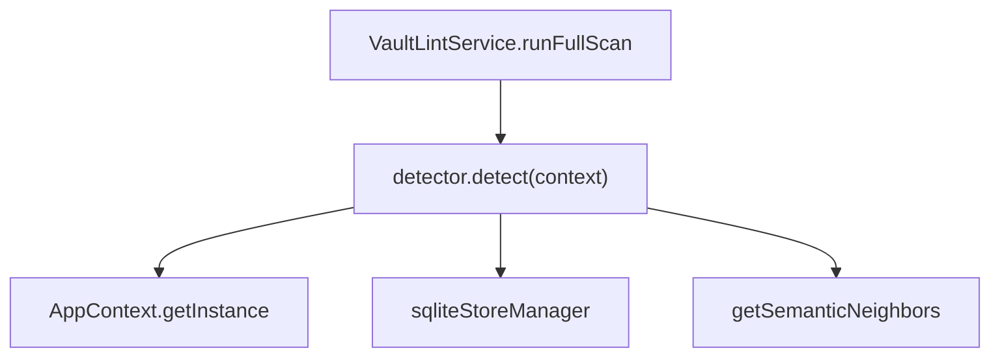
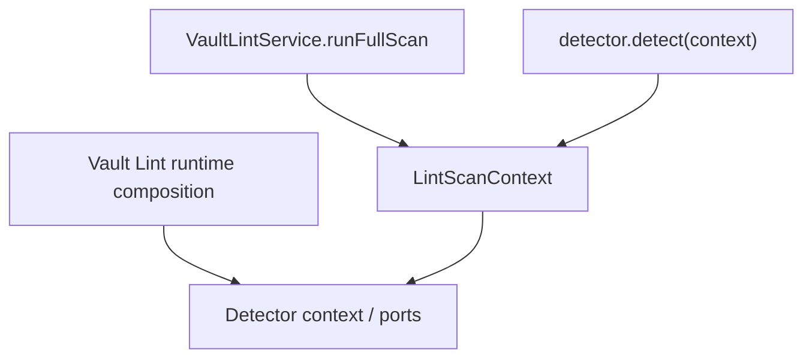

# Peak Assistant Modernization Handoff: T7 Vault Lint Detector Context Closure

Status:
- Superseded.
- Do not send this smaller T7 handoff as-is.
- Use [`t7-vault-lint-foundation-completion-wave-handoff.md`](./t7-vault-lint-foundation-completion-wave-handoff.md) instead.

Why superseded:
- T6R has now landed and been accepted.
- The owner wants larger, more coherent closure waves.
- The replacement handoff includes detector context closure, stale comments, known broken Vault Lint tests, source guard sweep, and dependency inventory updates.

## 中文摘要

这一步在全局架构里的位置：
- T5 关闭了 UI store truth。
- T6 把 `VaultLintService` 变成 ports + plain class。
- T7 清掉 Vault Lint 里最后一批 detector 层 service-locator：`signals/*.ts` 直接访问 `AppContext` / `sqliteStoreManager`。

为什么现在做它：
- T6 后 engine 已经干净，但 detectors 仍然绕过 ports：
  - `signals/structural.ts` imports `AppContext` + `sqliteStoreManager`
  - `signals/content.ts` imports `AppContext`
  - `signals/tags.ts` imports `AppContext`
- 这说明 capability 还没有完全可 fake：service 可以 fake，detector 不行。
- T7 目标是让 detectors 从 `LintScanContext` 或 detector context port 读环境，而不是自己找 Obsidian/sqlite。

本轮粒度：
- 允许改 12-30 个相关文件。
- 允许改 `LintScanContext`、detector port/context、app adapters、detector implementations、tests。
- 允许修正 `VaultDigestService` 的 stale comment。
- 不接受只新增 context type 但 detectors 仍 import `AppContext` 的实现。

允许 Claude Code 改什么：
- `src/service/lint/types.ts`
- `src/service/lint/signals/*`
- `src/service/lint/runtime/*`
- `src/service/lint/ports/*`
- `src/app/lint/*`
- `src/service/lint/VaultLintService.ts`
- `test/*vault-lint*`

明确不允许改什么：
- 不改 detector 判定语义和 finding 文案，除非是为了保持旧行为的最小搬迁。
- 不改 SQLite schema。
- 不改 Vault X-Ray UI 视觉。
- 不改 Chat、Quick Search、Copilot、Ambient Push、Command Gateway。
- 不引入新的全局 event bus / detector registry singleton。
- 不把所有 search/graph infra 一起重构。

做完后用户应该看什么：
- `signals/structural.ts` / `content.ts` / `tags.ts` 不再 import `AppContext`。
- `signals/structural.ts` 不再 import `sqliteStoreManager`。
- Detector 需要的 vault/metadata/graph 数据通过 context/ports 进入。
- Tests 可以用 fake detector context 跑 content/tags/broken-link/orphan 逻辑。
- Boundary audit 的 `service -> app` 应继续下降。

## Review Entry Points

| Review item | Status | Why open it |
| --- | --- | --- |
| This T7 handoff | Ready to send | 给 Claude Code 的 detector closure wave。 |
| [`2026-06-13-t6-owner-review-packet.md`](../audits/2026-06-13-t6-owner-review-packet.md) | Previous packet | 说明 T6 已清 service engine，剩余债在 detectors。 |
| [`t6-vault-lint-ports-service-plain-class-handoff.md`](./t6-vault-lint-ports-service-plain-class-handoff.md) | Previous handoff | T6 的原任务边界。 |
| [`architecture-scorecard.md`](./architecture-scorecard.md) | Current score ledger | T7 完成后必须更新分数。 |

## Send To Claude Code

````md
# Peak Assistant Modernization: T7 Vault Lint Detector Context Closure

Branch:
codex/peak-modernization-refactor

Source-of-truth docs:
- docs/superpowers/specs/2026-06-01-peak-system-architecture-modernization-handbook.html
- docs/superpowers/audits/2026-06-13-t6-owner-review-packet.md
- docs/superpowers/refactor-ops/README.md
- docs/superpowers/refactor-ops/t7-vault-lint-detector-context-closure-handoff.md

Current operating rules:
- Codex owns architecture reports, diagrams, task design, and review packets.
- Claude Code owns implementation.
- Owner-facing explanations should be Chinese-first.
- This is a detector closure wave, not a micro-slice.
- Do not start a second capability in this implementation unless the read-only checkpoint proves this detector closure is small enough and no files overlap.

## Goal

Make Vault Lint detectors dependency-clean by moving all Obsidian/sqlite environment access out of `src/service/lint/signals/*` and into explicit detector context/ports supplied by the Vault Lint runtime.

Current path:

```text
VaultLintService.runFullScan()
-> detector.detect(context)
   -> structural.ts imports AppContext + sqliteStoreManager
   -> content.ts imports AppContext
   -> tags.ts imports AppContext
```

Target path:

```text
VaultLintService.runFullScan()
-> build LintScanContext with detectorContext ports/data
-> detector.detect(context)
   -> context.detectorContext.vault / metadata / graph
   -> no AppContext/sqliteStoreManager imports inside signals/*
```

The exact shape may differ, but detector files must stop resolving app/sqlite themselves.

## Execution Mode

Do a compact read-only checkpoint first. If no stop condition is found and the file list stays inside this handoff, continue implementation in the same Claude session.

Expected scale:
- production files: roughly 10-20;
- tests/docs files: roughly 5-10;
- total changed files may be 12-30.

## Required First Section From Claude Code

```md
## Read-only checkpoint — T7 Detector Context Closure

中文摘要:
- T6 后剩余 service-locator 在哪里:
- detectors 当前分别读取哪些环境数据:
- 本轮建议新增哪些 detector context/ports:
- 哪些 behavior 必须保持 byte-for-byte / semantically identical:
- 哪些 old paths 本轮会删除:
- 是否发现 stop condition:

Current detector dependency path:


Proposed detector dependency path:


Expected files:
- Context / ports:
- App adapters:
- Detector rewrites:
- Service / registry changes:
- Tests:
- Docs:
```

## Current Detector Environment Reads

Read these before editing:

- `src/service/lint/signals/structural.ts`
  - `sqliteStoreManager.getMobiusEdgeRepo()`
  - `sqliteStoreManager.getMobiusNodeRepo()`
  - `AppContext.getInstance().app.metadataCache.unresolvedLinks`
  - `getSemanticNeighbors(...)`
- `src/service/lint/signals/content.ts`
  - `AppContext.getInstance().app.vault.getMarkdownFiles()`
  - `app.vault.cachedRead(file)`
- `src/service/lint/signals/tags.ts`
  - `AppContext.getInstance().app.vault.getMarkdownFiles()`
  - `app.metadataCache.getFileCache(file)`

## Required Closure Outcomes

The implementation is not complete unless these are true:

1. `src/service/lint/signals/structural.ts` has no `AppContext` import.
2. `src/service/lint/signals/structural.ts` has no `sqliteStoreManager` import.
3. `src/service/lint/signals/content.ts` has no `AppContext` import.
4. `src/service/lint/signals/tags.ts` has no `AppContext` import.
5. `LintScanContext` or a nested context/port object carries detector environment access.
6. App/sqlite adapters live outside `signals/*`, preferably under `src/app/lint/` or runtime composition.
7. Existing detector behavior remains semantically the same:
   - orphan findings;
   - broken link grouping;
   - empty note detection;
   - stub note detection with configured threshold;
   - untagged note detection.
8. Tests prove detectors can run with fake context and no Obsidian/AppContext/sqlite boot.
9. Boundary audit must not regress. Expected improvement: `service -> app` should drop again.

## Suggested Shape

Use a narrow detector context. Example:

```ts
export interface VaultLintDetectorContext {
  vaultFiles: {
    listMarkdownFiles(): Array<{ path: string; basename: string }>;
    readMarkdown(path: string): Promise<string>;
  };
  metadata: {
    getUnresolvedLinks(): Record<string, Record<string, number>>;
    getTags(path: string): { inline: readonly unknown[]; frontmatter: readonly string[] };
  };
  graph: {
    getHardOrphans(limit: number): Promise<string[]>;
    getNodesByIds(ids: readonly string[]): Promise<Map<string, GraphNodeLike>>;
    getSemanticNeighbors(nodeId: string, limit: number, excludeIds: ReadonlySet<string>): Promise<SemanticNeighborLike[]>;
  };
}

export interface LintScanContext {
  totalNotes: number;
  allNodeIds: string[];
  lastScanTimestamp: number | null;
  dismissals: Map<string, LintDismissal>;
  detectorContext: VaultLintDetectorContext;
}
```

Do not overfit these exact names. Prefer the simplest local shape that removes detector-level service locators.

## Behavior Preservation

Do not rewrite detector algorithms broadly.

Keep:
- `buildBrokenLinkFindings` behavior.
- `strippedLength` semantics.
- `findingId` shapes unless a test proves the old shape was unstable.
- existing detector ids, severities, dimensions, signal weights, and fix actions.

Allowed:
- Extract helper functions so detector logic can accept plain data.
- Add fake context builders in tests.
- Move AppContext/sqlite access into app-layer adapters.

## Required Tests / Guards

Add/update tests proving:

- each detector can run with fake context and no AppContext.
- `signals/*.ts` has no `AppContext` / `sqliteStoreManager` imports.
- `src/service/lint` has no app/ui import outside explicitly allowed app-layer adapters.
- `VaultLintService` still runs with fake ports.
- `InMemoryDetectorRegistry` still initializes built-in detectors.
- structural broken link tests still pass.
- content and tags detector behavior has focused tests if none exist.

Keep existing tests passing:
- `npm run test -- test/vault-lint-service-ports.test.ts`
- `npm run test -- test/vault-lint-runner.test.ts`
- `npm run test -- test/vault-lint-contract.test.ts`
- `npm run test -- test/vault-lint-structural.test.ts`
- `npm run test -- test/vault-lint-repo.test.ts`
- `npm run test -- test/run-envelope-core.test.ts`

## Required Verification

Run:
- `npm run build`
- new T7 detector-context tests
- `npm run test -- test/vault-lint-service-ports.test.ts`
- `npm run test -- test/vault-lint-runner.test.ts`
- `npm run test -- test/vault-lint-contract.test.ts`
- `npm run test -- test/vault-lint-structural.test.ts`
- `npm run test -- test/vault-lint-repo.test.ts`
- `npm run test -- test/run-envelope-core.test.ts`
- `node scripts/audit/boundary-baseline.mjs --out /tmp/t7-vault-lint-detector-context-boundary-baseline.md`

Required `rg` checks:
- `rg -n "AppContext|sqliteStoreManager" src/service/lint/signals src/service/lint`
- `rg -n "from ['\"]@/app/|from ['\"]@/ui/" src/service/lint`
- `rg -n "detectorContext|VaultLintDetectorContext|LintScanContext" src/service/lint src/app/lint test`
- `rg -n "let default|static instance|getInstance\\(" src/service/lint src/service/run-envelope 2>/dev/null || true`

Expected boundary direction:
- `service -> app` should decrease from T6.
- `service -> ui` should stay at or below T6.
- total flagged edges should decrease or remain flat with explanation.

## Hard Acceptance Bar

Reject the task if:

- detector files still import `AppContext`;
- detector files still import `sqliteStoreManager`;
- detector behavior changes without explicit test evidence;
- new context passes raw `AppContext` through;
- it introduces another singleton registry;
- it expands into unrelated capability work.

## Implementation Note Required From Claude Code

After implementation and commit, report:

```md
## Implementation note

中文摘要:
- 本轮在全局架构里的位置:
- 为什么这是 detector closure wave:
- 用户可见行为是否变化:
- 最重要的旧路径删除:
- 最重要的新 detector context truth:
- 还没有解决的旧路径:
- 下一步建议:

Commit:
- <hash and message>

Changed files grouped by purpose:
- Detector context / ports:
- App adapters:
- Detector rewrites:
- Service / registry:
- Tests:
- Docs:

Code reading guide:
- Read first:
- Then read:
- Optional / only if debugging:
- Main symbols to inspect:
- Files intentionally not changed:

Runtime path:
- Before:
- After:

Detector dependency truth:
- Before:
- After:
- Why detectors are now fakeable:

Old path deletion evidence:
- Deleted imports:
- Deleted service-locator calls:
- rg evidence:

Mutable global state:
- New module-level mutable defaults introduced:
- Existing module-level mutable defaults preserved:
- Any singleton/runtime binding preserved:
- Why preserved binding is temporary or centralized:

Verification:
- ...

Boundary audit delta:
- total flagged edges:
- service -> ui:
- service -> app:
- service/core -> Obsidian side-effect:
- core -> upstream:

Known remaining old paths:
- ...

Suggested next task:
- ...
```
````

## Stop Conditions

Stop before editing if:

- preserving detector behavior requires changing SQLite schema;
- extracting detector context requires rewriting graph/search infrastructure broadly;
- the task would touch more than 30 production files;
- a detector relies on a live Obsidian object in a way that cannot be represented by a narrow fakeable port;
- the implementation would start Chat, Quick Search, Ambient, Copilot, or Command Gateway work.

Do not stop merely because detector extraction touches multiple signal files. This handoff intentionally asks for one coherent detector closure wave.
