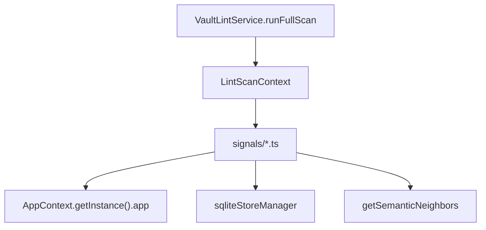
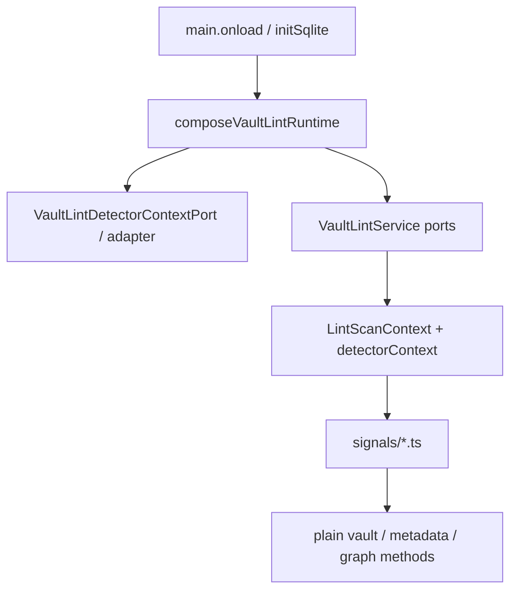

# Peak Assistant Modernization Handoff: T7 Vault Lint Foundation Completion Wave

## 中文摘要

这是 T6R 之后真正该发给 Claude Code 的下一轮，不是旧的小 T7。

这一轮的目标：

- 把 Vault Lint 做成一个可以复制到下一个 capability 的完整 worked example。
- 不只抽一个 detector context，而是一次性关掉 Vault Lint 地基里剩下的一组旧路径。
- 粒度要比之前更大：允许在一个 Claude session 里做多个相关 commit，只要仍然能用一份 code reading guide 读懂。

本轮要一起处理：

1. `src/service/lint/signals/*` 不再 import `AppContext`。
2. `src/service/lint/signals/structural.ts` 不再 import `sqliteStoreManager`。
3. detector 所需的 vault / metadata / graph 环境通过明确的 detector context / ports 进入。
4. 修复或替换旧的 `test/lint-health-score.test.ts`，让 Vault Lint 测试集不再保留已知坏测试。
5. 清理 T6R 留下的 stale comments。
6. 强化 source guards：`src/service/lint` 不能再悄悄长出 app/ui/sqlite service locator。
7. 更新 Vault Lint dependency inventory，让 owner 能看懂现在所有环境依赖在哪。

预期粒度：

- 允许 30-80 个相关文件。
- 允许 production files 约 20-50 个。
- 允许 tests/docs 约 8-25 个。
- 允许一个 Claude session 内 2-4 个小 commit，只要最后 implementation note 汇总清楚。

不允许：

- 不碰 Chat、Quick Search、Ambient Push、Command Gateway。
- 不改 SQLite schema。
- 不做 Vault X-Ray 视觉重做。
- 不把 detector 算法重写成新产品逻辑。
- 不把 raw `AppContext` 作为 detector context 传下去。

## Review Entry Points

| Review item | Status | Why open it |
| --- | --- | --- |
| This T7 handoff | Ready to send | 当前真正要给 Claude Code 的大粒度 Vault Lint closure wave。 |
| [`2026-06-13-t6r-owner-review-packet.md`](../audits/2026-06-13-t6r-owner-review-packet.md) | Source review | T6R 验收结果和下一步要求。 |
| [`t6-review-fix-runtime-ownership-config-defaults-handoff.md`](./t6-review-fix-runtime-ownership-config-defaults-handoff.md) | Previous handoff | T6R 的原始任务边界。 |
| [`t7-vault-lint-detector-context-closure-handoff.md`](./t7-vault-lint-detector-context-closure-handoff.md) | Superseded draft | 旧小包，只作为参考，不要直接发送。 |
| [`architecture-scorecard.md`](./architecture-scorecard.md) | Score ledger | T7 完成后必须更新分数。 |

## Send To Claude Code

````md
# Peak Assistant Modernization: T7 Vault Lint Foundation Completion Wave

Branch:
codex/peak-modernization-refactor

Source-of-truth docs:
- docs/superpowers/specs/2026-06-01-peak-system-architecture-modernization-handbook.html
- docs/superpowers/refactor-ops/README.md
- docs/superpowers/audits/2026-06-13-t6r-owner-review-packet.md
- docs/superpowers/refactor-ops/t7-vault-lint-foundation-completion-wave-handoff.md

Current operating rules:
- Codex owns architecture reports, diagrams, task design, and review packets.
- Claude Code owns implementation.
- Owner-facing explanations should be Chinese-first.
- This is intentionally a larger closure wave. Do not shrink it into a tiny adapter-only slice.
- You may use 2-4 small commits inside the same Claude session if that makes review clearer, but provide one final implementation note.

## Goal

Make Vault Lint a complete foundation example for the modernization:

1. No service-layer detector may resolve Obsidian/sqlite through `AppContext` or `sqliteStoreManager`.
2. All detector environment access must pass through explicit, fakeable detector context / ports.
3. Vault Lint tests and source guards must cover the completed boundary.
4. Stale T6/T6R comments and known broken Vault Lint tests must be cleaned in the same package.

This is not a product feature task. User-visible behavior should remain the same.

## Execution Mode

Do a read-only checkpoint first, then continue implementation in the same Claude session if:

- no stop condition appears;
- the work stays inside Vault Lint, app lint adapters, Vault X-Ray runtime wiring, tests, and docs;
- total changed files are roughly 30-80;
- production changed files are roughly 20-50;
- the work can still be explained in one code reading guide.

Do not stop merely because this is larger than earlier slices. The owner explicitly wants fewer tiny handoffs and more coherent closure waves.

## Read-only Checkpoint Required First

```md
## Read-only checkpoint — T7 Vault Lint Foundation Completion

中文摘要:
- T6R 后 Vault Lint 剩余旧路径:
- detectors 当前分别读取哪些环境数据:
- 本轮建议的 detector context / ports 形状:
- 本轮会修哪些已知坏测试或 stale comments:
- 本轮会新增/加强哪些 source guards:
- 预计 changed files 数量和 commit 拆分:
- 是否发现 stop condition:

Current old path:


Target path:


Expected commit split, if useful:
- Commit 1: detector context port + app adapter + service wiring.
- Commit 2: detector rewrites + fake detector tests.
- Commit 3: stale tests/comments/source guards/docs.
```

## Current Detector Environment Reads

Read before editing:

- `src/service/lint/signals/content.ts`
  - `AppContext.getInstance().app.vault.getMarkdownFiles()`
  - `app.vault.cachedRead(file)`
- `src/service/lint/signals/tags.ts`
  - `AppContext.getInstance().app.vault.getMarkdownFiles()`
  - `app.metadataCache.getFileCache(file)`
- `src/service/lint/signals/structural.ts`
  - `sqliteStoreManager.getMobiusEdgeRepo()`
  - `sqliteStoreManager.getMobiusNodeRepo()`
  - `getSemanticNeighbors(...)`
  - `AppContext.getInstance().app.metadataCache.unresolvedLinks`
- `test/lint-health-score.test.ts`
  - imports `HealthScoreEngine` and `DEFAULT_VAULT_LINT_CONFIG` from old/nonexistent paths.
  - either fix it to test `computeHealthScore(...)` with `VaultLintDefaults`, or replace/delete it with an equivalent current test.

## Required Closure Outcomes

Detector context:

1. `src/service/lint/signals/content.ts` has no `AppContext` import.
2. `src/service/lint/signals/tags.ts` has no `AppContext` import.
3. `src/service/lint/signals/structural.ts` has no `AppContext` import.
4. `src/service/lint/signals/structural.ts` has no `sqliteStoreManager` import.
5. `src/service/lint/signals/structural.ts` does not call `getSemanticNeighbors(...)` directly; graph/semantic-neighbor access is behind detector context / port.
6. Detector environment access is carried by `LintScanContext` or a nested `VaultLintDetectorContext` object.
7. The context must expose narrow methods/data, not raw `AppContext`, raw Obsidian `App`, raw sqlite manager, or raw Kysely DB.

App adapter / runtime wiring:

1. Real Obsidian/sqlite/graph access lives in `src/app/lint/` or app-owned composition.
2. `composeVaultLintRuntime()` wires the detector context adapter into `VaultLintPorts`.
3. `VaultLintService.runFullScan()` passes the detector context into `LintScanContext`.
4. `VaultLintContract.ts` dependency inventory reflects the new detector context owner.

Tests and guards:

1. Add fake-context tests for content detectors:
   - empty note after stripping frontmatter/headings;
   - stub note under configured threshold;
   - dismissals respected.
2. Add fake-context tests for tags detector:
   - inline tags;
   - frontmatter tags;
   - untagged finding;
   - dismissals respected.
3. Extend structural tests:
   - broken links via fake unresolved-links context;
   - orphan detector via fake graph/orphan context;
   - semantic revival suggestion path with fake neighbors, if feasible without broad graph rewrite.
4. Repair `test/lint-health-score.test.ts` or replace it with current `computeHealthScore` tests.
5. Add source guards:
   - `src/service/lint/**/*.ts` must not import `@/app/*`.
   - `src/service/lint/**/*.ts` must not import `@/ui/*`.
   - `src/service/lint/**/*.ts` must not import `SqliteStoreManager`.
   - `src/service/lint/signals/*.ts` must not import app/sqlite/Obsidian or graph inspector runtime helpers directly.
   - `VaultLintRun.ts` docs must not say production callers can pass nothing.
6. Keep existing T6R guards passing:
   - runtime file pure interface;
   - config defaults in `VaultLintDefaults.ts`;
   - `VaultLintService.ts` no inline default config;
   - no service-layer runtime singleton.

Comment/doc cleanup:

1. Fix stale comment in `src/service/lint/VaultLintRun.ts` saying production callers pass nothing.
2. Fix stale comment in `src/app/lint/composeVaultLintRuntime.ts` saying consumers reach runtime via bare `set/getVaultLintRuntime`.
3. Update `docs/superpowers/refactor-ops/config-defaults-governance.md` only if implementation changes the config inventory path.
4. Do not update scorecard or owner review packet; Codex will do that after review.

## Suggested Detector Context Shape

Use the simplest shape that covers current detectors. Example only:

```ts
export interface VaultLintDetectorFileRef {
  path: string;
  basename: string;
}

export interface VaultLintDetectorGraphNode {
  id: string;
  label: string;
  type: string;
  attributes: string | null;
}

export interface VaultLintDetectorSemanticNeighbor {
  id: string;
  label: string;
  similarity: string;
  attributes: string | null;
}

export interface VaultLintDetectorContextPort {
  listMarkdownFiles(): VaultLintDetectorFileRef[];
  readMarkdownFile(path: string): Promise<string>;
  getTags(path: string): { inlineTags: readonly unknown[]; frontmatterTags: readonly string[] };
  getUnresolvedLinks(): Record<string, Record<string, number>>;
  getHardOrphans(limit: number): Promise<string[]>;
  getNodesByIds(ids: readonly string[]): Promise<Map<string, VaultLintDetectorGraphNode>>;
  getSemanticNeighbors(
    nodeId: string,
    limit: number,
    excludeIds: ReadonlySet<string>,
  ): Promise<VaultLintDetectorSemanticNeighbor[]>;
}
```

Do not over-engineer. If one method can be simpler, make it simpler. The acceptance target is fakeability and no service-layer app/sqlite lookup.

## Behavior Preservation

Keep behavior semantically identical:

- `strippedLength` semantics for empty/stub notes.
- finding ids, signal ids, severities, dimensions, weights, titles, descriptions, fix actions.
- broken-link grouping by source file.
- orphan finding metadata and revival suggestion shape.
- dismissal key semantics.
- health score math.

Allowed:

- Extract helper functions from detectors so tests can cover pure logic.
- Add small file-ref types so detectors do not depend on Obsidian `TFile`.
- Adjust tests to current API names.
- Update comments/docs that became stale after T6R.

Not allowed:

- No SQLite schema change.
- No detector product behavior redesign.
- No broad graph/search infrastructure rewrite.
- No UI redesign.
- No new global singleton or event bus.

## Required Verification

Run:

- `npm run build`
- new/updated detector-context tests
- `npm run test -- test/lint-health-score.test.ts`
- `npm run test -- test/vault-lint-service-ports.test.ts`
- `npm run test -- test/vault-lint-runner.test.ts`
- `npm run test -- test/vault-lint-contract.test.ts`
- `npm run test -- test/vault-lint-structural.test.ts`
- `npm run test -- test/vault-lint-repo.test.ts`
- `npm run test -- test/vault-lint-defaults.test.ts`
- `npm run test -- test/app-runtime-registry.test.ts`
- `npm run test -- test/run-envelope-core.test.ts`
- `node scripts/audit/boundary-baseline.mjs --out /tmp/t7-vault-lint-foundation-completion-boundary-baseline.md`

Required `rg` checks:

- `rg -n "from ['\"]@/app/|from ['\"]@/ui/" src/service/lint`
- `rg -n "AppContext|getInstance\\(|sqliteStoreManager|SqliteStoreManager" src/service/lint/signals src/service/lint`
- `rg -n "getSemanticNeighbors" src/service/lint/signals src/service/lint`
- `rg -n "production callers pass nothing|setVaultLintRuntime| getVaultLintRuntime" src/service/lint/VaultLintRun.ts src/app/lint/composeVaultLintRuntime.ts`
- `rg -n "DEFAULT_VAULT_LINT_CONFIG" src/service/lint/VaultLintService.ts test/lint-health-score.test.ts`
- `rg -n "VaultLintDetectorContext|DetectorContext|detectorContext" src/service/lint src/app/lint test`

Expected boundary direction:

- `service -> app` should decrease from T6R (`73`).
- total flagged edges should decrease or stay flat only with a specific explanation.
- service-layer `AppContext.getInstance` leak count should decrease.

## Hard Acceptance Bar

Reject the task if:

- any `src/service/lint/signals/*.ts` file still imports `AppContext`;
- any `src/service/lint/signals/*.ts` file still imports `sqliteStoreManager`;
- detector context passes raw `AppContext`, raw Obsidian `App`, or raw sqlite manager;
- `VaultLintService.ts` receives raw app/sqlite objects;
- `test/lint-health-score.test.ts` remains broken or ignored;
- source guards are missing or only check comments without checking import specs;
- detector behavior changes without focused tests;
- the task expands into Chat, Quick Search, Ambient, Command Gateway, or UI redesign.

## Implementation Note Required From Claude Code

After implementation and commit(s), report:

```md
## Implementation note

中文摘要:
- 本轮在全局架构里的位置:
- 为什么这是一个更大粒度 Vault Lint completion wave:
- 用户可见行为是否变化:
- 本轮删除/降级了哪些旧路径:
- detector dependency truth 现在在哪里:
- 修复了哪些旧测试/注释/guard:
- 还没有解决的旧路径:
- 下一步建议:

Commits:
- <hash and message>
- <hash and message if multiple>

Changed files grouped by purpose:
- Detector context / ports:
- App adapters:
- Runtime/service wiring:
- Detector rewrites:
- Health score / stale tests:
- Source guards:
- Comment/docs cleanup:

Code reading guide:
- Read first:
- Then read:
- Optional / only if debugging:
- Main symbols to inspect:
- Files intentionally not changed:

Detector dependency truth:
- Before:
- After:
- Why detectors are now fakeable:

Old path deletion evidence:
- Deleted imports:
- Deleted service-locator calls:
- rg evidence:

Runtime/config governance:
- Runtime ownership still app-level?:
- Config defaults still in `VaultLintDefaults.ts`?:
- Any new mutable global state?:
- Any new domain config table?:

Verification:
- ...

Boundary audit delta:
- total flagged edges:
- service -> ui:
- service -> app:
- service/core -> Obsidian side-effect:
- core -> upstream:
- AppContext.getInstance leak count:

Known remaining old paths:
- ...

Suggested next task:
- ...
```
````

## Stop Conditions

Stop before editing if:

- preserving detector behavior requires changing SQLite schema;
- extracting detector context requires rewriting graph/search infrastructure broadly;
- the task would touch more than 80 total files or more than 50 production files;
- live Obsidian objects cannot be represented by a narrow fakeable port after a reasonable attempt;
- implementation needs to start Chat, Quick Search, Ambient, Copilot-wide redesign, Command Gateway, or UI redesign work.

Do not stop merely because this touches multiple detector files, ports, app adapters, tests, and comments. That is the intended closure wave.
