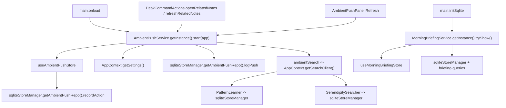
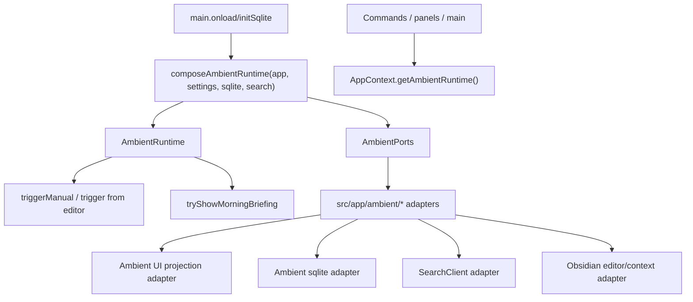

# Peak Assistant Modernization Handoff: T8 Ambient Foundation Runtime Boundary Wave

## 中文摘要

这是 T7 之后的下一轮：**把步伐加大，切到第二个 capability：Ambient Push / Morning Briefing**。

T0-T7 已经把 Vault Lint 做成第一个 worked example。T8 不应该继续在 Vault Lint 里小修小补，而应该把同一套架构纪律推广到 Ambient：

```text
Contract -> app-owned runtime -> ports/adapters -> UI projection -> tests/source guards
```

本轮不是做新的 Current Work State UI，也不是重写 Ambient 产品体验。它是 foundation cleanup：

- 移除 Ambient / Morning Briefing 的 service-layer singleton runtime。
- 把长生命周期 runtime 绑定到 `AppRuntimeRegistry` / `AppContext`。
- 让 `src/service/ambient` 不再直接 import UI store、`AppContext`、`sqliteStoreManager`。
- 把真实 Obsidian / sqlite / UI-store / SearchClient / LLM explanation access 放到 `src/app/ambient/*` adapters。
- 让 UI 和 commands 通过 app-owned runtime 触发 Ambient refresh，而不是 `AmbientPushService.getInstance()`。
- 增加 fake-port tests 和 source guards，避免以后又退回旧路径。

粒度要求：

- 这应该比 T7 大。
- 允许一个 Claude session 内 3-5 个小 commit。
- 预计改动约 25-60 个相关文件；如果读完发现必须超过 70 个文件，先停下来汇报原因。
- 不要把它缩成“只加一个 contract seed”的小任务。

## Review Entry Points

| Review item | Status | Why open it |
| --- | --- | --- |
| This T8 handoff | Ready to send | 当前建议发给 Claude Code 的大粒度 Ambient foundation wave。 |
| [`2026-06-13-t7-owner-review-packet.md`](../audits/2026-06-13-t7-owner-review-packet.md) | Previous accepted packet | T7 接受结论：Vault Lint foundation 已封顶，下一步切第二 capability。 |
| [`2026-06-02-ambient-push-current-work-state-product-technical-review.html`](../specs/2026-06-02-ambient-push-current-work-state-product-technical-review.html) | Product north star | Ambient 最终方向是 Current Work State / Session Thought Trace，不是泛化推荐侧栏。 |
| [`README.md`](./README.md) | Operating rules | 包含 task size policy、runtime ownership rule、config defaults rule。 |
| [`architecture-scorecard.md`](./architecture-scorecard.md) | Score ledger | T8 完成后由 Codex 更新分数。 |

## Send To Claude Code

````md
# Peak Assistant Modernization: T8 Ambient Foundation Runtime Boundary Wave

Branch:
codex/peak-modernization-refactor

Source-of-truth docs:
- docs/superpowers/specs/2026-06-01-peak-system-architecture-modernization-handbook.html
- docs/superpowers/specs/2026-06-02-ambient-push-current-work-state-product-technical-review.html
- docs/superpowers/refactor-ops/README.md
- docs/superpowers/audits/2026-06-13-t7-owner-review-packet.md
- docs/superpowers/refactor-ops/t8-ambient-foundation-runtime-boundary-wave-handoff.md

Current operating rules:
- Codex owns architecture reports, handoff prompts, scorecards, and owner review packets.
- Claude Code owns implementation.
- Owner-facing explanations should be Chinese-first.
- This is intentionally larger than T7. Do not shrink it into a tiny adapter-only slice.
- You may use 3-5 small commits inside this one Claude session if that makes review clearer, but provide one final implementation note.
- Commit messages must be English.

## Goal

Move Ambient Push / Morning Briefing from hidden service singletons and service->UI/store/sqlite coupling toward an app-owned runtime with explicit ports/adapters.

After T8:

1. Production callers should not use `AmbientPushService.getInstance()` or `MorningBriefingService.getInstance()`.
2. Long-lived Ambient runtime ownership should live in `AppRuntimeRegistry` / `AppContext`, not in service-layer static fields.
3. `src/service/ambient` should not import UI stores.
4. `src/service/ambient` should not import `AppContext`.
5. `src/service/ambient` should not import `sqliteStoreManager`.
6. UI / command refresh actions should drive an app-owned ambient runtime.
7. Current user-visible behavior should remain effectively unchanged: Related Notes panel, status count, serendipity gutter, manual refresh, and Morning Briefing still work.

This is a foundation task. Do not implement the future Current Work State / Session Thought Trace UI in this task.

## Why This Is Bigger Than T7

T7 closed one capability's remaining detector boundary. T8 should close a broader set of old Ambient ownership seams in one coherent package:

- runtime singleton ownership;
- service -> UI store writes;
- UI store -> sqlite side effects;
- service -> AppContext reads;
- service -> sqlite reads/writes;
- UI / command callers still reaching service singleton;
- source guards and fake-port tests.

Do not stop after only adding a contract file. The owner explicitly wants fewer tiny deltas.

## Read-only Checkpoint Required First

Do this read-only checkpoint first. Then continue implementation in the same Claude session if no stop condition appears.

```md
## Read-only checkpoint — T8 Ambient Foundation Runtime Boundary

中文摘要:
- 当前 Ambient runtime 入口:
- 当前 Morning Briefing runtime 入口:
- 当前 state owners:
- 当前 service -> UI store imports:
- 当前 service -> AppContext imports:
- 当前 service -> sqliteStoreManager imports:
- 当前 UI / command -> service singleton callers:
- 本轮建议拆成几个 commit:
- 预计 changed files 数量:
- 是否发现 stop condition:

Current old path:


Target path:


Proposed commit split:
- Commit 1: Ambient contract/runtime types + AppRuntimeRegistry/AppContext wiring.
- Commit 2: ports/adapters + refactor AmbientPushService/MorningBriefingService away from static singletons.
- Commit 3: update main.ts, commands, panels, gutter/status-bar integration.
- Commit 4: tests/source guards + stale comment cleanup.
```

## Current Files To Inspect Before Editing

Runtime and singleton paths:

- `src/service/ambient/AmbientPushService.ts`
  - static `instance`
  - `getInstance()`
  - direct `AppContext.getSettings()`
  - direct `useAmbientPushStore`
  - direct `sqliteStoreManager.getAmbientPushRepo()`
- `src/service/ambient/MorningBriefingService.ts`
  - static `instance`
  - `getInstance()`
  - direct `AppContext.getSettings()`
  - direct `sqliteStoreManager`
  - direct `useMorningBriefingStore`
- `main.ts`
  - starts `AmbientPushService.getInstance().start(this.app)`
  - subscribes to `useAmbientPushStore`
  - calls `MorningBriefingService.getInstance().tryShow()`
  - calls Ambient dispose twice on unload

UI / command callers:

- `src/app/commands/PeakCommandActions.ts`
  - `openRelatedNotes()`
  - `refreshRelatedNotes()`
- `src/ui/view/ambient-push/AmbientPushPanel.tsx`
  - refresh button calls `AmbientPushService.getInstance().triggerManual()`
- `src/service/ambient/SerendipityGutterPlugin.ts`
  - imports `useAmbientPushStore`
  - uses `(window as any).app`

State / side-effect coupling:

- `src/ui/store/ambientPushStore.ts`
  - imports `sqliteStoreManager`
  - `recordAction()` writes SQLite from a UI store
- `src/ui/store/morningBriefingStore.ts`
  - UI projection for briefing
- `src/service/ambient/AmbientSearcher.ts`
  - `AppContext.getSearchClient()`
  - calls `getLearnedPatterns()`
  - calls `serendipitySearch(...)`
- `src/service/ambient/PatternLearner.ts`
  - `sqliteStoreManager.getAmbientPushRepo()`
  - module-level cache
- `src/service/ambient/SerendipitySearcher.ts`
  - sqlite graph/edge/embedding repos
- `src/service/ambient/briefing-queries.ts`
  - sqlite query builder calls
- `src/service/ambient/RelevanceExplainer.ts`
  - `AppContext.getApp()`
  - provider/profile access
- `src/service/ambient/ContextExtractor.ts`
  - pure extraction helpers mixed with Obsidian `App` / `MarkdownView` extraction

Existing tests:

- `test/ambient-push.test.ts`
- `test/ambient-panel-startup.test.ts`
- `test/app-runtime-registry.test.ts`

## Required Architecture Outcomes

### 1. Runtime ownership

Add an app-owned Ambient runtime.

Expected shape, adjust names if needed:

- `src/service/ambient/AmbientRuntime.ts`
  - type/interface only.
  - methods likely include:
    - `start(): void`
    - `triggerManual(): void`
    - `tryShowMorningBriefing(): Promise<boolean>`
    - `dispose(): void`
- `src/app/ambient/composeAmbientRuntime.ts`
  - constructs the runtime and adapters.
- `src/app/runtime/AppRuntimeRegistry.ts`
  - add `setAmbientRuntime`, `getAmbientRuntime`, `tryGetAmbientRuntime`, `clearAmbientRuntime`.
- `src/app/context/AppContext.ts`
  - add thin static delegators, matching Vault Lint style.
- `src/ui/context/ServiceContext.tsx` and `src/ui/react/ReactElementFactory.tsx`
  - expose `ambientRuntime` to React surfaces if that is the least invasive UI path.

Required:

- `AmbientPushService.getInstance()` should not be used by production callers after this task.
- `MorningBriefingService.getInstance()` should not be used by production callers after this task.
- Prefer deleting static singleton fields/methods. If kept only for compatibility, they must be thin, marked deprecated, source-guarded from production callers, and listed in the implementation note as a retirement target.

### 2. Ports/adapters

Create explicit ports so `src/service/ambient` stops reaching app/UI/sqlite directly.

Expected file:

- `src/service/ambient/ports/AmbientPorts.ts`

Suggested ports. Keep them minimal and current-behavior-shaped:

```ts
export interface AmbientSettingsPort {
  getSettings(): AmbientPushSettings;
  markPanelAutoOpened(): Promise<void>;
}

export interface AmbientEditorContextPort {
  start(onTrigger: (filePath: string, triggerType: TriggerType) => void): void;
  triggerManual(): void;
  dispose(): void;
  extractContext(filePath: string): AmbientContext | null;
}

export interface AmbientSearchPort {
  search(context: AmbientContext, maxItems: number, pushHistory: ReadonlyMap<string, number>, settings: AmbientPushSettings): Promise<AmbientPushItem[]>;
}

export interface AmbientUiProjectionPort {
  getPushHistory(): ReadonlyMap<string, number>;
  setItems(items: AmbientPushItem[], sourceFilePath: string): void;
  clearItems(): void;
  updateLlmExplanation(filePath: string, explanation: string): void;
  recordPush(filePath: string, timestamp: number): void;
  showMorningBriefing(items: BriefingItem[]): void;
}

export interface AmbientPersistencePort {
  logPushes(context: AmbientContext, items: AmbientPushItem[], triggerType: TriggerType): Promise<void>;
  recordAction(sourceFilePath: string, pushedFilePath: string, action: UserAction): Promise<void>;
  getLearnedPatterns(): Promise<LearnedPattern[]>;
  invalidatePatternCache(): void;
}

export interface AmbientBriefingPort {
  isReady(): boolean;
  getLastBriefingTimestamp(): Promise<number>;
  getLastSessionTimestamp(fallback: number): Promise<number>;
  recordSessionTimestamps(now: number): Promise<void>;
  loadBriefingItems(lastSessionTs: number): Promise<BriefingItem[]>;
}

export interface AmbientExplanationPort {
  generateLlmExplanation(contextParagraph: string, title: string, excerpt: string, cooldownMs: number): Promise<string | null>;
}

export interface AmbientClockPort {
  now(): number;
}
```

This is a suggested shape, not a mandate. The acceptance rule is stronger than the exact names:

- service runtime depends on ports;
- app adapters own Obsidian/sqlite/UI-store/SearchClient/LLM/provider access;
- tests can fake ports.

### 3. Service layer cleanup

After T8:

- `src/service/ambient/AmbientPushService.ts`
  - no static singleton runtime owner;
  - no `@/ui/store/ambientPushStore`;
  - no `@/app/context/AppContext`;
  - no `sqliteStoreManager`;
  - receives dependencies through constructor ports.
- `src/service/ambient/MorningBriefingService.ts`
  - no static singleton runtime owner;
  - no `@/ui/store/morningBriefingStore`;
  - no `@/app/context/AppContext`;
  - no `sqliteStoreManager`;
  - receives settings/time/query/projection through ports.
- `src/service/ambient/AmbientSearcher.ts`
  - no `AppContext.getSearchClient()`;
  - search dependency comes through port or function parameter.
- `src/service/ambient/PatternLearner.ts`
  - pure `getPatternBoost(...)` may stay;
  - sqlite-backed pattern loading should move behind `AmbientPersistencePort` or app adapter.
- `src/service/ambient/SerendipitySearcher.ts`
  - graph/sqlite reads should move behind an app adapter/port, or the file should move to `src/app/ambient` if it remains infrastructure-bound.
- `src/service/ambient/briefing-queries.ts`
  - sqlite query implementation should move to `src/app/ambient` adapter or be hidden behind `AmbientBriefingPort`.
- `src/service/ambient/RelevanceExplainer.ts`
  - LLM/provider/AppContext access should be hidden behind `AmbientExplanationPort` or moved to app adapter.
- `src/service/ambient/ContextExtractor.ts`
  - keep pure string helpers in service/core if useful;
  - move Obsidian `App` / `MarkdownView` extraction behind an app adapter if needed.

### 4. UI and command integration

Update production callers:

- `main.ts`
  - compose and bind Ambient runtime at the appropriate boot point.
  - start runtime through the bound runtime.
  - use runtime for Morning Briefing startup.
  - clear runtime on unload.
  - remove duplicate Ambient dispose calls if possible.
- `src/app/commands/PeakCommandActions.ts`
  - `openRelatedNotes()` and `refreshRelatedNotes()` should call `AppContext.getAmbientRuntime().triggerManual()` or equivalent.
- `src/ui/view/ambient-push/AmbientPushPanel.tsx`
  - refresh button should use `ambientRuntime` from `ServiceContext` or `AppContext.tryGetAmbientRuntime()`.
  - no direct `AmbientPushService.getInstance()`.
- `src/service/ambient/SerendipityGutterPlugin.ts`
  - remove direct UI store import and `(window as any).app`.
  - either move this extension to app/ui layer or inject a small port/action handler.
- `src/ui/store/ambientPushStore.ts`
  - remove sqlite import.
  - store should project UI state, not write persistence.
  - action recording should flow through runtime/port or a UI action adapter.

### 5. Contract / inventory

Add a contract/inventory file so the owner can understand current Ambient reality.

Suggested file:

- `src/service/ambient/AmbientContract.ts`

It should include:

- stable capability ids, for example:
  - `ambient.push.refresh`
  - `ambient.briefing.startup`
- current inputs:
  - trigger type: `manual | writing_pause | doc_switch`
  - source file path if available
  - current editor context from port
- current outputs:
  - `AmbientPushItem[]`
  - `BriefingItem[]`
- current state owner description:
  - UI projection store(s)
  - sqlite log/action persistence
  - app-owned runtime binding
- dependency inventory:
  - settings;
  - editor context;
  - search;
  - graph/embedding;
  - sqlite log/action/briefing;
  - UI projection;
  - optional LLM explanation.
- future-only terms:
  - `Current Work State`
  - `Session Thought Trace`
  - mark them explicitly as not implemented in T8.

Do not pretend T8 implements Current Work State. The final product direction belongs to the spec, but this task is only foundation.

## Behavior Preservation

Keep user-visible behavior as close as possible:

- Related Notes panel still opens.
- Manual refresh still triggers current related-note suggestions.
- Status bar count still updates.
- Serendipity gutter still opens suggested notes.
- `PushCard` actions still open, insert link, dismiss, and record action.
- Morning Briefing still decides whether to show on startup and opens the existing modal.
- Existing settings semantics stay unchanged.
- Existing `ambient-panel-startup` behavior stays unchanged.

Allowed:

- Move files between `src/service/ambient` and `src/app/ambient` when the file owns Obsidian/sqlite/app side effects.
- Introduce adapter classes.
- Introduce fakeable ports.
- Convert singleton services to constructor-injected runtime classes.
- Add source-scan tests.
- Add fake-port tests.
- Update comments/docs that describe old runtime ownership.

Not allowed:

- No new Ambient product features.
- No Current Work State UI.
- No Session Thought Trace UI.
- No settings redesign.
- No SQLite schema migration.
- No Chat changes.
- No Command Gateway work.
- No broad SearchClient or graph infrastructure rewrite.
- No second Ambient business path. Old public entry names may thin-forward temporarily, but old and new implementations must not both own behavior.

## Required Tests And Guards

Add or update tests:

- `test/ambient-runtime-ports.test.ts`
  - fake settings/context/search/projection/persistence/briefing/explanation ports;
  - manual trigger produces `setItems` when search returns items;
  - empty search clears items;
  - push logging uses persistence port;
  - LLM explanation uses explanation port and updates projection when present;
  - detector-like failure behavior remains non-critical where current code is non-critical;
  - Morning Briefing fake path records timestamps and projects items.
- `test/ambient-source-guard.test.ts`
  - `src/service/ambient/**/*.ts` must not import `@/ui/*`;
  - `src/service/ambient/**/*.ts` must not import `@/app/context/AppContext`;
  - `src/service/ambient/**/*.ts` must not import `SqliteStoreManager` / `sqliteStoreManager`;
  - production code should not call `AmbientPushService.getInstance()` or `MorningBriefingService.getInstance()`;
  - `src/ui/store/ambientPushStore.ts` must not import sqlite;
  - no `(window as any).app` in Ambient runtime/gutter code.
- Extend `test/app-runtime-registry.test.ts`
  - Ambient runtime get/tryGet/set/clear/double-bind semantics, mirroring Vault Lint.
- Keep existing:
  - `test/ambient-push.test.ts`
  - `test/ambient-panel-startup.test.ts`

Source guards should strip comments where needed, but they should fail on live code.

## Required Verification

Run:

- `npm run build`
- `npm run test -- test/ambient-push.test.ts`
- `npm run test -- test/ambient-panel-startup.test.ts`
- `npm run test -- test/ambient-runtime-ports.test.ts`
- `npm run test -- test/ambient-source-guard.test.ts`
- `npm run test -- test/app-runtime-registry.test.ts`
- `npm run test -- test/run-envelope-core.test.ts`
- `node scripts/audit/boundary-baseline.mjs --out /tmp/t8-ambient-boundary-baseline.md`

Also run source checks:

```bash
rg -n "AmbientPushService\\.getInstance|MorningBriefingService\\.getInstance" src main.ts
rg -n "from ['\"]@/ui/|from ['\"]@/app/context/AppContext|sqliteStoreManager|SqliteStoreManager" src/service/ambient
rg -n "sqliteStoreManager|SqliteStoreManager" src/ui/store/ambientPushStore.ts
rg -n "\\(window as any\\)\\.app" src/service/ambient src/app/ambient src/ui
```

If any intentional compatibility reference remains, explain exactly why and add a narrower guard so it cannot become a second runtime path.

## Acceptance Criteria

T8 is accepted only if all of these are true:

1. Ambient runtime is app-owned, not a service-layer module singleton.
2. Production callers use `AppContext` / `ServiceContext` runtime access, not `AmbientPushService.getInstance()`.
3. `src/service/ambient` has no direct UI store imports.
4. `src/service/ambient` has no direct `AppContext` imports.
5. `src/service/ambient` has no direct `sqliteStoreManager` imports.
6. UI store no longer writes sqlite directly.
7. Existing Ambient user-visible behavior is preserved.
8. Fake-port tests prove the runtime can run without Obsidian/sqlite/UI store.
9. Source guards enforce the new boundary.
10. Boundary audit should reduce at least:
    - service -> ui by the Ambient store edges;
    - service -> app shell by Ambient `AppContext` edges;
    - service AppContext leak count by Ambient service references.

If one of these cannot be achieved without exploding beyond the task boundary, stop and report the blocker. Do not silently accept a partial migration as complete.

## Implementation Note Required From Claude Code

After implementation and commit(s), report:

```md
## Implementation note

中文摘要:
- 本轮在全局架构里的位置:
- 为什么这次比 T7 更大:
- 用户可见行为是否变化:
- 最重要的边界变化:
- 还没有解决的旧路径:
- 下一步建议:

Commits:
- <hash message>
- ...

Changed files grouped by purpose:
- Contract / inventory:
- Runtime ownership:
- Ports:
- App adapters:
- Service runtime:
- UI / command integration:
- Stores:
- Tests / guards:
- Deleted or reduced old paths:

Code reading guide:
- Read first:
- Then read:
- Optional / only if debugging:
- Main symbols to inspect:
- Files intentionally not changed:

Mutable global state:
- New module-level mutable defaults introduced:
- Existing module-level mutable defaults preserved:
- Why any preserved global is temporary:
- What future task should retire it:

Runtime ownership:
- Runtime owner before:
- Runtime owner after:
- App-level composition point:
- Any service-layer runtime singleton introduced or preserved:

Config defaults:
- Editable config source:
- Compiled fallback:
- Service files that import defaults:
- Drift guard / shape test:
- Any inline service-engine defaults introduced or preserved:

Boundary audit delta:
- total flagged:
- service -> ui:
- service -> app shell:
- service AppContext references:
- service/core -> Obsidian side-effect:

Verification:
- ...

Known remaining old paths:
- ...

Suggested next task:
- ...
```

## Stop Conditions

Stop before editing or after the read-only checkpoint if:

- implementing this requires new Current Work State UI;
- implementing this requires Chat or Command Gateway changes;
- implementing this requires SQLite schema migration;
- implementation would exceed about 70 changed files;
- old and new Ambient runtimes would both own behavior after the task;
- app-owned runtime binding cannot be added without breaking Vault Lint runtime registry behavior;
- source guards cannot be made precise enough to avoid false confidence.
````

## Codex Notes For Owner

为什么我建议 T8 做 Ambient，而不是 Quick Search 或 Chat：

- Ambient 是产品三支柱之一，但当前边界问题清晰、可闭环。
- Chat 太大，容易爆炸。
- Quick Search 的 runtime/store/agent path 更复杂，适合作为后续 T9/T10。
- Ambient 现在正好有 3 条明显旧路径：
  - service singleton runtime;
  - service -> UI store;
  - service -> AppContext/sqlite.

这次 handoff 明确允许多 commit、大一点的文件数、更多 old-path closure。它应该能明显减少你来回复制小 delta 的频率。
