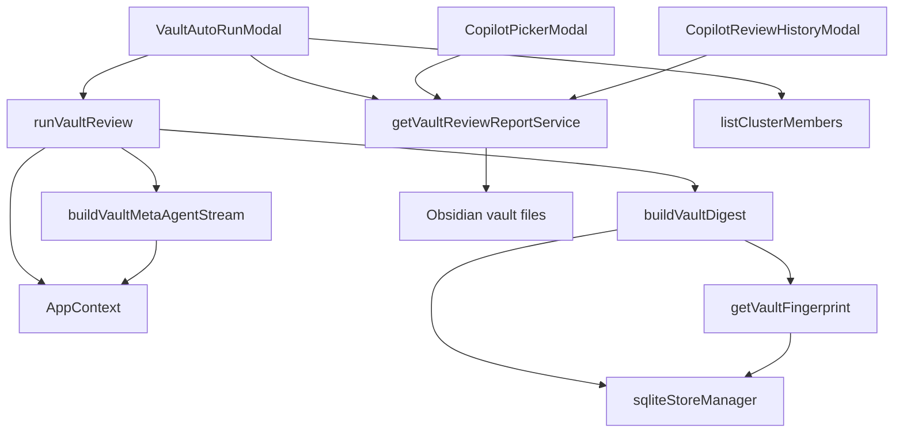
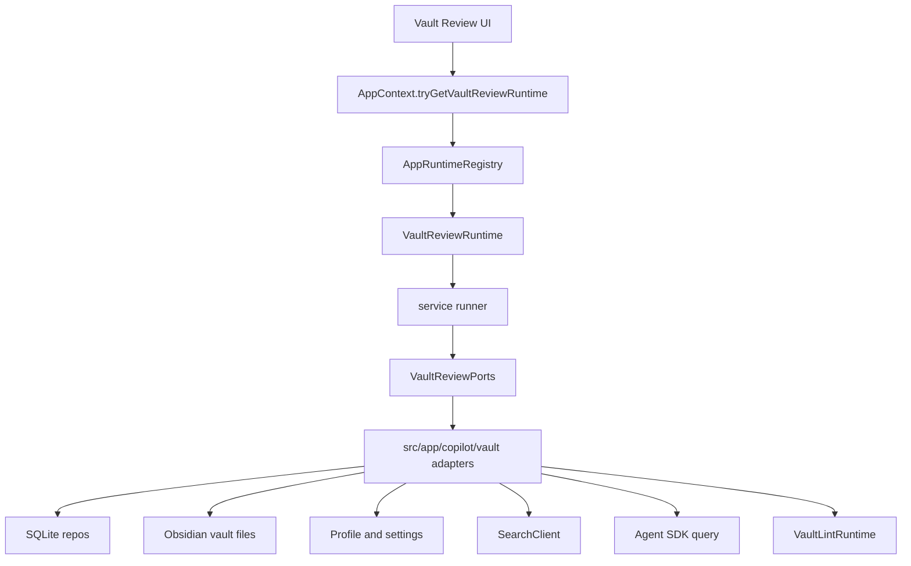
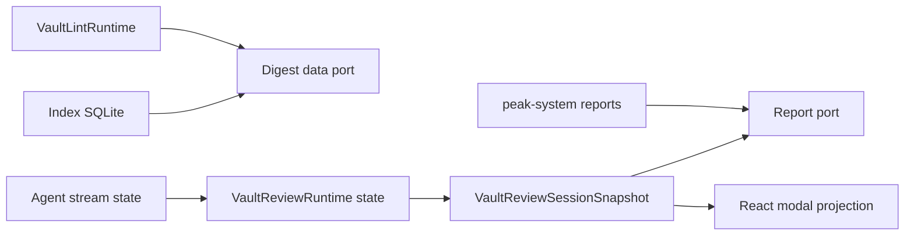
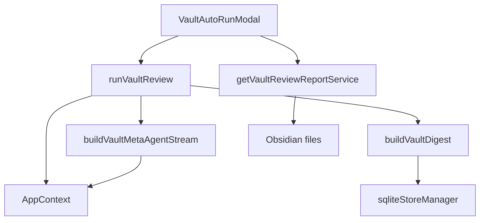
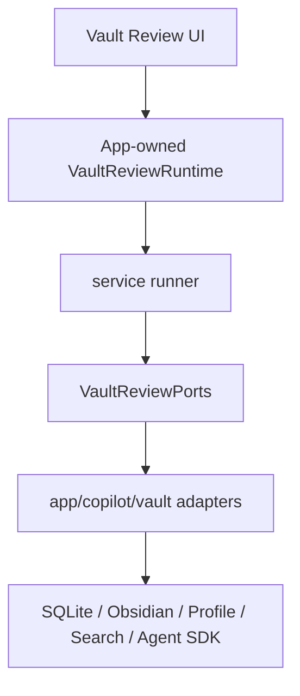

# Peak Assistant Modernization Handoff: T9 Copilot Vault Review Runtime Boundary Wave

## 中文摘要

T8 已经把第二个 capability（Ambient Push / Morning Briefing）从 service singleton 推到 app-owned runtime。T9 不应该回去做 Ambient 或 Vault Lint 小修小补，而应该切到第三个运行面：**Copilot Vault Auto Review / Vault Digest**。

这一轮的目标不是重写 Copilot 产品，也不是整理整个 `src/service/copilot/actions/index.ts`。目标更具体：

- 让 Vault Auto Review 从 UI 直接调用 service 函数，变成 UI 调 app-owned `VaultReviewRuntime`。
- 让 `src/service/copilot/vault/*` 不再直接抓 `AppContext`、`sqliteStoreManager`、Obsidian `App/Notice/TFile`。
- 把 SQLite、Obsidian vault 文件、Profile、SearchClient、LLM query、Vault Lint runtime 等真实依赖放进 `src/app/copilot/vault/*` adapters。
- 删除或退役 `getVaultReviewReportService()` 这种 service-layer singleton。
- 保持用户可见行为不变：Vault Auto Review 可以跑、可以渐进保存、可以读历史、可以删历史、可以打开旧报告、cluster drilldown 仍可用。

这是一轮中等偏大的 closure wave。它应该比 T7/T8 的单点修补更完整，但不能扩散成“整个 Copilot 重构”。

## Review Entry Points

| Review item | Status | Why open it |
| --- | --- | --- |
| This T9 handoff | Ready to send | 当前建议发给 Claude Code 的下一轮实现任务。 |
| [`2026-06-13-t8-owner-review-packet.md`](../audits/2026-06-13-t8-owner-review-packet.md) | Previous accepted packet | T8 接受结论：Ambient foundation runtime boundary 已完成，下一步切第三 capability。 |
| [`README.md`](./README.md) | Operating rules | 包含 task size policy、runtime ownership rule、code reading guide rule、visual map rule。 |
| [`architecture-scorecard.md`](./architecture-scorecard.md) | Score ledger | T9 完成后由 Codex 更新分数和趋势。 |
| [`2026-06-01-peak-system-architecture-modernization-handbook.html`](../specs/2026-06-01-peak-system-architecture-modernization-handbook.html) | Source of truth | 主架构顺序和禁止双系统规则。 |

## Why T9 Is This Target

确认自代码：

- `src/ui/view/copilot/vault/VaultAutoRunModal.tsx` 直接调用 `runVaultReview()`、`getVaultReviewReportService()`、`listClusterMembers()`。
- `src/service/copilot/vault/VaultReviewSession.ts` 直接用 `AppContext.getInstance()` 和 `AppContext.getVaultLintRuntime()`。
- `src/service/copilot/vault/VaultMetaAgentStream.ts` 直接用 `AppContext` 取 `app`、`pluginId`、`searchClient`。
- `src/service/copilot/vault/VaultDigestService.ts` 直接用 `sqliteStoreManager`。
- `src/service/copilot/vault/VaultFingerprintService.ts` 直接用 `sqliteStoreManager`，并有 module-level `_cached`。
- `src/service/copilot/vault/VaultReviewReportService.ts` 直接 import Obsidian、`AppContext`、`Notice`，并暴露 `getVaultReviewReportService()` singleton。

这说明 Vault Review 已经是一个完整 runtime surface：入口、digest、agent stream、report persistence、history UI 都串在一起。它适合作为 T9，因为它能继续验证同一条架构纪律：

```text
UI / command -> AppContext runtime -> service runtime -> ports -> app adapters -> side effects
```

不选 Quick Search 的原因：Quick Search / Background Session 的 blast radius 更大，和 Chat / Search session / UI store 纠缠更深。T9 先拿 Copilot Vault Review 做第三个 worked example，会更容易让 owner 看懂“同一套 modularity 模式如何重复使用”。

## Current Shape



How to read this:

- 左上是入口：modal / picker / history UI。
- 中间是 service runtime。
- 右下是实际副作用：SQLite、Obsidian 文件、Profile/Search/LLM。
- 问题不是 UI 能不能 import service type，而是 service 自己在到处找真实世界依赖。

## Target Shape



Expected after T9:

- UI 只知道“我要运行 Vault Review / 保存报告 / 读历史”，不直接知道 report singleton 或 sqlite helper。
- service 只知道 ports，不直接知道 `AppContext`、Obsidian、sqlite singleton。
- app adapters 是允许触摸真实依赖的地方。
- runtime owner 是 `AppRuntimeRegistry`，不是 service 文件里的 module-level singleton。

## State Ownership Map



State rules:

- Durable index facts live in SQLite.
- Durable history lives in markdown files under `peak-system/vault-reviews`.
- Running state lives in the review runtime/session snapshot.
- UI is projection and control surface, not persistence owner.
- Report save/load/delete should be app-side persistence behavior, not a service singleton.

## Send To Claude Code

````md
# Peak Assistant Modernization: T9 Copilot Vault Review Runtime Boundary Wave

Branch:
codex/peak-modernization-refactor

Source-of-truth docs:
- docs/superpowers/specs/2026-06-01-peak-system-architecture-modernization-handbook.html
- docs/superpowers/refactor-ops/README.md
- docs/superpowers/audits/2026-06-13-t8-owner-review-packet.md
- docs/superpowers/refactor-ops/t9-copilot-vault-review-runtime-boundary-wave-handoff.md

Current operating rules:
- Codex owns architecture reports, handoff prompts, scorecards, and owner review packets.
- Claude Code owns implementation.
- Owner-facing explanations should be Chinese-first.
- Commit messages must be English.
- This is a closure wave, not a tiny adapter-only slice.
- You may use 3-5 small commits inside this one Claude session if that makes review clearer, but provide one final implementation note.

## Goal

Move Copilot Vault Auto Review / Vault Digest from UI/direct-service/singleton wiring to an app-owned `VaultReviewRuntime` with explicit service ports and app adapters.

After T9:

1. `src/service/copilot/vault/*` should not import `@/app/context/AppContext`.
2. `src/service/copilot/vault/*` should not import `@/core/storage/sqlite/SqliteStoreManager`.
3. `src/service/copilot/vault/*` should not import concrete Obsidian runtime modules such as `Notice`, `TFile`, `TFolder`, or `App`.
4. Production UI should not call `runVaultReview(...)` directly.
5. Production UI should not call `getVaultReviewReportService()` directly.
6. Production UI should not call direct sqlite-backed helpers like `listClusterMembers(...)` directly.
7. Long-lived runtime ownership should live in `AppRuntimeRegistry` / `AppContext`.
8. User-visible behavior should remain unchanged:
   - starting Vault Auto Review;
   - progressive checkpoint save;
   - report path display;
   - history list;
   - opening a historical review read-only;
   - deleting a historical review;
   - cluster member drilldown;
   - fast / complete modes.

## Non-goals

Do not do these in T9:

- Do not refactor the entire `src/service/copilot/actions/index.ts` registry. It is a separate high-blast-radius target.
- Do not refactor document-scope `CopilotReviewSession` / `CopilotMetaAgentStream`.
- Do not redesign the Vault Review UI.
- Do not change prompts, tool schemas, MCP server behavior, or report markdown format unless strictly required by dependency injection.
- Do not implement Current Work State, Chat modernization, Quick Search modernization, or Command Gateway.
- Do not introduce a service-layer `let currentVaultReviewRuntime = null` binding.
- Do not create a new parallel runtime path where old and new implementations both own behavior.

## Read-only Checkpoint Required First

Do this checkpoint first. Then continue implementation in the same Claude session if no stop condition appears.

```md
## Read-only checkpoint — T9 Copilot Vault Review Runtime Boundary

中文摘要:
- 当前 Vault Review 入口:
- 当前 report/history 入口:
- 当前 service -> AppContext imports:
- 当前 service -> sqliteStoreManager imports:
- 当前 service -> Obsidian imports:
- 当前 service-layer singletons / mutable globals:
- 当前 UI -> direct service calls:
- 本轮建议拆成几个 commit:
- 预计 changed files 数量:
- 是否发现 stop condition:

Current old path:


Target path:


Proposed commit split:
- Commit 1: `VaultReviewRuntime` / `VaultReviewPorts` types + registry/context wiring.
- Commit 2: app adapters for sqlite digest/fingerprint/cluster data, report persistence, profile, agent/search/lint deps.
- Commit 3: refactor service runner/session/meta-agent/digest/fingerprint/report paths to use ports; delete or retire service singleton.
- Commit 4: UI wiring to runtime + source guards/fake-port tests.
```

Stop and report before editing if:

- You discover this requires redesigning all Copilot action registration.
- You must change the persisted report markdown format.
- You must touch more than about 70 files.
- You need to modify Chat, Quick Search, Command Gateway, or Ambient.
- You cannot remove both direct `AppContext` and direct `sqliteStoreManager` from `src/service/copilot/vault/*` in one coherent package.

## Files To Inspect Before Editing

Service runtime and dependency points:

- `src/service/copilot/vault/VaultReviewSession.ts`
  - `loadUserProfileText`
  - `runVaultReview`
  - `AppContext.getVaultLintRuntime`
- `src/service/copilot/vault/VaultMetaAgentStream.ts`
  - `buildVaultMetaAgentStream`
  - `AppContext.getInstance`
  - `resolveProfileForMode`
  - `queryWithProfile`
  - `buildVaultMcpServer`
- `src/service/copilot/vault/VaultDigestService.ts`
  - `buildVaultDigest`
  - `listClusterMembers`
  - direct `sqliteStoreManager`
- `src/service/copilot/vault/VaultFingerprintService.ts`
  - `getVaultFingerprint`
  - module-level `_cached`
  - direct `sqliteStoreManager`
- `src/service/copilot/vault/VaultReviewReportService.ts`
  - `VaultReviewReportService`
  - `getVaultReviewReportService`
  - direct `AppContext`
  - direct Obsidian `Notice` / `TFile` / `TFolder`
- `src/service/copilot/vault/VaultReviewArtifactBuilder.ts`
  - likely pure; should remain service-side if no concrete dependency leak.

UI / app callers:

- `src/ui/view/copilot/vault/VaultAutoRunModal.tsx`
  - live run lifecycle
  - progressive checkpoint save
  - previous review load
  - cluster member drilldown
  - `openVaultReviewHistoryRecord`
- `src/ui/view/copilot/vault/VaultPickerSections.tsx`
  - latest vault review status / freshness
- `src/ui/view/copilot/CopilotPickerModal.tsx`
  - vault review launch and history list
- `src/ui/view/copilot/CopilotReviewHistoryModal.tsx`
  - mixed doc/vault review history list and delete
- `src/app/runtime/AppRuntimeRegistry.ts`
  - add `VaultReviewRuntime` binding semantics, same style as Vault Lint and Ambient.
- `src/app/context/AppContext.ts`
  - thin static delegators only.
- `main.ts`
  - compose and bind runtime during plugin boot; clear on unload.

Existing tests to reuse/extend:

- `test/app-runtime-registry.test.ts`
- `test/copilot-run-artifacts.test.ts`
- `test/copilot-review-model.test.ts`
- `test/vault-mcp-tools.test.ts`

## Required Architecture Shape

### 1. Runtime ownership

Add an app-owned runtime.

Expected files, adjust names if a local pattern is clearer:

- `src/service/copilot/vault/VaultReviewRuntime.ts`
  - interface/type only;
  - no module-level runtime variable;
  - no `set/get current runtime` functions.
- `src/app/copilot/vault/composeVaultReviewRuntime.ts`
  - constructs the runtime and adapters.
- `src/app/runtime/AppRuntimeRegistry.ts`
  - add:
    - `setVaultReviewRuntime`
    - `getVaultReviewRuntime`
    - `tryGetVaultReviewRuntime`
    - `clearVaultReviewRuntime`
- `src/app/context/AppContext.ts`
  - add thin delegators to the registry.

Suggested runtime methods:

```ts
export interface VaultReviewRuntime {
  run(options: RunVaultReviewOptions): AsyncGenerator<VaultReviewSessionSnapshot, VaultReviewSessionSnapshot, void>;
  saveReport(snapshot: VaultReviewSessionSnapshot, existing?: Pick<VaultReviewHistoryRecord, 'id' | 'storagePath'>): Promise<VaultReviewHistoryRecord>;
  listReports(limit?: number): Promise<VaultReviewHistoryRecord[]>;
  loadReport(record: VaultReviewHistoryRecord): Promise<VaultReviewSessionSnapshot | null>;
  deleteReport(record: VaultReviewHistoryRecord): Promise<void>;
  listClusterMembers(communityId: string, limit?: number): Promise<ClusterMember[]>;
  dispose?(): void;
}
```

You may split report/history into a nested port if that makes types cleaner, but UI should have one obvious app-owned entry point.

### 2. Service ports

Create explicit ports so `src/service/copilot/vault/*` no longer reaches concrete infra directly.

Expected file:

- `src/service/copilot/vault/ports/VaultReviewPorts.ts`

Suggested minimal ports:

```ts
export interface VaultReviewProfilePort {
  loadUserProfileText(): Promise<string | undefined>;
}

export interface VaultReviewDigestDataPort {
  getVaultFingerprint(force?: boolean): Promise<VaultFingerprint | null>;
  buildDigest(options: BuildVaultDigestOptions): Promise<VaultDigest | null>;
  listClusterMembers(communityId: string, limit?: number): Promise<ClusterMember[]>;
}

export interface VaultReviewAgentPort {
  runRound(options: VaultMetaAgentOptions): AsyncGenerator<LLMStreamEvent>;
}

export interface VaultReviewReportPort {
  save(snapshot: VaultReviewSessionSnapshot, existing?: Pick<VaultReviewHistoryRecord, 'id' | 'storagePath'>): Promise<VaultReviewHistoryRecord>;
  listAll(limit?: number): Promise<VaultReviewHistoryRecord[]>;
  load(record: VaultReviewHistoryRecord): Promise<VaultReviewSessionSnapshot | null>;
  delete(record: VaultReviewHistoryRecord): Promise<void>;
}

export interface VaultReviewDeps {
  profile: VaultReviewProfilePort;
  digestData: VaultReviewDigestDataPort;
  agent: VaultReviewAgentPort;
  reports: VaultReviewReportPort;
  vaultLintRuntime: VaultLintRuntime;
}
```

These exact names are not mandatory. The required thing is dependency visibility: service code should receive dependencies from constructor/options/ports, not discover them via global singletons.

### 3. App adapters

Move concrete dependencies to app adapters.

Expected files, adjust names if needed:

- `src/app/copilot/vault/composeVaultReviewRuntime.ts`
- `src/app/copilot/vault/AppVaultReviewProfileAdapter.ts`
- `src/app/copilot/vault/SqliteVaultReviewDigestAdapter.ts`
- `src/app/copilot/vault/ObsidianVaultReviewReportAdapter.ts`
- `src/app/copilot/vault/AppVaultReviewAgentAdapter.ts`

Concrete ownership expectations:

- SQLite access belongs in `SqliteVaultReviewDigestAdapter`.
- Obsidian report file persistence belongs in `ObsidianVaultReviewReportAdapter`.
- `Notice` for peak-system folder creation belongs in the app/report adapter, not in service.
- Profile/search/Agent SDK query setup belongs in an app adapter or explicit agent port.
- The existing `VaultLintRuntime` should be read from `AppContext.getVaultLintRuntime()` inside composition, then passed into the runtime/deps. Service code should not call `AppContext.getVaultLintRuntime()`.

### 4. Service refactor expectations

Refactor the service files toward pure orchestration and data shaping:

- `VaultReviewSession.ts`
  - should not import `AppContext`;
  - should receive deps/ports;
  - should still own session snapshot progression and round loop.
- `VaultMetaAgentStream.ts`
  - should not import `AppContext`;
  - either becomes prompt/tool-runner logic parameterized by deps, or app adapter owns the concrete agent execution;
  - preserve prompt/tool behavior.
- `VaultDigestService.ts`
  - should not import `sqliteStoreManager`;
  - data access should be supplied by a digest data port/adaptor;
  - pure formatting/types may remain.
- `VaultFingerprintService.ts`
  - should not import `sqliteStoreManager`;
  - move `_cached` into an app adapter instance if caching remains;
  - keep `diffVaultFingerprint` / `freshnessFromDelta` pure.
- `VaultReviewReportService.ts`
  - remove or reduce to pure markdown build/parse helpers;
  - delete `getVaultReviewReportService()` production singleton if possible;
  - no `AppContext` and no concrete Obsidian import in service.

### 5. UI wiring expectations

Update UI to call app-owned runtime:

- `VaultAutoRunModal.tsx`
  - live run should call `vaultReviewRuntime.run(...)`;
  - progressive save should call `vaultReviewRuntime.saveReport(...)`;
  - previous review list should call `vaultReviewRuntime.listReports(...)`;
  - cluster members should call `vaultReviewRuntime.listClusterMembers(...)`.
- `VaultPickerSections.tsx`
  - should use runtime/report facade rather than `getVaultReviewReportService()`.
- `CopilotPickerModal.tsx`
  - should use runtime/report facade for vault review history.
- `CopilotReviewHistoryModal.tsx`
  - should use runtime/report facade for vault records, while keeping doc-scope history behavior unchanged.

If a UI component can mount before runtime binding, use `tryGetVaultReviewRuntime()` and show the same existing graceful error/empty state style. Do not throw inside React render.

## Required Tests / Guards

Add tests close to the changed boundary.

Required:

- `test/app-runtime-registry.test.ts`
  - add Vault Review runtime binding tests matching Vault Lint and Ambient:
    - fail-loud `get` before set;
    - soft `tryGet` before set;
    - store exact instance;
    - reject double bind;
    - clear allows rebind;
    - clear calls `dispose` if runtime has it.
- `test/vault-review-source-guard.test.ts`
  - source-scan `src/service/copilot/vault/*.ts`;
  - assert no `@/app/context/AppContext`;
  - assert no `SqliteStoreManager` / `sqliteStoreManager`;
  - assert no concrete `obsidian` import in service vault files;
  - assert no `getVaultReviewReportService` singleton export;
  - assert production UI files do not import `runVaultReview`, `getVaultReviewReportService`, or direct sqlite-backed `listClusterMembers`.
- `test/vault-review-runtime-ports.test.ts`
  - fake ports can run a minimal review session without AppContext/sqlite/Obsidian;
  - verify digest failure returns an error snapshot;
  - verify a fake agent stream progresses into completed snapshot;
  - verify report methods are delegated through runtime rather than singleton.

Use source-scan tests where Obsidian runtime setup would make full integration tests too heavy.

Run at minimum:

```bash
npm run build
npm run test -- test/app-runtime-registry.test.ts test/vault-review-source-guard.test.ts test/vault-review-runtime-ports.test.ts
node scripts/audit/boundary-baseline.mjs --out /tmp/t9-boundary-baseline.md
```

Also run any existing Copilot/Vault tests touched by the change. Do not run multiple `npm run test -- <file>` processes in parallel because `run-test.js` writes a fixed temp file.

## Expected Boundary Delta

Expected improvement, exact numbers may differ:

- service -> app shell should decrease by at least the `VaultReviewSession` / `VaultMetaAgentStream` `AppContext` removals.
- service/core -> Obsidian side-effect should decrease by moving report persistence out of service.
- service direct sqlite usage under `src/service/copilot/vault` should become zero.
- total boundary findings should decrease or stay explainably flat only if source-scan false positives change.

If total findings increase, explain exactly why and list whether the increase is real or scanner noise.

## Implementation Note Required Back To Codex

When done, provide one final implementation note in Chinese-first format:

```md
## T9 Implementation Note

Commit(s):
- <hash> <message>

中文摘要:
- 修了什么:
- 为什么这是 runtime boundary / modularity 改善:
- 用户可见行为:
- 旧路径删了什么:
- 仍然保留的旧路径:

Changed code files, grouped by purpose:
- Runtime / ports:
  - <file> — <what changed>
- App adapters / composition:
  - <file> — <what changed>
- Service runner / digest / report:
  - <file> — <what changed>
- UI wiring:
  - <file> — <what changed>
- Tests / guards:
  - <file> — <what changed>

Code reading guide:
1. <file> — read <symbol>; this shows runtime shape.
2. <file> — read <symbol>; this shows app composition.
3. <file> — read <symbol>; this shows service no longer imports concrete deps.
4. <file> — read <symbol>; this shows UI now calls runtime.
5. <test> — read <test names>; this proves regression guards.

Runtime ownership check:
- Owner before:
- Owner after:
- App composition point:
- Service-layer singleton introduced/preserved?:

Mutable global state check:
- Introduced:
- Removed:
- Preserved:
- Retirement path:

Boundary audit delta:
- total flagged:
- service -> app:
- service -> ui:
- service/core -> Obsidian side-effect:
- service direct sqlite under copilot/vault:

Verification:
- npm run build:
- npm run test -- ...:
- boundary scanner:

Do not review:
- <files or areas intentionally not changed>
```

## Acceptance Criteria

T9 is accepted only if:

- `src/service/copilot/vault/*` no longer directly imports `AppContext`.
- `src/service/copilot/vault/*` no longer directly imports `sqliteStoreManager`.
- concrete Obsidian report persistence is app-side.
- `getVaultReviewReportService()` is deleted or no longer used by production UI.
- UI calls an app-owned runtime/facade for run/report/history/cluster operations.
- runtime state is owned by `AppRuntimeRegistry` / `AppContext`, not service module globals.
- fake-port tests prove the core review session can run without AppContext/sqlite/Obsidian.
- source guards prevent regression.
- build and relevant tests pass.
- implementation note includes changed files and owner reading order.

## What Codex Will Review Afterward

Codex will write a T9 Owner Review Packet with:

- verdict;
- clickable changed-file reading guide;
- small Mermaid dependency maps;
- state ownership map;
- old-path deletion / guard map;
- boundary audit delta;
- architecture-scorecard update;
- next task recommendation.
````

## Next After T9

If T9 lands cleanly, the next likely target is one of:

1. **T10 Quick Search / Background Session foundation boundary wave**  
   Bigger, higher blast radius, but now we will have three runtime-boundary examples to reuse.

2. **T9B Copilot Action Registry boundary wave**  
   Specifically targets `src/service/copilot/actions/index.ts`, currently one of the largest boundary offenders because it mixes service action registration with UI panels.

Do not start Current Work State or Command Gateway immediately after T9. Current Work State depends on the foundation being stable; Command Gateway remains T12 capstone.
