# Peak Assistant System Architecture Flow Review

Date: 2026-05-18

Status: current-code architecture review

Scope:

- System architecture and boot lifecycle
- Main product surfaces and user mental model
- Search / indexing / graph pipeline
- AI Analysis / report generation pipeline
- Chatbot pipeline
- Copilot / Command Center / Auto Review pipeline
- Ambient Push, Vault Lint, Gap Analysis, Precompiled Knowledge

Primary code paths reviewed:

- `main.ts`
- `src/app/context/AppContext.ts`
- `src/app/view/ViewManager.ts`
- `src/app/commands/Register.ts`
- `src/app/commands/PeakCommandActions.ts`
- `src/service/search/**`
- `src/service/agents/**`
- `src/service/chat/**`
- `src/service/copilot/**`
- `src/service/ambient/**`
- `src/service/lint/**`
- `src/ui/view/quick-search/**`
- `src/ui/view/chat-view/**`
- `src/ui/view/copilot/**`
- `src/ui/view/command-center/**`
- `src/ui/view/knowledge-center/**`

Related visual/product specs:

- `docs/superpowers/specs/2026-05-16-copilot-command-center-final-ux-flow.md`
- `docs/superpowers/specs/2026-05-17-copilot-meta-agent-redesign.md`
- `docs/gstack/copilot-command-center-redesign-2026-05-14/final-ux-flow.html`

## 1. One-Screen Product Model

Current product shape is no longer just "chat with vault search". It is closer to an Obsidian-native knowledge operating layer:

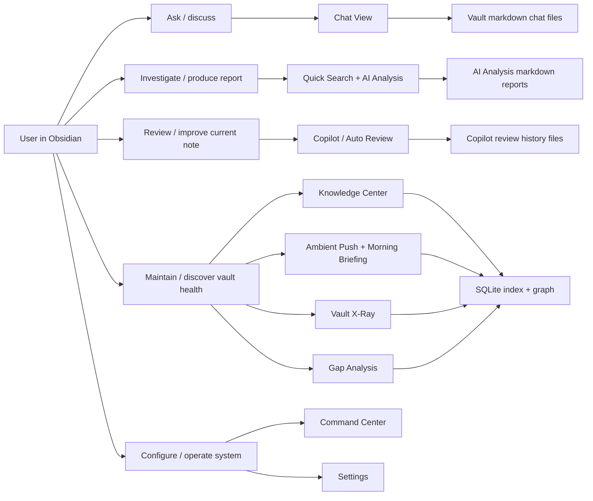

Review:

- Strong direction: the system has differentiated away from a generic RAG chat plugin.
- Main risk: user-facing names overlap. "Quick Search", "AI Analysis", "Vault Intelligence", "Knowledge Center", "Command Center", "Copilot" are powerful internally, but the mental model needs one sentence per surface.
- Recommended user mental model:
  - `Chat`: ask and continue conversation.
  - `AI Analysis`: investigate a question and turn evidence into a report.
  - `Copilot`: improve the note I am working on.
  - `Knowledge Center`: maintain the knowledge system.
  - `Ambient`: the system notices useful links without being asked.
  - `Command Center`: launcher and operations console.

## 2. Layered System Architecture

The codebase still mostly follows the declared four-layer model, but there are now cross-cutting singletons for agents, context, storage, usage, skills, and MCP.

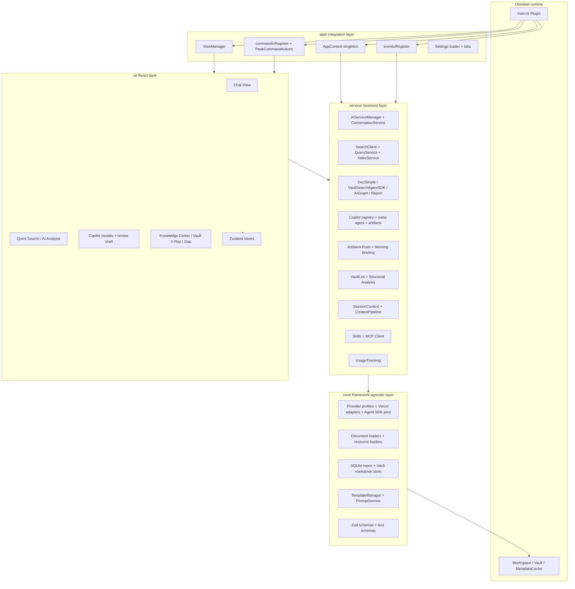

Review:

- `AppContext` is now the practical DI root. Most services resolve dependencies through it or static getters.
- This improves convenience, but makes lifecycle discipline important: `main.ts` must create `AppContext` before services that call `AppContext.getInstance()`.
- The architecture is service-rich, not view-rich. That is good for agent features, but documentation must explain which service owns which user promise.

## 3. Plugin Boot Lifecycle

Current startup has two important gates:

- The plugin can load without SQLite if the native module is missing.
- Search/index/usage/session-context only become available after `initSqlite()`.

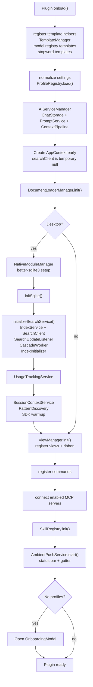

Review:

- Good: native SQLite failure is non-fatal, so setup wizard can recover.
- Important product implication: features depending on `SearchClient` must handle "index not ready" gracefully.
- Current code comments already acknowledge early `AppContext` creation as a previous bug fix. Keep this invariant documented.

## 4. Persistent Data Map

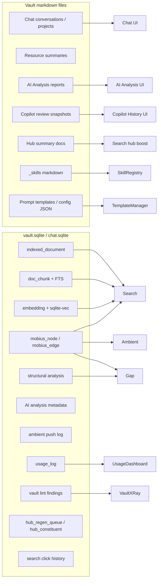

Review:

- Strong split: human-readable artifacts live as markdown; retrieval and metrics live in SQLite.
- This is the right Obsidian-native tradeoff.
- Watchpoint: generated markdown folders such as AI Analysis are intentionally skipped by listener indexing to avoid churn.

## 5. Search And Indexing Pipeline

### 5.1 Index Build / Update Flow

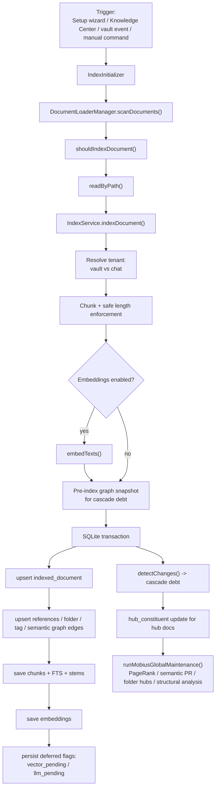

### 5.2 Full Pipeline Levels

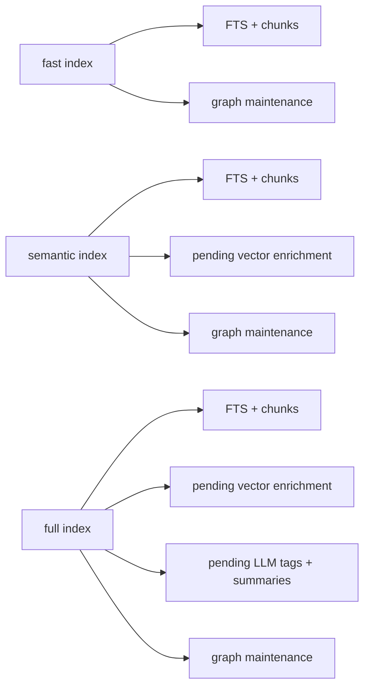

Review:

- The staged pipeline is well-shaped: fast path keeps startup/search cheap, semantic/full enrich later.
- `IndexService` is now a large god-service. It works, but future changes should keep extracting small helpers around graph upsert, deferred state, and maintenance rather than adding more branches.
- The tenant split (`vault` vs `chat`) is important: chat artifacts and vault notes are indexed differently but share graph/search machinery.

## 6. Search Query Pipeline

The current Search pipeline is no longer a plain FTS/vector search. It is multi-retriever + graph-aware reranking.

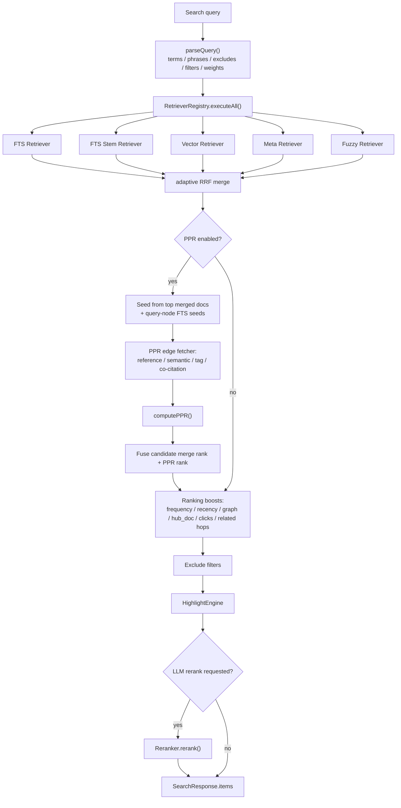

Consumers:

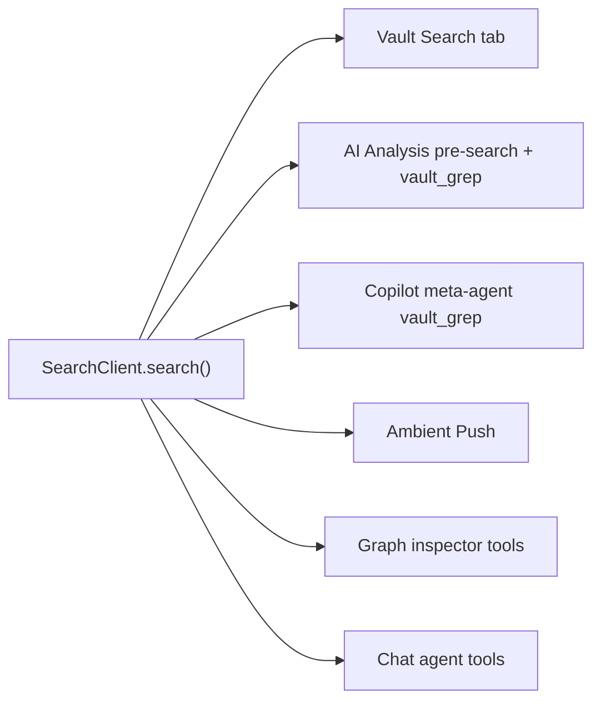

Review:

- The Search pipeline is the strongest technical core of the project.
- PPR is correctly placed after candidate retrieval and before final boosts/highlighting.
- Click-through feedback and current-file related hops are good product signals.
- Watchpoint: search quality now depends on index freshness, graph quality, and deferred enrichment completion. UI should explain "fast index vs semantic/full index" in user terms, not implementation terms.

## 7. AI Analysis Pipeline

AI Analysis currently has three modes:

- document-scoped quick answer via `DocSimpleAgent`
- vault-wide report planning via `VaultSearchAgentSDK`
- graph output via `AIGraphAgent`

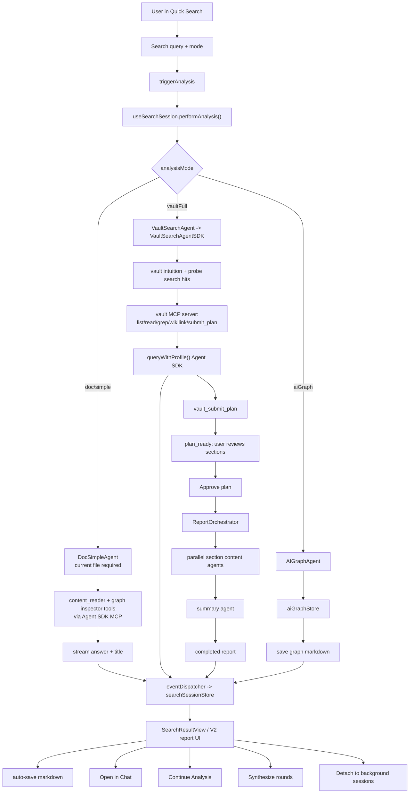

### 7.1 Vault Report Generation

```mermaid
flowchart LR
  PlanSections["Plan sections\nfrom vault_submit_plan"]
  Assign["Optional: assign user insights"]
  Evidence["Read evidence files\nper section"]
  Prompts["Render section prompts"]
  Parallel["Fire all section agents in parallel"]
  Stream["Stream section chunks to store"]
  Guard["Repetition guard"]
  Complete["completeSectionContent"]
  Summary["Summary agent"]
  Persist["persistSessionToVault"]

  PlanSections --> Assign --> Evidence --> Prompts --> Parallel --> Stream --> Guard --> Complete --> Summary --> Persist
```

Review:

- Good: the AI Analysis flow separates "find and plan" from "write report"; this is easier to review than one giant answer.
- Good: `eventDispatcher` is pure enough to support foreground and background routing.
- High-priority review item: `useSearchSession` passes `{ webEnabled, signal }` into `vaultAgentRef.current.startSession(...)`, but `VaultSearchAgent.startSession(userQuery)` currently exposes only one parameter and delegates to `VaultSearchAgentSDK.startSession(userQuery)` without options. If this is the live code, web search toggles and abort signals may be ignored on the vault-full path.
- Background sessions are useful, but the queue model should be tested carefully. `tryStartNext()` marks queued sessions as streaming; it does not itself launch a paused generator. If the underlying generator was never paused, "queued" may be only a UI state.

## 8. Chatbot Pipeline

Chat is the conversational surface. It uses vault markdown storage, a context pipeline, and Vercel streaming for the chat response.

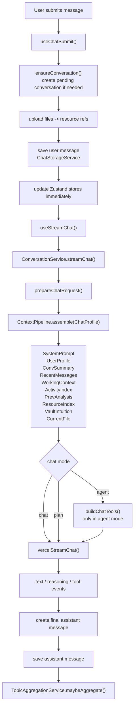

Storage and sync:

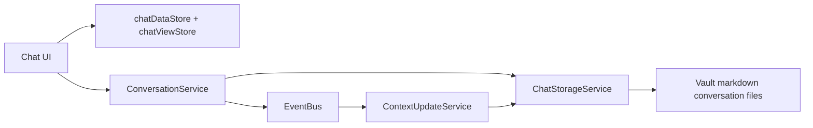

Review:

- Good: Chat context is modular through slots, which makes it easier to add or remove context sources.
- Good: message lifecycle and streaming state are kept visible in UI stores.
- Watchpoint: user-facing `chat / agent / plan` modes should be simplified in product language. Users should not need to know "allowedTools + maxSteps" to choose correctly.
- Watchpoint: Chat uses Vercel provider streaming, while AI Analysis and Copilot Auto use Agent SDK. This is technically valid, but model routing docs need to explain why.

## 9. Copilot / Command Center Pipeline

### 9.1 Entry And Intent Hub

Command Center is a launcher. Copilot Picker is the intent hub for current-note, vault, and system scopes.

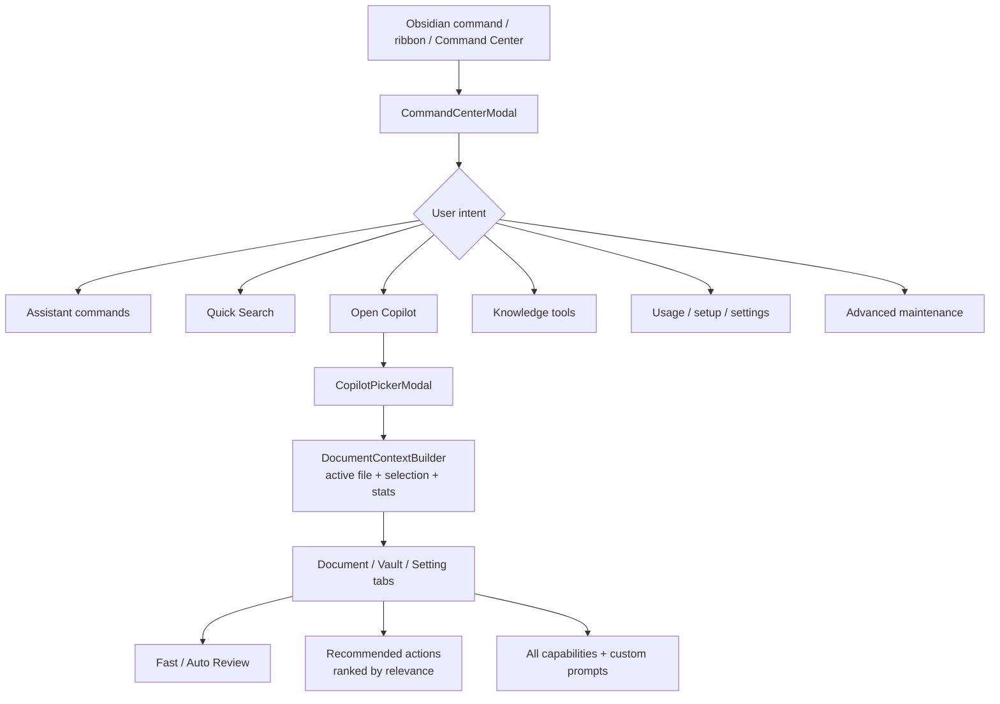

### 9.2 Manual Copilot Action Flow

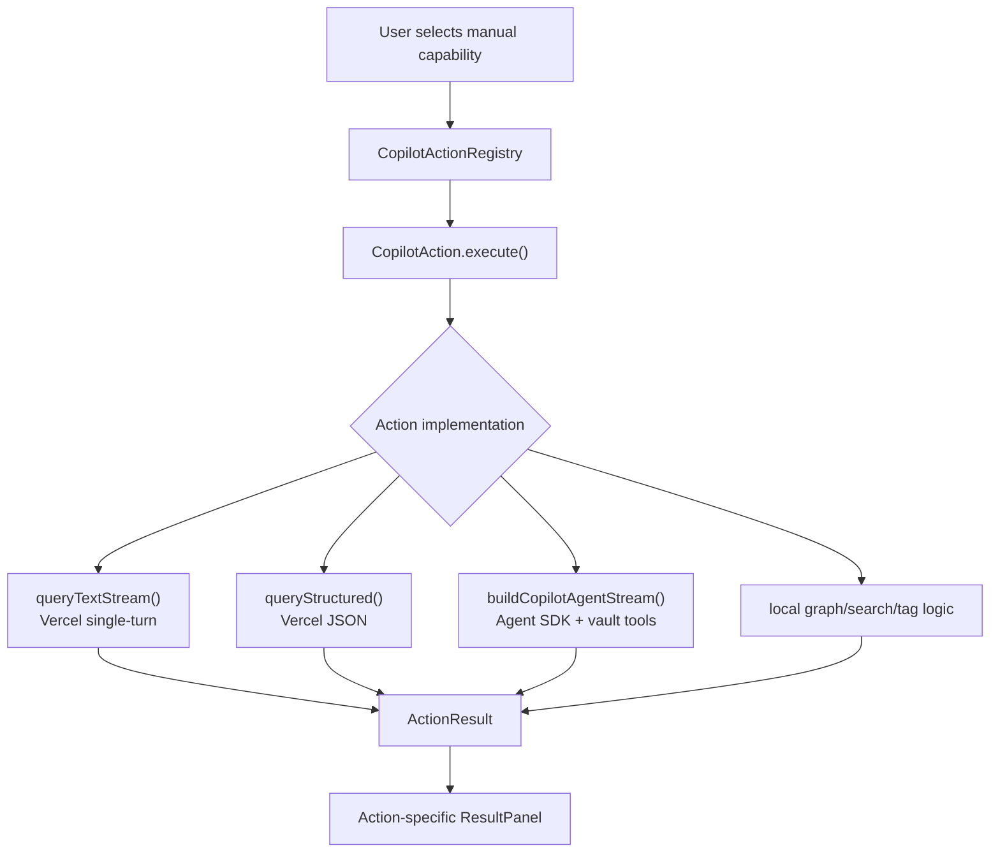

Current built-in action families:

- Document: tags, links, graph links, split, review, correct, polish, format, summarize, concepts, translate, task list.
- Vault: related files, knowledge gaps, synthesize topic, vault health, vault summary, todos, duplicates, find/solve tasks, smart connections, detect/file, prompt audit, workflow.
- Writing: continue writing, rewrite selection, add evidence, writing plan, write article.
- Extension point: custom prompts loaded from vault.

### 9.3 Auto Review Meta-Agent Flow

Current implementation has moved from "planner chooses N capability loops" toward one meta-agent that emits typed artifacts through explicit MCP output tools.

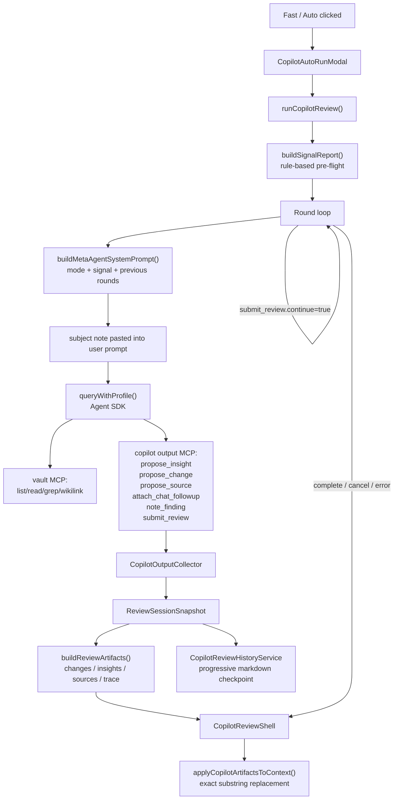

### 9.4 Artifact Review Surface

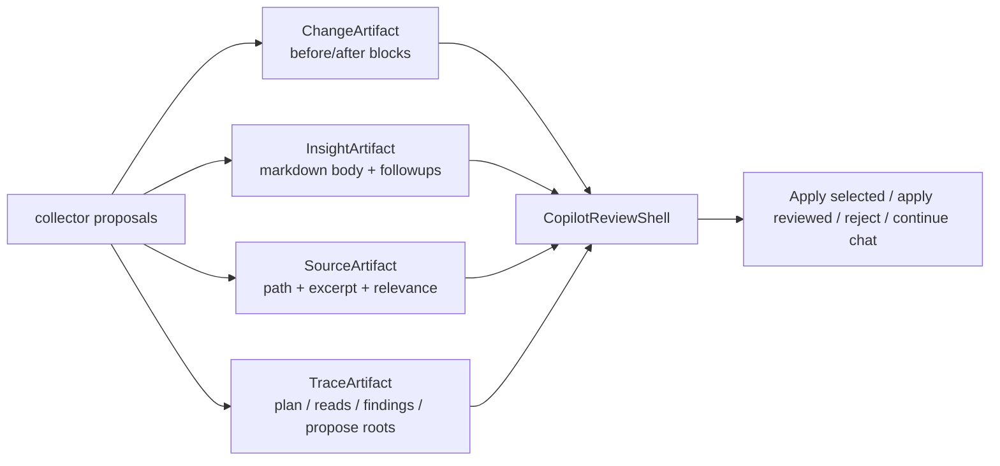

Review:

- Strong: `propose_*` tools remove guesswork. The agent explicitly publishes artifacts instead of relying on result adapters to infer UI output.
- Strong: nothing is applied automatically. Change application is review-first.
- High-priority review item: current `CopilotReviewSession` uses `UNCAPPED_MAX_TURNS = 999` and `ABSOLUTE_ROUND_SAFETY_CAP = 20`. This differs from the earlier spec's bounded Fast/Complete budget. It may be intentional, but cost/latency UX should be reviewed.
- Watchpoint: `applyCopilotArtifactsToContext()` uses exact substring replacement. That is safe, but fragile when the note changed after the agent read it. The UI should show conflicts, not only "No matching changes were applied."
- Watchpoint: Auto Review is desktop-only by UI guard, while manual actions may still depend on desktop search/SQLite. Mobile affordance needs explicit handling.

## 10. Ambient / Knowledge Maintenance Pipeline

### 10.1 Ambient Push

Ambient Push is the "system notices useful notes while I write" surface.

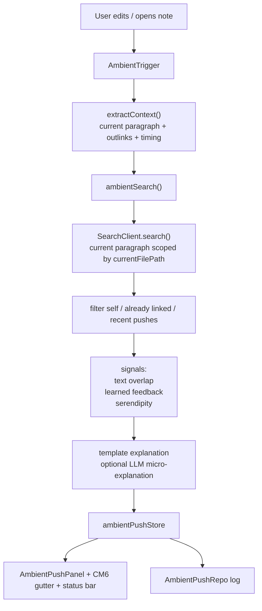

### 10.2 Morning Briefing

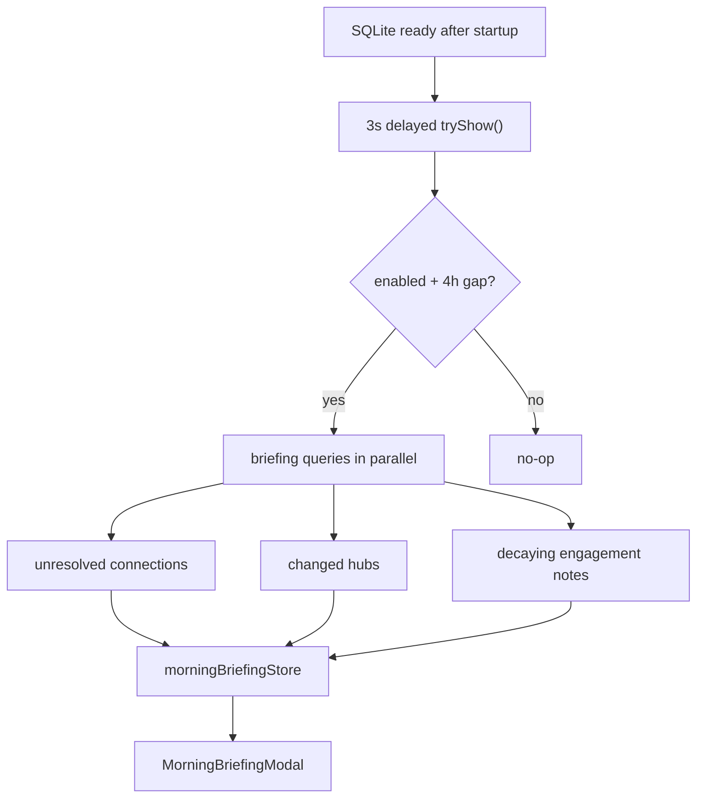

### 10.3 Vault Lint And Structural Hole Analysis

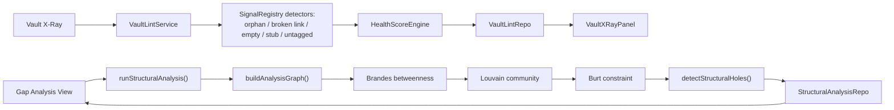

Review:

- Ambient, Vault Lint, Gap Analysis, Hub summaries, and PPR search are now all using the same underlying graph/index substrate. That is a good platform effect.
- User-facing language should avoid exposing every algorithm. The visible promise is "connections, gaps, health, stale hubs, useful notes".
- Search and Ambient both depend on graph/search freshness; Knowledge Center should remain the place that explains and fixes index state.

## 11. End-to-End User Mental Model Flow

This is the product-level map the UI should teach.

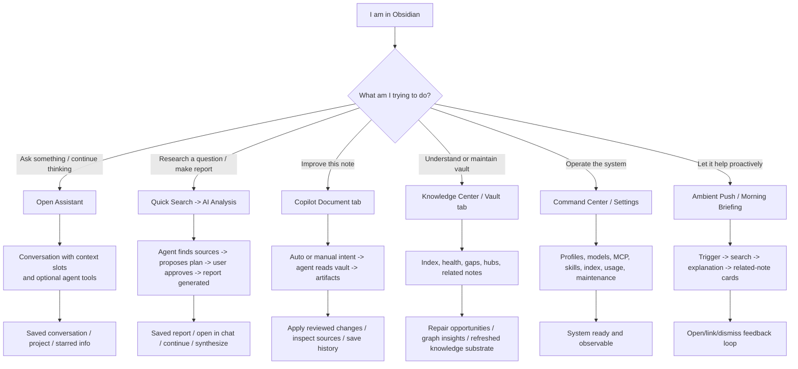

Review:

- The product should not ask users to choose between "RAG", "PPR", "Agent SDK", "MCP", "FTS", or "Graph". Those belong in trace/provenance and settings.
- The user should choose intent: ask, investigate, improve, maintain, operate, or receive proactive help.
- Copilot and AI Analysis should remain distinct:
  - Copilot starts from current note and produces reviewable artifacts.
  - AI Analysis starts from a question and produces a report.
  - Chat starts from a conversation and produces continuity.

## 12. Main Technical Strategy Review

| Area | Current strategy | Review |
| --- | --- | --- |
| Storage | Markdown for human artifacts; SQLite for index/graph/metrics | Correct Obsidian-native split. Keep generated files readable and re-loadable. |
| Search | Multi-retriever + RRF + PPR + ranking boosts | Strong core. Avoid adding new search paths outside `SearchClient`. |
| Indexing | Fast / semantic / full staged enrichment | Good. UI needs plain-language status and upgrade prompts. |
| Agents | Agent SDK for tool-heavy work; Vercel path for chat and simple single-turn calls | Valid but needs routing documentation so model/profile settings are understandable. |
| Copilot | Intent hub + explicit artifact output tools | Strong direction. Keep manual actions as initial intents, not separate product silos. |
| AI Analysis | Plan-first report generation with approval | Good reviewability. Watch option passing and background-session queue semantics. |
| Chat | Context slots + markdown persistence + optional tools in agent mode | Good foundation. Product language for modes needs simplification. |
| Ambient | Low-interruption proactive suggestions using same Search substrate | Differentiating. Needs careful dedupe and explanation quality. |
| Knowledge health | Vault Lint + Gap + Hub summaries + Cascade | Strong "knowledge maintenance" pillar. Needs one combined dashboard narrative. |
| Observability | Usage tracking, trace artifacts, debug stores | Good, but scattered. Product-level trace should remain readable. |

## 13. Architecture Risks / Review Findings

### P0 / P1

1. `VaultSearchAgent.startSession()` option mismatch

   - Caller path: `src/ui/view/quick-search/hooks/useSearchSession.ts`
   - Callee path: `src/service/agents/VaultSearchAgent.ts`
   - Observed issue: caller passes `webEnabled` and `signal`, wrapper signature only accepts `userQuery` and does not forward options to `VaultSearchAgentSDK`.
   - Product impact: web search toggle and cancellation may not work in vault-full AI Analysis.
   - Recommendation: update wrapper signature to accept options and forward to SDK; add a narrow test or type check around it.

2. Agent SDK `pluginId` accessor drift

   - Observed paths: `src/service/agents/DocSimpleAgent.ts`, `src/service/agents/FollowupChatAgent.ts`, `src/service/workflow/WorkflowAgent.ts`, `src/service/agents/intuition-helper/intuition.recon.ts`, `src/service/ambient/RelevanceExplainer.ts`
   - Observed issue: several call sites reference `ctx.pluginId` or `AppContext.getPluginId()`, but current `AppContext` exposes `plugin.manifest.id`, not a `pluginId` property or static `getPluginId()` method.
   - Product impact: tool-heavy agent calls can fail compile-time or runtime depending on how these paths are bundled/executed.
   - Recommendation: standardize on `AppContext.getInstance().plugin.manifest.id` or add one explicit `AppContext.getPluginId()` helper and migrate all call sites.

3. Copilot Auto Review budget drift

   - Current path: `src/service/copilot/CopilotReviewSession.ts`
   - Observed issue: code uses uncapped per-round turns (`999`) and round safety cap `20`, while earlier product spec described bounded Fast/Complete behavior.
   - Product impact: unpredictable latency/cost and possible long-running runs.
   - Recommendation: decide explicitly whether "agent decides" is allowed to be long. If yes, show budget/cost guard in UI; if no, restore practical caps.

4. Too many product surfaces with overlapping names

   - Command Center, Copilot, Vault Intelligence, Knowledge Center, Quick Search, AI Analysis, Ambient Push.
   - Product impact: users may not know where to start.
   - Recommendation: teach the six-intent mental model in UI labels and docs: Ask, Investigate, Improve, Maintain, Operate, Proactive.

### P2

4. Exact-substring apply is safe but conflict-prone

   - Path: `src/service/copilot/CopilotArtifactApply.ts`
   - Current behavior: if `before` is not found, block is skipped.
   - Recommendation: expose unmatched blocks as conflicts with "copy patch / retry review" options.

5. Search freshness is now a cross-system dependency

   - Search, AI Analysis, Copilot search tools, Ambient, Gap, Vault Lint, Hub summaries all depend on index/graph quality.
   - Recommendation: Knowledge Center should surface index level, pending vector/LLM enrichment, graph maintenance debt, and last structural analysis time in one place.

6. Agent routing is hard to explain

   - Chat and simple Copilot actions use Vercel provider streaming.
   - AI Analysis and Copilot Auto use Agent SDK with MCP tools.
   - Recommendation: create a short model-routing doc: Chat model, Agent model, Copilot model, Embedding model, Web Search model, and which surface uses each.

7. Background session queue semantics need a real-flow test

   - Path: `src/service/BackgroundSessionManager.ts`
   - Recommendation: test close modal during vault-full analysis, run 3+ sessions, restore plan-ready session, approve plan, verify events and saved markdown remain correct.

## 14. Recommended Next Documentation / Implementation Steps

1. Create a user-facing "Which surface should I use?" doc based on Section 11.
2. Fix or verify the `VaultSearchAgent.startSession()` option mismatch.
3. Standardize Agent SDK `pluginId` access across agent services.
4. Decide Copilot Auto Review budget policy and align code/spec/UI copy.
5. Add Knowledge Center status cards for pending enrichment and graph maintenance debt.
6. Add conflict UI for Copilot artifact apply.
7. Create a model-routing reference under `docs/` or Settings help.
8. Use this architecture review as the map for Phase 11 tutorial docs:
   - Graph inspector / AI Analysis tutorial
   - Model selection best practice
   - Copilot Auto Review tutorial
