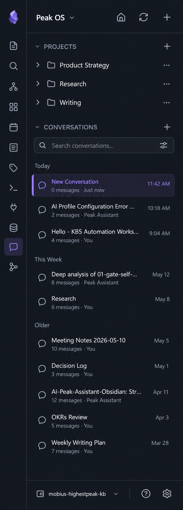
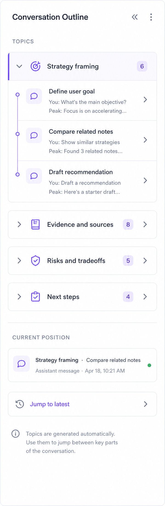
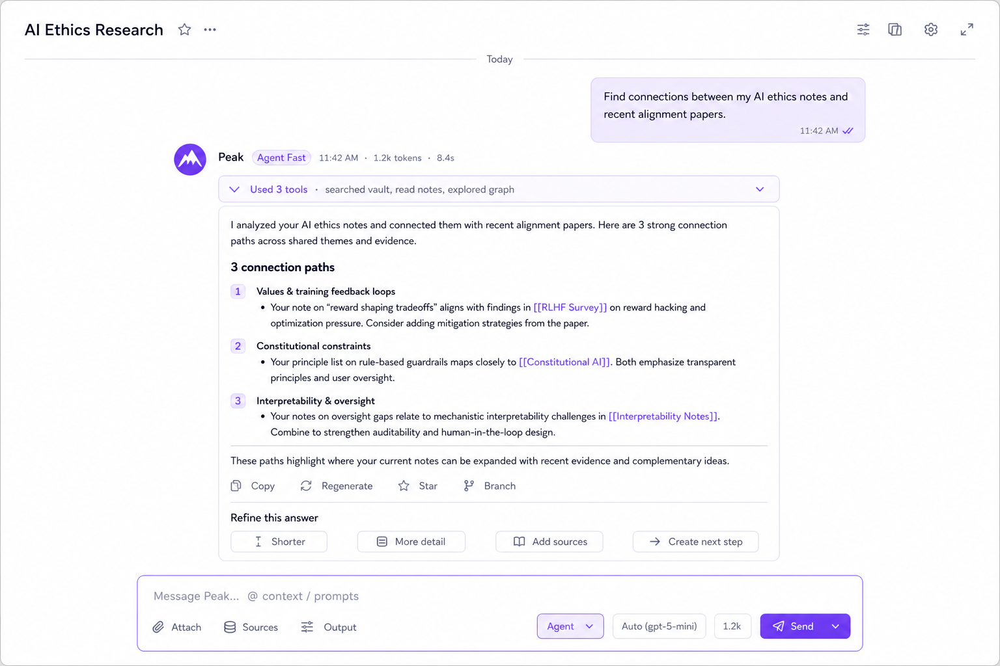
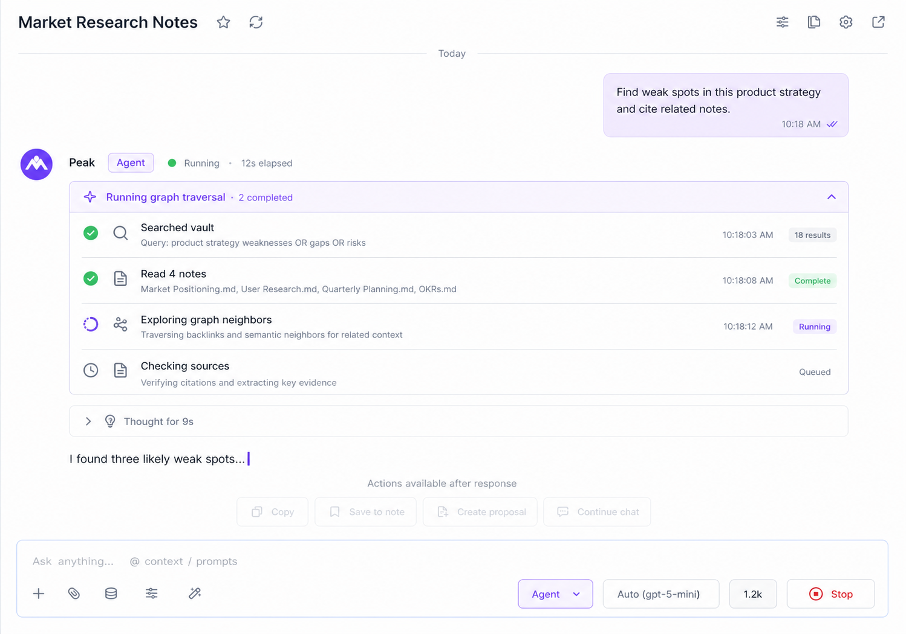
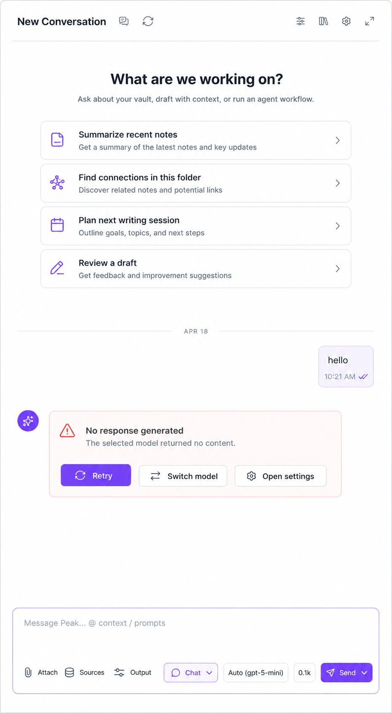

# Peak Chat · 产品设计文档

> Status: design draft
> Date: 2026-05-22
> Scope: Chat bot 主工作面：左侧会话导航、中间消息工作区、右侧 Topic Outline、底部输入 dock
> Owner: Peak Assistant design session
> Related:
> - `docs/mockups/chat-ui-redesign.html`
> - `docs/mockups/tool-call-redesign.html`
> - `docs/mockups/input-toolbar-final.html`
> - `docs/superpowers/specs/2026-04-22-chat-ui-redesign-design.md`
> - `docs/superpowers/specs/2026-05-22-design-system-migration.md`

---

## 1. 产品定位

Peak Chat 不是一个普通 chatbot，也不是 Obsidian 旁边再塞一个问答窗口。

它是用户在 vault 里的 **conversational knowledge workspace**：

- 帮用户把当前写作、研究、复盘、整理这些知识工作串起来。
- 能读取 vault、调用工具、引用笔记、生成回答、继续追问。
- 对用户可见的是 answer / plan / synthesis / next step，不是工具列表本身。
- Agent 做了什么要透明，但默认不抢正文；用户需要时可以展开看 trace / tool detail。

一句话：

> Peak Chat 是住在 Obsidian 里的“知识工作对话层”：用户用自然语言启动工作，agent 读取 vault 和上下文，最后把可继续使用的答案、计划、证据和下一步交还给用户。

---

## 2. 当前问题

从当前截图看，Chat surface 的问题不是单个组件丑，而是几个区域没有形成一致的产品语言。

### 2.1 中间聊天区

- 留白太大，消息、日期、actions、input 彼此像散落在画布上。
- assistant 消息下方堆了 metadata、图标 actions、style chips、quick actions，层级不清。
- `Shorter / More detail / Simpler / More formal` 和 `State your goals / Suggest topics / Create agenda` 同时出现，用户不知道哪个是改写、哪个是继续工作。
- 空 assistant 会显示成 `(empty)` 或留白，像坏掉。

### 2.2 Tool calls

- 旧 mock 已经证明 tool calls 应该默认 collapsed summary，但真实 UI 仍容易把工具调用变成视觉主体。
- 用户关心“agent 有没有查、查了什么、结果能不能信”，不关心 raw tool name / JSON。

### 2.3 Conversation Outline

- 右侧栏现在像 transcript/debug panel：`USER hello`、`ASSISTANT (empty)`。
- 但用户真正需要的是 topic wayfinding：这段对话谈了哪些主题，我现在在哪个主题，点哪里能跳回去。
- Outline 不应该承载 sources、artifact、report 等复杂信息；那些应该跟着 answer 或 review artifact。

### 2.4 Input area

- `input-toolbar-final.html` 的能力已经部分存在：附件、sources、output control、mode、model、token。
- 但当前输入框视觉上仍像大 textarea，不像一个 command dock。
- `Used 0` 这类计数没有解释价值，应该变成可理解的 token/cost/context 状态。

---

## 3. 产品哲学

### 3.1 Conversation Is The Working Record

聊天不是一次性问答日志，而是用户知识工作的过程记录。中间区域应该像一篇可读的工作文档：

- 稳定阅读宽度
- 清晰 turn hierarchy
- markdown / wikilink / evidence 可读
- action 跟随对应 answer

### 3.2 Agent Work Is Visible, Not Dominant

工具调用、reasoning、trace 必须可见，但默认只是辅助层：

- 默认一行 summary
- streaming 时显示当前 step
- 展开后才看细节
- 错误时要能解释失败原因

### 3.3 Actions Follow The Artifact

按钮应该出现在用户要操作的东西附近。

- answer 下方是 copy / regenerate / star / branch
- answer 之后是 continue / refine
- input dock 是新任务入口
- outline 只负责导航

### 3.4 Outline Is Topics, Not Transcript

右侧栏主要只有 topics。

它不做：

- raw USER / ASSISTANT 列表
- sources 管理
- review result
- agent trace

它做：

- topic group
- active topic
- message-pair anchors
- jump to latest

### 3.5 One Product Language

Chat、Copilot Picker、Vault Review 都应共享一套设计语言：

- `--pk-*` token
- 真源紫色 `#7c3aed`
- Lucide icons
- 8px radius 基准
- restrained density
- no emoji icons in production UI

---

## 4. 现有能力映射

这不是从零设计。当前代码和旧 mock 已经提供了很多能力。

| 能力 | 已有基础 | 新设计如何使用 |
|---|---|---|
| Message stream | `MessageViewItem` / `StreamdownIsolated` | 作为中心 answer document，强化 role row、metadata、空状态 |
| Tool calls | `ToolCallSummary` + `tool-call-redesign.html` | 默认 collapsed summary，展开看 step detail |
| Reasoning | `Reasoning` component | 保留 collapsed `Thought for Ns`，不默认展开 |
| Actions | `MessageActionsList` | 分成 metadata / primary actions / continue-refine |
| Style buttons | `MessageStyleButtons` | 收敛为最多 3-4 个 refine chips |
| Suggested follow-ups | `SuggestedFollowups` | 作为最后一条 assistant 的 continue row，不堆满多行 |
| Capability suggestion | `CapabilitySuggestion` | 只在有明确上下文时出现，避免和 refine chips 竞争 |
| Input toolbar | `InputToolbar` + `input-toolbar-final.html` | 变成 compose dock：tools left, mode/model/token right |
| Context search | `ContextMenu` / `useContextSearch` | 通过 `@ context` 路径保留，输入区不额外铺 UI |
| Prompt menu | `/` prompt menu | 作为 input command，不占主聊天区 |
| Conversation Outline | `MessageHistoryView` | 从 transcript list 改成 topic navigator |

---

## 5. UI Mock 索引

这些图是本轮 imagegen 产物，已经保存到项目目录：

### 5.1 Left Sidebar



意图：

- 左栏只解决 navigation：vault / projects / conversations。
- active conversation 用紫色左边线或浅 tint，不再用强烈系统蓝。
- conversation list 需要搜索、日期分组、两行信息密度。

### 5.2 Right Topic Outline



意图：

- 右栏几乎只显示 topics。
- topic 是 collapsible group，里面是 message-pair anchors。
- 不显示 raw `USER / ASSISTANT`，不显示 `(empty)`。
- 辅助区最多保留 `Current position` / `Jump to latest`。

### 5.3 Center · Normal Answer



意图：

- answer 是主角，tool summary 和 actions 是辅助。
- assistant turn 的顺序固定：role row → tool summary → answer → actions/refine。
- `Continue / Refine` 一行收敛，不把所有 quick actions 都摊开。

### 5.4 Center · Agent Running



意图：

- agent 正在跑时，active tool step 可展开，历史 step 轻量。
- streaming answer 仍然是目的地，tool trace 只是过程透明度。
- input dock 进入 disabled / stop state。

### 5.5 Center · Empty / Error



意图：

- 新对话不应该只有空白，应该有 context-aware starters。
- 空 assistant / model failure 要显示为明确 error card。
- 错误状态不显示 style chips，先提供 Retry / Switch model / Open settings。

---

## 6. 信息架构

```
┌──────────────────────────────────────────────────────────────┐
│ Header: conversation title / project / global controls        │
├───────────────┬────────────────────────────────┬─────────────┤
│ Left nav       │ Center message workspace       │ Topic outline│
│ Projects       │ Date separators                │ Topic groups │
│ Conversations  │ User / Peak turns              │ Anchors      │
│ Search         │ Tool summary                   │ Active topic │
│                │ Answer / actions               │ Jump latest  │
├───────────────┴────────────────────────────────┴─────────────┤
│ Sticky compose dock: text input + toolbar + mode/model/tokens │
└──────────────────────────────────────────────────────────────┘
```

### 6.1 Left Sidebar

职责：conversation navigation。

保留：

- project / folder 分组
- conversation list
- date grouping
- active conversation
- new conversation / search

不做：

- chat actions
- tool settings
- outline 内容

### 6.2 Center Message Workspace

职责：read and continue the work。

每个 assistant turn 推荐结构：

1. **Role row**：Peak icon、mode/model、time/token/cost。
2. **Tool summary**：如果 agent 用了 tools，一行 collapsed summary。
3. **Reasoning**：如有，折叠成 `Thought for Ns`。
4. **Answer body**：Streamdown markdown / wikilinks / code / tables。
5. **Action row**：copy、regenerate、star、branch。
6. **Continue / Refine row**：最多 3-4 个 chips。

### 6.3 Right Topic Outline

职责：wayfinding。

信息模型：

```ts
interface ConversationTopicOutline {
  topics: Array<{
    id: string;
    title: string;
    messageCount: number;
    anchors: Array<{
      messageId: string;
      label: string;
      rolePair?: 'user-assistant' | 'assistant-only';
    }>;
  }>;
  activeTopicId?: string;
  activeMessageId?: string;
}
```

规则：

- 有 topic 时只显示 topic tree。
- 没有 topic 但有消息时，用 message-pair anchors 临时分组。
- 对话内容不足时显示 empty hint：`Topics appear after the conversation develops.`
- 不出现 `USER hello` / `ASSISTANT (empty)` 这种 raw transcript。

### 6.4 Compose Dock

职责：command entry + run control。

左侧：

- Attach
- Sources
- Output controls

右侧：

- Mode：Chat / Plan / Agent
- Model：当前 profile / model
- Token/cost：当前输入估算
- Send / Stop

降级规则：

- 窄宽度隐藏 token/cost。
- 模型名 truncate。
- mode 保留。
- submit / stop 永远可见。

---

## 7. 关键交互模式

### 7.1 Tool Calls

默认：

```text
Used 3 tools · searched vault, read notes, explored graph ▾
```

展开：

```text
Searched vault         "AI ethics alignment"       12 results
Read note              Ethics/RLHF-Survey.md       2.1s
Explored graph         2-hop from RLHF-Survey      8 nodes
```

Streaming：

```text
Running graph traversal · 2 completed
```

设计原则：

- 显示人话，不显示 raw tool name 优先。
- input preview 只显示最能解释目的的字段。
- result preview 给用户信心：多少结果、读了多少 note、花了多久。

### 7.2 Continue / Refine

把当前散落的 style buttons 和 suggestion actions 合并为一条可预测的 row。

默认候选：

- Shorter
- More detail
- Add sources
- Create next step

规则：

- 最多 4 个。
- 仅 assistant 有有效内容时出现。
- 最后一条 assistant 常显，历史消息 hover reveal。
- 更复杂的建议进入 overflow / follow-up generator。

### 7.3 Empty / Error

空 answer 是失败状态，不是普通 assistant turn。

展示：

- title：`No response generated`
- reason：模型无输出、凭证错误、网络错误等
- primary：Retry
- secondary：Switch model
- tertiary：Open settings

不展示：

- style chips
- follow-up suggestions
- `(empty)`

### 7.4 Topic Outline

Topic 生成来源优先级：

1. message.topic 字段
2. conversation context topics
3. local heuristic：每个 user/assistant pair 生成一条 anchor label

点击行为：

- 点击 topic：展开 / 折叠
- 点击 anchor：滚动并高亮 message
- 点击 Jump latest：滚到底部

---

## 8. 状态设计

| 状态 | 中栏 | 右栏 | 输入区 |
|---|---|---|---|
| New conversation | starter prompts + compose dock | empty hint | enabled |
| Normal answer | answer body + collapsed tools + refine row | topic tree | enabled |
| Agent running | active tool step + streaming answer | active run topic / anchor | disabled + Stop |
| Error / empty | error card + retry actions | failed anchor, no `(empty)` | enabled |
| Long conversation | normal timeline | topic tree becomes primary navigation | enabled |

---

## 9. 与其他 Peak 设计的关系

| 模块 | 共同语言 |
|---|---|
| Copilot / Review Launcher | 用户先选 scope / intent，再让 agent 决定 tools |
| Auto Review Result | agent trace 可见，但用户消费 artifact |
| Peak Chat | tool summary 可见，但用户消费 answer |
| Vault Review | sources 跟随具体结论，不做孤立 sources tab |

统一原则：

- 用户不应该先理解工具清单。
- Agent 能力以 intent / artifact 形式出现。
- 过程透明，但结果优先。
- 所有 evidence / source 附着在具体 claim 上。

---

## 10. Phase 1 范围

Phase 1 聚焦主 Chat Workspace，不同时重做所有聊天相关页面。

### 10.1 做

1. **Center message workspace**
   - 稳定阅读宽度
   - assistant turn hierarchy
   - empty / error state

2. **ToolCallSummary**
   - 保留 collapsed summary
   - Lucide icons 替换 emoji
   - natural language labels
   - streaming active step

3. **Action / refine row**
   - metadata、actions、refine chips 分层
   - 去掉重复建议
   - 空 answer 不显示 chips

4. **Topic Outline**
   - 以 topics 为主
   - 无 topic 时优雅 empty / fallback anchors
   - 点击滚动到 message

5. **Input compose dock polish**
   - 对齐 `input-toolbar-final.html`
   - 去硬编码蓝色 focus ring
   - token/model/mode 降级规则

### 10.2 不做

- 不重做 Home Page。
- 不重做 New Conversation Type Picker。
- 不重做 Project Overview。
- 不引入 artifact split panel。
- 不改 chat service / agent loop。
- 不做全局 token migration，只消费已经确定的 token。

---

## 11. 实现映射

| 区域 | 主要文件 | 备注 |
|---|---|---|
| Message item | `src/ui/view/chat-view/components/messages/MessageViewItem.tsx` | assistant turn hierarchy / empty state |
| Tool summary | `src/ui/view/chat-view/components/ToolCallSummary.tsx` | label、icon、streaming、expanded detail |
| Message actions | `src/ui/view/chat-view/components/messages/MessageActionsList.tsx` | metadata vs actions 分层 |
| Style/refine | `src/ui/view/chat-view/components/MessageStyleButtons.tsx` / `SuggestedFollowups.tsx` | 合并为 Continue / Refine row |
| Input dock | `src/ui/view/chat-view/components/InputToolbar.tsx` / `ChatInputArea.tsx` | spacing、focus、responsive |
| Outline | `src/ui/view/message-history-view/MessageHistoryView.tsx` | topic-only navigator |
| Tokens | `src/styles/peak-variables.css` / future `peak-tokens.css` | 不新增私有色板 |

---

## 12. 验收标准

- `hello` 这种短对话不再看起来像 UI 坏了。
- 右侧栏不显示 raw `USER / ASSISTANT` transcript，也不显示 `(empty)`。
- tool calls 默认一行，展开后足够解释 agent 做了什么。
- assistant answer 是视觉中心，actions 不抢正文。
- input 看起来是 command dock，不是孤立 textarea。
- 所有新增视觉使用 `--pk-*` token 和 Lucide icons。
- 左、中、右三块密度一致：左栏负责找会话，中栏负责读和继续，右栏负责 topics 导航。

