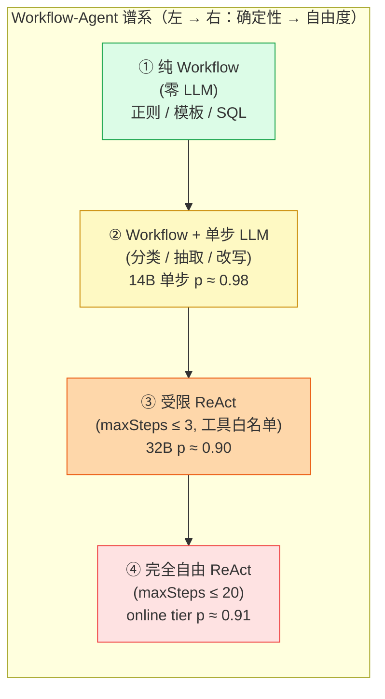
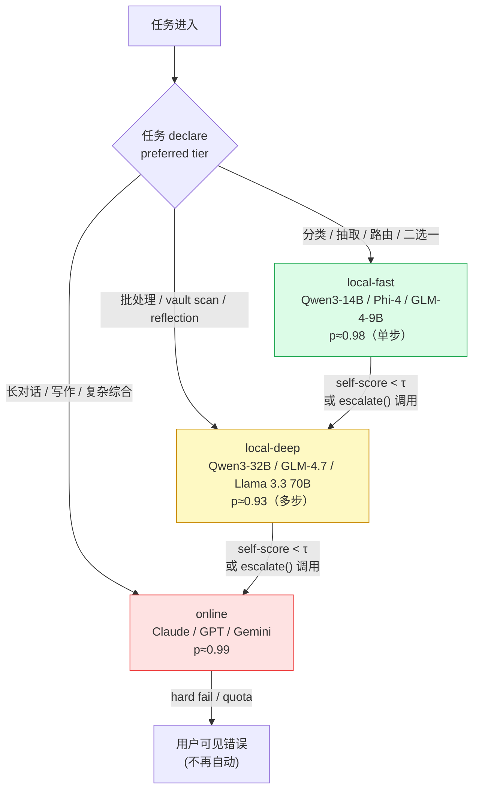
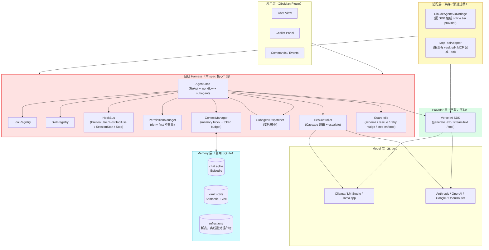
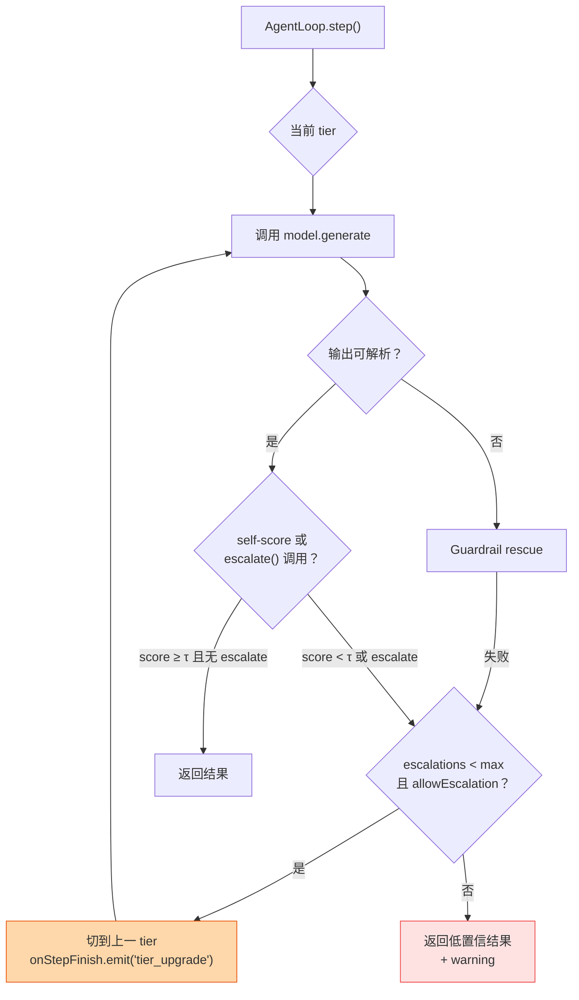
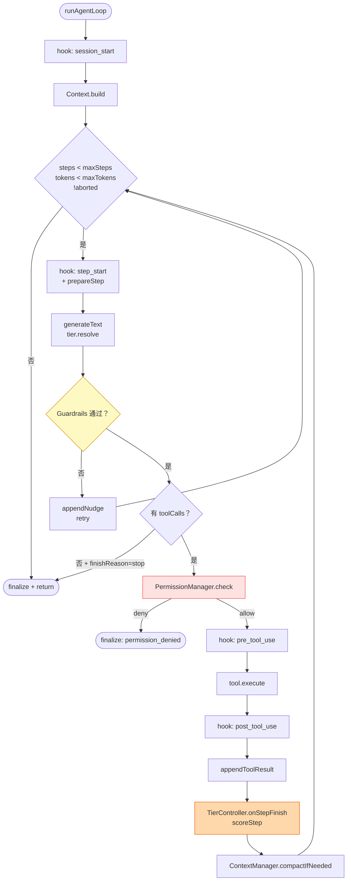
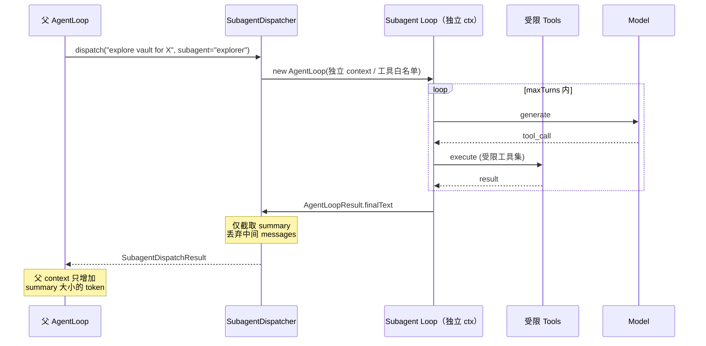
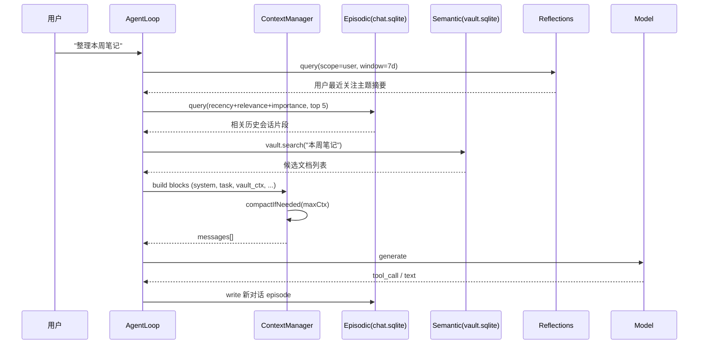
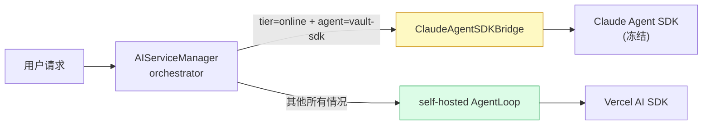
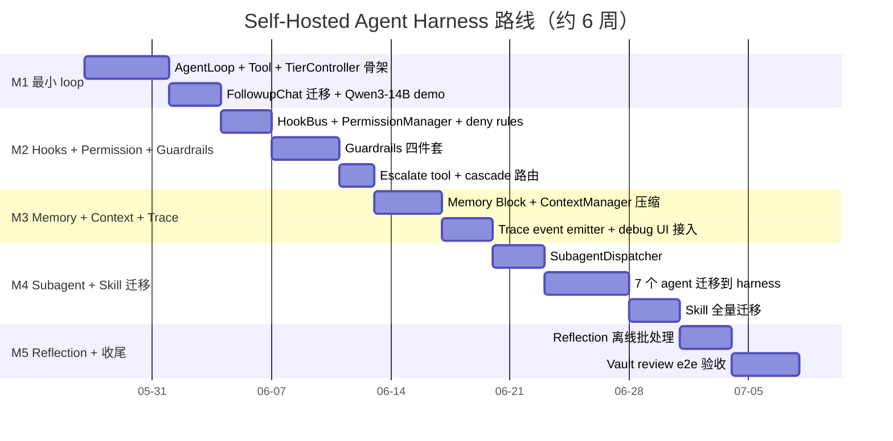

# Self-Hosted Agent Harness 设计方案（2026-05-24）

> 关联调研：[`docs/research/2026-05-24-agent-harness/`](../../research/2026-05-24-agent-harness/)（README + 01/02/03 三份子报告）
> 状态：方向已确认，待评审执行
> 作者：Peak Assistant agent harness 工作组

---

## 0. 摘要 & 目标

### 0.1 解决什么

Peak Assistant 现有 9 个 agent（VaultSearchAgent / VaultSearchAgentSDK / AIGraphAgent / ContinueAnalysisAgent / DocSimpleAgent / FollowupChatAgent / KnowledgeIntuitionAgent / PatternDiscoveryAgent / SynthesizeAgent）分两条路径运行：一条用 Vercel AI SDK 裸跑，一条挂在 Claude Agent SDK 之上（`service/agents/core/sdkAgentPool` + `agentToolMcpAdapter`）。问题：

1. **强耦合 Claude Agent SDK**，本地模型路径被锁死（SDK 假定 Anthropic-shape 消息 / MCP server 调度）。
2. **没有统一 harness 层**，guardrails / permission / context budget / subagent 隔离散落在各 agent 实现里。
3. **无 tier 概念**，每个 agent 自己挑 model，没有"先本地后云"的级联路由。
4. **本地小模型（14B）无法可靠运行多步链路**（调研 03 Q1：14B 单步 88% → 10 步 27%），需要 workflow-agent 谱系而非一刀切 ReAct。

### 0.2 不解决什么

- 不重写 provider 层。继续用 Vercel AI SDK（`@ai-sdk/*`），底层不动。
- 不引入新的依赖框架（Mastra / LangGraph / Letta），调研已确认 TS + 进程内 + 本地模型三角无现成赢家。
- 不重写 SQLite / 向量索引。`vault.sqlite` 与 `chat.sqlite` 直接复用为 CoALA Semantic / Episodic 层。
- 不做 Voyager 式自动 skill 生成（留 M5+）。
- 不做 code-as-action（Smolagents 模式），TS 沙箱不成熟，本地小模型生成 code 失败率高（调研 02 §2.3）。

### 0.3 成功标准

| # | 标准 | 度量 |
|---|---|---|
| S1 | 本地 Qwen3-14B 跑完一次 chat → tool → answer 闭环成功率 ≥ 95% | M1 验收 demo |
| S2 | 本地 Qwen3-32B 跑完一次 8 步 vault review 成功率 ≥ 85% | M4 验收 |
| S3 | 现有 9 个 agent 全部迁到自研 harness，无功能回退 | M5 验收 |
| S4 | Harness 核心代码 ≤ 1500 行（不含 guardrails / tools） | 持续 |
| S5 | 本地失败可自动 escalate 到 online tier，用户可见 | M2 验收 |

### 0.4 非目标

- 不追求 Claude Code 全功能对齐（如 hooks 配置 DSL、`/doctor` 命令、`InstructionsLoaded` event 等）。先抓核心 5 项。
- 不追求 multi-agent 协议互通（不实现 A2A、不实现 OpenAI Swarm handoff）。
- 不追求 distributed agent / 跨 process。Obsidian 是单进程，所有 agent 在主进程内串行/有限并行。

---

## 1. 设计哲学

### 1.1 Harness >> Model

调研 01 §横向洞察的 98.4% 论据：Claude Code v2.1.88 中 98.4% 是 harness 基础设施，1.6% 才是 AI 决策逻辑（VILA-Lab arxiv 2604.14228 四团队独立复现）。本 spec 把这一结论作为指导原则：**所有可以确定性化的步骤不交给 LLM**，只把"判断 + 创造"留给 model。

### 1.2 Workflow-Agent 谱系（14B 友好的核心）

调研 03 Q1：14B 在 10 步链路上指数级衰减（0.88^10 ≈ 27%）。结论不是"上 32B 就完事"，而是**把多步任务降难度让 14B 单步 p ≈ 0.98**。



**核心准则**：每个业务任务先问"能不能降到 ① 或 ②"，答案是肯定就别用 ③④。Tag 抽取、笔记分类、query rewrite 都是 ②；vault 全文重组才需要 ③④。

### 1.3 三层模型分级 + Cascade

调研 03 §Part A 的实测数据（well-formed call rate）：14B ≈ 87%，32B ≈ 93%，70B ≈ 97%，Claude Sonnet ≈ 99%。本 spec 引入 `ModelTier` 一等公民：



### 1.4 Hooks-first / Deny-first

引用调研 01 §5：**"Hooks guarantee behavior; prompts suggest it."** 凡是"必须做"的事（vault 外写入屏蔽、危险 bash 命令、token 超预算中止）一律走 hooks + permission deny-rule，不写进 system prompt。Permission deny-rule 是不变量，即使 `bypassPermissions` 也不能绕过。

---

## 2. 顶层架构



**与现有代码的边界**：

- `core/providers/vercel/*` 不动，作为 harness 的唯一 LLM 出口。
- `core/profiles/*`（`ProfileRegistry` / `presets`）扩字段引入 `tier`，沿用 settings UI。
- `service/agents/core/*`（sdkAgentPool / sdkMessageAdapter / agentToolMcpAdapter）冻结，仅供 `ClaudeAgentSDKBridge` 调用。新代码走 `service/agents/harness/*`。
- `service/skills/builtin/*` 改造为 `SkillRegistry` 注册项。
- `service/chat/service-manager.ts`（AIServiceManager）保留为顶层 orchestrator，内部从直接调 Claude Agent SDK 切到调 `AgentLoop`。

---

## 3. 核心抽象

### 3.1 `ModelTier` 三层路由

#### 接口

```typescript
// src/service/agents/harness/tier/types.ts
import type { LanguageModel } from "ai";

export type ModelTier = "local-fast" | "local-deep" | "online";

export interface TierBinding {
  tier: ModelTier;
  modelId: string;                    // e.g. "qwen3:14b"
  providerId: string;                 // e.g. "ollama-local"
  resolve(): LanguageModel;           // Vercel AI SDK LanguageModel
  capabilities: {
    toolCalling: boolean;
    parallelToolCalls: boolean;
    structuredOutput: boolean;
    thinking: boolean;                // Qwen3 thinking / Claude extended
    maxContextTokens: number;
  };
  estimatedSingleStepP: number;       // 文档化的单步成功率，用于 cascade 决策
}

export interface TierPolicy {
  preferred: ModelTier;
  allowEscalation: boolean;           // 默认 true；某些隐私敏感任务可锁死本地
  escalationThreshold: number;        // self-score 阈值，默认 0.6
  maxEscalationsPerLoop: number;      // 默认 1，防止失控
}
```

#### Cascade 决策流程



#### `TierController` 与 `onStepFinish` 集成

```typescript
// src/service/agents/harness/tier/TierController.ts
import { z } from "zod";
import { tool } from "ai";

export class TierController {
  constructor(
    private bindings: Record<ModelTier, TierBinding>,
    private policy: TierPolicy,
    private bus: HookBus,
  ) {}

  current(): TierBinding {
    return this.bindings[this.activeTier];
  }

  // 暴露给 agent 的工具（agent 可自评低置信主动升级）
  escalateTool() {
    return tool({
      description:
        "Escalate to a more capable model tier when current model is uncertain. " +
        "Use this when you cannot confidently complete the task with current capabilities.",
      parameters: z.object({
        reason: z.string().describe("Why escalation is needed"),
      }),
      execute: async ({ reason }) => {
        const upgraded = this.tryUpgrade(reason);
        return upgraded
          ? { upgraded: true, newTier: this.activeTier }
          : { upgraded: false, message: "Already at top tier or quota exhausted" };
      },
    });
  }

  // onStepFinish 钩子：根据 step 输出决定是否自动升级
  onStepFinish(step: StepResult): void {
    if (!this.policy.allowEscalation) return;
    if (this.escalations >= this.policy.maxEscalationsPerLoop) return;
    const score = this.scoreStep(step);              // 见 §4 trace
    if (score < this.policy.escalationThreshold) {
      this.tryUpgrade(`auto: score=${score.toFixed(2)}`);
    }
  }

  private tryUpgrade(reason: string): boolean {
    const next = this.nextTier(this.activeTier);
    if (!next) return false;
    this.activeTier = next;
    this.escalations += 1;
    this.bus.emit("tier_upgrade", { from: this.activeTier, to: next, reason });
    return true;
  }

  private nextTier(t: ModelTier): ModelTier | null {
    if (t === "local-fast") return "local-deep";
    if (t === "local-deep") return "online";
    return null;
  }
}
```

#### ProviderManager 配置示例

```typescript
// src/app/settings/tierBindings.ts
export const defaultTierBindings: Record<ModelTier, TierBinding> = {
  "local-fast": {
    tier: "local-fast",
    providerId: "ollama",
    modelId: "qwen3:14b",
    resolve: () => ollama("qwen3:14b"),
    capabilities: { toolCalling: true, parallelToolCalls: false, structuredOutput: true, thinking: true, maxContextTokens: 32_768 },
    estimatedSingleStepP: 0.87,
  },
  "local-deep": {
    tier: "local-deep",
    providerId: "ollama",
    modelId: "qwen3:32b",
    resolve: () => ollama("qwen3:32b"),
    capabilities: { toolCalling: true, parallelToolCalls: true, structuredOutput: true, thinking: true, maxContextTokens: 131_072 },
    estimatedSingleStepP: 0.93,
  },
  online: {
    tier: "online",
    providerId: "anthropic",
    modelId: "claude-sonnet-4-7",
    resolve: () => anthropic("claude-sonnet-4-7"),
    capabilities: { toolCalling: true, parallelToolCalls: true, structuredOutput: true, thinking: true, maxContextTokens: 200_000 },
    estimatedSingleStepP: 0.99,
  },
};
```

#### 用户配置（settings UI 暴露）

| 字段 | 默认 | 说明 |
|---|---|---|
| `tier.local-fast.modelId` | `qwen3:14b` | 下拉，从 ollama list 动态填充 |
| `tier.local-deep.modelId` | `qwen3:32b` | 同上，可选无（关闭本地深思） |
| `tier.online.providerId` | `anthropic` | 复用现有 provider 配置 |
| `tier.allowEscalation` | true | 全局开关 |
| `tier.escalationThreshold` | 0.6 | 0–1 滑块 |
| `tier.maxEscalationsPerLoop` | 1 | 整数 1–3 |

**决策**：选 "三 tier" 不选 "细粒度模型矩阵"，因为：(1) 用户认知成本低；(2) 三层正好覆盖"分类/批处理/对话"三个工作负载维度；(3) 调研 03 §Part A 的实测数据天然分三档（14B / 32B / 70B+）。

---

### 3.2 `Tool` 模型

#### 接口（zod schema 驱动）

```typescript
// src/service/agents/harness/tool/types.ts
import type { ZodSchema } from "zod";
import type { ModelTier } from "../tier/types";

export interface ToolDef<TInput = unknown, TOutput = unknown> {
  name: string;                                 // unique 全局名 e.g. "vault.search"
  description: string;                          // 必填，model-first discovery 用
  parameters: ZodSchema<TInput>;                // zod schema → JSON Schema 注入 LLM
  allowedTiers?: ModelTier[];                   // 默认全 tier；某些昂贵工具只给 online
  requiresPermission?: PermissionRequest;       // 触发 PermissionManager 检查
  execute(args: TInput, ctx: ToolExecCtx): Promise<ToolResult<TOutput>>;
}

export interface ToolExecCtx {
  loopId: string;
  stepIndex: number;
  signal: AbortSignal;
  bus: HookBus;
  tier: ModelTier;                              // 当前调用方 tier，工具可据此调整行为
}

export type ToolResult<T> =
  | { ok: true; data: T; tokensEstimate?: number }
  | { ok: false; error: string; retryable: boolean };
```

#### 错误返回 vs throw

**约定**：业务错误（文件不存在、参数非法、权限拒绝）一律 `{ ok: false, error, retryable }` 返回；只有"harness 自身 bug"（hook 抛异常、schema 解析 panic）才允许 throw。

理由（调研 02 §推荐借鉴清单 #4）：tool 失败是 agent 执行的正常情况，应让 LLM 看到错误并自己决定下一步，而非让整个 loop 崩溃。CrewAI 的 doom loop bug 就是因为错误 throw 后框架自动重试同一命令。

#### 与 MCP server 适配

```typescript
// src/service/agents/harness/tool/McpToolAdapter.ts
// 把现有 vault-sdk MCP server 暴露的工具批量包成 ToolDef
import { agentToolMcpAdapter } from "@/service/agents/core/agentToolMcpAdapter";

export function adaptMcpServer(serverName: string, mcp: McpServer): ToolDef[] {
  return mcp.listTools().map((mcpTool) => ({
    name: `mcp.${serverName}.${mcpTool.name}`,
    description: mcpTool.description,
    parameters: jsonSchemaToZod(mcpTool.inputSchema),    // 复用现有转换
    execute: async (args, ctx) => {
      try {
        const result = await mcp.callTool(mcpTool.name, args, { signal: ctx.signal });
        return { ok: true, data: result };
      } catch (err) {
        return { ok: false, error: String(err), retryable: !isFatalMcpError(err) };
      }
    },
  }));
}
```

#### 代码示例：vault search tool

```typescript
// src/service/agents/harness/tools/vaultSearch.ts
import { z } from "zod";
import type { ToolDef } from "../tool/types";
import { SearchClient } from "@/service/search/SearchClient";

export const vaultSearchTool: ToolDef = {
  name: "vault.search",
  description:
    "Hybrid (text + vector) search over the user's Obsidian vault. " +
    "Returns the top matching note chunks with file path, snippet, and relevance score.",
  parameters: z.object({
    query: z.string().min(1).describe("Natural language search query"),
    topK: z.number().int().min(1).max(50).default(10),
    mode: z.enum(["text", "vector", "hybrid"]).default("hybrid"),
  }),
  allowedTiers: ["local-fast", "local-deep", "online"],
  async execute({ query, topK, mode }, ctx) {
    const client = SearchClient.getInstance();
    try {
      const hits = await client.search(query, { topK, mode, signal: ctx.signal });
      return {
        ok: true,
        data: hits.map((h) => ({ path: h.path, snippet: h.snippet, score: h.score })),
        tokensEstimate: hits.length * 80,
      };
    } catch (err) {
      return { ok: false, error: `search failed: ${err}`, retryable: true };
    }
  },
};
```

**决策**：选 zod schema 不选手写 JSON Schema，因为项目已大量使用 zod（`src/core/schemas/`），AI SDK `tool()` 原生支持 zod。

---

### 3.3 `Skill` 注册表

#### 接口

```typescript
// src/service/agents/harness/skill/types.ts
export interface SkillDef {
  id: string;                                 // e.g. "summarize-note"
  name: string;                               // 显示名
  description: string;                        // ≤ 200 字，进 LLM context（始终）
  body: string;                               // markdown 正文，仅模型主动 invoke 才注入
  allowedTiers: ModelTier[];                  // 哪些 tier 可以执行
  allowedTools: string[];                     // 工具白名单
  permissionMode?: PermissionMode;            // 覆盖 loop 默认
  invocation: "model-first" | "user-only";    // user-only 用于副作用 skill（如 vault 重组）
}
```

#### 静态注册

```typescript
// src/service/agents/harness/skill/SkillRegistry.ts
export class SkillRegistry {
  private skills = new Map<string, SkillDef>();
  register(skill: SkillDef): void { this.skills.set(skill.id, skill); }
  list(): SkillDef[] { return [...this.skills.values()]; }
  get(id: string): SkillDef | undefined { return this.skills.get(id); }

  // 注入 context 时只给摘要列表
  buildSystemSummary(activeTier: ModelTier): string {
    const usable = this.list().filter((s) => s.allowedTiers.includes(activeTier));
    return usable
      .map((s) => `- ${s.id}: ${s.description}`)
      .join("\n");
  }
}
```

#### Skill discovery：参考 Claude Code 的 model-first

调研 01 §2：Claude Code skill 启动时只注入 name + description（前 1% context），body 仅在模型 invoke 时加载。**但调研 01 附录指出此机制对小模型不稳定**——本 spec 改进：

```mermaid
flowchart LR
    Start["AgentLoop 启动"] --> Inject["注入所有 skill 摘要<br/>(≤ 1KB)"]
    Inject --> Decide{"模型 invoke skill？"}
    Decide -->|invokeSkill(id)| Load["加载 skill.body 进 context"]
    Decide -->|忽略| Continue["正常工具调用"]
    Load --> Restrict["切到 skill.allowedTools<br/>切到 skill.permissionMode"]
    Restrict --> Continue

    Note["⚠ 本地 fast tier:<br/>额外提供 'list skills' 工具<br/>降低对模型自主判断的依赖"]
    Decide -.-> Note
```

#### 与现有 `service/skills/builtin/index.ts` 关系

`service/skills/builtin/index.ts` 目前是简单的 builtin skill 列表，迁移路径：

1. 把现有每个 builtin 改造为 `SkillDef`（加 `allowedTiers` / `allowedTools` 字段）。
2. `index.ts` 改为 `register(registry, skill)` 调用。
3. 未来支持从 vault 加载用户自定义 skill（`.peak/skills/*.md` frontmatter 解析），不在 M1-M5 范围。

#### 代码示例：summarize-note skill

```typescript
// src/service/agents/harness/skill/builtin/summarizeNote.ts
export const summarizeNoteSkill: SkillDef = {
  id: "summarize-note",
  name: "Summarize Note",
  description: "Read a single Obsidian note and produce a 3-bullet summary.",
  allowedTiers: ["local-fast", "local-deep", "online"],
  allowedTools: ["vault.read"],
  invocation: "model-first",
  body: `
You will receive a note path. Steps:
1. Call vault.read({ path }) once.
2. Produce exactly 3 bullets: (a) main thesis, (b) key evidence, (c) open question.
3. Do NOT call any other tools. Do NOT search. Do NOT write.
Output format: markdown bullets only, no prose preamble.
`.trim(),
};
```

**决策**：选 "静态注册表 + 强 system prompt 约束" 不选 "RAG 检索 skill"，因为：(1) 当前 skill 数量 < 20，全量摘要约 800 字符，远低于 budget；(2) RAG 引入额外失败模式（embedding 漂移、检索 miss），违背 14B 友好原则；(3) 留 hook：M5+ 当 skill 数 > 50 时再切 embedding 路由。

---

### 3.4 `Agent` & ReAct Loop

#### AgentLoop 接口

```typescript
// src/service/agents/harness/loop/types.ts
export interface AgentLoopConfig {
  loopId: string;
  systemPrompt: string;
  initialMessages: CoreMessage[];               // AI SDK 类型
  tools: ToolDef[];
  skills?: SkillDef[];
  tierController: TierController;
  hookBus: HookBus;
  permission: PermissionManager;
  context: ContextManager;
  budget: { maxSteps: number; maxTokens: number; maxToolCalls: number };
  abortSignal?: AbortSignal;
  onStepFinish?: (step: StepResult) => void | Promise<void>;
}

export interface AgentLoopResult {
  finalText: string;
  steps: StepResult[];
  finishReason: "stop" | "max_steps" | "max_tokens" | "abort" | "permission_denied";
  tierUsage: Record<ModelTier, number>;
}
```

#### 主循环伪代码

```typescript
// src/service/agents/harness/loop/AgentLoop.ts
import { generateText, stepCountIs } from "ai";

export async function runAgentLoop(cfg: AgentLoopConfig): Promise<AgentLoopResult> {
  await cfg.hookBus.emit("session_start", { loopId: cfg.loopId });

  let messages = cfg.context.build(cfg.initialMessages, cfg.systemPrompt);
  const steps: StepResult[] = [];
  let totalTokens = 0;
  let totalToolCalls = 0;

  while (steps.length < cfg.budget.maxSteps) {
    if (cfg.abortSignal?.aborted) return finalize(steps, "abort", cfg);
    if (totalTokens >= cfg.budget.maxTokens) return finalize(steps, "max_tokens", cfg);
    if (totalToolCalls >= cfg.budget.maxToolCalls) return finalize(steps, "max_steps", cfg);

    const tier = cfg.tierController.current();
    const tools = buildToolMap(cfg.tools, tier, cfg.tierController);

    // 调用 Vercel AI SDK，stopWhen 让 SDK 在工具回合自动续跑（我们外层仍控制步预算）
    const result = await generateText({
      model: tier.resolve(),
      messages,
      tools,
      stopWhen: stepCountIs(1),                       // 我们手动驱动每步
      abortSignal: cfg.abortSignal,
      experimental_prepareStep: async ({ stepNumber }) => {
        await cfg.hookBus.emit("step_start", { stepNumber, tier: tier.tier });
        return {};
      },
    });

    // Guardrails 介入
    const guarded = await applyGuardrails(result, { tier, tools });
    if (!guarded.ok) {
      messages = cfg.context.appendNudge(messages, guarded.nudge);
      continue;
    }

    // 工具调用 → PermissionManager 检查 → 执行
    for (const tc of result.toolCalls) {
      const decision = await cfg.permission.check(tc, tier.tier);
      if (decision === "deny") return finalize(steps, "permission_denied", cfg);
      await cfg.hookBus.emit("pre_tool_use", { toolCall: tc });
      const out = await tools[tc.toolName].execute(tc.args, ctx);
      await cfg.hookBus.emit("post_tool_use", { toolCall: tc, result: out });
      messages = cfg.context.appendToolResult(messages, tc, out);
      totalToolCalls += 1;
    }

    const step: StepResult = { ... };
    steps.push(step);
    totalTokens += result.usage?.totalTokens ?? 0;
    cfg.tierController.onStepFinish(step);
    await cfg.onStepFinish?.(step);

    if (result.finishReason === "stop" && result.toolCalls.length === 0) {
      return finalize(steps, "stop", cfg);
    }

    // Context 自动压缩
    messages = await cfg.context.compactIfNeeded(messages, tier.capabilities.maxContextTokens);
  }

  return finalize(steps, "max_steps", cfg);
}
```

#### 流程图



#### Workflow-Agent 谱系应用矩阵

| 业务场景 | 谱系档位 | 配置 | 备注 |
|---|---|---|---|
| 笔记标签建议 | ② Workflow + LLM | maxSteps=1, tier=local-fast, tools=∅ | 纯单步 classify |
| Query rewrite | ② | maxSteps=1, tier=local-fast | 改写 → embedding |
| 单笔记摘要 | ② | maxSteps=1, tier=local-fast, tools=[vault.read] | summarize-note skill |
| FollowupChat | ③ 受限 ReAct | maxSteps=3, tier=local-fast→escalate | 短对话 |
| VaultSearch | ③ | maxSteps=5, tier=local-deep | 多轮检索 + rerank |
| Vault Review | ④ 自由 ReAct | maxSteps=20, tier=online（强制） | 高风险，强制 Plan Mode |

**决策**：选 "外层手动 while + AI SDK 内层 stopWhen=1" 不选 "AI SDK 自带 maxSteps"，因为我们需要在每步之间插入 tier 切换、guardrails、permission、context compaction，AI SDK 内置 loop 钩子不够细。

---

### 3.5 `SubAgent` 委托模型

#### 接口

```typescript
// src/service/agents/harness/subagent/types.ts
export interface SubagentDef {
  name: string;
  description: string;                          // 父 agent 用此判断何时委托
  systemPrompt: string;
  tools: string[];                              // tool 名白名单
  tier: ModelTier | "inherit";
  maxTurns: number;                             // 默认 5
  permissionMode: PermissionMode;
  isolation: "full";                            // 永远独立 context
}

export interface SubagentDispatchInput {
  task: string;                                 // 父 agent 给的任务描述
  inputData?: Record<string, unknown>;
}

export interface SubagentDispatchResult {
  summary: string;                              // 只返回 summary，不返完整 trace
  artifacts?: Record<string, unknown>;          // 可选结构化产物
  finishReason: AgentLoopResult["finishReason"];
}
```

#### 与 Claude Code SubAgent frontmatter 对齐

调研 01 §4 列出 Claude Code 的 frontmatter 字段（name / description / tools / disallowedTools / model / permissionMode / maxTurns / memory / isolation / background / effort），本 spec 取核心 7 项：name / description / tools / model→tier / permissionMode / maxTurns / isolation（永远 full）。

跳过的：
- `memory`（先不支持 subagent 持久化记忆）
- `background`（Obsidian 进程内不允许真正后台跑）
- `effort`（thinking budget 由 tier capability 决定）
- `worktree`（无 git 概念）

#### 时序图



#### 父 agent 看到的 API：`subagentTool`

```typescript
// src/service/agents/harness/subagent/subagentTool.ts
export function buildSubagentTool(sub: SubagentDef, ctx: HarnessCtx) {
  return tool({
    description: `Delegate to subagent "${sub.name}": ${sub.description}`,
    parameters: z.object({
      task: z.string().describe("Task description for the subagent"),
    }),
    execute: async ({ task }, { abortSignal }) => {
      const result = await ctx.dispatcher.dispatch(sub, { task }, { abortSignal });
      return { summary: result.summary, finishReason: result.finishReason };
    },
  });
}
```

**决策**：选 "subagent 作为父 loop 的一个 tool" 不选 "subagent 作为顶层独立调度单元"。理由：(1) 让父 agent 用统一 tool calling 语义触发，模型不需要学新机制；(2) subagent 失败只是一次 tool call 失败，不污染父 loop；(3) 调研 01 §SubAgent 与 02 §OpenAI SDK 对比明确指出委托模型对本地小模型碾压 handoff 模型。

---

### 3.6 `Hook` 系统

#### 事件类型

```typescript
// src/service/agents/harness/hook/types.ts
export type HookEvent =
  | "session_start"
  | "session_end"
  | "step_start"
  | "step_finish"
  | "pre_tool_use"
  | "post_tool_use"
  | "permission_request"
  | "tier_upgrade"
  | "subagent_dispatch"
  | "context_compact"
  | "guardrail_trigger";

export type HookHandler<E extends HookEvent> = (
  payload: HookPayload<E>,
) => Promise<HookDecision | void>;

export type HookDecision =
  | { type: "continue" }
  | { type: "block"; reason: string }            // 阻断当前操作，注入 reason 给 model
  | { type: "modify"; patch: unknown };          // PostToolUse 可改 tool result
```

#### `HookBus`

```typescript
// src/service/agents/harness/hook/HookBus.ts
export class HookBus {
  private handlers = new Map<HookEvent, HookHandler<any>[]>();

  on<E extends HookEvent>(event: E, handler: HookHandler<E>): void {
    const list = this.handlers.get(event) ?? [];
    list.push(handler);
    this.handlers.set(event, list);
  }

  async emit<E extends HookEvent>(event: E, payload: HookPayload<E>): Promise<HookDecision> {
    const list = this.handlers.get(event) ?? [];
    for (const h of list) {
      const decision = await h(payload);
      if (decision?.type === "block") return decision;
      if (decision?.type === "modify") payload = applyPatch(payload, decision.patch);
    }
    return { type: "continue" };
  }
}
```

#### 用户配置（settings.json 仿 Claude Code）

```json
{
  "harness.hooks": {
    "pre_tool_use": [
      { "matcher": "vault\\.(write|delete)", "type": "deny-rule", "rule": "deny if path not in vault" }
    ],
    "post_tool_use": [
      { "matcher": "vault\\.write", "type": "command", "command": "obsidian://refresh" }
    ]
  }
}
```

加载入口：`src/app/settings/harnessHooks.ts` 把 settings JSON → `HookBus.on(...)` 注册。

#### 代码示例：阻断 vault 删除

```typescript
// src/service/agents/harness/hook/builtin/blockVaultDelete.ts
bus.on("pre_tool_use", async ({ toolCall }) => {
  if (toolCall.toolName !== "vault.delete") return { type: "continue" };
  if (!isUserConfirmed(toolCall.args.path)) {
    return { type: "block", reason: "vault.delete requires explicit user confirmation" };
  }
  return { type: "continue" };
});
```

**决策**：选 "in-process JS hooks" 不选 "Claude Code 的 shell command hooks"。理由：(1) 在 Obsidian 进程内 spawn shell 是反模式（沙箱 / 权限问题）；(2) 配置同样用 JSON，但 type=`command` 改为 type=`builtin` 引用预注册函数。

---

### 3.7 `Permission` 模式

#### 不变量

```typescript
// src/service/agents/harness/permission/types.ts
export type PermissionMode =
  | "plan"               // 只读，禁止任何 write tool
  | "default"            // 每个 write 询问用户
  | "acceptEdits"        // 自动批准 vault 内 write，bash/外部仍询问
  | "bypassPermissions"; // 跳过用户提问；deny rule 仍生效

export interface DenyRule {
  toolPattern: RegExp;
  argsPredicate?: (args: unknown) => boolean;
  reason: string;
}

export class PermissionManager {
  constructor(
    private denyRules: DenyRule[],              // 不可被 mode 覆盖
    private mode: PermissionMode,
    private ask: (req: PermissionRequest) => Promise<boolean>,
  ) {}

  async check(toolCall: ToolCall, tier: ModelTier): Promise<"allow" | "deny"> {
    // 1. Deny rules 永远第一
    for (const rule of this.denyRules) {
      if (rule.toolPattern.test(toolCall.toolName)) {
        if (!rule.argsPredicate || rule.argsPredicate(toolCall.args)) {
          return "deny";
        }
      }
    }
    // 2. Mode 决定默认
    if (this.mode === "plan" && isWriteTool(toolCall.toolName)) return "deny";
    if (this.mode === "bypassPermissions") return "allow";
    if (this.mode === "acceptEdits" && isVaultWriteTool(toolCall.toolName)) return "allow";
    // 3. default + 其他：询问用户
    return (await this.ask({ toolCall, tier })) ? "allow" : "deny";
  }
}
```

#### 与 Hooks 的协作

调研 01 §9 给出的链：Hook → Deny Rules → Allow Rules → Ask Rules → Mode。本 spec 简化为 Hook → DenyRules → Mode 三层（合并 allow/ask 进 mode）。Hook 先于 Permission 触发，hook 可以提前 block，但即使 hook 放行，deny rule 仍生效。

**决策**：选 "deny-first 不变量" 不选 "白名单优先"。理由：调研 01 §9 引用 Anthropic 内部数据：默认模式批准率 93%，审批疲劳是真实问题。deny-first 让安全底线明确，其余靠 mode 弹性。

---

### 3.8 `Memory` 系统

#### CoALA 三层映射

| CoALA 抽象 | 实现位置 | 当前状态 | M5 补强 |
|---|---|---|---|
| Working | AgentLoop 内 `messages[]` | 已有 | 加 Memory Block 命名分块 |
| Episodic | `chat.sqlite` | 已有 | 加三维评分检索 API |
| Semantic | `vault.sqlite` + embeddings | 已有 | 不动 |
| Procedural | `SkillRegistry` | 已有（迁移） | 不动 |

#### 新增 Reflection 表（离线批处理产物）

```sql
-- chat.sqlite 新表
CREATE TABLE reflections (
  id TEXT PRIMARY KEY,
  scope TEXT NOT NULL,                          -- 'user' / 'project' / 'vault'
  scope_key TEXT,                               -- e.g. project id
  window_start INTEGER NOT NULL,                -- unix ts
  window_end INTEGER NOT NULL,
  summary TEXT NOT NULL,                        -- LLM 生成的摘要
  importance REAL NOT NULL,                     -- 0-1
  source_session_ids TEXT NOT NULL,             -- JSON array
  created_at INTEGER NOT NULL,
  model_tier TEXT NOT NULL                      -- 哪个 tier 生成的
);
CREATE INDEX idx_reflections_scope ON reflections(scope, scope_key, window_end DESC);
```

调研 03 Q4 警示：**Reflection 不应每次对话实时计算，应做成离线批处理**（每天 00:00 跑一次 7 天用户行为摘要）。本 spec 严格遵循：
- 触发时机：用户空闲（连续 N 分钟无 plugin 操作）或 Obsidian startup 后延迟 60s。
- Tier：`local-deep`（不抢主对话资源；不耗 online quota）。
- 失败：静默 fallback 到下次触发，不弹错。

#### Memory Block 概念

每个 block 有名字 + 独立 token 预算：

```typescript
// src/service/agents/harness/context/MemoryBlock.ts
export interface MemoryBlock {
  name: "system" | "task" | "tool_results" | "vault_ctx" | "skill_body" | "user_msg";
  content: string;
  priority: number;                             // 0-10，CompactionPolicy 用
  tokenBudget?: number;                         // 软上限，超出触发压缩
  evictable: boolean;                           // 是否允许 compact 时丢弃
}
```

`ContextManager.build()` 把 blocks 按优先级拼接，超 tier 上限时按 evictable + priority 升序压缩。

#### 时序图：vault review 中 memory 如何流动



**决策**：选 "复用现有 SQLite + 加新表 + Memory Block 抽象" 不选 "新建专用 memory store"。理由：(1) 调研洞察 4 指出 CoALA 三层已 80% 到位；(2) 新引入 store 增加迁移成本；(3) Memory Block 是 Letta 的核心好设计（调研 02 §7），抽出来不绑死 Letta 框架。

---

### 3.9 `Context Manager`

#### 接口

```typescript
// src/service/agents/harness/context/types.ts
export interface ContextManager {
  build(initial: CoreMessage[], systemPrompt: string): CoreMessage[];
  appendToolResult(msgs: CoreMessage[], call: ToolCall, result: ToolResult<unknown>): CoreMessage[];
  appendNudge(msgs: CoreMessage[], nudge: string): CoreMessage[];
  compactIfNeeded(msgs: CoreMessage[], tierMaxTokens: number): Promise<CoreMessage[]>;
  estimateTokens(msgs: CoreMessage[]): number;
}
```

#### 压缩策略

```mermaid
flowchart LR
    Check{estimateTokens<br/>≥ 0.8 × maxCtx?} -->|否| Pass[原样返回]
    Check -->|是| Strat{压缩策略}
    Strat --> S1[1 保留 system + 最近 N 条 user/assistant]
    Strat --> S2[2 旧 tool_result 折叠为占位<br/>'(N 条 tool 结果已折叠)']
    Strat --> S3[3 再超限：调 local-fast tier<br/>对旧片段生成 200 token 摘要]
    S1 --> Done
    S2 --> Done
    S3 --> Done[emit context_compact]
```

**决策**：选 "三阶段渐进压缩" 不选 "一次性 LLM 摘要"。理由：(1) 调研 02 §设计分歧 #3 指出 Mastra 的隐式 LLM 压缩会有"隐性 token 开销"，所以三阶段先做无 LLM 的便宜操作（截断 / 折叠），最后才调 LLM；(2) 用 `local-fast` 而非主 tier 做摘要，避免污染主对话 quota。

---

## 4. 执行 trace & 可观测性

复用 spec [`2026-04-12-agent-trace-observability-design.md`](./2026-04-12-agent-trace-observability-design.md) 的 trace 表结构，本 spec 仅补充：

```typescript
// src/service/agents/harness/trace/events.ts
export interface StepResult {
  loopId: string;
  stepIndex: number;
  tier: ModelTier;
  modelId: string;
  promptTokens: number;
  completionTokens: number;
  toolCalls: ToolCall[];
  toolResults: ToolResult<unknown>[];
  text: string;
  finishReason: string;
  selfScore?: number;                           // 用于 cascade，由 scoreStep 计算
  guardrailTriggered?: string;                  // 哪个 guardrail 介入
  durationMs: number;
}
```

`scoreStep` 简单实现（M2 版）：

- tool call schema 解析失败 → score = 0.2
- tool call execute 失败 → score = 0.4
- 模型输出包含 "I'm not sure" / "I cannot" → score = 0.5
- 正常 finish → score = 0.9
- agent 调用 `escalate()` → score = 0.0（强制升级）

M5+ 可换成 LLM judge 评分。

debug UI 集成点：现有 `ui/view/agent-trace/*`（若不存在，新增于 M3）订阅 `HookBus.on("step_finish", ...)` 渲染。

---

## 5. 与现有代码的关系

### 5.1 兼容策略

**vault-sdk MCP server 怎么继续用**：保留 `service/agents/core/agentToolMcpAdapter`，但仅作为 `McpToolAdapter` 的内部实现。新代码统一用 `ToolDef`。

**Claude Agent SDK 与 self-hosted harness 共存**：



`ClaudeAgentSDKBridge` 是兼容层：把现有 `VaultSearchAgentSDK` 包成"online tier 的特殊 provider"，输入输出与 `AgentLoopResult` 兼容。M4 完成后可考虑废弃。

**AIServiceManager / providers 边界**：

- `AIServiceManager` 顶层不变，新增 `runAgentTask(taskSpec)` 方法，内部判断走 harness 还是 SDK bridge。
- `MultiProviderChatService` 不动，作为 Vercel AI SDK 的 provider 工厂。
- `core/profiles/ProfileRegistry` 加 `tier` 字段，UI（`RoleModelPicker`）扩展 tier 选择。

### 5.2 迁移路径

| 现有 agent | 谱系档位 | 目标 tier | Loop 配置 | 优先级 |
|---|---|---|---|---|
| FollowupChatAgent | ③ 受限 ReAct | local-fast → escalate | maxSteps=3, tools=∅ | M1（验收 demo）|
| DocSimpleAgent | ② Workflow+LLM | local-fast | maxSteps=1, tools=[vault.read] | M1 |
| KnowledgeIntuitionAgent | ② | local-fast | maxSteps=1 | M4 |
| PatternDiscoveryAgent | ③ | local-deep | maxSteps=5 | M4 |
| SynthesizeAgent | ③ | local-deep | maxSteps=5 | M4 |
| VaultSearchAgent | ③ | local-deep | maxSteps=5 | M4 |
| ContinueAnalysisAgent | ③ | local-deep | maxSteps=5 | M4 |
| AIGraphAgent | ④ | online | maxSteps=20, plan mode | M5 |
| VaultSearchAgentSDK | bridge | online (SDK) | — | 暂留兼容 |

---

## 6. 实施计划



| M | 交付物 | 验收标准 | 回滚 |
|---|---|---|---|
| M1 | `harness/{loop,tool,tier,skill}` 骨架 + FollowupChat 迁移 | Qwen3-14B 跑完 chat → tool → answer 闭环成功率 ≥ 95%（100 次测试） | git revert，FollowupChat 切回旧实现 |
| M2 | HookBus + Permission + Guardrails + Escalate + Cascade | escalation 命中本地→online 成功率 ≥ 90% | feature flag `harness.escalation=false` |
| M3 | ContextManager + trace UI | 16k context 任务不溢出；trace 可视 | revert M3 commits |
| M4 | SubagentDispatcher + 7 agent 迁移 + Skill 全量迁移 | 所有迁移 agent 通过 e2e 测试无回归 | per-agent feature flag |
| M5 | Reflection 表 + 批处理 + vault review e2e | 8 步 vault review Qwen3-32B 成功率 ≥ 85% | reflection 开关 off |

---

## 7. 第一步：M1 详细计划

### 7.1 文件结构

```
src/service/agents/harness/
├── index.ts                          # 公共 export
├── loop/
│   ├── AgentLoop.ts                  # runAgentLoop 实现
│   ├── types.ts                      # AgentLoopConfig / Result / StepResult
│   └── stopConditions.ts             # 内置 stop 判定
├── tier/
│   ├── TierController.ts             # cascade + escalate
│   ├── types.ts                      # ModelTier / TierBinding / TierPolicy
│   ├── bindings.ts                   # defaultTierBindings
│   └── scoreStep.ts                  # M1 简版 scorer
├── tool/
│   ├── types.ts                      # ToolDef / ToolExecCtx / ToolResult
│   ├── registry.ts                   # ToolRegistry
│   └── McpToolAdapter.ts             # MCP → ToolDef
├── skill/
│   ├── SkillRegistry.ts
│   ├── types.ts
│   └── builtin/                      # 从 service/skills/builtin/ 迁来
├── guardrails/                       # M2 才写，M1 留空目录
├── hook/                             # M2 才写
├── permission/                       # M2 才写
├── context/                          # M3 才写（M1 用最简 build）
├── subagent/                         # M4 才写
└── trace/
    └── events.ts                     # StepResult / event payload 类型

src/service/agents/harness-bridge/
└── ClaudeAgentSDKBridge.ts           # M1 即开始，让现有 SDK agent 也走统一入口
```

### 7.2 M1 关键接口 skeleton

```typescript
// src/service/agents/harness/index.ts
export { runAgentLoop } from "./loop/AgentLoop";
export { TierController } from "./tier/TierController";
export { defaultTierBindings } from "./tier/bindings";
export type { ToolDef, ToolResult, ToolExecCtx } from "./tool/types";
export type { ModelTier, TierBinding, TierPolicy } from "./tier/types";
export type { AgentLoopConfig, AgentLoopResult, StepResult } from "./loop/types";
```

```typescript
// src/service/agents/harness/loop/AgentLoop.ts — M1 minimal
import { generateText, stepCountIs, type CoreMessage } from "ai";
import type { AgentLoopConfig, AgentLoopResult, StepResult } from "./types";

export async function runAgentLoop(cfg: AgentLoopConfig): Promise<AgentLoopResult> {
  let messages: CoreMessage[] = [
    { role: "system", content: cfg.systemPrompt },
    ...cfg.initialMessages,
  ];
  const steps: StepResult[] = [];
  const tierUsage = { "local-fast": 0, "local-deep": 0, online: 0 } as Record<string, number>;

  while (steps.length < cfg.budget.maxSteps) {
    if (cfg.abortSignal?.aborted) break;
    const tier = cfg.tierController.current();
    tierUsage[tier.tier] += 1;

    const toolMap = Object.fromEntries(
      cfg.tools
        .filter((t) => !t.allowedTiers || t.allowedTiers.includes(tier.tier))
        .map((t) => [t.name, toAiSdkTool(t, cfg)]),
    );
    toolMap["escalate"] = cfg.tierController.escalateTool();

    const result = await generateText({
      model: tier.resolve(),
      messages,
      tools: toolMap,
      stopWhen: stepCountIs(1),
      abortSignal: cfg.abortSignal,
    });

    const step: StepResult = {
      loopId: cfg.loopId,
      stepIndex: steps.length,
      tier: tier.tier,
      modelId: tier.modelId,
      promptTokens: result.usage?.promptTokens ?? 0,
      completionTokens: result.usage?.completionTokens ?? 0,
      toolCalls: result.toolCalls ?? [],
      toolResults: result.toolResults ?? [],
      text: result.text ?? "",
      finishReason: result.finishReason,
      durationMs: 0,
    };
    steps.push(step);
    cfg.tierController.onStepFinish(step);
    await cfg.onStepFinish?.(step);

    // Append model output + tool results into messages
    messages = appendStepToMessages(messages, result);

    if (result.finishReason === "stop" && (result.toolCalls?.length ?? 0) === 0) {
      return { finalText: result.text ?? "", steps, finishReason: "stop", tierUsage };
    }
  }
  return { finalText: steps.at(-1)?.text ?? "", steps, finishReason: "max_steps", tierUsage };
}
```

### 7.3 测试策略

**测什么**：14B 单步 p ≈ 0.98 的目标用真实模型测，不能 mock。

```typescript
// test/harness/m1-followup-chat.test.ts
const cases = [
  { user: "what's a vector database?", expectsAnswerContains: ["index", "embedding"] },
  { user: "summarize my last note about agents", expectsToolCall: "vault.search" },
  // ... 共 100 条覆盖 5 类场景
];

for (const c of cases) {
  const result = await runAgentLoop({
    loopId: "test",
    systemPrompt: followupChatPrompt,
    initialMessages: [{ role: "user", content: c.user }],
    tools: [vaultSearchTool, vaultReadTool],
    tierController: new TierController(localFastOnlyBindings, ...),
    budget: { maxSteps: 3, maxTokens: 8000, maxToolCalls: 3 },
  });
  assert(matches(result, c));
}
// 统计：成功率 ≥ 95% 通过 M1 验收
```

**怎么测**：
- 本地 ollama 跑 qwen3:14b，确认已 `ollama pull qwen3:14b`
- `npm run test -- test/harness/m1-followup-chat.test.ts`
- 跑 3 次取平均，最低值 ≥ 0.95 才通过

### 7.4 第一个迁移：FollowupChatAgent

选它因为：(1) 现有最简单的 agent（短对话 + 偶尔 tool call）；(2) 用户感知度高，回归易发现；(3) 不依赖其他大改造（不需 subagent / 不需 plan mode）。

迁移步骤：
1. 把 `FollowupChatAgent.ts` 中的 prompt 抽到 `PromptId.FOLLOWUP_CHAT`（若未抽）。
2. 把现有 tool 列表（应该是 vault.search + vault.read 等）转 `ToolDef[]`。
3. 写 `FollowupChatRunner.ts`：构造 `AgentLoopConfig` + 调 `runAgentLoop`。
4. 在 `AIServiceManager` 中加 feature flag `useHarnessForFollowup`，默认 false，dev 开 true。
5. 跑测试集 → 达标后默认 true。

### 7.5 M1 验收 demo

用户故事："我配好了 Qwen3-14B 在 Ollama，打开 Peak Assistant chat，问 'what's my last note about prompt caching?'，agent 应：(1) 调 vault.search；(2) 调 vault.read 拿到正文；(3) 给出基于笔记内容的回答。整个过程在本地完成，无 Anthropic API 调用。trace 显示 tier=local-fast，未触发 escalate。"

---

## 8. 风险登记

| # | 风险 | 严重度 | 触发条件 | 缓解措施 | 决策时机 |
|---|---|---|---|---|---|
| R1 | Qwen3-14B 单步 p 实际 < 0.95（demo 失败） | 🔴 高 | M1 测试集成功率 < 95% | (a) 加强 system prompt few-shot；(b) 上 local-deep（32B）做 baseline；(c) 实在不行降级到只用 ② Workflow+LLM 档位 | M1 验收日 |
| R2 | Vercel AI SDK v6 破坏性变更 | 🟡 中 | 升级 AI SDK 主版本 | adapter pattern 集中在 `provider/vercel/*`；pin 主版本 | 每次依赖升级 PR |
| R3 | Cascade 路由把所有任务都升到 online，省不了钱 | 🟡 中 | maxEscalationsPerLoop 配太宽 / scoreStep 太严 | (a) 默认 1 次升级；(b) UI 显示 tier 使用统计；(c) 用户可关 escalation | M2 收尾 |
| R4 | Guardrails 四件套实现不足 → 14B 仍崩 | 🟡 中 | M2 测试通不过 | 调研 03 Q2 给出参考实现路径，且 AI SDK 有 `experimental_repairToolCall` 可用 | M2 第 1 周 |
| R5 | ClaudeAgentSDKBridge 与 harness 并存导致两套 trace / debug | 🟢 低 | 用户报告 trace 不一致 | 显式 namespace（`trace.source = "harness" | "sdk-bridge"`）；UI 区分展示 | M3 |
| R6 | Reflection 批处理耗 VRAM 导致 Obsidian 卡顿 | 🟢 低 | 大 vault + low-end mac | 检测空闲 + 检测 VRAM > 阈值才跑 | M5 |
| R7 | Skill body 注入推爆 14B 32K context | 🟢 低 | 多 skill 同时被 invoke | 同时只允许 1 个 skill body 在 context；切换时显式驱逐 | M4 |
| R8 | Subagent 委托模型在 14B 上不可靠 | 🟡 中 | 14B 无法理解何时调用 subagentTool | 强制 subagent 只在 tier ≥ local-deep 时可用 | M4 |

---

## 9. 开放问题

1. **Q1**：`scoreStep` 简版（M2）会不会把"模型谦虚回答"误判为低置信？是否需要立刻上 LLM judge？
   - 待 M2 测试数据验证；先简版上线，看误判率。
2. **Q2**：FollowupChatAgent 迁移后是否保留旧的 SDK 实现？还是直接删？
   - 建议保留 1 个版本（一个 release cycle），feature flag 切换；下个 release 删。
3. **Q3**：`local-deep` tier 是否默认开启？关闭对低端设备友好但失去 cascade 中间档。
   - 建议首次运行检测 VRAM ≥ 24GB 才默认开启 local-deep。
4. **Q4**：Reflection 是否对所有 vault 文档做？还是只对带 `#chat-relevant` 标签的？
   - 建议 M5 先全量但加大 importance 阈值（仅 top 10% 保留）；用户可显式标 `#peak/no-reflect` 排除。
5. **Q5**：`bypassPermissions` 模式是否暴露给用户？还是只内部用（如 reflection 批处理）？
   - 建议不暴露给 chat UI，仅 reflection / vault scan 等系统任务可用。

---

## 10. 引用

### 调研报告（本 spec 直接依据）

- [调研 README — 自研可行性总览](../../research/2026-05-24-agent-harness/README.md)
- [调研 01 — Claude Code 设计模式](../../research/2026-05-24-agent-harness/01-claude-code-design.md)
- [调研 02 — 开源 Agent 框架对比](../../research/2026-05-24-agent-harness/02-open-source-frameworks.md)
- [调研 03 — 本地模型与学界范式](../../research/2026-05-24-agent-harness/03-local-models-academia.md)

### 关联 spec

- [`2026-04-12-agent-trace-observability-design.md`](./2026-04-12-agent-trace-observability-design.md) — trace 表结构与事件 schema
- [`2026-04-11-provider-system-v2-design.md`](./2026-04-11-provider-system-v2-design.md) — provider tier 概念前身
- [`2026-04-10-provider-mcp-skills-design.md`](./2026-04-10-provider-mcp-skills-design.md) — Skill 与 MCP 总体设计
- [`2026-04-18-mobile-support-design.md`](./2026-04-18-mobile-support-design.md) — mobile 场景下 tier 退化策略

### 外部参考

- Vercel AI SDK `generateText` / `stepCountIs` / `experimental_prepareStep`：https://ai-sdk.dev/docs/agents/loop-control
- CoALA — arxiv 2309.02427
- Voyager — arxiv 2305.16291
- Reflexion — NeurIPS 2023
- VILA-Lab "Dive into Claude Code" — arxiv 2604.14228（98.4% harness 论据）
- LLM Agent Guardrails Playbook（8B 53% → 86.5%） — dev.to/monuminu
