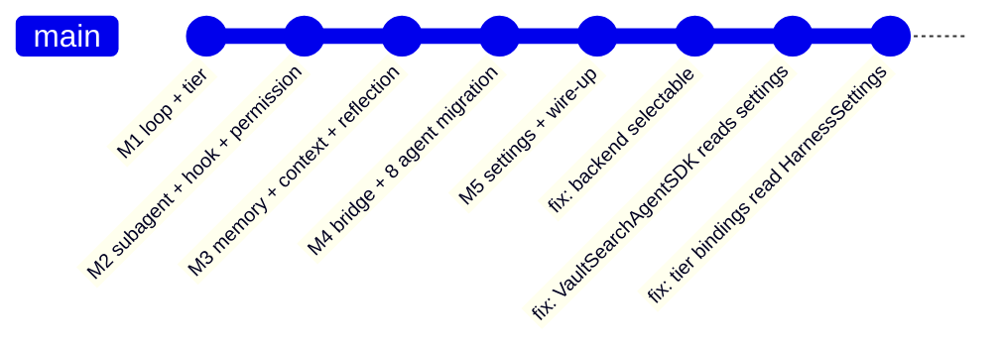
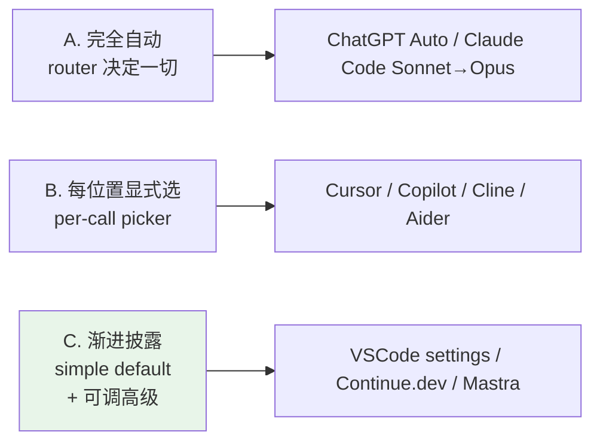
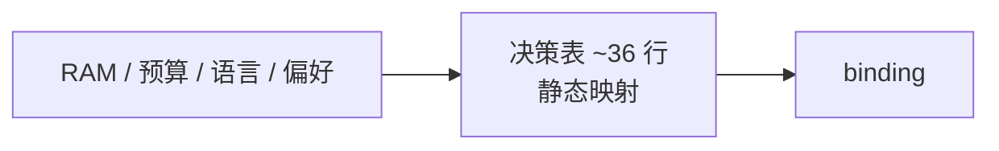
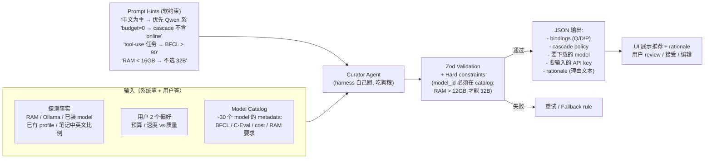
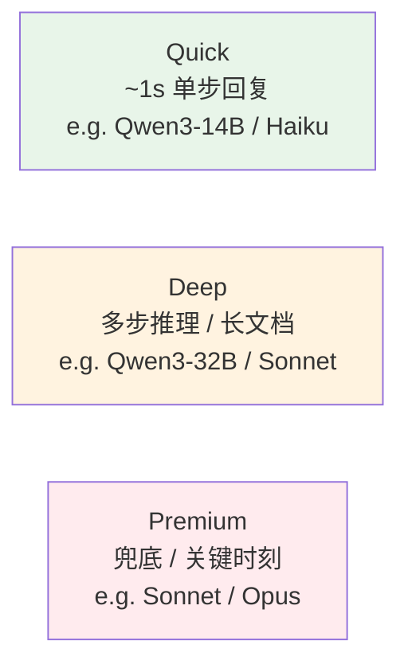
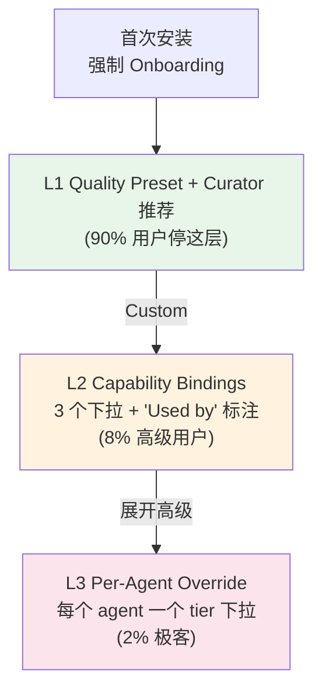
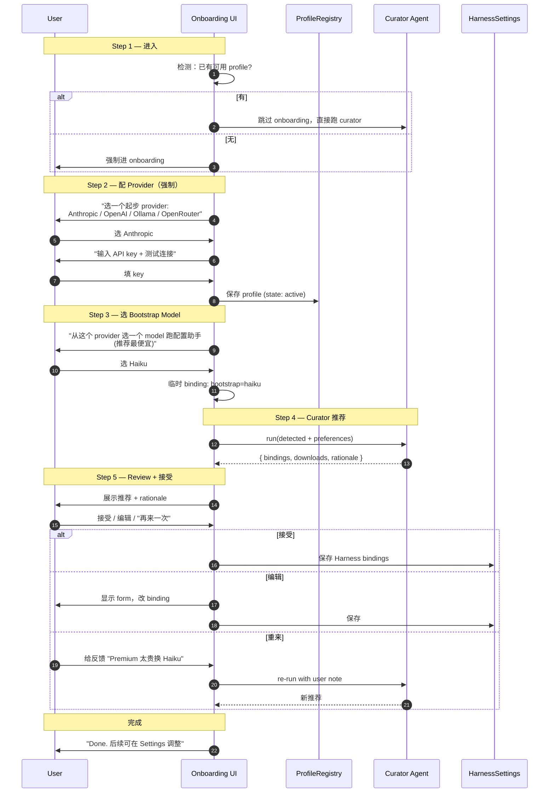
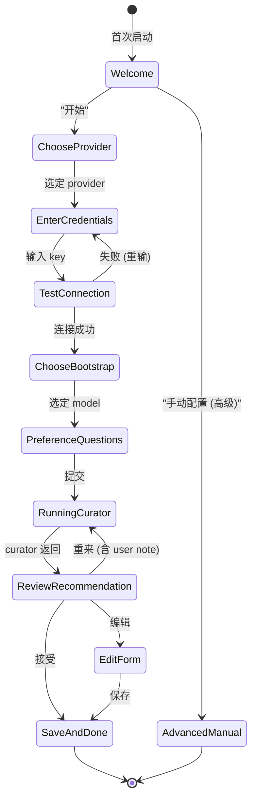
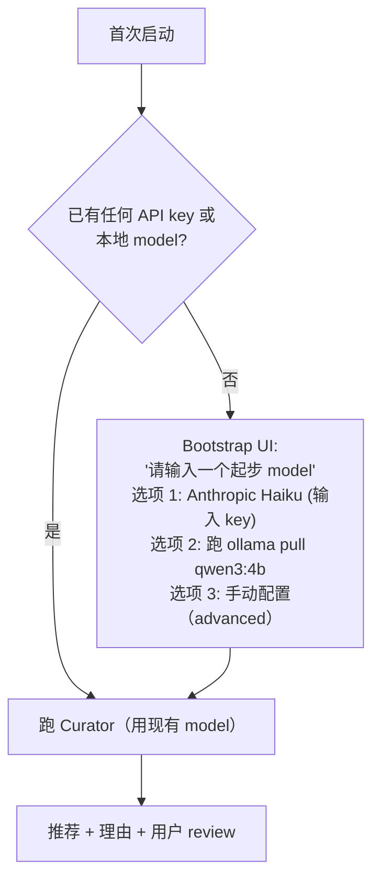
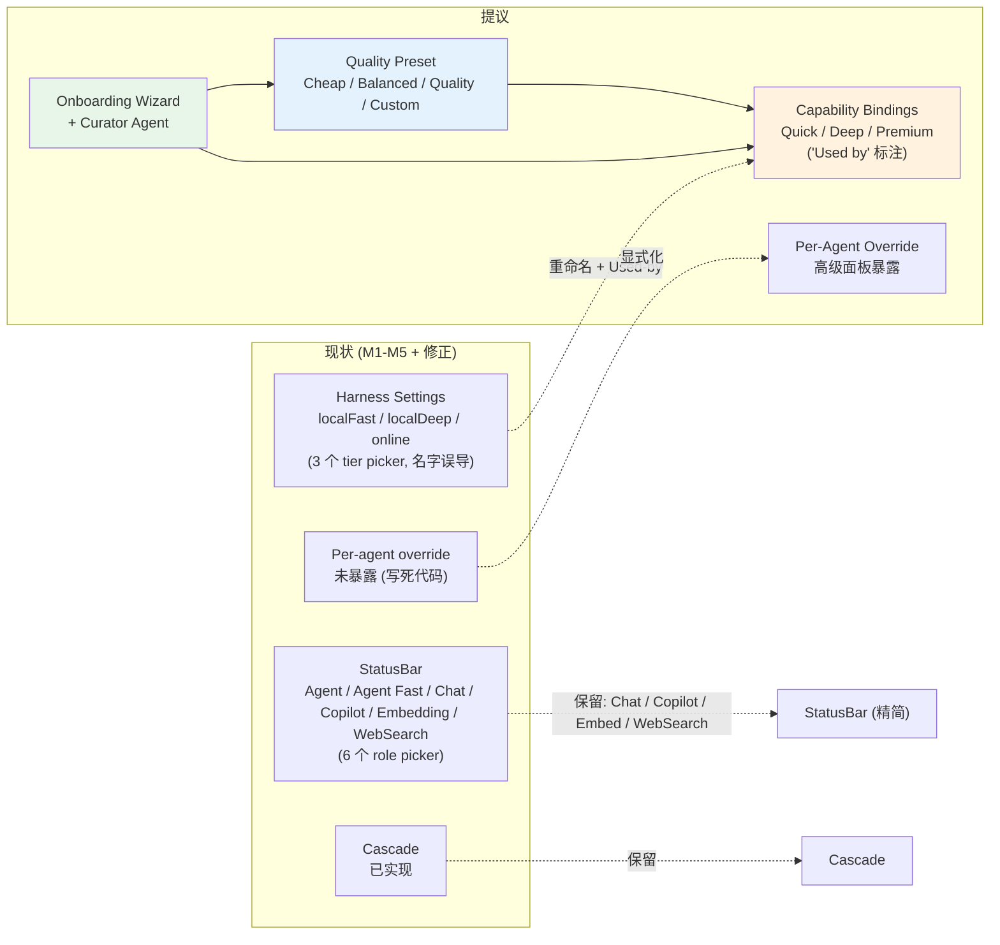

# Agent Model Selection & Onboarding 设计

> 状态：设计讨论沉淀，未实施
> 上游：`2026-05-24-self-hosted-agent-harness.md`（已实施 M1-M5）
> 范围：Harness 落地后，用户**怎么选模型 / 怎么知道要选什么 / 系统怎么帮 ta 选**

## TL;DR

Harness 已经能跑（M1-M5 完成），bridge 让用户在 `harness` / `claude-agent-sdk` 间切换。但**留下了真正的产品问题**：

1. 用户不知道哪个 model 适合 ta（性能 / 预算 / 中英文 / 任务）
2. Model 可用性是动态的（机器 RAM、是否装 Ollama、有没有 API key、配了哪些 provider）
3. 当前 8 个 agent 的起始 tier 写死在代码里，用户不可改
4. 当前 UI 既有 StatusBar（Agent / Agent Fast / Chat role）又有 Harness 三 tier，**两套互相覆盖、概念混乱**

**结论方案**：不让用户在 model 海里挑，**一个 Config Curator Agent 帮 ta 配**。

- 用户首次进来做强制 onboarding：配 1 个 provider + 选 1 个 bootstrap model
- 系统探测环境事实（RAM / Ollama / 已装 model / 笔记中英文比例）
- 问 2 个偏好（预算 / 速度 vs 质量）
- 用 bootstrap model 跑 Curator Agent
- Curator 基于 Model Catalog（30+ model metadata）+ prompt hints 输出推荐 binding plan
- 用户 review / 编辑 / 重来 / 接受
- 之后想调改 settings 或 chat 调用 "re-run wizard"

工作量 ~1,240 行，分 4 个 commit 落地。

---

## 1. 背景与已实施现状

### 1.1 已实施（M1-M5 + 修正）



**已可用的能力**：
- 自研 ReAct loop（基于 Vercel AI SDK）+ Claude Agent SDK 通过 bridge 共存
- 用户能在 settings 选 `agentBackend`: `auto` / `harness` / `claude-agent-sdk`
- 3 个 Capability tier（`local-fast` / `local-deep` / `online`）—— 命名待改
- Cascade（自动升级到下一 tier）+ Escalate（model 自评低主动升）
- Hooks / Permission / Memory / Trace 基础设施

### 1.2 已知 Bug / 修正

| 问题 | 状态 |
|---|---|
| UI 文案误导"harness = local only" | ✅ 已修（commit `b6889de`） |
| VaultSearchAgentSDK 写死 useSDK=true | ✅ 已改成读 settings.agentBackend（commit `b6889de`） |
| HarnessSettings 的 3 个 tier 配置没生效（bindings.ts 没读它） | ✅ 已修（commit `4494d18`） |

### 1.3 真正的产品问题（未解决）

| 问题 | 严重度 |
|---|---|
| **用户不知道哪个 model 适合 ta** | 🔴 |
| **Model 可用性动态变化（机器 / 预算 / 已配 provider）** | 🔴 |
| **8 个 agent 的起始 tier 写死代码，用户没法 per-agent override** | 🟡 |
| **StatusBar role picker 和 Harness 三 tier 概念重叠、互相覆盖** | 🟡 |
| **`local-fast` / `local-deep` 命名误导（不一定是本地）** | 🟡 |
| **Vault MCP server 6 个 tool 还没适配 harness backend** | 🟡 |

---

## 2. 核心矛盾：让用户挑 model 是错路

### 2.1 经典 picker 范式（业界主流）



### 2.2 业界产品对比

| 产品 | 范式 | 关键设计 |
|---|---|---|
| **ChatGPT** | 自动（"Auto" 模式 2025-08 上线） | 内部 router 选 GPT-4o / o1 / Sora，用户能 override |
| **Claude Code** | 半自动 | 主跑 Opus，quota 触发降 Sonnet，用户可强制 |
| **Cursor** | 全显式 | chat / cmd-K / apply / agent 各一个 picker |
| **Copilot** | 显式 → 加 Auto | chat / inline 选；最近加了 "Auto" 路由 |
| **Cline / Aider** | 全显式 | 用户完全控制每个 step |
| **Continue.dev** | 渐进披露 | 每个 step 默认 + 可改 |
| **Letta / Mastra** | per-agent | 每个 agent 声明默认 model |

### 2.3 学界 routing 研究

| 论文 | 方法 | 关键发现 |
|---|---|---|
| **FrugalGPT** (Chen 2023) | Cascade by score（**我们这套**） | 50-90% cost ↓，quality 保持 |
| **RouteLLM** (LMSys 2024) | Learned router（小 model 判断 query 难度） | MT-bench 节省 85% cost，需训练 router |
| **AutoMix** (2024) | Self-verification + cascade | 类 cascade 但增加 self-eval 步 |
| **Hybrid LLM** (Microsoft 2024) | Edge ↔ cloud routing | 复杂 query → cloud，简单 → edge |
| **LLM-Blender** (2023) | 多模型 ensemble pick best | 质量好但 3-5× 成本 |

**学界共识**：
- 100% 自动 routing **目前不可靠**——quality regression 难预测
- 简单 task classifier 准确率 ~70-85%
- **Cascade + escalate** 是当前最稳的方案

### 2.4 用户诉求矩阵

| 用户类型 | 想要 | 当前满足度 |
|---|---|---|
| 完全小白 | 一键搞定，别问我 | ❌（要配 3 个 tier） |
| 中级 | 知道场景对应模型，少量改 | 🟡（两套 UI 重复） |
| 高级 | 完全控制每一步 | 🟡（per-agent override 没暴露） |
| 省钱党 | 默认便宜 + 关键升级 | ✅（cascade 本就是这个语义） |
| 质量党 | 默认贵的 | ❌（没"全跑 online"快捷开关） |
| 中文为主 | 优先 Qwen / GLM | ❌（默认 Anthropic 在中文不一定最强） |
| 英文为主 | 优先 Claude / GPT | ✅ |

### 2.5 关键洞察：用户不知道答案

**用户能回答关于自己的问题，但不能回答"我该用 Qwen3-32B 还是 Claude Sonnet"**。这指向根本不同的范式：不是让 ta 挑 model，而是**问 ta 关于 ta 自己的问题，然后帮 ta 推荐**。

---

## 3. 设计演进：从规则到 LLM Curator

### 3.1 路径 A：纯规则决策表（被放弃）



**优点**：简单、可预测、无 LLM 依赖
**缺点**：
- 新 model 出来要改代码
- 边角组合（用户独特配置）brittle
- 维护成本累积
- 不可解释（没 rationale）
- 不能对话调整

→ **不采纳**

### 3.2 路径 B：LLM Curator（采纳）



**核心理念**：LLM 做决策（软）+ 代码做边界（硬）

| 层 | 实现方式 |
|---|---|
| **Soft (LLM 可违反但要解释)** | 语言偏好 / 速度质量权衡 / cascade 策略 |
| **Hard (zod + code 强制)** | model_id 必须在 catalog；RAM 不够拦截；budget=0 不能含付费 |

---

## 4. 最终方案：3 个层次

### 4.1 概念厘清：Capability 而非 Tier

当前命名 `local-fast` / `local-deep` / `online` 误导（"local" 不应该出现，因为绑定可以是云模型）。改成**能力命名**：



为什么不 5+ 类？学界 RouteLLM 等论文显示 **>4 类后 routing 决策准确率反降**——越细越难选对。3 类已覆盖 90% 用例。

### 4.2 渐进披露：L1 / L2 / L3



### 4.3 每个 Agent 默认归类

| Agent | 默认 capability | 理由 |
|---|---|---|
| FollowupChatAgent | **Quick** | chat 后续追问，频率高，1s 要出 |
| SynthesizeAgent | **Quick** | 单步总结，简单任务 |
| PatternDiscoveryAgent | **Quick** | 模式识别，固定输入 |
| ContinueAnalysisAgent | **Deep** | 中等推理 |
| DocSimpleAgent | **Deep** | 单文档问答，要准 |
| KnowledgeIntuitionAgent | **Deep** | 知识连接推理 |
| VaultSearch | **Deep**，cascade 兜底 **Premium** | 多步搜索，卡住升级 |
| AIGraphAgent | (无 LLM 调用) | 纯 graph 构建 |

---

## 5. Onboarding 流程

### 5.1 完整 Bootstrap 流程



### 5.2 UI 状态机



### 5.3 第二屏：偏好问题

```
配置 AI 助手 (Step 4/5)

检测到:
  ✓ 32GB RAM
  ✓ Ollama 已安装 (已装 model: qwen3:14b)
  ⚠ 你笔记里 87% 是中文
  ✓ 已配 Anthropic API key

最后 2 个问题:

1. 每月愿意花多少 API 钱?
   ○ $0 / 极少 (全本地)
   ● $5-20
   ○ $50+

2. 速度 vs 质量?
   ○ 速度优先
   ● 平衡
   ○ 质量优先

              [配置助手开始推荐 →]
```

### 5.4 推荐展示（含 rationale）

```
推荐配置 (你可以编辑)

Quick    → qwen3:14b (本地, 已装)
Deep     → qwen3:32b (要下载 18GB)  [跳过]
Premium  → claude-sonnet-4-7 (你已有 API key)
Cascade  → 开启

为什么这样推荐:
"你笔记主要是中文，Qwen3-32B 在中文任务上跟 Sonnet 相当但本地免费。
你的 RAM 够跑 32B。Premium tier 用 Sonnet 做关键时刻的兜底，
按你 $5-20 预算估算每月 Sonnet 调用 ~50 次，预计 $8。"

[接受]  [编辑]  [重新生成 (告诉我哪里不对)]
```

---

## 6. Curator Agent 实现细节

### 6.1 Prompt 模板

```
你是 Peak Assistant 的配置顾问。用户给你他的环境信息和偏好，
你要为 Quick / Deep / Premium 三个 capability 各推荐一个 model，
并决定 cascade 策略。

## 用户环境（已探测）
- RAM: {ramGB}GB
- Ollama: {ollamaStatus}
- 已装 local model: {downloadedModels}
- 已配 provider: {profiles}
- 笔记语言: {chineseRatio}% 中文

## 用户偏好（用户回答）
- 预算: {budget}
- 速度 vs 质量: {preference}

## 可选 model（catalog，含 metadata）
{...injected JSON, ~30 models...}

## 软建议（不是硬规则，可违反但要解释）
- 中文为主：Qwen / GLM / DeepSeek 在 C-Eval 上常优于同 size 的 Claude/GPT
- Quick tier：~1s 单步响应优先，<= 14B 本地 model 或 Haiku 级
- Deep tier：多步推理，BFCL > 0.85
- Premium tier：作为 cascade 兜底；如用户 budget=0 可与 Deep 同
- 不要让用户下载超过现 RAM 一半的 model
- 优先用已装 / 已配的，减少用户操作

## 输出 schema（zod-enforced）
{
  bindings: { quick: ModelId, deep: ModelId, premium: ModelId },
  cascadeEnabled: boolean,
  modelsToDownload: ModelId[],
  apiKeysNeeded: ProviderKind[],
  rationale: string  // 中文，2-3 句，告诉用户为什么这样配
}
```

### 6.2 Model Catalog 示例

```json
{
  "qwen3:32b": {
    "kind": "ollama",
    "params": "32B",
    "ramRequiredGB": 18,
    "bfcl": 0.93,
    "ceval": 0.82,
    "mmlu": 0.79,
    "costPer1M": 0,
    "latencyClass": "slow-local",
    "languageStrengths": ["zh", "en"],
    "notes": "Strong tool calling; matches Sonnet on Chinese"
  },
  "claude-sonnet-4-7": {
    "kind": "anthropic",
    "bfcl": 0.97,
    "ceval": 0.79,
    "costPer1M": 3.0,
    "latencyClass": "fast-online",
    "languageStrengths": ["en", "zh"],
    "notes": "Best general purpose; expensive"
  }
}
```

这是**唯一需要维护的数据**——新 model 出来加一行 JSON，curator 自动会用。

### 6.3 硬约束（外置 validation）

```typescript
function validateRecommendation(rec: Recommendation, ctx: Env): ValidationError[] {
    const errs: ValidationError[] = [];

    // 1. model_id 必须在 catalog
    for (const [tier, id] of Object.entries(rec.bindings)) {
        if (!ModelCatalog[id]) errs.push({ type: 'unknown_model', tier, id });
    }

    // 2. RAM 检查
    for (const [tier, id] of Object.entries(rec.bindings)) {
        const m = ModelCatalog[id];
        if (m?.ramRequiredGB && m.ramRequiredGB > ctx.ramGB) {
            errs.push({ type: 'insufficient_ram', tier, id, required: m.ramRequiredGB });
        }
    }

    // 3. budget=0 不能含付费
    if (ctx.budget === 'zero') {
        for (const [tier, id] of Object.entries(rec.bindings)) {
            if (ModelCatalog[id]?.costPer1M > 0) {
                errs.push({ type: 'budget_violation', tier, id });
            }
        }
    }

    // 4. 必须有至少一个 binding
    if (Object.values(rec.bindings).every(v => !v)) {
        errs.push({ type: 'empty_bindings' });
    }

    return errs;
}
```

Curator 输出 → validation 失败 → 自动重试（错误反馈给 LLM "model X 不存在 / RAM 不够 / 违反 budget"）→ 重试 3 次仍失败 → fallback rule-based。

---

## 7. 兼容现有系统

### 7.1 与 StatusBar 旧 picker 关系

目前 StatusBar 有 5 个 role picker（Agent / Agent Fast / Chat / Copilot / Embedding / WebSearch）。Harness 加了 3 个 tier。两套并存导致混乱。

**方案**：
- StatusBar 不动（其他子系统还在用：Chat / Copilot / Embedding / WebSearch）
- Harness 三个 tier 是 **agent loop 专用**
- Agent / Agent Fast role 继续给 SDK 路径（VaultSearchAgentSDK 用）
- 在 Settings → Agent Harness 顶部明确说"这里只配 harness agent，其他子系统配置在 StatusBar"
- 长期：把 Agent / Agent Fast role 也并入 capability，删 StatusBar 重复部分

### 7.2 Bootstrap 与 Curator 的鸡生蛋



Bootstrap model 选什么？UI 给一个 dropdown，**只列适合跑 curator 的 model**（能 follow prompt + 出 valid JSON）。最便宜的标 ⭐ 推荐。

Curator 跑完后 bootstrap model 怎么处理？**可能被推荐覆盖**——curator 决定不用它就丢掉。让 LLM 做最优配置，不被 bootstrap 选择锁死。

---

## 8. 错误处理

| 错误 | 处理 |
|---|---|
| Curator 跑炸（network / model 报错） | 显示错误 + fallback rule-based 推荐（最朴素的）+ "重试"按钮 |
| Curator 推荐含未知 model_id | Zod validation 失败 → 自动重试（带错误反馈给 LLM "model X 不存在 in catalog, retry"） |
| Curator 推荐 RAM 不够的 model | Hard constraint 拦截 → 同上重试 |
| Curator 重试 3 次仍失败 | Fallback 到决策表 + 显示警告 "AI 推荐失败，给你基础配置" |
| Profile 删除导致 binding 孤儿 | UI 警告 "Quick binding 孤儿"+"Re-bind?"按钮，不要 silent fallback |
| 用户跳过 onboarding | 必须 block —— 没 provider 没法跑任何 agent |
| API key 过期 / 配额耗尽 | Cascade 升级时遇到失败 → 跳到下一可用 tier + log warning，**不静默** |

---

## 9. 实施清单

### 9.1 模块拆分（~1,240 行）

| 模块 | 行数 | 优先级 |
|---|---|---|
| Onboarding container + state machine | 150 行 | P0 |
| Provider 选择 + credential 表单 + 连接测试 | 200 行 | P0 |
| Bootstrap model picker（只显示当前 provider 的） | 80 行 | P0 |
| 2 个偏好问题表单 | 50 行 | P0 |
| Curator running 状态 UI（spinner + 取消） | 50 行 | P0 |
| Recommendation review + edit + 重来 | 200 行 | P0 |
| Curator agent + prompt + zod schema | 200 行 | P0 |
| Model catalog 数据 (~30 model) | 200 行 JSON | P0 |
| Fallback rule（curator 跑不通） | 60 行 | P1 |
| "Re-run wizard" 入口 in Settings | 50 行 | P1 |
| **总计** | **~1,240 行** | |

### 9.2 PR 拆分建议

**PR 1：后端基础设施（~500 行）**
- Model Catalog（JSON 数据 + TypeScript loader）
- Curator Agent 实现（用 harness 自己跑）
- Curator prompt template
- Zod schema + hard validation

**PR 2：Onboarding UI 主干（~430 行）**
- Onboarding container + state machine
- Provider 选择 + credentials 表单 + 连接测试
- Bootstrap model picker

**PR 3：Curator 集成 + 推荐展示（~250 行）**
- 偏好问题表单
- Running 状态 UI
- Recommendation 展示

**PR 4：编辑 / 重来 / Re-run / Fallback（~160 行）**
- 编辑 form
- 重来（含 user note 给 curator）
- Re-run wizard 入口（settings）
- Fallback rule

---

## 10. 决策记录（已定）

| 决策 | 选项 | 取舍 |
|---|---|---|
| **Capability 数量** | 3（Q/D/P） vs 5+ | 3，>4 学界证明 routing 准确率反降 |
| **命名** | `local-fast` vs `Quick` | `Quick`，去 "local-" 误导 |
| **决策方式** | 规则表 vs LLM curator | LLM curator（可维护、可解释、可对话） |
| **硬约束位置** | LLM 内 vs 外置 validation | 外置（LLM 软决策 + zod 硬拦截） |
| **Bootstrap** | 自动选 vs 用户挑 | 用户挑（在配的 provider 内挑） |
| **跳过 Curator** | 允许 vs 强制 | 允许（"手动配置 (高级)" 入口） |
| **Bootstrap model 保留** | 锁死 vs 可被覆盖 | 可被覆盖（curator 决定最优） |
| **失效 binding** | Silent fallback vs 警告 | 警告（用户应知道为何质量降） |
| **Per-agent override** | 暴露 vs 隐藏 | 高级面板隐藏（2% 极客） |

---

## 11. 风险登记

| 风险 | 严重度 | 缓解 |
|---|---|---|
| Curator 推荐质量差，用户不满意 | 🔴 | Rationale 展示 + 编辑 + 重来；持续优化 prompt + catalog |
| Model Catalog 维护负担（新 model 频出） | 🟡 | JSON 形式，社区可贡献；CI 检查 model id 引用一致 |
| 用户首次进来 bootstrap model 也不会选 | 🟡 | 提供"最省钱"推荐；明确每个选项的成本 / 速度 |
| Curator 跑得慢（30s+），用户等不及 | 🟡 | Spinner + "取消" + 估时；用更快 model 跑 curator |
| 推荐 fallback 仍然 wrong | 🟢 | 极少触发；至少给用户一个能跑的基线 |
| Onboarding 太长用户中途退出 | 🟡 | 总步骤 5 步以内；每步可"跳过"（带后果说明） |

---

## 12. 开放问题（待用户后续决定）

1. **Curator 用哪个 model 跑**？bootstrap 用户选的那个？还是固定用 Haiku 类 cheap model？
2. **Re-run wizard 多久提示一次**？永不主动？季度？还是新 model 加入 catalog 时？
3. **Per-agent override 真的暴露给 UI 吗**？还是只允许通过 chat "对 Curator 说" 来调？
4. **Cascade policy 暴露多深**？阈值 / 最多升级次数继续作 UI knob？还是预设 3 套（Conservative / Balanced / Aggressive）？
5. **多设备同步**？用户在 Mac 配好 binding，移动到 iPad 上 RAM 不够怎么办？要不要每个 device 一套 binding？

---

## 13. 引用

### 13.1 项目内
- `2026-05-24-self-hosted-agent-harness.md` — Harness 实施 spec（M1-M5）
- `docs/research/2026-05-24-agent-harness/README.md` — Harness 调研总览
- `docs/research/2026-05-24-agent-harness/03-local-models-academia.md` — 本地模型 BFCL / 学界 routing
- `src/service/agents/harness/tier/bindings.ts` — 现有 tier binding 实现
- `src/app/settings/types.ts` — `HarnessSettings` 定义

### 13.2 学界
- Chen et al. 2023, **FrugalGPT** — cascade routing
- Ong et al. 2024, **RouteLLM** — learned router (LMSys)
- Microsoft 2024, **Hybrid LLM** — edge ↔ cloud routing
- AutoMix 2024 — self-verification + cascade

### 13.3 产业
- ChatGPT "Auto" mode (2025-08)
- Cursor model picker
- Cline initial setup
- Continue.dev config hub
- Aider provider auto-detect

---

## 附：当前 vs 提议的概念对比


