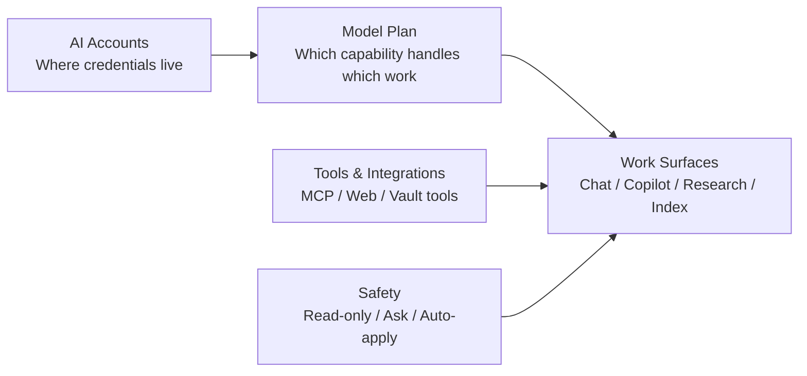
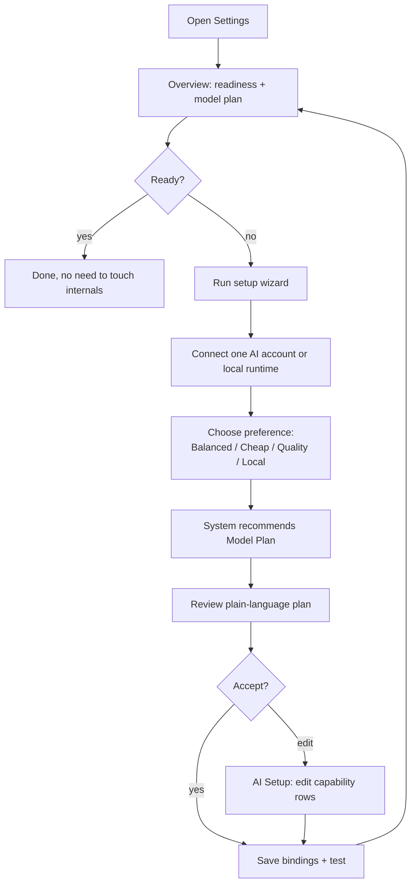
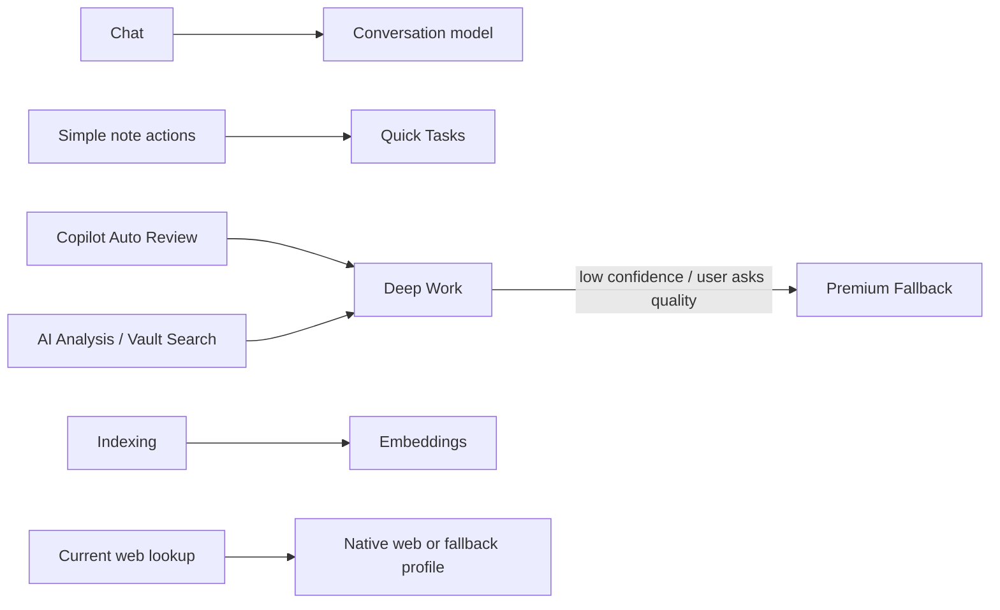
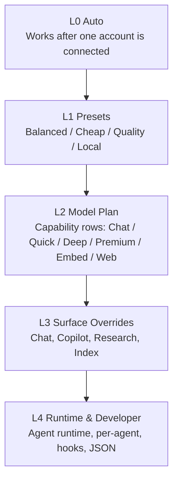
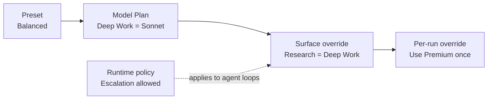

# Settings Mental Model Redesign

Date: 2026-05-26

Status: product / UX design proposal, not implemented

Scope:

- Settings information architecture
- AI provider / profile / model routing
- Agent, Agent Fast, Copilot, Chat, Web Search, Embedding
- Agent Harness runtime settings
- MCP / external tools mental model
- Onboarding and readiness flow

## 1. Diagnosis

The settings problem is not "too many controls" alone. The deeper problem is that internal implementation layers are exposed as if they were user concepts.

Current top-level tabs:

```text
Profiles | MCP Servers | Search & Indexing | Agent Harness | Maintenance | General
```

Current Profiles tab begins with editable pills:

```text
Agent | Agent Fast | Chat | Copilot | Embedding | Web Search | SQLite
```

Current Agent Harness tab then exposes another routing layer:

```text
Backend | Local Fast tier | Local Deep tier | Online tier | Escalation | Permission
```

This creates three kinds of confusion:

1. A profile is both an account credential and a model selector.
2. A role picker is both a status chip and a control.
3. Harness tiers duplicate and override role pickers, but the UI does not explain the precedence.

The code confirms this overlap:

- `ProfileRegistry` owns six active role configs: Agent, Agent Fast, Chat, Copilot, Embedding, Web Search.
- `defaultTierBindings()` maps Harness tiers to HarnessSettings first, then falls back to existing role configs:
  - `local-fast` -> Harness local fast or Agent Fast
  - `local-deep` -> Harness local deep or Agent
  - `online` -> Harness online or Chat
- Copilot is inconsistent:
  - single-turn copilot text streaming uses the Copilot slot and falls back to Agent;
  - Auto Review / Vault Review meta-agents resolve Agent / Agent Fast directly;
  - older copilot agent actions also use active Agent profile.
- Chat web search is not a normal model role. It is a fallback tool model when the active chat model lacks native web-search capability.
- Agent Harness backend is an engine/runtime choice, but it is placed at the same level as normal user settings.

So the current UI asks the user to understand implementation plumbing before they can answer a simple question: "Will this plugin work well, cheaply, and safely?"

## 2. External Design Principles Used

The redesign should follow these principles:

- Settings should mostly contain infrequently changed preferences, not frequent actions. Frequent controls belong near the feature they affect.
- If settings are deep or numerous, start with an overview, group related settings, and add search.
- Defaults should be common, low-risk, low-interruption, and performance-conscious.
- Model selection is an accuracy / cost / latency tradeoff. Users should not be forced to understand every model ID to get a good default.
- MCP servers expose tools, resources, and prompts. Tools can take action and may need explicit user consent, so they belong with permissions and trust, not with model providers.

References:

- Android Settings guide: https://developer.android.com/design/ui/mobile/guides/patterns/settings
- OpenAI model selection: https://platform.openai.com/docs/guides/model-selection/2-optimize-cost-and-latency
- OpenAI latency guide: https://platform.openai.com/docs/guides/latency-optimization/process-tokens-faster
- Anthropic models overview: https://docs.anthropic.com/en/docs/about-claude/models/overview
- MCP server concepts: https://modelcontextprotocol.io/docs/learn/server-concepts

## 3. New User Mental Model

The product should teach five concepts, in this order:



### Concept 1: AI Accounts

User meaning:

> "Which services or local runtimes can Peak Assistant use?"

Examples:

- Anthropic account
- OpenAI account
- OpenRouter account
- Ollama local runtime
- LiteLLM / custom endpoint

Rules:

- AI Accounts are about connection, credentials, base URL, and test status.
- They should not be the primary place where users decide every feature's model.
- Provider cards should say "Connected", "Needs key", "Local runtime unavailable", etc.

### Concept 2: Model Plan

User meaning:

> "How should Peak Assistant spend model power across different work?"

This replaces the visible mental model of Agent / Agent Fast / Chat / Copilot / Web Search.

Recommended capability rows:

| Capability | User-facing label | Used by | Current backing field |
|---|---|---|---|
| Conversation | Chat & daily writing | Chat view, quick replies | `activeChatConfig` |
| Quick Tasks | Fast background jobs | short summaries, simple copilot actions, cheap retries | `activeAgentFastConfig` |
| Deep Work | Research and multi-step agents | AI Analysis, Vault Search, Auto Review, richer Copilot | `activeAgentConfig` / Harness deep |
| Premium Fallback | Only when quality matters | escalation from Deep Work | Harness online, future explicit premium slot |
| Embeddings | Knowledge index | semantic search / vector index | `activeEmbeddingConfig` |
| Web Access | Current web lookup | native search-capable model or fallback web profile | `activeWebSearchConfig` |

This is the single most important redesign decision:

> Stop asking users to configure internal roles. Ask them to choose a plan for kinds of work.

### Concept 3: Work Surfaces

User meaning:

> "Where will I use this?"

Work surfaces should be visible in copy and badges, not become separate model silos by default:

- Chat: ask and continue conversation.
- Copilot: improve the note I am working on.
- Research & Analysis: investigate a question and produce evidence-backed output.
- Knowledge Index: keep the vault searchable.
- Maintenance: health checks, graph, ambient suggestions.

Each surface should show "uses Quick / Deep / Embedding / Web" rather than expose its own unrelated model picker.

### Concept 4: Tools & Integrations

User meaning:

> "What extra things can the assistant access or do?"

This includes:

- MCP servers
- Web access
- Skills
- Vault tools
- future external apps

MCP should not sit beside Profiles as if it is another provider category. MCP servers are tools/resources/prompts, not model accounts.

### Concept 5: Safety

User meaning:

> "What is the assistant allowed to change?"

Current `defaultPermissionMode` values should be renamed:

| Current value | Current label | Proposed user label |
|---|---|---|
| `read` | Read only | Read only |
| `acceptEdits` | Accept edits | Apply note changes automatically |
| `bypassPermissions` | Bypass permissions | Full access, unsafe |

For new users, the recommended default should be "Ask before changing notes" if/when the permission layer supports it. Until then, keep existing behavior but show a clear warning for auto-apply.

## 4. Proposed Settings IA

Replace the current six equal tabs with a task-oriented structure:

```text
Overview | AI Setup | Knowledge Index | Tools | Advanced
```

### 4.1 Overview

Default landing tab. This is the settings home.

Purpose:

- answer "is the system ready?"
- show the active model plan in plain language
- provide one-click repair paths

Layout:

```text
Readiness
  AI accounts: 2 connected, 1 needs key
  Model plan: Balanced
  Knowledge index: Semantic, ready
  Web access: available
  Agent safety: Apply note changes automatically

Model Plan
  Chat & daily writing: openai/gpt-5-mini
  Quick tasks: claude-haiku-4-5
  Deep work: claude-sonnet-4-6
  Embeddings: nomic-embed-text
  Web access: native if available, fallback openai/gpt-5-mini

Actions
  Run setup wizard
  Test all connections
  Rebuild index
```

The overview replaces the current green editable pill row. Pills can remain as read-only status chips, but editing should happen inside AI Setup.

### 4.2 AI Setup

Purpose:

- connect accounts
- choose or regenerate the model plan
- edit capability bindings if needed

Sections:

1. Recommended setup
   - preset cards:
     - Balanced
     - Lowest cost
     - Best quality
     - Local/private
   - "Re-run recommendation" action, using the future Curator Agent from `2026-05-25-agent-model-selection-design.md`.

2. Model Plan
   - six capability rows:
     - Chat & daily writing
     - Quick tasks
     - Deep work
     - Premium fallback
     - Embeddings
     - Web access
   - each row shows:
     - selected profile/model
     - "used by" badges
     - cost/latency hint
     - Test button
     - Change button

3. AI Accounts
   - provider cards for credentials and connection tests only.
   - advanced fields remain collapsed: base URL, custom headers, embedding endpoint.

4. Advanced model controls
   - temperature, reasoning effort, verbosity, timeouts.
   - only visible under Advanced within AI Setup, not at the top.

### 4.3 Knowledge Index

Purpose:

- configure what the plugin indexes and how search behaves.

Sections:

- Index mode: Fast / Semantic / Full
- Auto-index
- Document types
- Ignore patterns
- Graph search / PPR
- Chunking advanced
- AI Analysis save/history behavior

Important: AI Analysis model selection should not live here unless it is a high-level "uses Deep Work" summary with a link back to AI Setup.

### 4.4 Tools

Purpose:

- manage external capabilities.

Sections:

- MCP servers
  - status
  - exposed capabilities
  - read/write risk
  - enabled/disabled
- Skills folder and installed skills
- Web access detail
  - native model web support
  - fallback web search profile

MCP server cards should make the trust boundary visible:

```text
GitHub MCP
  Status: connected
  Capabilities: read issues, create comments
  Risk: can write externally
  Permission: ask before write
```

### 4.5 Advanced

Purpose:

- house runtime, storage, maintenance, and developer settings.

Sections:

- Agent runtime
  - backend: Auto / Peak Agent Runtime / Claude Agent SDK
  - escalation policy
  - per-agent overrides
  - hooks
- Storage folders
- Maintenance
- Usage dashboard retention
- Developer tools

The label "Agent Harness" should disappear from the top-level navigation. It can exist as an internal or advanced runtime name, but it should not be a normal user's first-order concept.

## 5. Naming Changes

| Current label | Problem | Proposed label |
|---|---|---|
| Profiles | Too technical; sounds like personas | AI Accounts |
| Agent | Ambiguous with product agent and SDK agent | Deep Work |
| Agent Fast | Internal implementation term | Quick Tasks |
| Chat | Good but should be a capability row | Chat & daily writing |
| Copilot | Product surface, not a model role | Note Copilot uses Quick/Deep |
| Embedding | Technical but acceptable with helper text | Knowledge index embeddings |
| Web Search | Sounds like a chat feature, not fallback model | Web access |
| Agent Harness | Internal runtime term | Agent runtime, Advanced |
| MCP Servers | Technical but acceptable in Tools | External tools (MCP) |
| General | Junk drawer | Storage & app behavior, under Advanced |

## 6. Target User Flow



## 7. Model Routing Rules

Default routing should be explainable:



Rules:

1. Chat uses Conversation unless the user explicitly switches per conversation.
2. Copilot should not have a normal dedicated global model role. It should use Quick for simple one-shot actions and Deep for multi-step review. A dedicated Copilot override can remain in Advanced.
3. AI Analysis and Vault Search use Deep Work, with Premium fallback if enabled.
4. Embeddings are independent and should never be silently inferred from the chat model.
5. Web access is a tool capability. If the selected conversation model has native web search, use it. If not, use the Web Access fallback profile.
6. Agent runtime backend stays Auto for most users. Runtime backend should not be changed during normal model setup.

## 8. Migration From Current UI

Do not rewrite all settings storage first. Start with a UI-level remap over current fields:

| New UI row | Reads/writes current data |
|---|---|
| Chat & daily writing | `ProfileRegistry.activeChatConfig` |
| Quick Tasks | `ProfileRegistry.activeAgentFastConfig` |
| Deep Work | `ProfileRegistry.activeAgentConfig`; Harness `localDeepConfig` if set |
| Premium Fallback | Harness `onlineConfig`; future explicit `premiumConfig` |
| Embeddings | `ProfileRegistry.activeEmbeddingConfig` |
| Web Access | `ProfileRegistry.activeWebSearchConfig` |
| Agent runtime backend | `settings.harnessSettings.agentBackend` |
| Escalation | `settings.harnessSettings.allowEscalation`, `maxEscalationsPerLoop`, `autoEscalateScoreBelow` |

Precedence should become visible:

- If Harness tier override exists, show "Overrides Deep Work for agent runtime" with a reset link.
- Otherwise, show "Inherits from Model Plan."

Longer-term cleanup:

- introduce a `modelPlan` object as the durable source of truth;
- keep old role configs as migration compatibility;
- remove `activeCopilotConfig` from primary UI;
- move per-agent overrides into Advanced.

## 9. Ease vs Configurability Contract

The goal is not to hide advanced features. The goal is to make every advanced feature enter through a user-understandable promise, then preserve escape hatches without creating duplicate truth.

### 9.1 Four Levels Of Control



| Level | Target user | UI shape | What it controls | Rule |
|---|---|---|---|---|
| L0 Auto | new / busy user | readiness card + repair button | minimum viable account and defaults | never show model IDs before first success |
| L1 Presets | most users | 4 preset cards | budget / quality / privacy posture | preset explains tradeoff in one sentence |
| L2 Model Plan | informed users | six capability rows | model power by workload type | this is the main configuration surface |
| L3 Surface Overrides | power users | per-surface "override inherited plan" drawers | Chat/Copilot/Research-specific choices | override must show inherited value and reset |
| L4 Runtime & Developer | expert users | Advanced tab / config file | backend, per-agent, hooks, debug | never needed to make normal features work |

The important product contract:

> A user can stop at any level and still have a coherent system. Moving deeper gives more control, not a second competing setup path.

### 9.2 Inheritance Model

Every configurable model choice should declare where it came from:



UI requirement:

- inherited values show "Inherited from Model Plan".
- overridden values show "Overrides Model Plan" plus a reset action.
- runtime policies show "Applies to agent loops only", so they are not mistaken for chat model selection.
- a setting must not appear as two equal controls in two places. If it appears twice, one is read-only summary or a link.

### 9.3 Simple Defaults, Advanced Legibility

Ease of use requires defaults, but advanced users need to trust those defaults.

For each smart default, show:

- what it chose;
- why it chose it;
- what uses it;
- how to test it;
- how to override it;
- how to reset to recommendation.

Example Model Plan row:

```text
Deep Work
  claude-sonnet-4-6 via Anthropic Direct
  Used by: AI Analysis, Vault Search, Auto Review
  Why: better multi-step reasoning; can escalate to Premium if confidence drops
  Actions: Test | Change | Reset to Balanced
```

This keeps the first screen simple without turning it into magic.

### 9.4 Advanced Mode Should Be Contextual

Do not create one giant "Advanced mode" that merely reveals every hidden control. Instead, reveal advanced controls at the point of need:

| User intent / problem | Advanced disclosure |
|---|---|
| "I want this cheaper" | show preset comparison + Quick/Deep/Premium costs |
| "Copilot is too weak" | show Copilot surface override and explain Quick vs Deep |
| "Vault Search fails under harness" | show Agent runtime backend note and SDK requirement |
| "I need local-only" | show Local/private preset, Ollama account, no-online escalation |
| "MCP tool feels risky" | show tool-level permission and disable controls |
| "Embedding search is broken" | show embedding account/model readiness, not chat model settings |

Advanced features should therefore be accessible from:

- the Advanced tab for deliberate expert browsing;
- the exact feature row when an issue or override need appears;
- settings search for users who know the term.

### 9.5 Search Is A Safety Valve, Not The Main IA

Settings search should find technical terms such as `Agent Fast`, `Harness`, `MCP`, `embedding`, `Claude SDK`, `Ollama`, and `temperature`, but search should route to the new conceptual location.

Example:

```text
Search "Agent Fast"
  -> result: Quick Tasks model
  -> subtitle: Formerly Agent Fast; used for short background jobs and cheap retries.
```

This preserves expert discoverability while migrating the product language.

### 9.6 Configuration Debt Rules

Avoid these patterns:

1. Two editable controls for the same underlying value.
2. A status chip that silently edits global behavior.
3. A runtime engine setting presented beside normal model selection.
4. A per-feature model picker for every feature before a shared Model Plan exists.
5. A warning that explains implementation history instead of user impact.
6. A "coming soon" advanced control that looks clickable but cannot do anything useful.

Prefer these patterns:

1. One source of truth, many read-only summaries.
2. Plain-language row label, technical alias in secondary text.
3. Override drawers with explicit inheritance.
4. Reset-to-recommended on every advanced override.
5. Test buttons near the thing being tested.
6. Risk labels for tools and write permissions.

### 9.7 Feature-Specific Balance

| Area | Easy path | Advanced path | Hidden danger to avoid |
|---|---|---|---|
| AI Accounts | add provider, paste key, test | custom endpoint, headers, embedding endpoint | mixing credentials with every role picker |
| Model routing | choose preset / accept recommendation | capability rows, surface overrides, per-agent overrides | exposing Agent/Fast/Copilot as unrelated top-level roles |
| Copilot | "Improve current note" uses Quick/Deep automatically | override Copilot surface or action family | making Copilot another global model silo |
| AI Analysis | uses Deep Work | analysis-specific override under Research surface | putting model choice inside Search settings |
| Web search | native if model supports it, fallback if needed | choose fallback web model/tool | treating Web Search like an always-used LLM role |
| Embeddings | one readiness row with rebuild prompt | embedding endpoint/model override | silently falling back to broken semantic search |
| Agent runtime | Auto | backend, escalation, hooks, per-agent | making Harness a normal setup step |
| MCP | tool cards with status and risk | per-server/per-tool permissions | listing servers without explaining what they can do |

### 9.8 Success Metrics

This redesign should be judged by behavior, not just visual cleanliness:

- first successful chat after install takes less than 2 minutes;
- first successful vault search clearly says whether index/model/web is ready;
- fewer than 10 visible choices before the system is ready;
- no normal user needs to understand "Agent Harness";
- every advanced override shows its inherited source and reset path;
- failed provider/model/tool tests point to the exact row to fix;
- support/debug reports can export the active Model Plan and runtime overrides.

## 10. Settings Surface Inventory

The product should not render one giant settings page. Each setting surface must answer one mental question.

| Visual frame | User question | Current settings / code | Primary controls | Advanced controls |
|---|---|---|---|---|
| Overview | Is Peak Assistant ready? | derived from profiles, SQLite, search, MCP, harness | readiness, repair actions, active plan summary | export/debug report |
| AI Accounts | What services can Peak use? | `ProfileSettings.profiles`, `customEndpoints` | provider cards, key, base URL, test | headers, custom endpoint metadata, embedding endpoint |
| Model Plan | How should model power be spent? | active Chat / Agent Fast / Agent / Embedding / Web role configs, Harness online | presets, capability rows, used-by badges | surface overrides, reset inheritance |
| Knowledge Index | What does the vault index? | `SearchSettings.indexLevel`, `autoIndex`, `includeDocumentTypes`, `ignorePatterns`, `enablePPR` | index depth, rebuild, doc types, ignore patterns | chunking, PPR tuning, inspector link tuning |
| Research Output | Where do AI Analysis results go? | `aiAnalysisAutoSaveEnabled`, folder, history limit, summary lengths | auto-save, folder, history | analysis model override, report limits |
| Tools & MCP | What external tools can agents use? | `mcpServers`, skills folder, web access fallback | server cards, connect, enable, risk, permission | transport args/env/headers, per-tool toggles |
| Safety | What can the assistant change? | `defaultPermissionMode`, future tool/write policies | read-only / ask / auto-apply posture | per-surface and per-tool permission overrides |
| Agent Runtime | How do agent loops execute? | `HarnessSettings.agentBackend`, tier configs, escalation, hooks | backend Auto, escalation on/off, premium fallback | per-agent tier override, hooks, thresholds |
| Storage & Folders | Where does plugin data live? | `dataStorageFolder`, `ai.rootFolder`, `skillsFolder`, `inboxFolder`, `customPromptsFolder`, attachment handling | storage roots, attachment handling | path diagnostics, migration helpers |
| Usage & Maintenance | How do I operate/repair the system? | usage tracking, retention, maintenance commands, database health | usage retention, rebuild/verify actions | destructive cleanup, compare PPR, pending enrichment |
| Ambient Intelligence | When should the system proactively surface notes? | `AmbientPushSettings` | enable, status bar, morning briefing, gutter | cooldowns, hops, LLM explanations, learning |

Visual generation rule:

- one image per visual frame;
- no mixed boards;
- each image should show exactly one user question and one coherent setting surface;
- advanced controls appear only as collapsed drawers, side panels, or contextual overrides;
- every override must visibly show its inherited source and reset path.

## 11. Implementation Plan

### Phase 1: IA and copy cleanup

Low risk, no schema migration.

- Rename top-level tabs to Overview / AI Setup / Knowledge Index / Tools / Advanced.
- Move current editable StatusBar into AI Setup.
- Add Overview tab with read-only readiness summary.
- Rename "Agent Harness" to "Agent runtime" and move under Advanced.
- Keep all current controls reachable.

Verification:

- `npm run build`
- manual: Settings opens, all old controls still accessible

### Phase 2: Model Plan component

Medium risk, still using existing `ProfileRegistry` fields.

- Create `ModelPlanSection`.
- Render capability rows with used-by badges.
- Put role model pickers inside each row.
- Remove role pickers from the top of Profiles / AI Accounts.
- Add explicit inheritance/override labels for Harness tier configs.

Verification:

- changing each capability row persists to the same current fields;
- Agent runtime tier override still wins when present;
- Chat, Copilot simple action, Auto Review, Vault Search, Web Search, Embedding all still resolve expected configs.

### Phase 3: Setup wizard / Curator

Build on `2026-05-25-agent-model-selection-design.md`.

- Add "Run setup wizard" from Overview and AI Setup.
- Ask user preference: Balanced / Cheap / Quality / Local.
- Detect available accounts, Ollama models, embedding availability, and missing API keys.
- Generate a recommended model plan.
- Show rationale and let user accept/edit.

### Phase 4: Schema cleanup

Only after the UI proves stable.

- Introduce `settings.modelPlan`.
- Migrate old role configs into model plan.
- Keep backward-compatible readers for one release.
- Remove hidden duplicate model-routing behavior from UI.

## 12. Decisions

Adopt:

- Treat provider/profile as "AI Account", not "where every model setting lives".
- Treat Agent / Agent Fast / Chat / Embedding / Web Search as rows in one Model Plan.
- Hide Agent Harness from primary navigation.
- Collapse Copilot model selection into Quick/Deep policy, with advanced override only.
- Put MCP under Tools, with capability and risk labels.
- Make Overview the default settings entry.

Avoid:

- Do not add more top-level tabs for every subsystem.
- Do not expose 10+ per-agent model selectors to normal users.
- Do not put web search next to embeddings as if both are the same type of model setting.
- Do not show a green control chip when the user needs a plain readiness summary.
- Do not make users choose exact model IDs before they understand the outcome.

## 13. Open Product Questions

1. Should new users default to auto-apply note edits, or should the product introduce an "Ask before applying" mode first?
2. Should Chat remain independently configurable, or should it default to Deep Work with only per-conversation override?
3. Should Premium Fallback exist as a first-class plan row now, or remain an advanced Harness online tier until the Curator flow ships?
4. Should Tools include Skills immediately, or keep Skills in Advanced until the UI is more mature?

Recommended answers:

1. New users should not default to silent writes. Existing users can be grandfathered.
2. Keep Chat visible because users understand and frequently care about chat quality/cost.
3. Show Premium Fallback as a row, but allow "Off".
4. Include Skills in Tools once there is a readable installed-skills list; until then link to Advanced.
