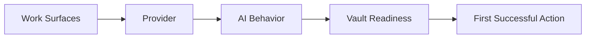

# Peak Assistant Settings Interface Design

Date: 2026-05-29

Status: design spec, ready for implementation planning

Supersedes the user-facing language in `2026-05-26-settings-mental-model-redesign.md`.
The older document is still useful for the configurability model, but its `AI Accounts`, `Quick Tasks`, `Deep Research`, and `Harness` chrome should be treated as pre-onboarding-redesign vocabulary.

## Goal

Redesign Peak Assistant settings so the configuration model matches the new onboarding flow:



Settings should feel like the persistent control room for the same mental model, not a second product with different nouns.

The settings UI lives inside Obsidian's plugin settings pane, so it should only render Peak Assistant's content area. Do not add a left sidebar, app shell, hero layout, dashboard frame, or duplicated Obsidian surrounding UI.

## Non-Negotiable Vocabulary

Use these user-facing terms:

| Internal / legacy concept | User-facing term |
| --- | --- |
| Profile | Provider |
| Chat slot / default model | Conversation |
| Agent Fast / quick tier | Fast Lookup |
| Agent / deep tier | Research |
| Premium / online tier / escalation | Use stronger model when needed |
| Embedding | Knowledge Index |
| Web Search slot | Web Access |
| MCP Servers | External tools |
| Agent Harness | Agent runtime, only under Advanced |
| Safety / permission mode | Safety |

Do not expose `Harness`, `Quick`, `Deep`, `Premium`, `local-fast`, `local-deep`, or `online tier` in primary chrome.

## Settings IA

Top tabs inside the existing Peak Assistant settings content:

```text
Overview | AI Setup | Knowledge Index | Tools | Advanced
```

This is intentionally fewer and more product-shaped than the current:

```text
Profiles | MCP Servers | Search & Indexing | Agent Harness | Maintenance | General
```

### Why This Shape

The old tabs are implementation buckets. Users must already understand that `Profiles` feeds `Agent Harness`, `Embedding`, `Copilot`, `Chat`, and `Web Search`. The new tabs answer user questions:

| User question | New tab |
| --- | --- |
| "Is Peak ready?" | Overview |
| "Which AI does Peak use?" | AI Setup |
| "Can Peak read my vault well?" | Knowledge Index |
| "What can Peak call outside Obsidian?" | Tools |
| "Where are low-level/runtime/maintenance knobs?" | Advanced |

## Layout Rules

Use a single-column settings layout with compact rows.

```text
[Overview] [AI Setup] [Knowledge Index] [Tools] [Advanced]

Section title
┌──────────────────────────────────────────────────────────────┐
│ Label + short explanation                  Status   Control  │
└──────────────────────────────────────────────────────────────┘
┌──────────────────────────────────────────────────────────────┐
│ Label + short explanation                  Status   Control  │
└──────────────────────────────────────────────────────────────┘
```

Rules:

- Maximum content width: about `860px`.
- Prefer `SettingRow` over large nested cards.
- Use cards only for repeated selectable items: Provider rows, recommended setup presets, action launchpad rows.
- Do not put cards inside cards.
- Keep advanced controls in collapsible disclosures.
- Use shadcn `Button`; no raw production buttons.
- Use Lucide icons; no emoji.
- Selection state: solid `--pk-accent-soft`, `3px` left border in `--pk-accent`, and a `Check` icon.
- Avoid opacity utility selections like `bg-[--x]/10`; prefer defined `--pk-*` tokens.
- All visible strings should come from `templates/config/settings.json`.

## Core Components

### `SettingsTabBar`

Horizontal tab bar only. No internal sidebar.

```text
Overview  AI Setup  Knowledge Index  Tools  Advanced
```

Each tab should have a short tooltip from config, but the visible label stays compact.

### `ReadinessChip`

Used everywhere a capability can be green/yellow/red.

States:

| State | Meaning | Example |
| --- | --- | --- |
| Ready | Fully configured | Research has a provider/model and can run |
| Needs attention | Usable with fallback or partial setup | Fast Lookup falls back to Conversation |
| Not ready | Blocking issue | No Provider with valid API key |

### `CapabilityRow`

The main reusable settings row.

```text
Research
Vault synthesis, AI Analysis, and multi-step agent work.
Used by: Vault Search, AI Analysis, Copilot
                                      Ready  Claude Sonnet  Change
```

Row anatomy:

- Icon
- Title
- One-sentence description
- `Used by` chips when helpful
- Readiness chip
- Current binding summary
- Primary action: `Change`, `Connect`, `Fix`, `Test`, or `Open`
- Secondary overflow menu only for rare actions

### `ProviderRow`

Collapsed by default:

```text
Anthropic Direct
Anthropic · API key set · 2 models used
                                      Connected  Test  Edit
```

Expanded:

```text
Connection
Type      Anthropic
Base URL  https://api.anthropic.com
API Key   •••••••••••••

Models
Default model       claude-sonnet...
Fast model          claude-haiku...
Knowledge Index model Not used
```

The user sees `Provider`, while the implementation can still persist to `ProfileRegistry`.

### `IndexReadinessPanel`

Settings version of onboarding Step 5. It must detect first, then recommend.

```text
Knowledge Index
SQLite store              Ready
Indexed notes             1,842 / 1,913 · 96%
Missing or changed notes  71
Semantic search           Not enabled
Current mode              Fast Index

Recommended action        Update changed notes
                           [Update now] [Review details]

Advanced rebuild          collapsed
```

Never default to full re-index when an existing usable index is present.

### `RepairCTA`

Repair actions should jump to the right tab/section or onboarding step:

| Problem | Primary CTA |
| --- | --- |
| No provider | `Add Provider` |
| Provider test failed | `Fix Provider` |
| Conversation missing | `Choose Conversation model` |
| Research missing | `Choose Research model` |
| Index stale | `Update index` |
| Semantic requested but embedding missing | `Connect Knowledge Index provider` |
| Web access missing | `Configure Web Access` |
| External tool error | `Open Tools` |

## Tab 1: Overview

Purpose: answer "Can I use Peak now, and what should I fix first?"

Do not turn this into a dashboard. It is a short readiness summary plus actions.

```text
Peak readiness
┌──────────────────────────────────────────────────────────────┐
│ Providers        Ready             3 connected       Manage  │
│ AI behavior      Needs attention   Fast Lookup fallback Fix  │
│ Knowledge Index  Ready             96% indexed       Check   │
│ Web Access       Optional          Not configured    Setup   │
│ Safety           Ready             Ask before risky writes    │
└──────────────────────────────────────────────────────────────┘

AI behavior
Conversation      OpenAI GPT-5 mini
Fast Lookup       Falls back to Conversation
Research          Claude Sonnet
Stronger model    Off

Actions
[Run setup] [Test providers] [Check index] [Try Chat]
```

Rows:

| Row | Data source | Notes |
| --- | --- | --- |
| Providers | `profileSettings.profiles` + provider tests | Green if at least one enabled provider is usable |
| AI behavior | role bindings and fallback resolution | Summarize Conversation/Fast Lookup/Research |
| Knowledge Index | `IndexService.getIndexStatus()` + coverage stats | Green if usable index exists |
| Web Access | `activeWebSearchConfig` | Optional; yellow only if user enabled a feature that needs it |
| Safety | `harnessSettings.defaultPermissionMode` | Show human wording, not raw enum |

Overview should not expose low-level selectors. It links to deeper tabs.

## Tab 2: AI Setup

Purpose: answer "Which AI does Peak use for each kind of work?"

Structure:

```text
Recommended setup
[Balanced] [Lowest cost] [Research quality] [Local/private]

AI behavior
Conversation       Chat and daily writing              Ready  model  Change
Fast Lookup        Short answers and simple note work  Ready  model  Change
Research           Vault synthesis and AI Analysis     Ready  model  Change
Use stronger model when needed                         Off    Setup
Knowledge Index    Semantic understanding              Ready  model  Change
Web Access         Current web information             Off    Setup

Providers
Anthropic Direct   API key set                         Test   Edit
OpenAI             No key                              Add key
Ollama             Local                               Test   Edit
OpenRouter         API key set                         Test   Edit

Advanced model controls  collapsed
```

### Recommended Setup Presets

These presets change role bindings, not provider credentials.

| Preset | User promise | Internal effect |
| --- | --- | --- |
| Balanced | Good everyday quality and cost | Conversation + Research from strongest general configured provider; Fast Lookup from cheaper/fast provider if available |
| Lowest cost | Prefer cheaper or local models | Fast Lookup local/small; Research lower-cost cloud; stronger fallback off |
| Research quality | Prefer deeper synthesis | Research strongest configured model; stronger fallback available |
| Local/private | Keep routine work local | Conversation/Fast Lookup local if available; Research asks before cloud |

Each selected preset uses the required selected-state rule: `--pk-accent-soft` fill, `3px` left border, `Check`.

### AI Behavior Rows

| User-facing row | Internal sources | Used by |
| --- | --- | --- |
| Conversation | `profileSettings.activeChatConfig`, fallback to `ai.defaultModel` while migrating | Chat |
| Fast Lookup | `profileSettings.activeAgentFastConfig`, `harnessSettings.localFastConfig`, fallback to Conversation | lightweight Copilot actions, quick lookup, short tool calls |
| Research | `profileSettings.activeAgentConfig`, `harnessSettings.localDeepConfig`, fallback to Conversation only as yellow | Vault Search, AI Analysis, Copilot synthesis |
| Use stronger model when needed | `harnessSettings.onlineConfig`, `allowEscalation`, `maxEscalationsPerLoop`, `autoEscalateScoreBelow` | longer agent runs |
| Knowledge Index | `profileSettings.activeEmbeddingConfig`, provider embedding fields | semantic index |
| Web Access | `profileSettings.activeWebSearchConfig` | Chat web access, research web tool |

### Providers Section

Provider list replaces the current Profiles tab wording.

Provider row visible summary:

```text
Provider name
Provider kind · credential state · used by Conversation / Research / Knowledge Index
```

Actions:

- `Test`
- `Edit`
- `Disable`
- `Delete`
- `Add Provider`
- `Add custom endpoint`

Provider detail fields:

| Field | Source |
| --- | --- |
| Provider type | `Profile.kind` |
| Base URL | `Profile.baseUrl` |
| API key | `Profile.apiKey` |
| Primary model | `Profile.primaryModel` |
| Fast model | `Profile.fastModel` |
| Knowledge Index endpoint | `Profile.embeddingEndpoint` |
| Knowledge Index API key | `Profile.embeddingApiKey` |
| Knowledge Index model | `Profile.embeddingModel` |
| Custom headers | `Profile.customHeaders`, advanced |

### Advanced Model Controls

Collapsed by default.

Fields:

| Field | Source | Placement note |
| --- | --- | --- |
| Temperature | `ai.defaultOutputControl.temperature` | Advanced |
| Top P | `ai.defaultOutputControl.topP` | Advanced |
| Top K | `ai.defaultOutputControl.topK` | Advanced |
| Presence penalty | `ai.defaultOutputControl.presencePenalty` | Advanced |
| Frequency penalty | `ai.defaultOutputControl.frequencyPenalty` | Advanced |
| Reasoning effort | `ai.defaultOutputControl.reasoningEffort` | Advanced |
| Text verbosity | `ai.defaultOutputControl.textVerbosity` | Advanced |
| Total timeout | `ai.defaultOutputControl.timeoutTotalMs` | Advanced |
| Step timeout | `ai.defaultOutputControl.timeoutStepMs` | Advanced |
| Attachment handling | `ai.attachmentHandlingDefault` | Advanced; user wording: `Send directly` / `Convert to text first` |
| Per-prompt overrides | `ai.promptModelMap` | Very advanced; collapsed table |

Do not put AI Analysis model pickers in Knowledge Index. AI Analysis uses Research, with optional advanced per-prompt override here.

## Tab 3: Knowledge Index

Purpose: answer "How well can Peak read my vault?"

```text
Index readiness
SQLite store              Ready
Current index             1,842 files · 96% coverage
Missing/changed notes     71
Semantic readiness        Provider missing
Current mode              Fast Index

Recommended action
Update changed notes
[Update now] [View changed notes]

Index behavior
Index mode                Fast Index / Semantic Index / Full Knowledge Index
Auto-index on startup     Off
Document types            Markdown, PDF, Images, Excalidraw ...
Ignore patterns           Edit

Search quality
Personalized PageRank     On
Inspector links           Advanced

AI Analysis output
Auto-save results         On
Save folder               ChatFolder/AI-Analysis
Recent history            5
Exclude saved analyses    On

Advanced chunking         collapsed
Advanced rebuild          collapsed
```

### Index Modes

Use user language:

| UI label | Internal value | Description |
| --- | --- | --- |
| Fast Index | `fast` | Local text and graph search. No API calls. |
| Semantic Index | `semantic` | Adds embeddings for meaning-based search. Requires Knowledge Index provider. |
| Full Knowledge Index | `full` | Adds LLM tags and summaries. Slower and may cost money. |

### Index Detection

The top readiness panel should call `IndexService.getIndexStatus()` and combine it with vault file counts where available.

Recommended action logic:

| Detected state | Recommended action |
| --- | --- |
| SQLite unavailable | Repair SQLite / open Advanced storage |
| No indexed docs | Build Fast Index |
| Usable index with changed notes | Update changed notes |
| Usable index and current | No action needed |
| Semantic mode selected but no embedding provider | Connect Knowledge Index provider |
| Full mode selected but Research missing | Configure Research |
| User explicitly opens advanced rebuild | Offer full rebuild |

### Knowledge Index Fields

| Field | Source |
| --- | --- |
| Index mode | `search.indexLevel` |
| Auto-index | `search.autoIndex` |
| Document types | `search.includeDocumentTypes` |
| Ignore patterns | `search.ignorePatterns` |
| Refresh interval | `search.indexRefreshInterval`, advanced |
| Max chunk size | `search.chunking.maxChunkSize`, advanced |
| Chunk overlap | `search.chunking.chunkOverlap`, advanced |
| Min document size for chunking | `search.chunking.minDocumentSizeForChunking`, advanced |
| Skip code blocks | `search.chunking.skipCodeBlocksInChunking`, advanced |
| Code block placeholder | `search.chunking.codeBlockPlaceholder`, advanced |
| Max code block chars | `search.chunking.maxCodeChunkChars`, advanced |
| Personalized PageRank | `search.enablePPR` |
| Keyword link count | `search.inspectorLinks.keywordTopN`, advanced |
| Tag link count | `search.inspectorLinks.tagTopN`, advanced |
| Folder grouping | `search.inspectorLinks.folderGroupingEnabled`, advanced |
| Folder group min count | `search.inspectorLinks.folderGroupMinCount`, advanced |
| Folder group max depth | `search.inspectorLinks.folderGroupMaxDepth`, advanced |
| AI Analysis summary words | `search.aiAnalysisSessionSummaryWordCount`, advanced |
| Short summary length | `search.shortSummaryLength`, advanced |
| Full summary length | `search.fullSummaryLength`, advanced |
| Auto-save AI Analysis | `search.aiAnalysisAutoSaveEnabled` |
| AI Analysis save folder | `search.aiAnalysisAutoSaveFolder` |
| Exclude saved analyses from search | `search.aiAnalysisExcludeAutoSaveFolderFromSearch` |
| Recent AI Analysis limit | `search.aiAnalysisHistoryLimit` |

Hidden/internal:

| Field | Treatment |
| --- | --- |
| `search.searchUpgradePromptDismissedAt` | No direct UI |
| `search.aiAnalysisModel` | Legacy compatibility; migrate to Research/per-prompt overrides |
| `search.chunking.embeddingModel` | Legacy compatibility; prefer Knowledge Index provider row |
| `search.chunking.rerankModel` | Advanced only if reranking is user-configurable later |

## Tab 4: Tools

Purpose: answer "What outside capabilities can Peak use?"

```text
External tools
Filesystem Tools        Connected · 8 tools       Manage
Browser Search          Error                     Fix
[Add external tool]

Web Access
Provider                Not configured            Setup
Used by                 Chat, Research

Skills
Skills folder           _skills                   Change
Installed skills        12 found                  Open

Capture destinations
Inbox folder            _inbox                    Change
Custom prompts folder   _prompts                  Change
```

### External Tools

Current `MCPServerSection` becomes `External tools`.

Fields:

| Field | Source |
| --- | --- |
| Server name | `mcpServers[].name` |
| Enabled | `mcpServers[].enabled` |
| Transport | `mcpServers[].transport` |
| Command | `mcpServers[].command` |
| Args | `mcpServers[].args` |
| Environment | `mcpServers[].env`, advanced |
| SSE URL | `mcpServers[].url` |
| Headers | `mcpServers[].headers`, advanced |
| Connection status | `MCPClientManager.getConnectionInfo()` |
| Tool count | `MCPConnectionInfo.toolCount` |

Use `Connect`, `Disconnect`, `Test`, `Edit`, `Disable`, `Delete`.

### Skills

Fields:

| Field | Source |
| --- | --- |
| Skills folder | `skillsFolder` |
| Inbox folder | `inboxFolder` |
| Custom prompts folder | `customPromptsFolder` |

These are tools/workflow surfaces, not general storage. Put them in Tools unless implementation wants all folder paths consolidated in Advanced with cross-links.

### Web Access

Web Access is optional. It should be visible here and summarized in AI Setup.

Source:

- `profileSettings.activeWebSearchConfig`

If no Web Access provider is configured, show `Optional` rather than `Broken`.

## Tab 5: Advanced

Purpose: keep full configurability without forcing normal users to understand runtime internals.

```text
Agent runtime
Runtime mode             Auto                      Change
Safety                   Ask before risky writes   Change
Stronger model rules     Off / configured          Edit
Hooks                    Coming soon

Storage and folders
Data storage folder      A-control/PeakAssistant/DataStore
Chat root folder         ChatFolder
SQLite backend           Auto

Proactive suggestions
Suggest related notes    On
Morning briefing         On
Status bar               On

Usage and retention
Usage tracking           On
Detailed logs retained   30 days

Maintenance
[Update index] [Verify database] [Cleanup data] [Cancel indexing]
Danger zone              collapsed

Developer
Graph inspector          Off
Graph visualization      collapsed
SDK process settings     collapsed
Legacy compatibility     collapsed
```

### Agent Runtime

User-facing labels:

| UI label | Source |
| --- | --- |
| Runtime mode | `harnessSettings.agentBackend` |
| Safety | `harnessSettings.defaultPermissionMode` |
| Use stronger model when needed | `harnessSettings.onlineConfig`, `allowEscalation` |
| Max stronger-model uses per run | `harnessSettings.maxEscalationsPerLoop` |
| Confidence threshold | `harnessSettings.autoEscalateScoreBelow` |
| Hooks | `harnessSettings.hooksEnabled` |

Runtime mode choices:

| UI label | Internal value |
| --- | --- |
| Auto | `auto` |
| Peak runtime | `harness` |
| Claude Agent SDK | `claude-agent-sdk` |

Only this Advanced area may explain runtime tradeoffs. Primary tabs should not say `Harness`.

### Storage And Folders

Fields:

| Field | Source |
| --- | --- |
| Data storage folder | `dataStorageFolder` |
| Chat root folder | `ai.rootFolder` |
| SQLite backend | `sqliteBackend` |

Derived folders should be shown as read-only detail under Chat root:

- `Prompts`
- `Attachments`
- `resources-summary-cache`
- `Hub-Summaries`
- `system/User-Profile.md`

### Proactive Suggestions

Source: `ambientPush`.

Fields:

| UI label | Source |
| --- | --- |
| Suggest related notes | `ambientPush.enabled` |
| Trigger cooldown | `ambientPush.triggerCooldownMs` |
| Document switch cooldown | `ambientPush.docSwitchCooldownMs` |
| Writing pause | `ambientPush.writingPauseMs` |
| Minimum writing change | `ambientPush.minCharDelta` |
| Max suggestions | `ambientPush.maxPushItems` |
| Show status bar | `ambientPush.showStatusBar` |
| Graph expansion hops | `ambientPush.graphExpansionHops` |
| Learn from feedback | `ambientPush.feedbackLearning` |
| Use AI explanations | `ambientPush.enableLlmExplanation` |
| AI explanation cooldown | `ambientPush.llmExplanationCooldownMs` |
| Show inline suggestions | `ambientPush.enableSerendipityGutter` |
| Morning briefing | `ambientPush.enableMorningBriefing` |
| Auto-open panel | `ambientPush.autoOpenedPanel` |

This should not be in Overview unless it affects readiness. It is an advanced personalization capability.

### Usage And Retention

Fields:

| Field | Source |
| --- | --- |
| Usage tracking | `usageTrackingEnabled` |
| Detailed usage retention | `usageDetailRetentionDays` |

### Maintenance

Move current Maintenance tab actions here, grouped by risk.

Normal actions:

- Update index
- Full configured pipeline
- Cancel indexing
- Refresh related notes
- Refresh hub summaries
- Recompute gap analysis
- Analyze vault intuition
- Verify database health
- Cleanup useless data
- Build pending vectors
- Run pending LLM enrichment
- Global maintenance
- Compare PPR search

Danger zone:

- Clear profile build record
- Delete index data

Danger zone must be collapsed and confirm before running.

### Developer

Fields:

| Field | Source |
| --- | --- |
| DevTools graph inspector | `enableDevTools` |
| MST prune depth | `graphViz.mstPruneDepth` |
| Skeleton backbone only | `graphViz.skeletonBackboneOnly` |
| MST leaf opacity | `graphViz.mstLeafOpacity` |
| MST leaf width scale | `graphViz.mstLeafWidthScale` |
| SDK CLI path override | `profileSettings.sdkSettings.cliPathOverride` |
| SDK subprocess pool size | `profileSettings.sdkSettings.subprocessPoolSize` |
| SDK warmup on load | `profileSettings.sdkSettings.warmupOnLoad` |
| Vault Search SDK profile | `vaultSearch.sdkProfile`, legacy compatibility |
| Legacy provider configs | `ai.llmProviderConfigs`, migration only |

## Surface Integration

Every product surface should use the same readiness concepts.

| Surface | Capability label | If not ready |
| --- | --- | --- |
| Chat | Conversation | `Choose Conversation model` |
| Vault Search | Knowledge Index + Research | `Check index` / `Choose Research model` |
| AI Analysis | Research + Knowledge Index | `Choose Research model` / `Check index` |
| Copilot | Fast Lookup + Research + Safety | `Configure AI behavior` / `Review safety` |
| Web-enabled Chat | Web Access | `Configure Web Access` |

Do not show model-tier internals in these surfaces. Show user capability names and repair CTAs.

## `templates/config/settings.json` Shape

Create this config before implementing the new TSX chrome. Suggested shape:

```json
{
  "tabs": [
    { "id": "overview", "label": "Overview", "description": "Readiness and quick fixes" },
    { "id": "aiSetup", "label": "AI Setup", "description": "Providers and AI behavior" },
    { "id": "knowledgeIndex", "label": "Knowledge Index", "description": "Vault search and indexing" },
    { "id": "tools", "label": "Tools", "description": "External tools, skills, and web access" },
    { "id": "advanced", "label": "Advanced", "description": "Runtime, storage, maintenance, and developer settings" }
  ],
  "capabilities": {
    "conversation": {
      "label": "Conversation",
      "description": "Chat and daily writing"
    },
    "fastLookup": {
      "label": "Fast Lookup",
      "description": "Short answers and simple note actions"
    },
    "research": {
      "label": "Research",
      "description": "Vault synthesis, AI Analysis, and multi-step work"
    },
    "strongerModel": {
      "label": "Use stronger model when needed",
      "description": "Let longer runs switch to a stronger model when confidence is low"
    },
    "knowledgeIndex": {
      "label": "Knowledge Index",
      "description": "Search and semantic understanding of your vault"
    },
    "webAccess": {
      "label": "Web Access",
      "description": "Current web information for chat and research"
    }
  },
  "readiness": {
    "ready": "Ready",
    "needsAttention": "Needs attention",
    "notReady": "Not ready",
    "optional": "Optional"
  }
}
```

Add row labels, action labels, help text, and empty states under the same file as implementation proceeds.

## Implementation Slices

### Slice 1: Vocabulary And Config

- Add `templates/config/settings.json`.
- Add typed loader for settings UI config.
- Rename visible `Profile` chrome to `Provider`.
- Rename visible `MCP Servers` chrome to `External tools`.
- Hide `Harness`, `Quick`, `Deep`, `Premium` from settings chrome.

### Slice 2: Settings Shell And Overview

- Replace current six tabs with five tabs.
- Build `ReadinessChip`, `CapabilityRow`, `SettingsSection`, and `SettingsTabBar`.
- Implement Overview with read-only summaries and repair CTAs.

### Slice 3: AI Setup

- Move provider list into AI Setup.
- Replace current `StatusBar` chips with AI behavior rows.
- Implement Recommended Setup presets.
- Move output controls into collapsed Advanced model controls.

### Slice 4: Knowledge Index

- Build index detection panel.
- Change index actions to detect-first behavior.
- Move current Search tab fields into Index behavior, Search quality, AI Analysis output, and Advanced chunking.

### Slice 5: Tools

- Move MCP into External tools.
- Add Skills/Web Access/Capture destination rows.

### Slice 6: Advanced

- Move runtime, safety, storage, proactive suggestions, usage retention, maintenance, developer settings here.
- Collapse danger zone.

### Slice 7: Surface Repair CTAs

- Add capability labels and repair CTAs to Chat, Vault Search, AI Analysis, and Copilot surfaces.

## Design Checks Before Shipping

- No visible `Profile` except developer/internal contexts.
- No visible `Harness`, `Quick`, `Deep`, or `Premium` in primary settings.
- Overview can be understood without knowing providers/models.
- AI Setup answers which AI does which work.
- Knowledge Index detects first and recommends action; no automatic full rebuild.
- Tools separates external capabilities from AI model setup.
- Advanced preserves full configurability without dominating first-run users.
- All strings come from `templates/config/settings.json`.
- Selection state uses `--pk-accent-soft` + left border + `Check`.
- Every red/yellow state has a repair CTA.
