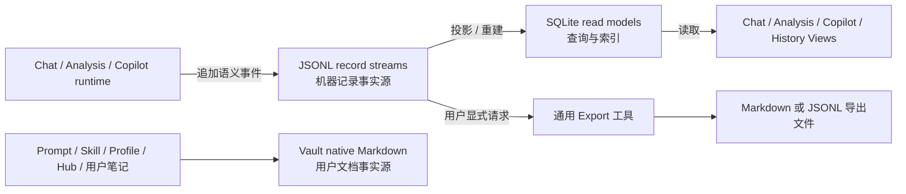

# 机器运行记录存储重构：JSONL 事实源、SQLite 索引与 Markdown 导出

日期：2026-07-21  
状态：**Accepted design · implementation not started**  
范围：Chat Studio、AI Analysis、新 Composer Copilot / History，以及与这些能力直接相邻的机器存储  
不包含：旧 Copilot review/report 历史迁移、真实用户 Vault 文件数量盘点、现有知识文档格式迁移

> 本文只依据插件源码定义目标存储边界。当前生产代码仍以 SQLite + Vault Markdown 混合方式运行；在迁移完成并通过验证前，源码行为仍是当前事实，本文是目标设计事实。

## 1. 核心决定

Peak Assistant 后续按数据责任选择存储格式，不再把“机器生成”简单等同于 Markdown，也不把“历史数据”简单等同于 SQLite。

- **JSONL 是机器运行记录的可同步事实源。** Chat 对话、AI Analysis run、新 Copilot session 和已提交的文档 History transaction 使用分片 JSONL stream。
- **SQLite 是可重建的查询投影。** 列表、分页、搜索、计数、关联、star、状态和轻量 preview 继续由 SQLite 提供。
- **Markdown 只承担用户文档和显式导出。** Prompt、Skill、User Profile、Hub、用户真实笔记继续使用 Markdown。
- **当前状态不强行使用 JSONL。** Chat Project 当前配置和 Resource Summary cache 使用 SQLite 或 JSON snapshot；只有需要审计历史时才追加事件。
- **运行数据不写入插件安装目录。** 插件源码位于 `.obsidian/plugins/obsidian-peak-assistant`，运行记录统一写入配置化的 `DataStore/records/`。
- **一个逻辑根目录不等于一个巨大文件。** 每个 conversation、analysis run、Copilot session 或 document history 使用独立 stream，避免同步冲突和单点损坏。

### 1.1 “Chat 消息保存到 Vault”的修正决定

当前每条 Chat 消息上的 `Save to Vault` 不是内部持久化链路，而是一个独立的用户动作。它不应继续出现在“必须保留的 Markdown 存储”清单中。

本设计作出以下决定：

- 当前单条消息 `Save to Vault` **不属于迁移兼容要求**。
- Chat JSONL 切换时，从核心 Chat Studio message action 中移除该入口。
- 已经由用户保存出的 Markdown 笔记属于普通用户文档，不迁移、不删除。
- 如果未来确认存在真实导出需求，使用独立的通用 Export 工具重新提供，而不是让单条消息继续拥有特殊的 Vault 写入逻辑。
- 通用 Export 工具属于后续产品范围，不阻塞 JSONL 迁移。

这项决定将“数据可靠性”和“用户导出”彻底分开：没有导出按钮，Chat 历史仍必须完整；有导出工具，也不能让导出文件反过来成为运行事实源。

## 2. 本文读者与使用方式

本文供以下读者使用：

- 评审 Peak Assistant 存储边界的 owner；
- 实施 Chat、AI Analysis 或 Composer 持久化迁移的工程师；
- 需要拆分迁移任务、测试和回滚步骤的 AI coding agent。

读完后，执行者应能回答：

1. 哪些当前 Markdown 写入必须迁移；
2. 哪些 Markdown 是用户文档，不能误删；
3. JSONL、SQLite、View 和 Export 分别拥有什么；
4. 怎样分阶段切换而不丢失已有 Chat 或 AI Analysis 数据；
5. 新 Composer Copilot / History 怎样避免继承旧 Copilot 存储。

## 3. 当前代码事实

### 3.1 Chat Studio

当前 Chat Studio 使用双重事实源：

- SQLite 保存 conversation/message metadata；
- `Conv-*.md` 保存完整消息正文；
- 读取时把 SQLite rows 与 Markdown parser 输出重新合并；
- append 实际执行 `parse -> merge -> re-render -> vault.modify`。

代码证据：

- [`ChatStore.ts`](../../../src/core/storage/vault/ChatStore.ts)：创建、读取、重命名和更新 conversation Markdown；
- [`ChatConversationDoc.ts`](../../../src/core/storage/vault/chat-docs/ChatConversationDoc.ts)：约 430 行 Markdown builder/parser；
- [`ddl.ts`](../../../src/core/storage/sqlite/ddl.ts)：`chat_message` 保存 `content_hash` 和 preview，但不保存完整 `content`；
- [`registerChatMarkdownAffordance.ts`](../../../src/app/chat/registerChatMarkdownAffordance.ts)：通过 Markdown 路径反查 conversation 并显示“切换到 Chat View”按钮；
- [`MaintenanceCleanupService.ts`](../../../src/service/maintenance/MaintenanceCleanupService.ts)：以 conversation Markdown 是否存在判断 SQLite row 是否 orphan。

### 3.2 AI Analysis

当前 AI Analysis 也使用双重事实源：

- 自动保存把完整 analysis snapshot 构造成 Markdown；
- `ai_analysis_record` 只保存历史列表 metadata 和 `vault_rel_path`；
- History View 读取 Markdown，再用 parser 重建 snapshot；
- follow-up 或 milestone save 会覆盖原 Markdown。

代码证据：

- [`analysisDocPersistence.ts`](../../../src/service/search/analysisDocPersistence.ts)：自动保存入口；
- [`AppAnalysisDocVaultWriterAdapter.ts`](../../../src/app/search/AppAnalysisDocVaultWriterAdapter.ts)：`.md` 创建和覆盖；
- [`AiSearchAnalysisDoc.ts`](../../../src/core/storage/vault/search-docs/AiSearchAnalysisDoc.ts)：snapshot 与 Markdown model 转换；
- [`analysis-markdown-builder.ts`](../../../src/core/storage/vault/search-docs/analysis-markdown-builder.ts) 与 [`analysis-markdown-parser.ts`](../../../src/core/storage/vault/search-docs/analysis-markdown-parser.ts)：Markdown 协议实现；
- [`RecentAIAnalysis.tsx`](../../../src/ui/view/quick-search/components/ai-analysis-sections/RecentAIAnalysis.tsx)：历史重放依赖 Markdown parser。

### 3.3 新 Composer Copilot / History

当前新 Composer Intelligence 仍是设计和静态 mock，不是生产持久化 runtime。

- `Copilot` 负责 brief、session、run receipt 和临时 review；
- `History` 只保存已经接受或真正提交的文档事务；
- pending proposal 不属于 History；
- 旧 `CopilotReviewHistoryService` 和 Vault review report 不作为新实现基础。

产品边界来自 [`2026-07-15-composer-intelligence-sidecar-ui.md`](./2026-07-15-composer-intelligence-sidecar-ui.md)。

### 3.4 其他 Markdown 写入

插件中还有多种 Markdown writer，但它们不共享同一种数据语义。

| 功能 | 当前责任 | 目标决定 |
| --- | --- | --- |
| Chat Project Summary | 用户 description/instructions + 系统 summary 混合当前状态 | 改为 SQLite/JSON 当前状态；需要审计时追加事件 |
| Resource Summary Cache | 机器生成的资源摘要缓存 | 改为 SQLite/JSON cache |
| User Profile | 用户可读、可编辑的长期上下文 | 保持 Markdown |
| Prompt override | 用户可编辑的 prompt source | 保持 Markdown |
| Vault Skill | Markdown 本身是技能定义 | 保持 Markdown |
| Hub Summary | 进入知识库链接和编辑体系的真实文档 | 保持 Markdown |
| AI Analysis / Graph 显式保存 | 用户主动生成一份文档 | 保留为 Export 能力 |
| Run artifact body | 按 `contentType` 保存原生内容 | 保持 content-type-aware，不统一转 JSONL |
| 旧 Copilot review/report | 已被新 Composer 方向取代的旧历史 | 不迁移；随旧能力退役 |

## 4. 目标数据所有权



阅读这张图时需要注意：

- View 默认读取 repository/read model，不直接解析 Markdown。
- SQLite 可以删除后重建；JSONL stream 不能依赖 SQLite 才可解释。
- Export 文件是派生产物，不参与恢复运行状态。
- 用户文档继续由 Vault Markdown 拥有，不进入机器 record store。

## 5. 统一目录布局

目标根目录使用现有 `getAIDataStoreFolder(rootFolder)`，默认落在 `<AI root>/DataStore`。

```text
DataStore/
├── records/
│   ├── chat/
│   │   └── conversations/<conversation-id>.jsonl
│   ├── analysis/
│   │   └── runs/<run-id>.jsonl
│   ├── copilot/
│   │   └── sessions/<session-id>.jsonl
│   └── document-history/
│       └── <document-stable-id>.jsonl
├── chat.sqlite
└── vault.sqlite
```

约束：

- 不在 `.obsidian/plugins/obsidian-peak-assistant` 下创建运行记录；
- 不创建 `all-history.jsonl`、`events.jsonl` 等全局共享 append 文件；
- 文件名使用稳定 ID，不使用会随标题或路径变化的 display name；
- document path 变化通过 transaction/index 更新表达，不通过重命名全部 history stream 表达；
- 二进制和大 artifact body 继续独立保存，JSONL 只记录 artifact reference。

## 6. 通用 JSONL 记录合同

每一行都是一个完整 JSON object。以下为提议合同，不是现有代码：

```ts
// Proposed
interface RecordEvent<TPayload = unknown> {
  schemaVersion: 1;
  eventId: string;
  streamType: 'chat' | 'analysis' | 'copilot' | 'document-history';
  streamId: string;
  eventType: string;
  occurredAt: number;
  actor: 'user' | 'assistant' | 'system' | 'tool';
  previousEventId?: string;
  payload: TPayload;
}
```

### 6.1 写入规则

- 同一 stream 的 append 必须经过实例拥有的串行 write queue。
- `eventId` 必须可用于重试去重。
- 一个业务事件必须一次写成完整一行，不能把 token delta 当成 durable line。
- cancellation、timeout 和 failure 是显式终态事件，不能只靠“缺少 completed”推断。
- JSONL 不保存 chain-of-thought；只保存允许展示的 reasoning summary、可验证 trace、tool input/output 和错误。
- 读取器遇到损坏的最后一行时可以隔离 tail，但必须报告修复状态，不能静默吞掉中间损坏。

### 6.2 存储端口

service/core 不直接依赖 Node `fs` 或 Obsidian `Vault`。建议由 app 层组合一个端口：

```ts
// Proposed
interface JsonlRecordStorePort {
  append<T>(stream: RecordStreamRef, event: NewRecordEvent<T>): Promise<RecordEvent<T>>;
  read(stream: RecordStreamRef): AsyncIterable<RecordEvent>;
  validate(stream: RecordStreamRef): Promise<RecordValidationResult>;
  exists(stream: RecordStreamRef): Promise<boolean>;
}
```

具体 adapter 可以选择 Vault adapter 或 desktop filesystem append，但不能把该选择泄漏进 Chat、Search 或 Composer service。

## 7. 各域事件边界

### 7.1 Chat conversation stream

建议持久化：

- `conversation.created`；
- `conversation.metadata.updated`；
- `message.created`；
- `message.completed`；
- `message.failed`；
- `message.cancelled`；
- `tool.completed`；
- `artifact.linked`；
- `conversation.summary.updated`；
- `conversation.archived`。

不持久化每个流式 token。UI streaming state 仍然留在当前 scoped store，消息到达语义 checkpoint 后写 durable event。

SQLite 继续负责：

- conversation 列表和 project 关联；
- message 时间排序、star、状态和 preview；
- attachment/resource 和 artifact receipt 关联；
- 搜索和分页。

完整 message content、tool record 和 durable lifecycle 由 JSONL 恢复。

### 7.2 AI Analysis run stream

建议持久化：

- `analysis.started`；
- `analysis.plan.ready`；
- `analysis.section.completed`；
- `analysis.followup.added`；
- `analysis.graph.updated`；
- `analysis.completed`；
- `analysis.failed`；
- `analysis.cancelled`。

`analysis.completed` 保存可直接恢复的最终 snapshot。前序事件用于恢复过程、诊断中断和保留增量修改来源。

`ai_analysis_record` 继续作为 read model，但 `vault_rel_path` 应迁移为格式中立的 `record_rel_path`，UI 不再假设该路径可由 Markdown View 打开。

### 7.3 Copilot session stream

建议持久化：

- `session.created`；
- `context.frozen`；
- `message.created`；
- `recommendation.presented`；
- `run.started`；
- `run.receipt.updated`；
- `artifact.recorded`；
- `proposal.created`；
- `review.completed`；
- `session.closed`。

`proposal.created` 和 pending review 只属于 Copilot session。只有真正提交到文档的 change 才产生 document History event。

### 7.4 Document History stream

建议持久化：

- `document.transaction.committed`；
- `document.transaction.rolled_back`；
- 必要时记录 `document.transaction.superseded`。

每个 committed transaction 至少包含：

- transaction ID；
- document stable ID 和提交时路径；
- author kind；
- source run/session ID；
- before/after revision hash；
- source-range anchors 或 block IDs；
- patch 或 before/after artifact references；
- rollback safety metadata；
- committed timestamp。

History 不保存仍未接受的 candidate，也不导入旧 Copilot review Markdown。

## 8. View 与 Export

### 8.1 View

- Chat Studio 从 `ChatConversationRepository` 读取 JSONL + SQLite projection。
- AI Analysis History 从 `AnalysisHistoryRepository` 恢复 run snapshot。
- Composer Copilot 从 session repository 恢复 thread、receipt 和 pending review。
- Composer History 从 document transaction repository 展示已提交事务。
- View 不直接知道 `.jsonl` 文件路径和 append 实现。

### 8.2 Export

本迁移不要求保留当前单条 Chat message `Save to Vault`。

如果后续建设通用 Export 工具，应满足：

- 输入是稳定 domain model，不是直接复制 JSONL line；
- 支持显式选择导出范围；
- Markdown exporter 只负责可读格式；
- JSONL exporter 可复制原始或筛选后的机器记录；
- 导出文件不注册为 canonical record；
- 删除导出文件不影响历史恢复。

AI Analysis 当前“保存为 Markdown”可以保留为 Export adopter，但必须与自动保存的 persistence service 分开。

## 9. 迁移范围

### 9.1 必须修改

```text
src/
├── core/
│   ├── ports/                         新增 JSONL record store / repository ports
│   ├── storage/vault/chat-docs/       Chat 切换后退役 conversation Markdown 协议
│   └── storage/sqlite/                read-model schema 与 path 字段调整
├── app/
│   ├── storage/                       app-owned JSONL adapter 与 composition
│   ├── chat/                          退役 conversation Markdown affordance
│   └── search/                        AI Analysis writer 改为 record adapter
├── service/
│   ├── chat/                          Chat repository 切换
│   ├── search/                        Analysis persistence 切换
│   └── maintenance/                   cleanup 不再依赖 Markdown 存在性
└── ui/
    ├── view/chat-view/                移除单条消息 Save to Vault 特殊入口
    └── view/quick-search/             History replay 改读 repository
```

### 9.2 不应修改

- Prompt、Skill 和 User Profile 的 Markdown authoring contract；
- Hub Summary 作为知识文档的 Markdown contract；
- 用户实际 Vault 文档及 Composer 写入结果；
- media、Base、Canvas、Excalidraw 等原生文件；
- 已经导出的用户 Markdown 笔记；
- 旧 Copilot 历史文件的格式和内容。

## 10. 分阶段实施

### Phase 0：行为固化

变化：

- 为当前 Chat Markdown replay、AI Analysis replay、rename/archive 和 cleanup 补 characterization tests；
- 准备不含用户真实数据的 synthetic fixtures；
- 定义 JSONL event schema、validation 和 corrupt-tail 行为。

验证：

- 当前 fixture 可完整 round-trip；
- 消息 lifecycle、attachments、tool records、analysis section 和 graph snapshot 均被覆盖。

回滚：无生产写入变化。

### Phase 1：通用 Record Store

变化：

- 新增 `JsonlRecordStorePort`；
- app 层组合真正 writer；
- 加 per-stream queue、event dedupe、validation 和 repair report；
- 建立 `DataStore/records/` layout。

验证：

- 并发 append 不丢行；
- reload 后顺序一致；
- 重复 event ID 不产生重复 read model；
- 尾行截断可检测。

回滚：Record Store 尚未成为任何产品 read path，可直接停用。

### Phase 2：Chat Studio 切换

变化：

- 新 conversation 先 dual-write JSONL 与旧 Markdown；
- shadow replay 比较 domain model；
- 通过 gate 后切换 read path 到 JSONL；
- 迁移当前受 SQLite 跟踪的 conversation；
- 移除单条消息 `Save to Vault` 特殊入口；
- 最后退役 Chat conversation Markdown builder/parser 和路径 affordance。

验证：

- message 数、ID、role、content hash、tool calls、attachments、status 和 receipts 一致；
- project rename、conversation rename、archive、delete 和 maintenance cleanup 真机通过；
- Chat Studio reload 后可恢复同一 thread。

回滚：feature flag 切回旧 Markdown read path；迁移期间不删除旧文件。

### Phase 3：AI Analysis 切换

变化：

- 自动保存写 analysis JSONL；
- 历史列表由 SQLite 指向 `record_rel_path`；
- History replay 改走 analysis repository；
- 显式 Markdown save 保留为 exporter；
- 最后退役自动保存所需的 Markdown parser/builder 路径。

验证：

- plan-ready、completed、follow-up、graph 和 restored session 等价；
- background 与 foreground session 都能保存和恢复；
- clear/delete 同时处理 index 和 canonical stream，不再出现“只删 metadata”的默认行为。

回滚：切回 Markdown writer/read path；旧 analysis Markdown 暂不删除。

### Phase 4：新 Composer Copilot / History

变化：

- 新建 Copilot session ledger 和 document transaction ledger；
- session View 与 History View 使用 repository；
- accepted transaction 才从 Copilot 投影到 History；
- 不接入旧 Copilot review/report storage。

验证：

- context freeze 后编辑器焦点变化不重写已发 run；
- pending proposal 不出现在 History；
- accept 后产生唯一 transaction；
- rollback 产生新 transaction，不修改旧 event。

回滚：功能尚未生产 cutover 时关闭新 Composer runtime；不需要恢复旧 Copilot storage。

### Phase 5：清理与收口

变化：

- 删除无调用的 conversation/analysis Markdown persistence code；
- 删除格式绑定的 `file_rel_path`、`vault_rel_path` 假设；
- 更新 maintenance、export 和 docs；
- 在保留期结束后提供显式归档工具，不自动删除旧用户文件。

验证：

- 源码不存在内部历史对 Markdown parser 的运行依赖；
- build、targeted tests 和真机 replay 全绿；
- 旧格式 fallback 的删除有单独 owner gate。

回滚：Phase 5 前保留旧文件和兼容 reader；Phase 5 清理必须独立提交。

## 11. 测试矩阵

| 范围 | 自动验证 | 真机验证 |
| --- | --- | --- |
| JSONL store | append、并发队列、去重、顺序、tail corruption | Vault sync 后 reload |
| Chat | event projection 与旧 fixture 等价 | 新建、连续对话、regenerate、archive、rename、restart |
| AI Analysis | snapshot replay、milestone、follow-up、graph | foreground/background、历史恢复、clear/delete |
| Copilot | context freeze、receipt、proposal lifecycle | brief → session → review → accept |
| History | commit、rollback、later-edit safety | 定位、Before/After、不可安全回滚状态 |
| Export | domain model → Markdown/JSONL | 导出、打开、删除导出后重新加载历史 |
| Migration | idempotent import、hash/count parity | 旧数据只读保留、切换和回滚 |

至少新增以下测试面：

- `test/jsonl-record-store.test.ts`；
- `test/chat-jsonl-replay.test.ts`；
- `test/chat-markdown-import.test.ts`；
- `test/analysis-jsonl-replay.test.ts`；
- `test/analysis-markdown-import.test.ts`；
- `test/copilot-session-ledger.test.ts`；
- `test/document-history-ledger.test.ts`。

文件名是计划建议；实施前应先核对当时的测试目录和命名约定。

## 12. 风险与防护

| 风险 | 机制 | 验证 |
| --- | --- | --- |
| append 同步冲突 | per-stream 文件、串行 queue、event ID 去重 | 并发与 reload 测试 |
| 尾行半写 | 单行原子 append、tail validation、repair report | truncated fixture |
| SQLite 与 JSONL 漂移 | JSONL canonical、projection 可重建、checkpoint | rebuild parity |
| 大事件造成读写压力 | semantic milestone、artifact reference、按 stream 分片 | 大 conversation/run fixture |
| 迁移漏字段 | old/new domain model 对比，不只比较行数 | hash + semantic parity |
| 导出反向成为事实源 | exporter 与 repository 分离 | 删除导出后 replay 测试 |
| 旧 Copilot 污染新模型 | 不导入、不复用旧 history service | composition audit |
| 插件升级覆盖数据 | runtime root 只使用 DataStore | path contract test |

## 13. 被拒绝的替代方案

### 13.1 继续使用 Markdown 作为机器事实源

拒绝原因：需要维护自定义 builder/parser，heading、code fence 和用户编辑都可能改变协议语义；append 仍可能退化为整文件重写。

### 13.2 所有内容只存 SQLite

拒绝原因：SQLite 很适合查询投影，但不满足用户希望的可同步、可导出、逐行恢复和低耦合 archive 目标。SQLite 仍然保留，但不是唯一事实源。

### 13.3 所有机器数据都改成 JSONL

拒绝原因：Resource Summary 和 project current state 是可覆盖的当前状态；Prompt、Skill、Profile、Hub 是用户文档。统一格式会抹掉数据责任差异。

### 13.4 一个全局 JSONL 文件

拒绝原因：所有能力竞争同一 append 点，扩大同步冲突、损坏和 retention blast radius，也让按 conversation/document 删除与归档变复杂。

### 13.5 迁移旧 Copilot Markdown

拒绝原因：旧产品模型已被新 Composer Copilot / History 取代。迁移成本不会改善新架构，也会把旧 review/report 语义带进新 ledger。

## 14. 验收标准

设计实施完成必须同时满足：

- Chat 和 AI Analysis 的内部恢复不再解析 Markdown；
- 新 Copilot session 与 Document History 有独立 JSONL streams；
- History 只包含已提交事务；
- SQLite 可从 JSONL 重新投影关键 read models；
- View 不依赖 `.md` 或 `.jsonl` 文件扩展；
- 单条 Chat message `Save to Vault` 不再是核心 message action 或迁移兼容项；
- 显式 Export 与内部 persistence 使用不同接口；
- Prompt、Skill、Profile、Hub 和用户真实文档未被误迁移；
- 旧 Copilot history 未被导入；
- 旧 Chat/Analysis 文件在 owner 确认前未被自动删除；
- targeted tests、build 和 Obsidian 真机 replay 通过。

## 15. 不做什么

- 不根据用户真实 Vault 文件数量决定设计；
- 不把 JSONL 写进插件安装目录；
- 不把 token delta、隐藏 chain-of-thought 或无界 debug payload 持久化；
- 不为了统一格式迁移用户知识文档；
- 不在同一提交里完成 storage cutover 和旧文件删除；
- 不把“能导出 Markdown”解释为“内部仍需 Markdown”；
- 不把 build/test 通过单独视为数据迁移完成。

## 16. 后续产品问题

这些问题不阻塞基础存储迁移，但需要在对应阶段确认：

- 通用 Export 工具是否需要 message、conversation、project 三种范围；
- Export 是否同时提供 Markdown 和 JSONL；
- JSONL retention、compaction 和 archive 的默认策略；
- 多设备同时写同一 conversation/document 时采用何种冲突处理；
- 旧 Chat/AI Analysis 文件保留多久、怎样提示和归档。

## 17. Source-of-truth 与冲突规则

- **当前运行事实**：生产源码和现有测试；
- **目标存储设计**：本文；
- **Chat 产品行为**：[`2026-07-15-chat-studio-complete-implementation-spec.md`](./2026-07-15-chat-studio-complete-implementation-spec.md)，但存储目标与本文冲突时以本文为准；
- **Composer 产品行为**：[`2026-07-15-composer-intelligence-sidecar-ui.md`](./2026-07-15-composer-intelligence-sidecar-ui.md)；
- **旧 Copilot review/report docs**：只作历史背景，不定义新 ledger。

本文不授权立即删除任何旧数据。实施必须按 Phase 0–5 的验证和 rollback gate 推进。
