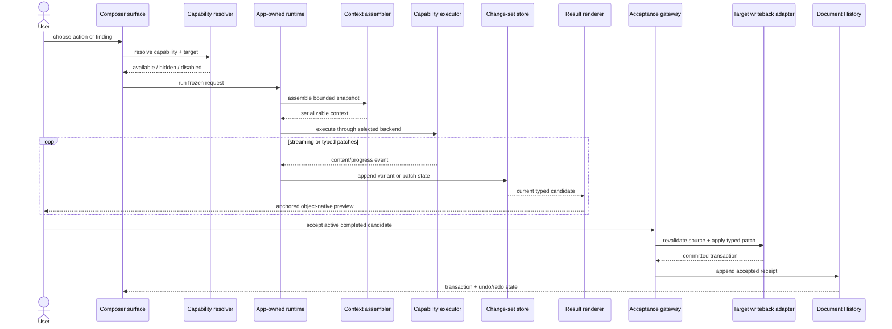
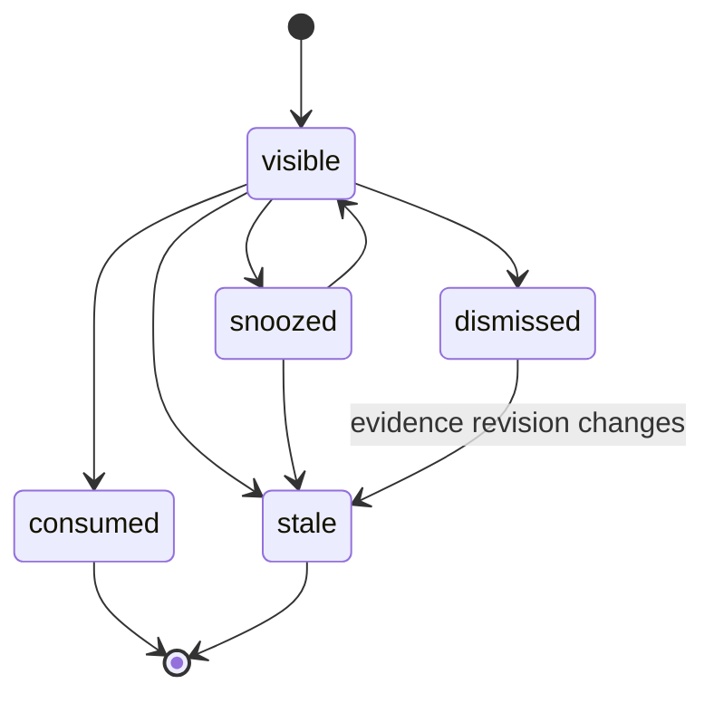
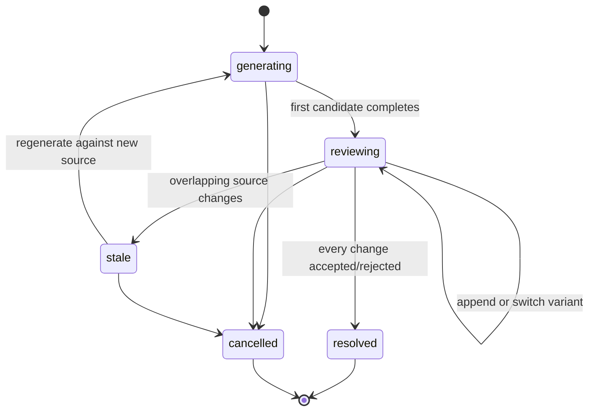

# Peak Composer AI Capability Modularity Architecture

- **Status:** proposed architecture; implementation pending
- **Date:** 2026-07-24
- **Primary reader:** Peak Assistant engineers adding or maintaining Composer intelligence
- **Primary goal:** make a new Composer AI capability a small registered module instead of another UI-specific branch
- **Product host:** dedicated Composer View over the same Markdown and native files; the existing CodeMirror editor remains unchanged

- **Related product contract:** [`2026-07-15-composer-block-ai-capability-contract.md`](2026-07-15-composer-block-ai-capability-contract.md)
- **Composer host design:** [`2026-07-09-peak-composer-editing-view.md`](2026-07-09-peak-composer-editing-view.md)
- **Component contract:** [`2026-07-22-peak-composer-component-consistency.md`](2026-07-22-peak-composer-component-consistency.md)
- **Integrated design fixture:** [`../../gstack/peak-composer-editing-view-2026-07-09/index.html`](../../gstack/peak-composer-editing-view-2026-07-09/index.html)

## How to Use This Document

- Product or interaction question: read the related Block AI contract first, then use Sections 3–4 here for capability classification and inventory.
- Adding one capability: use Sections 12–15 as the implementation checklist.
- Building the shared runtime: use Sections 5–11 as the contract and module boundary.
- Migrating current Copilot or mock behavior: use Section 16 and Appendices A–B.
- Reviewing completeness: use Sections 17–18 and Appendix C.

## 0. Architecture Decision

Composer AI must not become a collection of button handlers.

The target is one app-owned capability runtime with five replaceable parts:

1. a typed capability definition and stable ID;
2. an applicability resolver that decides where the capability belongs;
3. an executor that produces typed events and results without knowing the UI;
4. a result renderer selected by result kind, not by capability label;
5. a writeback adapter that validates and commits one accepted transaction.

The same definition may be projected into:

- the Block action row;
- the selection toolbar;
- an object toolbar;
- the Copilot Brief;
- a Copilot collaboration session;
- a custom instruction picker.

These are entry points into one capability. They are not separate copies of the capability.

The existing generic `CapabilityManifest`, `CapabilityRunner`, `RunEnvelope`, app-owned runtime composition and Copilot artifact model are the foundation. Composer adds target, applicability, typed-patch and review contracts on top of that foundation. It must not introduce a third independent AI runtime beside the generic capability platform and the current Copilot Action Runtime.

## 1. Reader Outcome and Scope

After reading this document, an engineer should be able to:

- identify every current Composer AI capability family;
- decide whether a new feature is an AI capability, a deterministic editor command, or a direct edit;
- assign a stable capability ID independent of its Chinese UI label;
- implement a capability without importing Composer DOM or React into service code;
- reuse the same execution from more than one Composer or Copilot surface;
- produce an object-native, reviewable result;
- commit through a target adapter with stale-source protection;
- record accepted changes in document History;
- add focused tests without booting the complete Composer UI.

This document does not choose the internal rich-text editing engine. It does not change Obsidian's existing CodeMirror view. It also does not claim that the current HTML mock is production implementation.

## 2. Evidence and Current State

### 2.1 Generic capability foundation already exists

The repository already contains:

- `src/core/types/capability.ts`
  - `CapabilityManifest`;
  - input/output shape metadata;
  - permission, cost and backend policy;
  - skill and surface bindings.
- `src/service/capabilities/CapabilityManifestRegistry.ts`
  - stable-ID manifest storage.
- `src/service/capabilities/CapabilityRunner.ts`
  - backend-independent execution;
  - skill/manifest validation;
  - run status, event and artifact recording.
- `src/service/run-envelope/`
  - stable `runId`;
  - status, progress, artifact, error and log events.

This foundation is real code, but it is still a narrow platform pilot. Its current surface union does not include Composer, and the manifest registry is not yet the owner of the current Copilot action catalog.

### 2.2 Production Copilot has a separate app-owned action runtime

The current production Copilot path contains 28 built-in actions in `src/service/copilot/actions/index.ts`.

`CopilotActionRuntimeImpl` correctly keeps runtime ownership in the app composition path and uses a port bag. The service-side `CopilotAction` contract also keeps React and Lucide components out of service code.

The current contract is still too coarse for Composer:

- `DocumentContext` mainly describes full-document or text-selection scope;
- `ActionResult` is only `structured`, `stream`, or `error`;
- `actionResultToArtifacts()` infers result meaning from fields and action IDs;
- it has no typed Markdown range, table cell, image attachment, formula micro-block, Base view, Canvas node or Excalidraw element target;
- it does not itself define anchored candidate variants, stale-source validation or writeback.

These are gaps to extend, not reasons to discard the runtime.

### 2.3 The Composer mock is the broadest capability inventory

The integrated mock currently demonstrates:

- 14 global Composer/Copilot capabilities;
- context-sensitive Block actions for Markdown and Obsidian-native objects;
- selection-scoped AI actions and custom instructions;
- AI Frontmatter proposals;
- formula explanation, split and variable-table details;
- image caption, semantic rename, generation and AI edit;
- table analysis and chart generation;
- incremental Mermaid, Canvas and Excalidraw patches;
- streaming candidates, targeted regeneration and variant history;
- explicit accept/reject and accepted History transactions.

The mock still uses label-driven fixtures such as `getAiActions()`, `candidateLibrary`, `showAiSuggestionCard()` and a large dispatch chain. That is appropriate for owner-review design evidence. It is not the production modularity model.

### 2.4 Current fragmentation

| Concern | Generic capability platform | Production Copilot actions | Composer design fixture |
| --- | --- | --- | --- |
| Stable machine ID | Yes | Yes | Global actions yes; many local actions still use labels |
| App-owned runtime | Partial foundation | Yes | Static page state |
| Target model | Generic input | Document/selection | Rich Block/object fixture state |
| Applicability | Surface binding | Relevance + guard | `data-block-kind` + local signals |
| Streaming | Run events | `LLMStreamEvent` | Timed fixture streaming |
| Typed result | Generic `TResult` | Three coarse variants | Many object-specific DOM shapes |
| Review model | Artifact reference | Copilot artifacts | Anchored candidates and variants |
| Writeback | Caller-owned | Not a complete Composer transaction | Mock functions mutate fixture DOM |
| History | Run envelope | Run artifacts | Accepted document transaction fixture |

The convergence task is therefore not “build AI from scratch.” It is “make the generic platform capable of expressing the object-level behavior already approved in the Composer contract.”

## 3. Capability Vocabulary

The architecture uses orthogonal dimensions. A capability is not classified by only one “AI type.”

### 3.1 Invocation source

| Invocation | Meaning |
| --- | --- |
| Manual | User deliberately chooses a compatible action |
| Contextual finding | A detector has evidence that the action is useful now |
| Custom instruction | User describes a target-specific transformation |
| Copilot session | Conversation starts the same registered capability |
| Follow-up | User refines a generated candidate with a targeted instruction |
| Regeneration | Runtime appends another candidate variant |

### 3.2 Execution mode

| Mode | Mechanism | Example |
| --- | --- | --- |
| Deterministic | Local program or editor algorithm | table transpose, image crop |
| Model stream | One provider streams text or typed source | paragraph rewrite |
| Agent | Multi-step run with tools and sources | add evidence from Vault |
| Media generation | Image/media provider with progress | generate illustration |
| Native patch | Typed changes to a native object | add a Canvas node |
| Hybrid | Deterministic preparation plus model output | semantic rename with collision-safe path |

### 3.3 Effect kind

| Effect | Mutation |
| --- | --- |
| Analyze | No document mutation; emits insight/source/finding |
| Rewrite | Replaces the content of the same target |
| Insert | Creates a new object at an anchor |
| Delete | Removes one target after review |
| Transform | Replaces one source object with another typed object |
| Metadata patch | Changes selected Frontmatter fields |
| Asset transaction | Creates/moves an attachment and patches references |
| Native-object patch | Changes Base, Canvas, Excalidraw, Mermaid or another typed source |

### 3.4 Capability class

The product contract's classes remain:

- `fixed`: compatible manual operation with stable meaning;
- `contextual`: evidence-backed Copilot finding;
- `incremental`: typed patches that repeatedly re-render;
- `direct-edit`: ordinary editor behavior, not an AI capability.

`direct-edit` belongs in the inventory because it prevents false AI abstraction. Typing a table cell, toggling a task or changing a caption directly must not run the capability system.

## 4. Current AI Capability Inventory

The IDs below are the proposed stable contract IDs. Chinese labels remain configurable presentation copy.

### 4.1 Document and Vault capabilities

| Stable ID | Current mock label | Scope | Result |
| --- | --- | --- | --- |
| `vault.related.connect` | 连接相关笔记 | current topic / Vault | sources + link proposal |
| `doc.review.improve` | 改善当前笔记 | document | findings, insights and changes |
| `doc.evidence.add` | 补上依据 | claim / selection | sources + citation changes |
| `doc.selection.rewrite` | 改写选区 | selection | inline rewrite |
| `doc.content.translate` | 翻译 | selection / Block | inline rewrite or inserted translation |
| `doc.content.continue` | 继续写 | caret / current anchor | inserted draft |
| `doc.plan.generate` | 写作计划 | document | outline draft |
| `doc.article.write-from-vault` | 从资料写文章 | document / Vault | long-form draft + sources |
| `doc.illustration.generate` | 生成配图 | Block / section | asset candidate |
| `doc.summary.generate` | 总结 | document / section | insight or inserted summary |
| `doc.concepts.extract` | 提取概念 | document | concepts + optional note proposals |
| `doc.tags.suggest` | 建议标签 | Frontmatter | field candidates |
| `doc.split.suggest` | 建议拆分 | document | structural change set |
| `doc.tasks.check` | 检查任务列表 | task collection | findings + task changes |

The current global Composer list is a curated projection, not the full production Copilot catalog. Existing production actions such as knowledge-gap analysis, topic synthesis, Vault health, recent Vault summary, TODO extraction, detect-and-file, prompt audit, deduplication and task solving remain shared platform capabilities. Composer may project them when their target and product fit are explicit; it should not copy their implementations.

### 4.2 Metadata, title and prose

| Target | Stable capability family | Current actions |
| --- | --- | --- |
| Frontmatter | `metadata.property.*` | suggest tags, normalize properties, warn about missing/rare/conflicting fields, propose semantic values |
| Document title | `md.title.*` | shorten title, clarify scope, generate subtitle or outline |
| Section heading | `md.heading.*` | rewrite heading, bridge sections, generate child outline, generate reader questions |
| Paragraph | `md.paragraph.*` | polish, shorten, expand, ask questions, add example, add evidence, turn into table, extract formula, generate visual, extract actions |
| Styled token | `md.inline-style.*` | propose emphasis, underline, text color or highlight; explain current source syntax |
| Selection | `md.selection.*` | polish, shorten, expand, translate, comment, targeted custom instruction |

Formatting remains a typed Markdown/HTML-enhanced patch. A model may suggest a style, but bold, italic, underline, strikethrough, color and highlight are applied per semantic text unit and committed as one transaction.

### 4.3 Lists, tasks, quotes and callouts

| Target | Stable capability family | Current actions |
| --- | --- | --- |
| Bullet/numbered list | `md.list.*` | add missing item, reorder, convert to table, generate questions |
| Checklist | `md.task-list.*` | find blocker, add next step, add owner/deadline, reorder by priority |
| Quote | `md.quote.*` | explain relevance, find counterexample, add attribution, convert to Callout |
| Callout | `md.callout.*` | change type, rewrite title/body, expand principle, create checklist, split dense callout |

`md.list.to-table` is a structural transform. The real list appears once; the candidate table appears once. Accept replaces the list. Dismiss changes nothing.

### 4.4 Links, citations, embeds and attachments

| Target | Stable capability family | Current actions |
| --- | --- | --- |
| Vault link | `md.wikilink.*` | suggest link, repair broken target, explain relation, synchronize target summary |
| External link | `md.external-link.*` | fetch metadata, summarize, assess source, create link card |
| Footnote/citation | `md.citation.*` | verify source, repair definition, move to reference section, promote important detail |
| Embed | `md.embed.*` | summarize target, relocate anchor, convert to link |
| PDF/media attachment | `asset.attachment.*` | extract key points, generate citation, split chapter notes |

Primary navigation is never replaced by an AI action. Link and attachment actions are secondary affordances around a still-clickable target.

### 4.5 Formula capabilities

| Stable ID | Scope | Result |
| --- | --- | --- |
| `math.explain` | one formula | formula-local annotation variants |
| `math.split` | one formula | typed math replacement variants |
| `math.variables.describe` | one formula | formula-local variable table variants |
| `math.correct` | one formula | LaTeX patch |
| `math.definition.insert` | formula / nearby text | inserted variable definition |
| `math.diagram.generate` | one formula | inserted explanatory visual |

The state key is `(formulaId, capabilityId)`.

Consequences:

- one formula may keep explain, split and variables open together;
- different formulas may keep any combination open together;
- reopening the same key focuses the existing surface;
- regenerating or closing one key never closes another;
- every model-derived detail has its own instruction, variants and acceptance state.

### 4.6 Image and multi-image capabilities

| Stable ID | Scope | Result |
| --- | --- | --- |
| `asset.image.caption` | image figure | in-place `figcaption` rewrite or missing-caption slot |
| `asset.image.semantic-rename` | attachment | rename + reviewed reference patches |
| `asset.image.annotate` | image | non-destructive annotation patch |
| `asset.image.edit` | image | new attachment candidate |
| `asset.image.generate` | text/image context | new attachment candidate |
| `asset.image.alt-text` | image | metadata/caption patch |
| `asset.image.background-remove` | image | new attachment candidate |
| `asset.image.object-erase` | image | new attachment candidate |
| `asset.image-layout.suggest` | image collection | HTML layout patch |
| `asset.image-layout.caption-unify` | image collection | per-figure caption changes |
| `asset.image-layout.reorder` | image collection | figure-order patch |

Crop, rotate, straighten, flip, resize, compress, format conversion and metadata stripping are deterministic image commands. They share preview/writeback infrastructure but do not pretend to be AI capabilities.

### 4.7 Table and chart capabilities

| Stable ID | Scope | Result |
| --- | --- | --- |
| `md.table.summarize` | table | insight or inserted summary |
| `md.table.column.suggest` | table | column patch |
| `md.table.schema.check` | table | findings + optional fixes |
| `md.table.formula.derive` | cell/range/table | formula patch |
| `md.table.data.normalize` | selected cells | cell patches |
| `md.table.chart.generate` | table / selected range | new Chart Block |
| `chart.type.recommend` | chart | insight + typed config candidate |
| `chart.labels.improve` | chart | chart-source patch |

Cell selection is editor state, not an AI capability. Continuous rectangular ranges and discontinuous cell sets become typed target locators passed into a compatible capability.

### 4.8 Code and query capabilities

| Target | Stable capability family | Current actions |
| --- | --- | --- |
| Code fence | `code.block.*` | explain, syntax check, generate test/example, generate companion preview |
| Dataview/query | `query.block.*` | explain, repair, optimize, add grouping/filter, rerun |
| Base source | `native.base.*` | summarize rows, suggest filter, generate view, add formula/property |

Rich-text formatting actions are not applicable to code blocks. Copy preserves source newlines and indentation.

### 4.9 Mermaid, Canvas and Excalidraw

| Stable ID family | Current actions | Patch granularity |
| --- | --- | --- |
| `native.mermaid.*` | explain diagram, add missing branch, convert to Canvas | node/edge/source clause |
| `native.canvas.*` | summarize nodes, add node, find island, add edge | node or edge |
| `native.excalidraw.*` | extract process, add process node, improve layout | element or binding |

Every patch re-renders the actual object shell. Preview/source mode stays in the object header; copy and AI actions stay in the shared Block action row.

### 4.10 Cross-cutting generation and review capabilities

These behaviors are reusable runtime modules, not one capability per button:

- targeted instruction;
- initial generation;
- textual streaming;
- typed source streaming;
- object-shaped progress;
- append-only regeneration;
- previous/next candidate;
- candidate history;
- accept active completed candidate;
- reject/dismiss;
- retry failed generation;
- stale-source regeneration;
- accepted-transaction linkage.

## 5. Canonical Runtime Model

### 5.1 One registered definition

The proposed definition composes the existing `CapabilityManifest` instead of replacing it.

```ts
type CapabilityResultKind =
  | 'analysis'
  | 'finding-batch'
  | 'proposed-change-set'
  | 'asset-candidate'
  | 'no-change';

interface RegisteredCapability<TInput, TResult> {
  manifest: CapabilityManifest;
  version: string;
  owner: string;
  inputSchema: RuntimeSchema<TInput>;
  resultSchema: RuntimeSchema<TResult>;
  resultKind: CapabilityResultKind;
  applicability: CapabilityApplicability;
  contextPolicy: CapabilityContextPolicy;
  executor: CapabilityExecutor<TInput, TResult>;
}
```

`manifest.id` is the identity. UI label, icon, grouping, short description and recommended placement are surface projections keyed by that ID.

### 5.2 Target contract

```ts
type ComposerTargetRef =
  | MarkdownRangeTarget
  | MetadataFieldTarget
  | TableCellSetTarget
  | FormulaTarget
  | ImageTarget
  | AttachmentTarget
  | MermaidTarget
  | BaseTarget
  | CanvasTarget
  | ExcalidrawTarget;

interface ComposerTargetBase {
  documentId: string;
  documentRevision: string;
  blockId: string;
  sourceOrder: string;
  locatorVersion: string;
}
```

Target locators contain source identity. They do not contain DOM nodes.

The UI may keep ephemeral DOM references in its view state, but the run request freezes a serializable target reference so the executor and writeback path can be tested without a browser.

### 5.3 Applicability contract

```ts
interface CapabilityApplicability {
  targetKinds: readonly ComposerTargetKind[];
  scopes: readonly ComposerScope[];
  invocation: readonly CapabilityInvocation[];
  evaluate(context: ApplicabilityContext): CapabilityAvailability;
}

type CapabilityAvailability =
  | { state: 'available'; score: number; reason?: string }
  | { state: 'hidden'; reason: string }
  | { state: 'disabled'; reason: string };
```

`hidden` means irrelevant. `disabled` means relevant but unavailable because of permission, provider, target state or missing dependency. The UI must not guess the distinction.

### 5.4 Frozen run request

```ts
interface ComposerCapabilityRunRequest<TInput> {
  capabilityId: string;
  capabilityVersion: string;
  trigger: CapabilityInvocation;
  target: ComposerTargetRef;
  input: TInput;
  context: ComposerContextSnapshot;
  originatingFindingIds: string[];
}

interface ComposerContextSnapshot {
  documentRevision: string;
  targetSourceHash: string;
  selection?: SerializedSelection;
  nearbyBlocks: SerializedBlock[];
  frontmatter: Record<string, unknown>;
  explicitAttachments: ArtifactRef[];
  relatedSources: SourceRef[];
  userInstruction?: string;
}
```

The context snapshot is assembled once at run start. Navigating the document or switching the focused Block does not mutate the active run.

### 5.5 Event contract

The generic `RunEvent` remains the operational envelope. Composer adds typed content events carried by the execution result stream.

```ts
type ComposerCapabilityEvent =
  | { type: 'content-delta'; variantId: string; delta: string }
  | { type: 'typed-patch'; variantId: string; patch: ComposerTypedPatch }
  | { type: 'preview-ready'; variantId: string; preview: PreviewRef }
  | { type: 'candidate-completed'; variantId: string }
  | { type: 'finding'; finding: SuggestionFinding }
  | { type: 'source'; source: SourceRef }
  | { type: 'no-change'; reason: string };
```

Operational progress and domain content are deliberately separate. A renderer does not parse log text to discover a candidate.

### 5.6 Result contract

```ts
type ComposerCapabilityResult =
  | AnalysisResult
  | FindingBatchResult
  | ProposedChangeSetResult
  | AssetCandidateResult
  | NoChangeResult;
```

Mutation-producing capabilities return a typed `ProposedChangeSet`. Analyze-only capabilities return insights, sources or findings.

The current `CapabilityArtifact` union of `change`, `insight`, `source` and `trace` remains a useful run-receipt projection. It must not be the source-of-truth writeback payload. In particular, `ChangeArtifact.before/after` strings cannot safely represent a Canvas node, table range, image rename or merged-cell table.

## 6. Registry and Projection Boundaries

### 6.1 Runtime ownership

The app layer composes and owns one runtime instance per plugin load.

Proposed composition path:

```text
src/app/composer/capabilities/
├─ composeComposerCapabilityRuntime.ts
├─ ComposerSourceSnapshotAdapter.ts
├─ ComposerHistoryAdapter.ts
└─ writeback/
   ├─ MarkdownWritebackAdapter.ts
   ├─ MetadataWritebackAdapter.ts
   ├─ AttachmentWritebackAdapter.ts
   ├─ BaseWritebackAdapter.ts
   ├─ CanvasWritebackAdapter.ts
   └─ ExcalidrawWritebackAdapter.ts
```

There must be no service-layer `let currentComposerRuntime`, `setRuntime()` or `AppContext.getInstance()` shortcut.

### 6.2 Service modules

```text
src/service/capabilities/
├─ CapabilityManifestRegistry.ts
├─ CapabilityRuntimeRegistry.ts
├─ CapabilityResolver.ts
├─ CapabilityRunner.ts
├─ CapabilityRunCoordinator.ts
└─ result/
   ├─ ResultMaterializerRegistry.ts
   └─ ComposerResultContracts.ts

src/service/composer-capabilities/
├─ packs/
│  ├─ document/
│  ├─ metadata/
│  ├─ prose/
│  ├─ list/
│  ├─ math/
│  ├─ image/
│  ├─ table/
│  ├─ links/
│  └─ native/
├─ context/
└─ findings/
```

Each capability pack exports definitions. It does not register itself through a global singleton.

### 6.3 UI projections

```text
src/ui/view/composer/capabilities/
├─ ComposerCapabilitySurfaceRegistry.ts
├─ projectBlockActions.ts
├─ projectSelectionActions.ts
├─ projectObjectActions.ts
├─ projectCopilotBriefActions.ts
└─ renderers/
   ├─ InlineDiffRenderer.tsx
   ├─ InsertedObjectRenderer.tsx
   ├─ TablePatchRenderer.tsx
   ├─ FormulaDetailRenderer.tsx
   ├─ ImageCandidateRenderer.tsx
   └─ NativeObjectPatchRenderer.tsx
```

The UI projection owns:

- label and icon;
- placement and ordering;
- compact versus expanded presentation;
- renderer selection by declared result/preview kind.

It does not own:

- the prompt;
- provider selection;
- target validation;
- mutation logic;
- History persistence.

### 6.4 Config and prompts

```text
templates/config/composer-capabilities/
├─ presentation.json
├─ applicability.json
├─ thresholds.json
└─ context-policy.json

templates/prompts/composer/
├─ prose/
├─ math/
├─ image/
├─ table/
└─ native/
```

User-facing labels, multilingual signal patterns, thresholds, model/cost knobs and timing values belong in template config. Model instructions use `PromptId` and `PromptService`. Logic files must not accumulate hardcoded prompt paragraphs or multilingual regexes.

## 7. Runtime Collaboration



Reading notes:

- the surface never calls a provider directly;
- the executor never receives a DOM node or React component;
- Review owns pending candidate state, while History owns accepted transactions;
- source revalidation happens again at acceptance, not only at generation start;
- renderer selection comes from declared result and target kinds.

## 8. Finding, Candidate and History State

### 8.1 Finding lifecycle



One `SuggestionFinding` is projected into both the document-local action and the Copilot Brief. Identity uses its fingerprint and evidence revision, not its UI position.

### 8.2 Proposed change lifecycle



### 8.3 Ownership table

| Record | Owner | Durable? | May write document? |
| --- | --- | --- | --- |
| `SuggestionFinding` | finding store | session/policy dependent | No |
| Run events/artifacts | run record store | retention policy | No |
| Candidate variant | active review store | session cache | No |
| `ProposedChangeSet` | active review store | transient | No |
| Accepted transaction | document History | Yes | Already committed |
| Undo/Redo cursor | Composer document session | session-local | Applies inverse/forward transaction |

## 9. Typed Writeback Adapters

Every adapter implements the same safety boundary.

```ts
interface ComposerWritebackAdapter<TPatch> {
  targetKind: ComposerTargetKind;
  preview(target: ComposerTargetRef, patch: TPatch): Promise<TypedPreview>;
  revalidate(target: ComposerTargetRef, patch: TPatch): Promise<RevalidationResult>;
  commit(target: ComposerTargetRef, patch: TPatch): Promise<CommittedTransaction>;
  invert(transaction: CommittedTransaction): Promise<ComposerTypedPatch>;
}
```

### 9.1 Adapter requirements

| Adapter | Required validation | Commit unit |
| --- | --- | --- |
| Markdown range | file revision, range hash, semantic-unit boundaries | range patch |
| Frontmatter | YAML revision, field key/type | selected fields |
| Table | table source hash, row/column/cell locator | cell/row/column/schema patch |
| Formula | formula source hash, micro-block ID | LaTeX or annotation patch |
| Attachment | source asset identity, target path collision, controlled references | asset create/move + reference patches |
| Mermaid | fenced source revision, parse validity | typed source patch |
| Base | file revision, YAML parse validity | view/filter/formula/property patch |
| Canvas | file revision, node/edge IDs, JSON validity | node/edge patch |
| Excalidraw | file revision, element/binding IDs, plugin compatibility | element/binding patch |

No adapter may guess a new target position after failed relocation. It must return stale or conflict and fail closed.

## 10. Result Renderer Registry

A capability declares a preview contract. It does not select a React component.

```ts
type ComposerPreviewKind =
  | 'inline-diff'
  | 'item-diff'
  | 'table-patch'
  | 'metadata-fields'
  | 'inserted-object'
  | 'asset-frame'
  | 'formula-detail'
  | 'native-object-patch';

interface ComposerResultRendererRegistry {
  register(binding: {
    targetKind: ComposerTargetKind;
    previewKind: ComposerPreviewKind;
    renderer: ComposerResultRenderer;
  }): void;
}
```

This removes two fragile patterns:

- choosing a panel from the capability label;
- inferring an artifact shape from `action.id.includes(...)` or arbitrary result fields.

Unknown combinations render a visible unsupported-result fallback and are rejected by registry conformance tests.

## 11. Variants and Targeted Follow-up

Every model-generated candidate uses the same variant contract.

```ts
interface ProposedChangeVariant<TPatch> {
  id: string;
  instruction?: string;
  patch: TPatch;
  status: 'generating' | 'completed' | 'failed' | 'discarded';
  createdAt: number;
  origin: 'initial' | 'regenerate' | 'follow-up';
}
```

Rules:

- initial generation creates variant 1;
- regenerate/follow-up appends a variant;
- old variants remain reachable;
- the instruction is frozen into the submitted variant;
- the input remains editable for the next variant;
- only a completed active variant can be accepted;
- switching variants never writes the document;
- deterministic editor previews use Undo/Redo or restore, not AI variant language.

Formula detail, semantic filename, image caption, AI image edit, Base generation, native patches and prose generation all reuse this model.

## 12. Capability Registration API

Registration is explicit at app composition.

```ts
interface CapabilityPack {
  id: string;
  definitions(): readonly RegisteredCapability<unknown, unknown>[];
}

function composeComposerCapabilityRuntime(deps: ComposerCapabilityDependencies) {
  const registry = new CapabilityRuntimeRegistry();

  for (const pack of [
    createDocumentCapabilityPack(deps),
    createMetadataCapabilityPack(deps),
    createProseCapabilityPack(deps),
    createMathCapabilityPack(deps),
    createImageCapabilityPack(deps),
    createTableCapabilityPack(deps),
    createLinkCapabilityPack(deps),
    createNativeObjectCapabilityPack(deps),
  ]) {
    registry.registerPack(pack);
  }

  return new ComposerCapabilityRuntime(registry, deps);
}
```

Registration validation fails on:

- duplicate capability ID/version;
- missing input/result schema;
- missing result materializer;
- unsupported target/preview pairing;
- missing writeback adapter for a mutation-producing capability;
- a model capability without Prompt/Skill reference;
- a capability bound to Composer without Composer in its surface projection.

## 13. Example Module: Formula Explanation

```ts
export const mathExplainCapability = defineCapability({
  manifest: {
    id: 'math.explain',
    title: 'Explain formula',
    description: 'Create a formula-local explanation without changing the formula',
    inputContract: { kind: 'object', description: 'Formula target and instruction' },
    outputContract: { kind: 'custom', description: 'Formula detail candidate variants' },
    permissionKind: 'read',
    costTier: 'fast',
    backendPolicy: {
      preferred: 'provider-direct',
      fallback: ['hermes-harness'],
    },
    skillRef: 'composer.math.explain',
    surfaceBinding: ['composer', 'copilot'],
  },
  version: '1',
  owner: 'composer-math',
  inputSchema: MathExplainInputSchema,
  resultSchema: FormulaDetailResultSchema,
  resultKind: 'proposed-change-set',
  applicability: {
    targetKinds: ['display-formula'],
    scopes: ['micro-object'],
    invocation: ['manual', 'contextual', 'follow-up', 'regenerate'],
    evaluate: evaluateFormulaExplain,
  },
  contextPolicy: formulaLocalContextPolicy,
  executor: executeMathExplain,
});
```

This example assumes Phase 1 has extended `CapabilitySurfaceId` with `composer`. The UI separately maps `math.explain` to:

- label `解释公式`;
- the formula object action row;
- the `formula-detail` renderer;
- ordering next to split and variables.

The executor has no knowledge of those choices.

## 14. Adding a New Capability

Use this sequence:

1. choose an existing target kind and effect kind;
2. search the registry for an existing capability that already expresses the intent;
3. assign a stable domain ID independent of UI label;
4. define input and result runtime schemas;
5. declare applicability, invocation sources and context policy;
6. reuse an existing executor or add one behind narrow ports;
7. choose a typed result kind;
8. reuse a renderer or register one target/preview binding;
9. reuse a writeback adapter or add one with revalidation and inversion;
10. add surface presentation config;
11. add unit, contract and transaction tests;
12. update the capability inventory in this document.

A new capability is not complete when only a button appears.

## 15. Test Strategy

### 15.1 Definition and registry tests

- unique ID/version;
- schema presence;
- valid skill/prompt reference;
- valid target/preview pairing;
- valid result materializer;
- stable ordering independent of registration order;
- unknown ID produces a visible fallback.

### 15.2 Applicability tests

- compatible target appears;
- incompatible target stays hidden;
- unavailable provider or permission is disabled with reason;
- code blocks suppress rich-text capabilities;
- single-cell text selection and object-native cell selection do not conflict;
- stale target is not executable.

### 15.3 Executor tests

- deterministic fake provider;
- bounded context snapshot;
- cancellation;
- streaming event order;
- retryable versus terminal error;
- no-change result;
- sources and provenance;
- tool quarantine where applicable.

### 15.4 Result and review tests

- inline rewrite streams at the target;
- insert renders one real candidate object;
- structural transform does not duplicate the source;
- table patches preserve grid and locators;
- each formula/capability key can coexist;
- every formula detail accepts targeted follow-up;
- image caption stays in the figure;
- AI image edit retains old variants and original asset;
- native patches re-render after each typed event;
- only completed active variant may be accepted.

### 15.5 Transaction and History tests

- accept revalidates revision;
- overlapping direct edit marks only the affected change stale;
- accept creates one independent History transaction;
- inline and sidecar acceptance use the same bridge;
- rejected and pending candidates never enter History;
- Undo/Redo operates on committed transactions;
- rollback appends an inverse transaction;
- attachment rename updates reviewed references atomically;
- failed write leaves source and asset state unchanged.

### 15.6 Architecture source guards

- service capability modules do not import React, Lucide, Obsidian view classes or Composer DOM;
- UI renderers do not call AI providers or write Vault files;
- app composition is the only concrete dependency wiring site;
- no service-side mutable runtime singleton;
- prompts and configurable multilingual patterns are not embedded in logic files;
- production code does not dispatch by visible label.

## 16. Migration Plan

### Phase 0 — Characterize

Preserve the current mock and capability contract as behavior evidence.

Deliver:

- stable inventory IDs;
- fixtures for every target/result family;
- source-guard tests around existing production runtime ownership;
- explicit gaps between mock-only and production capabilities.

Rollback: documentation and fixtures only.

### Phase 1 — Extend the generic contract

Add Composer surface/target/result contracts around the current `CapabilityManifest` and `CapabilityRunner`.

Deliver:

- runtime schemas;
- Composer target references;
- typed result kinds;
- result materializer registry;
- fake ports.

Safety: no production Composer writeback yet.

### Phase 2 — Build app-owned Composer runtime

Compose the runtime and source snapshot adapters in `app/`.

Deliver:

- registry;
- resolver;
- context assembler;
- run coordinator;
- read-only execution and preview.

Safety: mutation capabilities remain preview-only.

### Phase 3 — Land transaction adapters

Start with Markdown range, Frontmatter and formula targets.

Deliver:

- revalidation;
- commit/invert;
- History bridge;
- stale handling;
- Undo/Redo integration.

Rollback: capability-level feature flags and no removal of the direct Markdown editor path.

### Phase 4 — Migrate object-heavy packs

Order:

1. table;
2. image/attachment;
3. Mermaid;
4. Base;
5. Canvas;
6. Excalidraw.

Each pack must replace its compatibility handler before the next one is considered complete.

### Phase 5 — Converge Copilot actions

Project existing production Copilot actions from the canonical capability definitions. Remove duplicate action metadata and heuristic result inference only after conformance tests show equivalent behavior.

### Phase 6 — Delete label-driven production paths

The static mock may keep fixture helpers. Production code must no longer:

- use visible labels as dispatch keys;
- infer result type from ID substrings;
- choose renderer from arbitrary result fields;
- maintain a second finding or History store for Composer.

## 17. Acceptance Criteria

The modularity architecture is implemented only when:

1. one stable ID identifies a capability across Block, selection, object and Copilot entry points;
2. adding presentation placement does not copy execution logic;
3. service executors have no UI or Obsidian host dependency;
4. all mutation-producing results are typed change sets;
5. every accept goes through source revalidation and a target writeback adapter;
6. every accepted change creates an addressable History transaction;
7. pending, rejected and stale candidates never become History;
8. formula, image and native-object variants share one variant lifecycle;
9. result renderers are selected by declared target/preview contracts;
10. production dispatch does not depend on Chinese or English UI labels;
11. config and prompts follow TemplateManager/PromptService conventions;
12. every capability pack can run with fake ports in isolation;
13. the existing Markdown editor remains independent of Composer;
14. the old compatibility path is deleted after each migrated pack.

## 18. Do Not Do

- Do not add one React result card per capability when an existing typed renderer fits.
- Do not let a Block component call a provider or mutate a Vault file.
- Do not create a Composer-only AI provider manager.
- Do not store DOM nodes in run requests or History.
- Do not write Markdown before explicit acceptance.
- Do not turn findings, traces or previews into document History.
- Do not use prompt text, action label or `action.id.includes(...)` as a result schema.
- Do not give each formula one shared exclusive AI panel.
- Do not duplicate the real source object in structural comparison.
- Do not add a global Command Palette entry for every capability.
- Do not keep both the new registered path and an old production handler indefinitely.

## Appendix A. Current 14-Action Composer Projection to Production Copilot

| Composer projection | Existing production action(s) | Convergence note |
| --- | --- | --- |
| `connect-notes` | `suggest-links`, `suggest-semantic-links`, `find-related`, `smart-connections` | one user intent may orchestrate several capabilities; do not alias four IDs into one implementation |
| `improve-note` | `polish`, `format-polish`, `correct-content`, `review` | use a composite plan or expose focused child capabilities |
| `add-evidence` | `add-evidence` | direct reusable capability |
| `rewrite-selection` | `rewrite-selection` | add typed selection target and inline review |
| `translate` | `translate` | add target-aware writeback |
| `continue-writing` | `continue-writing` | add insertion anchor and draft variants |
| `writing-plan` | `writing-plan` | add outline object result |
| `write-article` | `write-article` | add long-form draft and source artifacts |
| `generate-illustration` | no equivalent Copilot action in the current 28-action catalog | reuse the shared media-generation port; add a canonical capability definition |
| `summarize` | `summarize` | insight versus inserted summary is an explicit input choice |
| `extract-concepts` | `extract-concepts` | concepts may remain insights or become note proposals |
| `suggest-tags` | `suggest-tags` | materialize as field candidates |
| `suggest-split` | `suggest-split` | materialize as a structural change set |
| `check-task-list` | `check-task-list` | add task locators and item-level patches |

## Appendix B. Existing Production Actions Not Yet Explicitly Projected in the Mock

These are shared platform capabilities, not mandatory Composer toolbar buttons:

- `knowledge-gaps`;
- `synthesize-topic`;
- `vault-health`;
- `vault-summary`;
- `extract-todos`;
- `detect-and-file`;
- `prompt-audit`;
- `deduplicate-scan`;
- `find-solve-tasks`.

`find-related` and `smart-connections` already contribute to the broader `connect-notes` product intent but retain their own stable execution identities.

## Appendix C. Traceability

| Requirement | Evidence | Architecture response | Validation |
| --- | --- | --- | --- |
| One capability can appear in several surfaces | global capability picker, Block row, formula row, selection toolbar, Copilot Brief | stable definition + surface projections | same ID executes once from every projection |
| Context-sensitive actions | `getAiActions()` and signal-based paragraph suggestions | applicability resolver | target/signal unit tests |
| Streaming and regeneration | rewrite, draft, image and formula fixture flows | domain event + append-only variant contract | streaming/variant tests |
| Object-native review | Composer Block AI capability contract | typed target + renderer registry | per-target renderer tests |
| Safe Markdown/native writeback | dedicated Composer host and source mapping rules | app-owned writeback adapters | revision conflict and inversion tests |
| Findings differ from changes | `SuggestionFinding` / `ProposedChangeSet` contract | separate stores and lifecycles | no finding enters History |
| Accepted changes are auditable | current History and transaction contract | one acceptance gateway | run/change/transaction bidirectional linkage |
| Future maintainability | current split between generic runner, Copilot actions and mock handlers | convergence migration with deletion gates | architecture source guards and compatibility-path deletion |
