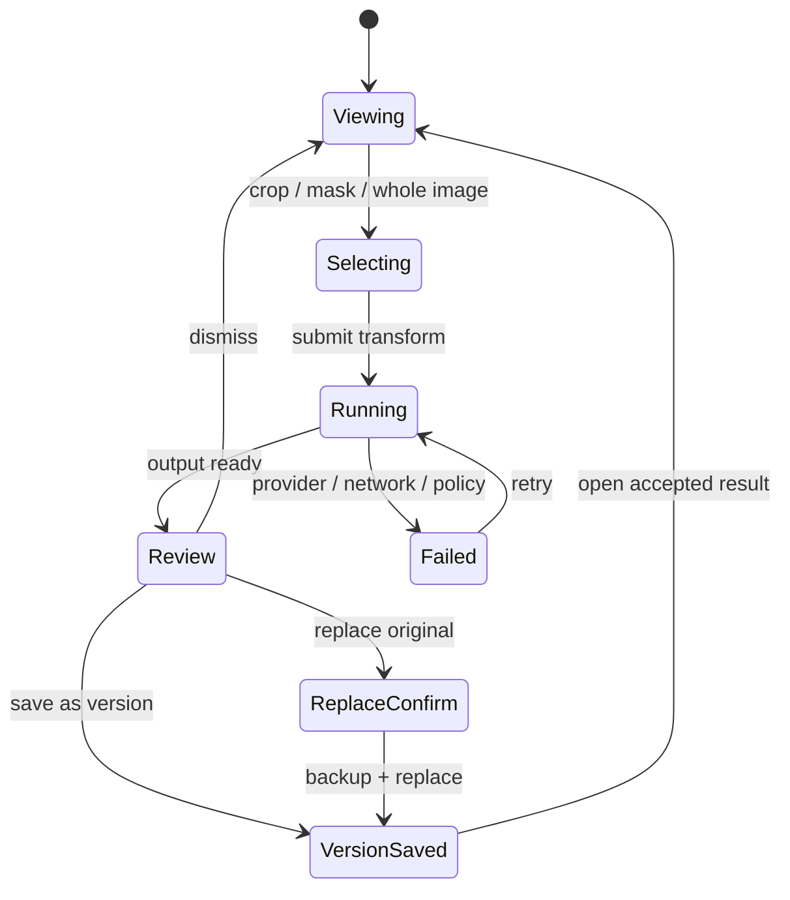
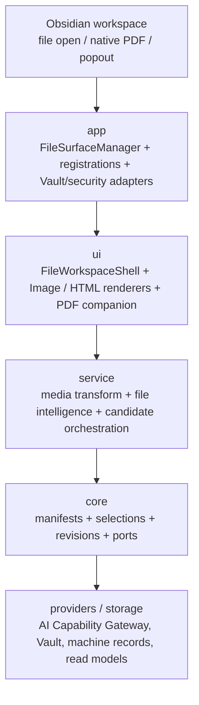

# Peak File Workspace：多文件预览、编辑与 AI 协作方案

日期：2026-07-24  
产品方向：**Decided**  
技术细节：**Review-ready design proposal**  
生产状态：**Implementation pending**

配套材料：

- [当前能力审计与设计输入](../../research/2026-07-24-peak-file-workspace/README.md)
- [视觉方案](../../gstack/peak-file-workspace-2026-07-24/index.html)
- [Roadmap](../../roadmap.html)

> 本文定义目标产品与技术边界。当前生产代码尚未注册 Image / HTML / PDF 的 Peak file view；源码仍是 current behavior authority。
>
> 2026-08-09 owner update：跨格式 AI context、effect、Code Source Workspace、CSV/XLSX → Peak Sheet、TXT plain-text、Canvas/Excalidraw companion 和 Image 能力以 [Peak 文件表面与 AI 能力模型](./2026-08-09-file-surface-ai-capability-model.md) 为准；Jupyter 仅保留规划位，JSONL 复用现有 machine-record 基础设施，DOC/DOCX、PPT/PPTX 明确不属于产品支持范围。

## 1. 核心判断

Peak Assistant 应从“Markdown 内的 AI 助手”扩展为“Vault 文件的 AI 工作区”。用户在 File Explorer 打开图片、HTML 或 PDF 后，不需要先回到 Chat 添加附件，也不需要学习三套互不相干的 AI 操作入口。

这项能力不是三个孤立 viewer。它由一个共享 File Workspace shell、一个 app-owned 文件 surface registry，以及按类型提供的 Image、HTML、PDF provider 组成。

最重要的边界：

1. `DocumentLoader` 继续负责读取、索引与摘要，不拥有 View。
2. File Workspace 负责打开、预览、选择、变换、审阅与保存，不复制 Loader。
3. Image、HTML、PDF 共用现有 AI runtime、PermissionGuard、RunEnvelope、receipt 与 usage tracking。
4. AI 结果先成为候选，只有接受后才能写入文件或产生新版本。
5. 不静默覆盖原文件，不把外部网站自动化伪装成本地 HTML 预览。

## 2. 本文读者与用途

本文面向：

- owner：确认产品方向、边界和实施顺序；
- 实现者：拆分模块、spike、测试和迁移任务；
- reviewer：核对 source-of-truth、安全、runtime ownership 和用户可见语义；
- 后续 AI coding agent：在不猜测文件保存与浏览器权限的前提下执行。

读完后，读者应能回答：

- 为什么不能只往当前 Preview 组件里继续加分支；
- 三种文件分别由谁拥有 View；
- AI 上下文和候选如何进入同一审阅循环；
- 什么情况下写原文件、写新版本或只写 companion；
- 哪些浏览器/PDF 能力必须先做 spike，不能凭推断实现。

## 3. 范围

### 3.1 本方案覆盖

- Image：独立文件预览、程序变换、AI 像素编辑、版本保存。
- HTML：Source / Preview / Split、本地浏览器式控制、AI source patch。
- PDF：复用 Obsidian native viewer、Peak AI companion、page-aware context、批注 companion。
- 共享 File Workspace shell。
- 文件能力注册、生命周期、权限、候选、版本与历史。
- desktop Obsidian 主窗口和 native popout。
- 为 Code Source、TXT、JSON、CSV/XLSX、Canvas、Excalidraw、Audio、Video 与 SVG 保留受 capability model 约束的扩展点。

### 3.2 本方案不覆盖

- 替代 Chrome、Safari 或 Obsidian Web viewer。
- 登录网站、cookie 管理、跨域 DOM 控制或任意网页自动化。
- 通用 DevTools。
- PDF 内容重排版或把 PDF 变成所见即所得文档编辑器。
- 自建新的 AI provider/router、agent loop、permission protocol 或 artifact store。
- 为每种文件创建独立 Command Palette 命令。
- 在本方案阶段修改生产代码。

## 4. 当前状态

### 4.1 已有基础

| 能力 | 当前事实 | 可复用位置 |
| --- | --- | --- |
| 多类型读取 | Loader 已覆盖 Image、HTML/XML、PDF 等类型 | `src/core/document/loader/` |
| Vault preview | 已集中提供 binary、text、resource path | `AppVaultPreviewAdapter` |
| Image edit | 已支持 base、mask、additional references 与 edit route | `src/service/media/` |
| Image output | writer 默认创建新附件并处理冲突 | `ObsidianMediaAttachmentWriter` |
| PDF text | `pdfjs-dist` 逐页提取文本 | `PdfDocumentLoader` |
| PDF hover | iframe 预览已存在 | `ResourcePreviewHover` |
| Peak views | `ViewManager` 集中注册 `ItemView` | `src/app/ui-host/views/` |
| AI review 语义 | Composer 已定义 candidate、accept、regenerate、dismiss | Composer design / Block AI contract |

### 4.2 关键缺口

| 缺口 | 用户结果 | 设计响应 |
| --- | --- | --- |
| Loader 与 View 没有关联 | 文件能被索引，却没有一等工作区 | 新增 app-owned File Surface Registry |
| 图片 edit 只在 Chat | 打开图片后仍需绕回 Composer | Image Workspace 直接以当前文件为 base |
| HTML 只有源码读取 | 不能浏览、刷新或选择元素修改 | HTML Source / Preview / Split |
| PDF AI 不知道页/选区 | 问答难以引用具体位置 | Native PDF companion + page/selection context |
| 保存语义分散 | AI 结果可能让用户担心覆盖 | 统一 candidate + version policy |
| 安全边界未显式 | HTML/SVG/远程上传风险不可见 | sandbox、CSP、permission receipt |

### 4.3 当前事实不等于目标能力

以下说法不能用在交付报告中：

- “Loader 支持图片”不等于“AI 看懂图片”。
- “PDF iframe 能显示”不等于“PDF 工作区完成”。
- “HTML 被索引”不等于“HTML 像浏览器一样可用”。
- “Chat 可以 edit image”不等于“Vault image file 可以 AI 编辑”。
- “有 mock/spec”不等于“功能已实现”。

## 5. 用户心智模型

### 5.1 一套工作区，按文件改变工具

用户心智保持为：

```text
打开文件
  -> 看文件
  -> 选择对象或区域
  -> 直接操作，或告诉 AI 想怎么改
  -> 审阅候选
  -> 接受、另存版本、替换原文件或丢弃
```

文件类型只改变中心 renderer 和可用动作。以下内容保持一致：

- 文件标题与路径；
- Preview / Edit / Source 等 mode 切换；
- Copilot / Related / History sidecar；
- 运行状态；
- candidate review；
- Save as version；
- Replace original 的明确确认；
- error、retry 和 provider/cost 说明。

### 5.2 入口

主要入口是 File Explorer 打开文件。稳定的辅助入口包括：

- 当前文件 tab 的 `More actions`；
- Markdown 中的 image / PDF / HTML link；
- Search / File Atlas result 的 Open；
- Chat artifact 的 Open in File Workspace；
- 系统文件选择器导入 Vault 后打开。

Command Palette 只保留一个 owner-approved 稳定入口：

- `Peak: Open current file in File Workspace`

Image crop、AI edit、HTML reload、PDF ask page 等动作留在工作区内部，不进入全局 Palette。

## 6. 共享工作区

### 6.1 屏幕结构

```text
┌─────────────────────────────────────────────────────────────────────┐
│ Back / Forward   filename.ext   mode switch        file actions     │
├──────────────────────────────────────────────┬──────────────────────┤
│                                              │ Copilot / Related /  │
│                                              │ History              │
│           type-specific renderer             │                      │
│                                              │ current selection    │
│                                              │ prompt / operations  │
├──────────────────────────────────────────────┴──────────────────────┤
│ candidate status · versions · accept · save copy · replace · dismiss│
└─────────────────────────────────────────────────────────────────────┘
```

布局原则：

- 中心文件始终是视觉主体；
- sidecar 可收起，不把工作区变成三栏 dashboard；
- candidate footer 只在有候选或运行时出现；
- deterministic edit 与 AI edit 使用相同的审阅位置，但状态文案不同；
- popout 使用 element `ownerDocument` / `defaultView`；
- 与全键盘导航方案共用 `Zone -> Component -> Item` 语义。

### 6.2 Screen inventory

| Screen | Primary job | Reads | Writes | Entry / exit |
| --- | --- | --- | --- | --- |
| Common shell | 定位文件、模式和当前候选 | file state、capabilities、run state | view state、focus bookmark | File Explorer / close tab |
| Image workspace | 查看并变换当前图片 | binary、metadata、mask、history | new image version、optional replace | image file / next file |
| HTML workspace | 编辑源码并验证页面 | source、local assets、console errors | `.html` source、new assets | html file / external link |
| PDF companion | 阅读、提问和记录批注 | PDF text、page、copied selection | annotation companion、exports | native PDF / linked note |
| Unsupported state | 解释为何不能编辑 | manifest、model/provider availability | none | choose external app / fallback preview |

每个 screen 都必须有：

- loading；
- empty / unsupported；
- read-only；
- dirty；
- running；
- review；
- failed；
- offline/provider unavailable。

### 6.3 Sidecar

File Workspace 复用 Composer Intelligence 的交互语义，但不复用 Markdown block 假设。

Tabs：

- **Copilot**：当前文件/选区的理解、变换和问答。
- **Related**：与当前文件相关的 Vault 材料。
- **History**：程序变换、AI 候选、接受/丢弃与文件版本。

Sidecar 输入必须显示当前上下文：

- `Whole image`；
- `Crop region`；
- `DOM: #hero .title`；
- `HTML source lines 42-58`；
- `PDF page 7`；
- `Copied selection · page unknown`。

AI 不得默默扩大上下文范围。

## 7. Image Workspace

### 7.1 支持范围

首批完整支持：

- PNG；
- JPEG/JPG；
- WebP。

受限支持：

- GIF：预览、元数据、导出静态帧；AI edit 输出新 raster，不覆盖动画源。
- BMP：预览和转换；AI edit 前转为 provider 支持的格式。
- SVG：进入 safe preview + source-aware 流程，不按普通 raster 执行脚本。

### 7.2 操作分轨

程序变换：

- crop；
- rotate；
- flip；
- resize；
- compress；
- format conversion；
- metadata cleanup；
- color/profile normalization。

AI 像素变换：

- prompt edit；
- inpaint；
- outpaint；
- remove / replace background；
- remove object；
- restyle；
- reference-guided edit；
- OCR / caption / alt text。

两条轨道都产生 candidate，但 receipt 必须区分：

```ts
// Proposed contract
type FileTransformSource = 'deterministic' | 'ai';
```

### 7.3 选择与 mask

Image selection 统一为图片原始像素坐标，不保存 viewport CSS 坐标。

```ts
// Proposed core contract
interface ImageRegionSelection {
  imageWidth: number;
  imageHeight: number;
  x: number;
  y: number;
  width: number;
  height: number;
  maskArtifactId?: string;
}
```

Renderer 负责把 pointer/zoom/pan 坐标转换为原始像素。Service 只接收已归一化 selection 和 stable artifact reference。

### 7.4 AI edit lifecycle



阅读要点：

- `Running` 不是虚假文字打字；显示真实理解、上传、生成和保存阶段。
- `Review` 前不修改原图或引用。
- `Replace original` 永远经过独立确认并先创建可恢复版本。
- Retry 复用冻结的 input、mask、provider decision 和 cost disclosure。

### 7.5 保存策略

默认动作：`Save as new version`。

建议路径：

```text
Artifacts/File Versions/<original-basename>/<timestamp>-<operation>.<ext>
```

`Replace original`：

1. 先把原文件写入 version path；
2. 验证 version 可读且 hash 匹配；
3. 写入临时输出；
4. 替换原路径；
5. 重新索引；
6. 写 receipt 和 undo pointer。

任何一步失败都保留原文件。实现不得依赖 Obsidian 对二进制文件一定有 File Recovery。

### 7.6 与 Composer 图片能力的关系

两者共享：

- `MediaGenerationService`；
- `VaultMediaReferenceResolver`；
- media config；
- provider preflight；
- artifact receipt；
- usage tracking；
- Image Converter operations。

差异：

- Composer 编辑 Markdown 中的受控 image block 和引用；
- Image Workspace 编辑一个独立 Vault file；
- 接受 Workspace candidate 后，不自动扫描并替换 Vault 中所有引用；
- “更新当前 Markdown 引用”只在从 Composer 进入且携带 stable source anchor 时出现。

## 8. HTML Workspace

### 8.1 产品定义

“像浏览器一样”在本方案中指：

- 页面预览；
- reload；
- local history 的 back / forward；
- desktop / tablet / phone viewport presets；
- 页面内链接导航；
- loading 与 console/error indicator；
- element picker；
- Source / Preview / Split；
- AI 从选中元素提出 source patch。

它不代表：

- 登录任意网站；
- 复用真实浏览器 cookie；
- 控制跨域 DOM；
- 替代 DevTools；
- 让 Vault HTML 获得 Node 或 Obsidian API。

### 8.2 三种 mode

**Preview**

- 中心显示 sandboxed HTML；
- 默认 Safe；
- toolbar 提供 reload、history 和 viewport；
- element picker 只返回允许字段。

**Source**

- 使用 CodeMirror；
- HTML/CSS/JS syntax support；
- manual edit 按 `TextFileView` save lifecycle；
- AI patch 在编辑器 range 上展示 diff。

**Split**

- Source 与 Preview 同时可见；
- source save 或 accepted patch 后 debounce refresh；
- preview runtime error 映射到 source line when possible。

### 8.3 Safe 与 Interactive

Safe 是默认模式：

- iframe 使用 sandbox；
- 不包含 `allow-same-origin`；
- 不暴露 parent、Node、Electron 或 Obsidian；
- network 默认阻断；
- form submit、popup、download 和 top navigation 默认阻断；
- local CSS/image/font 通过受控 resource resolver 提供；
- 外部链接交给 Obsidian Web viewer 或系统浏览器。

Interactive 需要用户明确开启：

- 允许页面 JavaScript；
- 仍然不包含 `allow-same-origin`；
- network 依据 permission policy；
- `postMessage` bridge 只接受 allowlisted schema；
- 每次权限决定进入 receipt；
- 页面无法读取 Vault 其他文件。

禁止同时提供 `allow-scripts`、`allow-same-origin` 和可访问 parent 的同源能力。

### 8.4 Local resource resolution

HTML preview 不直接把 raw Vault path 拼进 iframe。新增 app adapter：

```ts
// Proposed port
interface HtmlPreviewResourcePort {
  buildPreviewDocument(input: {
    filePath: string;
    source: string;
    mode: 'safe' | 'interactive';
    networkPolicy: HtmlNetworkPolicy;
  }): Promise<HtmlPreviewDocument>;
  revoke(sessionId: string): void;
}
```

Adapter 负责：

- `<base>`；
- CSP；
- Vault-relative asset mapping；
- object URL lifecycle；
- blocked resource diagnostics；
- external navigation handoff。

实现前必须用 spike 验证 `app://` 与 sandbox/CSP 的真实行为。

### 8.5 Element picker 与 AI patch

element picker 返回最小、稳定、可解释的上下文：

```ts
// Proposed contract
interface HtmlElementSelection {
  selectorHint: string;
  sourceRange?: { from: number; to: number };
  outerHtmlExcerpt: string;
  textExcerpt: string;
  computedBox: { width: number; height: number };
  screenshotArtifactId?: string;
}
```

`selectorHint` 不是 source-of-truth。Source range 和 AST match 能确认时才允许精确 patch；否则 AI 只能给出 reviewable suggestion，不能直接改文件。

AI patch lifecycle：

1. 冻结 file hash、selection、prompt 和 preview mode；
2. 生成 unified patch；
3. 检查 source hash 是否变化；
4. hash 已变化时进入 rebase/conflict；
5. 在 Source mode 显示 diff；
6. Accept 后写 `.html`；
7. reload preview；
8. smoke check DOM/console；
9. 失败时保留已接受源码并提供 rollback，不伪装成功。

### 8.6 外部网页

外部 `http(s)` URL：

- 默认交给 Obsidian Web viewer；
- 用户设置为 external browser 时尊重宿主选择；
- Peak 可把 URL 作为 Chat/Search resource；
- Peak 不依赖 Web viewer 私有 class、DOM selector 或 cookie store；
- Codex-style arbitrary browser control 只能作为独立 security-reviewed capability 研究。

## 9. PDF Workspace

### 9.1 Takeover 策略

第一阶段不调用 `registerExtensions(['pdf'], ...)` 接管默认 PDF View。

理由：

- Obsidian 已有成熟的 PDF 阅读、搜索和链接体验；
- 当前用户诉求首先是“能看”和“能和 AI 一起读”；
- 接管会迫使 Peak 重做 rendering、selection、accessibility、performance 和 compatibility；
- Obsidian 没有为第三方插件公开完整 PDF selection/page contract。

目标形态是 Native PDF + Peak companion：

```text
Obsidian native PDF tab
  + current-file aware Peak sidecar
  + page / copied selection / whole-document context
  + annotation companion
```

只有当精确 page coordinates、selection events 或 annotation overlay 无法通过公开能力完成时，才评估 opt-in `Open in Peak PDF Review`，而不是全局接管 `.pdf`。

### 9.2 上下文优先级

AI context 按最小范围优先：

1. 用户显式 copied selection；
2. 用户指定 page；
3. 当前可确认 page；
4. 用户指定 page range；
5. whole document。

UI 必须显示实际发送范围。无法确认 page 的 copied selection 标为 `page unknown`，不得伪造页码。

### 9.3 文本、OCR 与模型

- text PDF：优先本地 `pdfjs-dist` extraction；
- scanned PDF：只有在用户请求或 extraction 为空时进入 OCR；
- OCR 输出保留 page boundary 和 confidence；
- 远程模型默认只接收相关 page text；
- 发送 PDF binary 或 page image 前经过 provider/cost/privacy gate；
- 模型不支持 PDF/vision 时显式降级，不静默选择另一个计费方。

### 9.4 批注 companion

PDF 原文件默认只读。用户高亮、笔记与 AI 引用写入 sibling Markdown：

```text
<pdf-basename>.annotations.md
```

建议结构：

```md
---
peak-source: path/to/file.pdf
peak-kind: pdf-annotations
---

## Page 7

> selected text

User note...

Source: [[path/to/file.pdf#page=7]]
```

这类内容是用户知识，不是机器 run record，因此 Markdown 是 canonical source。AI run、trace、provider decision 和 candidate receipt 仍走 machine record storage。

### 9.5 PDF 可编辑边界

首批允许：

- rotate page view；
- annotate；
- extract selected pages；
- export text/Markdown；
- OCR；
- summarize/ask/cite。

后续可研究：

- reorder/delete pages；
- merge/split；
- redact；
- fill forms。

不做：

- 把 PDF 内容当普通富文本直接重排；
- 未经确认修改 PDF binary；
- 把 OCR 文本冒充原生 selectable text。

## 10. Capability 与注册模型

### 10.1 核心 manifest

```ts
// Proposed core contract
type FileSurfaceId = 'image' | 'html' | 'pdf';

type FileOpenMode =
  | 'takeover'
  | 'native-companion'
  | 'opt-in';

type FileCapability =
  | 'preview'
  | 'source-edit'
  | 'deterministic-transform'
  | 'ai-understand'
  | 'ai-transform'
  | 'annotate'
  | 'version'
  | 'export';

interface FileSurfaceManifest {
  id: FileSurfaceId;
  extensions: readonly string[];
  openMode: FileOpenMode;
  capabilities: readonly FileCapability[];
  desktopOnly: boolean;
}
```

Manifest 描述能力，不引用 Obsidian `WorkspaceLeaf`。

建议由 `templates/config/file-surfaces.json` 提供 owner-facing enablement、扩展映射和限制；compiled fallback 放在清晰命名的 `FileSurfaceDefaults.ts`，并声明镜像关系。

### 10.2 App registration

```ts
// Proposed app-layer shape
interface FileSurfaceRegistration {
  manifest: FileSurfaceManifest;
  createView?: (leaf: WorkspaceLeaf) => FileView;
  composeCompanion?: (filePath: string) => FileCompanionHandle;
}

class FileSurfaceManager {
  register(registration: FileSurfaceRegistration): void;
  init(): Promise<void>;
  unload(): Promise<void>;
}
```

`FileSurfaceManager`：

- 由 `main.ts` / `AppContext` / app-owned registry 创建；
- 使用 `plugin.registerView()`；
- 只对 `takeover` surface 调用 `plugin.registerExtensions()`；
- 管理 unload、leaf、object URL 和 popout migration；
- 注入 ports，不从 service 读取 app singleton。

不允许在 service 层增加：

```ts
// Forbidden
let currentFileSurfaceRuntime: FileSurfaceRuntime | null = null;
export function setFileSurfaceRuntime(...) {}
export function getFileSurfaceRuntime() {}
```

### 10.3 能力检查

可用动作由以下事实共同决定：

- manifest；
- file extension / MIME；
- current mode；
- selection；
- platform；
- provider/model capabilities；
- credential；
- permission；
- size/format limits；
- read-only/conflict state。

UI 只能展示 runtime 返回的 capability state，不能自己根据 extension 猜测。

```ts
interface FileCapabilityState {
  capability: FileCapability;
  available: boolean;
  reason?: string;
  requiresConfirmation?: boolean;
}
```

## 11. 分层与 ownership



阅读要点：

- runtime owner 在 app 层。
- UI 不直接访问 Obsidian Vault。
- service 不知道 `WorkspaceLeaf`。
- Loader 与 File Workspace 通过 core types/ports 协作，不共享 UI 生命周期。
- Provider routing 仍属于全局 AI 能力层。

### 11.1 推荐目录

```text
src/
├─ core/file-surface/
│  ├─ manifest.ts
│  ├─ selection.ts
│  ├─ revision.ts
│  └─ ports/
├─ app/file-surface/
│  ├─ FileSurfaceManager.ts
│  ├─ registrations/
│  └─ adapters/
├─ service/file-surface/
│  ├─ FileTransformService.ts
│  ├─ HtmlPatchService.ts
│  └─ PdfCompanionService.ts
└─ ui/view/file-workspace/
   ├─ FileWorkspaceShell.tsx
   ├─ image/
   ├─ html/
   └─ pdf/
```

这是一份目标树，不是要求一次性创建所有文件。实现时应按 phase 抽取最小可复用边界。

## 12. Candidate、revision 与 source-of-truth

### 12.1 Candidate model

```ts
// Proposed core contract
type FileCandidateState =
  | 'running'
  | 'review'
  | 'accepted'
  | 'dismissed'
  | 'failed'
  | 'conflicted';

interface FileRevisionCandidate {
  candidateId: string;
  filePath: string;
  sourceHash: string;
  operation: string;
  source: 'deterministic' | 'ai' | 'annotation';
  state: FileCandidateState;
  previewArtifactId?: string;
  outputArtifactId?: string;
  providerDecisionReceiptId?: string;
  createdAt: number;
}
```

候选不存大 binary。Binary 进入 artifact storage；candidate 只引用 stable ID。

### 12.2 文件真值

| 类型 | Canonical source | Derived / machine state |
| --- | --- | --- |
| Image | 原图片 + accepted version files | candidate、mask artifact、receipt、usage |
| HTML | `.html` source | preview DOM、console、candidate patch |
| PDF | `.pdf` original | extracted text/index |
| PDF annotation | sibling Markdown companion | OCR/cache、AI receipt |
| Search | Vault files | SQLite read models |
| Run history | machine records | UI projections |

`Save to Vault` 不是 machine history 的 canonical store。接受的新文件属于用户 artifact；run、trace、cost、provider decision 仍进入 machine record。

### 12.3 Conflict

每个写操作携带 `sourceHash`。

写入前：

- hash 相同：可接受；
- hash 不同：进入 conflicted；
- HTML 尝试 range-aware rebase；
- binary 不做自动 merge；
- 用户可以 regenerate against latest、save output separately 或 dismiss。

不得用最后写入覆盖用户在另一窗口完成的修改。

## 13. 权限与安全

### 13.1 文件写权限

动作分级：

- Preview/read：无额外确认。
- Manual text save：沿用正常 editor save。
- AI upload：显示 provider、范围和是否发送 binary。
- Save as version：确认目标路径。
- Replace original：destructive confirmation + backup receipt。
- Delete/reorder PDF pages：后续能力，单独确认。

### 13.2 HTML threat model

必须防止：

- Vault HTML 访问 parent document；
- Node/Electron/Obsidian API 暴露；
- 任意 Vault 文件读取；
- top navigation 劫持；
- silent download；
- cookie/session 复用；
- unrestricted network exfiltration；
- SVG script 通过 image path 绕过。

安全不是一个 toolbar toggle。Safe/Interactive 改变真实 sandbox、CSP、network policy 和 bridge schema。

### 13.3 AI privacy

发送前 disclosure 包含：

- provider/profile；
- model；
- text / image / PDF page / binary；
- selection scope；
- estimated cost；
- retention/policy link when available。

“AI understand”不能默认上传 whole vault file。优先本地 extraction 和最小 page/region。

## 14. 与现有系统的关系

### 14.1 DocumentLoaderManager

保留：

- path -> document type；
- read；
- chunk；
- summary；
- index content。

新增协作：

- File Workspace 可请求 Loader 生成 AI context；
- Image loader 的多模态描述 TODO 应独立修复；
- PDF page extraction 应暴露 page boundaries，而不是只返回拼接 string；
- HTML Loader 不承担 preview sandbox。

### 14.2 AppVaultPreviewAdapter

继续作为简单 preview primitive。

新增能力放在专用 ports：

- object URL session lifecycle；
- HTML resource mapping；
- image metadata；
- PDF page text；
- version write。

不要把 `VaultPreviewPort` 扩成万能文件系统接口。

### 14.3 Composer

共享 candidate/review 的交互语义和底层 ports，不共享 Markdown block transaction。

从 Composer image block 进入 File Workspace 时可携带：

```ts
interface FileWorkspaceOpenContext {
  filePath: string;
  sourceAnchor?: {
    documentPath: string;
    blockId: string;
    sourceRevision: string;
  };
}
```

只有 source anchor 仍有效时，接受新版本后才出现 `Update original reference`。

### 14.4 AI Capability Gateway

File Workspace 声明能力：

- `vision.understand`；
- `media.edit.image`；
- `text.patch.html`；
- `document.understand.pdf`；
- `ocr.extract`。

业务 surface 不选择具体 provider。Gateway 尚未落地时，通过 port adapter 接当前 runtime；不得为 File Workspace 新建临时 router。

## 15. 实施路线

### Phase 0：Characterization 与 spike

变更：

- extension takeover spike；
- HTML sandbox/resource spike；
- PDF public companion spike；
- popout lifecycle spike；
- current behavior tests。

安全机制：

- 全部在 isolated lab/test view；
- 不注册 production extensions；
- 不依赖 private API。

验证：

- 研究文档 §4 的通过标准；
- 明确 go/no-go；
- 更新最终 file open mode。

回滚：

- 删除 lab registration 和 test files，不影响生产。

### Phase 1：File Workspace foundation

变更：

- core manifest/selection/revision；
- app-owned `FileSurfaceManager`；
- common shell；
- capability state；
- candidate review；
- version/save ports；
- lifecycle cleanup。

安全机制：

- feature flag；
- no extension takeover；
- mock providers；
- source hash guard。

验证：

- registry；
- unload/reload；
- two leaves；
- popout；
- conflict；
- keyboard/focus；
- error/retry。

回滚：

- 关闭 feature flag；旧 View/Preview 路径不变。

### Phase 2：Image

变更：

- Image `FileView`；
- PNG/JPEG/WebP registration；
- pan/zoom/metadata；
- deterministic transform；
- mask/region；
- AI edit；
- new version / replace original。

安全机制：

- opt-in registration；
- default save copy；
- backup-before-replace；
- provider upload disclosure。

验证：

- three primary formats；
- large image；
- EXIF orientation；
- transparent PNG；
- failed upload；
- stale source conflict；
- reference update with/without anchor。

回滚：

- unregister takeover；
- generated versions remain ordinary Vault files；
- original backup restores replacement.

### Phase 3：HTML

变更：

- `TextFileView`；
- Source / Preview / Split；
- safe sandbox；
- local resource resolver；
- reload/history/viewport；
- element picker；
- AI patch/rebase；
- Interactive permission mode。

安全机制：

- Safe default；
- no same-origin；
- schema allowlist；
- network deny-first；
- external links delegated。

验证：

- relative CSS/image；
- inline script blocked/allowed by mode；
- parent/Node access denial；
- large HTML；
- syntax error；
- external link；
- patch conflict；
- popout。

回滚：

- disable HTML takeover；
- `.html` remains ordinary source file；
- no migration required。

### Phase 4：PDF companion

变更：

- active PDF awareness；
- whole/page/copied selection context；
- page-aware extraction；
- OCR fallback；
- annotation companion；
- citation/export。

安全机制：

- native viewer remains default；
- explicit binary/page upload；
- no private DOM dependency；
- PDF original read-only。

验证：

- text PDF；
- scanned PDF；
- encrypted PDF；
- 500+ page PDF；
- copied selection without page；
- annotation links；
- offline extraction；
- provider unavailable。

回滚：

- close/disable companion；
- native PDF unchanged；
- annotation Markdown remains readable。

### Phase 5：扩展与收口

候选：

- Code Source Workspace：native source open/edit、import/reference context、multi-file review；
- TXT / JSON / XML source workspace；
- CSV/XLSX → Peak Sheet import surface；
- Canvas / Excalidraw native AI companion；
- Audio / Video timeline + transcription；
- SVG safe source/preview。

收口：

- 删除重复 preview branches；
- 统一 MIME/extension manifest；
- usage dashboard 增加 file workspace attribution；
- 完整 capability checklist；
- owner real-vault acceptance。

## 16. 测试与验收

### 16.1 自动测试

| Area | Required checks |
| --- | --- |
| Registry | manifest validation、duplicate extension、unload、feature flag |
| Capability | format/model/credential/permission/selection reasons |
| Candidate | lifecycle、retry、dismiss、conflict、receipt |
| Save | new version、collision、backup、hash、rollback |
| Image | coordinate transform、mask、format、alpha、orientation |
| HTML | CSP、sandbox、resource mapping、bridge schema、patch/rebase |
| PDF | page extraction、OCR gate、annotation serialization、citation |
| Window | ownerDocument、popout migration、object URL cleanup |
| Boundary | app owns runtime；service 不 import Obsidian；ui 不 direct vault |

### 16.2 真机验收

Image：

1. 从 File Explorer 打开 PNG。
2. crop 后看到 candidate，不修改原图。
3. AI edit 显示真实阶段和 provider。
4. Save as version 产生新文件。
5. Replace original 先产生可恢复 backup。
6. 关闭重开后 History 可解释。

HTML：

1. 打开带相对 CSS/image 的本地页面。
2. Safe preview 正常且脚本不能访问 parent。
3. Source edit 刷新 Preview。
4. element picker 选中元素并生成 patch。
5. source 在另一窗口改变时进入 conflict。
6. 外部链接进入 Web viewer/外部浏览器。

PDF：

1. native PDF 阅读不退化。
2. sidecar 明确显示 whole/page/selection scope。
3. text PDF 使用本地 extraction。
4. scanned PDF 明确请求 OCR。
5. annotation 写 sibling Markdown。
6. 关闭 Peak 后 PDF 和 annotation 仍可正常使用。

### 16.3 完成标准

不能只用 build/test 通过宣称完成。必须同时满足：

- 三种文件都有真实 Vault E2E；
- no silent overwrite；
- no private Obsidian API；
- no second AI runtime；
- current vs target 文档已更新；
- security spike 结论已落实；
- owner 在真实工作流完成验收；
- capability checklist 无假可用状态。

## 17. 风险

| Risk | Impact | Mitigation |
| --- | --- | --- |
| Extension takeover 与 built-in 冲突 | 文件无法按预期开启 | Phase 0 spike；feature flag；可恢复 registration |
| HTML sandbox 过松 | Vault/credential 暴露 | no same-origin；deny-first network；schema bridge |
| HTML sandbox 过严 | 本地页面资源失效 | controlled resolver；blocked-resource diagnostics |
| PDF 私有 DOM 依赖 | Obsidian 升级即失效 | native companion 只用公开信号；复制选区 fallback |
| Binary replace 失败 | 原图损坏 | backup/hash/temp write；default save copy |
| Loader/Surface extension drift | UI 和索引认知不同 | shared manifest/defaults；contract tests |
| AI scope 不透明 | 隐私与成本不可控 | context chip；provider disclosure；receipt |
| 大文件内存 | OOM / 卡 UI | size limits；lazy render；dispose；worker |
| Popout globals | 交互失效或泄漏 | ownerDocument/defaultView；migration tests |
| Gateway 尚未落地 | 产生临时 provider 体系 | port adapter；禁止 file-specific router |

## 18. 被拒绝的替代方案

### 18.1 在现有 hover preview 里继续加按钮

拒绝原因：

- hover 不是稳定工作区；
- 没有文件生命周期；
- 不能承载复杂 selection、candidate 或 history；
- PDF iframe/Image `` 分支会继续膨胀。

### 18.2 每种文件各建一套独立 feature

拒绝原因：

- AI sidecar、history、save policy、permission 重复；
- 交互和状态会漂移；
- Provider/runtime 容易形成三套调用路径。

### 18.3 全部文件都用一个 iframe

拒绝原因：

- Image selection/coordinates 不适合；
- PDF 会退化；
- HTML security 与其他文件不同；
- accessibility 和 popout 生命周期不可控。

### 18.4 立即接管 PDF

拒绝原因：

- 重复 Obsidian native viewer；
- 精确 selection/page contract 尚未验证；
- 用户首先需要的是 AI companion，而不是第二个 PDF renderer。

### 18.5 直接依赖 Obsidian Web viewer 内部实现

拒绝原因：

- 无稳定公开 contract；
- cookie/security 边界过深；
- 本地 HTML source editing 与外部浏览本来就是不同产品任务。

## 19. Requirement traceability

| Requirement | Current evidence | Design response | Validation |
| --- | --- | --- | --- |
| Image 可 AI 编辑 | media edit + Vault reference 已存在 | Image Workspace + region + candidate | real PNG/JPEG/WebP E2E |
| HTML 像浏览器一样查看 | HTML Loader only；Web viewer external | Source/Preview/Split + safe browser controls | sandbox/resource/link tests |
| PDF 可以看 | native PDF + iframe hover | native viewer + Peak companion | native behavior no regression |
| 全面扩展文件类型 | Loader 已多类型，View 未统一 | manifest + registry + common shell | add next provider without shell fork |
| 保存安全 | writer 目前只 create new | unified version/replace contract | backup/hash/rollback tests |
| AI 不分裂 | existing media + planned Gateway | ports and shared runtime | boundary audit + no new router |
| 留存并进入 roadmap | current doc taxonomy | spec + research + visual + roadmap row | link/anchor/static validation |

## 20. 实现前的 owner review 点

需要 owner 最终确认：

1. `Peak File Workspace` 是否作为用户可见名称，还是只作为内部项目名。
2. Replace original 的版本目录是否使用 `Artifacts/File Versions/`。
3. PDF annotation companion 是否采用 `<name>.annotations.md`。
4. HTML Interactive network permission 的确认粒度。
5. Image takeover 是否默认开启，还是由 Settings 显式开启。
6. SVG 首批走 safe source/preview，还是只 read-only。

这些选择不会改变总体架构，但会改变 Settings、文件命名和首次使用体验。

## 21. 不要做

- 不把 Loader 支持包装成 UI 已完成。
- 不让 HTML iframe 获得 parent/Node/Obsidian 能力。
- 不为了统一视觉重写 native PDF viewer。
- 不静默覆盖图片或 PDF。
- 不把 candidate preview 写成第二份 canonical source。
- 不在 UI 里硬编码 provider/model 能力。
- 不新增 service-side runtime singleton。
- 不把 feature-local action 倒回 Command Palette。
- 不在没有真实 E2E 前把 roadmap 改成 built/shipped。
