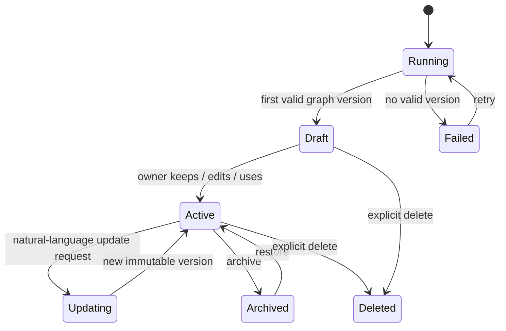

# AI Graph Artifact Platform：持久化、统一浏览与异构知识关系

日期：2026-07-28  
产品方向：**Decided**  
技术状态：**Review-ready design proposal**  
生产状态：**Implementation pending**

配套材料：

- [现状审计与外部研究](../../research/2026-07-28-ai-graph-artifact-platform/README.md)
- [可交互产品原型](../../gstack/ai-graph-artifact-platform-2026-07-28/index.html)
- [AI Search 统一模式入口](./2026-07-28-ai-search-unified-modes.md)
- [Planned Requirements](../../planned-requirements.html#pr-composer-ai-graph)
- [Shared AI Instruction Composer](./2026-07-28-shared-ai-instruction-composer.md)
- [机器运行记录 JSONL 设计](./2026-07-21-machine-record-storage-jsonl-design.md)
- [Roadmap](../../roadmap.html)

> 本文定义 AI Graph 的目标产品、数据和 runtime 边界。它不是当前生产行为说明，也不授权立即修改代码。

## 1. 核心判断

Peak 的 AI Graph 应从“AI Analysis 页面里的临时文件关系图”升级为**可持久化、可版本化、跨 surface 复用的知识图谱 artifact**。

它需要同时满足五个条件：

1. **不绑定文件**：节点可以是概念、词汇、人物、组织、事件、主张、网页或 Vault 文档。
2. **不绑定入口**：AI Search、Composer / File Atlas、Vault Search 和 Chat 使用同一个 capability 与 repository。
3. **不绑定一次运行**：每张图有稳定身份、版本、来源、历史和可重建的全局浏览投影。
4. **不把 AI 推断当事实**：关系保存证据、qualifier、confidence、生成方式和 review 状态。
5. **不另起存储体系**：JSON artifact 是事实源，JSONL 记录运行事件，SQLite 是可重建 projection，Markdown 只做显式 export。

最重要的命名边界：

- **Neighborhood Graph**：local / two-hop、wikilink、semantic similarity，确定性、只读、以文件为节点。
- **AI Graph**：围绕用户问题，从多种来源抽取异构节点与关系，可审阅、持久化、版本化。

两者可以使用同一个 canvas renderer，但不能共享一套含混的数据语义。

## 2. 本文读者与用途

本文面向：

- owner：确认产品定位、持久化与跨 surface 入口；
- 实现者：拆分 domain schema、runtime、repository、projection 与 UI；
- reviewer：核对 evidence、Web 权限、版本和 source-of-truth；
- 后续 coding agent：在不复制 graph runtime 的前提下执行。

读完后，读者应能回答：

- 什么才算一张 AI Graph；
- 图如何脱离 AI Analysis 被保存和重开；
- “所有 AI Graph”在哪里查看；
- Web、词汇、主张和文件如何进入同一张图；
- 每条 AI 关系如何追溯和纠错；
- 当前 `LensGraphData`、analysis JSON 与 graph Markdown 如何迁移。

## 3. 目标与非目标

### 3.1 目标

- 建立 `AIGraphArtifact` domain model。
- 成功生成的 Graph 自动持久化，不依赖用户另点 Save。
- 在 `AI Search → AI Graph` 模式提供全部 AI Graph 的统一历史列表。
- 支持 Vault、Web、粘贴文本和已有 Graph 作为来源。
- 支持异构 node / relationship。
- 支持 graph version、semantic edit、refresh 与 source drift。
- 让所有 graph surface 通过 app-owned capability 复用同一 runtime。
- 保留当前 renderer 的可复用价值，但不让 renderer type 成为事实源。

### 3.2 非目标

- 不把整个 Vault 自动转成一个永久 AI Graph。
- 不在后台持续爬取互联网。
- 不引入公开分享、多人协作或实时 CRDT。
- 不实现完整 RDF / OWL / SPARQL。
- 不把 Neo4j 作为首版依赖。
- 不把 AI Graph 当成 Obsidian wikilink 的自动写回工具。
- 不把图中的 AI relation 静默写入用户笔记。
- 不为每个 surface 注册新的 Command Palette 命令。
- 本文阶段不修改生产代码。

## 4. 当前状态与目标差距

完整证据见[现状审计](../../research/2026-07-28-ai-graph-artifact-platform/README.md)。这里保留直接影响设计的六项事实。

| 当前事实 | 目标响应 |
| --- | --- |
| `AIGraphAgent` 以 Vault search results 为输入 | source contract 扩展为 Vault / Web / manual / graph |
| 基础 topology 主要来自 local link / semantic edge | 增加 entity / concept / claim extraction pipeline |
| node identity 等于 Vault path | node 有稳定 ID，Vault path 只是 source/entity property |
| graph JSON 嵌在 analysis snapshot | graph 成为独立 artifact；analysis 只保存 `artifactRef` |
| history 已能混合 analysis 与 graph | AI Search 复用同一 history 心智；AI Graph mode 改读 artifact browse projection |
| graph node / edge count 写成 `0` | projection 从 canonical version 重建真实统计 |

## 5. 用户心智模型

用户不是在“运行一个 graph agent”。用户是在创建和维护一张可以反复回看的知识图。

```text
提出想看的关系
  -> 选择来源和图谱类型
  -> AI 抽取节点、关系和证据
  -> 审阅图和低置信关系
  -> 自动保存为一张 Graph
  -> 在任何相关 surface 重开
  -> 添加来源、修正关系或刷新 Web
  -> 产生新版本，旧版本仍可回看
```

一张 Graph 可以回答不同问题：

- “这些产品概念之间是什么关系？”
- “这组文章中的关键术语、上下位概念和别名是什么？”
- “互联网上围绕 GraphRAG 有哪些人物、项目、论文和方法关系？”
- “哪些主张互相支持、冲突或缺少证据？”
- “一个想法如何随时间演化？”

## 6. Graph 类型与 lens

Graph 类型决定 extraction guidance。Lens 只决定同一份 graph data 如何显示，两者不能混为一谈。

### 6.1 首批 Graph 类型

| 类型 | 适合问题 | 重点 node | 重点 relation |
| --- | --- | --- | --- |
| Free Explore | “帮我找出重要对象和关系” | 自动提取 + custom | 自动归类到 relation family |
| Concept Map | 术语、词汇、分类、定义 | concept / term | broader、narrower、related、defines、alias |
| Entity Map | 人、组织、产品、地点、作品 | person / organization / place / work | typed real-world relation |
| Evidence Map | 主张是否有支持或冲突 | claim / source / entity | supports、refutes、qualifies、derived-from |
| Causal / Process Map | 原因、影响、步骤、依赖 | concept / event / process | causes、enables、blocks、precedes |
| Timeline | 事件、版本、思想演化 | event / work / claim | precedes、succeeds、derived-from |

### 6.2 首批 lens

- Constellation：自由探索与 entity network。
- Concept：概念层级与相关词。
- Evidence：claim / support / refute / source。
- Flow：因果、流程和依赖。
- Timeline：时间关系。
- Source：每个 node / relation 从哪里来。

Folder tree、local neighborhood 和 orbit 属于 deterministic file graph 的 renderer preset。它们可以继续存在，但不是 AI Graph 类型。

### 6.3 Lens relation projection 与线条可读性

Lens 不修改 canonical graph body，但也不能只换 node position 后继续渲染全部 relation。每个 lens 必须先产生 transient relation projection：

- Thinking Tree 只显示明确的 parent / child、broader / narrower、defines / derived-from 等层级主线；temporal、cross-domain 与普通 reference 默认不混入树。
- Timeline 对 raw temporal relation 与 evolution chain edge 按 canonical relation identity 去重；同一语义路径只绘制一次。
- 没有有效时间或不属于当前 evolution chain 的 node 不作为无解释的孤岛散落在主时间轴；进入 `No date / Unassigned` 分组，或隐藏并显示数量。
- 主关系线在默认 zoom 下保持清晰对比和至少 2px 的视觉粗细；方向必须明确，不能依赖用户猜测 source / target。
- Renderer 必须消费 `AIGraphRelation.directed`：`directed: true` 在 target 端绘制单向 arrow marker，`directed: false` 使用无箭头中性线；不能对所有 predicate 统一加箭头。
- Hierarchy 的 parent → child 与 Timeline 的 earlier → later 必须始终显示方向；Bridges 的 cluster connector 默认无方向，只有落到具体 directed predicate 时才显示箭头；Topology / Network 按每条 canonical relation 的 `directed` 决定。
- 箭头在 light / dark theme、默认 zoom 与缩放后都必须可见，大小随 stroke 协调，不能遮挡 target node；hover / selection 同时增强 edge 与 marker。
- 方向不能只靠视觉表达。Relation inspector 和可访问名称必须提供 `source label → predicate → target label` 文本，且与画布箭头一致。
- 重复的 relation kind 不在每条线上常驻打印；默认通过简短 legend 解释，hover / selection 再显示完整 predicate、qualifier 与 evidence。
- Lens projection、viewport 和线条显隐属于 view state，不产生 semantic version，也不能丢掉 artifact 中未显示的关系。

## 7. 来源模型

### 7.1 Source 类型

```ts
// Proposed domain contract
type AIGraphSourceKind =
  | 'vault-file'
  | 'vault-block'
  | 'web-page'
  | 'manual-text'
  | 'analysis-result'
  | 'ai-graph-version';
```

每个 source 必须有稳定 ID、显示名称、读取时间和内容指纹。Web source 还需要 canonical URL、fetchedAt 和可用状态。

```ts
// Proposed
interface AIGraphSource {
  sourceId: string;
  kind: AIGraphSourceKind;
  title: string;
  locator: string;
  contentHash: string | null;
  capturedAt: number;
  freshness: 'current' | 'changed' | 'unavailable' | 'unknown';
  parentSourceId?: string;
  metadata?: Record<string, string | number | boolean | null>;
}
```

### 7.2 Web source 规则

- Web 默认关闭；用户主动开启。
- 运行前显示将访问 Web、预计 source 数和成本等级。
- 搜索结果 snippet 只能用于找候选，不能单独成为 relation evidence。
- 需要打开正文并捕获最小证据片段。
- 默认不保存整篇网页。
- 保存 canonical URL、标题、fetchedAt、content hash 和 evidence quote。
- 网页变化只把 source freshness 标记为 `changed`，不会直接改写 graph，也不会自动创建版本。
- 用户可从 Sources 管理面板把变化的来源带入 `Update graph`；只有 semantic diff 被接受后才产生新版本。
- 无法重新访问时保留旧 evidence，并标记 unavailable。

## 8. Evidence 与 provenance

关系是 AI Graph 的风险中心。每一条 AI relation 都必须能回答：

- 由谁或什么产生；
- 根据哪段来源；
- 是原文明确表达，还是模型推断；
- 适用什么时间、范围或条件；
- 用户是否审阅过。

```ts
// Proposed
interface AIGraphEvidenceRef {
  evidenceId: string;
  sourceId: string;
  selector:
    | { kind: 'vault-lines'; from: number; to: number; heading?: string }
    | { kind: 'vault-block'; blockId: string }
    | { kind: 'text-quote'; exact: string; prefix?: string; suffix?: string }
    | { kind: 'url-fragment'; value: string };
  quote?: string;
  sourceContentHash: string | null;
  capturedAt: number;
}

interface AIGraphProvenance {
  origin: 'ai-extracted' | 'ai-inferred' | 'deterministic' | 'user' | 'imported';
  runId?: string;
  provider?: string;
  model?: string;
  extractorVersion?: string;
}
```

展示规则：

- `ai-extracted`：原文明确表达，实线。
- `ai-inferred`：跨来源推断，虚线，并显示 explanation。
- `deterministic`：wikilink、明确 import、相同 ID 等，使用独立图例。
- 没有 evidence 的 AI relation 默认进入 `needs-review`，不能伪装成确定事实。

## 9. Canonical domain model

### 9.1 Artifact 与 version

`AIGraphArtifact` 保存稳定身份和当前状态。每次成功 generation、source refresh 或 semantic edit 产生一个 immutable version。

```ts
// Proposed
type AIGraphOriginSurface =
  | 'ai-search'
  | 'ai-analysis'
  | 'file-atlas'
  | 'composer'
  | 'vault-search'
  | 'chat-studio'
  | 'import';

interface AIGraphOriginContextRef {
  kind:
    | 'search-query'
    | 'vault-file'
    | 'vault-selection'
    | 'atlas-file'
    | 'conversation'
    | 'project'
    | 'import';
  ref: string;
  label: string;
  locator?: string;
}

interface AIGraphArtifactManifest {
  schemaVersion: 1;
  graphId: string;
  title: string;
  description?: string;
  graphType:
    | 'free'
    | 'concept'
    | 'entity'
    | 'evidence'
    | 'causal'
    | 'timeline';
  status: 'draft' | 'active' | 'archived';
  headVersionId: string;
  createdAt: number;
  updatedAt: number;
  createdFrom: {
    surface: AIGraphOriginSurface;
    contextRefs: AIGraphOriginContextRef[];
  };
  tags: string[];
  defaultLens?: string;
}

interface AIGraphVersion {
  schemaVersion: 1;
  graphId: string;
  versionId: string;
  parentVersionId?: string;
  createdAt: number;
  createdBy: 'user' | 'assistant' | 'system';
  changeKind: 'generated' | 'sources-added' | 'refreshed' | 'semantic-edit' | 'imported';
  prompt?: string;
  sourceIds: string[];
  nodes: AIGraphNode[];
  relations: AIGraphRelation[];
  evidence: AIGraphEvidenceRef[];
  generation: {
    runId?: string;
    provider?: string;
    model?: string;
    extractorVersion?: string;
  };
  stats: {
    nodeCount: number;
    relationCount: number;
    sourceCount: number;
    needsReviewCount: number;
  };
}
```

### 9.2 Node

```ts
// Proposed
type AIGraphNodeKind =
  | 'vault-document'
  | 'web-resource'
  | 'concept'
  | 'person'
  | 'organization'
  | 'place'
  | 'event'
  | 'work'
  | 'product'
  | 'claim'
  | 'process'
  | 'dataset'
  | 'custom';

interface AIGraphNode {
  nodeId: string;
  kind: AIGraphNodeKind;
  label: string;
  aliases: string[];
  description?: string;
  canonicalRef?: string;
  customType?: string;
  properties: Record<string, string | number | boolean | null>;
  evidenceIds: string[];
  provenance: AIGraphProvenance;
  reviewStatus: 'suggested' | 'accepted' | 'edited' | 'rejected';
}
```

Node 不要求 `path`。Vault 文件 node 通过 `canonicalRef: vault://...` 关联文件；Web entity 可以关联 Wikidata、Wikipedia、official site 或其他 canonical URL。

### 9.3 Relationship assertion

```ts
// Proposed
type AIGraphRelationFamily =
  | 'semantic'
  | 'taxonomic'
  | 'causal'
  | 'evidence'
  | 'temporal'
  | 'attribution'
  | 'structural'
  | 'custom';

interface AIGraphQualifier {
  key: string;
  value: string | number | boolean;
}

interface AIGraphRelation {
  relationId: string;
  sourceNodeId: string;
  targetNodeId: string;
  family: AIGraphRelationFamily;
  predicate: string;
  label: string;
  directed: boolean;
  qualifiers: AIGraphQualifier[];
  evidenceIds: string[];
  confidence: number | null;
  explanation?: string;
  provenance: AIGraphProvenance;
  reviewStatus: 'suggested' | 'accepted' | 'edited' | 'rejected';
}
```

`predicate` 可以自由扩展，但必须归入一个稳定 `family`，否则 renderer、filter 与 legend 会失控。

首批提供的 canonical predicates：

- taxonomic：`broader-than`、`narrower-than`、`instance-of`、`alias-of`；
- semantic：`related-to`、`defines`、`contrasts-with`、`applies-to`；
- causal：`causes`、`enables`、`blocks`；
- evidence：`supports`、`refutes`、`qualifies`；
- temporal：`precedes`、`succeeds`、`overlaps`；
- attribution：`authored-by`、`published-by`、`owned-by`；
- structural：`part-of`、`depends-on`、`derived-from`、`references`。

## 10. 持久化与 source-of-truth

### 10.1 目录

沿用已接受的 JSONL machine-record 方向，大 artifact body 独立存放。

```text
DataStore/
├── records/
│   └── analysis/
│       └── runs/<run-id>.jsonl
├── artifacts/
│   └── ai-graphs/
│       └── <graph-id>/
│           ├── manifest.json
│           └── versions/
│               ├── <version-id>.json
│               └── ...
├── chat.sqlite
└── vault.sqlite
```

规则：

- 不创建 `all-ai-graphs.jsonl`。
- version file 不原地修改。
- `manifest.json` 可以原子更新 head pointer、title、status 和 default lens。
- JSONL run 只记录生命周期与 `artifactRef`，不重复存整张图。
- SQLite projection 可删除后从 manifest / versions 重建。
- Markdown export 不参与 reopen、history 或 projection。

### 10.2 Run events

```text
ai-graph.run.started
ai-graph.sources.resolved
ai-graph.extraction.completed
ai-graph.entity-resolution.completed
ai-graph.validation.completed
ai-graph.version.created
ai-graph.run.completed
ai-graph.run.failed
ai-graph.run.cancelled
```

Analysis run 可以通过 `analysis.artifact.linked` 指向 graph。Composer / Chat run 也使用同一 artifact reference，不需要新建 surface-specific history。

### 10.3 SQLite projection

首批 projection：

- `ai_graph_artifact_projection`：AI Graph history 列表、状态、类型、来源、更新时间和统计。
- `ai_graph_version_projection`：版本列表和 change summary。
- `ai_graph_node_projection`：跨 Graph 搜索 concept / entity / alias。
- `ai_graph_relation_projection`：按 predicate、family、source node、target node 找关系。
- `ai_graph_usage_projection`：origin surface、context ref 和最近打开时间。

这些表是 read model，不允许成为 graph semantic edits 的事实源。

## 11. AI Search 中的 AI Graph 历史

### 11.1 产品位置

AI Graph 不再拥有独立 Library screen。canonical browse surface 是 [AI Search 统一模式入口](./2026-07-28-ai-search-unified-modes.md)中的 `AI Graph` mode；artifact repository 仍然是事实源，但浏览 UI 复用 AI Search 的 modal、PromptInput 与 history list。

- Quick Search 普通打开默认 `AI Search`，通过顶栏 AI workspace selector 切到 `AI Graph`。
- Composer / File Atlas Graph toolbar 的 `View all` 打开同一个 AI Graph mode。
- Vault Search inspector 的 `Related` 与 `View all` 打开同一个 AI Graph mode 或 Graph Detail。
- Chat 中的 graph artifact card 打开同一个 Graph Detail。

### 11.2 Screen inventory

| Screen | Primary job | Reads | Writes | Entry / exit |
| --- | --- | --- | --- | --- |
| AI Graph history | 找到、重开所有 Graph，或描述一张新图 | artifact browse projection | create run ref | AI Search mode menu / Composer / Search |
| Graph Detail | 阅读图、切 lens、检查 evidence | head version + view state | semantic draft、view preference | AI Graph history / related card |
| Create Graph | 选择问题、来源、类型与 Web | current context + source resolver | run + new artifact | any graph-capable surface |
| Update Graph | 用自然语言描述修改、预览 semantic diff、接受新版本 | current graph + selection + sources | proposed diff + new version | Graph Detail |
| Sources | 查看 / 添加 / 移除来源、检查 freshness | source registry + freshness | source context only | Graph Detail / Update Graph |
| Version History | 比较与恢复 graph version | version projection + snapshots | set head / duplicate | Graph Detail |

### 11.3 History list

首版使用一列紧凑 history row，不显示 source/type filter rows，也不显示 graph preview card grid。每行显示：

- title；
- node / relation / source count；
- current version；
- needs-review count；
- updated time；
- stale / changed source badge；
- 创建它的 surface；
- 一个主要创建上下文，例如 File Atlas 对应的精确文件名。

Graph type 与 source kind 仍保留在 projection 和 detail metadata 中，但不占据默认列表。创建来源不是 taxonomy filter，而是帮助用户理解跨 surface artifact 来历的关键上下文，因此必须直接出现在 history row。只有真实规模和使用证据证明 title search + recent sort 不足时，才增加一个搜索框或排序菜单；不预先恢复多排 taxonomy chips。

### 11.4 Creation provenance

每张 AI Graph 必须同时保存“由哪个功能生成”和“基于什么上下文生成”。history row 使用紧凑格式：

```text
Created in <surface> · <primary context>
```

各 surface 的主要上下文如下：

| Creation surface | History row primary context | Graph Detail full context |
| --- | --- | --- |
| AI Search / legacy AI Analysis | 原始 query 或 analysis title | query、选中 / 自动发现 sources、run ref |
| File Atlas | 精确 Vault 文件名 | 稳定 file ref、captured path / label、选区或 blocks |
| Composer Copilot | 当前文档名 | document ref、selection / block refs、composer action |
| Vault Search | query | query、选中的 result refs |
| Chat Studio | project 或 conversation title | project / conversation / message refs |
| Import | 导入文件或 provider | import ref、原始 metadata |

规则：

- `createdFrom` 是不可变的创建 provenance；以后从 Graph Detail、Chat Studio 或其他 surface 更新时，不覆盖它。
- 后续修改位置属于 version / run provenance，在 Version History 中显示。
- 多个创建上下文在 history row 只显示一个主要上下文和 `+N`；Graph Detail 显示全部。
- File Atlas 必须保存稳定 file ref，并捕获当时的可读文件名；文件移动后可解析新路径，文件删除后仍保留 captured label 并标记 unavailable。
- provenance 是可打开的导航上下文，但历史行本身仍保持单一主动作：打开 Graph Detail；来源跳转放在 Detail 内，避免一行出现多个相互竞争的点击目标。

## 12. Graph Detail

Graph Detail 是所有 surface 共用的阅读和审阅壳，不把 AI Search UI 嵌进 Composer。

### 12.1 布局

```text
┌───────────────────────────────────────────────────────────────────┐
│ title · type · v4      Fullscreen · Versions · Sources · Update  │
├─────────────────────────────────────────────┬─────────────────────┤
│ Update graph: natural-language instruction + automatic context   │
│ Preview: nodes / relations / evidence / review semantic diff     │
├─────────────────────────────────────────────┬─────────────────────┤
│                                             │ Selection inspector │
│                  graph canvas               │ node / relation     │
│                                             │ evidence / status   │
│                                             │ accept / edit       │
├─────────────────────────────────────────────┴─────────────────────┤
│ Sources · Versions · Needs review · Run / cost summary            │
└───────────────────────────────────────────────────────────────────┘
```

### 12.2 Selection inspector

选择 node：

- kind、label、aliases、description；
- canonical ref；
- source evidence；
- merge / split history；
- accepted / suggested / edited；
- open Vault file / web source。

选择 relation：

- predicate 与 direction；
- qualifier；
- confidence；
- explicit / inferred / deterministic；
- evidence list；
- accept、edit、reject；
- “为什么存在这条边” explanation。

### 12.3 Update graph 与 Sources 的职责

Graph Detail 的主修改入口命名为 `Update graph`，不是 `Add sources` 或模糊的 `Refresh`。它采用 instruction-first 交互：

1. 用户直接用自然语言描述期望变化，例如补充概念与关系、重组层级、合并重复对象、删除缺少证据的关系。
2. 系统自动带入 current graph / head version、当前选中的 node 或 relation、已有 sources 与 review context；用户不必重新选择 graph type。
3. 用户可选 `Add context or source` 补充 Vault、Web、manual text 或 existing graph，但它只是更新输入的一部分。
4. AI 先返回 semantic diff，按 added / changed / removed nodes、relations、evidence 与 review status 分组。
5. 当前 graph 在预览阶段不改变；只有用户接受 diff 才创建新的 immutable version。

`Sources` 是独立的来源管理入口：

- 查看、添加、移除来源及 freshness / availability；
- 添加来源不等于更新 graph，不自动触发 run，也不创建 graph version；
- source hash 变化只显示 `Changed`，不能由通用 Refresh 按钮静默改图；
- 用户可明确选择 `Use source changes in Update graph`，把变化带入自然语言更新流程。

Create Graph 只负责首次生成，保留 Graph type 与初始 source scope；它不兼任已有 Graph 的更新表单。

### 12.4 依赖 Shared AI Instruction Composer

输入核心是与 AI Graph Artifact Platform 平级的 [Shared AI Instruction Composer](./2026-07-28-shared-ai-instruction-composer.md)，不属于 AI Graph。

AI Graph Update adapter 只负责：

- 注入 `graphId`、`baseVersionId`、当前 node / relation selection、sources、lens 与 review context；
- 把用户 instruction 和显式新增 context 组装成 graph update envelope；
- 将 submit 路由到 AI Graph capability，返回 semantic diff，而不是 chat message 或 document patch；
- 在 preview / accept / cancel 生命周期中保持 PromptInput 本身无 Graph canonical state。

AI Graph 不得 import Chat Studio view store、conversation runtime 或 Composer Copilot 私有 store。当前可交互 HTML 中的输入区域只是共享能力接入 AI Graph 的设计投影；完整输入行为、ownership 和跨 surface 验收以平级共享能力规格为准。

## 13. 创建与更新 workflow

### 13.1 Create

```mermaid
flowchart LR
  Intent["问题 + Graph 类型"] --> Sources["Vault / Web / Text / Existing Graph"]
  Sources --> Resolve["Source capture + evidence units"]
  Resolve --> Extract["Node / claim / relation extraction"]
  Extract --> Merge["Entity resolution + relation normalization"]
  Merge --> Validate["Evidence / schema / confidence validation"]
  Validate --> Persist["Create immutable version"]
  Persist --> Browse["AI Search · AI Graph history + related surfaces"]
```



阅读要点：

- Web search snippet 只参与 `Resolve` 找 source，不直接越过 evidence gate。
- entity resolution 与 relation extraction 分开，避免同名实体静默合并。
- persist 发生在成功 validation 之后；用户不需要再点 Save 才保住结果。
- surface 只接收 `artifactRef` 和 projection，不拥有 graph truth。

### 13.2 Update

Update 不是原图上覆盖：

1. 在 Graph Detail 选择 `Update graph`，用自然语言描述希望发生的变化。
2. runtime 自动读取 head version、当前 selection、已有 sources 与 freshness；用户可补充 context / source。
3. 根据 instruction 只重做受影响的 extraction、entity resolution 或 relation normalization。
4. 产生候选 semantic diff：added / changed / removed nodes、relations、evidence 与 review status。
5. 用户先审阅 diff；预览、修改 instruction 或取消都不能改变当前 graph。
6. 用户接受后才创建新 immutable version。

### 13.3 Semantic edit 与 layout edit

- 移动 node、缩放、切 lens：view state，不产生 semantic version。
- 改 label、merge/split entity、加删 relation、改 qualifier：semantic draft。
- semantic draft 接受后创建 version。
- reject AI relation 也进入 version，避免下一次无记忆地重复建议。

## 14. Lifecycle



删除规则：

- Archive 可恢复，只改 manifest status。
- Delete 需要确认 exact graph；删除 artifact versions 后 projection 可重建为 absent。
- graph 被 Chat / Analysis / document 引用时，删除前显示 backlinks。
- 删除 artifact 不删除原始 Vault 或 Web source。

## 15. 跨 surface 复用

| Surface | Create context | 展示 | Browse 行为 |
| --- | --- | --- | --- |
| AI Search | query + selected / discovered sources + optional Web | 完整 Graph Detail | AI Graph mode history |
| Composer / File Atlas | current doc + selected blocks / tray + prompt | 内嵌 preview，open full detail | toolbar opens AI Graph mode |
| Vault Search | current query + selected results | related graph card / detail | related + open AI Graph mode |
| Chat Studio | attachments + conversation prompt | artifact card / detail | project / conversation backlinks |
| Future Copilot | explicit selected source set | graph as reviewable artifact | attach graph as context |

所有 surface 调用同一个 capability：

```ts
// Proposed
interface AIGraphCapability {
  create(request: CreateAIGraphRequest): Promise<AIGraphRunRef>;
  update(request: UpdateAIGraphRequest): Promise<AIGraphRunRef>;
  open(graphId: string, versionId?: string): Promise<AIGraphArtifactView>;
  list(query: AIGraphBrowseQuery): Promise<AIGraphBrowsePage>;
  subscribe(runId: string, listener: (event: AIGraphRunEvent) => void): () => void;
}
```

runtime 由 app layer 组合。UI store 只保存当前 selection、viewport、filter 和 transient draft，不保存 canonical graph。

## 16. Runtime 边界

```text
app/
└── AIGraphRuntimeRegistry
    ├── AIGraphCapability
    ├── AIGraphArtifactRepositoryPort
    ├── AIGraphProjectionPort
    ├── AIGraphSourceResolverPort
    ├── WebResearchPort
    ├── AI generation / object generation capability
    ├── RunEnvelope / record store
    └── usage / permission / trace

service/
└── ai-graph/
    ├── extraction pipeline
    ├── entity resolution
    ├── relation normalization
    ├── validation
    └── migration/import

ui/
├── AIGraphHistoryProjection
├── GraphDetail
├── CreateGraph
└── surface adapters
```

禁止：

- `service/ai-graph` 新增 module singleton；
- surface 直接读写 artifact JSON；
- Composer 直接 import Quick Search Zustand store；
- provider SDK 出现在 graph feature；
- analysis history service 继续充当 graph repository。

## 17. Legacy 迁移

### 17.1 可迁移来源

- `DataStore/ai-analysis/*.json` 中 `runAnalysisMode: aiGraph` + `v2GraphJson`。
- 旧 AI Analysis Markdown 中的 Graph Data callout。
- 显式保存的 `type: ai-graph` Markdown export。

### 17.2 导入规则

1. 只读扫描 legacy records。
2. 每个 legacy graph 生成新 `graphId` 与 version 1。
3. path node 映射成 `vault-document`。
4. 旧 edge kind 映射到 canonical predicate / family。
5. 无 evidence 的 relation 标记 `legacy-import` + `needs-review`。
6. 原文件不删除、不改写。
7. projection 与新 artifact 校验成功后，AI Search 的 AI Graph mode 才切到新 browse projection。

### 17.3 不接受的迁移方式

- 不 dual-write 无限期维持 analysis snapshot graph 与 artifact graph。
- 不把旧 graph Markdown 继续当更新目标。
- 不按 title 作为 graph identity。
- 不因无法构造 evidence 而伪造 source quote。

## 18. 实施阶段

### Phase 0：characterization 与 contract

- 锁现有 AI Graph generate / save / replay 行为。
- 为 `v2GraphJson`、legacy Markdown 和 explicit graph export 建 fixtures。
- 定 schema、ID、atomic write 和 projection rebuild contract。
- 验证 100 / 500 / 2,000 node artifact。

### Phase 1：artifact store + AI Graph history read path

- 实现 manifest / immutable version repository。
- 建 SQLite projections 与 rebuild command。
- 导入 legacy graphs。
- 先以 read-only AI Graph history / Detail 打开新 artifact。

### Phase 2：统一 create runtime

- 将 AI Analysis `aiGraph` 改走 app-owned capability。
- 提取 heterogeneous node / relation / evidence。
- 完成 entity resolution、validation、usage 与 RunEnvelope。
- 停止把新 graph body 写回 analysis snapshot；只写 artifact ref。

### Phase 3：Web + concept / evidence templates

- 接 WebResearchPort。
- 完成 Concept / Entity / Evidence / Causal / Timeline guidance。
- 增 source freshness 与 version refresh。

### Phase 4：surface adapters

- Composer / File Atlas。
- Vault Search inspector。
- Chat graph artifact。
- Related / View all / backlinks。

### Phase 5：retire legacy truth

- 删除 `useAIGraphStore` 的 canonical 责任。
- 删除 graph body 的 analysis snapshot 写入。
- `AIAnalysisHistoryService.findRelatedAIGraph` 改为 graph projection query 或退役。
- Markdown Save Graph 改名为 Export，不参与 persistence。
- 删除不再需要的 legacy parser / adapter。

## 19. 验证矩阵

| 需求 | 自动验证 | 实机验证 |
| --- | --- | --- |
| 自动持久化 | successful run 产生 manifest + version；restart 可重开 | 生成后关闭 modal / reload plugin 仍存在 |
| All AI Graphs | projection rebuild 后 history list 与 search 一致 | 四个入口打开同一 AI Graph mode / Detail |
| 异构 node | schema 覆盖 concept / person / claim / web | 图中没有 Vault file 也能成立 |
| Web evidence | relation 必须有 captured URL + selector | 点击 evidence 打开原网页并定位/显示 quote |
| version | update 只新增 version，不改旧文件 | compare v1/v2；切回旧版 |
| entity resolution | alias merge / split round-trip | 中文名、英文名、缩写可审阅 |
| source drift | hash change 只标记 changed，不改 graph/version | Sources 显示 changed；明确进入 Update graph 后才出现 diff |
| instruction-first update | current graph / selection / sources 自动进入 update envelope；preview 不写 version；accept 才追加 version | 输入自然语言 → 预览 semantic diff → revise/cancel 不改图 → accept 创建新版本 |
| source/update separation | add/remove source 只改 source context，不触发 graph run | Add source 后 graph 与版本不变；可用 “Use source changes in Update graph” 显式继续 |
| shared instruction composer dependency | AI Graph 通过 adapter 消费平级 Shared AI Instruction Composer；禁止 Graph-local input stack；adapter 不依赖 Chat / Copilot store | shared composer 行为由平级 capability 验收；AI Graph submit 只增加 graph context 并产生 semantic diff |
| relation review | accept / edit / reject 写入 version | rejected relation 不再作为 active edge |
| lens readability | Thinking Tree relation family filter；Timeline canonical edge dedupe；unassigned node 分组；`directed` → arrow marker mapping | 默认 zoom 下主线清楚；Hierarchy / Timeline 方向可辨；directed / symmetric 关系箭头正确；无重复边和无解释孤岛 |
| no dual truth | graph body 只在 artifact store | analysis / composer / chat 重开得到相同版本 |
| projection rebuild | 删除 projection 后从 artifact 重建 | AI Graph history count / stats 不漂移 |

## 20. 风险与对策

### 20.1 AI 关系看起来太像事实

对策：

- explicit / inferred / deterministic 三种视觉；
- evidence inspector；
- confidence 与 needs-review；
- Web relation 无 evidence 不进入 accepted。

### 20.2 图太大，画布失效

对策：

- extraction 与 rendering 分离；
- community / cluster progressive disclosure；
- node cap 只限制当前 lens，不裁掉 artifact；
- AI Graph history stats 和 source map 仍能访问全量。

### 20.3 实体误合并

对策：

- canonical ref、type、alias 和 evidence 共同决策；
- merge 需要解释；
- split 可撤销；
- semantic edit 进入 version。

### 20.4 Web source 漂移

对策：

- capturedAt + contentHash + quote；
- changed / unavailable badge；
- refresh 新建 version；
- 旧 evidence 不静默替换。

### 20.5 成本失控

对策：

- Web 与 deep extraction 显式 opt-in；
- source 数、预计 cost tier 和 model role 运行前可见；
- source unit cache 与 incremental update；
- deterministic edges 不重复过 LLM。

## 21. 备选方案

### 21.1 继续扩展 `LensGraphData`

拒绝。它是 renderer view model，要求 `path`，无法拥有 artifact lifecycle、evidence 与 version。

### 21.2 每个 AI Analysis 保存一个完整 Markdown graph

拒绝。机器生成的大量 wikilink Markdown 已造成 Obsidian metadata OOM；Markdown 应继续只做显式 export。

### 21.3 直接使用 Neo4j

首版拒绝。当前首要难题是 semantic contract、provenance 与 UX，不是 billion-edge query。JSON artifact + SQLite projection 已符合本地、可同步和可重建边界。

### 21.4 把所有 graph 都塞进现有 `mobius_node` / `mobius_edge`

拒绝。它们拥有 Vault index / derived graph 语义，不应成为用户创建的版本化 AI Graph 事实源。未来可以投影一部分 accepted entity / relation 用于跨图搜索，但必须可从 artifact 重建。

## 22. 验收标准

设计实施完成后，必须同时满足：

- 用户能在 `AI Search → AI Graph` 的历史列表中看到所有成功生成的 graph。
- graph 重启后存在，不依赖原 surface 的 store。
- 一张 graph 可以完全不含 Vault 文件 node。
- Web relation 有可打开 source 与捕获时间。
- concept / term 有层级与 related relation。
- relation 能显示 evidence、confidence、qualifier 和 origin。
- AI Search、Composer、Search、Chat 打开相同 `graphId/versionId`。
- semantic update 产生新 version。
- SQLite 删除后可从 artifact 重建。
- Markdown graph 是 Export，不是 persistence。
- current local / two-hop graph 仍保持 deterministic、read-only。

## 23. 明确不要做

- 不把“AI Graph 已经有 JSON”当成持久化设计已经完成。
- 不用 query title 代替 stable graph ID。
- 不把 URL 节点等同于 Web evidence。
- 不把 search snippet 当事实证据。
- 不把 low-confidence inferred relation 画成普通实线。
- 不在 Composer 新建 graph service。
- 不让 layout drag 产生 semantic version。
- 不自动写 wikilink 或修改用户笔记。
- 不在没有 migration / projection rebuild gate 时删除旧 graph records。
