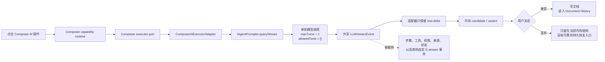
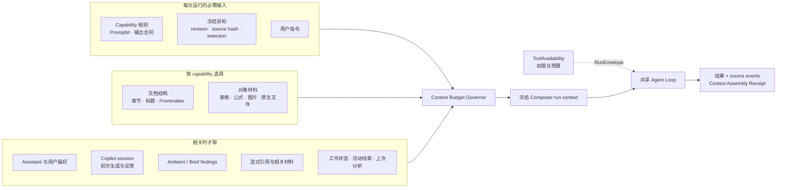
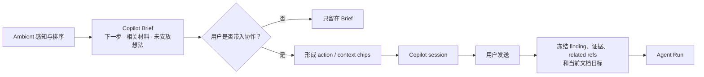
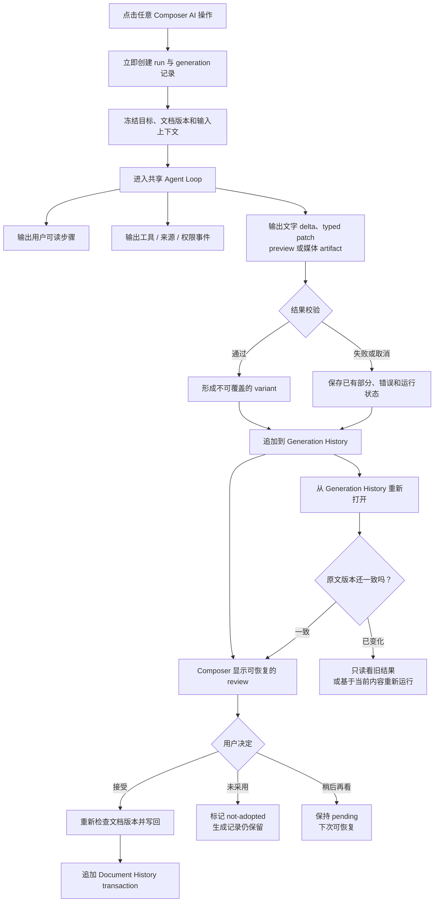

# Composer AI Agent 流程与生成历史

**状态：** Owner 已确认方向 · 设计记录 · 尚未实现  
**日期：** 2026-07-28  
**范围：** Composer View 内所有真正调用 AI 的操作  
**不包含：** 本文不修改代码，不决定具体实施批次，也不把普通裁剪、排序、格式转换等确定性编辑强行改成 AI Agent

## 1. 先说结论

Composer 里的文字生成、表格生成、公式解释、图片编辑和原生对象修改，都应当进入同一套 Agent Run。简单文字任务可以只调用一次模型，也可以完全不调用工具，但仍然要有完整的运行身份、步骤事件、结果校验和生成记录。

界面要显示的是可理解的执行步骤，例如：

1. 已锁定当前段落和文档版本；
2. 正在准备任务；
3. 正在调用模型或工具；
4. 正在校验文字、表格或图片结果；
5. 已生成候选，等待采用。

这里的“步骤可见”不等于展示模型的内部思维。原始 chain-of-thought 不进入产品界面或生成历史；可见的是运行状态、工具调用、来源、校验结果和产物。

每一次 AI 生成都必须留下可恢复记录。用户按“未采用”、关闭面板、切换候选，甚至运行失败或取消，都不能让已经产生的内容无声消失。

## 2. 为什么现在不是这样

### 2.1 当前 Composer 只是借用了共享 AI 服务

当前文字和结构化对象的主链路是：



这条链路共享了 Provider 和 Prompt 服务，但没有共享完整 Agent Loop：

- [`documentRuntime.ts`](../../../src/service/composer/capabilities/documentRuntime.ts) 使用一个临时 `CompiledSkill`，其中 `allowedTools` 是空数组。
- [`service-manager.ts`](../../../src/service/chat/service-manager.ts) 的 `queryStream()` 对 Agent SDK 也固定使用 `maxTurns: 1` 和 `allowedTools: []`。
- [`ComposerAiExecutorAdapter.ts`](../../../src/app/composer/capabilities/ComposerAiExecutorAdapter.ts) 只转发 `text-delta`，其余共享事件全部忽略。
- [`executorPort.ts`](../../../src/service/composer/capabilities/executorPort.ts) 本身也只允许 `text-delta` 和 `complete` 两种事件。

因此，当前 Composer 的“stream”主要等于文字分片，不等于 Agent 的完整执行过程。

### 2.2 `CapabilityRunner` 不是 Agent Loop

当前 Composer 的确经过 [`CapabilityRunner.ts`](../../../src/service/capabilities/CapabilityRunner.ts)。它会创建 RunEnvelope、记录开始/结束状态，并产出一个 artifact reference。

但真正的模型执行仍由调用方提供的 `execute()` 完成。当前 `execute()` 内部调用的是上面的单轮文字流。仅仅经过 `CapabilityRunner`，不会自动获得多步骤 Agent、工具循环、权限等待或可见步骤。

### 2.3 共享 stream 已经有丰富格式，但 Composer 边界没有使用

[`LLMStreamEvent`](../../../src/core/providers/types.ts) 已经支持多种事件：

| 已有事件 | 能表达什么 | 当前 Composer |
| --- | --- | --- |
| `ui-step` / `ui-step-delta` | 用户可读的步骤和进度 | 没有转发 |
| `agent-step-progress` | Agent 当前执行到哪里 | 没有转发 |
| `tool-call` / `tool-result` | 调用了什么工具，结果怎样 | 没有转发 |
| `source` | 使用了哪些来源 | 没有转发 |
| `chat-permission-*` | 等待用户允许或拒绝一次操作 | 没有转发 |
| `chat-run-status` | running、waiting、completed、failed 等状态 | 没有转发 |
| `prompt-stream-*` | Prompt 子任务的开始、增量和结果 | 没有转发 |
| `text-delta` | 逐步生成的文字 | 已转发 |
| `complete` / `error` | 结束或失败 | Composer 自己重新包装 |

Agent Harness 还拥有 `step_start`、`step_finish`、`tool_input_*`、`permission_*`、`run_status` 和 `loop_finish` 等运行事件。Chat 已有把 Harness 事件翻译成 `LLMStreamEvent` 的桥接层；Composer 没有走这条桥。

### 2.4 结构化结果仍在等待一整段 JSON

表格、图表和原生对象当前会先累计模型输出的原始文字。由于半截 JSON 不能安全解析，界面只能显示空骨架，等全部生成完成后再一次性 materialize。

这解释了“为什么先等做完再显示”，但不是最终目标。共享 Agent 流程应当把运行步骤和结构化产物分开：

- 运行步骤可以立即显示；
- 文字内容继续使用 `content-delta`；
- 结构化对象使用 `typed-patch`、`preview-ready` 等领域事件；
- UI 不需要向用户闪现半截 JSON。

[`2026-07-24-peak-composer-ai-capability-modularity-architecture.md`](./2026-07-24-peak-composer-ai-capability-modularity-architecture.md) 已经设计了 `typed-patch`、`preview-ready`、`candidate-completed`、`finding`、`source` 和 `no-change`。当前生产事件合同尚未完整实现这些格式。

### 2.5 当前所谓“候选历史”不是可靠的生成历史

当前有三种彼此分开的临时状态：

- [`candidateStore.ts`](../../../src/service/composer/candidateStore.ts) 在内存中保存 candidate、variant 和 discarded candidate；
- [`formulaDetailStore.ts`](../../../src/ui/view/composer/blocks/math/formulaDetailStore.ts) 在每个公式块的 Zustand store 里保存解释版本；
- 图片协调器单独管理图片运行和候选。

这些状态能支持当前会话内的版本切换，但不是持久记录：

- `ComposerCandidateStore` 是运行时 `Map`；
- 未保留的公式解释在关闭时会从 store 删除；
- [`historyStore.ts`](../../../src/service/composer/historyStore.ts) 明确只记录已经提交的 transaction；
- 当前没有统一 repository 可以在重新打开 Composer 后恢复所有生成结果。

图片编辑即使留下了新文件，也只是文件没有被删除，不等于存在一条可查询、可解释、可恢复的生成记录。

## 3. Owner 已确认的目标契约

### 3.1 所有 Composer AI 操作都属于 Agent Run

“属于 Agent Run”表示每次操作都具备：

- 稳定的 `runId`；
- 冻结的输入上下文和目标位置；
- Prompt 身份和版本；
- 明确的 capability 与允许使用的工具；
- 可订阅的步骤、工具、来源、权限、状态和结果事件；
- 一个或多个不可覆盖的生成 variant；
- 完整的 run receipt 和 usage；
- 可持久恢复的生成记录。

它不表示每次都必须多轮思考或调用工具。简单的“润色文字”可能仍只有一次模型调用，但它不再绕过统一 Agent Run 的生命周期。

### 3.2 步骤要输出，但不输出内部思维

界面可展示：

- 上下文已锁定；
- Prompt 和模型路线已准备；
- 正在读取某个明确来源；
- 正在调用某个工具；
- 工具成功、失败或等待权限；
- 正在生成文字、结构化 patch 或媒体；
- 正在校验结果；
- 候选已准备好；
- 运行已完成、取消或失败。

界面不展示：

- 模型隐藏推理；
- 原始 chain-of-thought；
- 未经整理的大段 debug log；
- 可能包含秘密的 Provider 原始 payload。

如果 Provider 返回 reasoning 内容，只能按现有安全策略处理。产品步骤由系统根据真实运行事件生成，不从模型内部思维中猜测。

#### 3.2.1 结果可以等待，运行反馈不能中断

所有 Composer AI 操作都必须在点击后立即创建可见 run 状态。结构化结果不能安全增量展示，不等于界面可以保持空白。

运行期间至少同时存在两条独立投影：

| 投影 | 是否持续可见 | 内容 |
| --- | --- | --- |
| **Run feedback** | 每个 AI 操作都必须持续可见 | 当前阶段、最近真实事件、运行心跳、已用时间、等待原因和终态 |
| **Result preview** | 由结果类型决定 | 文字 delta、完整 typed patch、通过校验的对象或已经写出的媒体 artifact |

当底层暂时没有新的语义事件时，Run feedback 仍保留：

- 当前真实阶段；
- indeterminate 动画，例如动态圆点、微光或运行轨迹；
- 从 run 开始计算的已用时间；
- 最近一次真实状态更新时间；
- 停止操作。

动画只说明“运行尚未结束”，不表示虚构的完成比例。除非 Provider 或工具返回可信的总量与进度，否则不能显示伪造百分比，也不能定时追加假的 Agent 步骤。

收到新的 `ui-step`、`agent-step-progress`、`tool-call`、`tool-result`、`source`、permission 或 run-status 事件时，界面更新真实阶段。若等待用户授权，状态改为 `waiting-for-user`，主动运行动画停止，授权动作获得主焦点；失败、取消、超时和完成也必须停止运行动画并显示明确下一步。

动画还必须满足：

- `prefers-reduced-motion` 下改为低动态状态变化；
- 状态文字使用适当的 live region，但动画帧本身不能反复触发读屏；
- quiet / stalled / timeout 阈值来自配置，不散落硬编码；
- 长时间没有事件时显示“仍在运行”或“等待服务返回”，而不是继续停在空骨架。

### 3.3 复用现有自定义 stream，不再造一套 Composer 日志

目标流分为两层：

1. **运行层：** 复用 Agent Harness 和 `LLMStreamEvent`，承载步骤、工具、来源、权限、状态、usage 和错误。
2. **结果层：** 复用 Composer typed event，承载文字 delta、typed patch、preview、candidate、finding 和 no-change。

Renderer 不能解析日志文字来猜测候选；运行步骤也不能被塞进候选正文。

### 3.4 所有生成结果都进入 Generation History

Generation History 是 AI 生成事实的时间线。它至少保存：

- 完成的结果；
- 每次 regenerate / follow-up 产生的旧 variant；
- 用户没有采用的结果；
- 被切换成非 active 的结果；
- 取消或失败前已经产生的部分内容；
- 图片、图表、文件等生成 artifact 的稳定引用；
- 校验失败的原始产物和错误信息。

“未采用”只是一个状态，不是删除动作。界面不再把它理解成“把 AI 已经生成的内容扔掉”。

### 3.5 Generation History 与 Document History 分开

| 历史 | 保存什么 | 用户用它做什么 |
| --- | --- | --- |
| **Generation History** | 每一次 AI run、variant、产物和采用状态 | 找回、比较、重新打开、继续修改 |
| **Document History** | 真正写入 Markdown 或原生文件的 transaction | 查看文档怎么变了、Undo、Redo、Rollback |

一个生成结果可以永远停留在 Generation History，而不进入 Document History。只有“接受”并成功写回后，才会产生 Document History transaction；该 transaction 反向引用原来的 `runId`、`generationId` 和 `variantId`。

### 3.6 固定 capability 与动态生成同时存在

Composer 的 AI 入口有三层，不能把它们混成一张固定按钮表：

| 层 | 是否固定 | 产生什么 |
| --- | --- | --- |
| **Capability registry** | 稳定注册 | 可执行能力、适用目标、Prompt、工具、结果与写回合同 |
| **Ambient / Copilot finding stream** | 随正文和证据持续刷新 | finding、recommendation、related material、unplaced thought 和 reason-now |
| **Agent Run / generation** | 每次运行新建 | insight、source、no-change、candidate 与后续 variant |

固定快捷操作直接选择一个已注册 capability。动态建议可以：

- 推荐一个已有 capability，并预填 instruction 与 context；
- 由 Copilot 用多个已注册 capability 或工具组合一项新任务；
- 只产出 finding、insight 或 no-change，不准备文档修改；
- 在 active session 中继续生成 recommendation、follow-up 和新 variant。

动态生成不能绕过 registry、ToolAvailability、权限或 writeback adapter。系统可以不断产生新的建议和任务语义，但不能动态注入一段没有合同的可执行代码。

Ambient refresh 可以创建、更新、重排、defer 或 stale finding。每个 finding 需要稳定 ID、fingerprint、evidence revision、target、evidence、reason-now 和可选 `proposedAction`。同一个 finding 可以同时投影到正文附近与 Copilot Brief；UI 位置不是身份。

当 Ambient 或 Copilot 调用模型产生 finding、recommendation 或主动 insight 时，这次后台或前台生成本身也属于 Agent Run：

- 保存 `runId`、generation record、Prompt 身份、上下文收据和来源；
- 结果以 `finding`、`insight` 或 `no-change` 进入 Generation History；
- dismiss、ignore、defer、dedup 和 stale 只改变 finding lifecycle 或当前投影，不删除原始生成记录；
- 后续 refresh 产生新 evidence revision 时追加新记录，不覆盖旧结果。

纯确定性 producer 重新计算出的 finding 不伪装成 AI generation，也不需要为每次 reparse 复制模型生成历史。它仍保留稳定 finding identity 和必要的 lifecycle / telemetry。

当前生产只完成了这条动态链的一部分：

- `IntelligenceRuntime` 已支持 finding store、Brief sensing mode、refresh 与跨 surface lifecycle；
- related materials 和 session receipt insights 已有投影；
- 当前 app 注入的 `detectOpenWritingMoves()` 主要从明确的未完成任务项产生确定性 finding；
- 完整 AI finding producer、正文投影与 Copilot model-executor 仍未端到端接通。

因此，文档必须同时表达“动态生成是目标能力的一部分”和“当前生产还没有完整实现”，不能把固定按钮误写成最终产品边界。

## 4. 上下文合同：不是四段文字拼 Prompt，而是按能力装配

### 4.1 当前生产事实

当前 [`contextAssembler.ts`](../../../src/service/composer/capabilities/contextAssembler.ts) 冻结的 `ComposerContextSnapshot` 只有：

- 文档 ID 与 revision；
- 当前 target；
- target 的原始 source；
- 可选的 selection text；
- 固定字符窗口内的 `nearby.before / nearby.after`。

因此，当前普通 Composer action 并没有统一得到 Chat 已有的 Assistant instructions、用户偏好、会话摘要、working context、activity index、previous analysis、resource index、Vault intuition 或 current file slot。这个窄快照对简单改写够用，但不能代表图片、公式、Frontmatter、原生对象和 Copilot 建议所需的完整上下文。

Copilot / Ambient 侧已经存在另一部分能力：

- Ambient 把感知结果投影为 Copilot Brief；
- Brief 可以提供下一步、相关材料和未安放想法；
- 用户显式“带入协作”后，相关材料引用进入 Copilot session；
- 发送时可以把 related refs 与当前目标一起冻结。

但这部分目前没有与普通 Composer capability 的上下文装配统一起来，也没有形成完整的 production model-executor 链。不能把“Brief 能显示”写成“每个 Composer AI 操作已经使用这些材料”。

### 4.2 目标原则

Composer 应复用 [`11-feature-chat-context.html`](../../11-feature-chat-context.html) 已解释的 Context Pipeline 方法：上下文由 slot 组成，每个 slot 有 required、priority、maxTokens 和压缩规则，再由总预算治理。Composer 不复制 Chat 最终 Prompt，也不新增一套独立 Prompt 系统；它在共享的 slot / budget 基础上增加编辑领域的 slot。

每个 capability manifest 必须声明：

1. **必需上下文：** 没有这些信息就不能安全运行；
2. **可选上下文：** 相关时带入，超预算时可压缩或省略；
3. **可检索上下文：** 先保存引用，需要细节时通过允许的工具读取；
4. **工具需求：** 本次可以搜索、读取或生成什么；工具授权属于 RunEnvelope，不伪装成 Prompt 文字；
5. **冻结时点：** Agent Run 创建时固定最终输入，之后 focus、selection 或 Ambient 刷新都不能改变在途运行。



这里的 Optional 不是默认全选。required slot 不得丢弃；低优先级 optional slot 先压缩，仍超预算才省略。大型 Vault 内容和附件优先保留可取回引用，不把全文无边界塞入 Prompt。

### 4.3 不同能力的上下文选择

| Capability 家族 | 必需输入 | 相关时增加 |
| --- | --- | --- |
| prose / heading / list / code | 精确 target、所在章节、用户指令 | 写作偏好、相关证据、Copilot session 反馈 |
| frontmatter | 当前 YAML、文档结构或正文摘要 | Vault 属性名和类型库存 |
| table / chart | 完整表格或选区、列结构、用途说明 | 相关来源和输出展示要求 |
| math | 完整 LaTeX、附近变量定义、所在推导段落 | 引用的定理、笔记或 previous analysis |
| image caption / layout | 真实图片、asset 元数据、所在段落 | 章节目的、相关来源 |
| AI image edit | 原图、明确指令、参考图、媒体工具可用性 | 风格约束与已有 artifact |
| link | 当前链接、目标元数据、保留的非链接文本 | backlinks、related materials |
| Base / Canvas / Excalidraw | 原生文件内容、嵌入位置、编辑指令 | 文档结构、显式附件与相关来源 |
| Copilot / Ambient-originated run | originating finding IDs、证据、Brief revision、显式 handoff refs | active session、已有 recommendation 与用户反馈 |

### 4.4 Copilot / Ambient 的边界

Ambient 负责 sensing 与 ranking，不直接拥有 Agent Run。Copilot Brief 是它的产品投影，不是第三个 tab 或第二套 AI 系统。

上下文进入运行必须经过显式边界：



后台 refresh 可以更新下一版 Brief，但不得修改已经冻结的 run context。只有与 active session 直接相关并被显式呈现的 recommendation，才进入 session timeline；不能把每次 Ambient refresh 追加成聊天消息。

### 4.5 Context Assembly Receipt

每个 generation 除了保存 PromptId 和 `contextSnapshotRef`，还必须保存可审计的上下文收据。收据至少记录：

- capability 请求了哪些 slot；
- 哪些 slot 实际进入模型；
- 哪些 slot 被压缩或因预算省略；
- 使用了哪些 explicit refs、related sources 和 tool-loaded sources；
- Brief revision、originating finding IDs 和 session ID；
- 冻结时的 document revision、target source hash；
- ToolAvailability、权限决定和模型所需 capabilities。

收据记录“模型被提供了什么”和“工具实际读取了什么”，不保存 chain-of-thought。它与 Generation History 一起持久化，使未采用结果恢复后仍能解释当时依据。

## 5. 目标流程



阅读这张图时要注意：

- Generation History 在用户决定之前就已经写入。
- “未采用”不会删除 output 或 artifact。
- 恢复旧生成不会绕过 revision 检查。
- Document History 仍然只保存真实写回。

## 6. Generation History 最小数据模型

下面是设计字段，不是已经存在的 TypeScript 接口。

```ts
// Proposed
interface ComposerGenerationRecord {
  generationId: string;
  runId: string;
  sessionId: string;
  capabilityId: string;
  documentId: string;
  target: ComposerTargetRef;

  input: {
    documentRevision: string;
    targetSourceHash: string;
    contextSnapshotRef: string;
    instruction?: string;
  };

  prompt: {
    promptId: string;
    templateVersion?: string;
    effectivePromptHash: string;
  };

  execution: {
    profileId?: string;
    modelId?: string;
    startedAt: number;
    completedAt?: number;
    status: 'running' | 'completed' | 'failed' | 'cancelled';
    receiptRef?: string;
  };

  variants: ComposerGenerationVariant[];
  activeVariantId?: string;
  adoption: 'pending' | 'accepted' | 'not-adopted';
  acceptedTransactionId?: string;
}
```

每个 variant 至少需要：

- `variantId`、创建时间和 instruction；
- 完整 output 或 artifact reference；
- 已产生的部分 output；
- 结构化校验结果；
- 来源和工具结果的稳定引用；
- 它是 initial、regenerate 还是 follow-up；
- 对应的 base revision 与 target hash。

Prompt 记录不得包含 API key、authorization header 或其他 secret。是否保存完整 effective prompt body，需要跟本地隐私和存储策略一起裁决；无论如何必须保存 PromptId、模板版本或 hash，以及恢复所需的输入快照引用。

## 7. 持久化边界

沿用已接受的 [`2026-07-21-machine-record-storage-jsonl-design.md`](./2026-07-21-machine-record-storage-jsonl-design.md)：

- JSONL 保存 append-only 的 run、generation、variant 和 adoption 事件；
- Artifact Store 保存大正文、图片、结构化对象和其他原生产物；
- SQLite 是可重建的查询投影；
- Markdown 和原生文件仍是用户文档的事实源；
- 不把运行记录写进插件安装目录；
- 不新建 Composer 专用的第二套 Provider、Agent Loop 或 History 基础设施。

建议新增或补齐的语义事件：

- `generation.created`；
- `generation.step.recorded`；
- `generation.variant.appended`；
- `generation.output.recorded`；
- `generation.validation.completed`；
- `generation.disposition.changed`；
- `generation.restored`；
- `generation.failed`；
- `generation.cancelled`。

这些事件属于 Copilot / Composer session stream。接受成功后，再向 document history stream 追加 `document.transaction.committed`。

## 8. 恢复规则

### 8.1 原文没有变化

历史 variant 可以重新变成当前 review candidate。恢复本身不写文档，用户仍需按“接受”。

### 8.2 原文已经变化

旧结果先以历史预览打开，不能直接接受。界面至少提供：

- 查看当时的输入和结果；
- 复制结果；
- 用当前内容重新运行；
- 当某种 typed patch 有可靠 rebase 能力时，显式尝试重新定位。

系统不能因为用户点了“恢复”就猜一个新位置写入。

### 8.3 图片和其他文件产物

Generation History 保存 artifact reference、content hash、MIME type、生成参数和来源 asset reference。未采用的图片或文件不会因关闭 review 自动删除。

自动清理和存储配额不在本文决定范围内。在另有 owner 决定之前，不允许后台静默删除 Generation History 引用的产物。

## 9. 与现有文档的关系

本记录补充并澄清以下旧表述：

- [`2026-07-15-composer-block-ai-capability-contract.md`](./2026-07-15-composer-block-ai-capability-contract.md) 中“History 只保存 accepted transaction”仍然成立，但这里的 History 仅指 **Document History**。
- [`2026-07-24-peak-composer-ai-capability-modularity-architecture.md`](./2026-07-24-peak-composer-ai-capability-modularity-architecture.md) 中“pending / not-adopted candidate 不进入 History”也仅指 **Document History**。这些 candidate 必须进入 **Generation History**。
- [`2026-07-21-machine-record-storage-jsonl-design.md`](./2026-07-21-machine-record-storage-jsonl-design.md) 的 Copilot session ledger 需要扩展为完整 generation lifecycle，而不是只保存临时 pending proposal。
- [`11-feature-chat-context.html`](../../11-feature-chat-context.html) 是共享 slot、预算、压缩和可检索引用的当前事实说明；本文定义 Composer 如何复用这些方法并增加编辑专用上下文。

当旧文档使用 `discarded` 时，产品语义应读作 `not-adopted`。兼容字段可以在迁移期存在，但不能触发数据删除。

## 10. 不要这样实现

- 不要让 Composer 继续调用单轮 `queryStream()`，外面只包一个“Agent”名字。
- 不要只在 UI 里伪造固定步骤；步骤必须来自真实运行事件。
- 不要让任何 AI 操作只显示空骨架或静止的“生成中”。
- 不要用定时器伪造 Agent 步骤、完成百分比或工具进度。
- 不要把“没有新的内容 delta”误判为“没有运行反馈可显示”。
- 不要把固定 capability 目录写成 Copilot / Ambient 能提出的全部建议。
- 不要为了动态建议复制 capability 定义、Prompt、工具或写回逻辑。
- 不要让 Ambient refresh 自动执行建议或修改正文。
- 不要把 raw chain-of-thought 当作“Agent 步骤”保存或展示。
- 不要为 Composer 新建另一套 stream 格式、Provider manager、tool loop 或持久化目录。
- 不要把 Chat 的最终 Prompt 原样复制进 Composer；应复用 slot / budget 方法，让 capability 选择上下文。
- 不要默认把整个 Vault、全部聊天历史或所有 Ambient findings 塞进每次运行。
- 不要让 Ambient 后台刷新修改已经冻结的 Agent Run。
- 不要把半截 JSON 当文字流展示。
- 不要让“未采用”、关闭面板或切换 variant 删除生成产物。
- 不要把 Generation History 混进 Document Undo/Redo。
- 不要从历史恢复后绕过 revision 和 source-hash 检查。

## 11. 验收标准

这一方向只有在以下条件全部满足时才算完成：

1. 任意 Composer AI 操作都有稳定 `runId` 和 `generationId`。
2. 文字操作也通过共享 Agent Loop，而不是单轮旁路。
3. 每种 AI 操作点击后立即出现 Run feedback，不存在静止空骨架等待。
4. 暂无新事件时，UI 仍显示当前阶段、indeterminate 动画、已用时间和停止动作。
5. UI 能显示真实步骤、工具、来源、权限等待、校验和终态。
6. waiting-for-user、failed、cancelled、timed-out 和 completed 会停止主动运行动画，并给出明确下一步。
7. Composer 复用现有 `LLMStreamEvent` 与 Harness 事件，不再把边界缩成 `text-delta | complete`。
8. 结构化对象通过 typed event 呈现阶段和进度，不闪现原始半截 JSON。
9. 每个 initial、regenerate 和 follow-up variant 都写入 Generation History。
10. 未采用、取消和失败前的部分 output 可以在重新打开 Composer 后找回。
11. 接受只追加 Document History transaction，不删除 Generation History。
12. 恢复旧结果时重新检查 document revision 和 target hash。
13. 每个 capability 对 required、optional 和 retrievable context 有明确声明。
14. 每个 run 保存 Context Assembly Receipt，可以看出使用、压缩和省略了哪些上下文。
15. Copilot / Ambient 发起的 run 保存 finding、证据、Brief revision 和显式 handoff refs。
16. 固定 capability 和动态 finding 使用同一稳定 capability 身份与执行合同。
17. Ambient 可以持续刷新 finding，但不会自动执行或修改正文。
18. 同一 finding 在正文与 Copilot Brief 中保持同一 ID、evidence revision 和 lifecycle。
19. 模型生成的 finding、recommendation 和主动 insight 拥有 run 与 Generation History；忽略或 stale 不删除原始记录。
20. 确定性 finding 不伪装成模型 generation。
21. 当前确定性 producer 与目标 AI producer 在文档、状态和验收中明确区分。
22. 没有新增 Composer 专用 Provider、Context Pipeline、Agent Loop、tool loop 或第二套 machine-record store。

## 12. 实施前仍需决定

这些问题不会改变上面的 owner 决定，但实施前需要明确：

- Generation History 在 Composer 中的入口和默认筛选；
- 失败或取消的部分 output 默认折叠还是直接可见；
- 完整 effective prompt body 的本地保存策略；
- 大型媒体产物的配额、显式删除和恢复站策略；
- 不同文档路径变化后，`documentId` 如何保持稳定；
- 哪些 Chat slot 可以直接复用，哪些需要 Composer-specific renderer；
- 每个 capability 的默认 slot manifest 与 token 预算；
- Brief findings 和 related refs 的隐私、保留期与显式移除规则；
- 哪些现有 `LLMStreamEvent` 可以直接复用，哪些需要补充通用字段而不是 Composer 私有事件。
