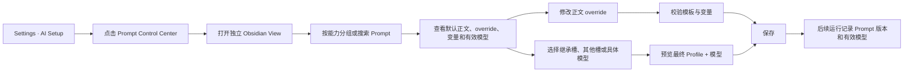

# Prompt Control Center 设计（已并入 AI Control Center）

> - 状态：已被 [`2026-07-30-ai-control-center-design.md`](./2026-07-30-ai-control-center-design.md) 合并取代
> - 日期：2026-07-28
> - 范围：Prompt 审阅、正文 override、逐 Prompt 模型与输出参数 override
> - 入口：Settings → AI Setup → Prompt Control Center
> - 交互稿：[打开可点击 mock](../../gstack/prompt-control-center-2026-07-28/index.html)

> 本文保留原 Prompt 子系统的设计依据。新的顶层设计以 AI capability / action 为主对象，将 Prompt、模型路由、运行前后步骤与真实 run history 放进同一个 AI Control Center；后续实现与评审应以新设计为准。

## 1. 先说结论

Peak 以前确实为“不同 Prompt 使用不同模型”留下过能力，但当前版本不能把它说成一项可用功能。

- 设置数据里仍有 `promptModelMap`，保存的数据也会被加载。
- `AIServiceManager.getModelForPrompt()` 仍会尝试读取这张表。
- 但是实际执行文字、流式文字和结构化结果的主路径，没有使用这个解析结果，而是直接使用当前 Profile 或 Copilot Profile。
- 当前 Settings 没有逐 Prompt 写入入口。
- Prompt 正文 override 已有文件机制，但还有调用者绕过 `PromptService`，所以不能保证所有 override 都真正生效。

因此现在的真实状态是：

> 数据结构和部分 resolver 还在，但执行接线已经失效；不能只补一个设置页面就宣称恢复完成。

本设计建议新增一个独立的 Obsidian View：**Prompt Control Center**。它从 Settings 的一个小入口打开，用于集中查看项目 Prompt、修改正文 override、设置模型 override，并明确显示最终会使用什么。

## 2. 为什么使用独立 View

Prompt 管理不是一个下拉框能完成的设置。用户需要同时看见：

- Prompt 属于哪个能力；
- 默认正文和自己的 override；
- system / user 模板如何配对；
- 运行时默认使用哪个模型用途槽；
- 有没有逐 Prompt override；
- override 后最终解析到哪个 Profile 和模型；
- 这个 Prompt 当前有没有生产调用者；
- 保存前能不能通过变量和格式校验。

把这些内容全部塞回 Provider 设置，会让日常设置页变成一张很长的高级表单。独立 View 更适合搜索、分组、比较、编辑和校验，也能像普通 Obsidian 标签页一样保留工作位置。

Settings 只保留一个紧凑入口：

```text
Prompt Control Center
Review prompts, overrides, and model routing.       Open
151 templates · 124 PromptIds · 3 overrides
```

不增加全局 Command Palette 命令。它是高级设置的附属工作区，不是高频全局入口。

## 3. 页面结构

页面采用三栏结构。

### 左栏：能力分组

默认分组按产品用途组织，而不是按文件名字母排序：

1. 全部
2. Chat 与写作
3. Composer
4. Copilot 与 Ambient
5. Search 与 AI Analysis
6. Knowledge Index
7. User Profile
8. Agent 与工具
9. 系统配套模板
10. 未接线 / 待核对

每个分组显示模板数量、正文 override 数和模型 override 数。用户可以快速只看“已修改”“模型已覆盖”“未接线”。

### 中栏：Prompt 列表

每一行至少显示：

- 人能读懂的名称；
- `PromptId` 或 Template ID；
- `system + user` 配对状态；
- 默认用途槽或当前有效模型；
- 正文 override 状态；
- 模型 override 状态；
- 生产调用状态。

搜索同时匹配名称、ID、变量、能力分组和调用者。

### 右栏：当前 Prompt 的 Inspector

右栏按四个区块排列：

1. **身份与状态**：名称、ID、用途、调用者、输出类型。
2. **Prompt 正文**：默认正文、用户 override、system / user 配对、变量清单。
3. **模型路由**：继承默认用途槽、改用其他用途槽、或指定 Profile + 模型。
4. **高级输出参数**：temperature、top-p、reasoning effort、verbosity、timeout 等，默认折叠且默认继承。

底部是固定保存条，分别提示正文和模型是否有未保存修改。

## 4. 不是每个模板都应该有模型下拉框

项目里有 151 个物理模板，但只有 124 个公开 `PromptId`。其中一部分 `*-system` 文件只是某个运行任务的配套 system Prompt，并不会自己发起一次模型调用。

页面必须区分两个概念：

- **可执行任务**：一次 AI run 的拥有者，可以设置模型。
- **内容片段**：被某个任务组合进去的 system / user 模板，可以修改正文，但模型跟随所属任务。

例如：

```text
composer-prose-transform
├── user template：可改正文；是运行拥有者，可设模型
└── system template：可改正文；模型继承 composer-prose-transform
```

如果模板没有生产调用者，页面显示“未找到生产调用”，并禁用模型 override。不能让用户保存一个永远不会被读取的设置。

## 5. 模型 override 的人话规则

默认情况下，大多数 Prompt 不应该固定到某个具体模型。它们应该继承 AI Setup 中的用途槽，这样用户换 Provider 或升级模型时，不需要维护一百多行设置。

页面只向普通用户提出两个选择：

1. **使用 AI Setup 的默认模型（推荐）**
   页面用“写作与对话”“快速任务”“深度思考”这类人话说明当前跟随什么，并直接显示下一次实际会用的模型。
2. **给这个 Prompt 单独选择模型**
   只用于确实需要固定 Provider 或模型的特殊任务。

`route`、`binding`、`slot` 不出现在主界面。底层仍可保留“改用另一个用途槽”的能力，但如果未来确实需要暴露，只能放在默认收起的高级选项里，不能与上面两个主要选择并排。

最终优先级：

```text
逐 Prompt 指定 Profile + 模型
        ↓ 没有
逐 Prompt 指定用途槽
        ↓ 没有
Prompt 注册时声明的默认用途槽
        ↓ 没有
产品能力的默认用途槽
        ↓ 仍不可用
明确报错，不静默换成未知模型
```

Profile 代表一套可运行的 Provider、鉴权、模型和能力配置。页面不应该只保存裸 `provider + modelId`，否则 Provider 重命名、Profile 切换和 Agent SDK 路径很容易再次绕过设置。

### 5.1 模型选择器必须复用公共组件

Prompt Control Center 不得自己拼两个原生下拉框来选择 Profile 和模型，也不得复制一份 Chat 或 Settings 的模型列表。

当前代码已经共享了部分数据，但 UI 仍然分裂：

- `src/ui/component/model-picker/modelPickerData.ts` 已提供 Profile + model 的共同目录、搜索、能力筛选和分组数据。
- Chat 的 `ComposerModelSelector` 自己实现完整弹层。
- Settings 的 `RoleModelPicker` 又实现了另一套搜索、分组、能力标签和键盘选择。
- `ModelCombobox` 是编辑单个 Profile 内模型的简化控件。

目标不是让 Prompt Control Center 复用其中某一个页面的私有组件，而是抽出公共的 **ProfileModelPicker** 组件族，由 Chat、AI Setup、Prompt Control Center 和以后所有运行时模型选择共同使用。

公共组件必须统一负责：

- 只读取启用的 Profile 和统一 model catalog；
- Profile 分组；
- 搜索；
- capability、context window、output limit 筛选；
- 模型能力标签；
- 当前选中状态；
- 不可用原因和 capability 不满足提示；
- 键盘上下移动、Enter 选择、Escape 关闭；
- focus、popover placement、滚动定位和空结果；
- 返回稳定的 `{ profileId, modelId }`，不把显示名称当身份。

各页面只允许通过 props 决定：

- 默认项叫 `Auto`、`Use AI Setup default` 还是 `Clear selection`；
- 是否允许默认项；
- 当前任务要求哪些 capability；
- trigger 上显示什么说明；
- 选择后是临时覆盖还是持久化设置。

这意味着“共享同一个 model catalog，但每个页面重新写一套 JSX”仍然不算复用。Prompt Control Center 的 mock 和后续生产实现都必须表现为同一个公共弹层，只替换默认项的文案与保存语义。

## 6. 正文 override 的规则

Prompt 正文仍遵守“内置模板只有一份真相”：

- 内置默认正文来自 `templates/prompts/*.md`；
- 用户 override 保存在 Vault 的 Prompt override 文件中；
- 页面显示默认正文与 override 的差异；
- 删除 override 后恢复内置默认；
- 插件升级不能覆盖用户 override；
- system 和 user 可以分别 override；
- 保存前检查必需变量、未知变量、空正文和输出合同。

页面不能把编辑结果写回插件内置模板。那会让用户配置与插件源码混在一起，也会在升级时丢失。

## 7. 页面主要流程



## 8. 关键交互状态

### 正常继承

显示：

```text
Which model should this prompt use?
● Use the AI Setup default (Recommended)
  Follows “Writing & conversation”

Next run will use:
Writing & conversation → claude-sonnet-4
```

用户不用知道用途槽、provider 字段或 resolver 如何拼装，也能看懂“现在不用改”和“下一次到底会用谁”。

### 指定具体模型

用户选择“给这个 Prompt 单独选择模型”后，才展开 Profile 和模型选择器。若模型不支持当前任务所需能力，例如图片输入、结构化输出或工具调用，保存前直接阻止并解释原因。

### 高级路由

“跟随另一类 AI Setup 设置”属于高级能力，默认不显示。即使未来开放，也应该写成“跟随深度思考设置”这类产品语言，不显示 `Stronger slot` 或 `route binding`。

### 内容配套模板

system 配套模板的模型区显示：

```text
This template does not start an AI run.
It inherits the model from composer-prose-transform.
```

可以点击父任务跳回运行拥有者。

### 未接线 Prompt

显示“未找到生产调用者”。正文可以审阅，但默认不允许新建模型 override。若以后重新接线，执行描述注册后自动恢复控件。

### 有未保存修改

底部固定保存条分别列出：

- 1 个正文 override 待保存；
- 1 个模型路由待保存；
- `Save changes`；
- `Discard`。

切换 Prompt 或关闭 View 前需要确认。

## 9. 运行时必须满足的合同

这个页面只有在下面四个条件完成后才能作为生产功能发布。

### 9.1 所有 Prompt 正文走同一个 resolver

无论调用来自 Chat、Composer、Copilot、Search、Indexing 还是 Agent，都必须通过同一个 Prompt resolver 读取：

```text
PromptId
→ Registry metadata
→ 内置 template
→ 用户 override
→ system/user 配对
→ 本次变量
→ rendered prompt
```

直接调用 `TemplateManager.render()` 的旁路必须收敛，否则页面保存的正文只对部分功能生效。

### 9.2 所有模型选择走同一个 resolver

每次 AI run 都必须携带可执行 Prompt 的身份，并通过同一个模型 resolver：

```text
PromptId + RunEnvelope
→ Prompt override
→ purpose slot
→ Profile
→ model
→ capability check
→ provider call
```

`queryText`、`queryTextStream`、`queryStream`、`queryStructured` 和 Agent loop 不能各自再选一次模型。

### 9.3 运行历史记录“请求值”和“实际值”

Generation History / run receipt 至少记录：

- executable PromptId；
- system / user Template ID；
- Prompt 正文版本或内容 hash；
- 用户是否使用 override；
- 请求的用途槽或指定模型；
- 实际使用的 Profile、Provider 和模型；
- fallback / escalation 是否发生及原因；
- 结果、停止、失败和未采纳状态。

这样即使用户没有采纳 AI 结果，也能还原当时到底用了什么 Prompt 和模型。

### 9.4 页面从同一份注册信息生成

Prompt 名称、分组、配对、变量、默认用途槽、输出类型、能力要求和调用状态不能维护成第二张手写表。它们需要由 Prompt Registry 与执行注册信息生成，文档目录和 Control Center 都消费同一份数据。

## 10. 建议的数据边界

这是目标结构示意，不是实现代码：

```ts
type PromptRouteOverride =
  | { kind: 'inherit' }
  | { kind: 'slot'; slot: ModelSlot }
  | { kind: 'model'; profileId: string; modelId: string };

interface PromptExecutionOverride {
  promptId: PromptId;
  route: PromptRouteOverride;
  outputControl?: {
    temperature?: number;
    topP?: number;
    reasoningEffort?: string;
    textVerbosity?: string;
    timeoutTotalSeconds?: number;
    timeoutStepSeconds?: number;
  };
}
```

正文 override 不进入这份设置，仍然是 Vault Markdown 文件。模型和输出参数属于运行配置，保存在插件设置中。两者可以在同一个页面编辑，但不能混成同一种存储。

现有 `promptModelMap: { provider, modelId }` 需要迁移为 Profile / slot 语义，并提供旧数据兼容读取。不能直接删除用户已有设置。

## 11. 与当前 AI Setup 的关系

AI Setup 继续负责：

- Provider 和凭据；
- Profile；
- Conversation、Fast Lookup、Research、Stronger、Knowledge Index 等用途槽；
- 全局输出参数与安全策略。

Prompt Control Center 只负责例外：

- 某个 Prompt 的正文 override；
- 某个 Prompt 改用其他用途槽；
- 极少数 Prompt 固定到具体 Profile + 模型；
- 某个 Prompt 的高级输出参数 override。

页面默认鼓励继承。顶部应明确显示“0 / 124 prompts use a model override”，避免用户误以为必须逐条配置。

## 12. 不在本次范围内

- 不实现产品代码；
- 不改 Provider 凭据管理；
- 不取代 AI Setup 的用途槽；
- 不让每个物理模板都变成独立模型任务；
- 不增加全局命令；
- 不在 Prompt 页面直接运行会修改文档的 Agent；
- 不把 Prompt 正文复制进新的配置 JSON；
- 不把当前失效的 `promptModelMap` 描述成已可用功能。

## 13. 后续实现顺序

如果以后决定实现，应按这个顺序推进：

1. 建立可执行 Prompt / 配套模板 / 默认用途槽的统一注册信息。
2. 收敛 Prompt 正文渲染旁路，保证 override 对所有调用者有效。
3. 收敛模型路由，让所有 AI 入口消费同一个 resolver。
4. 补齐 run receipt 和 Generation History。
5. 迁移旧 `promptModelMap`。
6. 把 Chat / Settings 现有模型选择器收敛为公共 `ProfileModelPicker`。
7. 最后实现 Settings 入口和 Prompt Control Center View，并直接复用该组件。

不能先做页面再慢慢接运行时。那会产生一张看起来能保存、实际上部分不生效的假设置页。

## 14. 验收标准

- Settings 有紧凑入口，点击打开独立 Obsidian View。
- 全部 151 个模板可搜索和审阅。
- 124 个 PromptId 与 companion 模板关系清楚。
- 只有真正拥有 AI run 的 Prompt 可以设置模型。
- 默认显示用途槽与最终解析出的 Profile / 模型。
- 模型 override 使用与 Chat、AI Setup 相同的公共 ProfileModelPicker；不得出现页面私有的 Profile + model 双下拉框。
- 正文 override、模型 override 和输出参数 override 可以分别重置。
- system / user 配对可并排比较。
- 未接线 Prompt 不允许保存无效模型配置。
- 所有 AI 执行入口都消费相同 Prompt 与模型 resolver。
- 运行历史可以还原 Prompt 版本、上下文引用、实际模型和生成结果。
- 未采纳的 AI 生成也保留在 Generation History。

## 15. 相关文档

- [Prompt 总目录与统一维护](../../25-infra-prompt-catalog.html)
- [AI 模型路由](../../24-infra-ai-model-routing.html)
- [配置与用户目录](../../04-configuration-and-user-views.html)
- [Composer AI 运行链](../../19-feature-peak-composer-ai-runtime.html)
- [Prompt Template Panel 旧设计](./2026-05-10-prompt-template-panel-design.md)
