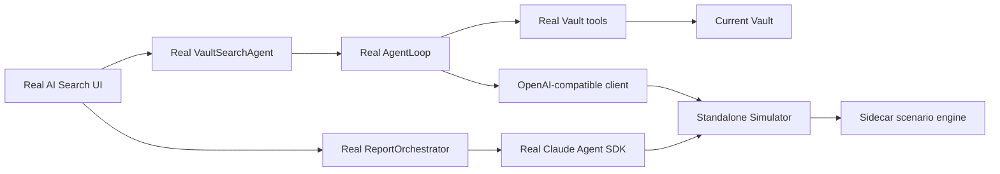

# AI Search Simulator Sidecar Provider

**Status:** Implemented
**Date:** 2026-07-29
**Scope:** AI Search planning and report-generation flow

## 1. Outcome

Developers can test the complete AI Search experience without calling
OpenRouter or another paid model. Simulator is a standalone localhost Provider,
not an in-process mock and not a branch inside AI Search UI.

The normal workflow is:

```bash
npm run dev:simulator
```

Then select **AI Search Simulator** for **Research** in
**Settings → AI Setup → AI Behavior** and run AI Search normally.

## 2. Product contract

- Simulator is configured on the existing Provider card.
- The sidecar starts independently with `npm run simulator`.
- `npm run dev:simulator` starts the ordinary plugin watchers and sidecar
  together, while retaining separate processes.
- The Provider card stores endpoint, scenario, speed and strictness.
- No API key, remote account, AI Search toolbar or separate scenario screen is
  required.
- If the sidecar is offline, Connection Test fails and AI Search surfaces the
  connection failure. It never silently falls back to OpenRouter.
- The current Vault is used by default; a QA Vault remains optional.

## 3. Runtime boundary



The plugin bundle retains only:

- `simulator` profile type and persisted configuration;
- the thin OpenAI-compatible localhost client;
- Agent SDK environment materialization for localhost;
- Provider Settings UI, model metadata and health check.

The following live exclusively under `tools/ai-search-simulator/` and must not
appear in `main.js`:

- simulated response copy;
- semantic request classification;
- tool-result state machine;
- failure, latency and streaming behavior;
- OpenAI and Anthropic protocol response generation.

## 4. Dual protocol

AI Search currently uses two production model transports, so the sidecar must
support both:

| Endpoint | Consumer | Responsibility |
|---|---|---|
| `POST /v1/chat/completions` | Vercel AI SDK | planning, streaming tool calls |
| `POST /v1/messages` | Claude Agent SDK | report sections and summary |
| `GET /health`, `/v1/health` | Provider Connection Test | readiness |
| `GET /v1/models` | provider compatibility | model discovery |
| `GET /v1/scenarios` | development tooling | scenario catalogue |

Requests carry per-profile configuration through:

- `x-peak-simulator-scenario`;
- `x-peak-simulator-speed`;
- `x-peak-simulator-strict`.

There is no server-global active scenario, so concurrent runs and multiple
profiles remain isolated.

## 5. Real and simulated responsibilities

Simulator replaces only model inference. These remain real:

- AI Search Process, Report and Sources surfaces;
- cancellation, history and background sessions;
- `VaultSearchAgent`, `AgentLoop`, tier policy and tool execution;
- Vault folder/note reads and returned paths;
- Plan Review and report orchestration;
- Claude Agent SDK subprocess and HTTP streaming;
- report persistence and source attribution.

No scenario branch is allowed in AI Search components, stores, agents or Vault
tools.

## 6. Scenarios

1. **Happy path** — real Vault discovery, valid multi-section plan and report.
2. **Slow streaming** — visible latency and multiple stream chunks.
3. **Planning failure** — provider error during planning.
4. **Empty Vault result** — valid zero-evidence plan without modifying Vault.
5. **Vault tool recovery** — invalid real tool input followed by recovery.
6. **Report partial failure** — one report section fails.
7. **Report total failure** — all report inference requests fail.
8. **Escalation request** — requests the stronger tier before discovery.

The happy path reads real tool results and reuses returned folder and file
paths. It does not assume a fixed QA Vault.

## 7. Safety and acceptance

- The server binds to `127.0.0.1` by default.
- No real credential is read or forwarded.
- Agent SDK receives an internal dummy key and request headers only.
- Scenario engine source and failure copy are absent from production `main.js`.
- Binding Simulator to Research keeps planning, escalation and report calls on
  localhost.
- Connection Test performs a real health request.
- Both npm startup commands are executed in verification.
- Focused tests exercise a spawned sidecar process, real Vercel streaming,
  real AgentLoop tool calls/schema validation with deterministic fixtures and
  the real Claude Agent SDK transport.
- Full-suite failures must be fixed or reproduced on the untouched baseline.
- Real Obsidian interaction follows the canonical CDP protocol when available.
