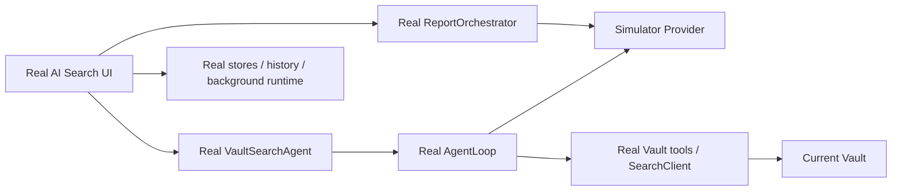

# AI Search Simulator Provider

**Status:** Accepted for implementation
**Date:** 2026-07-29
**Scope:** AI Search planning and report-generation flow

## 1. Outcome

Developers can test the complete AI Search experience without calling
OpenRouter or another paid/remote model.

Simulator is a built-in provider in **Settings → AI Setup → Providers**. A
developer adds the provider, selects a scenario and speed on its provider card,
then binds its model to **Research** using the existing AI Behavior picker.
There is no AI Search-only toolbar, terminal process, API key, Base URL, or
separate scenario activation screen.

## 2. Product contract

- Simulator is configured exactly where other providers are configured.
- The selected scenario is active immediately after the provider is saved.
- Scenario and speed belong to the Simulator profile, so multiple Simulator
  profiles may represent different reusable test configurations.
- Selecting Simulator for Research is the only action required to route the
  full AI Search model path through it.
- The simulator never falls back to a network provider.
- The current Vault is used by default. A dedicated QA Vault remains optional
  for deterministic search/index fixtures.

## 3. Boundary

Simulator replaces only model inference:

The following stay real:

- AI Search modal, Process, Report and Sources views;
- cancellation, background sessions and history;
- `VaultSearchAgent`, `AgentLoop`, tier routing and tool execution;
- Vault folder/note reads, grep and wikilink expansion;
- plan review and report section orchestration;
- report persistence and source attribution.

No simulator branches are permitted in AI Search components, stores, agent
logic or Vault tools.

## 4. Architecture

### 4.1 Profile

Add `simulator` as a first-class `ProfileKind`. The profile stores a small
`simulator` configuration:

- `scenario`: stable scenario id;
- `speed`: `instant`, `normal`, or `slow`;
- `strict`: fail when the request cannot be classified safely.

Connection credentials and embedding fields are not shown for this provider.
The provider exposes one logical model, `ai-search-simulator`.

### 4.2 In-process provider

`createLanguageModel(profile, modelId)` returns a Vercel AI SDK-compatible
language model for Simulator profiles. This adapter:

- inspects the real request messages and available tool names;
- derives the next response from conversation/tool-result state rather than a
  global call counter;
- emits ordinary SDK streaming chunks and tool calls;
- applies configured latency and failure behavior;
- performs no network access.

The scenario engine is framework-neutral and separate from the SDK adapter.
It returns response intents such as `tool-call`, `text`, `delay`, or `error`.

### 4.3 Report bridge

Report generation currently uses the Claude Agent SDK-shaped
`queryWithProfile` stream. When the resolved Research profile is Simulator,
that function uses the same scenario engine and emits SDK-shaped text events
in-process. Real providers continue through the Claude Agent SDK unchanged.

`ReportOrchestrator` must resolve the complete Research binding
(`profile + model`), not combine the Active Agent profile with the Research
model id. This prevents a Simulator-selected Research role from leaking report
requests to a real provider.

## 5. Scenario model

Initial built-in scenarios:

1. **Happy path** — inspect the current Vault, submit a valid multi-section
   plan, generate every report section and the executive summary.
2. **Slow streaming** — same logical flow with visible model latency and
   multiple text deltas.
3. **Planning failure** — provider error during the planning loop.
4. **Empty Vault result** — submit a valid zero-evidence plan without requiring
   the developer to empty their real Vault.
5. **Vault tool recovery** — issue an invalid real Vault-tool input, observe
   schema validation failure and continue through a successful plan.
6. **Report partial failure** — planning succeeds; one report section fails
   while sibling sections and summary continue.
7. **Report total failure** — planning succeeds; all report inference requests
   fail so the report error surface can be checked.
8. **Escalation request** — planning asks for the `escalate` tool before
   continuing, for verifying tier policy and UI trace behavior.

Scenario matching is semantic:

- available Vault tools classify planning requests;
- prior tool-result messages determine the next planning action;
- report prompt markers classify section, summary, insight assignment,
  regeneration and Mermaid repair requests;
- concurrent report sections are independent and order-insensitive.

For the happy path, the simulator reads actual tool results and reuses returned
folder/file paths. It does not assume a particular QA Vault structure.

## 6. Strictness and safety

- `strict=true`: an unrecognized request returns an explicit Simulator error.
- `strict=false`: an unrecognized one-shot request returns a labelled generic
  test response.
- Empty Vault planning submits a valid zero-evidence plan rather than inventing
  paths.
- No real credentials are required or read.
- Connection Test validates the local scenario configuration only.
- Simulator responses carry deterministic local token usage metadata; they do
  not make billable model requests.

## 7. Tier policy correction

`VaultSearchAgent` currently constructs `TierController` with only
`preferred: research`, ignoring the persisted escalation settings. It must pass
`allowEscalation`, `autoEscalateScoreBelow`, and
`maxEscalationsPerLoop`. This is part of the simulator acceptance surface
because the escalation scenario would otherwise misrepresent the configured
policy.

## 8. Acceptance

- Simulator appears in Add Provider and needs no credentials.
- Its card exposes scenario, speed and strict mode, and hides connection and
  embedding inputs.
- `ai-search-simulator` appears in role/model pickers.
- Binding Simulator to Research causes both plan and report calls to remain
  local.
- Happy path exercises real Vault tools and produces a plan, report sections,
  summary and sources in the production UI.
- Slow, planning-error, report-partial-failure and escalation scenarios reach
  their intended production states.
- Changing back to OpenRouter or another provider requires no simulator cleanup
  and restores the normal code path.
- Focused tests and production build pass. Full-suite failures must either be
  fixed or reproduced on the untouched baseline and documented.
- Real Obsidian interaction is verified through CDP when available; otherwise
  the exact unverified interaction is reported.
