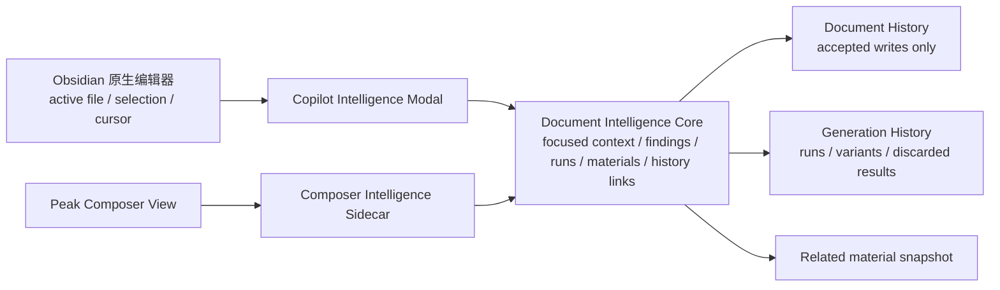
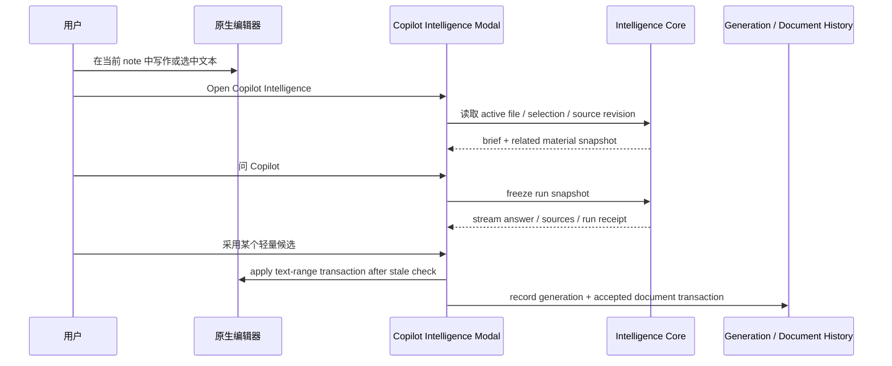

# Copilot Intelligence Native Editor Modal 设计

**状态：** Implemented in original workspace · owner interaction QA pending
**日期：** 2026-07-29
**范围：** 当前 Obsidian 原生编辑器中的当前文件 / 选区 / 光标上下文
**不包含：** 本文不改代码，不新增 AI model，不把 Composer View 的完整编辑能力搬进原生 CodeMirror
**配套 mock：** [Copilot Intelligence Native Editor Modal Mock](../../gstack/copilot-intelligence-native-modal-2026-07-29/index.html) · [File Atlas Copilot / Flatten Mock](../../gstack/file-atlas-copilot-flatten-2026-07-29/index.html)
**实现审计：** [产品 IA 纠偏与 Review 清单](../audits/2026-08-02-planned-requirements-product-ia-correction.md)

> 2026-08-02 closure：Native modal、原生 editor context、Copilot / History、Composer handoff 与 focus restoration contract 已进入原工作区；选区、真实发送、handoff 和关闭后的 focus 仍需真实 Obsidian QA。本文保留为设计与验收依据。

> 本文把这次讨论里的 “model 能单独弹出来” 理解为 **modal / pop-out surface**。AI 模型选择仍沿用现有 Copilot / model routing 配置；这里设计的是新的产品宿主，不是新的模型层。

## 0. 五分钟结论

应该做一个独立的 **Copilot Intelligence Modal**，让用户即使不打开 Peak Composer View，也能在 Obsidian 原生编辑器里围绕当前文档获得同一套 Intelligence 能力。

它的定位是：

```text
同一个 Document Intelligence core
  ├─ Composer sidecar host
  │   └─ 适合完整块级 Review、对象转换、富媒体和文档级事务
  └─ Native editor modal host
      └─ 适合原生编辑器中提问、检查、材料带入、选区级草稿和轻量写入
```

核心决策：

- **新建一个 modal surface**，与 `Open File Atlas` 同级，而不是塞进 File Atlas 或 Chat Studio。
- **复用现有 Copilot / Intelligence core**，不建第二套 sensing、run、History、Generation History 或 related-material runtime。
- **原生编辑器 modal 默认是当前文件 companion**，不是全 Vault dashboard。
- **顶层 IA 只保留 `Copilot / History`**。`Copilot` 内部可以并排呈现自动建议与对话，但不暴露 `Ambient`、`Session` 或 `候选` 作为新 tab。
- **可读、可问、可带入、可生成候选** 是 v1 主线；全面 review 与完整块级/对象级写回仍应进入 Composer Review。
- **File Atlas 可以呈现元素级 Copilot 建议，但必须与 Composer Copilot 完全同源**：同一 generator、preset、排序、卡片语义和 prompt composer。Atlas 不维护自己的 Copilot action taxonomy。
- **Atlas 工具栏的 filter / flatten 控制用 icon-only 形态**，保留 `aria-label` / tooltip；flatten 后以 path crumb 保留原层级。
- **不要默认自动弹出**。用户声音和 Word Copilot 的自动 summary 争议都说明，强推的 AI surface 会迅速变成打扰源。

推荐的产品名可以先叫：

```text
Copilot Intelligence
Open Copilot Intelligence
Ask Copilot about Current File
```

最终 Command Palette 名称需要 owner approval。按当前 Command Palette governance，它只有在被确认是稳定入口后才应进入全局命令。

## 1. 为什么这个文档值得写

当前 Composer Intelligence sidecar 已经解决了“贴着正文工作的 Copilot”这条主线，但它绑定在 Peak Composer View 里。用户这次提出的真实场景是：

- 有时用户只想留在 Obsidian 原生 Markdown 编辑器里写；
- 他们不一定想切到完整 Composer View；
- 但他们仍然希望打开当前文档就能获得类似截图里的 `Copilot / History` Intelligence 视图；
- 这个视图应该知道当前正文、当前选区和真实相关材料；
- 它不能自动写入正文，也不能要求用户先进入一个更重的编辑器。

如果不单独设计，后续实现很容易出现三种坏结果：

- 把 Composer sidecar 复制一份，产生第二套状态和 History；
- 把 File Atlas 做成又能导航又能聊天又能改写的胖 modal；
- 把原生编辑器写入能力承诺得太满，最后绕过 Composer 的 source model 和 Review 安全线。

## 2. 证据调研摘要

调研截至 2026-07-29。外部资料用于回答一个问题：**用户在当前文档里需要怎样的 AI companion，才不会丢失控制感、上下文和写作所有权？**

### 2.1 学界调研

| 证据 | 关键发现 | 对本设计的含义 |
| --- | --- | --- |
| [CoAuthor](https://coauthor.stanford.edu/) / CHI 2022 | 63 位写作者、1,445 个 session；系统记录提问、建议、接受、拒绝和后续编辑。高采纳并不等于 AI 接管，最终文本仍大量由用户塑造。 | Modal 要把 AI 定位成建议和协作入口，不应把“自动生成整段并写入”作为默认胜利路径。 |
| [Co-Writing with AI, on Human Terms](https://arxiv.org/html/2504.12488v1) | 109 篇 HCI 文献综述 + 15 位写作者访谈；写作者需要 final say、suggestions 和全局/局部开关来维持 ownership。 | 必须有 `仅建议`、`接受前审阅`、`局部关闭/忽略`，不能用自动接受或自动 summary 抢控制权。 |
| [Mixed-Initiative Context](https://arxiv.org/abs/2604.07121) | 多轮协作中的 context 不应只是隐藏 prompt history，而应成为可显式组织、排除、复用的对象。 | Modal 需要显示当前文件、选区、相关材料和 run snapshot 的边界；context chip 比“AI 知道当前文档”更可信。 |
| [Co-Writing with AI: Diverse Academic Workflows](https://arxiv.org/abs/2604.25389) | AI 使用按 ideation、sourcing、planning、drafting、reviewing 分化；用户选择性使用 AI，而非全流程自动化。 | Modal 不能只做 chat。它要覆盖“问、找材料、规划、审阅、局部写作”这些阶段，但每个阶段都要可退出。 |
| [It Felt a Bit Eerie](https://arxiv.org/abs/2605.24729) | 同步建议提升效率但可能造成 context mismatch；可见 AI cursor 提升意图理解但带来被监视感。 | 原生编辑器里不要做常驻 AI cursor 或持续贴身提示。Modal 是用户明确打开的 companion，更符合低打扰边界。 |

综合判断：学界证据不支持“AI 越近越好”或“越自动越好”。它支持的是 **用户显式调度 AI、AI 显式展示上下文、结果接受前留在建议态**。

### 2.2 产业界调研

| 产品 | 形态 | 可借鉴点 | 需要避免 |
| --- | --- | --- | --- |
| [Microsoft Copilot in Word](https://support.microsoft.com/en-us/word/welcome-to-copilot-in-word) | 文档内 Copilot 能 draft、rewrite、summarize 和理解长文档。 | 当前文档 companion 是成熟需求，不应只留在 Chat Studio。 | 自动 summary 如果缺少单独关闭，会被用户视为侵入。见 Microsoft Q&A 的 [no separate end-user control](https://learn.microsoft.com/en-us/answers/questions/5905881/how-to-disable-the-microsoft-office-365-word-copil) 反馈。 |
| [Gemini in Google Docs side panel](https://workspaceupdates.googleblog.com/2024/06/gemini-in-side-panel-of-google-docs-sheets-slides-drive.html) | 侧边栏可在 Docs/Sheets/Slides/Drive 中汇总、分析、生成内容，并利用当前文档和其他文件上下文。 | “不用切应用或 tab”是核心价值；当前文件 + 工作区材料是合理组合。 | 不要把 side panel 变成全功能 dashboard；上下文越多越需要明确来源边界。 |
| [Notion AI for Docs](https://www.notion.com/help/guides/notion-ai-for-docs) | 三入口：sidebar/bottom agent、选中文本 `Edit with AI`、新行生成。支持 accept/discard/try again。 | 入口分层很重要：问整个页面、改选区、生成新文本不是同一个 UX。 | 不要把所有动作挤进一个输入框；选区写作和当前文档问答需要不同 review 语法。 |
| [Obsidian WordSmith](https://github.com/samwega/obsidian-wordsmith) | Obsidian 内 context-aware writing assistant，支持 editor 内逐条接受/拒绝建议。 | Obsidian 用户已经期待“在笔记内”的 AI 写作辅助和细粒度 review。 | 不能以插件自带状态替代 Peak 已有 Copilot runtime、History 和 model routing。 |

产业界的稳定收敛不是某一种容器，而是三条语法：

- 当前文档旁边有一个 AI companion；
- 选中内容可以被局部编辑；
- 任何写入前都要 accept / discard / try again。

### 2.3 用户声音

| 来源 | 用户需求 / 反感点 | 设计响应 |
| --- | --- | --- |
| Obsidian Forum: [Cursor-like sidebar for selected text/note](https://forum.obsidian.md/t/looking-for-a-plugin-chat-sidebar-that-works-with-selected-text-note-like-cursor-ide-but-for-notes/102401) | 用户想要一个简单 sidebar chat，可以问当前选区/当前 note、总结或修改 note，并偶尔生成后续内容。 | Native modal 第一优先支持当前文件和选区；不用先打开 Composer。 |
| Reddit: [AI integration in sidebar](https://www.reddit.com/r/ObsidianMD/comments/1qfmiec/ai_integration_in_sidebar/) | 用户喜欢 Readwise Reader Ghostreader 的 sidebar，想把 editor 文本转到 sidebar 里对话。 | 提供“带入当前选区 / 当前块 / 当前文件”的显式 chips；不要靠复制粘贴。 |
| Reddit: [How important is native AI](https://www.reddit.com/r/ObsidianMD/comments/1k63z1b/how_important_is_it_to_include_native_ai/) | 一部分 Obsidian 用户强烈反感默认 AI，强调 local、offline、privacy。 | 不自动打开、不默认扫描敏感内容；设置里有持久关闭和按文件/目录策略。 |
| Microsoft Q&A: [disable Word Copilot summary](https://learn.microsoft.com/en-us/answers/questions/5905881/how-to-disable-the-microsoft-office-365-word-copil) | 用户想只关掉自动 summary，但保留 Copilot；缺少细粒度控制造成挫败。 | 分开设计 `什么时候更新建议` 和 `是否自动准备候选`；不能一开 Copilot 就默认强推 summary。 |

用户声音的共同点很清楚：他们要 AI **在旁边**，但不想 AI **挡在前面**。

## 3. 产品形态

### 3.1 推荐形态：新建 Copilot Intelligence Modal

这是一个独立弹出的 modal，类似 File Atlas 的宿主方式，但内容和责任不同。



这张图的重点：

- Modal 和 Composer sidecar 是两个 host。
- 它们消费同一个 Intelligence core。
- History 和 Generation History 不按 host 分裂。
- 原生编辑器只是上下文来源和轻量写入目标，不成为第二套 Composer source model。

### 3.2 它不应该放在哪里

不建议放进 File Atlas。

File Atlas 的已确认边界是“selects, locates, inspects, indexes”。它可以把选中的 blocks/resources/insights hand off 给 Copilot，也可以在右侧 inspector 呈现“当前元素的 Copilot 建议”。但这必须是 **Composer Copilot 同一套建议能力在 Atlas 的另一个呈现位置**，不是 Atlas 自己新增 `Explain / Find support / Draft / Save anchor` 之类的 action taxonomy。

换句话说：

- 建议 generator、preset、排序和卡片语义与 Composer Copilot 保持完全一致；
- prompt composer、run receipt、model routing 和 History 不分裂；
- Atlas 只负责选择、定位、检查、context handoff；
- 需要写入时进入 Copilot Intelligence 或 Composer Review；
- Atlas toolbar 可以新增 icon-only filter / flatten 控制，但 flatten 只是视图模式，不改变文档结构。

如果让 File Atlas 自己聊天、生成、写入或维护 History，它会从文档地图膨胀成又导航又聊天又执行的全能面板，这是本设计明确避免的。

不建议做成 Chat Studio 子模式。

Chat Studio 是项目/会话级 AI workspace；Native Intelligence Modal 是当前文件 companion。它们可以共享 Prompt Input、model routing、artifact receipts，但用户心智不同。

不建议作为 Composer View 的唯一入口。

这次需求的重点正是“不想打开 Composer”。如果每次都提示“请打开 Composer 才能用”，就没有解决用户场景。

### 3.3 它应该放在哪里

产品 IA 上，它属于 Document Copilot / Intelligence 家族，与 File Atlas 同级：

```text
Current file surfaces
  ├─ Open File Atlas
  │   └─ 看当前文件结构、资源、洞察、位置
  ├─ Open Copilot Intelligence
  │   └─ 围绕当前文件提问、建议、材料、轻量候选
  └─ Open in Peak Composer
      └─ 完整块级编辑、对象转换、原位 Review、事务历史
```

入口建议：

- Command Palette：`Open Copilot Intelligence`，仅在 owner 确认为稳定入口后加入。
- Hotkey：用户可绑定，不默认抢快捷键。
- File Atlas handoff：选中 block/resource 后可 `Ask in Intelligence`。
- Editor selection menu：未来可加 `Ask Copilot about selection`，但第一版不必为了它扩大 scope。
- Status bar / ribbon：可作为可选低频入口，不应默认自动弹出。

## 4. Modal 的界面结构

### 4.1 默认布局

默认不是“更大的 sidecar dashboard”，而是一个文档 companion modal。

```text
┌──────────────────────────────────────────────────────┐
│ Current file · source status · suggestions updated    │
│ [Copilot] [History]                         settings  │
├──────────────────────────────────────────────────────┤
│ Context strip: current file / selection / anchor      │
├──────────────────────────────────────────────────────┤
│ Copilot                                              │
│                                                      │
│   left: 自动建议                                    │
│     接下来可能要做 / 相关材料 / 还没安放的想法       │
│                                                      │
│   right: 对话                                       │
│     shared prompt composer / run receipt / sources   │
└──────────────────────────────────────────────────────┘
```

推荐尺寸：

- 默认宽度约 `920-1040px`，高度接近 File Atlas modal。
- 当用户打开完整相关材料或宽图时，再进入更宽的 explorer modal 或同 modal expanded state。
- 不要在默认视图里展示小型关系图；按 2026-07-28 owner override，窄空间使用普通材料列表。

### 4.2 顶层只有 Copilot / History

沿用 Composer sidecar 的当前 IA：

- `Copilot`：当前文件 brief、自动建议、对话、run receipt、来源和 handoff。
- `History`：已经写入的事务账本、diff、定位和回滚入口。

不要恢复 `Ambient` 作为第三 tab。Ambient 仍是背后的 sensing / ranking runtime，它在 UI 中表现为 Copilot brief。

也不要把 `Session` 或 `候选` 暴露成新的顶层 tab。用户看到的是两个 Copilot 呈现区域：

- `Copilot · 自动建议`：与 Composer sidecar 的建议组件、preset、排序一致；
- `Copilot · 对话`：复用共享 PromptInput / Prompt composer shape，围绕当前 context 继续问。

全面 review 不是一个持续停留在 modal 里的候选面板。用户需要完整 review 时，从建议或对话结果中打开 Composer Review。

### 4.3 Context strip

Native modal 比 Composer sidecar 更需要明确 context，因为用户仍在原生 Obsidian editor 中。

Context strip 应显示：

- 当前文件路径和修改状态；
- 当前选区摘要，没有选区时显示当前光标附近 heading / block；
- 是否使用 related material；
- 本轮 run snapshot 是否已经冻结；
- stale / changed source 状态。

用户要能移除某个 context chip。AI 不应暗中把整 Vault、完整长文或敏感目录都带入。

## 5. 能力分层

Native modal 不能承诺 Composer 的全部编辑能力。建议按三层处理。

### 5.1 Native-safe 能力

这些能力可以在不打开 Composer 的情况下完成：

- 问当前文件 / 当前选区；
- 总结当前文件或当前 heading；
- 解释某段话为什么不顺；
- 找相关材料并带入下一轮；
- 生成 checklist / 下一步 / 反问；
- 为当前选区生成改写候选；
- 将候选复制、插入光标、替换选区；
- 创建 follow-up note 草稿；
- 打开来源或定位回当前文件。

写入规则：

- 替换选区和插入光标必须显示 diff 或 candidate preview；
- 接受前重新检查 active file revision；
- 只允许 text-range transaction，不做复杂块结构推断；
- 所有 accepted writes 进入 Document History；
- 所有 run / variant / discarded result 进入 Generation History。

### 5.2 Composer-preferred 能力

这些能力可以从 modal 发起，但应明确提示“在 Composer Review 中完成”：

- 文档级 rewrite；
- 多块结构调整；
- table 转换、合并、公式和图表；
- image caption / rename / AI edit；
- Frontmatter 多字段审阅；
- Mermaid / Canvas / Excalidraw / Base 等 native object patch；
- 多候选跨块 review；
- 需要 `全部改动` / `工作视图` / `纯净阅读` 的审阅场景。

这里不是推脱，而是保护 source model。Composer View 已经承担复杂 Markdown/native object 的 round-trip、anchor、review 和 transaction 语法；Native modal 不应绕过它。

### 5.3 Read-only / background 能力

这些能力在 modal 中很适合：

- 更新建议；
- 更新相关材料；
- 展开 run receipt；
- 查看 History；
- 从 File Atlas handoff 过来的资源解释；
- 显示为什么现在建议这个动作；
- 忽略、snooze、dismiss 某类 finding。

Read-only 能力不能偷偷升级为自动写入。

## 6. 用户旅程

### 6.1 留在原生编辑器里提问



### 6.2 从 File Atlas 带入上下文

```text
File Atlas 选中 block/resource/insight
  -> 右侧 Inspector 显示同源 Copilot 建议
  -> 用户选择“问 Copilot / 带入协作 / 打开 Review”
  -> Copilot Intelligence 或 Composer Review 打开
  -> context strip 显示 Atlas source element
  -> 用户补充指令
  -> run snapshot 冻结
  -> 结果留在 Copilot 对话 / 轻量写入 / 或进入 Composer Review
```

File Atlas 仍只负责选择、定位、检查和 context handoff。它不执行自己的 Copilot run，也不维护自己的建议 preset。

### 6.3 从轻量候选升级到 Composer Review

```text
用户在 modal 中要求“重写这一整节”
  -> modal 判断需要多块/结构化 Review
  -> 生成 task summary + frozen context
  -> 打开 Peak Composer Review
  -> Composer sidecar 恢复同一个 run / changeSet / related materials
  -> 用户在正文原位接受或拒绝
```

这里的关键是：升级后不是重新问一遍 AI，也不是另建一条 History。它应复用同一个 run identity 和 context snapshot。

## 7. 状态与历史合同

### 7.1 Run identity

无论从 Composer sidecar 还是 Native modal 发起，模型运行都必须有稳定 `runId`。

Run record 应保存：

- host surface：`composer-sidecar` 或 `native-editor-modal`；
- active file；
- source revision；
- selection / anchor；
- explicit context refs；
- related material snapshot revision；
- capability ID；
- prompt identity；
- model routing result；
- result variants；
- final status。

Host surface 是 provenance，不是事实源。

### 7.2 Generation History

Native modal 产生的未采用结果也要进入 Generation History。

这解决两个真实问题：

- 用户关闭 modal 后可以找回刚才生成但没采用的段落；
- 后续打开 Composer Review 时，可以继续比较旧 variant。

### 7.3 Document History

只有真实写入当前文件的事务进入 Document History。

Native modal 允许的 v1 写入类型应保持窄：

- insert at cursor；
- replace current selection；
- create follow-up note；
- maybe append below current heading。

不建议 v1 直接支持复杂 block replace、HTML table patch 或 native object patch。那些应交给 Composer Review。

## 8. 设置与控制

Modal 需要继承 Composer sidecar 已经确认的两层设置语言。

### 8.1 什么时候检查新建议

用户可见选项：

- `仅手动`；
- `停笔后更新（推荐）`；
- `编辑时定期更新`。

这些只控制 sensing / brief refresh。

### 8.2 发现建议后做什么

独立开关：

- `自动准备待审改动`。

即使开启，也只能生成候选。它不能自动接受、自动写入、自动改 Markdown。

### 8.3 持久关闭

必须支持：

- 对当前文件关闭；
- 对当前文件夹关闭；
- 对某类 suggestion dismiss / snooze；
- 全局关闭 proactive refresh；
- 保留显式 `Ask Copilot`。

这回应 Obsidian 用户对 local/offline/privacy 和“不要默认 AI 化”的强烈偏好。

## 9. 与现有 surface 的边界表

| Surface | 用户问题 | Owns | 不 owns |
| --- | --- | --- | --- |
| File Atlas | 当前文件里有什么，在哪里，哪些资源/洞察附着在哪 | block tree、resources、insights、selection tray、handoff | chat、generation、writeback、History transaction |
| Native Intelligence Modal | 我在原生编辑器里，想问/查/轻量改当前文档 | current-file Copilot brief、session、related materials、light text candidates | full Composer source model、complex object Review、new runtime |
| Composer sidecar | 我在 Composer 里，需要完整文档级 AI 编辑与审阅 | anchored candidates、object-aware review、sidecar Copilot/History | native editor fallback |
| Chat Studio | 我想围绕项目/会话/多材料长聊 | conversation、assistant identity、broad artifacts | current-file companion as primary mental model |
| Command Center / Gateway | 我想让系统规划并执行产品能力 | capability planning / dispatch | current document review UI |

## 10. 实现方向，不是代码计划

本文不要求立刻实现，但后续实现时应遵守这些边界。

### 10.1 Host pattern

File Atlas 已经提供了一个合理 precedent：app layer modal host 组合 host port，然后渲染独立 surface。

Native Intelligence Modal 可以采用同类宿主思路，但不能复用 File Atlas 的 domain state。它应组合：

- active file / editor selection reader；
- focused document snapshot；
- Copilot action runtime；
- related material snapshot provider；
- run / generation history writer；
- optional native text writeback adapter；
- Composer escalation adapter。

这些都应由 app layer 组合，不应在 service 层加 module singleton。

### 10.2 不新增 AI model 概念

Modal 顶部可以显示当前 Copilot model / routing chip，但不要引入“此 modal 的独立 model”。

模型来源应沿用：

- active Copilot config；
- global model routing；
- capability-specific requirement；
- run receipt 中的 actual model。

如果用户需要临时切 model，应该复用 shared AI Instruction Composer / model selector 的统一策略，而不是这个 modal 自己维护一套。

### 10.3 Command Palette governance

如果新增全局命令，必须是稳定、owner-approved 的产品入口。

建议命令：

```text
Open Copilot Intelligence
```

不建议注册一批临时命令：

- `Open Copilot Brief Debug`；
- `Refresh Native Intelligence Snapshot`；
- `Open Modal Experiment`；
- `Ask Current Selection Test`。

临时和 QA 入口应保持开发态，不进生产 Command Palette。

## 11. 第一版验收标准

第一版不需要覆盖 Composer 全量能力，但必须证明核心心智成立。

最低验收：

- 从原生 Obsidian Markdown 文件打开 modal；
- modal 显示当前文件、选区或当前 heading 的 context；
- Copilot brief 显示 `接下来可能要做 / 相关材料 / 还没安放的想法`；
- 顶层 IA 只有 `Copilot / History`，不出现 `Ambient` / `Session` / `候选` tab；
- `Copilot` 内部同时支持自动建议和对话，二者复用 Composer Copilot 的建议和输入组件语义；
- `Ask Copilot` 在对话区域继续，发送时冻结 run snapshot；
- run receipt 展示 sources / trace / result status 的可验证摘要；
- related material 可以查看来源并带入下一轮；
- 选区级 rewrite 可以在 run receipt 中产生 narrow native-safe preview，或直接升级到 Composer Review；
- 全面 review 必须打开 Composer Review，不在 Native modal 内做持续候选 tab；
- accept 前重新检查 source revision；
- accepted write 进入 Document History；
- discarded / non-adopted generation 进入 Generation History；
- 从 modal 升级到 Composer Review 时保留 run identity 和 context；
- File Atlas inspector 中的 Copilot 建议与 Composer Copilot 使用同一 generator、preset、排序和卡片语义；
- File Atlas filter / flatten toolbar 控制为 icon-only，保留 `aria-label` / tooltip，flatten 后保留 path crumb；
- 关闭 modal 后焦点回到原编辑器。

明确不算完成：

- 只复制静态 UI；
- 只做 Chat iframe；
- 只把 Composer sidecar 原样挂进 modal；
- Atlas 右侧新增一套与 Composer 不同的 Copilot 快捷动作；
- modal 顶层出现 `Ambient`、`Session` 或 `候选` tab；
- 没有 source revision / stale check；
- History 只存在内存里；
- 对复杂对象直接 patch 原生 editor；
- 自动 summary 默认出现且不能单独关闭。

## 12. 风险与防线

| 风险 | 表现 | 防线 |
| --- | --- | --- |
| 第二套 Copilot | modal 有自己的 findings、run store、history store | host surface 只作为 projection；run/history canonical ID 共享 |
| File Atlas 变胖 | Atlas 直接聊天、改写或维护自己的 Copilot presets | Atlas 只 handoff context；建议与 Composer 同源；执行在 Intelligence / Composer Review |
| 自动 AI 打扰 | 打开文件就弹 summary 或建议 | 默认手动打开；proactive refresh 可关；无自动写入 |
| 原生写回过度承诺 | table/image/frontmatter/native object 在 CodeMirror 中被粗暴替换 | v1 仅 text-range；复杂变更升级到 Composer Review |
| 用户失去 ownership | AI 候选直接写入或替换大段 | preview / final say / regenerate / discard / edit-before-accept |
| 隐私与成本焦虑 | 默认读取太多 Vault / 频繁模型调用 | context chips、材料来源可见、手动/停笔/定期三档、usage receipt |
| Command Palette 污染 | 实验入口回流生产 | 只加 owner-approved stable command；debug 不进 palette |

## 13. 设计决策记录

Decision: 新建 `Copilot Intelligence Modal` 作为 Native editor host。
Reason: 用户需要留在原生 Obsidian editor 时也能获得当前文档 AI companion；学界和产业证据都支持“文档旁的可控 AI”，但不支持默认自动写入。
Alternatives:

- 只用 Composer sidecar：无法覆盖“不想打开 Composer”的场景。
- 塞进 File Atlas：会破坏 File Atlas 的导航/检查边界。
- 放进 Chat Studio：当前文件 companion 心智被项目级 chat 稀释。
- 常驻 side panel：更接近打扰源，并与 Obsidian 原生布局竞争。

Trade-off: v1 的原生写入能力必须比 Composer 窄。
Risk: 用户可能期待 modal 也能做完整文档级修改。
Mitigation: 把复杂改动明确升级到 Composer Review，并保留同一个 run/context，不让用户重新开始。
Review date: Composer Review / Native modal 第一版实现计划前。

Decision: File Atlas 增加元素级 Copilot 建议呈现，但不新增 Atlas-only Copilot action。
Reason: Atlas 与 Composer 都是在文档元素上工作；Atlas 的优势是选择、定位和检查元素，适合展示“同一 Copilot 建议”的当前元素版本。若为 Atlas 单独设计 Explain / Find support / Draft / Save anchor，会让同一功能在两个位置产生不同 preset 和用户心智。
Contract:

- Atlas 建议与 Composer Copilot 同 generator、同 preset、同排序、同卡片语义；
- Atlas 只做 context handoff，不直接写 Markdown；
- toolbar 的 filter / flatten 使用 icon-only 按钮，保留 `aria-label` / tooltip；
- flatten 是 source-order 视图模式，通过 path crumb 保存原始层级。

Decision: `Copilot Intelligence Modal` 顶层只保留 `Copilot / History`，`Copilot` 内部分为自动建议和对话。
Reason: `Session` / `候选` 会让用户以为这是新的状态机；`Ambient` 又会暴露内部 sensing 概念。用户需要的是两个 Copilot 用法：系统给建议，以及我继续问。
Contract:

- 不出现 `Ambient`、`Session`、`候选` 顶层 tab；
- 自动建议区域复用 Composer sidecar 建议组件；
- 对话区域复用共享 PromptInput / Prompt composer；
- 全面 review 通过建议或对话 handoff 到 Composer Review，而不是在 modal 内保持一套 review 面板。

## 14. 原始后续问题与当前验收边界

以下是实现前记录的问题；当前 UI / source 是行为真相，改名或扩大写回范围时再重新做 owner 决策：

- 全局命令最终叫 `Open Copilot Intelligence` 还是 `Ask Copilot about Current File`？
- v1 是否允许 `append below current heading`，还是只允许 replace selection / insert cursor？
- 是否需要一个 editor 右上角低打扰 launcher，还是只靠 Command Palette / hotkey？
- 是否在 History 中显示 host surface，文案写 `Accepted from native editor modal` 还是只在详情里显示？

已关闭的问题：

- Native modal 与 Atlas element handoff 已实现，不再出现在 `docs/planned-requirements.html` 或 `roadmap.html#decided`；实现证据由产品 IA 纠偏审计承接。

## 15. 参考资料

项目内资料：

- [Composer Intelligence Sidecar UI Contract](./2026-07-15-composer-intelligence-sidecar-ui.md)
- [Peak Composer Related Document Map](./2026-07-22-peak-composer-related-document-map.md)
- [Peak Composer AI Capability Modularity Architecture](./2026-07-24-peak-composer-ai-capability-modularity-architecture.md)
- [Composer AI Agent 流程与生成历史](./2026-07-28-composer-agent-runs-and-generation-history.md)
- [Shared AI Instruction Composer](./2026-07-28-shared-ai-instruction-composer.md)
- [File Atlas Design Spec](./2026-07-08-file-atlas-design.md)
- [AI 编辑器 / AI 知识工具深度调研](../../research/2026-07-27-ai-editor-landscape-deep-research/README.md)

外部资料：

- [CoAuthor dataset](https://coauthor.stanford.edu/)
- [Co-Writing with AI, on Human Terms](https://arxiv.org/html/2504.12488v1)
- [Mixed-Initiative Context](https://arxiv.org/abs/2604.07121)
- [Co-Writing with AI: Diverse Academic Writing Workflows](https://arxiv.org/abs/2604.25389)
- [It Felt a Bit Eerie](https://arxiv.org/abs/2605.24729)
- [Microsoft Copilot in Word](https://support.microsoft.com/en-us/word/welcome-to-copilot-in-word)
- [Gemini in Google Docs side panel](https://workspaceupdates.googleblog.com/2024/06/gemini-in-side-panel-of-google-docs-sheets-slides-drive.html)
- [Notion AI for docs](https://www.notion.com/help/guides/notion-ai-for-docs)
- [Obsidian Forum: Cursor-like sidebar for selected text/note](https://forum.obsidian.md/t/looking-for-a-plugin-chat-sidebar-that-works-with-selected-text-note-like-cursor-ide-but-for-notes/102401)
- [Reddit: AI integration in sidebar](https://www.reddit.com/r/ObsidianMD/comments/1qfmiec/ai_integration_in_sidebar/)
- [Reddit: native AI in Obsidian discussion](https://www.reddit.com/r/ObsidianMD/comments/1k63z1b/how_important_is_it_to_include_native_ai/)
- [Microsoft Q&A: disable Word Copilot summary](https://learn.microsoft.com/en-us/answers/questions/5905881/how-to-disable-the-microsoft-office-365-word-copil)
- [Obsidian WordSmith](https://github.com/samwega/obsidian-wordsmith)
