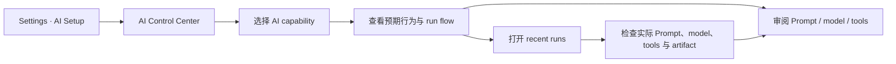

# AI Control Center 设计

> - 状态：设计已记录，尚未实现
> - 日期：2026-07-30
> - 前身：Prompt Control Center
> - 范围：AI capability 目录、运行合同、Prompt / model 配置、Run history 与覆盖缺口
> - 入口：Settings → AI Setup → AI Control Center
> - 交互稿：[打开可点击 mock](../../gstack/ai-control-center-2026-07-30/index.html)
> - 当前证据：[AI 能力与运行链审计](../audits/2026-07-30-ai-capability-run-inventory.md)

## 1. 决策

原 **Prompt Control Center** 合并升级为 **AI Control Center**。

Prompt 管理不会删除。它成为中心中的一个子能力，与 AI capability、模型路由和真实 run history 互相链接。

默认主对象从 `PromptId` 改为 **AI capability / action**，因为一次用户可理解的 AI 动作可能：

- 使用多个 Prompt；
- 使用一个被多项 action 复用的 Prompt；
- 没有文本 Prompt，例如 embedding 或原生媒体生成；
- 包含检索、工具、schema 校验、人工 review 和写回；
- 在不同步骤使用不同模型策略；
- 产生一个长期运行的 job，而不是一次模型 response。

中心需要回答两类问题：

1. **设计真值：**这项能力预期如何运行，允许什么，不允许什么；
2. **执行真值：**某一次真实运行实际使用了什么 Prompt、模型、工具、来源和结果。

## 2. 用户真正需要维护的是什么

### 2.1 AI capability

这是稳定的产品行为，例如：

- Vault Search 的 Refine；
- AI Search 的取证与报告；
- AI Graph 的生成；
- Composer 的表格补列；
- Copilot 的 Document Review；
- Chat Studio 的主对话 turn；
- Knowledge Index 的文档摘要。

每个 capability 都有明确入口、输入、预期结果和安全边界。

### 2.2 Execution step

一个 capability 可以包含多个步骤。

以 AI Search 为例：

1. 组装 query、来源和预算；
2. AgentLoop 调 Vault tools 收集证据；
3. 用户审阅 plan；
4. 分段生成报告；
5. 校验 Mermaid 和来源；
6. 保存 artifact 与 run receipt。

模型 override 应绑定到真正发起模型调用的 execution step，而不是默认绑定到物理 Prompt 文件。

### 2.3 Prompt 与动态上下文

Prompt 负责稳定指令。动态上下文负责本次输入、来源、用户偏好和工具结果。

Prompt 子页继续支持：

- 内置正文审阅；
- system / user 配对；
- Vault override；
- 变量与输出合同校验；
- Prompt 版本、调用者和关联 runs；
- companion / fragment / executable step 的身份区分。

### 2.4 Run 与 artifact

Run 是一次真实执行。Artifact 是该次执行生成的候选、报告、graph、媒体或写入结果。

一个 run 必须能反查：

- capability 和 execution step；
- 请求与实际模型；
- Prompt / Assistant / Skill 版本；
- 输入来源和 context receipt；
- tools、permissions、budget 与 escalation；
- 输出、validation、review 和 writeback；
- error、cancel、timeout 和未采纳结果。

## 3. 产品名称与边界

### 3.1 名称

用户界面名称使用：

> **AI Control Center**
>
> Review AI capabilities, prompts, model routing, and runs.

不使用 `Command Center`。该名称在项目里已有其他历史含义。

不继续使用 `Prompt Control Center` 作为顶层名称。它会让使用者误以为模型行为完全由 Prompt 文件决定。

### 3.2 它不是什么

AI Control Center 不是：

- Provider key 管理页；
- 一张 151 行 Prompt × model 表；
- 可视化 workflow 编排器；
- Chain-of-thought viewer；
- 通用 Usage Dashboard 替代品；
- 允许用户随意改写产品安全边界的低代码平台；
- 证明所有注册项都已生产可用的绿色清单。

## 4. 信息架构

独立 Obsidian View 使用四个顶层工作区。

### 4.1 Capabilities

默认工作区。按用户能力分组，而不是按源码目录排序。

建议分组：

1. Search 与 Knowledge；
2. AI Search、Analysis 与 Graph；
3. Composer 与 Copilot；
4. Chat 与 Generation；
5. Vault Intelligence 与 Ambient；
6. Index、Hub 与后台任务；
7. User-defined；
8. 未接线 / 待核对。

每一行显示：

- capability 名称和稳定 id；
- surface 与触发入口；
- 执行形状；
- 默认 model slot 或特殊 binding；
- 当前证据状态；
- Prompt、tool、artifact 和 recent run 数量。

### 4.2 Prompts

继承原 Prompt Control Center 设计。

它展示：

- 物理 template；
- `PromptId`；
- system / user companion；
- variables 和 output schema；
- 默认正文与 Vault override diff；
- 使用它的 capability steps；
- 使用该版本的 recent runs。

模型选择不再默认属于 Prompt：

- companion template 永远不显示 model picker；
- 多调用者 Prompt 显示“由各 capability step 决定”；
- 一对一 Prompt 可以把 step route 以简化形式显示在同一 inspector；
- workflow 中的 Prompt 必须跳转到所属 step 调整模型。

### 4.3 Models & routing

该工作区不复制 AI Setup。

它提供的是消费视图：

- 五个用途槽当前解析到的 Profile + model；
- 哪些 capability steps 消费每个槽；
- 哪些能力仍绕过统一 resolver；
- capability-step overrides；
- capability requirement 与模型能力不匹配；
- fallback 和 escalation 规则。

Provider、凭据和 Profile 本身仍在 AI Setup 管理。

### 4.4 Runs

Runs 工作区是运行证据浏览器，不是 hidden reasoning viewer。

它按 capability、surface、status、model、Prompt version 和时间筛选。单次 run 显示：

- 触发入口和 frozen input references；
- 前置检查；
- context assembly receipt；
- step timeline；
- model calls；
- tool / retrieval / embedding events；
- artifact 和 review outcome；
- usage、latency、error 与 stop reason。

Trace 只展示可验证事实。不得展示 chain-of-thought、thinking text 或把模型自述当作系统事实。

## 5. Capability inspector

### 5.1 Overview

首先用人话回答：

- 这项能力解决什么问题；
- 从哪里触发；
- 什么时候应该使用；
- 成功时用户得到什么；
- 什么情况下应该失败、禁用或降级；
- 当前是生产路径、部分接线还是待核对。

“预期行为”属于 capability definition。它默认只读，不能通过 Vault Prompt override 改写。

### 5.2 Run flow

Run flow 按三个区块呈现。

#### Before run

- eligibility / readiness；
- target 与 revision freeze；
- context assembly；
- Prompt / Assistant / Skill resolution；
- model resolution 与 capability check；
- tool availability；
- permission、budget 和 cost confirmation；
- run identity。

#### During run

运行形状必须显式标注：

- single text call；
- structured call；
- model stream；
- fixed-model tool loop；
- multi-tier AgentLoop；
- multi-step workflow；
- media job；
- embedding / rerank。

每个 step 显示 Prompt、模型策略、工具和 stop condition。

#### After run

- schema / typed output validation；
- materialization；
- candidate / artifact；
- review、accept、reject、retry 和 stop；
- transaction / writer；
- history、usage、receipt 和 feedback。

不适用的步骤显示 `Not part of this capability`，不能伪造一个统一流程。

### 5.3 Prompt & model

Capability inspector 汇总本能力全部执行步骤。

每个 step 可以：

- 继承注册时声明的用途槽；
- 在高级设置中改用其他用途槽；
- 极少数情况下固定到 Profile + model；
- 继承全局 output controls；
- 设置有明确理由的 output control override。

主界面继续使用人话：

```text
Uses AI Setup default
Research → Claude profile → claude-sonnet-4
```

`route`、`binding` 和内部 tier 名称只在高级说明中出现。

### 5.4 Tools, permissions & outputs

该区块显示：

- 可用工具与工具来源；
- read / edit / external / paid 操作；
- ask / allow / deny policy；
- 费用确认和预算；
- output schema；
- artifact 类型；
- review surface；
- persistence 与 writeback owner。

### 5.5 Evidence

每项能力必须显示证据等级：

| 证据 | 含义 |
| --- | --- |
| Registered | 有 capability / Prompt 注册信息 |
| Referenced | 生产源码存在调用 |
| Reachable | 能从当前产品入口到达 |
| Receipted | 真实 run 能记录完整 receipt |
| Tested | 有与合同对应的自动测试 |
| Interaction verified | 在真实 Obsidian 中验证关键交互 |

状态不能压缩成一个 `shipped` badge。

## 6. 目标数据合同

下面是设计结构，不是已实现代码。

```ts
interface AIExecutionContract {
  capabilityId: string;
  title: string;
  productGroup: string;
  owner: string;
  surfaces: string[];
  triggers: TriggerRef[];
  status: 'live' | 'partial' | 'unwired' | 'retired';
  expectedBehavior: {
    purpose: string;
    success: string[];
    mustNot: string[];
    failurePolicy: string[];
  };
  steps: AIExecutionStep[];
  outputs: OutputContract[];
  review: ReviewContract | null;
  persistence: PersistenceContract[];
  evidence: EvidenceRef[];
}

interface AIExecutionStep {
  stepId: string;
  title: string;
  kind:
    | 'single-text'
    | 'structured'
    | 'model-stream'
    | 'fixed-agent-loop'
    | 'tiered-agent-loop'
    | 'media-job'
    | 'embedding'
    | 'deterministic';
  promptRefs: PromptRef[];
  modelPolicy: ModelPolicy | null;
  toolRefs: string[];
  inputContract: string;
  outputContract: string;
  validation: string[];
  stopConditions: string[];
  receiptFields: string[];
}
```

### 6.1 与现有 CapabilityManifest 的关系

不要建立一个与 `CapabilityManifest` 平行、长期漂移的新世界。

目标是：

1. 保留通用 `CapabilityManifest` 的 id、输入、输出、权限、成本和 surface；
2. 为 AI capability 增加 execution contract；
3. 让 Composer 的 `ComposerCapabilityDefinition` 提供 typed target / candidate / writeback 细节；
4. 让 Chat、Search、Graph、Copilot、Media 和后台任务逐步注册同一种可查询说明；
5. 由 app layer 组合并暴露只读 registry；
6. Control Center、文档目录、model routing 和 receipt 都消费这份注册真值。

不得增加 service-layer mutable singleton。

### 6.2 Prompt 版本

Prompt version 需要稳定 identity：

- template id；
- built-in source revision；
- Vault override revision / hash；
- system / user pairing；
- variable schema revision；
- output schema revision。

运行记录保存实际使用版本，不只保存“当前最新版本”。

### 6.3 Model policy

模型策略的 owner 是 execution step。

优先级：

```text
step 固定 Profile + model
        ↓ 没有
step 指定用途槽
        ↓ 没有
capability 默认用途槽
        ↓ 没有
明确报错，不静默选择未知模型
```

旧 `promptModelMap` 需要迁移：

- 一对一可执行 Prompt：迁到对应 capability step；
- 多调用者 Prompt：要求用户或 migration rule 选择作用范围；
- companion template：删除无效模型语义；
- 找不到生产 owner：保留原值供审计，但不宣称生效。

## 7. 编辑边界

### 7.1 用户可以修改

- Vault Prompt override；
- capability-step model override；
- capability-step output controls；
- 允许用户配置的 tool policy；
- 可以安全调整的预算或确认选项。

### 7.2 用户只能查看

- capability 预期行为；
- source ownership；
- before / during / after 运行合同；
- output schema；
- writeback 与 persistence owner；
- 测试和接线证据；
- recent run facts。

改变这些内容属于产品或代码设计变更，不能伪装成普通设置。

### 7.3 默认不提供

- 在中心直接运行会修改 Vault 的 capability；
- 任意编辑工具权限或 schema；
- 修改内置 Prompt 文件；
- 显示 raw secrets；
- 显示 hidden reasoning；
- 用一键“Fix all”自动改写全项目 AI 配置。

## 8. 竞品研究与取舍

### 8.1 Langfuse

Langfuse 把 Prompt version 与具体 generation trace 链接，从 Prompt 页面能查看该版本的 latency、tokens、cost、count 和 score；trace 本身保留 LLM、retrieval、tool 和 custom logic 的因果关系。

Peak 应吸收：

- Prompt version ↔ run 的双向链接；
- 从真实 runs 聚合模型、耗时、成本和人工反馈；
- trace 记录完整生命周期，不只记录最终文本。

Peak 不照搬：

- 云端多租户管理；
- 与本地个人 Obsidian 无关的组织权限体系。

参考：

- [Link prompts to traces](https://langfuse.com/docs/prompt-management/features/link-to-traces)
- [Observability and application tracing](https://langfuse.com/docs/observability/overview)

### 8.2 LangSmith

LangSmith 为 Prompt 提供 commit history、diff、environment promotion 和 rollback。

Peak 应吸收：

- Prompt override 的版本和 diff；
- 明确的恢复默认与回滚；
- 运行记录引用不可变版本。

Peak 暂不需要：

- Staging / Production promotion；
- owner-only 权限和 webhook 流程。

参考：[Manage prompts](https://docs.langchain.com/langsmith/manage-prompts)

### 8.3 Braintrust

Braintrust 把 Prompt、Tool、Scorer 和 Workflow 都视为可执行 function，并对组合运行自动 tracing。

这证明 Prompt 不适合作为顶层唯一对象。Peak 应以 capability / step 组织 Prompt、tool、schema 和 artifact。

参考：[Deploy functions](https://www.braintrust.dev/docs/deploy/functions)

### 8.4 Microsoft Foundry

Microsoft Foundry 把 Agent、Model 和 Tool 放在同一个管理面。Prompt Flow 的 trace 区分 LLM、Function、Embedding、Retrieval 和 Flow span，并显示输入、输出、耗时与 token cost。

Peak 应吸收：

- 不同运行形状使用不同 step type；
- flow / run 可以逐步检查；
- embedding 和 retrieval 也是 AI 系统证据，但不能冒充 Prompt call。

Peak 不照搬：

- 云部署、RBAC 和在线 endpoint 管理；
- 把本地产品变成通用 DAG authoring 平台。

参考：

- [Microsoft Foundry overview](https://learn.microsoft.com/en-us/azure/foundry/what-is-foundry)
- [Prompt Flow trace view](https://learn.microsoft.com/en-us/azure/foundry-classic/how-to/flow-develop)

## 9. 页面流程



### 9.1 从 capability 出发

1. 用户按产品分组找到 `Vault Search · Refine`；
2. Overview 解释它只提供查询候选，不执行 AI Search；
3. Run flow 显示行为 context、Fast Lookup resolver、structured output 和 rule fallback；
4. Prompt & model 打开 Query Rewrite system/user pair；
5. Runs 显示真实使用模型、候选和用户是否采纳。

### 9.2 从 Prompt 出发

1. 用户搜索 `composer-prose-transform`；
2. Prompt inspector 显示它被多项 Composer action 复用；
3. 用户可以修改正文 override；
4. 模型区提示“由 18 个 capability steps 决定”；
5. 点击某个 action 后再修改该 step 的 model policy。

### 9.3 从真实 run 出发

1. 用户打开一条 AI Search report run；
2. timeline 显示取证 AgentLoop 和报告 workflow；
3. 选择报告 section generation；
4. 查看实际 Prompt version、Research model、tool receipts 和来源；
5. 跳回 capability contract 核对这次运行是否符合预期。

## 10. 与现有页面的关系

| 现有页面 | 继续负责 | AI Control Center 负责 |
| --- | --- | --- |
| AI Setup | Provider、凭据、Profile、用途槽 | 哪些 capability 消费这些配置以及 override |
| Usage Dashboard | 全局成本、趋势和优化 | 某项 capability / run 的执行证据 |
| Generation History | 用户生成结果和采纳状态 | 结果所对应的能力合同、Prompt 与模型 |
| Debug Trace | 深度诊断与复制 | 可读的 run timeline 和跳转 |
| Prompt catalog 文档 | 静态代码阅读与审计 | 运行时可查询和配置 |

## 11. 实施顺序

虽然本次不实现代码，未来实施顺序必须先建立真值，再做 UI。

### Phase 0 · Characterize

- 冻结现有 AI touchpoint 清单；
- 为每个触点标注 owner、入口、执行形状和 receipt；
- 加守卫，防止新增未注册 AI call。

### Phase 1 · Registry

- 扩展 `CapabilityManifest` 的 AI execution metadata；
- 先接 Composer、Chat、AI Search、AI Graph 四条代表链；
- 生成只读 catalog 并与静态审计对比。

### Phase 2 · Resolver 与 receipt

- 收敛 Prompt resolver；
- 收敛 model resolver；
- 建立 capability / step / prompt-version / run 的关联；
- 迁移旧 `promptModelMap`。

### Phase 3 · Shared UI

- 收敛公共 `ProfileModelPicker`；
- 实现 Capabilities 和 Prompts；
- 再实现 Models & routing 和 Runs。

### Phase 4 · Coverage

- 接入 Media、Ambient、Hub、Index、User-defined 和 provider-direct helpers；
- 增加覆盖缺口视图；
- 删除只为旧 Prompt page 存在的兼容路径。

## 12. 验收标准

### 12.1 目录完整性

- 当前所有生成式 AI、embedding、rerank 和 media job 都能归属到一个 capability / step；
- 每个 `PromptId` 能找到调用者、companion owner 或 `unwired` 状态；
- 新增 AI call 没有 capability identity 时守卫测试失败；
- deterministic-only action 不会被误标为 AI。

### 12.2 运行真值

- run 能记录 capability id 和 step id；
- 每次模型调用记录实际 Prompt version、Profile、Provider 和 model；
- tool、retrieval、embedding、media 和 validation 使用不同 step kind；
- error、cancel、timeout、reject 和未采纳结果不会丢失。

### 12.3 配置真值

- Prompt override 对所有调用者通过同一 resolver 生效；
- model override 绑定 capability step；
- companion template 不能设置模型；
- 共享 Prompt 不会静默把所有调用者锁到同一个模型；
- AI Setup、Chat 和 Control Center 使用同一个 `ProfileModelPicker` 组件族。

### 12.4 产品体验

- 用户能从 capability、Prompt 和 run 三个入口互相跳转；
- 5–10 分钟内能回答“这个 AI 动作做什么、怎么跑、用什么模型、上次实际发生了什么”；
- 页面不会暴露 chain-of-thought；
- 页面不会暗示未接线能力已经可用；
- 没有真实 Obsidian 交互证据时，验收标记为 `INTERACTION NOT VERIFIED`。

## 13. 风险与防错

| 风险 | 防错 |
| --- | --- |
| 做成漂亮但手写的第二张目录 | 页面、文档和 receipt 消费同一 registry |
| 把所有能力都强行改成 AgentLoop | 保留多种 execution kind |
| Prompt override 与产品行为边界混淆 | capability contract 只读，Prompt content 可 override |
| 一个共享 Prompt 的 model override 误伤多个能力 | model policy 绑定 capability step |
| Run timeline 泄漏 hidden reasoning | 只显示工具、来源、状态、输入输出合同和验证事实 |
| UI 先于 runtime 真值 | Registry、resolver 和 receipt 完成后再发布可编辑页面 |
| 中心取代 Usage / History / Debug | 只做互链，不复制各页面的完整职责 |

## 14. 相关文档

- [AI 能力与运行链审计](../audits/2026-07-30-ai-capability-run-inventory.md)
- [原 Prompt Control Center 设计](2026-07-28-prompt-control-center-design.md)
- [Prompt 总目录](../../25-infra-prompt-catalog.html)
- [AI 模型路由](../../24-infra-ai-model-routing.html)
- [Agent Harness](../../21-infra-agent-harness.html)
- [Composer AI 运行链](../../19-feature-peak-composer-ai-runtime.html)
- [可点击页面 mock](../../gstack/ai-control-center-2026-07-30/index.html)
