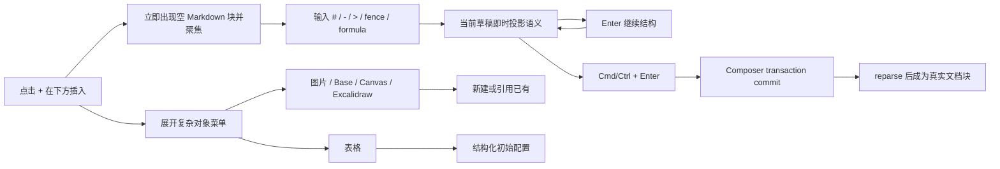

# Composer 流畅 Markdown 写入与编辑 DOM 所有权

日期：2026-07-30
状态：Accepted for implementation
裁决来源：Owner 当前反馈

## 1. 问题

当前 Composer 把“段落、标题、列表、待办、引用、Callout、公式”等 Markdown
语义做成插入前类型选择。用户必须先打开一排类型，再进入一个带预置内容的草稿，
最后才能写入。这既重复 Markdown 自己已经拥有的语法，也打断连续写作。

同时，正文与新块草稿都让浏览器原生修改 `contenteditable`，但 React 仍拥有其
内部文本节点和 `span`。当用户把一项删空时，浏览器可能已经移除了对应子节点；
下一次事务刷新中 React 再移除同一节点，会抛出：

```text
NotFoundError: Failed to execute 'removeChild' on 'Node':
The node to be removed is not a child of this node.
```

列表 Enter 需要先 flush 当前项再插入下一项，因此“删空列表项 → Enter”正好会
放大这个所有权冲突。

## 2. 产品裁决

### 2.1 普通写作只有一个入口

“在下方插入”主动作直接创建一个空的 `Markdown 块` 草稿并聚焦，不再要求先选
段落、标题或列表。

Markdown 草稿从空字符串开始。用户直接输入：

- `# 标题`
- `- 列表`
- `- [ ] 待办`
- `> 引用` / `> [!note]`
- fenced code
- `$$...$$`

草稿根据当前 Markdown 解析结果即时改变视觉语义。`Enter` 在草稿内继续 Markdown
结构，`Cmd/Ctrl + Enter` 才写入事务；列表和待办自动延续相同 marker，空 marker
再次 Enter 则退出列表。

### 2.2 类型菜单只保留复杂对象

插入菜单保留：

- Markdown 块
- 图片
- 表格
- Base
- Canvas
- Excalidraw

图片与 Obsidian 原生对象需要“新建 / 引用已有”两条路径；表格需要结构化初始配置。
这些不是普通 Markdown 写作快捷方式。

AI Sheet 当前没有生产 runtime / serializer / writeback contract，因此本轮不在生产
菜单放假入口。交互 mock 可以定义它的目标流程，等真实 capability 接线后再投影。

### 2.3 DOM 所有权

可编辑状态下，React 只拥有 `contenteditable` 根节点和其 `innerHTML` 字符串，
不再为内部 token 建立 React child fibers。浏览器可原生增删内部节点；重投影通过
一次 `innerHTML` 替换完成，再按 source offset 恢复 selection。

只读状态仍可使用 React 组件渲染 KaTeX 等富对象。任何情况下都只有一个 owner
修改同一批可编辑子节点。

## 3. 交互流



## 4. 复杂对象 mock 契约

### 图片

第一层只问意图：

- 引用已有：Vault 搜索 / 最近使用 / 上传到 Vault 后引用。
- 新建：AI 生成或本地导入；成功后以稳定 Vault 路径插入。

### Base / Canvas / Excalidraw

共享两段式面板：

1. `新建` 或 `引用已有`。
2. 新建时输入文件名与目标文件夹；引用时使用真实 Vault picker。

接受前显示将写入的文件路径和 Markdown embed；取消不得创建文件。

### 表格

先给最小 2×2 网格，可直接编辑；高级配置只负责行列数和表头，不暴露 Markdown
模板。

### AI Sheet

mock 中显示 `新建 AI Sheet` / `引用已有`，但生产入口的门槛是：

- app-owned runtime；
- 稳定文件格式与 serializer；
- create/reference 两条真实 port；
- transaction + reparse + history；
- 无 runtime 时隐藏，而不是 disabled fake control。

## 5. 验收

1. 删除正文或列表项的最后一个字符后，事务刷新不再触发 `removeChild`。
2. 删空列表项后按 Enter，生成同类下一项并把光标放入新项。
3. 点击主插入动作一次就出现空 Markdown 草稿并获得焦点。
4. 类型菜单不再出现段落、标题、列表、待办、引用、Callout、公式、AI 续写。
5. Markdown 草稿输入标题、列表、待办、引用、代码和公式后能按解析结果改变语义。
6. 普通 Enter 连续写；Cmd/Ctrl + Enter 才提交。
7. focused tests、production build 与真实 Composer transaction/reparse 均通过。
8. 没有真实 Obsidian CDP 证据时，交互状态必须标记 `INTERACTION NOT VERIFIED`。
