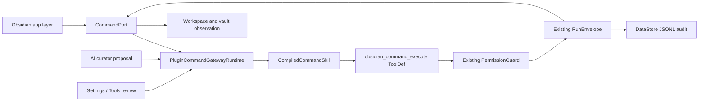

# Obsidian Plugin Command Gateway implementation design

Status: implementation source of truth
Date: 2026-07-31
Audience: Peak Assistant owner and implementers
Reading time: about 8 minutes

## 1. Why this document exists

Peak needs a safe way for Copilot and Chat's existing Harness loop to invoke commands contributed by other enabled Obsidian plugins. A command is a UI action with unstable context and no typed result, so exposing the raw command registry to a model would create an unreviewable execution backdoor.

This design turns an external command into a controlled capability only after:

1. the app layer discovers it and identifies its plugin source;
2. deterministic rules and an optional AI curator explain its likely purpose and risk;
3. the user explicitly reviews the proposal in Settings → Tools;
4. the runtime compiles only approved, source-matching commands into one Harness tool;
5. execution passes through PermissionGuard, RunEnvelope, side-effect observation, and a JSONL audit stream.

This is not the Command Center launcher, not a replacement for the native Command Palette, and not a second agent runtime.

## 2. Impact Contract

### Primary outcome

At least one command from another enabled Obsidian plugin can be discovered, reviewed, approved, invoked by the existing Harness tool loop, and reconstructed from an audit receipt.

### Required tracks

- C0: fake safe, edit, destructive, unavailable, and source-changed command fixtures.
- C1: external-plugin-only discovery with source metadata and preflight state.
- C2: app-owned CommandPort, one guarded `obsidian_command_execute` ToolDef, and side-effect observation.
- C3: schema-validated AI curator proposals that never change approval state.
- C4: Settings → Tools review surface with one unified scan workflow, filters,
  batch Allow, a direct two-state Allowed switch, and system-owned unavailable states.
- C5: immutable compiled command skill with approved command IDs, source hashes, and strict quarantine.
- C6: golden run with permission events, RunEnvelope events, observation, and JSONL audit receipt.

### Forbidden scope

- Do not merge or reuse the Command Center launcher/Home worktree.
- Do not add external commands to Obsidian's global Command Palette.
- Do not expose every raw command as a separate model tool.
- Do not create `CommandAgentService`, a second planner, a second tool runner, or another runtime singleton.
- Do not permit destructive or unknown-risk commands, even when Harness is in bypass mode.
- Do not let AI output enable a command or overwrite a human decision.

### Minimum acceptable delta

- Production Chat plus document-review, vault-review, and manual-action Copilot
  Harness runs receive the same real command tool when and only when at least
  one current command is approved.
- A stale approval cannot execute after command label, plugin version, source identity,
  or the reviewed AI draft changes.
- A destructive command remains blocked after explicit user approval data is injected.
- Focused tests cover every required track and the production build passes.

### Stop and commit rule

Commit only after the focused suites and production build pass. Run the full test suite and report unrelated baseline failures separately. If real Obsidian CDP is unavailable, mark UI interaction `INTERACTION NOT VERIFIED`; source/build tests are not a substitute.

## 3. Current state

The repository already has:

- `CommandGateway`, which wraps Peak's own stable palette commands in `runCapability`;
- `ObsidianCommandToolAdapter`, which can wrap a caller-supplied command but is not wired in production;
- Harness `ToolDef`, `PermissionGuard`, permission events, and strict Skill quarantine;
- Settings → Tools for MCP servers;
- `RunEnvelope` and app-owned JSONL patterns.

The missing control plane is:

- external command discovery and source identity;
- default-off persisted review decisions;
- curator proposal schema and prompt;
- source-hash invalidation;
- side-effect observation;
- production Chat and Copilot Harness injection;
- durable audit receipts.

## 4. Architecture



Reading notes:

- Only the app adapter touches Obsidian's private command/plugin registries.
- The AI curator writes findings, never approvals.
- One generic tool prevents hundreds of plugin commands from flooding the model tool list.
- The tool re-checks current discovery, source hash, reviewed-draft hash, decision,
  and risk at execution time.
- RunEnvelope and Harness remain the only execution and permission systems.

## 5. Core contracts

### CommandDescriptor

```ts
interface CommandDescriptor {
  commandId: string;
  commandName: string;
  pluginId: string;
  pluginName: string;
  pluginVersion: string;
  sourceHash: string;
  availability: 'available' | 'unavailable' | 'unknown';
  interaction: 'direct' | 'modal' | 'unknown';
  availabilityReason?: string;
}
```

`sourceHash` covers command ID, command name, plugin ID, plugin version, and callback shape. Any change invalidates the old approval.

### Persisted policy

Absence means off. AI findings and human decisions are separate fields.

```ts
interface PluginCommandGatewaySettings {
  reviews: Record<string, {
    decision: 'allow' | 'deny';
    risk: 'read' | 'edit' | 'destructive' | 'unknown';
    purpose: CommandPurpose;
    sourceHash: string;
    curationHash: string;
    reviewedAt: number;
  }>;
  findings: Record<string, CommandCurationFinding>;
}
```

### Compiled command skill

```ts
interface CompiledCommandSkill extends CompiledSkill {
  readonly quarantine: 'strict';
  readonly allowedTools: readonly ['obsidian_command_execute'];
  readonly approvedCommands: Readonly<Record<string, {
    sourceHash: string;
    curationHash: string;
    risk: 'read' | 'edit';
    purpose: CommandPurpose;
    confirmation: 'none' | 'per-run' | 'always';
  }>>;
}
```

The record maps each command ID to the exact source, reviewed curator draft,
human risk/purpose decision, and confirmation policy. The Skill fingerprint
changes when any compiled policy field changes. Compilation rejects:

- missing commands;
- stale source hashes;
- changed AI drafts that have not been reviewed again;
- unknown or destructive risk;
- modal-only interaction;
- findings without a human allow decision.

## 6. Discovery and preflight

The app adapter reads enabled plugin manifests and the live command registry. It returns only commands whose ID is owned by an enabled third-party plugin. Core Obsidian commands and Peak's own commands are excluded.

Discovery never invokes a command. For `checkCallback` commands it calls the documented check path with `checking=true`; errors become an unavailable descriptor. Callback-only commands remain available but carry unknown context requirements until curated.

## 7. Curation and review

The curator receives bounded batches of descriptors. Each finding contains:

- purpose and concise explanation;
- risk with evidence;
- active-editor and modal expectations;
- expected observation channel;
- candidate tool description;
- candidate skill name and usage guidance;
- recommendation flag.

The response is parsed with Zod. Findings for unknown command IDs are dropped. The runtime persists findings separately and leaves every review unchanged. A materially changed finding does not inherit the old approval: its `curationHash` differs, so the row becomes stale until the user reviews the new draft.

The review surface groups commands by source plugin. `Scan commands` is the
only owner action for refreshing the catalog: it discovers commands, compares
current source facts, applies deterministic safety checks, and prepares concise
explanations. AI may assist the final explanation phase, but that internal
boundary is not exposed as a second button. If AI is unavailable, deterministic
results remain reviewable and access stays unchanged.

A row shows command name, concise expected effect, risk, and a fixed far-right
Access control. The user can:

- filter by search, plugin, risk, and access;
- allow one current read/edit command with a direct `Allowed` switch;
- turn an allowed command back to `Not allowed`;
- Allow every eligible command in the current filter or across all plugins
  after reviewing an exact confirmation list.

Purpose stays internal to curator/runtime policy instead of becoming an
owner-editable field. Absence of approval is the owner-facing off state, so the
primary UI does not expose a separate Block decision. Unknown, destructive,
modal-only, and unavailable commands display a system-owned `Unavailable`
status and never enter bulk Allow or the automatic tool catalog.

## 8. Execution, permission, and observation

The generic tool input is `{ commandId }`, restricted to the current compiled approved IDs.

Before invoking:

1. rediscover and preflight the command;
2. match the stored source hash;
3. match the reviewed curator-draft hash;
4. require a human allow decision and the same compiled risk/purpose policy;
5. reject system-blocked risk;
6. let the existing Harness PermissionGuard apply read/edit policy. The
   compiled confirmation field is the curator's reviewed hint; actual
   ask/allow behavior remains owned by the current Harness permission mode.

The command execution itself runs inside `runCapability` with trigger `agent`. The backend records policy and preflight logs, invokes CommandPort, records the observation summary, and produces a RunEnvelope result artifact.

Observation compares:

- active file before and after;
- active leaf type before and after;
- open modal count before and after;
- vault file count;
- bounded paths whose size or modification time changed.

The observation records both total changed-path count and the bounded path
sample, so truncation is explicit. No observed change is an explicit result,
not a false success claim.

## 9. Audit and replay

Each terminal invocation appends one JSON object to:

`<DataStore>/command-gateway/runs.jsonl`

The receipt includes:

- run and command identity;
- plugin source, source hash, and reviewed-draft hash;
- compiled Skill ID, purpose, risk, and confirmation policy;
- status and error;
- RunEnvelope events;
- side-effect observation.

The stream uses configurable byte rotation and retained-file limits. Settings shows recent receipts; it does not read or write user Markdown.

## 10. Alternatives rejected

### One ToolDef per command

Rejected because a large plugin ecosystem would flood model context and create unstable tool names. A single tool with a runtime command allowlist is smaller and easier to revoke.

### Reuse the existing Peak palette CommandGateway

Rejected because that gateway maps owner-approved Peak surfaces to capability manifests. Third-party commands need discovery, review, source invalidation, and observation before they are capabilities.

### Treat AI recommendation as authorization

Rejected because command metadata is ambiguous and models cannot know local side effects. AI remains an explain-and-draft assistant.

### Persist compiled tools

Rejected because persisted runtime objects would drift from the live command registry. Persist policy and findings; compile from the current discovery snapshot.

## 11. Rollback and failure handling

- Disable all external commands by clearing review decisions; no command tool is exposed.
- Remove the runtime binding without affecting Peak's existing CommandGateway, MCP, Skills, or Chat tools.
- A curator outage leaves manual review available and changes no policy.
- An audit write failure does not hide execution failure, but the tool returns an explicit audit warning.
- An unavailable or changed command fails closed and tells the model to ask the user to rescan/review.

## 12. Verification matrix

| Track | Automated evidence | Real-app evidence |
| --- | --- | --- |
| C0–C1 | fake host discovery and preflight tests | installed plugin commands appear by source plugin |
| C2 | allow/source-stale/draft-stale/destructive/observation tests | approved command changes visible workspace state |
| C3 | valid, malformed, unknown-ID curator and scan-fallback tests | Scan keeps deterministic results when explanations are unavailable |
| C4 | filter/model, rendered UI, alignment, batch atomicity, and settings contract tests | unified Scan, filters, batch confirmation, two-state switch, and Unavailable interaction |
| C5 | compiler and quarantine tests | approved count matches exposed command catalog |
| C6 | scripted Harness golden trace and JSONL receipt test | one approved plugin command run with receipt |
