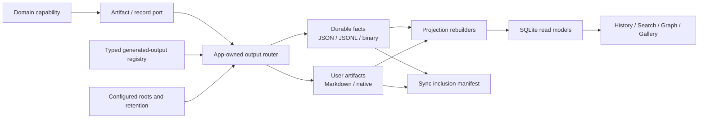
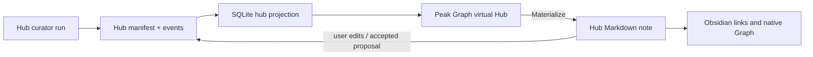

# 生成产物与存储治理实现设计

- 日期：2026-08-02
- 产品决定：**Accepted**
- 技术状态：**Implementation design ready**
- 生产状态：**Implementation pending**

配套材料：

- [生成产物注册表](../../conventions/generated-artifact-registry.md)
- [机器运行记录 JSONL 设计](./2026-07-21-machine-record-storage-jsonl-design.md)
- [Hub Generation Agent](./2026-07-03-hub-generation-agent.md)
- [AI Graph Artifact Platform](./2026-07-28-ai-graph-artifact-platform.md)
- [Roadmap](../../roadmap.html)

> 本文定义实施顺序、目标架构、迁移保护和验收门槛。它不描述已经完成的生产行为，也不授权自动删除现有 Vault 文件。

## 1. 决定摘要

Peak Assistant 不再用“是否由 AI 生成”决定文件格式，而用**谁拥有、能否重建、是否需要审计、是否需要 Obsidian 原生文件能力**四个问题决定。

最终边界：

- **用户资产**：Markdown 或原生文件。只有用户创建、接受、编辑、导出或明确物化时生成。
- **昂贵机器事实**：JSON snapshot 或分片 JSONL。需要同步，但从 Obsidian 知识索引排除。
- **查询层**：SQLite。只做本地 projection，可删除重建，不参与常规同步。
- **低价值运行数据**：cache / telemetry。本地、有界、可轮转。
- **Hub**：默认是 JSON canonical + SQLite virtual node；Markdown 是可选 materialization，用来获得用户编辑、wikilink 和原生 Obsidian Graph 能力。

这不是“把 Markdown 全部改成 JSONL”。Project Summary、Resource Summary、Hub、Chat、AI Graph、Composer history 的生命周期不同，必须分别选择 snapshot、stream、artifact body 和 materialization。

## 2. 问题陈述

### 2.1 当前真正的问题

当前 writer 分散在 ChatStore、context service、Hub agents、Composer adapters、Artifact producers、media adapters 和旧 Copilot service 中。没有统一 policy，导致：

1. **知识库污染**：机器 Markdown 进入 Obsidian metadata、全文索引、wikilink 与 graph；AI Analysis 曾因此造成启动内存放大。
2. **同步语义错误**：`ChatFolder/` 同时包含用户资产、昂贵 JSON、SQLite 和 telemetry，但 transport 只能看到一个大目录。
3. **双重事实源**：Chat 正文、Project Summary、Hub membership、receipt 在 Markdown 与 SQLite 之间互相补全，无法证明任一侧可独立恢复。
4. **用户所有权模糊**：Project Brief、Profile、Prompt、Skill、Hub Note 可能需要用户编辑，却和系统自动覆盖逻辑相邻。
5. **新增产物不可发现**：代码评审无法快速回答“这个功能会生成哪些文件、何时生成、是否同步、是否进入索引”。

### 2.2 本方案要让谁做什么

- owner 可以从一个注册表看到所有 runtime output 与存储裁决；
- feature developer 通过 typed policy 和 storage ports 写产物，不直接发明路径；
- migration runner 可以幂等导入旧 Markdown，生成校验报告，不删除原文件；
- projection rebuilder 可以删除 SQLite 后恢复 Chat、Hub、Gallery、History 和 Graph 列表；
- sync adapter 可以明确包含 user artifacts / durable records，排除 projection / cache / telemetry。

## 3. 设计原则

### 3.1 先确定事实，再确定格式

对每个 output 依次回答：

1. 用户是否直接拥有、编辑或发布它？
2. 丢失后能否不调用 AI、无信息损失地重建？
3. 需要当前 snapshot，还是完整事件历史？
4. body 是否很大或有原生 content type？
5. 是否必须进入 Obsidian 原生索引或 Graph？

结果映射：

| 判断 | 载体 |
| --- | --- |
| 用户拥有并需要编辑 / 链接 | Markdown 或原生格式 |
| 当前完整状态最重要 | JSON snapshot |
| 顺序、失败、取消、候选、采用历史重要 | 分片 JSONL |
| 大 body / immutable version | 独立 JSON / binary artifact，JSONL 只引用 |
| 仅查询、排序、关联、统计 | SQLite projection |
| 可廉价重建或只用于诊断 | cache / bounded telemetry |

### 3.2 存储格式不承担产品入口

用户从 Chat History、AI Search、Peak Graph、Composer History 或 Project Home 查看内容，不需要知道底层是 JSONL 还是 SQLite。UI 通过 repository/read model 读取；只有明确的 Open file / Materialize / Export 才进入 Vault 文件心智。

### 3.3 同步不等于索引

durable JSON/JSONL 要同步，但不应该被 Obsidian 当知识文档解析。实施必须提供两个独立 policy：

```ts
type SyncPolicy = 'required' | 'optional' | 'local-only';
type PeakIndexPolicy = 'include' | 'exclude';
```

禁止再用“放在 ChatFolder 里”同时表达这两个决定。

## 4. 目标架构



### 4.1 Typed registry，而不是第二份手写目录

实现阶段建立 typed schema；各 domain 在自己的模块附近声明 descriptors，由 app layer 组合。不要把几十行 domain policy 塞进 `src/core/constant.ts`，也不要把用户不可配置的安全规则伪装成 template config。

建议形状：

```ts
export type GeneratedOutputClass =
  | 'user-artifact'
  | 'durable-record'
  | 'projection'
  | 'cache'
  | 'telemetry';

export interface GeneratedOutputDescriptor {
  id: string;
  owner: string;
  outputClass: GeneratedOutputClass;
  canonicalCarrier: 'markdown' | 'native' | 'json' | 'jsonl' | 'sqlite';
  syncPolicy: 'required' | 'optional' | 'local-only';
  peakIndexPolicy: 'include' | 'exclude';
  materializationPolicy: 'automatic' | 'explicit' | 'never';
  retentionPolicy: string;
  schemaVersion?: number;
}
```

具体路径根、retention 数量、rotation 时间和可调阈值仍从 settings / `templates/config/` 注入。descriptor 表达不可随意漂移的数据责任。

长期目标是由 typed registry 生成或校验 [人类可读注册表](../../conventions/generated-artifact-registry.md)，而不是永久维护两套独立真值。第一阶段允许 docs-first，但 CI 必须用稳定 ID 做 completeness guard。

### 4.2 App-owned output router

`GeneratedOutputRegistry` 与 adapter composition 由 `main.ts`、`AppContext` 或 app-owned runtime registry 拥有。不得新增 service-layer singleton 或用 `AppContext.getInstance()` 绕过依赖注入。

建议 ports：

```ts
interface DurableRecordStorePort {
  writeSnapshot<T>(outputId: string, key: string, value: T): Promise<void>;
  appendEvent<T>(outputId: string, streamKey: string, event: T): Promise<void>;
  readSnapshot<T>(outputId: string, key: string): Promise<T | null>;
  readEvents<T>(outputId: string, streamKey: string): AsyncIterable<T>;
}

interface ArtifactBodyStorePort {
  putBody(input: ArtifactBodyInput): Promise<ArtifactRef>;
  getBody(ref: ArtifactRef): Promise<ArrayBuffer | string>;
}

interface MarkdownMaterializationPort {
  materialize(input: MaterializationRequest): Promise<MaterializedArtifactRef>;
}

interface ProjectionRebuilderPort {
  rebuild(scope: ProjectionScope): Promise<ProjectionRebuildReport>;
}
```

现有 specialized ports 不需要一次性删除。每个 wave 可以适配到这些责任上，先消除 raw writer，再决定是否合并接口。

### 4.3 Artifact body、record 与 projection 的引用关系

以 AI Graph 为例：

```text
manifest.json                    canonical identity/current version
versions/<version-id>.json       immutable artifact body
runs/<run-id>/events.jsonl       prompt/model/source/result receipt
SQLite ai_graph_*                list/search/count projection
optional <title>.md              user export, not graph truth
```

Chat media、structured artifact、Hub summary 和 File Workspace version 都遵循同一关系。receipt 保存 `artifactRef`，不复制大 body；SQLite 保存 list row，不拥有 body。

## 5. 目标目录与同步边界

### 5.1 逻辑目录

```text
ChatFolder/
├── system/User-Profile.md
├── Prompts/*.prompt.md
├── Skills/*.md
├── Projects/<project-id>/Brief.md
├── Hub-Summaries/*.md
├── Artifacts/**
├── Attachments/**
└── DataStore/
    ├── records/
    │   ├── chat/conversations/<conversation-id>.jsonl
    │   ├── chat/projects/<project-id>/state.json
    │   ├── resources/<resource-key>.json
    │   ├── hubs/<hub-id>/manifest.json
    │   ├── hubs/<hub-id>/events.jsonl
    │   ├── composer/**
    │   ├── copilot/**
    │   └── document-history/**
    ├── artifacts/
    │   ├── ai-graphs/<graph-id>/manifest.json
    │   ├── ai-graphs/<graph-id>/versions/<version-id>.json
    │   └── runs/<run-id>/**
    ├── projections/
    │   ├── vault.sqlite
    │   └── chat.sqlite
    ├── cache/**
    └── telemetry/**
```

`Projects/` 是目标语义名，不要求第一 wave 立刻移动现有 project folder。`Hub-Summaries/` 继续保留给已物化 Hub，以降低 wikilink/path 迁移风险。

### 5.2 Sync inclusion manifest

目标 policy：

```text
include: system/User-Profile.md when present
include: Prompts/**, Skills/**, Projects/**, Hub-Summaries/**
include: Artifacts/**, Attachments/**
include: DataStore/records/**, DataStore/artifacts/**
exclude: DataStore/projections/**, DataStore/cache/**, DataStore/telemetry/**
exclude: *.sqlite, *.sqlite.backup*
```

当前根 `.gitignore` 整体忽略 `ChatFolder/`。如果 Git 是同步 transport，Phase 0 必须生成精确的 include/exclude 方案；如果同步由 iCloud 等完成，也仍需保证 Peak 自己的 search/index exclusion 与 backup/export 工具使用同一 classification。

本方案不假定具体 transport，也不直接修改 `.gitignore`，因为取消 ignore 可能意外纳入现有 SQLite、私密历史和大 binary。

## 6. 各领域实施裁决

### 6.1 Chat conversation

目标：conversation JSONL 是完整事实源，SQLite 只做列表和查询。

每个 stream 至少包含：

- conversation created / metadata changed；
- user / assistant / tool message added；
- variant created / activated；
- branch reference；
- run started / completed / failed / aborted；
- artifact receipt reference；
- tombstone 或 archive event。

迁移不能只把 Markdown 文本塞进一个 JSON 字段。必须保留 message ID、role、content parts、tool calls、variant、parent message、artifact refs 和 timestamps。切读前要完成 parser round-trip 与 UI replay parity。

### 6.2 Project Brief 与 machine state 拆分

当前 `Project-Summary.md` 同时包含用户 description/instructions 和 AI short/full summary。目标拆成：

- `state.json`：project identity、conversation membership、AI summary、summary provenance、model、source revision；
- 可选 `Brief.md` / `Project-Bridge.md`：用户选择阅读、编辑、链接或维护的内容；
- `events.jsonl`：只有需要保留 summary revision / proposal / accept history时才创建。

系统不得因为创建 Project 就自动生成空 Brief。用户未选择导出的 project 仍可完整工作。

### 6.3 Resource Summary

Resource Summary 虽然当前叫 cache，但调用 AI 生成，不能按普通 cache 丢弃。

目标 `ResourceSummarySnapshot` 至少包含：

```ts
interface ResourceSummarySnapshot {
  schemaVersion: number;
  resourceId: string;
  sourceUri: string;
  sourceContentHash: string;
  summary: string;
  generatedAt: string;
  modelRef: string;
  promptVersion?: string;
  staleReason?: string;
}
```

相同 source hash 可复用；source 变化时生成新 snapshot 或版本事件。SQLite 只保存 preview、stale 和 lookup key。

### 6.4 User Profile、Prompt 与 Skill

- User Profile 保持 Markdown，但 `init()` 不再为了占位自动创建空文件。
- AI 建议先形成 proposal record；用户接受后才写 Profile Markdown。
- Prompt override 继续只在用户创建 override 时生成 `.prompt.md`。
- Vault Skill 继续使用 Markdown；当前主 Skill 系统仍存在，built-in skills 不复制到 Vault，用户 skills 才写 `Skills/`。

### 6.5 AI Analysis

当前 `DataStore/ai-analysis/*.json` 已经消除了大量 Markdown 自动写入，不需要为了形式统一立刻改成 JSONL。

- snapshot JSON 继续作为当前 analysis body；
- SQLite history row 只做 projection；
- 如果产品需要完整 follow-up / milestone / failure timeline，再增加 per-run events JSONL；
- Markdown 只保留 explicit export；
- AI Graph body 从 analysis snapshot 迁到独立 graph artifact 后，analysis 只保存 `artifactRef`。

### 6.6 Composer

已有布局基本符合目标：comments JSON、workspace JSONL、Document History JSONL、Copilot session JSONL 与 telemetry JSONL 已分开。

实施重点不是重写格式，而是：

- 给现有 streams 登记稳定 output ID 与 schema version；
- 明确 comments / workspace / history / generations 进入 sync；
- telemetry 保持 local-only、有界轮转；
- legacy plugin-directory copies 只作为 migration source；
- accepted native/image output 仍属于 user artifact，history 只引用版本与 transaction。

### 6.7 Structured artifacts 与 media

Dataview、Excalidraw、DrawIO、Extract、Reminder、图片、视频和音频是用户明确请求的产物，保留原生格式。不能因为文件由 AI 生成就转成 JSONL。

需要迁移的是其运行记录：

- artifact body 在 `Artifacts/` / `Attachments/`；
- job / run / cost / source / model / accept state 在 JSONL；
- Gallery / Resources / Usage 读 SQLite projection；
- Reminder note 是用户资产，scheduler execution 是 durable record；两者不能互相充当唯一历史。

### 6.8 Run artifact store

现有 `VaultArtifactStore` 提供 content-type-aware body 与 `artifact-index.json`，但审计未发现生产 runtime composition。接线时：

- 不启用第二套 `.peak/artifacts` catalog；
- body 迁入 `DataStore/artifacts/runs/`；
- metadata / list 进入 run JSONL + SQLite projection；
- 保留 `ArtifactRef` contract，统一 stable identity；
- 由 app layer 注入 store，不新增 service runtime singleton。

### 6.9 旧 Copilot review / report

`peak-system/auto-review/` 与 `peak-system/vault-reviews/` 不并入新 Composer ledger。停止旧 capability 新写入后：

- 保留现有文件；
- 提供一次只读识别 / export / archive 报告；
- 没有 owner 确认不删除、不改名；
- 新 runtime 不依赖旧 README 或路径。

## 7. Hub：virtual-first，Markdown 按需物化

### 7.1 为什么不能继续 always-Markdown

当前链路大致是：

```text
Curator SQLite plan
  -> Materializer writes Hub Markdown
  -> Index parses outgoing links
  -> hub_constituent SQLite rows
  -> Peak Result Graph renders hub anchors
```

这让 Markdown 同时承担 AI summary body、Hub identity、membership、Peak Graph 节点和原生 Obsidian Graph 文件。后台 maintenance 必须制造文档，用户编辑后又容易被 AI 覆盖。

### 7.2 新链路



Hub manifest 至少保存：

- stable `hubId`、label、status、community/source revision；
- constituent stable refs 与 membership provenance；
- current synthesis artifact/version；
- curation/materialization run refs；
- optional `materializedPath`、`materializedRevision`、user-owned flag。

### 7.3 两种查看能力

| 场景 | virtual Hub | materialized Hub Markdown |
| --- | --- | --- |
| Peak Search / Result Graph | 完整支持 | 完整支持 |
| Peak Hub Detail | 从 JSON + projection 读取 | 可打开对应 note |
| 用户直接编辑正文 | 通过 proposal / Materialize | 原生编辑 |
| 原生 Obsidian Graph | 不可见 | 可见 |
| 后台 maintenance | 更新 manifest / versions | 不自动覆盖用户 note |

产品必须明确展示 “Virtual” / “Materialized”，不能让用户误以为两者在原生 Obsidian Graph 中等价。

### 7.4 现有 Hub 迁移

1. 只读扫描现有 Hub Markdown，分配/恢复 stable `hubId`。
2. 从 frontmatter、path、outgoing links、SQLite `hub_constituent` 合并候选 membership。
3. 发现冲突时输出 report，不静默选择。
4. 写 Hub manifest，保留原 Markdown，并登记 `materializedPath`。
5. 从 manifest rebuild SQLite；比较 constituent count 与 Peak Graph 行为。
6. 新 scheduler 切到 virtual-first 后，才停止自动新建 Markdown。

现有 26 个 Hub Markdown 不属于自动清理目标。它们先全部视为已物化 Hub 或待人工判定的 legacy note。

## 8. 实施波次与依赖 DAG

### Phase 0：Registry 与 characterization guard

目标：不改变生产写入，先把“系统会产出什么”锁住。

- 落 typed descriptor schema 与 domain registration 机制；
- 为所有当前 writer 映射注册表 ID；
- 增加 raw writer / known path completeness test；
- 生成 current output inventory 与 sync classification report；
- 决定 Git / iCloud / 其他 transport 的实际 inclusion 实现；
- 记录 Chat、Project、Resource、Hub、Composer、AI Analysis migration fixtures。

停止条件：存在无法归类或 ownership 不明的 writer 时，不进入格式迁移。

### Phase 1：共享 store、schema 与 projection rebuild 地基

- app-owned registry 与 output router；
- atomic JSON snapshot、append-only JSONL、artifact body store；
- schema version / checksum / corruption quarantine；
- projection rebuild command/service，但不放进生产 Command Palette；
- sync inclusion manifest 与 Peak knowledge-index exclusion；
- migration journal、dry-run report 和 idempotence key。

停止条件：任一 durable fixture 无法在删除 SQLite 后恢复，就不切生产 read path。

### Phase 2：低耦合高价值迁移

按依赖顺序：

1. Resource Summary Markdown -> JSON snapshot；
2. User Profile lazy materialization + proposal record；
3. Project machine state / user Brief 拆分；
4. Chat turn / artifact / media receipts -> run JSONL；
5. 现有 Composer records 登记与 sync/telemetry 边界收口。

每项单独 dual-read、单写新格式、校验旧格式；不建立无限期 dual-write。

### Phase 3：Chat JSONL cutover

- migration dry run；
- 导入每个 conversation；
- JSONL -> projection -> UI replay 对比；
- 切 Chat repository read path；
- 停止新增 `Conv-*.md`；
- 保留旧 Markdown 回滚窗口；
- Maintenance cleanup 改为 canonical record 判断，不再以 Markdown path 判断 orphan。

### Phase 4：Hub virtual-first 与 AI Graph artifact 对齐

- 导入 Hub manifests；
- Hub projection rebuilder；
- Peak Graph / Hub Detail 支持 virtual node；
- 显式 Materialize / Promote 流程；
- scheduler 停止默认 Markdown materialization；
- AI Graph manifest/version store 复用同一 artifact/run/projection 基础设施。

Hub UI 没有稳定 identity、virtual detail 和 materialization state 之前，不得删除或隐藏现有 Hub Markdown 路径。

### Phase 5：legacy retirement 与物理目录清理

- old Copilot review/report 停写并输出 archive report；
- 旧 Chat / Resource / AI Analysis Markdown 标记 migrated；
- owner 审批后才 archive 或 delete；
- 可选移动 SQLite 到 `DataStore/projections/`；
- 清理 `.peak/artifacts` 等未接线第二 catalog；
- 由 typed registry 生成 docs / sync manifest，消除双维护。

```text
Phase 0 registry
  -> Phase 1 storage/rebuild foundation
      -> Phase 2 low-coupling migrations
          -> Phase 3 Chat cutover
          -> Phase 4 Hub + AI Graph
              -> Phase 5 legacy retirement
```

Phase 3 与 Phase 4 在 Phase 2 完成后可以独立推进；Phase 5 必须等待两者完成和 owner 审批。

## 9. Migration protocol

每个格式迁移统一采用：

```text
inventory -> dry-run parse -> write new canonical copy -> checksum/schema validate
-> rebuild projection -> UI/read parity -> switch reads -> stop old writes
-> observe rollback window -> owner-approved archive/delete
```

### 9.1 Migration journal

每次迁移记录：

- migration ID / schema version；
- source path、size、mtime、content hash；
- target output ID、record key、target hash；
- parse warnings、conflicts、skipped reason；
- projection rebuild result；
- cutover / rollback status。

journal 自身是 durable JSONL，不能只写 SQLite。

### 9.2 冲突与损坏

- JSONL 尾部半行：隔离损坏 tail，保留之前有效事件，输出 recovery report。
- schema 不认识：不覆盖，标记 requires-upgrade。
- Markdown 与 SQLite membership 冲突：报告双方来源，不按“SQLite 更新”自动胜出。
- 同步产生同一 stream 并发 append：按 event ID 去重；无法安全 merge 时保留两个 branch stream，等待 reconciliation。
- user-owned Markdown 在迁移期间修改：hash 不匹配就停止该项，不覆盖。

## 10. Impact Contract

这是跨多个持久化边界的大型实施，完成声明必须满足以下合同。

### 10.1 Primary metrics

- 新的 machine-owned Markdown 自动 writer 数量降到 **0**，除非注册表明确 `materializationPolicy=automatic` 且 owner 批准。
- 目标范围内 durable record 的 SQLite-only canonical owner 数量降到 **0**。
- 删除 projection 后，Chat / Analysis / Composer / Hub / artifact browse 的 fixture projection rebuild 成功率 **100%**。
- sync manifest 对注册表 `sync=required` 的覆盖率 **100%**，对 `local-only` 的误纳入率 **0%**。

### 10.2 Required tracks

- typed registry 与 completeness guard；
- canonical JSON/JSONL/artifact store；
- projection rebuild；
- sync / Peak knowledge-index 双 policy；
- Chat、Project、Resource、Hub、Composer、AI Analysis migration；
- legacy no-delete guard；
- corruption、idempotence、rollback tests。

### 10.3 Forbidden scope

- 不删除用户文档或现有 legacy 文件；
- 不借存储迁移重做 Chat / Graph / Composer UI；
- 不把 embedding 提升为 canonical knowledge truth；
- 不引入云数据库或 SaaS sync；
- 不建立第二套 service-owned runtime registry；
- 不把迁移/维护命令默认暴露到生产 Command Palette。

### 10.4 Stop / commit rule

每个 phase 独立提交，包含对应 migration test 和 implementation note。若无法证明 read parity、rebuild 或 rollback，不切 read path，也不以“build 通过”声称完成该 phase。

## 11. 验证设计

### 11.1 Registry 与路径守卫

建议新增：

- `generated-output-registry.test.ts`：ID 唯一、descriptor 完整、分类组合合法；
- `persistent-writer-registry-coverage.test.ts`：已知 raw Vault/FS/SQLite writers 必须映射 ID；
- `generated-output-path-policy.test.ts`：required/local-only 不能落入错误目录；
- `sync-manifest-coverage.test.ts`：registry 与 transport inclusion 一致；
- `markdown-materialization-policy.test.ts`：machine outputs 不可自动创建 Markdown。

coverage test 不能只靠易碎全文正则作为最终方案。Phase 0 可以用已知 writer allowlist 起步，后续让 writer 必须通过 output router，从架构上缩小扫描面。

### 11.2 Domain tests

| 领域 | 必须证明 |
| --- | --- |
| Chat | Markdown fixture -> JSONL -> projection -> message/variant/branch/artifact replay 等价 |
| Project | machine state 与 Brief 分离；没有 Brief 仍可完整使用 Project |
| Resource | source hash 相同复用，变化变 stale；JSON round-trip 不丢 provenance |
| Profile | boot 不创建文件；proposal reject 不写 Markdown；accept 才写 |
| AI Analysis | JSON snapshot history 重开；Markdown export 不参与恢复 |
| Composer | comments/workspace/history/generations 同步分类正确；telemetry 排除 |
| Hub | manifest rebuild membership；virtual node 可打开 detail；materialize 后稳定 hubId；user-owned 不覆盖 |
| Artifact/media | body、receipt、projection 三者引用一致；删除 SQLite 后 Gallery 可重建 |
| Legacy | migration rerun 幂等；source hash 变化会停止；无自动删除 |

### 11.3 真实 Vault 验证

使用脱敏副本完成：

1. 锁定源文件数量、hash、SQLite table count；
2. dry-run inventory；
3. 执行 copy/import；
4. 删除副本中的 projection 并 rebuild；
5. 打开 Chat History、Project、Recent Analysis、Composer History、Peak Graph；
6. 检查 Obsidian indexed file count 和启动内存趋势；
7. 模拟同步到第二副本，只传 required set，再 rebuild；
8. 回滚到旧 read path，确认原文件未被修改。

无真实 Obsidian / CDP 证据时，涉及 UI replay、Hub click、native Graph 和 user-owned write protection 的结果必须标记 `INTERACTION NOT VERIFIED`。

## 12. Rollback

- 格式切换前保留旧 reader，通过 migration state 选择，但不长期 dual-write。
- 新 writer 启用后如果 projection/UI parity 失败，停止新写入并回退 reader；已写 JSON/JSONL 保留，不反向覆盖旧 Markdown。
- 每个 stream 有 schema version；reader 至少支持当前和上一版本。
- 物理路径移动独立于格式切换，避免一次 rollback 同时处理两种变量。
- 任何删除或批量归档都属于独立 owner-approved task，不包含在本设计的默认实施权限内。

## 13. 预期代码影响面

这是 implementation map，不表示必须一次性修改全部文件。

| 责任 | 当前主要位置 | 目标影响 |
| --- | --- | --- |
| 路径与分类 | `src/core/config/folderPaths.ts` | 只保留路径 config；新增 typed output policy domain |
| app composition | `main.ts`, `AppContext` | 组合 registry、stores、rebuilders、migration runtime |
| Chat / Project | `src/core/storage/vault/ChatStore.ts`, `chat-docs/*` | repository 改读 JSONL/projection；Markdown parser 变 migration adapter |
| Resource / Profile | `src/service/chat/context/*` | snapshot store、lazy materialization、proposal record |
| Hub | `src/service/agents/Hub*`, `src/app/hub/*`, index service | manifest canonical、virtual projection、explicit materializer |
| AI Analysis | `AiAnalysisJsonStore`, analysis persistence | schema/registry 接入；graph body 引用化 |
| Composer | `src/app/composer/*Persistence*` | 登记/版本化、sync boundary、legacy adapter |
| Artifact / media | Chat artifact producer、media writer、receipt repos | body/record/projection 分离 |
| Run Envelope | `VaultArtifactStore`, `ArtifactPort` | 统一 artifact root 与 app-owned runtime |
| SQLite | repositories / DDL | 明确 projection 与 rebuild API |

## 14. 文档治理

[生成产物注册表](../../conventions/generated-artifact-registry.md) 是 owner-facing 总目录；本文是 implementation design；领域 spec 只描述自己的 domain contract并引用两者。

新增产物的 doc change 顺序：

1. 注册表新增/修改 row；
2. 领域 spec 解释触发和用户心智；
3. typed descriptor 与 tests；
4. implementation note 记录 migration / verification；
5. roadmap 更新阶段状态。

旧 spec 不需要重写成当前行为，但要在冲突处加 supersession note。这样保留历史设计证据，也避免实施者误用旧的 always-Markdown 假设。

## 15. Definition of Done

- [ ] 所有当前持久化 writer 都能映射到注册表 ID。
- [ ] 新 writer 无法绕过 typed registry / output router。
- [ ] Project Brief、Hub Note、Profile 只在明确门槛下创建 Markdown。
- [ ] Chat、run receipts、Hub identity/membership 和 AI Graph versions 有非 SQLite canonical truth。
- [ ] Resource Summary 不再自动写 Markdown，且不会被当成可随意删除的 cheap cache。
- [ ] Composer durable streams 与 telemetry 的同步边界有自动化守卫。
- [ ] SQLite projection 可从 user artifacts + durable records 完整重建。
- [ ] sync set 可在第二 Vault 恢复产品历史，而不携带 SQLite / FTS / embedding / telemetry。
- [ ] 现有 Hub、Chat、Resource、AI Analysis、old Copilot 文件未被自动删除。
- [ ] 领域 spec、roadmap、AGENTS/CLAUDE 和 docs index 已引用注册表与本设计。
- [ ] docs 链接、Mermaid、migration fixtures、focused tests、build 与真实 Obsidian 验证按 phase 完成。
