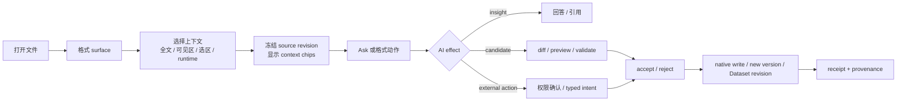

# Peak 文件表面与 AI 能力模型

> 状态：Product / architecture capability model · owner direction captured · implementation pending
>
> 日期：2026-08-09
>
> 面向读者：产品 owner、File Workspace / Peak Sheet / Composer 的后续设计与实现者、负责宣传口径的维护者
>
> 关联文档：[当前文件格式能力审计](../../research/2026-07-31-file-format-capability-audit/index.html)、[Peak File Workspace](./2026-07-24-peak-file-workspace.md)、[Peak Sheet rollout plan](../plans/2026-08-02-peak-sheet-view-adapter-spike-and-rollout-plan.md)、[生成产物与存储治理](../../conventions/generated-artifact-registry.md)

## 1. 执行结论

Peak 不应把“支持文件”定义为扩展名白名单，也不应该试图让每种文件都拥有同样重的编辑器。目标产品应由三部分组成：

1. **统一的 File Surface shell**：负责打开、当前文件上下文、选区、AI 入口、候选结果、review / accept 和版本状态；
2. **按格式提供的 context adapter 与 action provider**：Markdown、HTML、Peak Sheet、Image 等格式各自声明自己能向 AI 提供什么，以及允许 AI 产生什么 effect；
3. **格式原生的 source of truth**：AI 只能生成候选 patch、结构化 plan、新版本或 annotation，不能把聊天文本或 UI runtime state 偷偷变成文件真值。

这意味着对外不能只说“支持 PDF”“支持 CSV”或“支持图片”，而要说清楚用户能完成的任务：

- PDF 是可阅读、可按页/选区问 AI 的只读文档；
- CSV 和 XLSX 都是进入 Peak Sheet 的互操作入口，不是创建后的长期电子表格真值；
- TXT 复用 Markdown 的纯文本子集，但不会在原文件中偷偷写入 Markdown 语法；
- HTML 是可预览、可编辑、可运行的 AI-era document，并通过受控 bridge 执行交互；
- Canvas 与 Excalidraw 使用宿主/生态渲染器，Peak 提供结构感知的 AI companion 与可审阅写回；
- Image 不只做“看图”，还要覆盖区域理解、OCR、确定性变换、生成式编辑和版本管理；
- DOC / DOCX、PPT / PPTX **不属于 Peak 的产品支持范围**。内部 Loader、文件图标或偶然可提取文本都不构成支持，也不进入宣传；XLSX 则属于 Peak Sheet 的目标输入/输出格式，但当前尚未实现解析和产品闭环。

本文件定义目标产品合同，不把任何 implementation-pending 能力升级为已交付。

## 2. 已锁定的产品决定

### 2.1 当前事实与目标设计必须分栏

当前仓库是 Markdown-first：Markdown Composer 是唯一完整文件编辑面；部分格式只有 Loader、索引或嵌入对象写回；File Workspace 和 Peak Sheet 仍是设计/计划状态。

因此所有能力清单都必须同时回答：

- **Current**：当前 checkout 中有源码、测试或真实交互证据的能力；
- **Target**：产品决定要做的文件表面与 AI 合同；
- **Evidence**：该能力是 source-confirmed、test-confirmed、real-app verified，还是 implementation pending。

目标矩阵不能反向污染当前宣传。

### 2.2 CSV 与 XLSX 的目标归属都是 Peak Sheet

CSV 和 XLSX 都是可携带、可交换、可导入/导出的表格文件，不是 Peak Sheet 创建后的长期 machine truth。二者共享 Peak Sheet 入口，但解析合同不同：CSV 是单一扁平表；XLSX 是 workbook container，可能包含多个 worksheet、公式、类型、样式、合并单元格与隐藏区域。

目标闭环：

```text
CSV / flat JSON Array -> DatasetDraft
XLSX -> WorkbookDraft -> choose worksheets -> DatasetDraft / SheetDraft
  -> schema + compatibility diagnostics + preview
  -> owner accept
  -> DatasetCreatePlan / SheetCreatePlan
  -> Dataset / Sheet revision 1
  -> Peak Sheet views and compute
```

创建之后，AI 和用户操作都作用于稳定的 Dataset / Sheet / Field / View / Compute 合同，通过 typed patch 生成新 revision；不得重新生成整份 CSV/XLSX 覆盖已有修改。原文件保留为用户资产与 provenance，可显式导出新的 CSV 或 XLSX snapshot。

XLSX 导入必须先展示 worksheet 选择和 compatibility report：哪些公式、日期/数字类型、样式、合并单元格、隐藏行列或命名区域被保留、转换或丢弃。没有这层诊断，就不能把“能读单元格”称为支持 XLSX。

### 2.3 TXT 复用 Markdown 的纯文本子集

TXT 不需要另起一套编辑器。它复用 Composer 的文档/选区上下文、文本编辑、AI review 和 source-range transaction，但禁用依赖 Markdown AST 的块能力。

TXT 中允许：

- 选区或全文改写、润色、翻译、摘要；
- 提取任务、实体、关键词和大纲；
- 查找、替换、拆分、合并纯文本段落；
- 显式“另存为 Markdown”。

TXT 中不允许：

- 未经用户选择自动注入 Markdown heading、wikilink、callout、frontmatter 或 HTML；
- 把 Markdown preview 当成 TXT 的原生视图；
- 以“用户可能想要格式化”为由改变文件类型。

### 2.4 DOCX 与 PPTX 明确不支持

产品不支持 DOC / DOCX、PPT / PPTX。现有内部文本提取分支只能被视为实现细节或迁移/实验基础，不能出现在用户可见的支持清单、设置承诺或宣传话术里。

未来若重新评估 DOCX/PPTX，必须作为独立 import / conversion 项目进入 owner review，定义版式保真、批注、媒体、导出和失败语义；不能因为“能提取一些文本”自动升级。XLSX 不受这项排除约束，它归 Peak Sheet 路线，但当前状态仍是 implementation pending。

## 3. 第一性原则

### 3.1 文件表面服务任务，不服务扩展名数量

每种格式只需达到其主要用户任务所需的深度：PDF 的核心是阅读和引用，不是改写 PDF 二进制；Canvas 的核心是关系和空间结构，不是复制一个 Canvas renderer；Image 的核心是视觉理解和版本式编辑，不是文本 Loader。

### 3.2 每种文件都要有简单、明确的 AI 入口

支持进入 Peak 的文件表面至少提供：

- **Ask current file**：基于当前文件的可用上下文提问；
- **Ask selection**：有选区时自动收窄范围并显示 context chip；
- **格式动作**：只显示当前格式真正能执行的结构化动作；
- **结果边界**：明确回答是 insight、candidate edit、new version、annotation，还是 external action。

“简单 AI 能力”不等于把全文无差别塞给模型。它需要格式适配、上下文 provenance、revision 冻结和可见的权限。

### 3.3 AI runtime 只有一套

File Surface、Composer、Peak Sheet 和原生对象 companion 复用现有 app-owned AI runtime、模型路由、PermissionGuard、RunEnvelope、receipt 和 usage tracking。格式 provider 负责提供 context 和验证 effect，不得创建第二套 AI router、provider 配置或聊天历史真值。

### 3.4 原文件、交互状态和运行记录分开

- native file / Markdown / Dataset revision 是用户内容真值；
- selection、scroll、hover、preview DOM、console 和临时候选是 transient state；
- AI run、授权、接受/拒绝和版本 lineage 是 durable machine record；
- SQLite、embedding、OCR cache、thumbnail 和 telemetry 是 rebuildable/local derived state。

## 4. 统一 File Surface AI 合同

### 4.1 用户流程



### 4.2 上下文范围

每个 format adapter 只声明自己真正能够构建的 scope：

| Scope | 含义 | 典型格式 |
|---|---|---|
| `whole` | 整个文件的可读取内容 | Markdown、TXT、小型 JSON、PDF 文本 |
| `visible` | 当前页面、viewport、表格视图或画布窗口 | PDF、HTML、Peak Sheet、Canvas、Image |
| `selection` | 选中文字、节点、元素、单元格、区域或 JSON path | 所有可交互 surface |
| `runtime` | 渲染 DOM、console、数据 revision、交互状态或计算结果 | HTML、Peak Sheet；其他格式按需 |

每次运行必须记录并显示：

- file path、format 和 source revision/hash；
- scope 与选区摘要；
- 实际发送给模型的 context 来源；
- 是否包含渲染态、OCR、外部数据或派生摘要；
- provider 不支持原生文件输入时采用的 fallback。

### 4.3 AI effect 类型

| Effect | 用途 | 接受后的结果 |
|---|---|---|
| `insight` | 解释、摘要、问答、诊断 | 不改文件，可显式保存 note/annotation |
| `source-patch` | Markdown、TXT、HTML、JSON source edit | revision-guarded source transaction |
| `structured-patch` | Canvas、Excalidraw、Bases | 对象级 validate + review + native write |
| `dataset-plan` | Peak Sheet 数据、公式、筛选、视图 | 新 Dataset revision |
| `new-version` | Raster image、导出物 | 新 native file，保留 lineage |
| `annotation` | PDF、Image、其他只读来源 | sibling Markdown 或 registered annotation record |
| `external-action` | HTML dashboard 的刷新、筛选、写入或 API 操作 | PermissionGuard 后由 host adapter 执行并留 receipt |

模型不得直接决定写入路径、绕过 revision guard、静默覆盖原文件，或把未验证的自由文本当成结构化 patch 执行。

### 4.4 冲突与审阅

AI 运行开始时冻结 source revision、selection、surface mode 和数据 revision。候选返回后：

1. 验证格式、schema、引用和权限；
2. 展示受影响的范围，而不是只显示一段自然语言；
3. 源文件已变化时停止直接接受，提供 rebase / regenerate / discard；
4. destructive、external 或 replace-source 动作需要更高权限和显式确认；
5. 接受后重新读取 native truth，不能只相信 UI optimistic state。

## 5. 目标文件表面总览

### 5.1 一等工作表面

| Format | 目标 surface | 核心 AI context | 主要写回 |
|---|---|---|---|
| Markdown | Composer | block、selection、document、frontmatter、embed | source-range / block transaction |
| HTML | Source / Preview / Split + runtime companion | source range、selected element、visible DOM、runtime、data provenance | source patch 或受控 external action |
| CSV / XLSX | Import preview + Open as Peak Sheet | row/column/range、worksheet、schema、formula/style compatibility、source hash | import plan；转换后走 Dataset/Sheet revision |
| Peak Sheet | Table / Board / Calendar | cells、range、field、view、compute、data revision | typed Dataset / Formula / View plan |
| Raster Image | Image Workspace | whole image、region、OCR、metadata、references | save as new version；显式 replace |

### 5.2 轻量 source 与原生 companion

| Format | 目标 surface | 核心 AI context | 主要写回 |
|---|---|---|---|
| TXT | Composer plain-text mode | selection、paragraph、document | plain source patch |
| JSON | Source / Tree companion | JSON Pointer、subtree、schema、errors | JSON Patch 或转 Peak Sheet plan |
| PDF | Native viewer companion | current page、copied selection、document、OCR | annotation / materialized note |
| Canvas | Native Canvas companion | selected nodes/edges、subgraph、layout、file refs | typed graph patch |
| Excalidraw | Native/plugin renderer companion | element IDs、text、group、bounds、scene preview | typed scene patch |
| Bases | Native Bases companion | view、filter、property、formula、projection | typed Base patch |

XML 暂不获得独立产品 surface；SVG 不能简单并入 raster image；音频和视频先作为媒体理解/转录能力，均见后文边界。

## 6. 一等工作表面

### 6.1 Markdown：完整文档工作面

Markdown 继续是 Peak 最完整、最深的文件能力：

- context：当前 block、多个 block、文字选区、全文、frontmatter、链接、嵌入对象和相关 Vault 内容；
- insight：问答、摘要、事实检查、结构诊断；
- transform：改写、润色、翻译、扩写、压缩、拆分、合并；
- generation：表格、Mermaid、代码、公式、callout、链接和文档结构；
- writeback：候选 review 后通过 source-range / block transaction 原子接受。

Markdown 是完整能力基线，但其他格式只复用 shell、AI runtime 和审阅语义，不继承 Markdown block 假设。

### 6.2 HTML：可运行的 AI-era document

HTML 不只是待索引的源码。AI 编程工具会生成报告、仪表盘、交互说明书、数据探索器和小型内部工具，因此目标 surface 需要三个基础模式：

- **Source**：语法感知源码编辑、搜索、错误定位、AI patch；
- **Preview**：sandboxed render、element picker、可见 DOM 与 console companion；
- **Split**：源码、渲染结果和 AI review 同步定位。

AI context 至少包括：

- 当前源码选区或 selected element 对应的 source range；
- 当前可见 DOM 的文本、语义和边界信息；
- console error、failed resource、runtime mode；
- 数据来源、最后刷新时间和可公开给模型的 current state；
- 用户在页面内完成的受支持交互 intent，而不是任意浏览器状态 dump。

AI actions 包括：

- Ask this page / explain this element；
- diagnose render or console error；
- 修改选中组件、布局、样式或数据绑定；
- 生成新 section / chart / control；
- 总结 dashboard、解释指标变化；
- 在已注册 capability 中执行 refresh、filter、acknowledge、writeback 等 action。

HTML 分三级信任：

1. **Safe preview**：默认；脚本和网络受限，适合阅读 AI 生成页面；
2. **Interactive local artifact**：允许受控脚本和 typed host bridge，但不能访问 Obsidian/Electron/Node；
3. **Connected dashboard**：显式声明数据 connector 与 action capability，每次高风险写入受 PermissionGuard 控制。

重要业务数据不能只存进页面 `localStorage`、内存变量或隐藏 DOM。HTML source 是页面真值；可变数据应来自 Peak Dataset、CSV/JSON、Markdown、registered connector 或其他明确 carrier；AI run 与交互写入另记 durable receipt。sandbox、bridge 和 patch 细节由 Peak File Workspace spec 继续约束。

### 6.3 CSV、XLSX 与 Peak Sheet：入口和长期真值分离

打开 CSV 时先提供轻量 raw surface：表格预览、delimiter/encoding 诊断、行列选区、字段推断和来源 hash。打开 XLSX 时进入 workbook import surface：列出 worksheet、used range、公式/类型/样式兼容情况和来源 hash。两种格式都以 **Open as Peak Sheet** 完成 preview/accept，不建立第二套 CSV/XLSX 编辑 runtime。

Raw CSV 的 AI 能力：

- 推断 delimiter、header、encoding 和字段类型；
- 发现缺失值、重复项、异常分布和格式漂移；
- 解释 selected rows/columns；
- 预览清洗、列拆分/合并、值映射；
- 生成导入 schema 和 DatasetDraft。

XLSX import 的 AI 能力：

- 解释 workbook/worksheet 结构并推荐导入范围；
- 识别 header、typed cells、公式、日期/数字格式、merged cells 和隐藏区域；
- 诊断 unsupported formulas、跨 sheet reference 和可能的精度/样式损失；
- 将规则表映射为 DatasetDraft，将保留自由网格语义的表映射为 SheetDraft；
- 在 owner accept 前预览每个 worksheet 的目标、丢失项和转换规则。

Peak Sheet 的 AI 能力：

- 生成或修改公式、字段、筛选、排序、分组和视图；
- 基于选区做统计、分类、提取和填充；
- 诊断异常、缺失、重复、趋势和关联；
- 创建 Table / Board / Calendar 的新 projection；
- 把自然语言意图编译成可验证的 DatasetPatchPlan、FormulaPlan、FilterPlan、ViewPlan 或 ComputePlan。

任意动作都绑定 Dataset/Sheet revision。复杂分析可以生成 insight，但数据变更只能通过 typed plan 进入新 revision。导出 CSV/XLSX 是显式 snapshot，不默认与原始文件双向同步。

### 6.4 Raster Image：视觉理解与版本式编辑

PNG、JPEG 和 WebP 是第一阶段 raster baseline。Image Workspace 至少覆盖四组能力：

1. **理解**：描述、OCR、对象/区域解释、可访问性 alt text、标签和出处；
2. **确定性变换**：crop、rotate、resize、compress、convert、background/alpha 操作；
3. **生成式编辑**：inpaint、outpaint、remove/replace object、remove background、风格和构图变体；
4. **知识化**：将 OCR/观察结果保存为 note、引用图片区域、连接来源文档。

context 需要同时表达原图、自然像素坐标的 region、OCR 文本、metadata、source hash 和额外 reference images。模型不支持视觉输入时必须明确 fallback，不能用占位描述冒充理解。

默认写回是 **Save as version**：生成新的 native image，保留来源、prompt、mask、provider、尺寸和 source hash lineage。Replace source 仅在显式确认、备份和 hash guard 后执行。

GIF/BMP/HEIC/HEIF/AVIF 是否加入 raster baseline，取决于解码、方向、动画、颜色与 provider 合同验证，不能仅依据扩展名分类器宣布支持。

## 7. 轻量 source surface

### 7.1 TXT：Plain Text Composer

TXT surface 和 Markdown Composer 共用 shell、selection、AI input、history 与 review，但只注册纯文本 actions。默认输出也必须是 plain text。用户要求标题、列表或链接语法时，应先明确这是普通字符还是“转换为 Markdown”。

目标最小闭环：打开 TXT → 选择或全文 Ask → 生成 source patch → diff → accept → 保持 UTF encoding 与换行策略。

### 7.2 JSON：Source / Tree，不假装都是表格

JSON 分两类：

- **flat array of records**：可进入 DatasetDraft / Peak Sheet；
- **arbitrary or nested JSON**：保持 JSON source/tree surface。

AI context 应使用 JSON Pointer/path、选中 subtree、schema 和 validation errors。可用动作包括解释结构、推断 schema、查找错误、规范化 key/value、生成 JSON Patch、提取某个 subtree 或显式转换为 Dataset。

不得把 nested JSON 自动压平并覆盖原文件；不得用整文件自由文本重写代替 JSON Patch 和 parse/schema validation。

### 7.3 XML 与 SVG：暂不合并处理

XML 当前只保留内部读取能力，不提供独立产品 surface，也不宣传。若未来支持，应使用 source/tree、namespace、XPath 和 schema-aware patch 合同，不能继续借 HTML 类型运行。

SVG 是文本源码、矢量图和潜在脚本容器的交叉格式。未来可提供 safe source/preview 和 element-aware patch，但必须拥有独立 sanitization、external resource 和 script policy；在此之前不归入 raster image AI edit。

## 8. 原生 companion surfaces

### 8.1 PDF：保留 native viewer，增加 page-aware AI

PDF 原文件默认只读，Peak 不重做 PDF 编辑器。companion 从 native viewer 获取当前页、复制选区、页码范围和全文提取/OCR结果。

AI actions：Ask page、Ask selection、全文摘要、章节/表格解释、带页码引用、跨页比较、OCR scanned page。需要持久化时写入 sibling Markdown annotation 或显式 materialized note，不改 PDF 二进制。

### 8.2 Canvas：关系与空间结构 companion

Peak 复用 Obsidian Canvas 的打开、渲染和手工编辑。AI adapter 理解：

- selected node IDs、node type、text/file refs；
- selected edges、labels、direction；
- current subgraph 或 whole canvas；
- node bounds、relative layout 和 source revision。

AI actions：总结地图、聚类主题、发现缺失连接、解释路径、从笔记/搜索结果添加 nodes、连接或重命名 selected nodes、建议/执行布局、生成新 Canvas。

写回必须是 typed graph patch，按 node/edge 展示 review，保留未知 JSON fields，绑定 source revision。布局建议与语义改动应能分开接受；Peak 不复制 Canvas renderer。

### 8.3 Excalidraw：scene-aware diagram companion

Peak 复用 Excalidraw plugin/native renderer。adapter 需要结构 context（element IDs、text、group、binding、bounds、z-order）与必要时的 scene screenshot。

AI actions：解释图、生成图、改写 label、添加/删除/连接/group/move 元素、重新布局、统一样式、从文本或 Mermaid 转为 scene。

写回使用 typed scene patch 和对象级 preview，保留未知 metadata、bindings 与 plugin fields，并绑定 revision。对嵌入 bitmap 的像素编辑仍进入 Image Workspace，不与 scene patch 混合。

### 8.4 Bases：note-backed view companion

Obsidian Bases 是基于 Vault note properties 的原生 projection，不是 Peak Sheet。AI context 包括 Base view、filter、property、formula 和 current projection；AI 可以创建/修改 Base 配置，但不能把结果复制成第二份 records 真值。

Peak Sheet 与 Bases 的边界：Peak Sheet 拥有 Dataset revision 和计算链；Bases 展示/筛选已有 Vault notes。二者可显式导入、导出或 materialize，但不能静默双写。

## 9. 媒体与生成型格式

### 9.1 Audio

目标不是音频 DAW，而是媒体理解 companion：transcript、speaker/segment、chapter、summary、quote timestamp、clip marker 和基于时间范围的 Ask。原音频保持 native file；transcript/annotation 使用注册 carrier；能力需要显示 provider、语言和置信度边界。

### 9.2 Video

目标是 transcript + keyframe + chapter + timeline-aware Ask，不承诺视频编辑器。video context 可以组合时间段、音轨转录、采样帧和 metadata；任何“理解视频”的宣传都要证明模型实际获得了相应数据，而不是只保存了附件。

### 9.3 draw.io 与其他生成产物

draw.io 当前/近期只适合定义为 **generate/export integration**：Peak 可以生成经过校验的 native artifact，但没有对应读取、AI companion 或编辑 surface。生成能力必须和完整支持分开标注。

## 10. 明确不支持或尚未交付的格式

| 格式 | 产品状态 | 允许存在的内部事实 | 禁止表达 |
|---|---|---|---|
| DOC / DOCX | 不支持 | 旧 Loader 可能提取部分文本 | 支持 Word、可读取 Word、Office AI |
| PPT / PPTX | 不支持 | 旧 Loader 可能提取部分文本 | 支持 PowerPoint、理解幻灯片 |
| XLSX | 当前未交付；目标为 Peak Sheet 互操作 | 当前类型/UI 有扩展名，但 Loader 无解析实现 | 当前已支持 Excel；无诊断的 lossless import/export |
| 未注册附件 | 不支持 | 可以保存为 Vault file | 模型可直接理解任意附件 |

产品层应逐步消除设置、图标、Loader 和宣传之间的假阳性。内部兼容路径如需保留，应默认不可见，并有明确 owner、测试和删除/迁移条件。

## 11. 真值与写回矩阵

| Surface | 用户内容真值 | AI candidate / derived state | 接受方式 |
|---|---|---|---|
| Markdown / TXT / HTML / JSON | native source file | patch、render、diagnostic | guarded source transaction |
| CSV/XLSX import | original file + accepted Dataset/Sheet revision | DatasetDraft/WorkbookDraft、schema/compatibility inference | DatasetCreatePlan / SheetCreatePlan |
| Peak Sheet | Dataset revision | compute/cache/view projection | typed plan → next revision |
| Raster Image | original + accepted version files | mask、candidate、thumbnail | save version / guarded replace |
| PDF | original PDF | extracted text、OCR、page context | annotation / materialized note |
| Canvas / Excalidraw / Bases | native structured file | object diff、render preview | guarded structured patch |
| HTML external interaction | registered data source | runtime state、action proposal | permissioned host action + receipt |

所有 persistent writer 都必须进入 generated artifact registry，声明 canonical carrier、sync、Peak knowledge index、materialization、retention 和 recovery。AI receipt 不替代 native artifact；SQLite/read model 不升级为真值。

## 12. 机器可读 capability manifest

后续 File Surface registry 应成为设置、命令可见性、AI action、验收和宣传矩阵的共同来源。每个 provider 至少声明：

- extension / MIME / format family；
- current product status 与 target status；
- view modes 和 renderer dependency；
- supported context scopes；
- AI actions 与 effect type；
- writeback、permission、revision 和 conflict policy；
- source of truth 与 artifact registry ID；
- provider/model prerequisites；
- fixture、focused test、real Obsidian verification 状态；
- marketing label 与明确 exclusions。

该 manifest 由 app-owned registry 组合。Loader 可以贡献 read capability，但不能自己把格式升级成 product-supported surface。

## 13. 产品包装与优先级

### 13.1 四条产品线

1. **完整 AI 文件工作面**：Markdown、HTML、Peak Sheet、Image；
2. **轻量文本/数据工作面**：TXT、JSON；
3. **原生 viewer + Peak AI companion**：PDF、Canvas、Excalidraw、Bases；
4. **媒体理解与生成 integration**：Audio、Video、draw.io 等，按任务精确宣传。

DOCX/PPTX 不在上述产品线中；XLSX 属于 Peak Sheet 的输入/输出互操作格式。

### 13.2 推荐推进顺序

1. 先完成 capability manifest 与 shared context/effect contract，消除 Loader 假阳性；
2. 落地 File Workspace foundation，先让 Image、HTML、PDF 共享 shell 和 review；
3. 将 TXT 作为 Composer plain-text adapter 收口；
4. 将 CSV / flat JSON Array 接入 Peak Sheet draft/accept，再以 WorkbookDraft + compatibility report 接入 XLSX；
5. 为 Canvas、Excalidraw、Bases 增加独立 native companion，不再依赖“先嵌入 Markdown”；
6. 再评估 JSON tree、SVG、Audio、Video 等扩展 surface。

顺序表达依赖，不是当前 implementation commitment。

## 14. 宣传合同

宣传文案应使用“格式 + 用户任务 + 限制”结构：

- 好：`在 PDF 当前页或选区上向 Peak 提问，并把结论保存为带引用的笔记。`
- 好：`把 CSV 预览、清洗并确认导入 Peak Sheet，再用 AI 创建公式和视图。`
- 好（XLSX 交付后）：`选择 XLSX worksheet，审阅公式与样式兼容性，再导入 Peak Sheet。`
- 好：`在安全预览中检查 AI 生成的 HTML，并对选中组件提出可审阅修改。`
- 差：`支持 PDF / CSV / HTML。`
- 当前禁止：`已支持 Excel/XLSX`、`任意文件都能直接问 AI`；DOCX/PPTX 仍禁止笼统表达为 `支持 Office`。

发布前必须从机器可读 manifest 生成/核对支持页，避免产品页、设置页、Loader 与真实 surface 四套口径漂移。

## 15. 验收门槛

单一格式只有同时满足以下条件，才可从 target/experimental 升级为 product supported：

1. 固定 fixture 覆盖正常、超大、损坏、并发修改和不支持变体；
2. source / selection / runtime context 的实际模型输入可审计；
3. insight 与写操作的权限、候选、diff、accept/reject、conflict、undo/recovery 可验证；
4. native source of truth 在关闭 Peak 后仍可由原生/生态工具读取；
5. provider 缺失、模型不支持、离线和解析失败有明确降级；
6. focused tests、production build 和真实 Obsidian interaction evidence 分开记录；
7. 设置、命令、帮助、宣传与 capability manifest 一致。

静态 mock、Loader 注册、文件图标、成功 build 或“能生成一个文件”都不能单独作为支持证据。

## 16. 非目标

- 不为每个扩展名建立独立 AI runtime 或聊天系统；
- 不复制 Obsidian PDF/Canvas/Bases 或 Excalidraw 的成熟 renderer；
- 不把所有文件转成 Markdown 后假装支持原格式；
- 不把 CSV/XLSX 和 Peak Dataset/Sheet、Bases 和 Peak Sheet、HTML UI state 和业务数据混成同一个真值；
- 不因内部 Loader 存在而支持 DOCX/PPTX，也不因类型/UI 出现 XLSX 就宣称其 Peak Sheet 入口已经交付；
- 不在没有 revision、review 和 recovery 的情况下让 AI 直接覆盖 native file。

## 17. 本轮边界

本轮仅梳理产品与架构能力模型：

- 没有修改生产代码；
- 没有注册新的 file view、loader、writer 或 AI action；
- 没有把 File Workspace、Peak Sheet、Canvas/Excalidraw companion 或媒体理解升级为 shipped；
- 没有执行真实 Obsidian 的逐格式交互验收。

当前能力仍以关联的 source audit 为准；本文是后续设计、实现、验收和宣传的目标合同。
