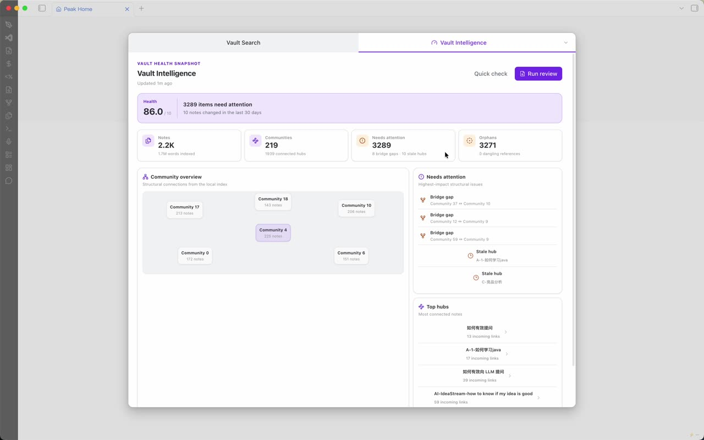
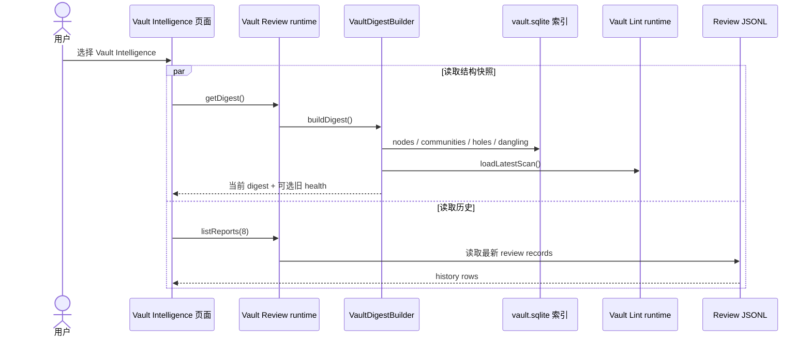
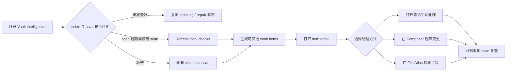
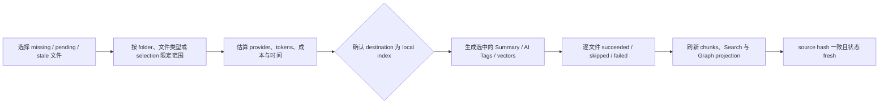
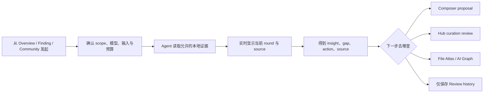
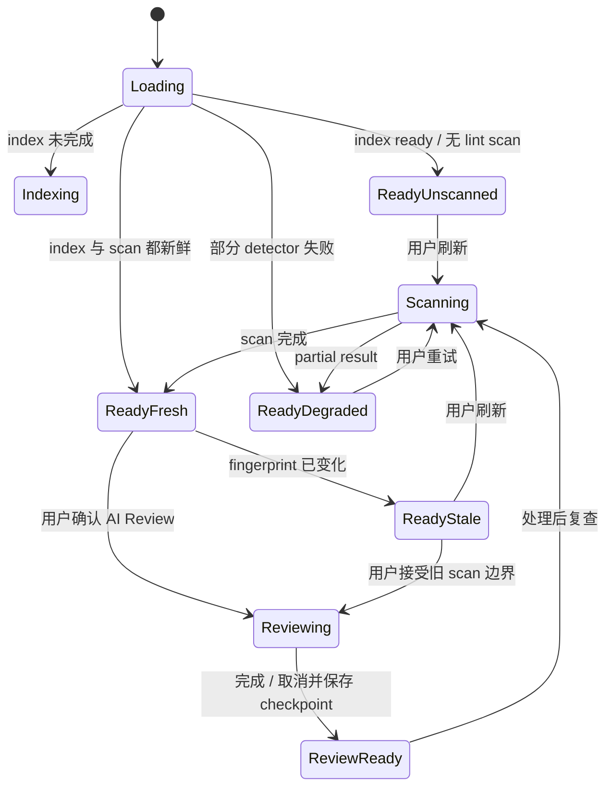
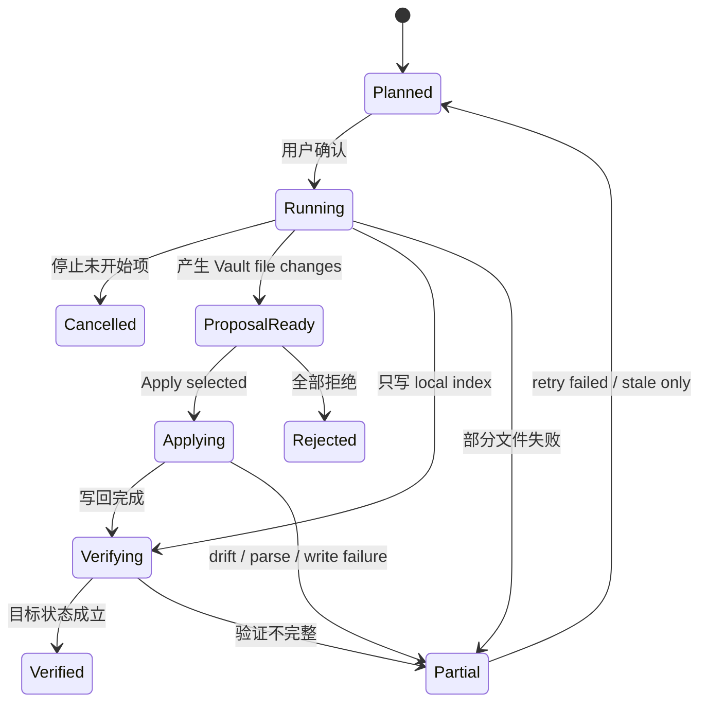

# Vault Intelligence 能力审计与 UX 重设计建议

> 状态：Owner review draft
>
> 日期：2026-08-10
>
> 文档类型：当前能力审计 + UX 架构建议
>
> 证据基线：工作区 `HEAD 1d093cec1305`；本文涉及的 Vault Intelligence、Vault Review、Vault Lint、Index enrichment 与 Composer Frontmatter 源文件在审计时无未提交改动
>
> 阅读时间：结论与能力版图约 10 分钟；完整审阅约 45–60 分钟
>
> 验证边界：只读源码、测试、配置、历史文档与真实 Obsidian 截图；未改产品代码，未执行真实交互验收，`INTERACTION NOT VERIFIED`

## 结论先行

Vault Intelligence 的核心不是给 Vault 打一个抽象分数，而是完成一条维护闭环：**发现值得处理的问题，补齐缺失的机器知识与用户元数据，解释为什么，帮助用户安全执行，并在处理后验证是否改善。** 当前界面把本地结构快照、旧 Vault Lint 结果和 AI Review 入口压在一个静态仪表盘里，因此看起来信息很多，实际既回答不了“现在该做什么”，也看不到哪些文件缺 Summary、AI Tags、向量或规范化的 YAML frontmatter。

本次建议有七个关键决定：

1. **把四种工作明确拆开。** Local Check、Index Enrichment、AI Review 与 Vault Writeback 的成本、数据边界、产物和风险都不同，不能再共用一个模糊的 `Run review`。
2. **把文件级知识补全列为一级能力。** Summary、AI Tags 与 vector 不是边角配置；它们直接影响 Search、Graph、聚类和后续 Agent 理解，应展示覆盖率、pending、stale、failed 与生成成本。
3. **把 YAML frontmatter 作为用户拥有的元数据治理。** 检查缺失、格式和跨 Vault 一致性可以自动完成；生成值必须先成为 candidate，展示证据和 diff，只有显式确认才写回 Markdown。
4. **主界面从 Dashboard 改成维护工作区。** 首页突出新鲜度、覆盖范围、变化和优先 work item，不再用大数字制造紧迫感。
5. **暂时撤下综合 Health hero。** 当前底层是 0–100，界面却显示 `/10`；未运行的 Semantic detector 仍以满分参与加权，分数不具备足够解释力。
6. **移除当前装饰性 Community map。** 现有节点位置来自固定坐标，最多显示六个 community，也没有详情入口；它不是真实拓扑图。
7. **每种 Action 都必须声明 effect。** 内部索引生成可以在预检后执行；AI Review 只能产出 recommendation；任何用户文件写回必须经过可审查 proposal、source-hash 防漂移和明确 Apply。

最小可用的新产品循环是：

```text
查看状态与覆盖率 → 刷新本地检查 → 选择 work item
→ 运行内部知识补全或生成可审查 proposal → 确认写回
→ 重新索引 / 扫描 → 验证 resolved、fresh 与 searchable
```

## 1. 本文回答什么

### 本文读者

- Peak Assistant owner：决定 Vault Intelligence 到底是什么。
- 产品与设计：重画页面、状态和操作流程。
- 工程维护者：判断哪些能力能直接复用，哪些只是底层库存。

### 本文目标

读完后，owner 应能确认：

- Vault Intelligence 的产品边界。
- 当前真实能力与未接通能力。
- 新界面要有哪些屏幕和状态。
- 每次操作会读取什么、分析什么、产生什么。
- Summary、AI Tags 与 frontmatter 到底是检查、生成还是写回。
- 哪些问题必须先修，哪些可以以后再做。

### 本文不做什么

- 不改代码，不提供 CSS 微调清单。
- 不再设计第五套 Graph 产品。
- 不把历史 spec 或 stub 当作已上线能力。
- 不决定视觉 token、最终文案和像素级布局。

## 2. 当前界面：看起来完整，实际缺少工作闭环



这张真实 Obsidian 截图呈现了当前页面的主要结构：

- 顶部 Health 与 “items need attention”。
- Notes、Communities、Needs attention、Orphans 四张统计卡。
- 占据最大面积的 Community overview。
- 右侧 Needs attention 与 Top hubs。
- 底部 Recent reviews。

问题不只是样式陈旧，而是信息语义互相冲突：

1. `86.0 / 10` 与底层 0–100 计分不一致。
2. `3289 items need attention` 是 structural holes、stale hubs 和全部 orphans 的简单相加，不是去重后的任务数，也没有严重度排序。
3. “Updated 1m ago” 是本次 digest 的计算时间，不是 Vault Lint 扫描时间，也不是 AI Review 完成时间。
4. 页面把巨大面积给了 Community map，但用户不能点 community、查看成员或进入处理流程。
5. `Quick check` 与 `Run review` 没有解释范围、时间、模型、成本和结果差异。
6. 页面能打开少量 hub note，却不能从 orphan、bridge gap 或总问题数进入 finding 详情。
7. Search Index 已经记录文件的 LLM Summary / AI Tags pending 状态，Composer 也已有 YAML candidate/writeback，但页面完全没有展示这些维护债务和可复用动作。

因此，这不是“卡片排版需要更新”，而是页面没有建立清楚的对象层级。**不同来源、不同生命周期的信息被当成了同一种东西。**

## 3. 当前真实能力地图

必须把“当前界面可达”“底层已实现但未接入”“只有占位”分开看。

### 3.1 当前界面已经能用的能力

#### A. 读取本地 Vault 结构快照

打开 Vault Intelligence 后，`VaultIntelligenceWorkspace` 同时读取：

- 当前 `VaultDigest`。
- 最近 8 条 Vault Review 历史。

Digest 会从本地索引读取：

- 笔记数、总词数和内容 fingerprint。
- Louvain communities 与结构洞。
- PageRank hub、stale hub 与 orphan。
- 未解析 wikilink 的 top targets。
- 最近 30 天修改量、dormant communities 与高频 tags。
- 最近一次已经持久化的 Vault Lint 扫描结果，如果存在。

这一步不会调用模型，也不会写 Vault 文档。

#### B. 打开部分结构对象

当前页面支持：

- 点击 stale hub 打开对应笔记。
- 点击 Top hubs 打开对应笔记。
- 点击 Recent review 打开历史快照。

当前页面不支持：

- 点击 community 查看成员。
- 点击 bridge gap 查看两侧证据。
- 点击 orphan 进入 orphan 列表。
- 从总问题数进入可筛选 finding queue。

#### C. 运行 Quick / Complete AI Review

两个按钮都会关闭 Search Modal，再打开 `VaultAutoRunModal`：

- Quick 使用 fast 配置，固定单轮，目标是少量高信号结果。
- Complete 使用主 agent 配置，允许多轮，session 安全上限是 12 轮。

两种模式都会：

- 重新构造一份 digest。
- 加载最多 2,000 字符的用户长期 profile。
- 把 digest 交给配置的模型。
- 允许 agent 按需读取 folder、note、混合搜索结果和 wikilink 邻域。
- 让 agent 用结构化工具提交结果。

模型可提交的用户可见结果包括：

- 一般 insight。
- cluster observation。
- gap。
- action。
- source citation。
- chat follow-up。
- round summary。

Vault scope 刻意没有开放 `propose_change`。因此当前 action 是文字建议，不是文档 diff，也没有 Apply 能力。

#### D. 展示 Live Review 与历史结果

Review Modal 目前有六个 tab：

- Overview。
- Clusters。
- Gaps。
- Actions。
- Sources。
- Trace。

运行中会展示 Agent trace，并允许 Cancel。历史记录以 read-only snapshot 重新打开。

### 3.2 底层已实现，但当前 Vault Intelligence 没有接通

以下能力存在源码和测试，但不能视为当前截图页面的用户能力。

#### A. 手动 Vault Lint full scan

`runVaultLintManualScan` 与 `VaultLintService.runFullScan` 都存在，也能生成 RunEnvelope trace 和 SQLite scan record。但当前 `src/` 中没有生产调用者；Vault Intelligence 页面和 Vault Review 都只调用 `loadLatestScan()`。

这意味着：

- 点击 `Quick check` 不会先刷新 lint。
- 点击 `Run review` 也不会先刷新 lint。
- 页面显示的 Health 可能来自很久以前的 scan。
- 新用户若从未产生 scan，Health 会一直是 “Not reviewed”。

当前 [Vault Intelligence 功能正稿](../../13-feature-vault-intelligence.html) 中“Complete review 会调用 `runVaultLintManualScan`”的描述已经落后于源码，不能继续作为实现真相。

#### B. 文件级 LLM Summary 与 AI Tags enrichment

Search Index 已有一条可复用的批量 enrichment 链，而不是从零开始建设：

- `listener_fast` 与 `startup_scan` 只做本地索引，并把跳过 LLM 的文件标成 `llm_pending`。
- `manual_full` 与 `llm_enrich_only` 会为 Markdown 文件生成短 Summary、必要时的长 Summary，以及 topic / functional 等 AI Tags。
- 短 Summary 写入 `mobius_node.summary`，长 Summary 写入 `attributes_json.full_summary`，并进入 `summary_short` / `summary_full` 搜索 chunks。
- AI Tags 写入本地 `tags_json`，参与 Search、Graph 和聚类；它们不是用户 YAML 中的 `tags`。
- `attributes_json` 同时保存 Summary / Tags 的 source hash、生成时间、pending 原因与 functional tag status。

Settings 的 Maintenance 页面已有 `Run pending LLM enrichment`，并且运行前会估算文档数、tokens、成本和时间；运行时支持 progress 与 cancel。当前缺口是：

- Vault Intelligence 完全不读取这些 per-file 状态。
- Summary 和 AI Tags 被一个批操作绑在一起，用户不能只补其中一项。
- 当前 batch runtime 同时遍历 `vault` 与 `chat` tenant；Vault Intelligence 不能原样调用成“全 Vault 文件补全”，必须增加 tenant / path scope。
- 现有 UI 只给总进度和最终 Notice，没有按文件的 succeeded / failed / stale 结果列表。
- 当前 repo read API 只公开 pending path，没有把 source hash、生成时间和失败状态投影给工作区。
- enrichment 结果只改善内部索引，不会自动写入用户笔记；界面必须把这一点讲清楚。

因此这不是“新增两个 AI 功能”，而是把已经存在的 index maintenance 能力纳入 Vault Intelligence，并补齐可观察性、选择范围和结果审阅。

#### C. 文件级 Tag suggestion 与显式 YAML 写回

`TagSuggestionEngine` 已能综合三类信号：

- 当前文件正文与标题。
- Graph 一跳邻居使用的 tags。
- 同文件夹历史与 Vault 高频 tags。

它会合并评分、过滤当前已有 tag 和部分噪声词，最多返回 7 条候选。现有 Document Copilot 面板支持逐条接受、拒绝和编辑，再由 `writeTagsToFrontmatter()` 把已接受项合并进 YAML `tags`，并保留已有值。

当前 Vault Intelligence 没有调用该流程，也没有批量入口。后续接入时不能把“index AI Tags”与“写入用户 frontmatter 的 tag suggestion”混为一件事：前者是本地机器事实，后者是用户文件变更。

#### D. Frontmatter inventory、candidate 与安全写回

Composer 的 Frontmatter 能力已具备可复用的底层积木：

- `computeVaultPropertyInventory()` 统计字段覆盖率、单次使用字段、value kind 冲突、Vault tag vocabulary，以及当前文档缺少的常用字段。
- `suggest-properties`、`suggest-tags` 与 `normalize-properties` 会根据正文和当前 YAML 生成逐字段 candidate，并附带 evidence。
- 当前笔记没有 frontmatter 时，可以在文件头创建新的 YAML block。
- 写回一次只修改一个字段，保留未知字段、key 顺序和可保留注释。
- list 与 scalar 形态变化会标成 `requiresReview`，candidate 生成后 source 漂移则拒绝写入。

这套能力目前服务于“当前笔记编辑”，还不是 Vault-wide governance。Vault Intelligence 需要复用 inventory 与 candidate contract，但必须增加 folder / note type policy、批量 proposal set、per-file diff、source hash guard、partial failure 与 receipt，不能直接把当前笔记 picker 放大成全库批处理器。

此前 roadmap 把 Vault 属性治理标成 deferred；本次 owner 补充已经改变了当前设计范围。新的文档方向是：**把治理纳入 Vault Intelligence 的整体能力设计，但仍不在本次实现代码。**

#### E. HealthInsight 聚合

`buildVaultHealthInsights` 能把原始 findings 聚合为六类修复建议：

- broken-link repair。
- repeated missing targets。
- noise source。
- orphan reconnect。
- tag coverage。
- content cleanup。

每类还能生成 AI prompt。但是当前 Vault Intelligence 页面没有调用它，Review Modal 也没有把这些确定性建议作为一级输入展示。

#### F. Dismiss / snooze / fixed persistence

SQLite repo 支持 dismissal、snooze 和 fixed 状态。但当前 runtime port 没有暴露这些写入，Vault Intelligence UI 也没有入口。它们是底层能力，不是当前操作流程。

#### G. Trend history

`VaultLintRepo.loadTrendHistory()` 可以读取最近扫描的 Health 与 dimension 分数。当前页面没有使用，因此现在没有可信的趋势图或 scan-to-scan delta。

#### H. Hub curation 与 materialization

项目已有 `HubGenerationRuntime` 与完整的 Hub review / materialize 流程。它内部已经区分 curation 和 materialization，并保护 `peak_user_owned` 内容。

但是当前 Vault Intelligence 的 action queue 只是文字，`VaultIntelligenceWorkspace` 与 `VaultAutoRunContent` 都没有调用 Hub runtime。因此“在 Vault Intelligence Review 中直接生成 / 更新 Hub”目前仍是相邻能力，不是已接通的主流程。

### 3.3 尚未成为真实分析能力

#### A. Semantic 六类检查

以下 detector 已注册，但都带 `requiresLlm: true`，实现直接返回空数组：

- `M-COVERAGE-GAP`。
- `M-LOW-COHESION`。
- `M-CONTRADICTION`。
- `M-PHANTOM-NODE`。
- `M-SEMANTIC-ISOLATION`。
- `M-REDUNDANT-HUBS`。

普通 full scan 只运行 `getNonLlm()`，因此不能把 coverage gap、contradiction 或 semantic isolation 作为已上线的确定性检测宣传。

#### B. 三类 Tag 检查

类型系统里还有 `G-TAG-ISLAND`、`G-TAG-REDUNDANCY` 和 `G-NOISE-TAGS`，当前没有 detector 注册。

#### C. Scheduled / incremental scan

配置里有 debounce 与 weekly interval，但 runtime 输入仍以手动 full scan 为主，没有 production scheduler 或 incremental owner。

## 4. 当前运行流程与技术产物

### 4.1 打开页面时发生什么



读图重点：

- 页面打开时不会运行新的 lint scan。
- Digest 的 `computedAt` 只能说明刚刚重新组装过数据。
- Health 有独立的 scan 时间，但当前 UI 没有显示。
- Review history 有第三套完成时间。

### 4.2 点击 AI Review 后发生什么


这条链的真实边界：

- Agent 会把 digest、profile 片段及工具返回的笔记内容发送给配置的模型 provider。
- 当前允许读取本地 Vault，没有 Web 工具。
- Core Vault Review 只产出建议，不产出可应用 diff。
- 若 Plugin Command Gateway 配置了人类批准的外部命令，Agent 还会拿到一个通用 command tool；其中可能包含 edit 风险命令。

最后一点与 UI 中 “No vault changes applied” 的绝对表述冲突。即使 command tool 有 allowlist 与 permission guard，Vault Review 也不应携带这条额外执行路径。建议在该 surface 完全移除 external plugin command tool。

### 4.3 当前会产生哪些数据

| 产物 | 当前载体 | 生命周期 | 用户现在怎么看 |
| --- | --- | --- | --- |
| Vault digest | 内存对象 | 每次打开或 review 重建 | Snapshot 与 Review UI |
| Vault fingerprint | 内存缓存 30 秒 | `path:contentHash` 排序后 SHA-256 | 只间接用于 freshness / history |
| Lint scan 与 findings | `vault.sqlite` | 本地可重建事实；当前页面不能触发刷新 | Health 只读取 latest |
| 文件短 / 长 Summary | `mobius_node.summary` + `attributes_json.full_summary` + `summary_*` chunks | 本地可重建 index enrichment | 当前 Vault Intelligence 不展示 |
| 文件 AI Tags | `mobius_node.tags_json` | 本地可重建机器事实；参与 Search / Graph | 当前 Vault Intelligence 不展示，也不会自动进入 YAML |
| LLM enrichment 状态 | `attributes_json` 中的 source hash / generated at / pending / status | 随文件内容与 enrichment 更新 | Settings 只有批量进度，页面没有 per-file projection |
| Tag suggestion batch | `TagSuggestionRepo` | 本地 suggestion / feedback 记录 | 仅 Document Copilot 面板可见 |
| Frontmatter candidate | Composer result envelope / 当前 review state | 接受前是临时候选 | 当前笔记逐字段审阅 |
| 用户 YAML frontmatter | 原始 Markdown 文件 | 用户拥有、可同步内容 | 只有明确 Apply 才写回 |
| Review session snapshot | `DataStore/records/copilot/sessions/vault-review-*.jsonl` | Durable record，运行中渐进 checkpoint | Review history |
| Legacy Vault Review Markdown | `peak-system/vault-reviews/*.md` | 只读迁移来源，新 writer 已停 | 旧记录兼容 |
| Export summary / Copy trace | Clipboard | 临时 | 用户主动复制 |

生产路径中，新 Vault Review 记录使用 `peak-review://vault-review/<id>` 作为虚拟 storage path。当前 `Open report note` 仍把它交给普通 Vault navigation，而 navigation 只显式识别 `peak-hub://`，没有 `peak-review://` resolver。源码不足以证明这个按钮能打开 canonical JSONL 记录，因此必须按未验证/可能失效处理，不能继续叫 “report note”。

### 4.4 三类看似相同、实际不同的“生成”

| 用户说法 | 实际目的 | 当前写入位置 | 是否修改用户笔记 |
| --- | --- | --- | --- |
| 给 file 生成 Summary | 让 Search / Graph / Agent 更快理解文件 | 本地索引的 summary columns、attributes 与 chunks | 否 |
| 给 file 生成 AI Tags | 给机器检索、关系和聚类提供分类信号 | 本地索引 `tags_json` | 否 |
| 补全 frontmatter / 把 tag 写进 YAML | 让用户在 Obsidian Properties、Bases、查询和同步中使用 | Markdown 文件头部 YAML | 是，必须确认 |
| 在正文顶部插入 Summary | 让人直接在笔记中看到摘要 | Markdown 正文 callout | 是，必须确认 |

重设计必须始终展示 `Destination / Writes`。如果只显示一个 `Generate` 按钮，用户无法知道结果是只进入本地机器索引，还是会改动同步中的 Markdown 文件。

## 5. 当前分析到底分析什么

### 5.1 确定性规则层：19 个实际运行 detector

Structural 共 6 个：

- hard orphan。
- soft orphan。
- broken link。
- missing backlink。
- island cluster。
- fragile bridge。

Content 共 6 个：

- empty note。
- stub note。
- oversized note。
- duplicate note。
- missing frontmatter。
- naming violation。

Temporal 共 5 个：

- stale hub。
- decaying bridge。
- abandoned cluster。
- recent drift。
- abandoned folder。

Tags 共 2 个：

- untagged note。
- tag explosion。

这些 detector 读取 Vault 文件、metadata cache、图节点、community 和 semantic neighbor 等本地数据。单个 detector 抛错时会 warning 并返回空数组，整次 scan 仍然完成；但当前 scan result 没有结构化的 coverage / degraded 标记。

### 5.2 Health score 为什么暂时不适合作为 Hero

当前公式是：

```text
dimension score = 100 × (1 - Σ finding affected ratio × severity multiplier × signal weight)
overall score   = Σ dimension score × dimension weight
```

公式本身可测试，但产品解释仍有四个缺口：

1. 页面显示 `/10`，底层和测试都是 0–100。
2. Semantic 权重是 25%，但六个 Semantic detector 全部不运行；没有 finding 会自动得到 100 分。
3. Tags 权重是 10%，但五个声明信号只有两个 detector 运行。
4. Detector 失败会被吞为 partial result，Health 仍按缺失 finding 计算，没有降低 coverage 或置信度。

因此当前 `86` 不是“Vault 有 86% 健康”，更准确的含义是“在本次实际执行且成功返回的规则中，按当前惩罚公式得到 86”。页面没有提供足够信息让用户理解这个限定。

推荐方案：

- 第一阶段不显示综合分，显示 `19 项本地检查 · 16 成功 / 3 degraded`、高优先 finding 数和 scan 时间。
- 若以后保留 score，必须显示 `/100`、coverage、参与维度和上次 scan 时间。
- Semantic 未上线前，不得按满分进入综合权重。

### 5.3 Agent Review 层分析什么

Agent 的任务不是重复跑 detector，而是：

- 给 top communities 命名并判断 growing、stable、dying、central 或 fragmenting。
- 解释 structural hole、dangling reference、stale hub 与 abstraction mismatch。
- 读取代表性笔记，形成有 wikilink 和 source citation 的结论。
- 产生七类 text-only action，覆盖新建、整理、归档和刷新等意图。
- 决定是否需要下一轮，从不同角度继续调查。

Quick 模式目标是单轮 2–4 个高信号输出。Complete 模式要求覆盖 top 12 communities、主要结构洞和关键 gaps，并可继续多轮。

当前每轮 `maxTurns` 实际设为 999，session 只靠 `submit_review` 和 12 轮安全上限停止。这个边界不适合直接暴露给普通用户：耗时和 token 成本不可预测，UI 也没有 preflight 或运行预算。重设计时应把预算变成明确 contract，而不是继续依赖 prompt 自律。

### 5.4 文件级知识补全与元数据治理分析什么

这部分不应继续塞进现有 `Content` 或 `Tags` 两个 lint dimension。它至少包含三类不同对象：

#### A. Machine knowledge coverage

它回答“Peak 是否已经理解这份文件”，而不是“文件是否写得好”。首批状态应包括：

| 检查 | 判断依据 | 当前可确认 | 设计缺口 |
| --- | --- | --- | --- |
| Summary missing | short / full summary 是否存在 | 索引已有 summary fields | 缺 Vault-wide projection |
| Summary pending | `llm_pending` 与 pending reason | 已持久化 | 目前只返回 path list |
| Summary stale | `content_hash` 是否等于 `llm_summary_source_hash` | 数据字段存在 | repo read port 未暴露 |
| Summary failed | 最近生成是否失败及错误 | 没有完整结构化状态 | 需要 per-capability status / error |
| AI Tags missing / pending | tag entries 与 `llm_pending` | 部分存在 | Summary / Tags 共用 pending，无法单独重试 |
| AI Tags stale | `content_hash` 与 `llm_tags_source_hash` | 数据字段存在 | UI 和 reader 未接通 |
| Functional tags failed / empty | `functional_tags_status` | 已持久化 | `failed` 与合法 empty 语义需要分清 |
| Vector missing / pending / stale | vector pending / source hash / generated at | 已持久化 | 应与 LLM enrichment 并列展示，不混入 Health |

这些状态全部可以先用本地索引事实判断，不需要为了“检查是否缺 Summary”再调用一次模型。真正调用模型的是后续 `Generate / Refresh` action。

#### B. User metadata quality

它回答“这份文件的 YAML 是否符合用户选择的 Vault 约定”。首批检查建议包括：

- Frontmatter 缺失或 YAML malformed。
- 某个 folder / note type 的 required fields 缺失。
- `created`、`updated`、`status`、`type`、`tags` 等字段的 value kind 不一致。
- 高频 canonical field 在目标 scope 缺失。
- single-use、大小写、拼写或近义字段可能重复。
- tag 为空、数量异常、写法不规范或与现有 taxonomy 冲突。
- 程序维护字段被 AI proposal 试图覆盖。

“低覆盖率”本身不是错误。只有当用户选择了 scope policy，例如“`Projects/` 下的 project note 必须有 `status` 与 `owner`”，缺失才成为 actionable finding。否则覆盖率只是诊断上下文。

#### C. Generated proposal quality

生成之后还要检查 proposal，而不是直接认为生成成功：

- evidence 是否来自目标文件或允许的 Vault convention。
- candidate 是否会覆盖已有值。
- list / scalar / boolean / date 类型是否改变。
- suggestion 是否重复已有 tag 或引入 one-off taxonomy。
- source hash 是否从预览后发生变化。
- 写回后 YAML 是否仍可解析，目标字段是否等于 accepted value。

因此完整状态不是 `missing → generated`，而是：

```text
missing / stale / inconsistent
→ selected
→ generating
→ proposal ready
→ accepted / rejected / edited
→ applied / skipped-drift / failed
→ re-indexed
→ verified
```

### 5.5 检查、生成、写回必须使用统一 work item，而不是统一执行器

每个 work item 至少需要声明：

```ts
// Proposed shape — not current code.
interface VaultMaintenanceItem {
  itemKey: string;
  filePath: string;
  dimension: 'structure' | 'content' | 'freshness' | 'knowledge' | 'metadata';
  issue: { code: string; evidence: unknown; observedAt: number };
  recommendedOperation:
    | 'local-fix'
    | 'index-enrichment'
    | 'ai-review'
    | 'metadata-proposal'
    | 'open-in-owner-surface';
  effect: 'none' | 'local-index-write' | 'machine-record-write' | 'vault-file-write';
  verification: { kind: string; expected: unknown };
}
```

统一的是队列、证据、状态和验证，不是把所有任务交给同一个 Agent。缺 Summary 可以进入 index enrichment；缺 `status` 应生成 frontmatter candidate；broken link 可能交给 Composer；community gap 才需要 AI Review 或 Graph / Hub handoff。

## 6. 重新定义 Vault Intelligence

### 产品定义

> Vault Intelligence 是 Peak Assistant 的 Vault 维护工作区。它持续判断整个 Vault 的结构问题、文件知识覆盖和元数据一致性；对缺失项执行可控的本地或 AI enrichment，对用户文件变更生成可审查 proposal，并记录处理后的验证结果。

这个定义明确区分了五层：

1. **Observe：看现在是什么状态。**
2. **Diagnose：看哪些 finding 值得处理。**
3. **Enrich：补齐内部 Summary、AI Tags 与 vectors。**
4. **Review and apply：审阅 AI 解释或 YAML proposal，再决定是否写回。**
5. **Verify：重新索引或扫描，确认结果真的生效。**

### 完整能力版图

| 能力域 | 会分析什么 | 主要产物 | 默认操作 |
| --- | --- | --- | --- |
| Structure | orphan、broken link、bridge、community、hub、dangling reference | deterministic findings + graph evidence | open note / File Atlas / Hub review |
| Content | empty、stub、oversized、duplicate、naming | deterministic findings | manual edit / Composer proposal |
| Freshness | stale hub、abandoned folder / cluster、recent drift | temporal findings + scan delta | inspect / refresh / snooze |
| Machine knowledge | Summary、AI Tags、vectors 的 missing / pending / stale / failed | local index enrichment work items | generate / retry / verify |
| User metadata | YAML presence、policy-required fields、types、taxonomy、field duplication | metadata findings + candidates | review diff / Apply selected |
| AI diagnosis | cluster meaning、gap、abstraction mismatch、cross-note pattern | sourced Review record | recommendation / handoff |
| Materialization | Hub、frontmatter、正文 Summary 等明确用户输出 | reviewed proposal + receipt | explicit apply in owning flow |

这七类能力共享 Work queue 与 Runs，但不会共享一个模糊的执行按钮。用户可以从“问题是什么”进入，也可以从“这次只补 Summary”进入。

这张表是首批能力边界，不是封闭清单。以后新增 citation coverage、aliases、status transition、attachment understanding 或自定义项目规则时，应注册新的 check / operation / verification contract，而不是再往 Overview 增加一张孤立卡片。

### 与其他 Graph surface 的边界

- Result Graph：解释搜索结果之间的结构。
- File Atlas：查看当前文件的一跳/两跳邻域。
- AI Graph：围绕问题生成带来源和版本的图谱 artifact。
- Vault Intelligence：诊断整个 Vault 的 Hub、Gap、Bridge、Orphan 与 Drift。

Vault Intelligence 可以把用户送到 File Atlas 或 AI Graph，但不再维护另一套通用 graph canvas、布局状态和编辑器。

## 7. 建议的信息架构

主界面保留在 Quick Search 的 AI workspace selector 内，不增加新的 Command Palette 入口。进入后使用四个工作区。维度通过 queue filter 表达，不为 Summary、Tags、YAML 各建一个孤立 dashboard。

### Overview

回答三个问题：

- 数据准备好了吗？
- 哪些本地检查、机器知识与用户元数据已经新鲜或过期？
- 现在最值得处理的三件事是什么？

首页只保留：

- Index、local scan、enrichment 与 AI review 四种独立 freshness。
- 本地检查 coverage 与 degraded 状态。
- Summary、AI Tags、vectors 与 frontmatter policy 的覆盖率。
- “Since last scan” 的真实 delta。
- 三到五条按影响和操作类型排序的 work group。
- `Refresh checks`、`Enrich files` 与 `Run AI review` 三个有明确 effect 的动作。

### Work queue

这是产品的主工作区，不是附属列表。每行既可以是 finding，也可以是 enrichment debt 或 metadata proposal。支持：

- 按 Structure、Content、Freshness、Knowledge、Metadata 分组。
- 按 severity、状态、folder、community、operation 与 write effect 过滤。
- 查看 affected notes、规则解释、source hash、生成时间、证据与阈值。
- 对缺 Summary / AI Tags / vector 的文件发起 scoped enrichment。
- 对 frontmatter 生成逐文件 candidate，进入 diff review。
- Open note、Open in File Atlas、Ask AI、Draft in Composer。
- Dismiss、Snooze、Reject proposal、Mark fixed 与 Re-run verification。

### Structure

这里承接 Communities、Hubs、Gaps、Bridges 与 Orphans，默认使用列表 + 展开详情，不显示固定坐标的假图。每个 community 展示：

- 语义名称与成员数。
- representative notes。
- activity / dormancy。
- internal density 与 bridge risk。
- 相关 findings。

只有在能复用真实 topology 数据和现有 graph canvas 时，才提供 `Graph lens` 次级切换。它不能成为首页最大视觉区域。

### Runs

它不是“最近 AI 报告”列表，而是所有有成本或副作用操作的运行记录：

- Local scan run。
- Summary / AI Tags / vector enrichment run。
- Metadata proposal 与 apply run。
- AI Review run。
- Hub materialization handoff receipt。

每条 run 展示 scope、provider、planned / actual cost、processed / skipped / failed、写入位置和 verification outcome。现有六个 Review tab 可以继续作为单次 AI Review 的内部结构，但不应和 Vault 的日常 snapshot 混成一个页面。

## 8. 建议的关键屏幕

### Screen A：Overview / readiness

```text
Vault Intelligence
Index ready · Local checks 6d ago · Enrichment 38% pending · AI review 12d ago

[Refresh checks]   [Enrich files]   [Run AI review ▾]

Maintenance coverage
Local checks     19 / 19 run       1 degraded
Machine knowledge  2,218 / 3,281  1,063 pending or stale
Metadata policy     712 / 940      228 need review

Priority work
1. 240 files missing internal Summary              Enrich
2. 81 files have stale AI Tags                     Enrich
3. 37 project notes miss required YAML fields      Review proposals
4. 24 broken-link occurrences across 7 notes       Review

Since last verification
12 notes changed · 3 new · 8 resolved · 14 became stale
```

关键变化：不再让 Health score 主导第一眼；用户先看到数据是否新鲜、发生了什么、下一步是什么。

### Screen B：Work queue + detail drawer

```text
Work queue                              Detail
[Structure] [Knowledge] [Metadata]      Missing internal Summary
[Open] [Pending] [Proposal] [Failed]    Scope · source hash · observed at

240 files · Summary missing              Evidence and reason
81 files · AI Tags stale                 Destination: local index only
37 files · required YAML missing         Suggested operation and verification
7 notes · broken links                   [Select files] [Run] [Snooze]
```

Detail drawer 必须把“观察事实”“建议操作”“实际 effect”与“验证条件”分开。规则说明来自 detector / index state；AI 解释必须有 source 与生成时间。

### Screen C：Enrichment preflight

```text
Enrich selected files

Scope        240 files · Projects/ and Notes/
Generate     [✓ Summary] [✓ AI Tags] [ ] Vectors
Reason       180 missing · 60 stale after content change
Provider     current configured provider and model
Inputs       selected file contents + local TextRank context; no user profile
Estimate     input / output tokens · cost · time
Destination  local index only; Markdown files will not change
Overwrite    missing or stale only

[Preview files] [Cancel] [Start enrichment]
```

现有 cost modal 可以提供估算逻辑，但新 surface 还要显示具体 scope、分项选择、overwrite policy 与 destination。完成后进入 per-file result，而不是只弹一条 Notice。

### Screen D：Frontmatter proposal review

```text
Review metadata proposals                    37 files

Policy       Projects/* → require type, status, owner
Write target User Markdown YAML frontmatter
Safety       source hash locked · preserve unknown fields

project-a.md   + status: active      evidence: active milestone
project-b.md   type: note → project  shape/value change · review
project-c.md   skipped               source changed after preview

[Reject all] [Apply selected 24]
```

批量不等于盲写。默认只选中高置信、无覆盖、无类型变化的 proposal；已有值覆盖、shape change、malformed YAML 和 source drift 必须逐条处理。

### Screen E：AI Review preflight

```text
Run AI review

Scope        Entire Vault / selected communities / one work item group
Depth        Quick / Deep
Inputs       Current digest + selected notes + user profile excerpt
Provider     current configured provider and model
Budget       max rounds / max notes / estimated context
Writes       Review history only; no Vault notes changed

[Cancel] [Start review]
```

Quick 与 Deep 的差异必须在这里讲清楚。若仍允许任何 edit-capable tool，`Writes` 就不能写 read-only；推荐直接从 Vault Review toolset 移除这类工具。

### Screen F：AI Review result

保留现有六个 tab，但调整为 evidence-first：

- Overview：headline、覆盖范围、未完成项。
- Clusters：deterministic cluster data + AI observation 并排。
- Gaps：每条都可回到 source / involved notes。
- Actions：显示 `Recommendation`，不要显示假 Apply。
- Sources：标明具体 claim 使用了哪条 source，而不是只有一张独立 source 表。
- Trace：高级详情，默认不抢占主工作流。

## 9. 重新设计后的用户流程

### Flow 1：日常快速检查



成功结果不是“看过一个分数”，而是 work item 获得明确状态：open、pending、proposal ready、snoozed、dismissed、applied 或 verified。

### Flow 2：补齐 Summary、AI Tags 与 vectors



默认策略只处理 missing 或 stale，不覆盖 source hash 仍一致的 fresh 结果。取消只停止尚未开始的文件；已经写入本地索引的结果保留。运行记录需要保存实际 token / cost 与失败原因，不能只依赖 transient Notice。

### Flow 3：补全 YAML frontmatter


批量 Apply 需要满足三个前提：scope 明确、每个 candidate 可见、用户知道会改哪些 Markdown 文件。AI 不得创建 required-field policy；policy 属于用户或项目配置，AI 只在该边界内建议值。

### Flow 4：运行 AI Review



AI Review 不自动修 Vault。任何真实写入都在目标 surface 中二次确认，并带回 source review id 与 involved notes。

### Flow 5：复查结果

处理后用户回到 Vault Intelligence：

1. 重新运行 local checks 或 enrichment status projection。
2. 以稳定 work item key 与 file source hash 对比前后状态。
3. 展示 resolved、fresh、new、unchanged、regressed 与 skipped-drift。
4. 允许用户打开上次 run receipt，确认实际写入、失败和验证结果。

当前实现只有 scan 内 finding id 和 review fingerprint，不足以完成稳定 issue lifecycle。需要增加跨 scan 的 `findingKey`，不能把 persistence row id 当作同一问题的永久身份。

## 10. 建议的状态模型



UI 不应只有 loading / digest / empty 三态。至少要区分：

- Indexing。
- Ready but unscanned。
- Fresh。
- Stale。
- Degraded。
- Reviewing。
- Error with recovery。

Readiness 与 operation 不能共用一个布尔 `loading`。每个 scan / enrichment / proposal / apply job 还需要独立状态：



这使“页面可继续浏览”与“后台任务正在运行”可以同时成立，也让 cancel、partial success 和 retry 有稳定语义。

## 11. 建议的技术组装方式

不需要重写现有 engine。建议在 app 层增加一个薄的 Vault Intelligence facade，组合现有 runtime：

```text
VaultIntelligenceFacade (app-owned)
├─ VaultLintRuntime              本地 scan / latest / progress
├─ IndexMaintenancePort          已有 Summary / AI Tags / vector enrichment
├─ FileEnrichmentStatusReader    proposed per-file coverage / stale / failure projection
├─ VaultPropertyScanPort         已有 field coverage / kind conflict inventory
├─ MetadataPolicyEvaluator       proposed config-backed scope policy → deterministic findings
├─ MetadataProposalRuntime       proposed candidate set / review / explicit apply
├─ VaultReviewRuntime            digest / AI review / history
├─ HubGenerationRuntime          显式 Hub handoff
├─ VaultNavigationPort           open note / File Atlas / Composer handoff
└─ GeneratedOutputRuntime        review history / maintenance run receipts
```

Facade 只负责产品流程，不复制 detector、Agent loop、summary/tag generator 或 YAML parser。`MetadataPolicyEvaluator` 的 folder / note type rules 应来自 `templates/config/`，不能把用户字段、required keys 或类型表硬编码进逻辑文件。`MetadataProposalRuntime` 应复用 Composer 的 typed candidate、CST-preserving YAML writeback 与 source-drift guard，但批量 scope、receipt 和 retry 由 app-owned maintenance flow 管理。

建议新增的 projection 至少包含：

```ts
// Proposed shape — not current code.
interface VaultIntelligenceSnapshot {
  index: {
    status: 'indexing' | 'ready' | 'degraded';
    revision?: string;
    computedAt?: number;
  };
  scan: {
    scanId?: string;
    completedAt?: number;
    fingerprint?: string;
    coverage: { planned: number; completed: number; failed: number };
  };
  checks: {
    open: number;
    highPriority: number;
    newSinceLastScan: number;
    resolvedSinceLastScan: number;
  };
  knowledge: {
    summary: { fresh: number; missing: number; stale: number; failed: number };
    aiTags: { fresh: number; missing: number; stale: number; failed: number };
    vectors: { fresh: number; missing: number; stale: number; failed: number };
    latestRunAt?: number;
  };
  metadata: {
    policyRevision?: string;
    inScope: number;
    compliant: number;
    needsProposal: number;
    conflict: number;
  };
  review: {
    latestId?: string;
    completedAt?: number;
    mode?: 'fast' | 'complete';
  };
  activeRuns: Array<{
    runId: string;
    kind: 'scan' | 'enrichment' | 'metadata-proposal' | 'metadata-apply' | 'ai-review';
    status: 'planned' | 'running' | 'proposal-ready' | 'partial' | 'verified';
  }>;
}
```

这份 projection 解决的是当前最大的技术误导：index、scan、enrichment、metadata policy 和 AI review 不再共用一个 “Updated” 时间。

### Action contract

Work item 只声明下一步和 effect；真正执行由对应 runtime owner 完成：

```ts
// Proposed shape — not current code.
type VaultIntelligenceAction =
  | { kind: 'open-note'; paths: string[] }
  | { kind: 'open-file-atlas'; path: string }
  | { kind: 'ask-ai'; itemKeys: string[] }
  | { kind: 'run-index-enrichment'; paths: string[]; include: Array<'summary' | 'ai-tags' | 'vector'> }
  | { kind: 'review-metadata-proposals'; proposalSetId: string }
  | { kind: 'apply-metadata-proposals'; proposalSetId: string; candidateIds: string[] }
  | { kind: 'draft-in-composer'; paths: string[]; reviewId: string }
  | { kind: 'review-hub-proposal'; communityId: string; reviewId: string }
  | { kind: 'dismiss'; itemKey: string; reason: string }
  | { kind: 'snooze'; itemKey: string; until: number };
```

`run-index-enrichment` 只允许写本地可重建索引。`apply-metadata-proposals` 是唯一新增的 Vault file effect，必须引用已审阅的 proposal set、锁定 candidate IDs、再次检查 source hash，并生成 applied / skipped / failed receipt。真正 materialize Hub、改正文或处理结构性建议仍由对应 owner 执行，并要求用户确认。

## 12. 必须修、可选、不要做

### Must do

1. 修正 Health 量纲，或在 coverage-aware score 完成前移除综合分。
2. 显示 index、lint scan、enrichment、metadata policy 与 AI review 的独立 freshness。
3. 把 `Refresh local checks` 接到真实 `runVaultLintManualScan`。
4. 增加 per-file enrichment projection，能区分 Summary、AI Tags 与 vector 的 missing / pending / stale / failed / fresh。
5. 把已有 `runPendingLlmIndexEnrichment` 与 vector enrichment 纳入 Vault Intelligence，并补 scope、分项选择、成本预检、per-file result 与 retry。
6. Vault Intelligence 发起的 enrichment 必须限定 `vault` tenant 与用户选择的 path scope，不能顺带处理 Chat documents。
7. 明确内部 Summary / AI Tags 只写 local index，不会修改用户 Markdown。
8. 建立可配置的 frontmatter scope policy；没有 policy 时，低覆盖率只显示上下文，不标成错误。
9. 用现有 Vault inventory 产生 metadata findings，并用 typed candidate + diff review 承接生成结果。
10. 所有 YAML Apply 都要有显式 selection、source hash guard、CST-preserving writeback、partial result 与验证 receipt。
11. 明确 Quick / Deep 的范围、模型、预算和 provider 数据边界。
12. 用 Work queue 替代无法 drill-down 的总数，并把 finding、enrichment debt 与 metadata proposal 放进同一生命周期。
13. 移除固定坐标 Community map，或替换为真实可交互 lens。
14. 修正 `danglingRefs` 等 capped list 被当成 total count 的问题。
15. 给 detector 与 generator failure 增加 coverage / degraded 状态。
16. 让 AI Review action 明确标记为 recommendation，并提供目标 surface handoff。
17. 修复 canonical JSONL history 的打开方式，移除 “Open report note” 假设。
18. 从 Vault Review toolset 移除 external plugin command execution。
19. 用真实 scan / source-hash delta 取代当前基于 noteCount / wordCount 的近似 “What changed”。

### Optional after the core loop works

- Scan-to-scan trend 与维度变化图。
- 真实 community graph lens。
- 单 community AI Review。
- 从 action 进入 Hub curation proposal。
- 把内部 Summary 显式 materialize 为 frontmatter field 或正文 callout。
- Tag taxonomy 的 rename / merge / synonym migration。
- AI 检查 Summary 质量、metadata evidence 充分性与跨文件一致性。
- Scheduled enrichment；默认仍只处理 missing / stale，并受 cost budget 约束。
- Review compare 与跨 run cost trend。

### Do not do

- 不新增独立 Graph editor。
- 不自动执行 AI 推荐的 archive、merge、split 或 create-note。
- 不把 index AI Tags 自动复制到 YAML `tags`。
- 不把内部 Summary 自动写进用户笔记。
- 不让 AI 自行发明 required-field policy 或覆盖程序维护字段。
- 不把“批量”实现成无文件清单、无 diff、无 source hash 的一键写回。
- 不重新生成 source hash 未变化的 fresh Summary / AI Tags 来制造进度。
- 不把 Semantic stub 放进用户可见 coverage。
- 不把 “几千项需要关注” 当首页 Hero。
- 不用 digest 计算时间冒充 lint freshness。
- 不把 JSONL machine record 自动物化成用户 Vault Markdown。
- 不为 UI 方便再建 service-side singleton 或第二套 review runtime。

## 13. 实施顺序建议

### Phase 0：修正产品真相

- 修量纲、freshness、count 与 `Open report note`。
- 隐藏或移除装饰性 Community map。
- 禁用 Vault Review 的 external plugin command tool。

完成标准：当前页面不再展示已知错误或不可证明的 claim。

### Phase 1：本地维护闭环

- 接通 manual scan。
- 建立 Overview、Work queue 与 detail drawer。
- 接通 dismiss、snooze、mark fixed。
- 增加 coverage、degraded 和真实 delta。

完成标准：不用 AI 也能完成发现、判断、处理、复查。

### Phase 2：文件知识 enrichment 闭环

- 增加 Summary / AI Tags / vector 的 per-file status reader。
- 复用已有 pending enrichment runtime 与 cost estimator。
- 支持按 operation、folder、selection 与 missing / stale 限定 scope。
- 保存 per-file result、actual cost 与 verification receipt。

完成标准：用户能看到哪些文件缺机器知识，知道生成会写到哪里，并能只处理需要补齐的文件。

### Phase 3：Frontmatter governance 闭环

- 建立 scope policy 与 deterministic metadata checks。
- 复用 Vault property inventory、typed candidate 与 YAML writeback。
- 增加 proposal set、逐文件 diff、Apply selected、drift skip 与 re-index verification。
- 把单文件编辑留在 Composer，把跨 Vault coverage 和 batch review 留在 Vault Intelligence。

完成标准：用户可以安全补齐 YAML，不会因批处理覆盖已有值或破坏文件格式。

### Phase 4：AI Review 重组

- 增加 preflight 与显式预算。
- 允许从 finding / community 带 scope 发起。
- 让 result action 跳到 Composer、Hub 或 File Atlas。
- 保留 Sources 与 Trace 作为证据层。

完成标准：用户清楚 AI 读取什么、产生什么、不会自动做什么。

### Phase 5：趋势与 Hub 闭环

- History compare。
- Community lens。
- Hub curation handoff。
- Review outcome receipt。

完成标准：长期维护价值成立，而不是一次性报告生成器。

## 14. 验收边界

### 数据与 contract

- Health 若存在，始终显示 `/100`，并展示 coverage。
- Semantic stub 不得贡献默认满分。
- 所有 count 标清 total、top-N 或 sample。
- Snapshot 能分别报告 index、scan、enrichment、metadata policy 与 review 时间。
- Summary、AI Tags 与 vector 的状态按 file + source hash 计算，不能只凭“曾经生成过”标成 fresh。
- Summary 与 AI Tags 可以单独选择、单独报告状态、单独 retry。
- Machine AI Tags 与用户 YAML tags 使用不同字段和 UI label，不能隐式互拷。
- Metadata finding 必须引用 policy revision；没有 policy 的 coverage 统计不能伪装成 violation。
- Metadata proposal 必须包含 file path、base source hash、field、before、after、evidence 与 risk flags。
- Apply receipt 必须记录 accepted、rejected、edited、applied、skipped-drift、failed 与 verified。
- Detector / generator partial failure 进入 degraded 或 partial，不静默冒充完整 run。
- Review record 使用 canonical JSONL；UI 能可靠打开，不假装是 Vault note。
- 新增 durable maintenance run / apply receipt 前，必须登记 generated output ID、carrier、sync 与 materialization policy。

### 用户流程

- 打开 Vault Intelligence 不自动触发昂贵 AI 操作。
- Refresh local checks 有可见 progress、cancel/error 和完成时间。
- Enrich files 在运行前显示 scope、生成项、provider、成本、overwrite policy 与 destination。
- Enrichment 完成后显示 per-file succeeded / skipped / failed，并能只重试失败或 stale 项。
- 用户可以从 Work queue 筛选缺 Summary、AI Tags、vector 与 metadata policy violations。
- Frontmatter 批量流程先显示 proposal；Apply selected 前可以拒绝、编辑和取消单项。
- Source drift、malformed YAML、已有值覆盖与 shape change 不得被静默写入。
- Quick / Deep 在运行前显示 scope 与成本边界。
- Work item 能进入 evidence、effect、destination 与 verification。
- Recommendation 不出现误导性的 Apply 状态。
- 任何用户 Markdown 写入都经过 review surface 的明确确认；local index writes 也要在 preflight 中明示。
- 处理后能通过新 scan / re-index 看到 resolved、fresh、unchanged、new 与 skipped-drift。

### 真实 Obsidian QA

需要用 CDP + Playwright 验证：

- index / unscanned / stale / degraded / running / completed 状态。
- Work queue 的 Structure / Knowledge / Metadata filter、detail、focus 与 Escape。
- Enrichment preflight、成本估算、分项选择、Cancel、partial result 与 retry。
- Metadata proposal 的逐项编辑、Apply selected、source drift skip、YAML parse 与写后验证。
- AI preflight、Cancel、历史回放。
- Composer / File Atlas / Hub handoff 的返回路径。
- JSONL history 的打开与删除。

需要 Computer Use 提供真实 Obsidian 可见截图。若没有完成这些交互证据，最终实现仍应标记 `INTERACTION NOT VERIFIED`。

## 15. Owner 需要确认的七个决策

1. 是否接受“Vault maintenance workspace”作为正式产品定位，而不是 Health dashboard。
2. 是否同意第一阶段撤下综合 Health score，等 coverage-aware 之后再决定是否恢复。
3. 是否确认 Summary、AI Tags 与 vector coverage 是 Vault Intelligence 一级能力，而不是只藏在 Settings Maintenance。
4. 是否确认 machine Summary / AI Tags 默认只进入本地索引；写入 YAML 或正文必须是另一个显式 materialization action。
5. 是否接受“Vault Intelligence 管全库 policy / queue / batch review，Composer 管当前笔记逐字段编辑”的边界。
6. 是否同意 Community 默认用可处理列表，Graph 只做次级 lens。
7. 是否同意 AI Review 永远只产出 proposal，不直接执行 Vault 写入或 external plugin command。

## 附录 A：主要源码证据

建议按这条顺序阅读：

1. `src/ui/view/quick-search/VaultIntelligenceWorkspace.tsx`：当前 snapshot 页面、计数和按钮。
2. `src/service/copilot/vault/VaultDigestBuilder.ts`：digest 来源、top-K、freshness 和 latest lint merge。
3. `src/service/lint/VaultLintService.ts`：本地 scan 与 Health 计算入口。
4. `src/service/lint/runtime/InMemoryDetectorRegistry.ts`：哪些 detector 真正运行。
5. `src/core/search/indexTypes.ts`：fast / full / LLM-only enrichment 的 effect contract。
6. `src/service/search/index/indexService.ts`：Summary / AI Tags / vector 生成、pending 状态与 batch runtime。
7. `src/core/document/loader/MarkdownDocumentLoader.ts`：文件内容如何生成 Summary 与分类 tags。
8. `src/core/storage/sqlite/repositories/IndexedDocumentRepo.ts`：source hash、generated at、pending 与 status 持久化。
9. `src/service/search/support/cost-estimator.ts`：批量 enrichment 成本估算。
10. `src/service/composer/packs/frontmatter/vaultInventory.ts`：字段覆盖、type conflict 与 missing-in-current。
11. `src/service/composer/capabilities/packs/frontmatter.ts`：AI metadata candidate contract。
12. `src/service/composer/packs/frontmatter/metadataWriteback.ts`：逐字段 operation、source drift 与 review flag。
13. `src/service/composer/packs/frontmatter/yamlWriteback.ts`：保留 YAML 结构的写回。
14. `src/service/copilot/TagSuggestionEngine.ts`：content / graph / folder 三路 tag suggestion。
15. `src/service/copilot/vault/VaultReviewSession.ts`：Quick / Complete round orchestration。
16. `src/service/copilot/vault/VaultMetaAgentStream.ts`：模型、工具、prompt 与 provider 输入。
17. `src/ui/view/copilot/vault/VaultAutoRunContent.tsx`：Review 六个 tab、checkpoint 与历史 UI。
18. `src/service/copilot/CopilotReviewRecordStore.ts`：canonical JSONL record。
19. `src/app/platform/navigation/AppVaultNavigationAdapter.ts`：当前虚拟 path navigation 边界。
20. `src/service/hub/HubGenerationRuntime.ts`：相邻但尚未接入的 Hub runtime。

## 附录 B：本次审计发现的文档漂移

[现有 Vault Intelligence 正稿](../../13-feature-vault-intelligence.html) 仍有以下描述需要后续单独校正：

- 把 Complete review 写成会先调用 manual lint scan；当前源码没有调用链。
- 把 Hub generation 写成 Review 内可选动作；当前 Review action 是 text-only。
- 把 dismissal 写成用户可操作流程；当前 UI 与 runtime port 未接通。
- 部分 failure recovery 建议依赖并不存在的 `Scan now` 入口。
- 没有把 index-time Summary / AI Tags coverage 作为 Vault Intelligence 能力，也没有解释它们与用户 YAML 的边界。

本次没有修改该正稿，避免把能力审计与 root 文档重写混成一个任务。
