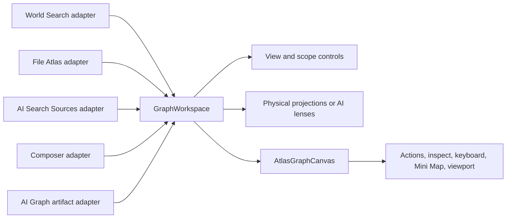

# Shared Graph Workspace 产品与交互最终规范

> 状态：Implementation-ready design baseline  
> 日期：2026-08-12  
> 视觉基准：[单页最终稿](../../gstack/shared-graph-workspace-2026-08-12/index.html)  
> 实施计划：[Shared Graph Workspace 实施计划](../plans/2026-08-12-shared-graph-workspace-implementation-plan.md)  
> Owner 验收：[真实 Obsidian 验收清单](../plans/2026-08-12-shared-graph-workspace-owner-verification.md)

## 1. 最终结论

Peak 的关系图不是五个各自生长的页面控件，而是一套公共 `GraphWorkspace`。宿主负责提供上下文、数据和允许的能力；公共 Workspace 负责视图切换、范围切换、投影、画布、动作栏、节点检查、快捷键、Mini Map、全屏和 viewport。

当前生产代码已经有较完整的底层能力，但还没有这个统一壳层：

- `AtlasGraphCanvas` 是普通关系图的共享 Cytoscape 画布。
- `ResultBrowser` 提供部分 List / Tree / Graph 与布局切换。
- `MultiLensGraph` 仍以 React Flow 单独渲染 AI Graph。

因此下一步是组件收敛和旧渲染栈迁移，不是再新增一种 Graph 模式。

## 2. 用户心智

用户面对的是一条稳定的控制链：

```text
宿主上下文 → 结果视图 → Graph 范围 → 关系投影 → 画布操作 → 节点检查或打开来源
```

其中：

- **结果视图**回答“用 List、Tree 还是 Graph 看当前集合”。
- **Graph 范围**回答“围绕当前上下文看一跳、两跳，还是打开持久化 AI Graph”。
- **关系投影**回答“同一批关系如何排布或解释”。
- **画布操作**在所有宿主保持稳定，不因宿主删减核心能力。

多文件上下文只决定关系图的数据边界，不自动授予多文件写入权限。File Atlas 和 Composer 里的关系图继续是只读入口；写入必须经过现有显式动作和权限链。

## 3. 公共组件边界



边界规则：

- 宿主 adapter 拥有查询、数据整形、加载/空白/错误状态、打开来源和 inspector 动作。
- `GraphWorkspace` 拥有控制条组合、状态切换和 capability manifest 解释。
- `AtlasGraphCanvas` 拥有 Cytoscape 生命周期、节点边渲染、布局执行、选择、hover、键盘、viewport、导出和画布内动作。
- AI Graph 必须通过 adapter 进入同一个 Cytoscape 数据模型，不得扩展旧 `MultiLensGraph`。

## 4. 宿主能力矩阵

| 宿主 | 结果视图 | Graph 范围 | Graph 投影 | 宿主保留的专属语义 |
| --- | --- | --- | --- | --- |
| World Search | List / Tree / Graph | 单一隐式 search-result scope，不显示范围控件 | Constellation / Community / Flow → / ↓ / Folders / Orbit | 当前搜索结果集 |
| File Atlas | Tree / Graph | One hop / Two hop / AI Graph | Physical projections 或 AI lenses | 当前文件、open files rail、只读邻域 |
| AI Search · Sources | List / Tree / Graph | One hop / Two hop / AI Graph | Physical projections 或 AI lenses | cited sources 集合、分析 footer |
| Composer Relations | Graph；若宿主继续开放结果浏览，可配置 List / Tree | One hop / Two hop / AI Graph | Physical projections 或 AI lenses | 当前文档 + frozen selection，只读 |
| AI Graph Artifact | Graph | AI Graph 固定；不显示无意义的单选范围 | Topology / Thinking tree / Bridges / Timeline / Gaps | 版本、来源、证据 inspector、更新动作 |

单一范围永远不渲染空的 scope pill。World Search 和 AI Graph Artifact 都遵守这条规则。

## 5. 最终布局

### 5.1 第一行：一个连续控制体

左侧是 View 与可选 Scope，右侧是 Projection。

- 非 Graph 状态显示完整文字：`List  Tree  Graph`。
- 选中 Graph 后，View 区平滑压缩成三个图标。
- 只有宿主提供多个 Graph 范围时，`One hop  Two hop  AI Graph` 才从 Graph 后方展开。
- Scope 是 Graph 状态的延伸，不是旁边新放的独立 button group。
- 切回 List 或 Tree 后，Scope 收回，View 恢复完整文字。

不得在这行增加 `68 matched nodes`、`current search result set`、`Document relations`、`current file anchored`、`Vault links around the cited sources` 等解释文字。需要保留的计数进入画布辅助信息、inspector 或宿主已有摘要，不再占用一整行。

### 5.2 Projection 文案

Physical Graph 固定为：

```text
Constellation  Community  Flow →  ↓  Folders  Orbit
```

约束：

- 文案使用 `Flow`，不使用 `Links`。
- 水平方向写作 `Flow →`。
- 垂直方向只有 `↓`，不重复第二个 `Flow`。

AI Graph 固定为：

```text
Topology  Thinking tree  Bridges  Timeline  Gaps
```

Physical 和 AI 两组投影占用同一稳定位置。Scope 切到 AI Graph 时替换内容，不新增第三行。

### 5.3 动作栏

动作栏悬浮在画布右上角，不与画布并列，也不单独占据一行。顺序固定为：

1. `Semantic edges`；AI Graph 中改为 `Evidence links`。
2. `Nodes`。
3. Copy as Mermaid。
4. Copy as image。
5. Zoom out。
6. 当前百分比。
7. Zoom in。
8. Fit entire graph。
9. Readable view。
10. Fullscreen / Exit fullscreen。

普通状态与全屏状态使用同一动作集合。窄宽度可逐步压缩文字为图标，但不得改变动作顺序或让某个宿主永久缺失核心动作。

### 5.4 画布角落

- 左下角：快捷键提示，覆盖 `Shift` inspect、`I` pin、方向键导航和 `Enter` 打开。
- 右下角：Mini Map；List / Tree 状态不显示。
- 节点 inspector 悬浮在画布内，可被 Shift 临时唤起或用 `I` 固定。

## 6. 状态与交互

### 6.1 View 切换

| 当前状态 | 用户动作 | 结果 |
| --- | --- | --- |
| List / Tree | 点击 Graph | active thumb 滑向 Graph；View 文字压缩为图标；Scope 从 Graph 后展开；Projection、动作栏、快捷键和 Mini Map 出现 |
| Graph | 点击 List / Tree | Scope 先失去交互并收回；View 恢复文字；Graph-only UI 消失；结果投影替换画布 |
| Graph，无多个 scope | 点击 Graph | 不出现任何空 scope 控件，直接显示 Projection 和画布 |

Graph-only 元素隐藏后必须从键盘顺序中移除，不能只做透明处理。

### 6.2 Scope 切换

- One hop 与 Two hop 切换当前上下文的即时 Vault 邻域。
- AI Graph 切换到匹配当前上下文的持久化、版本化关系产物。
- 没有匹配 AI Graph 时，在画布区域显示创建/打开入口；第一行控制条位置不跳动。
- AI Graph 返回物理范围时恢复宿主上一次使用的 Physical Projection 和 viewport。
- Scope 改变可触发宿主重新加载数据，但不能重建另一套画布 shell。

### 6.3 Projection 切换

- active thumb 以单个连续色块在选项之间滑动。
- 长距离切换允许色块先向目标方向拉伸、尾部随后跟上，不能瞬移。
- 切换只改变布局或 lens，不清空当前 selection。
- 布局结束后执行稳定的 fit/readable 策略，避免每次切换产生剧烈 viewport 跳变。

### 6.4 节点检查与固定

- 按住 `Shift`：显示当前节点的临时 inspector。
- 松开 `Shift`：若未固定，inspector 消失。
- 按 `I`：固定或取消固定 inspector。
- 固定后切换节点：同一 inspector 更新内容，不叠加新卡片。
- `Enter`：打开当前节点来源。
- `Escape`：按层级关闭节点列表、临时 inspector、全屏；不穿透关闭宿主弹窗。

AI Graph 节点还要保留 assertion / evidence / source / question 等语义角色和 provenance；共用画布不等于把 AI Graph 降级成普通文件关系图。

### 6.5 Fullscreen 与 viewport

- 全屏只提升当前 Workspace，不重建宿主页面。
- 进入和退出全屏保持 selection、scope、projection、zoom 和 viewport。
- Mini Map 视口框与主画布同步。
- `Fit entire graph` 与 `Readable view` 是不同动作：前者看全图，后者回到可读比例和中心。

## 7. Motion 最终基线

最终稿采用“有滑动感，但立即响应”的快速运动：

| 动作 | 目标时长 |
| --- | --- |
| View active thumb | 95–145ms，按距离变化 |
| Scope active thumb | 100–155ms，按距离变化 |
| Projection active thumb | 110–170ms，按距离变化 |
| View 文字压缩 / 图标出现 | 85–145ms |
| Scope 整体展开 / 收回 | 105–180ms |
| 三个 Scope 项依次长出 | 145ms，间隔 16ms / 32ms |
| Semantic switch | 约 120–140ms |

运动使用快速 ease-out / `cubic-bezier(.2,.8,.2,1)`。active thumb 的前缘和尾缘允许约 4% 的微小时差，形成滑块拉伸感。不得使用 240–300ms 的慢胶囊滑动。

必须支持 `prefers-reduced-motion: reduce`：关闭位移、拉伸和 stagger，但仍立即更新 active 状态。

这些时长属于可配置 UI timing knobs。生产实现应由 `templates/config/` 的 Graph Workspace 配置提供，并由清晰命名的 fallback defaults 镜像；不得散落硬编码在宿主组件。

## 8. Loading、empty 与 error

状态内容由宿主 adapter 提供，但 Workspace 保持结构稳定：

- Loading：画布区域显示加载状态，控制条保留并禁用会产生冲突的动作。
- Empty physical graph：说明当前范围无关系，并提供扩大到 Two hop 或打开 AI Graph 的动作。
- Empty AI Graph：说明当前上下文尚无 artifact，并提供 Create AI Graph。
- Error：显示重试或打开详情，不清空宿主的 List / Tree 结果。

不得用额外的永久说明行解释这些状态。

## 9. Accessibility 与键盘

- View、Scope、Projection 都使用 roving tab stop；同组方向键移动。
- `aria-selected`、`role="tablist"` 和 label 必须描述真实状态。
- Scope 收起时设为不可交互，并从 tab order 移除。
- 图标压缩后依然保留可读 `aria-label` 和 tooltip。
- active thumb 只是视觉层，不成为额外焦点或可访问节点。
- 画布 focus、节点 focus 和 inspector focus 恢复必须在真实 Obsidian 中验证。

## 10. 当前代码事实

| 能力 | 当前代码 | 结论 |
| --- | --- | --- |
| Cytoscape 共享画布 | `src/ui/component/graph/AtlasGraphCanvas.tsx` | 复用并扩展公共契约 |
| List / Tree / Graph 与部分 sliding thumb | `src/ui/component/result-browser/toolbar/ResultBrowserToolbar.tsx` | 抽入 Workspace，不在宿主重复组合 |
| File Atlas One / Two / AI | `src/ui/view/file-atlas/components/FileAtlasGraph.tsx` | 范围逻辑保留，UI 改接 manifest |
| AI Sources Graph-only scope | `src/ui/view/quick-search/components/V2SourcesView.tsx` | 条件逻辑保留，移除额外说明行和独立 scope group |
| Composer Related Materials Graph | `src/ui/view/composer/sidecar/RelatedMaterialsModal.tsx` | 作为 Composer adapter 的现有入口，按最终产品位置接入 |
| AI Graph 五种 lens | `src/ui/component/mine/multi-lens-graph/MultiLensGraph.tsx` | 行为先刻画，再迁移到 Cytoscape；不继续扩展 React Flow |

## 11. 不做什么

- 不新增第五种 Graph 产品层。
- 不修改搜索、File Atlas、AI Graph artifact 的领域语义。
- 不把宿主查询和权限逻辑塞进公共组件。
- 不恢复或新增 React Flow 消费者。
- 不因统一视觉而授予 Composer 多文件写入权限。
- 不把 Mock、静态测试或 build 通过宣称成真实 Obsidian 交互验收。

## 12. 完成定义

只有同时满足以下条件，才能称为 Shared Graph Workspace 完成：

- 五个最终稿宿主状态都通过同一个公共 Workspace 外壳表达。
- AI Graph 不再通过 React Flow 渲染，受影响 lens 已迁入 Cytoscape。
- 核心动作、Mini Map、快捷键和 inspector 在各 Graph 宿主一致。
- View → Graph → Scope 的展开关系和快速 motion 在真实 Obsidian 中成立。
- 生产 build、focused tests、宿主 parity tests 和真实 Obsidian 证据全部通过。

在真实宿主验收之前，状态保持 `INTERACTION NOT VERIFIED`。
