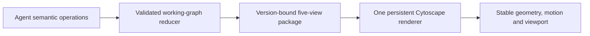
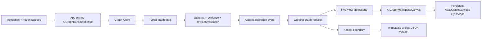
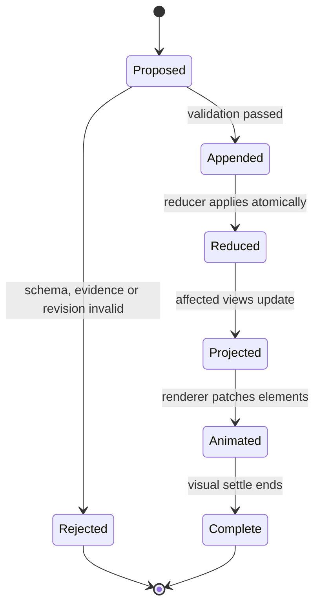

# AI Graph Agent 增量生成：最终产品与交互设计

> 状态：**最终设计已收束，生产增量运行时尚未实现**
> 日期：2026-08-13
> 面向读者：产品 Owner、实现工程师、代码审查者、真实 Obsidian 验收者
> 交互原型：[Incremental AI Graph · Cytoscape Mock](../../gstack/ai-graph-incremental-cytoscape-2026-08-12/index.html)
> 实施计划：[AI Graph Agent 增量生产实施计划](../plans/2026-08-13-ai-graph-agent-incremental-production-plan.md)
> 前置公共能力：[Shared Graph Workspace 产品与交互规范](./2026-08-12-shared-graph-workspace-product-and-interaction-spec.md)

## 1. 最终结论

AI Graph 的最终产品模型是：

> **一份有来源、有版本的 canonical semantic graph，一次 Graph Agent run 生成一组包含五个视图的 view package；所有视图由同一个 Cytoscape / `AtlasGraphCanvas` 渲染栈显示。**

五个视图是：

- `Topology`：当前知识是怎样连接的。
- `Thinking Tree`：推理分支是怎样逐步展开的。
- `Bridges`：哪些已验证概念把原本分离的领域连接起来。
- `Timeline`：事件、任务和依赖如何在时间中并行、汇合与推进。
- `Gaps`：任务所要求、但当前缺失或证据不足的连接在哪里。

它们不是五份互相独立的 artifact，也不是五套 Graph 组件。它们共享 canonical node / relation / evidence identity，但各自拥有：

- 视图成员关系；
- 必要的诊断或临时展示对象；
- 布局意图和视图坐标；
- 视口状态；
- 一段与当前版本绑定的自然语言解释。

Graph Agent 以**离散、可验证、可回放的步骤**构图。每个步骤内部不展示 token 或隐藏思维链；步骤之间实时更新画布和 Activity。

Accepted graph 始终不可变。Agent run 修改的是 working draft；只有整个 view package 校验通过且用户 `Accept` 后，才生成新的 immutable version。

## 2. 本设计解决的核心问题

此前的讨论暴露了五类根本问题：

1. **渲染实例被重建**：新增一个节点或一条线时整张图跳动，镜头、节点和边失去空间连续性。
2. **边与节点不在同一几何真值中**：外部 overlay、错误的动画遮罩或错误端点计算造成箭头偏移、断线、空白段。
3. **五种视图只有不同名字，没有不同语义**：Tree、Bridge、Timeline、Gaps 使用同一套固定数据和同一段动画，难以理解。
4. **Agent 只有“提交整图”能力**：生产 Agent 当前更接近一次性生成完整结果，无法真实表达“先放节点、后连线、再删除、局部布局、最后 refine”。
5. **图与解释割裂**：用户看见图，却不知道这一视图在回答什么问题，也看不出 bridge 或 gap 的判定理由。

最终设计的关键不是再换一次布局参数，而是统一三层真值：



## 3. 现状、术语与边界

### 3.1 当前已经存在的能力

当前生产源码已经完成 Shared Graph Workspace 的 renderer 收敛：

- `ContextualAIGraphView` 负责寻找并加载与当前上下文匹配的 AI Graph artifact。
- `AIGraphWorkspaceCanvas` 负责 AI Graph Lens、控制栏和 graph model 适配。
- `aiLensToAtlasModel` / `aiLensLayouts` 把 Lens 数据转换为中立的 `AtlasGraphModel`。
- `AtlasGraphCanvas` 是统一 Cytoscape renderer。
- `MultiLensGraph` 与 `@xyflow/react` 已从生产路径删除；React Flow 不再是允许扩展的 Graph 技术。
- Artifact manifest、immutable versions、proposal / accept 边界、JSONL run events 已经存在。

### 3.2 当前尚未存在的能力

本设计不能误写为已经实现。当前关键缺口是：

- Graph Agent 主要仍通过 `read_sources` + `submit_graph` 一次性提交完整结果。
- UI 主要在拿到完整 `LensGraphData` 后替换 graph data，没有消费 typed incremental patch stream。
- `AtlasGraphCanvasImpl` 在 model / subgraph 更新路径上仍会销毁并重建 Cytoscape 实例，不满足连续增量渲染。
- 五个 Lens 尚未保证由同一次 run 组成完整、可为空但可解释的 view package。
- rich node card 尚未提供 AI Graph 专属的 `Explain / Expand / Focus / Evidence` 完整行为。
- per-view explanation、Activity 的 operation receipt、最终 Refine 和场景缓存尚未接入生产链路。

### 3.3 三个常被混淆的名字

| 名称 | 正确职责 | 是否 renderer |
| --- | --- | --- |
| `ContextualAIGraphView` | 根据当前文件 / 搜索 /入口加载正确 artifact，处理 loading、empty、error、ready | 否 |
| `AIGraphWorkspaceCanvas` | AI Graph 的 Lens、布局、run 状态和共享画布编排 | 否 |
| `AtlasGraphCanvas` | 统一 Cytoscape 图形渲染、交互、camera、minimap、inspect | 是 |

`MultiLensGraph` 是旧 React Flow 实现的名字，不是一个新的产品概念。它已经是迁移完成后的历史术语，不能继续增加行为。

### 3.4 AI Graph 与其他 Graph 产品的边界

AI Graph 是 sourced / versioned artifact。它不替代：

- Result Graph：搜索结果的结构投影；
- File Atlas：当前文件的一跳 / 两跳关系；
- Vault Intelligence：Vault 级 Hub、Gap、Bridge、Orphan、Drift 诊断。

AI Graph 的 Bridge / Gap 是**这个 artifact 和当前任务契约内部**的推理视图；Vault Intelligence 的 Bridge / Gap 是 Vault 级维护诊断。两者可以复用视觉语言，但不能混用数据真值。

## 4. 最终信息架构

AI Graph 页面保持 Graph 为主，而不是让审计面板抢占空间。

```text
Artifact title / version / run state                         History  Activity
Update instruction + sources                                 Accept / Discard
────────────────────────────────────────────────────────────────────────────
Topology   Thinking Tree   Bridges   Timeline   Gaps         [layout controls]
────────────────────────────────────────────────────────────────────────────

                              Graph canvas

  current operation
  Shift inspect · I pin                          Mini Map / zoom / fit tools
────────────────────────────────────────────────────────────────────────────
Explanation of this view                                           Collapse
```

最终 UI 只保留：

- 标题、版本、run 状态；
- update instruction 与来源摘要；
- 五个 Lens tab；
- 当前 Lens 允许的 layout segmented control；
- 主画布；
- 可折叠的 per-view explanation；
- 可选 Activity drawer；
- draft 完成时的 `Accept / Discard`。

不保留常驻的 `Added / Changed / Removed / Validation passed` 大型 review dashboard。语义 diff 和完整 Activity 只在用户需要时打开。

## 5. 一份图、五个视图，而不是五套组件

### 5.1 Canonical graph

Canonical layer 只存一次：

- node；
- relation；
- source / evidence；
- provenance；
- stable object ID；
- artifact version / parent version；
- accepted review state。

### 5.2 View package

每次完成的 run 产生一个 version-bound `viewPackage`：

```ts
type AIGraphViewPackage = {
  schemaVersion: number;
  graphVersionId: string;
  sourceRevision: string;
  views: Record<AIGraphViewId, AIGraphViewProjection>;
};

type AIGraphViewProjection = {
  viewId: "topology" | "thinking-tree" | "bridges" | "timeline" | "gaps";
  nodeIds: string[];
  relationIds: string[];
  groups: ViewGroup[];
  diagnostics: ViewDiagnostic[];
  layoutIntent: LayoutIntent;
  explanation: ViewExplanation;
  validation: ViewValidationResult;
};
```

这个结构应以 additive schema 方式进入 artifact version。旧版本没有 `viewPackage` 时，通过兼容 adapter 派生 best-effort views，不修改旧 artifact body。

### 5.3 一个可见 workspace 只保留一个 live Cytoscape instance

五个 Lens 不需要同时维护五个隐藏 Cytoscape 实例。正确模型是：

- 可见 workspace 只有一个 live `cy`；
- Lens 切换时，从 scene cache 恢复该 Lens 的 elements、positions、zoom、pan；
- 当前 Lens 的增量操作直接 patch live `cy`；
- 非当前 Lens 的操作进入 reducer 和 scene cache，不抢走用户当前 tab 或 camera；
- 切回时看到已完成或正在继续的正确状态。

这同时满足低内存、视图连续性和一次 run 多视图生成。

## 6. 五个视图的真实语义与生成故事

### 6.1 Topology

回答：**这些概念当前怎样连接？**

允许的构建顺序不是固定的。Agent 可以：

1. 先放一个或一批尚未连接的候选节点；
2. 检查 evidence；
3. 后续再补 relation；
4. 更新 relation predicate；
5. 删除不成立的节点或 relation；
6. 在结构变化后请求一次局部布局；
7. 完成后整体 Refine。

未连线节点是合法的 working state，不能为了画面“完整”而伪造关系。

可选布局：

- `Constellation`
- `Flow →`
- `Flow ↓`

### 6.2 Thinking Tree

回答：**推理是从哪个问题出发，经过哪些分支，得到哪些结论？**

Thinking Tree 必须呈现“生长”，而不是先把全部未来节点放在画布上再逐个点亮：

1. root question 出现；
2. 发现一个分支时添加 child；
3. child 成立后继续增长其 subtree；
4. 分支被否定时，删除或标记被剪枝的 subtree；
5. 只对受影响 subtree 做局部 reflow。

Thinking Tree 仍允许 Agent 先规划一小段 coherent outline，但不能显示尚未发现的 ghost nodes。

可选布局：

- `Flow →`

不提供 Community、Folders、Orbit 或 Constellation。

### 6.3 Bridges

回答：**哪个概念或关系让原本分离的两个领域第一次拥有可验证路径？**

Bridge 不是“大节点”，也不是“跨得很远的一条线”。一个 bridge candidate 必须：

- 两端属于此前不同的 connected components / semantic domains；
- 至少有一条证据支持它连接左侧；
- 至少有一条证据支持它连接右侧；
- 通过路径验证后才从 candidate 升级为 validated bridge。

生成故事：

1. 先显示真实的分离组件；
2. 放置 bridge candidate；
3. 连接一侧时仍显示 candidate；
4. 连接两侧并验证路径后突出 bridge；
5. 只有单侧或关键词相似的假 candidate 被删除；
6. 没有 bridge 时合法输出 `No validated bridge found`。

可选布局：

- `Constellation`
- `Flow →`

### 6.4 Timeline

回答：**事件、工作和依赖如何随时间并行、汇合和推进？**

Timeline 是 temporal DAG，不是假设所有数据都是一条月份链。它必须支持：

- 同一时间点开启多个并行 branch；
- branch 内部有自己的任务序列；
- later discovery 插入较早时间的事件；
- 一个事件依赖多个前序；
- 跨 branch relation；
- 多个 branch 汇合到 gate / milestone；
- 尚未确定的时间范围；
- 横向或纵向阅读。

Phase wrapper 必须是真实 compound group，随 child nodes 的边界变化而变化；不能是与节点坐标分离的固定 SVG / HTML 框。

可选布局：

- `Timeline →`
- `Timeline ↓`

### 6.5 Gaps

回答：**为了完成当前任务，哪条必要路径不存在，或哪条路径的证据弱到不能依赖？**

Gaps 不是画布上的空白区域，也不是为了填空而生成的新 semantic node。Gap 是两个真实 endpoint 之间的 typed diagnostic：

- `missing-path`：任务契约需要连通，但当前没有路径；
- `weak-path`：存在路径，但 evidence / provenance 不足；
- `conflicting-path`：存在相互冲突、尚未决议的支持链；
- `coverage-gap`：一个必须覆盖的 group / phase 没有足够对象。

Agent 必须先证明任务契约要求该路径，再声明 Gap。若已存在有效路径，candidate 必须被拒绝。零 Gap 是合法结果。

布局：

- `Diagnostic map`，固定语义布局；不提供无意义的通用布局切换。

### 6.6 Bridges 与 Gaps 的区别

| | Bridges | Gaps |
| --- | --- | --- |
| 观察对象 | 已经存在并经过验证的连接 | 应该存在但缺失、过弱或冲突的连接 |
| 是否进入 canonical graph | 已验证 bridge node / relation 会进入 | diagnostic 本身不进入 canonical semantic graph |
| 主要证据 | 两侧路径与 relation evidence | task contract + 缺失 / 证据不足证明 |
| 合法空结果 | 没有 validated bridge | 没有 actionable gap |
| 主要视觉 | 分离组件与中间 connector | endpoint、现有路径、缺失 / 弱路径 overlay |

## 7. Layout 控件的最终映射

| View | Layout 选择 | 说明 |
| --- | --- | --- |
| Topology | `Constellation · Flow → · ↓` | 网络或有向关系 |
| Thinking Tree | `Flow →` | 固定横向树生长 |
| Bridges | `Constellation · Flow →` | 看组件或跨域方向 |
| Timeline | `Timeline → · ↓` | 同一个 temporal DAG 的横纵阅读 |
| Gaps | `Diagnostic map` | 语义固定，不暴露无意义的通用布局 |

按钮组必须复用 Shared Graph Workspace 的 Segmented 视觉与文案规则：

- 方向只表达一次；
- 横向写 `Flow →`，纵向写 `↓`；
- Timeline 写 `Timeline → · ↓`；
- 不出现重复的“箭头图标 + Flow →”双重方向；
- 不给 AI Graph 暴露 `Community / Folders / Orbit`，除非未来某个具体 Lens 的语义明确需要并重新评审。

## 8. Graph Agent 的能力模型

### 8.1 Agent 决定语义，renderer 决定几何

Graph Agent 可以决定：

- 添加、更新或删除哪个对象；
- relation 的方向、predicate 和证据；
- 哪个对象属于哪个 view；
- 哪个对象构成 group、bridge、timeline phase 或 gap diagnostic；
- 何时请求局部 layout 或最终 Refine；
- 何时完成一个 view 或整个 run。

Graph Agent 不可以决定：

- `x / y` 坐标；
- zoom / pan；
- node bbox；
- edge control points；
- collision offset；
- 动画时长与 easing。

### 8.2 公共 operation envelope

所有工具调用最终收敛为同一种 operation envelope：

```ts
type AIGraphOperationEnvelope<TPayload> = {
  runId: string;
  graphId: string;
  viewId: AIGraphViewId;
  operationId: string;
  baseRevision: number;
  expectedRevision: number;
  type: AIGraphOperationType;
  payload: TPayload;
  evidenceRefs: string[];
  requestedAt: string;
};
```

关键约束：

- `operationId` 幂等；
- `baseRevision` 不匹配则拒绝，不做 silent merge；
- endpoint、stable ID、evidence ref 和 view membership 在 reducer 前校验；
- 一个 operation 可以原子地包含一组 coherent nodes / relations，但不能把整次 run 包成一个巨大 snapshot；
- UI 动画完成与 operation 是否持久化无关。

### 8.3 Agent 工具词汇

Read tools：

```text
graph.inspect
graph.inspectNeighborhood
graph.inspectComponents
graph.inspectPath
graph.inspectView
```

Canonical working graph tools：

```text
graph.addNode
graph.updateNode
graph.removeNode
graph.addRelation
graph.updateRelation
graph.removeRelation
graph.attachEvidence
graph.detachEvidence
```

View tools：

```text
graph.beginView
graph.includeObjects
graph.addGroup
graph.addDiagnostic
graph.removeDiagnostic
graph.requestLayout
graph.setExplanation
graph.completeView
```

Run tools：

```text
graph.validate
graph.completeRun
```

UI 可以给模型暴露多个有意义的 tool name，但它们在内部必须转换为同一个 reducer contract，不能各自直接修改 React state、Cytoscape 或 artifact 文件。

### 8.4 运行时所有权

`AIGraphRunCoordinator` 由 app / `AppContext` 组合和持有：



Service 层不能新增 module singleton 或通过 `AppContext.getInstance()` 偷取 runtime。

## 9. Step-stream 的状态机

每一步是一个可观察事务：



状态顺序必须是 event-first：先校验并追加 durable operation event，再修改 working projection。若崩溃，replay 相同 events 必须产生与 live reducer 字节语义等价的 working state。

Activity 只显示 operation、对象、结果、revision 与 evidence receipt，不显示隐藏 chain-of-thought。

## 10. 增量绘制与镜头交互

### 10.1 Run 中的默认行为

- 首次 run 从 Topology 开始。
- 若用户从未手动切换 Lens，UI 可以跟随 Agent 当前正在构建的 view。
- 一旦用户手动选择某个 Lens，后台 view 继续生成，但不能自动切 tab 或抢 camera。
- 新节点默认放在 semantic anchor 附近的最近可用位置；没有 anchor 时进入稳定的 free / staging region。
- 新节点允许暂时无 relation。
- 新 relation 可以晚于节点出现。
- 删除是正式能力，不是假装失败后把节点透明度调低。
- 普通 patch 不运行 whole-graph layout，不调用全图 `fit()`。
- 结构变化较大时，Agent 可以请求受影响 component / subtree 的 local layout。

### 10.2 Off-canvas focus

新增对象超出 viewport 时：

- 用户当前没有拖拽、缩放、hover card 或文本选择：camera 平滑 pan 到新增对象，保持现有 zoom；
- 用户正在操作画布：不抢 camera，在边缘显示 `New changes` chip；点击后再 focus；
- 不为了看见一个新节点而全图 fit；
- 同一 operation 批量新增时 focus 整个 changed bounding box，而不是逐个节点来回跳。

### 10.3 Refine

生成期间 layout control 锁定，避免每一步在 `Constellation` / `Flow` 间反复切换。

所有五个 view 完成后执行一次明确的 Refine stage：

1. 每个 view 使用当前选定的 display layout；
2. layout 读取真实 rendered label bbox；
3. 运行 deterministic collision settle；
4. compound wrapper 重新包住 children；
5. edge geometry 重新计算；
6. 当前 view 只做一次平滑 fit；
7. 其他 view 更新 scene cache，不抢当前 camera。

Refine 是显示层操作，不创建新的 semantic artifact version。

## 11. 几何、碰撞与 resize

新增节点不能继续使用少量固定 offset。Placement solver 必须：

- 从 anchor 外围逐圈搜索候选位置；
- 使用 Cytoscape 的真实 rendered bounding box；
- 计入完整 label、border、badge 和可配置 gutter；
- 排除现有 node、compound group 与 UI-safe regions；
- 优先保持 relation 方向和当前 view orientation；
- 多节点批量加入时同时求解，不逐个占用同一点；
- 在 `layoutstop` 后做一次 deterministic overlap check；
- resize 或 drawer 开合只更新 viewport / overlay anchoring，不重新随机布局。

建议验收阈值不是写死在逻辑中的常量，应来自 `templates/config/`：

- node-to-node minimum gutter：建议初始值 24px；
- node-to-wrapper minimum gutter：建议初始值 18px；
- focus padding：建议初始值 56px。

## 12. 边、箭头与动画

边必须完全由 Cytoscape 在同一坐标系绘制。禁止使用与 Cytoscape node 分离的 SVG / HTML overlay 来模拟 edge animation。

连续线条规则：

- Cytoscape 的最终 edge path 从第一帧就以低透明度存在；
- enter animation 通过 opacity / color / width emphasis 渐进，不通过会产生空洞的 dash mask 截断基础路径；
- source / target intersection 由 renderer 根据真实 node shape 计算；
- arrowhead 固定在 target，方向与 relation truth 一致；
- 动画期间 pan、zoom、resize 也必须保持 path 连续；
- label 与 edge 同步淡入，不能先漂浮在空白处。

建议 motion token：

| Motion | 建议范围 |
| --- | --- |
| Node enter | 360–520ms |
| Node move / local settle | 480–700ms |
| Edge enter | 720–1000ms |
| Remove | 260–420ms |
| Camera focus | 420–650ms |
| Local reflow | 550–800ms |
| Final Refine | 900–1400ms |

最终值全部来自 graph motion config，并提供 `prefers-reduced-motion` 分支。`+ node` / `+ relation` marker 放在节点右下角或 edge label 旁，不能遮盖节点正文。

## 13. Node rich card 与操作

Hover / inspect card 复用其他 Graph 的 rich card 交互：

- hover 节点显示；
- pointer corridor 允许从节点移动到 card；
- click node 或 `I` 可 pin；
- pan / zoom 后 card 继续锚定节点；
- `Esc` 关闭并恢复正确 focus。

AI Graph node card 的动作是：

| Action | 行为 |
| --- | --- |
| Explain | 解释此节点在当前 Lens 中的角色、证据与上下游 |
| Expand | 从此节点启动新的 Graph Agent draft expansion |
| Focus | 平滑居中该节点及其一跳邻域，不改变布局 |
| Evidence | 打开来源、quote locator、revision / hash 与 provenance |

### 13.1 Expand 的完整交互

`Expand` 必须是真正执行，不是显示“staged”后结束：

1. 点击后立即关闭 rich card；
2. 整个 expansion sequence 期间设置 inspect suppression，不能因 hover 或状态更新再次弹出；
3. 从当前 accepted version 建立 next-version draft；
4. `inspectNeighborhood` 读取真实邻域；
5. Agent 添加一个或一批 candidate nodes；
6. placement solver 把它们放在互不覆盖的可用位置；
7. evidence 足够后再添加 relation；
8. validate 后显示 `Accept expansion / Discard expansion`；
9. sequence 完成后才恢复 hover card；不会自动重新打开旧 card。

多节点 expansion 必须以批量 changed bbox 做放置与 focus，不能把所有节点叠在 anchor 的同一个 offset 上。

## 14. 每个 View 的文字解释

每个 view 都必须有一段 version-bound explanation，因为图不能假设用户天然看懂。

```ts
type ViewExplanation = {
  headline: string;
  body: string;
  keyObjectIds: string[];
  evidenceRefs: string[];
  generatedFromRevision: number;
};
```

规则：

- 只解释当前可见 graph、diagnostics 与证据；
- 不输出隐藏 chain-of-thought；
- 明确回答当前 Lens 的问题；
- Bridges 说明连接了哪两个 domain、为什么成立；
- Gaps 说明任务为何要求这条路径、缺的是什么；
- Timeline 说明关键并行、汇合和依赖；
- 可折叠，默认在 view 完成后展开一次；
- 切换 Lens 同步切换 explanation；
- explanation 与 graph version 一起接受，不能用后来的文字解释旧图。

## 15. Activity 的最终角色

Activity 是可选的 operation log，不是主界面。

Canvas 上只保留一个紧凑 current-operation indicator，例如：

```text
Adding 3 evidence nodes · revision 12 → 13
```

Activity drawer 中每项显示：

- tool / operation；
- affected object count；
- evidence receipt；
- base / expected / resulting revision；
- validation result；
- rejected 原因；
- local layout / focus 等 display action。

最终 semantic diff 作为 `Review changes` 的按需内容，而不是常驻右栏。

## 16. Persistence 与版本边界

### 16.1 写入顺序

```text
validated operation
→ append JSONL run event
→ reduce working draft
→ update view projection
→ patch Cytoscape
→ animate
```

### 16.2 Canonical carrier

- Accepted AI Graph：immutable artifact JSON version；
- Artifact history：manifest head + `parentVersionId` chain；
- Run operation history：partitioned JSONL；
- Working draft：可从 event replay 重建的临时状态；
- SQLite / graph index：可重建 projection；
- positions / viewport：display scene state，不是 semantic truth。

### 16.3 Accept / Discard

- run 中的每一步不创建 artifact version；
- `completeRun` 只表示 draft 完整、可 review；
- `Accept` 原子创建新 version 并更新 manifest head；
- `Discard` 不创建 graph version，但保留 run receipt / rejection reason；
- 单纯切 layout、pan、zoom、focus、Refine 不创建 semantic version。

## 17. Validation contract

### 17.1 所有视图共有

- stable ID 唯一；
- relation endpoints 存在；
- directionality 合法；
- evidence refs 可解析；
- operation revision 连续；
- projection object 必须引用 canonical object，除明确声明为 diagnostic / group；
- explanation revision 与 view revision 相同。

### 17.2 View-specific

- Topology：允许孤立节点，但必须标明 working / accepted 状态。
- Thinking Tree：除 root 外，每个可见 tree node 有唯一 tree parent；cross-reference 不冒充 parent。
- Bridges：validated bridge 必须让两个先前分离的 component 建立路径。
- Timeline：temporal edge 不得制造未声明的 cycle；并行与 join 语义可判定；wrapper 包含真实 children。
- Gaps：每个 diagnostic 有 contract reason、两个真实 endpoint 和 path check result；diagnostic 不写入 canonical semantic graph。

### 17.3 Complete run

一次 run 必须返回五个 view entry，但每个 entry 可以是合法空结果。不能因为“没有 bridge / gap”就缺失整个 tab，也不能为了填满 tab 伪造数据。

## 18. 错误与恢复

- stale revision：拒绝 operation，Agent 重新 inspect；
- duplicate operation ID：幂等返回原结果；
- invalid endpoint / evidence：拒绝且不触发动画；
- animation 中断：re-render 当前 reducer state，不回滚已追加事件；
- UI reload：从 accepted artifact + active run events replay working draft；
- layout 失败：保留上一次 positions，标记 display failure，不破坏 semantic draft；
- view generation 失败：其他 view 可查看，run 不能 Accept，允许 retry failed view；
- Agent 取消：停止新 operation，等待已接受 operation settle，保留可恢复 draft receipt。

## 19. 不采用的方案

- **恢复或新增 React Flow**：违反统一 renderer 治理，也无法解决第二套交互语义的问题。
- **五个 view 各自一套 React component / state model**：会复制 camera、card、Activity、layout 和修复。
- **后台同时常驻五个 Cytoscape instance**：内存和生命周期成本不必要；scene cache 足够。
- **每个 operation 重建整个 model / Cytoscape**：导致跳图、焦点丢失和动画断裂。
- **每加一个节点就全图自动布局**：破坏空间记忆，也会抢用户 camera。
- **Agent 输出坐标**：把不稳定的模型输出当成几何真值，无法保证碰撞与 resize。
- **把 Gap 画成虚构节点**：混淆诊断与 semantic truth。
- **把五个 view 存成五个独立 artifact**：版本、证据、接受边界会发生漂移。

## 20. 讨论到设计的追踪矩阵

| 讨论中发现的问题 | 最终设计决策 | 实施工作包 |
| --- | --- | --- |
| 新增节点时整张图跳 | persistent `cy` + element patch + local layout | P4 Renderer |
| 箭头起点不准、线断开 | 单一 Cytoscape geometry；连续 base path | P4 Renderer / P8 QA |
| 节点新增时覆盖旧节点 | bbox-aware ring placement + collision settle | P4 Renderer |
| 节点超出画布 | idle auto-focus；busy 状态显示 chip | P5 UI |
| 节点可先无边、后连线、再删除 | typed independent node / relation operations | P1–P2 Runtime |
| Agent 有时主动 layout | explicit local `requestLayout` | P1–P4 |
| 完成后整体重排 | one final Refine per view | P4–P5 |
| 线绘制太快 | configurable 720–1000ms edge enter | P4 Motion |
| `+` 遮盖正文 | marker 锚定右下角 / edge label | P4 UI overlay |
| Review 右栏太重 | 主画布 + optional Activity / Review drawer | P5 UI |
| 五个 view 组件过多 | one orchestrator + one renderer + pure planners | P2–P4 |
| Timeline 太线性 | temporal DAG、parallel lanes、join、cross-dependency | P3 Timeline |
| Bridge 看不懂 | 两个分离 domain + validated connector | P3 Bridges |
| Gaps 看不懂 | task-required missing / weak path diagnostic | P3 Gaps |
| 每个 view 动画一样 | 每个 Lens 有自己的 operation grammar | P2–P3 |
| 生成期间 layout 是否生效 | generation 锁 display layout；local layout 仅显式请求；结束 Refine | P4–P5 |
| Expand 只是提示 | revision-guarded executable expansion | P2 / P5 |
| Expand card 重新出现 | run-scoped inspect suppression | P5 UI |
| Expand nodes 堆叠 | batch placement + changed bbox focus | P4 Renderer |
| 用户看不懂图 | version-bound per-view explanation | P3 / P5 / P6 |

## 21. 完成定义

只有同时满足以下条件，才能把本设计标记为 production complete：

- 同一次 run 生成完整的五视图 package；
- operation stream 可验证、幂等、可 replay；
- incremental patch 不销毁 Cytoscape instance；
- 普通 patch 不触发 whole-graph fit / layout；
- 五个 Lens 具有不同且真实的 operation story；
- edge animation 无断线、无空白、箭头端点正确；
- placement 在批量 Expand、Refine 和 resize 后均无不可接受覆盖；
- rich card 的 Explain / Expand / Focus / Evidence 可真实执行；
- Expand 全程 card 不重开；
- 每个 view 有 version-bound explanation；
- Accept 创建 immutable version，Discard 不污染 accepted graph；
- backward-compatible reader 可打开旧 artifact；
- focused tests、生产 build、storage / architecture checks 通过；
- 在真实 Obsidian 中用 DOM / geometry assertion 与短视频验证关键 motion、focus、resize、drawer、hover / pin / Escape。

## 22. 当前验证声明

本文件是对交互 Mock、现有生产源码、artifact contract 和全部 owner 反馈的最终设计收束。

- `DESIGN COMPLETE`
- `PRODUCTION INCREMENTAL RUNTIME NOT IMPLEMENTED`
- `REAL OBSIDIAN INTERACTION NOT VERIFIED`

静态 HTML Mock 证明的是交互方向与构图语法，不证明生产 Obsidian 行为。实施与验收必须遵循配套计划。
