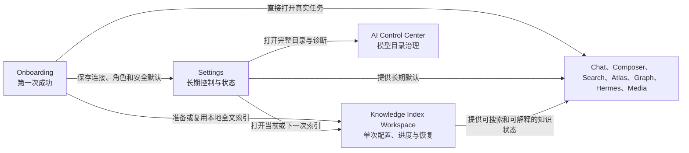

# Peak Assistant Onboarding、Settings 与 Knowledge Index 最终设计

> - 状态：Owner 讨论已收束 · 首发核心路径已实现 · 真实 Obsidian QA 与 P1 enrichment 待完成
> - 日期：2026-08-13
> - 面向读者：产品负责人、产品设计师、交互设计师、实现工程师、QA
> - 预计阅读：15–20 分钟
> - 交互证据：目标 HTML mock 与生产源码已更新；真实 Obsidian 交互仍为 `INTERACTION NOT VERIFIED`
> - 实施任务：[实现任务与验收计划](../plans/2026-08-13-onboarding-settings-knowledge-index-implementation.md)
> - 实施记录：[首发核心路径实施记录](../plans/2026-08-13-onboarding-settings-knowledge-index-implementation-note.md)

## 0. 这份文档解决什么问题

这份文档把本轮关于 Settings、Onboarding、模型选择、Peak Hermes、Knowledge Index 和首次成功体验的讨论收束为一个最终产品判断。读完后，设计与实现人员不应再需要翻阅聊天记录来确认页面职责、交互规则或优先级。

本文负责确定：

- 四个产品表面各自负责什么；
- Settings 最终保留哪些能力；
- Onboarding 最短但完整的首次流程；
- Knowledge Index 长任务怎样配置、运行、失败和恢复；
- Provider、模型、Agent、工具和安全如何保持一个一致的心智模型；
- 哪些是当前事实，哪些仍是目标能力；
- 什么条件才允许宣布上线准备完成。

字段级完整清单仍由 [Settings 可配置能力总表](./2026-08-12-settings-configurable-capabilities-by-group.md) 维护。本文不重复每个遗留字段，而是给出最终界面职责、关键交互和实现判决。

## 1. 最终产品判断

### 1.1 四个表面各自只做一件事

- **Onboarding**：完成首次使用所需的最小配置，并把用户送入一次真实任务。
- **Settings**：长期查看状态、修改默认行为、修复配置问题。
- **Knowledge Index Workspace**：配置一次索引任务，并持续展示进度、顺序、产物、失败和恢复。
- **AI Control Center**：处理完整模型目录、能力证据、目录来源和低频诊断。

Onboarding 不复制 Settings。Settings 不承载一次索引任务。Knowledge Index Workspace 不变成第二个 Settings。AI Control Center 不抢占普通模型选择的主路径。

### 1.2 Settings 的最终一级结构

Settings 使用 Obsidian 原生 Settings 面板，在内容区顶部放置四个水平分类：

1. `AI & Models`
2. `Agents`
3. `Knowledge & Search`
4. `Advanced`

以下结构不再使用：

- Peak 自己的第二套左侧栏；
- `Overview` 或 `Features` 一级页；
- `Standard / Advanced` 全局模式切换；
- 独立的 `Tools & Safety`、`Data & Privacy`、`Appearance` 一级页；
- 没有明确价值的 Settings 全局搜索。

### 1.3 Onboarding 的最终五步

Onboarding 使用可读的水平步骤条，不使用步骤侧栏：

1. `Connect AI`
2. `Core models`
3. `Prepare vault`
4. `System check`
5. `Try Peak`

五步是主流程，不代表每步都必须要求输入。已经存在且验证通过的连接、模型和索引应直接复用。

### 1.4 Agent 只有一个 runtime

**Peak Hermes 是唯一 Agent runtime。** 它拥有规划、循环、工具、权限、确认、receipt、停止和恢复。

Codex、Claude Code、OpenAI、Anthropic、OpenRouter、Ollama 等都是连接或执行模型。它们可以提供普通聊天，也可以在通过能力验证后为 Peak Hermes 提供执行能力，但不能成为绕过 Hermes 的平行 runtime。

### 1.5 首次索引采用最快可用路径

新用户默认只建立本地全文索引，让 Vault 尽快可搜索。Embedding、摘要、标签、实体、关系、OCR 和视觉理解可以在后台继续，或在 Knowledge Index Workspace 的后续 run 中开启。

Better SQLite 是桌面端硬依赖。Peak 必须自动安装并验证兼容组件，不向普通用户暴露 backend 选择。

## 2. 产品表面与职责边界

阅读这张图时要注意：

- Onboarding 保存的结果必须与 Settings 使用同一份配置，不建立 onboarding-only 副本。
- Settings 可以显示 Index 状态并跳转，但运行进度、文件队列和失败恢复属于 Index Workspace。
- 功能页面可以做本次运行覆盖，但长期默认只能跳回唯一 Settings owner 修改。
- 每次实际执行都应产生 receipt，记录最终连接、模型、参数、工具、权限和数据范围。

## 3. 共享概念与状态契约

### 3.1 用户需要理解的四个概念

- **Connection**：Peak 可以调用的服务或本地执行端。
- **Model**：某个连接提供的具体模型及其能力。
- **Feature default**：Chat Studio、Composer、Knowledge Index 等产品功能默认使用什么。
- **Peak Hermes**：负责 Agent 工作流的唯一执行系统。

普通用户不需要理解 Profile、adapter、route、gateway 或内部 role ID。诊断界面可以显示这些名称，但不能把它们作为一级设置术语。

### 3.2 设置值的继承顺序

同一动作的最终值按以下顺序解析：

1. 产品安全 fallback；
2. 系统 Automatic 策略；
3. 用户的产品功能默认；
4. 用户的具体动作覆盖；
5. 本次运行覆盖；
6. runtime 最终执行值。

`Restore automatic` 必须删除用户覆盖，让 Automatic 重新计算。它不能把某个当时的自动结果写成新的永久值。

### 3.3 Settings 中出现的内容类型

每一行必须明确属于以下一种类型：

- 用户可修改的长期设置；
- 系统自动计算但允许覆盖的默认；
- 只读状态；
- 立即执行且有进度的操作；
- 高影响动作的一次确认；
- 系统内部配置。

状态和操作不能伪装成开关。没有真实 runtime 消费者、持久化恢复、生效反馈或恢复路径的字段，不得显示为正常可用设置。

### 3.4 统一 readiness 状态

连接、模型、Hermes、SQLite、索引、工具和媒体共享以下状态语言：

- `Not configured`
- `Checking`
- `Ready`
- `Limited`
- `Needs attention`
- `Unavailable`
- `In development`

`Ready` 必须来自真实验证，不得由 API key 非空、静态布尔值或 mock 文案推断。

## 4. Settings 最终设计

### 4.1 页面外壳

- 保留 Obsidian 原生 Settings 左侧栏，让 `Peak Assistant` 与其他插件处在一致的位置。
- Peak 内容顶部只保留居中的四个分类，不添加品牌 Header、设置进度、常驻保存状态或搜索条。
- 内容宽度接近 Linear，密度接近 ChatGPT，控件直白程度接近 VS Code，整体气质参考 Raycast 与 macOS。
- 说明文字默认收起到 tooltip、focus help 或局部展开，静止状态优先显示设置名和当前值。
- 普通设置按分组使用行与分隔线。只有状态摘要、复杂选择和危险操作才使用完整容器。

### 4.2 所有设置行的交互规则

每个可编辑项在需要时必须回答：

- 当前有效值是什么；
- 当前值来自 Automatic、功能默认还是手动覆盖；
- 修改是否已保存；
- 修改何时生效；
- 是否需要重连、重建、重启或重新处理；
- 怎样撤销、恢复 Automatic 或恢复产品默认。

触发器应支持再次点击关闭。所有 popover、菜单和 accordion 还必须支持：

- 点击外部关闭；
- `Escape` 关闭；
- 键盘导航和选择；
- 关闭后焦点返回触发器；
- 不遮挡顶部分类和底部主要按钮。

### 4.3 AI & Models

AI & Models 按一个连续关系组织：`Connections → Model catalog → Feature defaults`。

#### Connections

首发主要连接：

- OpenAI
- Anthropic
- OpenRouter
- Ollama
- Codex
- Claude Code

更多连接按能力和产品价值出现，包括 Google、Perplexity、LiteLLM gateway、Custom OpenAI-compatible 和条件媒体服务。Add connection 的弹窗使用一个平等的 Provider 列表，不在同一个弹窗里再塞一个微型次级列表。

每个连接详情允许设置凭据、可选 Base URL、显示名称、启用状态和 Provider 特有的必要字段。测试、目录更新时间、可用模型数、能力状态和错误是状态或操作，不是普通设置。

Codex 与 Claude Code 分别检测：

- 普通生成能力；
- 工具调用与多轮续接；
- 作为 Hermes 执行端的 adapter 能力。

#### Model catalog

模型目录管理只有一个入口，集中处理：

- 目录来源和新鲜度；
- 模型搜索与能力证据；
- 隐藏不想使用的模型；
- 模型别名；
- 用户确认的能力覆盖；
- 目录缓存和 fallback 状态。

OpenRouter 的目标目录是项目控制的在线 JSON，而不是每次打开 picker 都直接请求远端 Provider：

- 使用 `schemaVersion` 和 `catalogVersion` 校验内容；
- 使用 `ETag` 或 `Last-Modified` 做条件更新；
- 校验成功后原子替换 last-known-good cache；
- 远端失败时先使用缓存，再使用随插件发布的最小 fallback。

Ollama 继续从本机动态发现。离线时保留上次结果，但明确标为当前不可达。

Provider 原生媒体路线只在连接或模型真实声明且通过相应能力验证时出现。没有媒体能力的连接不显示空设置。

#### Automatic

Automatic 只降低选择压力，不隐藏最终行为。用户只需要选择：

- `Recommended`
- `Lower cost`
- `Higher quality`

任务内容可以在哪里处理是独立设置，例如 `Cloud and this computer`、`Prefer local`、`Local only`。它不能混入模型质量选项。

Automatic 必须显示受影响的动作数量，并允许预览。应用时只修改仍处于 Automatic 的动作，任何手动绑定保持不变。

#### Choose models by feature

产品功能初始全部折叠：

- Chat Studio
- Composer & Copilot
- Vault Search & AI Search
- Knowledge Index
- File Atlas & AI Graph
- Ambient & Vault Intelligence
- Agent & Wizard
- Create media

每个功能的主模型在原地直接选择。展开后，每个子动作也在原地直接选择，不再要求打开另一个详情页才能换模型。

关键子动作至少包括：

- Chat Studio：日常对话、快速回答、深度分析、Web 与附件、图片理解、图片生成、默认附件处理；
- Composer：Copilot 对话、全文重写与结构化、block actions、多文件 change set、媒体生成；
- Search：AI 回答与分析，不再提供模型 rerank；
- Knowledge Index：Embedding、摘要、标签与其他生成知识动作；
- Agent & Wizard：规划、工具调用、复杂步骤和必要升级；
- Create media：图片、视频、音频、音乐与语音的条件路线。

纯 Markdown 格式化、普通全文搜索和确定性图计算应明确显示“不使用生成模型”，避免用户误以为每个动作都需要 LLM。

Ambient 与 Vault Intelligence 的信息架构正在重做。本轮只保留入口、owner 和安全边界，不冻结旧字段或旧模型绑定。

#### 统一模型 picker

所有模型入口复用同一个 picker，包括 AI & Models、Agents、Knowledge、Web 和媒体：

- 在触发器位置打开，不进入全屏 modal；
- 文本尺寸可读，不使用微型标签；
- 搜索 Profile、Provider、模型名、模型 ID 和能力；
- 按已启用的连接分组，每个 Provider 可以显示多个模型；
- 支持 `All`、Reasoning、Vision、Tools、Web、Local 等能力过滤；
- 显示上下文、工具、视觉、结构化输出和本地状态；
- 不兼容模型保持可见但不可选择，并给出原因；
- `Automatic` 始终可选；
- 当前项清楚标记；
- 触发器再次点击可关闭。

#### Advanced model controls

高级模型控制不是只有 reasoning effort 和 output detail。产品默认与具体动作都需要复用同一套能力驱动表单：

- temperature、top-p、top-k 等采样参数；
- reasoning effort、thinking budget 和 Provider 等价参数；
- output detail、verbosity、structured output；
- max output、context budget、history/window policy；
- timeout、retry、fallback、并发和流式行为；
- tool choice、parallel tool calls 和工具回合上限；
- image、audio、video 等媒体参数；
- Provider-specific extras。

表单只显示当前 adapter 支持的字段。被忽略、拒绝或降级的参数必须反馈，不得因为字段成功保存就显示为已生效。具体参数集合需要在实现前对当前 AI SDK 与各 Provider 契约做一次专项审计。

AI Control Center 的入口放在 Feature defaults 之后，作为最末端的低频高级入口。Add connection 仍只属于 Connections 分组。

### 4.4 Agents

Agents 的主线是：`Peak Hermes → Capabilities → Permissions → Confirmations`。

#### Peak Hermes execution

- 页面只显示一个 Peak Hermes runtime。
- 执行模型复用统一模型 picker，不提供另一套 Provider dropdown。
- 需要工具的模型必须通过 fail-closed capability gate。
- 验证至少覆盖工具调用、多轮续接、结构化结果、最低上下文和稳定性。
- 静态目录未知、过期或 probe 失败时，模型不能用于 Hermes 主循环。

#### Available capabilities

- Web access 与 Web search；
- MCP / external tool servers；
- 标准 Agent Skills；
- Obsidian commands；
- External plugin commands；
- 单独打开的 Command Gateway workspace。

“能力已连接”和“Agent 已获权限”是两个状态。接入 MCP 或命令并不自动赋予执行权。

MCP 目标支持当前协议所需 transport、schema、认证、健康、工具级信任和恢复。当前较窄实现不能对外写成完整 MCP 支持。

Skills 以标准 `SKILL.md`、渐进披露、scripts、references 和 assets 为目标。旧 Peak 自定义格式只作为迁移输入，Peak Hermes 可以自主发现与选择技能，但仍受任务、工具和权限边界约束。

#### Safety and permissions

默认安全模式以纵向单选列表呈现，静止状态只显示当前选择：

- `Read only`
- `Ask every time`，默认值
- `Accept reviewed edits`
- `Bypass confirmations`，专家级危险模式

点击后原地展开，一行一个 mode。高风险硬规则不因选择 Bypass 而消失。

权限至少覆盖：

- 读取 Vault 文件；
- 创建和编辑文件；
- 删除、移动和大范围变更；
- 本地命令与允许的工作目录；
- 网络与 Provider 数据访问；
- 记住的允许或拒绝规则。

还需要 Agent budget、成本提醒、必要时升级更强模型、timeout、step/tool-call 上限和中断恢复。低频控制放在局部 Advanced，不单独制造一级页面。

### 4.5 Knowledge & Search

页面顶部显示真实 readiness 和当前索引 run 摘要，并提供 `View live progress` 或 `Start / Configure next run`。它不在 Settings 内展开完整队列。

#### Content included

目标普通文档类型为：

- Markdown
- PDF
- Images
- Excalidraw
- Plain text
- CSV
- JSON
- HTML
- Canvas

DOCX、PPTX 和 XLSX 不进入普通文档索引产品范围。Peak Sheet 与 AI Graph 使用各自的数据和索引策略，不伪装成普通文件类型。

用户可以配置 Whole Vault、include folders 和 ignore patterns。所有扫描、增量更新、结构分析和 run preview 必须消费同一份 scope。

#### Keep the index current

长期控制包括：

- changed files 自动更新；
- 可直接输入的 debounce / settle time；
- Obsidian 启动后的补偿行为；
- 大批变更何时自动打开进度页；
- batch size、并发、重试和失败可见性；
- 手动暂停、恢复和重新检查。

Refresh 不是单一时间间隔。长说明默认不占用整行高度，hover、focus 或展开后再显示。

#### Models and generated knowledge

- Embedding model 使用统一模型 picker；
- Summary lengths 是长期默认；
- Advanced chunking 包含 chunk size、overlap、最小文档长度和 code block 行为；
- 修改 embedding 或 chunking 后必须明确提示需要重建哪些投影。

#### Search quality and feature behavior

- Semantic search 是用户可理解的能力开关；
- Inspector links 管理 keyword、tag 和 folder-based related notes；
- 用户可设置 keyword count、tag count、folder grouping、minimum count 和 max depth；
- 模型 rerank 和 PPR 不作为用户设置；
- 确定性关系排序保留为内部实现，并在需要时通过 receipt 解释；
- AI Analysis 使用 `Auto-save results` 语义；
- 分析历史属于 AI Analysis workspace，不是 Settings 行。

File Atlas 与 AI Graph 可以在此提供稳定的长期默认，例如 graph scope、relationship depth、解释和 proposal review。Ambient 与 Vault Intelligence 在新能力模型稳定前保持 deferred。

### 4.6 Advanced

Advanced 只承载低频但真实有用的控制：

- Files & Data；
- Privacy, Usage & Retention；
- Workspace behavior；
- Appearance & Accessibility；
- Diagnostics & Maintenance。

Files & Data 只开放两个根目录：

- `Data root`：Peak 管理的记录、JSON/JSONL、可重建数据库和派生数据的根；
- `Media root`：体积较大的图片、视频、音频、音乐和附件输出。

Analysis、Skills、Inbox、prompt、attachment、summary、receipt、DataStore 和索引子目录都从 Data root 稳定派生。诊断可以显示最终路径，但不允许逐项修改。

Better SQLite 在 Diagnostics 中显示版本、Electron ABI、安装来源、最近加载、数据库打开和读写 probe，并提供重新安装和重新验证。普通用户不能选择 backend。

危险操作与普通设置隔离，必须说明影响范围、恢复可能性和执行进度。

## 5. Knowledge Index Workspace 最终设计

### 5.1 一个页面承载完整 run

Knowledge Index 使用一个可重复打开的页面，不拆成进度、文件类型、错误和历史四个目的地。页面必须持续回答：

1. 完成了多少；
2. 当前速度和预计剩余时间；
3. 正在处理哪个文档，后面是什么；
4. 当前文档正在生成什么；
5. 哪些失败，怎样恢复。

### 5.2 页面状态

- First setup
- Indexing
- Paused
- Cancelled with resumable work
- Complete
- Complete with failures / degraded
- Recovery after interruption

Text search、semantic search 和 generated knowledge 分层显示 readiness。全文搜索已经可用时，不得因为 enrichment 未完成而把整个 Vault 写成不可用。

### 5.3 顶部 setup 区域

没有 active run 时，setup 区域在进度卡上方展开。点击 Start indexing 后，它通过动效折叠，页面原地过渡到 live progress。

setup 只决定本次 run：

- 生成哪些索引与知识产物；
- 本次文件类型；
- 本次文件夹范围；
- 本次例外排除规则。

自动刷新、启动行为、batch/retry、Embedding model、summary lengths 和 chunking 是长期默认，继续留在 Settings。

### 5.4 可选择的实际产物

不要用抽象的 `Find words / Find meaning / Build knowledge` 代替真实产物。setup 按处理阶段组织：

- **Core search**：全文索引、Embedding 与 semantic search；
- **Summaries**：Markdown、PDF、Images、Canvas / Excalidraw；
- **Tags & entities**：本地关键词、AI topic tags、functional tags、people / places / dates、inferred date；
- **Relationships**：Vault links/tags/folders、semantic similarities、communities / Hub signals、search-ranking signals；
- **Content understanding**：PDF text、Canvas / Excalidraw text、scanned PDF OCR、image OCR、visual descriptions。

这些能力需要全部可见，但不能形成一条过长的纵向清单。最终布局使用 `Core search + Content scope` 首行，以及四列 generated-knowledge matrix。重复说明集中显示在一个可读 explanation strip 中。

暂未接线的动作保留 `In development`，不可选择。以下六项是本需求的必做范围，而不是可遗忘的视觉 backlog：

- PDF summaries；
- Image summaries；
- Canvas / Excalidraw summaries；
- Scanned PDF OCR；
- Image OCR；
- Image visual description。

### 5.5 Live progress

主进度卡必须同时显示：

- completed / total documents；
- percentage；
- current speed；
- ETA；
- elapsed time；
- documents left；
- active stage；
- Pause / Resume；
- Skip current document；
- run scope summary。

文件类型用 restrained donut chart 表示分布，旁边保留精确数量、百分比、处理能力和状态。hover 或 focus 图段时，高亮对应详情行。

文档队列按 completed、current、waiting、failed 和 skipped 连续展示。当前文档显示全文、Embedding、摘要、标签、关系、OCR 等子步骤，不让这些子步骤抢占主进度。

### 5.6 Complete and failure recovery

完成状态提供：

- `Search the Vault`
- `Run again`
- 完成时间和总耗时；
- 成功文档、失败文档、跳过文档；
- 可搜索层与仍降级的层。

`100% processed` 不等于 `100% successful`。失败和跳过项必须保留在 attention list，显示原因、受影响产物和恢复动作。用户可以只重试失败文档或失败动作，不必重建全部索引。

## 6. Onboarding 最终设计

### 6.1 启动前自动检测

在用户作出任何决定前，Peak 自动检查：

- 已配置且可验证的连接；
- 可用模型和能力；
- Peak Hermes readiness；
- Better SQLite 与当前 Electron ABI；
- 现有全文与 semantic index；
- Vault 文档数量和支持的文件类型；
- Data root 和 Media root；
- Web 与 media 的可选能力。

检测结果决定默认分支，不额外制造一个“环境扫描”步骤。

### 6.2 Step 1：Connect AI

无配置状态显示主要连接，并让用户选择一个优先服务。每种连接进入真正的配置表单，然后执行：

- authentication；
- model catalog；
- compatible model；
- minimum request。

验证过程中不发送 Vault 内容。失败留在原地修复。

已有配置状态直接显示验证结果，并允许继续或选择另一个连接。不能只展示“已经配置好”的单一 mock 状态。

### 6.3 Step 2：Core models

首次只确定三个角色：

- Chat & writing；
- Search & analysis；
- Agent & tools。

每个角色先给出安全 Automatic。用户打开 picker 时只看到短的 capability-filtered 候选，不进入完整模型目录。Agent 候选必须通过 Hermes capability gate，不能让用户选到不会稳定使用工具的模型。

### 6.4 Step 3：Prepare vault

先执行 Better SQLite gate：

1. 找到或下载兼容构建；
2. 校验平台和 Electron ABI；
3. 加载 native module；
4. 打开测试数据库；
5. 完成最小 read/write probe。

失败时阻塞 Continue，显示失败阶段、原因、Retry 和诊断入口。不能静默 fallback，不能只发 Notice，也不能让用户选择另一个 SQLite backend。

gate 通过后：

- 有健康全文索引则复用；
- 有变更则只补增量；
- 没有索引则默认开始最快本地全文索引；
- semantic 和 generated knowledge 后台继续或稍后运行。

### 6.5 Step 4：System check

Required checks：

- AI connection；
- Core model roles；
- Peak Hermes；
- Better SQLite；
- Vault search；
- Local storage；
- Safety defaults。

Optional checks：

- Web access；
- Media generation。

每个 check 必须来自真实 readiness adapter。失败项提供原地修复和重新检查，不能只显示静态行。

### 6.6 Step 5：Try Peak

最后一页是实际产品 launchpad，不显示另一个输入框。点击后直接打开：

- Chat Studio / Ask my vault；
- Composer & Copilot / Work on a note；
- Vault Search；
- AI Search；
- File Atlas；
- AI Graph；
- Agent & Wizard；
- Create media，仅在能力可用时。

Composer 优先使用当前合格文档；没有当前文档时打开最近使用的合格文档；仍没有时创建或引导选择一个文档。

`Setup complete` 只表示必要依赖已准备。用户成功打开并得到第一个真实结果后，才记录 `First success`。

### 6.7 返回、中断和错误

- Finish later 保存完整进度，但不把 onboarding 标成 Ready；
- 返回上一步不丢失已验证结果；
- 已完成步骤只有在依赖变化时失效；
- 重新打开后从第一个未完成或失效步骤继续；
- 错误说明包含失败内容、仍可用能力、原因、主要修复、替代路径和重新验证结果；
- 小窗口下底部按钮始终可见且可点击。

## 7. 视觉与交互语言

目标不是复制某一个产品，而是组合已经确认的优点：

- Raycast：克制、成熟、工具感；
- Linear：舒适内容宽度和节奏；
- macOS：原生分组、侧栏关系、彩色但克制的语义图标、直接控件；
- ChatGPT：紧凑密度和少装饰；
- VS Code：设置项直白、状态清楚、键盘友好。

明确避免：

- 廉价的彩色方块图标；
- 过多边框、卡片和嵌套容器；
- 渐变、超大圆角和过饱和强调色；
- 小到必须放大的说明文字；
- tab、模型名或步骤名被省略；
- 每一行都重复一段灰色解释；
- 不对应语义的图标；
- 用装饰代替状态反馈。

图标优先使用 Lucide，并为同一概念保留稳定映射。颜色只表达 selected、ready、warning、error、local 和 in-development 等有限状态。

## 8. 当前实现真相与目标差距

以下结论来自 2026-08-13 对本 worktree 生产源码的复核。`已接线` 只表示源码、配置和自动测试形成闭环，不等于真实 Obsidian 交互已验收：

| 范围 | 当前事实 | 目标差距 |
| --- | --- | --- |
| Onboarding | 五步状态机、草稿恢复、真实 connection test、Better SQLite gate、Fast FTS 和真实 launchpad 已接线 | fresh/existing/repair 的真实宿主交互、失败注入与完成指标待验收 |
| Better SQLite | 自动检查、修复、ABI 处理和 onboarding 硬门槛已接线；不提供 backend 选择 | 下载失败、ABI mismatch 和恢复仍需真实宿主失败注入与 receipt |
| OpenRouter | 严格 `schemaVersion: 1`、ETag / Last-Modified、持久 last-known-good、后台刷新和 UI 新鲜度已接线 | 项目正式 catalog URL、发布运维和真实网络失败注入待完成 |
| Model routing | 四组 Settings、统一 searchable Provider → Model picker、功能/动作绑定、隐藏/别名和 Automatic 配置已接线 | capability probe 证据仍不完整；部分 legacy runtime 尚未全部消费细粒度 action override |
| Peak Hermes | 继续作为唯一 runtime；默认 PermissionGuard、Settings 安全模式、工具过滤和 execution model 接线已完成 | 断点恢复、完整 receipt、MCP/Skills 标准化与所有旧 Agent 入口收口仍待后续 |
| MCP / Skills | 有较窄 MCP 工具链和 Peak 自定义 Skill 格式 | 完整协议边界、逐工具信任、标准 Agent Skills 和迁移 |
| Knowledge scope | include folders、ignore patterns、文件类型已被 full scan、incremental update 与 workspace preview 一致消费 | structural / hub 等遗留旁路仍需长期 consumer audit |
| Index workspace | 页面顶部可折叠 run setup、Fast/Embedding/AI tags/summary/graph maintenance 真实控制、进度/速度/ETA/顺序/类型/失败已接线 | 失败项定点重试、持久 run history 和真实大 Vault ETA 校准待完成 |
| Index enrichment | Markdown summary 与 AI tags 已可分别选择；本地 FTS、关键词、引用关系和图维护明确区分自动/可选 | PDF/image/Canvas summaries、OCR/vision、实体和更细产物仍为 P1 `In development` |
| Ambient / Vault Intelligence | 能力与信息架构正在重做 | 先完成新产品模型，再决定长期 Settings 字段 |

`CURRENT` 不代表真实 Obsidian 交互已验收。mock 中的 `Ready` 也不能作为生产证据。

主要证据入口：

- [五步 Onboarding 状态机](../../../src/ui/view/onboarding/OnboardingStateMachine.ts)
- [当前 Onboarding 组合 UI](../../../src/ui/view/onboarding/HarnessOnboardingWizard.tsx)
- [SQLite 单一 runtime 选择](../../../src/core/storage/sqlite/SqliteStoreManager.ts)
- [Better SQLite native component 管理](../../../src/core/storage/sqlite/NativeModuleManager.ts)
- [本地模型目录](../../../src/core/providers/model-registry.ts)
- [OpenRouter 动态目录与 last-known-good](../../../src/core/providers/openrouter-catalog.ts)
- [字段级实现审计](./2026-08-12-settings-configurable-capabilities-by-group.md#04-2026-08-12-owner-review-后的实现判决)

## 9. 上线验收标准

### Onboarding

- 新用户不读外部文档即可完成一个连接、三个核心角色、SQLite gate 和全文索引准备；
- 有效的既有连接与索引不会被错误显示为未配置；
- 任一 required check 失败都能原地修复和重新验证；
- 所有选择在关闭和重启后仍能恢复；
- 完成页直接进入真实功能；
- 小窗口、键盘和 Escape 交互可用；
- 首次成功与 setup complete 分开记录。

### Settings

- 四个一级分类覆盖所有仍有真实价值的旧设置；
- 同一意图只有一个修改 owner；
- Provider、模型和任务默认可以沿产品功能逐层找到；
- 所有模型入口复用统一 picker；
- Settings 能区分已保存、已生效、需重建、失败和不可用；
- 高级能力可找到，但不压住普通路径；
- 危险操作有影响说明、确认、进度和恢复。

### Knowledge Index

- run setup、live progress、complete 和 degraded complete 在一个页面内可重复打开；
- 总量、速度、ETA、顺序、当前文档、子步骤和文件类型同时可见；
- text / semantic / generated knowledge 分层 readiness；
- 失败项不会被 100% 隐藏；
- 可以只重试失败文档或失败动作；
- Settings 的 scope、refresh、model 与 chunking 会被真实 runtime 消费。

### 生产证据

- focused unit / integration tests；
- production build；
- 配置迁移和重启恢复测试；
- 失败注入；
- 真实 Obsidian CDP DOM 与键盘交互验证；
- light / dark theme 与小窗口验证；
- owner dogfood 完成一次全新设置和一次故障恢复。

## 10. 明确禁止的实现方式

- 为了简化页面删除仍有真实消费者的设置；
- 把未接线字段做成可点击的正常设置；
- 把 Codex 或 Claude Code 做成绕过 Peak Hermes 的 Agent runtime；
- 为 Agents、Knowledge 或媒体硬编码第二套模型下拉框；
- 用静态 catalog 布尔值证明 Hermes 工具兼容；
- 用 Notice 代替 Better SQLite 安装与失败恢复；
- 把完整 index pipeline 塞进 Onboarding；
- 把当前 run 的队列和进度塞进 Settings；
- 把内部目录、算法权重和路由分数交给普通用户；
- 用 localhost 临时服务器交付自包含 mock。

## 11. 文档与 mock 的最终阅读顺序

1. **本文**：最终职责、流程、交互和产品判决。
2. **[首发核心路径实施记录](../plans/2026-08-13-onboarding-settings-knowledge-index-implementation-note.md)**：当前真实实现、验证、限制和下一步。
3. **[实现任务与验收计划](../plans/2026-08-13-onboarding-settings-knowledge-index-implementation.md)**：工程依赖、任务顺序和完成门槛。
4. **[Settings 可配置能力总表](./2026-08-12-settings-configurable-capabilities-by-group.md)**：字段级能力、状态和当前实现审计。
5. **[Settings mock](../../gstack/settings-onboarding-unified-2026-08-12/settings.html)**：长期配置目标交互。
6. **[Onboarding mock](../../gstack/settings-onboarding-unified-2026-08-12/onboarding.html)**：五步首次流程与 review states。
7. **[Knowledge Index mock](../../gstack/knowledge-index-workspace-2026-08-11/index.html)**：单次 run 的配置、进度和恢复。
8. **[完整能力 brief](./2026-08-09-onboarding-settings-capability-content-flow-brief.md)**：本轮讨论的详细背景、分支和历史证据。

2026-08-06 的 variants 和视觉校准材料只保留为探索证据，不再作为实现 source of truth。

## 12. 待 Owner 终审的少量问题

以下问题不阻塞页面结构，但必须在对应实现任务开始前定案：

- Agent budget 只属于 Hermes，还是演进为全产品 AI budget；
- 多个同 Provider 连接的引用迁移规则；
- File Atlas 的视觉参数保留在功能内，还是提供少量 Advanced 默认；
- Ambient / Vault Intelligence 新能力模型稳定后，哪些设置回到 Knowledge & Search；
- 数据根目录迁移是否允许跨设备自动同步，还是只提供本地 move / verify。

除上述五项外，本轮已经讨论清楚的结构和交互不再作为开放问题反复重设。
