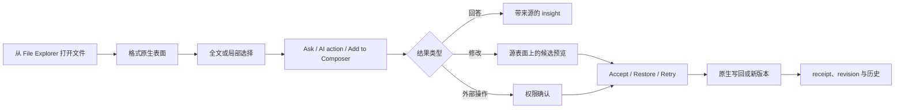

# Peak File Workspace 最终产品设计

> 日期：2026-08-13
>
> 状态：Owner-aligned final product design
>
> 生产状态：分格式混合状态；本文不会把设计稿升级成已交付能力
>
> 配套实施计划：[Peak File Workspace 实施计划](../plans/2026-08-13-peak-file-workspace-implementation-plan.md)
>
> 当前交互原型：[Composer-aligned prototype](../../gstack/peak-file-workspace-composer-aligned-2026-08-10/index.html)
>
> 证据审计：[文件格式能力审计](../../research/2026-07-31-file-format-capability-audit/index.html)

## 0. 结论先行

Peak Assistant 要做的不是“多注册一些扩展名”，而是一套 **Vault 文件的 AI 工作区**。用户打开文件后，应直接完成四件事：看清内容、选择上下文、调用 AI、审阅并决定是否写回。

最终产品由三层组成：

1. 一套共享的 File Workspace shell，统一文件身份、选区、Intelligence、Composer handoff、候选审阅和历史。
2. 每种格式自己的 renderer、context adapter 和可写 effect，不强迫所有文件使用同一种编辑器。
3. 原文件或格式原生数据继续作为真值；AI 只产生回答、候选 patch、新版本、批注或受控操作。

这套设计的重点不是格式数量，而是用户任务深度：

- Markdown 与 Peak Sheet 可以深度编辑。
- PDF 以阅读、引用和 AI companion 为主。
- Canvas 与 Excalidraw 必须保留原生手工编辑。
- DOCX 与 PPTX 明确不支持。

## 1. 本文读者与使用方式

本文面向四类读者：

- 产品 owner：确认范围、优先级和对外承诺。
- 交互设计师：重做正式 UI 时不丢失已锁定的行为细节。
- 工程实现者：从统一合同拆分 surface、adapter、测试和 rollout。
- 宣传与文档维护者：区分当前能力、目标设计和不支持范围。

读完后，应能回答：

- 哪些格式今天已有生产证据，哪些仍是设计。
- 每种格式的主任务、选区方式、AI 能力和写回边界是什么。
- 哪些交互是所有格式共享的，哪些必须留给原生 renderer。
- 后续应该按什么顺序实现和验收。

本文不替代生产源码、测试结果或真实 Obsidian 验收记录。旧的 [2026-07-24 方案](./2026-07-24-peak-file-workspace.md) 与 [2026-08-09 能力模型](./2026-08-09-file-surface-ai-capability-model.md) 仍保留历史推理，但产品交互以本文为准。

## 2. 状态词与当前事实

### 2.1 统一状态词

| 状态 | 含义 | 能否直接用于宣传 |
| --- | --- | --- |
| Production evidence | 当前源码与自动化存在；还需查看真实宿主验收状态 | 只能按已验证范围表达 |
| Interaction verified | 已在真实 Obsidian 中验证目标交互 | 可以进入发布评审 |
| Design ready | 产品与交互已定稿，生产实现尚未完成 | 不能称为已支持 |
| Read/index only | Loader、索引或嵌入能力存在，没有独立工作面 | 不能称为完整支持 |
| Planned | 保留方向，近期不实施 | 只能出现在路线图 |
| Unsupported | 产品明确不支持 | 不进入支持清单 |

### 2.2 当前能力与最终目标

| 文件家族 | 当前证据 | 最终产品定位 | 当前状态 |
| --- | --- | --- | --- |
| Markdown | Composer、结构化块、候选与写回已存在 | 最完整的文档工作面 | Production evidence |
| Peak Sheet (`.peaksheet`) | file-native view、typed patch、四视图、AI 工具、CSV/XLSX 导入导出已存在 | 表格、数据与计算工作面 | Production evidence；部分真实交互待验收 |
| CSV / XLSX | 已作为 Peak Sheet 的导入导出格式进入生产源码 | 互操作入口，不是长期真值 | Production evidence；真实文件交互待验收 |
| Image | Composer/Chat 已有媒体解析、生成与图片编辑基础 | 独立图片工作区与 AI 版本式编辑 | Design ready；可复用部分生产基础 |
| HTML | Loader 可提取内容，没有独立 File Workspace | 可预览、轻量编辑、元素选择与受控交互 | Design ready |
| PDF | Loader 可逐页提取文本，宿主可预览 | 原生 viewer + page-aware AI companion | Design ready |
| Code Source | 原生文件仍缺独立 Peak 工作面 | 轻量源码编辑、选区 handoff、跨文件引用 | Design ready |
| TXT | 有文本 Loader，没有专用工作面 | Markdown-lite 的纯文本模式 | Design ready |
| Canvas | Loader 和 Composer 内结构化 patch/preview 基础存在 | 原生 Canvas + AI Live Build | Design ready；复用部分生产基础 |
| Excalidraw | Loader、Composer 内 preview/typed patch 和产物生成存在 | 原生 Excalidraw + AI Live Build | Design ready；复用部分生产基础 |
| JSON | 有 Loader；没有最终独立工作面 | Source/Tree；扁平记录可显式转 Peak Sheet | 后续设计 |
| JSONL | 已作为 Peak 内部 durable record 使用 | 不建设笼统 JSONL Workspace | Existing internal carrier |
| Jupyter | 没有近期实现要求 | cell-aware companion 的规划位 | Planned |
| DOC/DOCX | 内部 Loader 分支可能提取文本 | 不支持 | Unsupported |
| PPT/PPTX | 内部 Loader 分支可能提取文本 | 不支持 | Unsupported |

重要纠正：2026-08-09 文档中“XLSX 尚未实现”的描述已经被后续生产实现取代。当前仍不能把自动化通过等同于真实 Obsidian 产品冻结。

## 3. 统一产品模型

### 3.1 用户主流程



阅读要点：

- 选区先于局部 AI；AI 不得默默扩大范围。
- 回答和修改是两种结果，只有修改需要 Accept/Restore。
- Composer handoff 只是增加上下文，不是授权修改文件。
- 原始文件、候选和运行记录保持三份不同状态。

### 3.2 页面骨架

每种格式共用以下骨架：

- 顶部：返回/前进、文件名、轻量路径、保存或只读状态。
- 中央：格式原生 renderer/editor，始终是视觉主体。
- 右侧：与中央文件表面严格同高的 Intelligence sidecar。
- 选区附近：临时 Selection Lens，只显示与当前选择有关的动作。
- 候选产生后：Accept、Restore、Retry 和版本信息。

以下控件不再作为全局骨架：

- `View / Edit / Compare / Changes` 模式条。
- 每种格式都重复出现的 Preview/Edit 切换。
- 在尚无候选时出现的 Changes 页面。
- 为局部功能增加的全局 Command Palette 命令。

文件应该尽可能直接可读或可编辑。只有 HTML 这类同时存在源码和渲染态的格式，才拥有格式内部的 Source/Preview 联动。

### 3.3 Intelligence sidecar

Intelligence 始终显示当前 AI 实际看到的范围，例如：

- `Whole image` 或 `Freehand mask · 18%`。
- `HTML · section.metric-card[data-id="reliability"]`。
- `PDF · page 7 · lasso region`。
- `Code · lines 42–58`。
- `Canvas · 3 nodes + 2 edges`。

它承担：

- 当前文件或选区问答。
- 格式预设动作与自由 prompt。
- 当前运行状态、provider、成本和上传边界。
- 候选审阅、错误、重试和历史。

它不承担第二套文件导航、第二套编辑器或一个永远展开的能力目录。

## 4. Selection Lens 与 Composer handoff

### 4.1 两种上下文范围

所有 surface 都必须支持：

- **Whole file**：当前完整文件或格式允许的完整可读内容。
- **Local selection**：文字、元素、页、区域、单元格、节点或图形对象。

Whole file 可以由稳定的 Ask/Add 入口使用。Local selection 完成后，Selection Lens 应靠近选择对象出现，并随着新选择重新定位。

### 4.2 Selection Lens 的动作

共享动作只有：

- `Ask`
- `Add to Composer`
- `Clear`

格式可以增加与选区强相关的动作，例如 Image 的 `Remove / replace` 或 PDF 的 `Extract`。不要把格式无关的长操作列表塞进 Lens。

### 4.3 选区信封

选区信封（下文称 `SelectionEnvelope`）是所有 surface 向 AI 与 Composer 交接的统一数据结构。以下为拟议合同，不代表源码已实现：

```ts
// Proposed interface.
interface SelectionEnvelope {
  source: {
    filePath: string;
    stableId?: string;
    format: string;
    revision: number | string;
    sourceHash?: string;
  };
  surface: 'markdown' | 'text' | 'html' | 'pdf' | 'code' |
    'image' | 'peak-sheet' | 'canvas' | 'excalidraw';
  scope: 'whole' | 'visible' | 'selection';
  selection: {
    kind: 'text' | 'element' | 'rectangle' | 'freehand' |
      'range' | 'nodes' | 'elements' | 'page';
    page?: number;
    sourceRange?: { from: number; to: number };
    selector?: string;
    objectIds?: string[];
    normalizedBounds?: { x: number; y: number; width: number; height: number };
    normalizedPoints?: Array<{ x: number; y: number }>;
    selectedText?: string;
    ocrText?: string;
    previewRef?: string;
  };
}
```

关键约束：

- 坐标使用 normalized geometry，缩放后可以重建。
- PDF 必须携带文件、页码和 PDF/CSS 坐标映射所需信息。
- Canvas 与 Excalidraw 必须携带稳定对象 ID，不能只交截图。
- Composer 展示人类可读摘要，同时保留完整来源定位。
- 同一个选区可以反复 Ask 或 Add，但不会自动获得写权限。

## 5. 文件表面的最终设计

### 5.1 Markdown 与 TXT

#### Markdown

Markdown 继续作为最完整的能力基线：

- block、跨 block 选区、全文和 frontmatter 上下文。
- 改写、扩写、翻译、结构调整、表格、代码、公式和链接。
- 候选 review 后通过 source-range 或 block transaction 写回。
- 嵌入图片、PDF、Canvas 与 Excalidraw 时，可进入对应文件表面。

#### TXT

TXT 复用 Composer 的文本选择、AI 输入、历史和 diff，但使用纯文本模式：

- 支持全文或选区改写、摘要、翻译、提取和查找替换。
- 默认输出保持 plain text、原 encoding 和换行策略。
- Markdown heading、wikilink、frontmatter 和 callout 不自动写入 TXT。
- “另存为 Markdown”必须是显式转换。

TXT 不需要独立视觉体系，也不把 Markdown preview 当成原生视图。

### 5.2 Peak Sheet、CSV 与 XLSX

Peak Sheet 已经是一份可见的 `.peaksheet` 文件。Table、Chart、Board 与 Calendar 读取同一份 revision，CSV/XLSX 只承担交换与导入导出。

#### 打开与导入

- 打开 `.peaksheet`：直接进入当前文件的工作面。
- 打开 CSV：表格预览、encoding/delimiter 诊断、字段推断，再确认创建 Peak Sheet。
- 打开 XLSX：先显示 workbook、worksheet、used range 和兼容性损失，再选择 worksheet。
- 取消导入必须零写入。
- 原 CSV/XLSX 保留为来源资产，不与 `.peaksheet` 静默双向同步。

#### AI 能力

- 对选区、行、列、字段、视图和完整 Sheet 提问。
- 诊断缺失、重复、异常分布、格式漂移和公式问题。
- 生成字段、公式、筛选、排序、分组和视图的 typed plan。
- 所有修改绑定 file path、dataset ID 和 base revision。

#### 宣传边界

可以表达 CSV/XLSX 导入与导出，但不能表达为 Excel round-trip。样式、宏、图表、数据透视表和公式语义损失必须在兼容性说明中可见。

### 5.3 HTML

HTML 是 AI 时代的重要文件类型。它既可能是文档，也可能是仪表盘、交互报告或小型内部工具，因此不能只当作源码 Loader。

#### 主表面

- 页面默认以 live preview 为主体。
- Source 编辑在页面内部按需展开，不增加全局模式条。
- Source 修改与 Preview 定位同步。
- 所有可见页面元素都应该可选，包括 KPI 数字、图表、按钮和嵌套内容。

#### Element picker

用户进入 Pick element 后：

1. hover 显示候选边界。
2. click 固定当前元素。
3. Selection Lens 显示 selector、可见文本和源码位置。
4. 用户可以 Ask、Add to Composer 或发起可审阅修改。
5. 下一次选择会移动 Lens，不需要清空整个页面状态。

不能只让预先加了 demo attribute 的元素可选。真实实现必须从渲染 DOM 解析到安全、稳定的 source locator。

#### AI 与交互写入

HTML AI 可以：

- 解释页面或选中元素。
- 修复布局、样式、无障碍和 console/resource 错误。
- 修改选中组件或新增 section、chart、control。
- 总结 dashboard 并解释指标。

如果页面按钮需要刷新、筛选、确认或写业务数据，必须通过 typed host bridge。页面 `localStorage`、隐藏 DOM 和内存变量不能成为重要业务数据的唯一真值。

#### 安全

- 默认 sandboxed preview。
- 本地脚本与网络权限按 trust level 提升。
- 页面不能获得 Obsidian、Electron 或 Node 的任意访问。
- connected dashboard 的外部写入单独经过权限确认并记录 receipt。

### 5.4 PDF

PDF 保持只读原文件，Peak 不重做 Acrobat。产品价值来自精确范围、来源引用和 Composer handoff。

#### 四种显式范围

- `All pages`
- `This page`
- `Text`
- `Lasso`

Text 使用原生文本层选择。Lasso 可以自由圈选文字、表格、图形或扫描区域，并携带 page、normalized points、bounds、选中文本或 OCR。

#### AI 能力

- 当前页或全文问答与摘要。
- 解释选中文字、表格和图形。
- 翻译、OCR、结构提取和跨页比较。
- 回答中的引用可以跳回具体页与区域。
- 需要保存时写 sibling annotation 或 materialized note，不修改 PDF 二进制。

Ask document 必须显示实际范围。用户不能面对一个不知道是否使用了全文、当前页或截图的黑盒按钮。

### 5.5 Code Source

Code Source 是轻量的 native file 工作面，不是第二个 VS Code 或 Codex。

#### 必须有

- Python、TypeScript、JavaScript、CSS、SQL、Shell、YAML 等文本源码可单独打开。
- 语法高亮、行号、直接输入和保存反馈。
- 文本选中后，Ask/Add to Composer 胶囊立即靠近选区出现。
- Whole file 也可以显式加入 Composer。
- Composer item 保留文件路径、行范围和 source revision。
- 跨文件 context 由用户显式纳入的文件和语言 import/reference 组成。

#### 不需要有

- View/Edit 模式。
- `Suggest Change` 独立入口。
- project tree、Symbols、debugger 或常驻 diagnostics dashboard。
- 在选择文本时自动运行代码。

Run、test、build、依赖安装、shell 和 network 都是独立授权动作。文件编辑权限不能自动升级为执行权限。

### 5.6 Image

Image 的正式设计是“直接操控优先、AI 贴近来源、原图受保护”。它复用现有 Composer/media 能力，但不照搬 Composer 内嵌块的布局。

#### 主工具坞

工具坞位于图片边界外，不遮挡像素。它以内容宽度居中，并保持稳定锚点。

一级控件依次为：

- Select
- Crop
- Rotate left
- Rotate right
- Export icon
- Ask
- AI edit
- Composer
- Zoom out / percentage / Zoom in / Fit

不在一级工具坞放 Resize 或黑盒 Compress。Export 只显示 icon，浮层向工具坞上方展开，并留在图片容器内。

#### Select

点击 Select 后，`Rectangle / Freehand` 在 Select 与 Crop 之间内联展开。工具坞从中心向两侧平滑扩展，不在上方再弹出第二行。

Rectangle：

- 默认覆盖整张图片，相当于 whole-image selection。
- 使用八个手柄直接调整。
- 拖动后保持用户最后位置，不自动跳回中心。
- 选择一成立，Selection Lens 即可用于 Ask、Composer 和 AI edit。

Freehand：

- 切换后移除矩形。
- 绘制过程中显示用户已经经过的点轨迹。
- 绘制中不显示“当前位置到起点”的提前闭合线。
- 松开后才闭合，并只显示最外层区域轮廓。
- 内部交叉、回绕和重叠轨迹不继续显示。
- 完成后 Selection Lens 靠近轮廓出现，并避免碰撞主工具坞。

不提供 `Whole / Rectangle / Freehand` 常驻分段组，也不提供 Object detect。

#### Crop

点击 Crop 后，同样在 Crop 旁内联展开 `Rectangle / Freehand`。它与 Select 共用轮廓输入引擎，但拥有独立状态和提交语义。

- Rectangle 默认整图，拖动手柄改变裁剪区域。
- Freehand 使用与 Select 相同的绘制反馈。
- Crop 展开状态提供 Reset、Cancel、Done。
- Done 只修改 working copy，并进入新版本候选。
- Cancel 恢复进入 Crop 前的构图。
- Reset 恢复到整图 Rectangle 或清除当前 Freehand mask。

Crop 不提供比例预设、1:1/4:3/16:9、straighten slider 或旋转子菜单。左右旋转保留在一级工具坞。

#### Selection Lens

Image Lens 显示：

- Rectangle 或 Freehand。
- 像素尺寸或 bounding area。
- Ask。
- Add to Composer。
- Remove / replace。
- Clear。

Lens 需要根据选区、工具坞和视口选择上方或下方位置。不得先在最右侧渲染再跳到选区附近，也不得挡住选区底部。

#### Export

Export 浮层包含：

- 格式。
- 可选尺寸。
- quality 滑杆。
- 实时文件大小估算。
- 保存副本。

原图默认受保护。压缩是格式、quality 与尺寸共同决定的可见结果，不再出现含义不明的 Compress 按钮。

#### AI edit

主工具坞只有一个 `AI edit` 入口。打开后，右侧 Intelligence 进入专用生成式编辑工作区。

能力按用户意图组织：

- Quick：Clean up、Remove background、Replace、Expand、Upscale。
- Restyle：Editorial、Watercolor、Sketch、3D clay、Anime、Pixel、Cinematic、Paper cut。
- Light：daylight、studio、golden hour、night、mood 等。
- Material：paper、glass、metal、fabric、clay 等。
- Compose：reframe、extend canvas、depth、product layout 等。

参考图必须声明角色：

- Style
- Subject
- Composition

生成前可见保护项：

- Identity
- Layout
- Text
- Unselected area
- Creative strength

每次生成返回四个可比较候选。候选在来源表面预览；Accept 保存新版本，Restore 返回受保护原图。局部编辑要显示 mask 并允许与原图对照，因为生成模型可能改变选区外内容。

### 5.7 Canvas 与 Excalidraw

两种画布共用 **Live Build** 产品模型，但必须调用各自的 native operations。Peak 不再复制一个假 Canvas 或假 Excalidraw。

#### 共同流程

1. 用户选择一个元素、子图或空白位置。
2. 用户点击 Build here / AI create tool。
3. 画布出现可拖动、可缩放的 `AI build area`。
4. 用户确认意图，例如 Expand flow、Turn into diagram、Re-layout。
5. Peak 依次执行可见 native operations。
6. 用户可以 Pause，并继续移动、调整样式或修改元素。
7. 开启 Respect my moves 时，人工移动成为后续布局的新 anchor。
8. Peak 自检重叠、阅读顺序、标签和连线。
9. 用户以一个 transaction Accept 或 Restore。

Intelligence 显示四段计划：

- Read anchors
- Place elements
- Bind relationships
- Self-check layout

同时显示 visible cursor、当前 operation、进度、日志和 Pause/Resume。直接一次性生成完整 XML/JSON 或在后台静默替换完整 scene 都不属于最终设计。

#### Canvas

AI 输出必须仍是普通 JSON Canvas 对象：

- card
- file
- group
- edge
- stable ID

接受后，用户继续使用 Canvas 原生卡片菜单、连线、颜色、缩放和创建工具。

#### Excalidraw

AI 输出必须仍是普通 Excalidraw elements：

- rough shape
- editable text
- bound arrow
- group
- native style

接受后，用户继续使用 Excalidraw 原生 selection、properties、library、zoom/pan 和 export。最终结果不能烘焙成 PNG/SVG，也不能让 Peak 自己的属性面板替代 Excalidraw。

### 5.8 JSON、XML、SVG 与媒体

#### JSON

- 扁平 records array 可以显式进入 Peak Sheet。
- 嵌套 JSON 保持 Source/Tree，使用 JSON Pointer、schema 和 JSON Patch。
- 不自动压平并覆盖原文件。

#### XML

XML 只保留内部读取能力，不提供独立产品 surface，也不进入近期宣传。

#### SVG

SVG 同时是文本、矢量图和潜在脚本容器。未来需要独立 safe source/preview 与 sanitization；当前不并入 raster Image。

#### Audio 与 Video

近期只考虑媒体理解 companion：

- transcript
- timestamp/chapter
- keyframe
- timeline-aware Ask

它们不是当前 File Workspace 的重点，也不承诺 DAW 或视频编辑器。

### 5.9 明确不支持与暂缓

#### 不支持

- DOC / DOCX
- PPT / PPTX
- executable、installer、disk image
- proprietary CAD/3D source

内部 Loader、附件图标或偶然文本提取都不能改变这个决定。

#### 暂缓

- Jupyter：保留 cell-aware companion 规划位，不预建 kernel/runtime。
- JSONL 用户工作区：不重复建设；未来只在明确 NDJSON 导入需求下评估。
- EPUB、LaTeX、Org、ODS、OPML、ICS、Parquet、SQLite、ZIP 等：没有明确用户任务前不进入主矩阵。

## 6. AI effect 与写回边界

| Effect | 典型格式 | 用户接受后的结果 |
| --- | --- | --- |
| Insight | 所有格式 | 不改文件；可显式保存为 note/annotation |
| Source patch | Markdown、TXT、HTML、Code、JSON | revision-guarded source transaction |
| Dataset plan | Peak Sheet | typed plan 生成下一 revision |
| New version | Image | 新 native file；保留 lineage |
| Annotation | PDF、Image | sibling note 或登记过的 annotation record |
| Structured patch | Canvas、Excalidraw | object-level validate 后写 native file |
| External action | Connected HTML | PermissionGuard 后由 host adapter 执行 |

所有写操作遵循：

1. 运行开始时冻结 file revision、source hash 和 selection。
2. 模型输出先经过 schema、范围和权限校验。
3. 候选必须在来源表面显示影响范围。
4. 原文件已变化时停止直接接受。
5. 接受后重新读取 native truth。
6. receipt 记录来源、权限、结果和版本。

原图默认不覆盖。PDF 默认不写二进制。Canvas/Excalidraw 不写扁平截图。CSV/XLSX 不成为 Peak Sheet 的隐藏真值。

## 7. 关键状态与失败语义

每个 surface 至少覆盖：

- Loading
- Ready
- Read-only
- Dirty
- Running
- Paused（仅长运行或 Live Build）
- Candidate ready
- Conflict
- Failed
- Provider unavailable
- Unsupported variant

常见失败必须有明确恢复：

- 文件外部变化：Reload、Regenerate 或 Save a copy。
- provider 缺失：保留本地查看/编辑，禁用相关 AI action。
- PDF 无文本层：提示 OCR，而不是返回空答案。
- HTML resource 失败：显示具体 resource/console diagnostics。
- Image 生成越过 mask：候选对照、Reject 或降低 strength。
- Live Build 中人工移动：重新锚定，不把节点抢回原位。
- Excalidraw compressed variant 无法安全 patch：fail closed。

## 8. 宣传合同

宣传不再使用一个笼统的“支持格式”列表。每条话术都采用“格式 + 用户任务 + 限制”。

### 当前可以基于生产证据描述

- 在 Markdown Composer 中阅读、选择、生成并审阅写回内容。
- 创建和编辑 `.peaksheet` 文件，并在同一数据上使用 Table、Chart、Board 与 Calendar。
- 将 CSV、扁平 JSON 和受限多 worksheet XLSX 导入 Peak Sheet。
- 从 Peak Sheet 导出 CSV、XLSX 或 portable `.peaksheet`。
- 在受支持的 Composer 原生对象场景中预览或结构化处理 Canvas/Excalidraw。

以上仍需按发布记录注明真实 Obsidian 验收状态。自动化存在不等于所有鼠标、键盘、拖拽和文件选择器流程已经冻结。

### 只能说“正在设计/开发”

- 独立 Image Workspace。
- HTML live preview + element-aware AI。
- PDF page/selection-aware AI companion。
- Code Source Workspace。
- Canvas/Excalidraw Live Build。
- TXT plain-text Composer。

### 禁止表达

- “支持 Office”。
- “支持 Word / PowerPoint”。
- “任意文件都能直接问 AI”。
- “完整支持 Excel”或“Excel 无损往返”。
- “AI 可以直接编辑 PDF”。
- “Canvas/Excalidraw 已支持实时 AI 绘制”，直到真实原生 integration 通过。

发布前必须从机器可读 capability manifest 生成或核对支持页。Loader 注册不能自己把格式升级为用户可见支持。

## 9. 设计追踪

实施任务编号以配套的 [Peak File Workspace 实施计划](../plans/2026-08-13-peak-file-workspace-implementation-plan.md) 为准。

| 用户纠正或目标 | 最终设计响应 | 实施计划入口 |
| --- | --- | --- |
| 不要为所有格式放 View/Edit/Changes | 直接可读写；review 仅在候选出现后展示 | FW-11 |
| Image 工具太远、太拥挤、会跳动 | 单一居中工具坞，方法内联扩展，Lens 碰撞定位 | FW-41、FW-44 |
| Freehand 不是真的自由圈选 | 点轨迹、松手闭合、最外层轮廓、normalized mask | FW-42 |
| Crop 与 Select 不应混成一个状态 | 共用输入引擎，独立 task state 与 commit | FW-43 |
| AI image edit 不只是移除背景 | 五类意图、typed references、保护约束、四候选 | FW-46 |
| PDF 看不出 AI 如何结合 | 四种 scope、页码引用、OCR 和 Composer envelope | FW-30 至 FW-33 |
| Code 不需要简陋 IDE | 轻量编辑、原生选区 Ask/Add、执行独立授权 | FW-21 至 FW-23 |
| Canvas/Excalidraw 要像人手动放置 | 可调整 build area、visible native ops、人工 re-anchor、自检 | FW-50 至 FW-55 |
| CSV 和 XLSX 都属于 Peak Sheet | import preview/accept，`.peaksheet` 为长期真值 | FW-60 至 FW-62 |
| DOCX/PPTX 不支持 | 从 capability、设置和宣传中保持明确排除 | FW-01、FW-02 |

## 10. 验收门槛

单一格式只有同时满足以下条件，才可升级为 product supported：

1. 正常、超大、损坏、并发修改和不支持变体 fixture 全覆盖。
2. 实际送给模型的 source、selection 与 runtime context 可审计。
3. Ask、candidate、Accept、Restore、conflict 和 recovery 可验证。
4. 关闭 Peak 后，native source 仍能被原生或生态工具读取。
5. provider 缺失、离线、解析失败和权限拒绝有降级路径。
6. focused tests、production build 和真实 Obsidian interaction evidence 分开记录。
7. 设置、命令、帮助和宣传与 capability manifest 一致。

Image freehand、PDF lasso、Canvas/Excalidraw Live Build 必须使用短视频验证，因为静态截图无法证明拖动轨迹、暂停、人工接管和恢复顺序。

## 11. 非目标

- 不复制 Photoshop、Acrobat、VS Code、Obsidian Canvas 或 Excalidraw。
- 不为每种文件创建第二套 AI runtime、聊天记录或模型设置。
- 不把所有文件转成 Markdown 后假装支持原格式。
- 不因为 Loader 存在而支持 DOCX/PPTX。
- 不把静态 mock、绿色 build 或文件图标当作交付证据。
- 不在没有 revision、review 和 recovery 的情况下覆盖原文件。
- 不在本设计里扩展 Jupyter、Office、CAD/3D 或长尾格式。

## 12. 证据与可审阅产物

- [当前六表面交互原型](../../gstack/peak-file-workspace-composer-aligned-2026-08-10/index.html)
- [Image](../../gstack/peak-file-workspace-composer-aligned-2026-08-10/index.html#image)
- [HTML](../../gstack/peak-file-workspace-composer-aligned-2026-08-10/index.html#html)
- [PDF](../../gstack/peak-file-workspace-composer-aligned-2026-08-10/index.html#pdf)
- [Code Source](../../gstack/peak-file-workspace-composer-aligned-2026-08-10/index.html#code)
- [Canvas Live Build](../../gstack/peak-file-workspace-composer-aligned-2026-08-10/index.html#canvas)
- [Excalidraw Live Build](../../gstack/peak-file-workspace-composer-aligned-2026-08-10/index.html#excalidraw)
- [调研依据与排除项](../../gstack/peak-file-workspace-composer-aligned-2026-08-10/research.html)
- [Peak Sheet production implementation note](../plans/2026-08-10-peak-sheet-production-implementation-note.md)
- [Peak Sheet file-native redesign plan](../plans/2026-08-11-peak-sheet-file-native-redesign-implementation-plan.md)

本文是后续 UI 重做、生产实现和宣传审计的产品合同。任务拆分、依赖、验证与 rollout 见配套实施计划。
