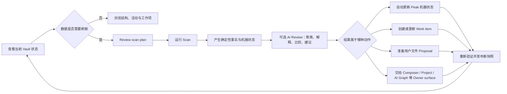

# Vault Intelligence 最终产品与交互设计

> 本文只描述最终产品心智模型与用户可见行为。  
> 数据结构、当前源码能力、未实现项和工程计划分别放在另外两份文档中。
>
> Scan 产生的 maintenance review surface 统一遵循[共享规则](../2026-08-15-vault-scan-follow-up-and-work-queue-contract.md#scan-maintenance-review-shared-rules)；File Property 的原子操作、冲突、combined diff 与 Apply / Verify 见[第 12 节合同](../2026-08-15-vault-scan-follow-up-and-work-queue-contract.md#file-property-review-contract)。

## 1. 产品综述

Vault Intelligence 是 Peak Assistant 面向整个 Vault 的**观察与维护工作区**。

它同时回答四个问题：

| 用户问题 | 产品负责回答 |
| --- | --- |
| 我的 Vault 现在是什么状态？ | 文件、知识 Community、Hub、Bridge、Peak 工作对象、Search 与 enrichment 状态 |
| 最近发生了什么？ | 自上次成功扫描后的变化、原始活动记录与结构变化 |
| 哪些事情值得处理？ | 确定性 Finding、AI 聚合的 Insight、明确的 Work item 与 Proposal |
| 我怎样安全地处理？ | 直接更新 Peak 机器状态、打开专属工作区、审阅 Proposal、重试或显式忽略 |

它不是：

- 一个只有分数的 Vault 健康仪表盘；
- 一个把所有问题都交给 LLM 的聊天页面；
- 一个自动修改用户文件的黑盒清理器；
- Search、File Atlas、Composer、Project、AI Graph 的替代品；
- 一个把运行日志直接暴露给用户的工程控制台。

## 2. 整体闭环



这里有三个不能混淆的概念：

| 对象 | 含义 | 是否修改用户文件 |
| --- | --- | --- |
| Finding | detector 产生的原始事实与证据 | 否 |
| Insight | AI 基于 Finding、历史与 Vault map 做出的解释 | 否 |
| Action | 用户真正可以执行的下一步 | 视类型而定；文件修改必须经过 Proposal |

## 3. 产品对象

Vault Intelligence 使用五类对象，而不是一个模糊的“健康”概念。

| 对象 | 例子 | 谁拥有 |
| --- | --- | --- |
| Vault objects | Markdown、PDF、图片、Canvas、`.peaksheet`、未来 `.peakaigraph` | 用户或对应原生工作区 |
| Peak work | Chat、Project、Composer session / Change Set | 各自的 Owner surface |
| Machine knowledge | Search projection、vectors、Summary、AI Tags、Community profile | Peak，可重建或可审阅 |
| Findings / Work items | orphan、parse failure、stale bridge、blocked Project | Vault Intelligence |
| Runs / Proposals / Receipts | 扫描运行、文件变更候选、Apply 与验证记录 | Vault Intelligence 与持久化运行时 |

Files 的含义是 Peak 当前维护的全部文件类型，不只 Markdown。AI Graph 与 Peak Sheet 属于 Files，不在顶层重复占一个入口。

## 4. 页面架构

### 4.1 全局壳

顶栏从左到右只保留：

- `Vault Intelligence`
- 最近一次成功扫描时间；
- 若有变化：`146 changes ready · Review plan`；
- 信息按钮；
- 唯一主动作。

主动作按状态变化，但同一时刻只有一个：

| 当前状态 | 主动作 | 点击结果 |
| --- | --- | --- |
| 首次使用，没有可用快照 | `Prepare Vault` | 进入 Runs 下的首次 Scan setup |
| 已有快照且空闲 | `Scan Vault` | 进入 Runs 下的 Scan setup |
| 有暂停或可恢复运行 | `Resume scan` | 打开原 Active run 并从 checkpoint 恢复 |
| 正在运行 | `View progress` | 打开同一个 Active run，不重复创建运行 |

最终只注册一条稳定全局命令：`Open Vault Intelligence`。内部动作不进入 Command Palette。

### 4.2 Overview

Overview 回答：**现在最值得我知道和继续的是什么？**

它不展示完整 Graph，也不展示大段 AI Insight。最终顺序：

1. 对象摘要：Files、Chats、Projects、Composer；
2. Continue work：最多 7 个最高优先的明确工作项；
3. What changed：自上次成功 Scan 后发生的结构、文件与对象变化；
4. Priority work：从完整队列中解释为什么优先的少量结果；
5. 可选的 Search 与 machine knowledge 状态摘要。

对象摘要的交互：

- Hover / keyboard focus 显示 Popover，不开右侧 Drawer；
- Files 用**实际文件类型** Pie，而不是 Notes / Documents / Media 这类二次分组；
- AI Graph 与 Peak Sheet 出现在 Files Pie 和明细中；
- Chats、Projects、Composer 各自展示真实、有意义的维度；
- Popover CTA 必须进入它的 Owner surface 或明确的 Inventory，而不是通用 Work queue。

Continue work 的规则：

- 只显示有显式状态、能够继续、能够退出的工作；
- 不从“多久没打开”推测任务；
- Source / owner label 比不可靠的泛用 icon 更重要；
- 行距紧凑，首页最多 7 项；`View all 24` 进入完整 Work queue。

### 4.3 Vault map · Vault contents

Vault map 只有两个同级视图：`Vault contents` 与 `Activity`。

`Structure` 不再独立存在，因为它和 Vault contents 描述的是同一个对象：**这个 Vault 由哪些文件与知识区域组成，它们怎样连接。**

Vault contents 由三层组成：

1. 文件类型分布：实际扩展名 Pie；
2. 知识结构图：Community、Topic / Hub、Bridge document；
3. 图下解释区：Community summary、Selection details、AI insight。

文件类型 Pie 是控制器，不是装饰：

- Hover 强调 slice，并预览数量、适用能力、排除原因；
- Click 将所选类型投影到下方知识图；
- 再次点击或 `All types` 恢复全局图；
- 只有在用户明确选择类型、状态或问题时，才展示具体文件清单；
- 文件清单每一行都必须能打开、重试、纳入 Scan、修改 policy 或交给 Owner surface，不能是一张无动作的库存表。

#### Graph 语义

Graph 必须使用共享 Cytoscape `AtlasGraphCanvas`，不能用静态 SVG 或 React Flow 创建第二套组件。

默认图展示中等密度的代表性结构：

- Community 节点表示一组具有真实成员关系的知识区域；
- Topic / Hub 是 Community 内的高连接主题入口；
- Bridge document 是连接多个 Community 的真实文件；
- Community 之间不画无法解释的“想象连线”，跨 Community 关系必须能追溯到 bridge 或已解析 typed relation。

图布局与共享 Graph Workspace 对齐：

| 控件 | 含义 |
| --- | --- |
| `Constellation` | 观察整体邻近关系 |
| `Flow →` | 观察水平方向的信息 / 引用流 |
| `↓` | 同一个 Flow 的纵向布局；只显示箭头，不重复文字 |
| `Orbit` | 从当前选择观察层级与邻域 |

工具栏复用共享按钮组：Semantic edges、Nodes、关系、Image、Fullscreen、Zoom / Fit 等，不为 Vault Intelligence 重新发明图按钮。

#### Graph 交互

- Hover 节点：节点与一跳关系高亮，其他对象轻度淡化；
- Click Community：在**同一张图、同一个节点位置附近展开** Topics / Hubs，不切换成另一张图；
- Click Bridge：显示来源 Community、目标 Community、涉及文件与 freshness；
- `Shift`：临时 inspect；`I`：pin 当前选择；`Esc`：逐层退出展开 / pin；
- 选择后，相关节点强，相关 bridge 中等，无关节点淡化；不能把背景压到几乎看不见，也不能让选择与背景同权重；
- 不使用永久右侧 Inspector。图下面的 Context 区随选择变化。

图下方紧跟一个统一内容区：

| 左侧 | 右侧 |
| --- | --- |
| Community summary：名称、notes、占比、Topics / Hubs、关键 bridge | Selection details + AI insight：解释当前选择、证据与可执行动作 |

移除图下 `File type` Tab。文件类型已经由上方 Pie 控制，再保留一个 File type Context 只会重复心智模型。

### 4.4 Vault map · Activity

Activity 回答：**我在 Vault 中实际做了什么；可选地，这些工作形成了哪些主题。**

必须先分两层：

| 层 | 默认可用 | 数据含义 |
| --- | --- | --- |
| Raw activity | 是 | File edit、Chat context、Project change、Composer action、AI Graph revision 等显式本地记录 |
| AI theme analysis | 否；按需或随 Scan 生成 | AI 将一段时间内的显式活动聚成 event / theme，附来源与生成版本 |

默认首页和 Activity 首屏先展示一张长横向 GitHub 风格 Heatmap：

- 默认范围 1 年；
- 颜色只代表“当天显式记录数”，不代表时长、生产力、重要性或监控分数；
- 使用真实日期范围选择器与预设范围，不使用含义不清的自制滑块；
- Hover 显示日期与记录数；Click 固定选择；
- 选中一天后，图下展示可读的活动 List，每个活动有 owner、对象、动作、时间与可打开目标；
- 如果一天有很多活动，使用分页 / 虚拟列表，而不是缩小字体。

AI Theme 只有在确实生成后才出现。它的归因规则：

1. 使用显式 File、Chat context、Project 或 Composer evidence；
2. 同一个短窗口且共享对象才聚成 event；
3. 显式 Project / Change Set 身份优先；
4. 每条记录最多归入一个 primary maintained theme；
5. 无法解释的记录标为 `Unclassified`；
6. 历史时期未分析时显示 `Not analyzed`，不补画假的主题；
7. 主题过多时展示 Top N + Other，并提供搜索 / 过滤，不铺满 Topic chips。

主题 Timeline 是 Heatmap 的第二层视图，不替代原始事实。应使用能够承载缩放、范围、Tooltip 与多行事件的统计图组件；不再使用密密麻麻的小字和无法拖动的伪范围条。

### 4.5 Work queue

Work queue 回答：**哪些明确的维护任务还没有完成，我可以怎样结束它们？**

可能的来源包括：

- Project blocked / decision required；
- Composer pending review / frozen Change Set；
- AI Graph source changed；
- parser failure / Search repair；
- hard orphan / stale hub / decaying bridge；
- metadata / frontmatter Proposal；
- Community profile、Topic、Hub description 等 Peak-owned generated knowledge 维护；
- 暂停、失败或等待凭据的 Run；
- Activity theme analysis / refresh 等可选 enrichment。

不是每条 Finding 都变成一个 Work item。系统先按原因、对象和行动聚合；AI Review 可以把 21 条同源 orphan 解释成 1 个 import 工作流问题。

列表交互：

- Click 行在该行下方展开详情；
- 不使用跨屏右侧 Drawer；
- 详情不重复两遍标题；
- 居中 Modal 仅用于从图节点或 Overview 卡片进入、没有自然行容器的场景；
- 详情必须围绕具体动作设计，不能统一套一个 `Work item truth` 模板后只换文字。

每个 Work item 至少有：

| 字段 | 用户可见含义 |
| --- | --- |
| Why | 为什么现在出现 |
| Evidence | 哪些事实支持它，可以继续 inspect |
| AI interpretation | 可选；如果已生成，就直接附在事实旁，不再要求“Review AI explanation” |
| Next action | 下一步准确会打开或改变什么 |
| Exit | 什么条件下它从队列消失 |
| Owner | Vault Intelligence、Composer、Project、AI Graph、File Atlas 等 |

### 4.6 Runs

Runs 承担一次维护运行的完整生命周期：Setup、Active、Completed、History / Compare。

#### Scan setup

Setup 是 Runs 下的独立页面，不是 Overview 上的 Modal。

用户需要选择的是**意图级范围与可选智能步骤**，不是重复阅读内部流水线：

- Scope：Changed objects（推荐）、Selected scope、Entire Vault；
- Checks：默认 All，Advanced 可按 Connections、Content、Tags & metadata、Aging 四组开关；
- Optional：AI Review、Machine knowledge（Summary / AI Tags）、Community profile / map descriptions、Prepare proposals；
- Vectors 只在缺失、source hash 变化或 policy 要求时自动加入，不鼓励用户机械重建。

页面不再展示一大块 `What this run will do`。系统根据选择编译真正的运行计划，并在 Start 前只给出：范围、预计对象数、预计时间 / 成本、会不会产生 Proposal、不会自动改用户文件。

#### Active run

点击 Start 立即进入 Active run。用户必须实时看到：

- 当前阶段与总百分比；
- processed / total、速度、ETA、warnings、AI cost；
- 阶段进度：Discover → Search projection → Vault map → Deterministic checks → AI Review → Publish results；
- Object order 与当前对象；
- 当前对象正在执行的步骤；
- Live events、partial failure、provider wait、checkpoint；
- Pause、Stop、Resume。

Pause / Resume 只有在真正存在持久 checkpoint 后才能进入生产；Mock 中的 `Finish demo run` 必须明确为 Mock-only，不得进入正式 UI。

`AI explanation` 统一改为 `AI Review` 或 `Review findings`：这是一次基于事实的分析阶段，不是用户在运行中再审核 AI 文案。

#### Completed run

Completed run 是一次运行的**结果与行动页**，不是技术数据浏览器。

顶部只展示：完成状态、对象数、需要决定的结果、创建的 Work item、准备好的 Proposal，以及自动更新了哪些机器状态。

正文一条结果就是一个完整单元：

```text
事实 / 变化 → AI 解释（如有）→ 证据 → 建议动作 → Owner / 完成条件
```

不再拆成 `Observed facts / AI insights / Files & enrichment / Run evidence` 四个 Tab。Run evidence 放在页底折叠的技术详情中。

Completed run 必须能够呈现的结果类型：

- 孤立文件与 import pattern；
- metadata / frontmatter Proposal；
- stale bridge / owner review；
- parse / OCR / policy failure；
- Community name、summary、Topic、Hub description 等 Peak-owned knowledge maintenance；
- Search、Summary、AI Tags、Vectors 等自动更新；
- 可选 Activity theme analysis；
- partial failure 与需要 Retry 的对象。

独立 AI Review 页面取消。需要展开一条 AI 解释时，在结果卡或 Work item 内打开证据与建议动作，不再让用户穿过多层页面。

### 4.7 Proposal 与专属 Owner surface

Proposal 与 repair workspace 可以使用不同领域动作，但都读取同一份 canonical atomic set。Batch / File、Target / File 等分组只改变阅读投影；owner correction 只重算 suggestion，不替换用户已经作出的 choice。

动作按所有权路由：

| 动作类型 | 处理方式 |
| --- | --- |
| Peak 本地、可重建机器状态 | 可在 Run 中直接更新，并记录 receipt |
| Peak-owned generated knowledge | 可直接 Accept / Regenerate / Keep current；仍保留证据与版本 |
| 用户文件内容 / frontmatter | 必须创建 Proposal，逐文件 diff、partial accept、revision guard、Apply、re-index verify |
| 文档内容重写 | 交给 Composer，并恢复所需文件、证据与 change context |
| Project / Chat / AI Graph / Peak Sheet | 打开各自 Owner surface 和对应对象，不复制编辑能力 |
| runtime / parser failure | Retry、Resume、Change policy 或显式 Exclude |

因此“Inspect bridge notes”不是一个空 Toast：它应打开 Composer 或 File Atlas，并带上两份 bridge note、14 个 changed source 与对应 Finding evidence。

## 5. 检查与分析能力

### 5.1 确定性检查

当前 19 个不依赖 LLM 的 detector 在产品中按用户语言分成四组：

| 用户组 | 数量 | 主要回答 |
| --- | ---: | --- |
| Connections | 6 | 链接、孤儿、孤岛、bridge 与 broken reference 是否异常 |
| Content | 6 | 空、过短、过长、重复、命名或 frontmatter 是否异常 |
| Tags & metadata | 2 | 标签是否缺失或爆炸 |
| Aging | 5 | Hub、Bridge、Folder、Cluster 是否长期失效或漂移 |

detector ID、阈值、适用文件与原始证据只在详情 / Evidence 中出现；Scan setup 首屏不把内部 ID 扔给用户。

### 5.2 AI Review

AI Review 不替代 detectors。它读取：

- 当前 run 的 Findings；
- Vault map 与相关文件；
- previous successful runs；
- source hash、policy 与现有 owner decisions。

它产生：

- 原因聚类：多条 Finding 是否来自一个工作流问题；
- 影响解释：为什么值得处理；
- 历史比较：是新增、恶化、改善还是预期状态；
- Insight：结构缺口、内容重复、陈旧 bridge 等；
- Suggested action：直接更新、Proposal、Owner handoff、Retry 或 Dismiss；
- Citations：每个结论对应的证据。

AI 不能：

- 把空的 semantic detector 返回当成“已检查且没有问题”；
- 无证据推断用户的生产力或意图；
- 自动 Apply 用户文件；
- 让解释与 action 分散在几个页面中。

## 6. 六条用户流程

| 用户目标 | 页面流转 | 最终结果 |
| --- | --- | --- |
| 只想知道 Vault 怎么样 | Overview → Vault contents / Activity | 看全局状态，不创建运行 |
| 更新变化后的情报 | Header Review plan → Runs / Setup → Active → Completed | 发布新快照与结果 |
| 处理孤立导入文件 | Work queue → 行内详情 → Inspect import pattern | 合并成 import 问题，进入分类 / Proposal / Dismiss |
| 更新 frontmatter | Completed result / Queue → Review proposal | 逐文件审阅、Apply、re-index、验证关闭 Finding |
| 理解知识结构 | Vault contents → 选择 Pie → Graph → 展开 Community | 图下看到 Community summary、selection 与 AI insight |
| 回看最近在做什么 | Activity → Heatmap → 选日期 → Activity list → 可选 Analyze themes | 先看原始活动，再看有 provenance 的 AI 主题 |

## 7. 文案与视觉原则

1. 删除解释同一件事的多层小字；一个标题配一句必要说明就够。
2. 正文和列表保持可读字号，不能靠 9–11px 塞信息。
3. Summary 展示结论，Details 才展示 detector、threshold、hash 与完整 provenance。
4. CTA 写用户将得到的结果：`Review proposal`、`Open in Composer`、`Retry 3 files`；不用模糊的 `Inspect`，除非对象已经写清。
5. 避免廉价图标墙；有可靠对象类型才用 Lucide icon，否则优先 owner / type label。
6. 首页不展示 AI Insight 大段文字；AI insight 出现在选择 Context、Completed result 和 Work item。
7. 不用大面积空白卡片撑高布局；列表按真实内容自然增长，首页有明确截断。

## 8. 与其他产品的边界

| 产品 | Vault Intelligence 负责 | Owner surface 负责 |
| --- | --- | --- |
| Search / Knowledge Index | readiness、变化、失败、是否需要刷新 | 索引配置、具体 Search 使用与结果 |
| File Atlas | Vault-wide structure 与 maintenance state | 单文件邻域、资源与局部 Graph |
| Composer | 发现需要修改 / 审阅的文档工作 | 内容编辑、Change Set、Review / Apply |
| Project | 统计 blocked / decisions / continuation | Project 计划与决策执行 |
| Chat | 统计保存的 context 与 pending actions | 对话本身与回复 |
| AI Graph | 把其视为文件、检测 source changed | 创建、编辑、版本与图专属交互 |
| Peak Sheet | 把其视为文件、检测 review / readiness | 表格、图表、Board、Calendar 编辑 |
| My Content | 可以提供入口和关联数量 | 显式保存 / materialized 内容的浏览与管理 |

## 9. 成功标准

最终产品可接受，不是因为页面“看起来完整”，而是因为以下闭环都成立：

1. 用户能分辨当前事实、AI 解释与建议动作；
2. 用户启动 Scan 后始终知道系统在处理什么；
3. Scan 完成后，最重要的结果无需穿过多个 Tab 才能操作；
4. 用户文件不会被静默写入；
5. Work item 有明确 Owner 与退出条件；
6. Vault contents 真实反映文件类型与 Community 结构；
7. Activity 默认建立在真实记录上；
8. 所有 Mock-only 能力在生产前都有对应 runtime、持久化、错误状态与真实 Obsidian 验收。
