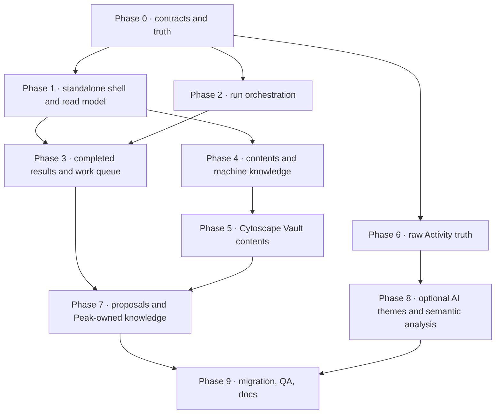

# Vault Intelligence 实施任务计划

> 本文把最终设计转换为实施 DAG。它不是本轮实现授权，也不表示任何任务已完成。  
> 生产实施前应先由 Owner 审核 Phase 0–2 的 contract 与首轮范围。
>
> 所有 Scan maintenance review 的实现以[共享规则](../2026-08-15-vault-scan-follow-up-and-work-queue-contract.md#scan-maintenance-review-shared-rules)为规范；File Property 还必须满足[第 12 节合同](../2026-08-15-vault-scan-follow-up-and-work-queue-contract.md#file-property-review-contract)。

## 1. Impact Contract

这是一项 Major product wave，不能以“页面更好看”或“build 通过”作为成功标准。

### 1.1 Primary metric

真实 Obsidian 中至少跑通一条完整维护闭环：

```text
Open Vault Intelligence
→ Review plan
→ Run deterministic changed-object scan
→ See continuous real progress
→ Completed result with evidence and action
→ Create / handle one work item or proposal
→ Recheck and close / update the result
```

### 1.2 Required tracks

1. 产品 contract 与 current source 适配；
2. app-owned Scan / Run orchestration；
3. standalone UI shell 与真实状态；
4. Result / Work item / Proposal contract；
5. Files / Search / machine knowledge projection；
6. Cytoscape Vault contents；
7. Raw Activity truth；
8. 写入安全、receipt、局部验证；
9. 真实 Obsidian QA 与文档收口。

### 1.3 Forbidden scope

- 不引入第二套 Graph renderer；全部使用 `AtlasGraphCanvas` / Cytoscape。
- 不让 SQLite 成为新的 canonical writer。
- 不自动 Apply 用户 Markdown / frontmatter。
- 不给每个内部动作注册 Command Palette 命令。
- 不从 inactivity 推断任务或生产力。
- 不在 UI 中展示假的 progress、cost、AI theme history 或成功状态。
- 不删除现有 Search、File Atlas、Composer、Project、AI Graph、Peak Sheet 能力来简化实现。
- 不把 HTML Mock 的状态分支带进生产 bundle。

### 1.4 Minimum acceptable delta

如果一轮只完成 standalone shell 和静态卡片，没有真实 Scan → Result → Action → Verify，它只能标为“UI foundation”，不能称为 Vault Intelligence 完成或 major wave 达成。

### 1.5 Stop / commit rule

- 每个 Phase 独立验证并只提交 task-owned 文件；
- 任何 user-file writer 没有 Proposal + revision guard + receipt 时停止；
- Run 无法真实恢复时，不发布 Pause / Resume；
- Graph / Activity 无真实数据时显示 empty / not analyzed，不降级到假 fixture；
- 真实 Obsidian 无法建立同一状态时标 `INTERACTION NOT VERIFIED`，不以 Mock 替代。

## 2. 实施 DAG



P0–P3 是首个可用闭环；P4–P7 完成最终主体；P8 是可延后的智能增强，不得阻塞原始事实层。

## 3. Phase 0 · Contract 与真相冻结

目标：先统一数据与所有权，不开始画第二套假 UI。

| ID | 任务 | 类型 | 依赖 | 验收 |
| --- | --- | --- | --- | --- |
| VI-001 | 建立 `VaultIntelligenceRuntime` app-owned composition | 功能 | 无 | main / AppContext 持有 runtime；service 无 module singleton |
| VI-002 | 定义 `VaultSnapshot` 与 freshness / changed-input contract | 功能 | VI-001 | 能区分 latest published snapshot、pending changes、partial freshness |
| VI-003 | 定义 frozen `ScanScope`：changed / selected / entire | 功能 | VI-001 | scope 可序列化，包含 dependency closure 与 policy revision |
| VI-004 | 定义 `RunPlan`、stage dependency、optional steps、budget | 功能 | VI-003 | 相同输入稳定编译；required stage 不被 UI toggle 破坏 |
| VI-005 | 定义 `CompletedRunResult` | 功能 | VI-002 | 同一对象容纳 facts、AI interpretation、citations、action、machine updates |
| VI-006 | 定义 canonical `WorkItem` 与 lifecycle | 功能 | VI-005 | 有 owner、reason、evidence refs、next action、exit、status、receipt |
| VI-007 | 定义 `ActionDescriptor` / Owner destination envelope | 功能 | VI-006 | direct、proposal、handoff、retry、dismiss 类型化且可追踪 |
| VI-008 | 对 19 detectors 建立用户组与 applicability config | 功能 / 配置 | VI-004 | Connections / Content / Tags / Aging 来自 template config，不散落硬编码 |
| VI-009 | 建立 current source adapter matrix | 架构 | VI-001 | digest、lint、index、review、Project、Composer、Chat、Graph 各有 owner port |
| VI-010 | 冻结 generated artifact registry 条目 | 存储 | VI-002–007 | Snapshot / Run / Work item / AI insight / Activity 均有 carrier、sync、projection 规则 |
| VI-011 | 冻结 maintenance atomic item 与 owner-review contract | 功能 / UI contract | VI-005–007 | Canonical identity、projection、scope action、suggestion revision、owner choice、final change set、Apply / Verify 与 reopen 可逐项验证 |

Phase gate：没有通过 VI-002–007 与 VI-011 的 contract review，不实现 Setup、Active run、Work queue 或领域 maintenance review UI。

## 4. Phase 1 · Standalone Shell 与只读 Overview

目标：让用户进入真实独立 View，先看到 current truth，不创建假维护能力。

| ID | 任务 | 类型 | 依赖 | 验收 |
| --- | --- | --- | --- | --- |
| VI-101 | 新增 standalone Vault Intelligence View lifecycle | UI / app | VI-001 | 可打开、恢复 tab、卸载无泄漏 |
| VI-102 | 注册唯一稳定命令 `Open Vault Intelligence` | app | VI-101 | Command Palette 只有 owner-approved 入口 |
| VI-103 | 实现 Overview / Vault map / Work queue / Runs routing | UI | VI-101 | deep link、back、active tab、loading / error state 正确 |
| VI-104 | 实现顶栏 snapshot / changes / primary action state | UI | VI-002–004 | Prepare / Scan / Resume / View progress 只出现一个 |
| VI-105 | 建立 Files / Chats / Projects / Composer inventory port | 功能 | VI-009 | 返回真实计数、状态、freshness 与 owner destination |
| VI-106 | 实现对象摘要与可访问 Popover | UI | VI-105 | Hover / focus / Escape 可用；没有右 Drawer |
| VI-107 | 将 AI Graph / Peak Sheet 纳入 Files kind registry | 功能 | VI-105 | 不再作为顶层对象；能打开正确 owner surface |
| VI-108 | 实现 Overview Continue work 空态与只读 adapter | UI / 功能 | VI-006 | 在统一 WorkItem 未产出前诚实显示 owner states / empty |
| VI-109 | 精简排版与可读性基线 | UI | VI-103–108 | 无密集 9–11px 文案；重复说明被删除；键盘 focus 可见 |

Phase gate：Overview 只允许真实数据。What changed、Priority work 没有 publisher 时必须隐藏或标明暂不可用，不能用 fixture。

## 5. Phase 2 · Scan Setup 与真实 Active Run

目标：先跑通 deterministic changed-object scan，并显示真实连续过程。

| ID | 任务 | 类型 | 依赖 | 验收 |
| --- | --- | --- | --- | --- |
| VI-201 | 将 Setup 建为 Runs 下独立 route | UI | VI-103, VI-004 | 从 header / Runs 进入，不跳回 Overview，不用 modal |
| VI-202 | 实现 scope selector | UI / 功能 | VI-003 | changed 推荐；selected 有真实 picker；entire 有明确代价 |
| VI-203 | 实现 checks Advanced selector | UI / 配置 | VI-008 | 默认 All；按四组关闭；运行 receipt 保存选择 |
| VI-204 | 实现 optional intelligence selector | UI / 功能 | VI-004, VI-009 | AI review / machine knowledge / generated knowledge / proposals 可计划 |
| VI-205 | 实现 plan estimate / provider availability | 功能 | VI-004 | 时间 / tokens / cost 有来源；未知显示 calculating / unavailable |
| VI-206 | 建立 app-owned run orchestrator | 功能 | VI-001–005 | 串联 discover、Search、map、detectors、AI、publish；partial failure 不丢结果 |
| VI-207 | 统一 lint / index / review event stream | 功能 | VI-206 | stage、object、event、warning、cost 可持久化重放 |
| VI-208 | 实现 Active run 页面 | UI | VI-207 | 真实 %, processed / total、speed、ETA、warning、cost |
| VI-209 | 实现 stage tracker | UI | VI-207 | 只显示真实 stage；AI Review 命名统一 |
| VI-210 | 实现 Object order 与 Current item | UI / 功能 | VI-207 | 当前对象、对象步骤、完成 / waiting / failed 来自事件 |
| VI-211 | 实现 Live events 降噪与详情 | UI | VI-207 | 默认读得懂；技术详情可展开；provider wait 可见 |
| VI-212 | 定义 Stop 与 partial publish 语义 | 功能 | VI-206 | Stop 不伪装 Pause；已产生事实有明确 retain / discard 规则 |
| VI-213 | 实现 durable checkpoint 后再开放 Pause / Resume | 功能 / UI | VI-206, VI-207 | restart 恢复、input revision guard、幂等测试全部通过后才显示按钮 |

首轮可以暂不做 VI-213，但 UI 必须因此不显示 Pause / Resume，而不是保留假按钮。

## 6. Phase 3 · Completed Results 与 Work queue

目标：Scan 完成后用户能立即理解并处理结果，而不是进入四个技术 Tab。

| ID | 任务 | 类型 | 依赖 | 验收 |
| --- | --- | --- | --- | --- |
| VI-301 | 建立 Finding fingerprint / grouping | 功能 | VI-005, VI-206 | 同源 findings 稳定聚合，重复 run 不产生垃圾任务 |
| VI-302 | 将 AI Review 输出绑定到 Finding cluster | 功能 | VI-301 | AI 结论有 citations、run id、failure / partial 状态 |
| VI-303 | 实现 Completed result publisher | 功能 | VI-005, VI-301–302 | machine updates、review results、work items、proposals 一次发布 |
| VI-304 | 实现 Completed run 单页 | UI | VI-303 | facts + insight + evidence + action 同卡；技术证据折叠 |
| VI-305 | 自动机器状态更新摘要 | UI / 功能 | VI-303 | Search / Summary / Tags / map 更新独立显示，不混作问题 |
| VI-306 | 实现 Work queue 列表与 filter | UI | VI-006, VI-303 | source、owner、severity、status、type 可筛选；无 icon 噪音 |
| VI-307 | 实现行内 Work item detail | UI | VI-006 | click 原行展开、focus / Escape、deep link、移动距离短 |
| VI-308 | 建立 action renderer registry | UI / 功能 | VI-007 | proposal / direct / handoff / retry / dismiss 各有专属组件 |
| VI-309 | 实现 owner decision / dismiss receipt | 功能 | VI-006, VI-007 | scope、reason、expiry、reopen 条件可追踪 |
| VI-310 | 实现 What changed snapshot diff | 功能 / UI | VI-002, VI-303 | 与 previous successful snapshot 比较，区分 improved / attention / input |
| VI-311 | 实现 Priority work ranking explanation | 功能 / UI | VI-306, VI-310 | 排序可解释，不使用单一 Health score |
| VI-312 | 实现 Run history 与 Completed deep link | UI / 功能 | VI-303 | active / partial / completed 可恢复浏览；运行 identity 稳定 |
| VI-313 | 实现基础 Run compare | UI / 功能 | VI-312 | 先比较 scope、policy、findings、closures；不可比较时明确说明 |

Phase gate：至少一条 real Finding 能变为 Work item，执行一个动作后产生 receipt，并通过局部 recheck 改变状态。

## 7. Phase 4 · Files、Search 与 Machine Knowledge

目标：不再用 Maintenance coverage，而是给每项能力清楚的 eligibility、状态与原因。

| ID | 任务 | 类型 | 依赖 | 验收 |
| --- | --- | --- | --- | --- |
| VI-401 | 建立统一 file-kind / capability policy projection | 功能 | VI-105, VI-010 | 所有支持格式来自正式 registry，不在 UI 硬编码 |
| VI-402 | 实现 actual file type Pie | UI | VI-401 | 数量 / 百分比准确；Hover、focus、click 可用 |
| VI-403 | 实现 Search readiness projection | 功能 / UI | VI-401 | discovered / eligible / ready / excluded / failed 分开 |
| VI-404 | 实现 Summary readiness | 功能 / UI | VI-401 | missing / stale / source hash / policy 可解释 |
| VI-405 | 实现 AI Tags readiness | 功能 / UI | VI-401 | 明确为 machine tags，不与用户 tags 混淆 |
| VI-406 | 实现 Vectors readiness | 功能 / UI | VI-401 | 只对 indexed eligible files；失败与 pending 可 drill down |
| VI-407 | 实现有动作的文件明细 | UI | VI-402–406 | 仅选中类型 / 状态后出现；open、retry、policy、scan 均可操作 |
| VI-408 | 将 enrichment 纳入 Run result | 功能 | VI-204, VI-303 | 每项有更新数、skipped、failed、receipt，不另造 Enrich 主按钮 |

## 8. Phase 5 · Cytoscape Vault Contents

目标：用真实知识结构替换旧手绘 SVG，并与 File type 选择保持一个状态。

| ID | 任务 | 类型 | 依赖 | 验收 |
| --- | --- | --- | --- | --- |
| VI-501 | 定义 Community / Topic / Hub / Bridge projection | 功能 | VI-009, VI-401 | 每条边有来源；bridge 能回到真实文件 |
| VI-502 | 建立 VI Graph Workspace manifest | UI / 配置 | VI-501 | 使用共享 Constellation / Flow → / ↓ / Orbit 与工具栏 |
| VI-503 | 接入 `AtlasGraphCanvas` | UI | VI-502 | 不新增 renderer / private toolbar；zoom / pan / minimap 可用 |
| VI-504 | 实现 Pie → Graph filter projection | 功能 / UI | VI-402, VI-501 | 所选实际类型改变成员与摘要，All types 可恢复 |
| VI-505 | 实现 Community 原图内展开 | 功能 / UI | VI-503 | 节点附近展开 Topics / Hubs；不切图；layout 不大幅跳动 |
| VI-506 | 实现 selection highlight / dimming | UI | VI-503 | selected、related、unrelated 三层可读；背景不过淡 |
| VI-507 | 实现 Graph Context 下方面板 | UI | VI-501, VI-506 | Community summary 左；selection + insight 右；无 persistent drawer |
| VI-508 | 实现 graph-scoped AI insight | 功能 / UI | VI-302, VI-507 | 有 citations / loading / stale / unavailable；不阻塞事实图 |
| VI-509 | 实现 Graph action deep links | 功能 / UI | VI-007, VI-507 | bridge → File Atlas / Composer；hub → owner view；失败可回到 Work item |
| VI-510 | 大图性能与布局验证 | QA | VI-503–509 | representative large Vault 下无严重 overlap，交互帧与 labels 可读 |

## 9. Phase 6 · Raw Activity Truth

目标：先交付真实活动事实与 Heatmap，不等待 AI topic 分析。

| ID | 任务 | 类型 | 依赖 | 验收 |
| --- | --- | --- | --- | --- |
| VI-601 | 定义 canonical `ActivityRecord` | 功能 / 存储 | VI-010 | source / object / action / time / owner / destination / provenance 完整 |
| VI-602 | 建立 File / Chat / Project / Composer / AI Graph adapters | 功能 | VI-601 | 不读取任意敏感正文；能去重、按 timezone 归日 |
| VI-603 | 建立 Activity query / aggregation | 功能 | VI-602 | day / range / source / owner 查询，支持分页与大范围 |
| VI-604 | 实现一年 GitHub Heatmap | UI | VI-603 | count-only 色阶；Hover / click / keyboard；真实 range picker |
| VI-605 | 实现 selected-day activity list | UI | VI-603–604 | readable rows、pagination / virtualization、owner deep link |
| VI-606 | 实现 Activity detail route | UI | VI-604–605 | Raw activity 是默认；AI analysis 未生成时诚实显示 Not analyzed |
| VI-607 | 定义 privacy / retention / exclusion policy | 产品 / 存储 | VI-601 | 用户知道记录了什么；可排除来源；不产生 surveillance score |

## 10. Phase 7 · Proposal 与 Peak-owned Knowledge

目标：所有结果都能在正确所有权边界内完成，而不是停在 `Inspect` Toast。

| ID | 任务 | 类型 | 依赖 | 验收 |
| --- | --- | --- | --- | --- |
| VI-701 | 定义 VI Proposal contract | 功能 | VI-007, VI-010 | finding / files / base revision / diff / status / receipts 完整 |
| VI-702 | 实现 per-file diff 与 partial accept | UI / 功能 | VI-701 | frontmatter / content 可读；支持冲突与跳过 |
| VI-703 | 实现 Apply + revision guard + receipt | 功能 | VI-702 | user file 只有显式 Apply 才写；失败可恢复 |
| VI-704 | 实现 post-apply re-index / recheck | 功能 | VI-703 | finding closure 自动更新；失败不伪装成功 |
| VI-705 | 实现 Composer / File Atlas / Project / AI Graph handoff | 功能 | VI-007 | typed context 真正打开目标、保留 source refs 和 return receipt |
| VI-706 | 定义 Peak-owned knowledge candidate contract | 功能 | VI-005, VI-010 | Current / Candidate / citations / model / source hash / version |
| VI-707 | 实现 Community / Hub result cards | UI / 功能 | VI-706 | Accept / Regenerate / Keep current，解释影响与证据 |
| VI-708 | 实现 Topic / Bridge explanation maintenance | UI / 功能 | VI-706 | changed candidate 能作为 Work item；不静默发布 |
| VI-709 | Completed run 集成 proposal / generated knowledge | UI | VI-304, VI-702, VI-707 | Proposal 是一等结果，不藏在 Files & enrichment Tab |

## 11. Phase 8 · 可选 AI Activity / Semantic 增强

目标：在事实层稳定后增加 AI 分析，不让 AI 生成假历史。

| ID | 任务 | 类型 | 依赖 | 验收 |
| --- | --- | --- | --- | --- |
| VI-801 | 定义 ActivityAnalysisRun / provenance | 功能 | VI-601–607 | range、records、model、prompt version、cost、result 可重放 |
| VI-802 | 实现 event clustering | 功能 | VI-801 | shared objects + time window 可解释；ambiguous 保留 |
| VI-803 | 实现 maintained theme assignment | 功能 | VI-802 | explicit Project / Change Set 优先；一个 primary theme；Unclassified |
| VI-804 | 实现 Top N / Other theme UI | UI | VI-803 | 多主题不铺满；search / filter；与 raw records 可互查 |
| VI-805 | 实现 readable theme timeline | UI | VI-803–804 | zoom / tooltip / selected range；不靠小字和假 slider |
| VI-806 | Activity 可按需 Analyze / 随 Scan 选择 | UI / 功能 | VI-204, VI-801 | 未分析与 stale 有状态；用户知道成本与覆盖范围 |
| VI-807 | 为 6 个 semantic detector 建 analyzer contract | 研究 / 功能 | VI-302, VI-501 | 输入、evidence、eval、false-positive policy 齐全 |
| VI-808 | 逐个实现并灰度 semantic detectors | Future | VI-807 | 每个独立评估；no-op 不出现在生产“已检查”计数中 |

## 12. Phase 9 · Migration、真实 QA 与文档

| ID | 任务 | 类型 | 依赖 | 验收 |
| --- | --- | --- | --- | --- |
| VI-901 | 旧 Quick Search Vault Intelligence 迁移 / 重定向 | app | VI-101–104 | saved workspace 兼容；无双重运行时与重复入口 |
| VI-902 | 旧 Health score / Maintenance coverage 退役 | UI / docs | VI-310–311, VI-403–406 | 新状态可解释后再删除旧英雄数字 |
| VI-903 | 重写 `docs/13-feature-vault-intelligence.html` | docs | Phase 1–8 Owner approval | 只写最终态，不写 Mock 已实现 |
| VI-904 | 更新 root docs / roadmap 状态 | docs | VI-903 | Planned / implemented / future 分开；不重复旧章节 |
| VI-905 | focused tests：contract / plan / run / result / work | test | 各 Phase | failure / partial / restart / stale / permission 路径覆盖 |
| VI-906 | shared graph contract tests | test | Phase 5 | VI 未新增私有 renderer / toolbar；presets / interactions 共享 |
| VI-907 | Activity truth / timezone / retention tests | test | Phase 6 | 跨日、DST、删除、排除与分页可验证 |
| VI-908 | production build + full test baseline | QA | 实施完成 | focused green；full baseline debt 单独报告 |
| VI-909 | real Obsidian CDP interaction QA | QA | VI-908 | navigation、hover、inline expand、graph、focus、scan progress、proposal |
| VI-910 | Computer Use human-visible evidence | QA | VI-909 | 真实 Obsidian 截图 / 必要视频；不拿 Harness 代替 |
| VI-911 | accessibility / readable typography audit | QA | UI phases | keyboard、focus、zoom、light/dark、无密集小字 |
| VI-912 | final implementation note 与 Owner acceptance | docs | VI-908–911 | 诚实列出 implemented / not verified / skipped / future |

## 13. 首轮建议范围

为了尽快得到真实闭环，首轮建议只做：

### 必做

- VI-001–010：contract；
- VI-101–109：standalone shell 与真实 Overview；
- VI-201–212：无 Pause / Resume 的 deterministic changed-object Scan；
- VI-301–312：Completed results、Work queue、What changed；
- VI-403、VI-408：Search readiness 与 enrichment result；
- VI-701、VI-702、VI-704 的只读 Proposal preview / recheck contract，Apply 可在下一小阶段开放；
- VI-905、VI-908、VI-909。

### 明确延后

- AI Activity themes；
- 6 个 semantic detectors；
- `.peakaigraph` 原生文件类型；
- scheduled background scan；
- Run compare 的高级趋势；
- durable Pause / Resume（除非 checkpoint 基础可在首轮完整交付）；
- My Content 深度集成。

首轮完成后，用户已经能真实启动一次 Scan、看进度、理解结果、进入 Work queue 并处理一条任务；这比同时做 Graph、Activity 和所有 AI enrichment 更有价值。

## 14. Owner 验收清单

### 产品

- [ ] 我进入 Vault Intelligence 后能在 10 秒内知道是否需要 Scan。
- [ ] 我知道 Overview、Vault contents、Activity、Work queue、Runs 各回答什么。
- [ ] 我不会再看到 Health score 或 Maintenance coverage 这种不透明总数。
- [ ] AI Graph 与 Peak Sheet 清楚地属于 Files。

### Scan

- [ ] 点击 Scan 不会跳回 Overview 或打开另一个无关 Modal。
- [ ] 运行中能看到真实对象、阶段、速度、ETA、warning 与 cost。
- [ ] 不能恢复的运行不会显示假的 Resume。
- [ ] 完成后我直接看到结果与动作，不需要打开四个 Tab。

### Work

- [ ] Work item 是真正可完成的任务，而不是每条 Finding 的复制。
- [ ] 点击行在附近展开，不需要把鼠标移到远处 Drawer。
- [ ] AI 解释已经存在时，不会再让我 `Review AI explanation`。
- [ ] Proposal、Owner handoff、Retry、Dismiss 行为各自清楚。

### Vault contents / Activity

- [ ] 文件 Pie 按实际扩展名，并能控制知识图。
- [ ] Community 点击在原图内展开，不切图。
- [ ] 图、summary、selection 与 insight 使用同一选择。
- [ ] Activity Heatmap 来自真实记录；AI theme 没生成就显示未分析。

### 安全与证据

- [ ] Scan 与 AI Review 不会自动修改用户文件。
- [ ] Apply 前有 per-file diff 与 revision guard。
- [ ] 处理后会局部 re-index / recheck 并更新 Work item。
- [ ] Harness / Mock 不会被写成真实 Obsidian 已验收。
