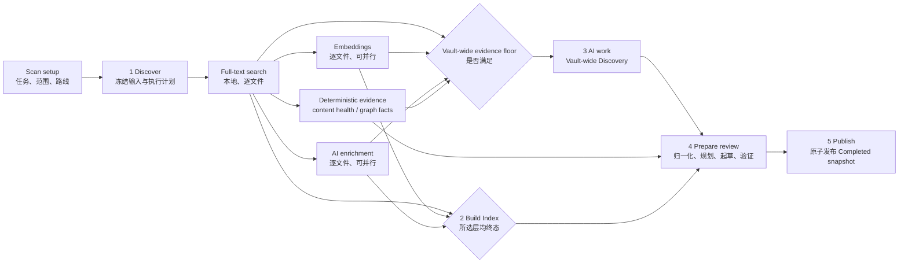
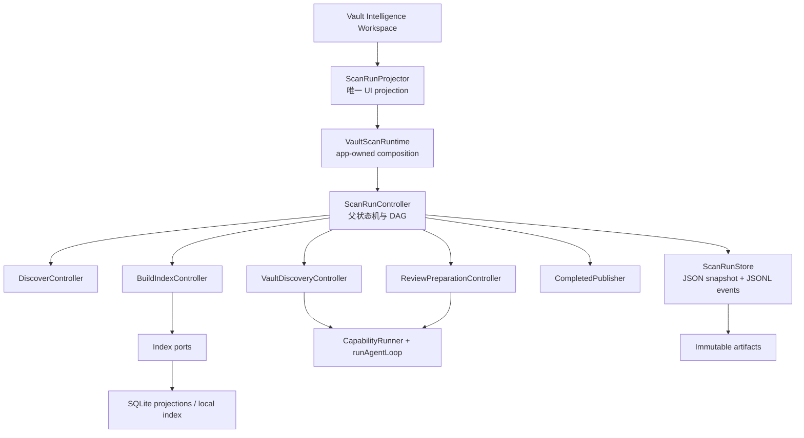
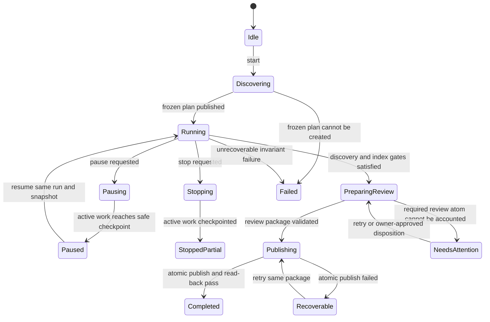

# Scan Vault 端到端生产运行设计

> 状态：生产实现合同
>
> 日期：2026-08-23
>
> 适用范围：Vault Intelligence 的 `Scan setup → Run progress → Completed` 运行链路
>
> 实施入口：[`2026-08-23-scan-vault-production-implementation-scope.md`](../plans/2026-08-23-scan-vault-production-implementation-scope.md)

## 1. 文档效力

本文不是视觉参考、概念草图或可选建议。后续实现必须以本文定义的运行状态、阶段边界、数据合同、进度算法、恢复语义和写入边界为准；聚焦 Mock 则规定最终 render tree 与交互结果。两者不一致时，先修正文档或 Mock，不能在代码中暗自创造第三套行为。

本文统合并约束以下已批准子设计：

- [`Vault-wide Discovery Harness`](./2026-08-23-vault-wide-discovery-harness-design.md)：负责 Vault 级反复调查、证据、发现和收敛；
- [`Prepare review`](./2026-08-23-vault-scan-review-preparation-design.md)：负责把冻结发现转成稳定、可验证、可 review 的工作；
- [`Scan and runs`](./2026-08-12-vault-intelligence-scan-and-runs-design.md)：保留产品原则；与本文五阶段运行图冲突的旧四阶段顺序由本文取代；
- [`Generated artifact registry`](../../conventions/generated-artifact-registry.md)：约束持久化载体、同步、索引和物化。

目标读者是即将实现此流程的工程师或编码 Agent。读者不需要从历史聊天猜测“为什么这么做”，也不应该用现有 `VaultIntelligenceRuntime` 的临时结构反向定义产品。

## 2. 用户承诺

一次 Scan Vault 必须提供六个可以验证的承诺：

1. 扫描范围、源版本和模型路线在运行前冻结；恢复时不会悄悄换一批输入。
2. Search、Embedding、逐文件 AI enrichment、Vault-wide Discovery 和 Review preparation 各自报告真实工作，不混成虚假的“文档速度”。
3. 进度来自系统可验证的 work units 和 gates，不来自计时器、模型自报或文字长度。
4. 暂停、应用重启和 provider 短暂失败不会丢失已完成的昂贵工作。
5. Scan 期间不修改用户文件；只有 Completed 之后的显式 proposal / accept / apply 流程可以写用户内容。
6. Completed 中每项可 review 工作都能回到稳定证据、模型 receipt、源 revision 和生成它的运行。

## 3. 非目标

本流程不负责：

- 自动接受或应用维护建议；
- 把机器结果自动物化成 Markdown；
- 在 Run progress 中重新选择模型；
- 用一个通用 Agent 自由决定所有阶段和完成条件；
- 用 SQLite 作为昂贵 AI 结果的唯一事实源；
- 把 Vault-wide Discovery 固化成 Relationships → Communities → Hubs → Bridges 的线性流水线；
- 为了显示百分比而预先捏造未知的发现总量。

## 4. 一次运行的真值模型

### 4.1 不是五个串行函数，而是一张受控 DAG

UI 显示五个阶段，便于用户理解当前扫描处于什么工作域；运行时则是一张带依赖、并行和回压的 DAG。



阶段含义固定如下：

| 阶段 | 负责什么 | 不负责什么 |
|---|---|---|
| Discover | 冻结 scope、源 revision、图快照、任务选择、路线策略和 ProgressPlan | 不分析 Communities，不建立全文索引 |
| Build Index | 对每个文件建立 Full-text、Embedding 和逐文件 AI enrichment 层 | 不做 Vault 级综合推理，不生成 owner task |
| AI work | 先组装 deterministic evidence，再在冻结证据边界内反复调查 Relationships、Communities、Hubs、Bridges 等 | 不按固定类型顺序运行，不直接改文件 |
| Prepare review | 把 findings 归并成稳定 workKey、建议、验证结果和 owner question | 不重新做 Vault-wide 探索，不应用建议 |
| Publish | 原子写入本次 Completed snapshot、引用和最终 receipts | 不调用模型，不临时推导任务 |

### 4.2 并行规则

Build Index 内三条 lane 采用流式依赖：一个文件完成文本读取与切块后即可进入它的 Embedding 和 AI enrichment，不等待所有文件的 Full-text 完成。Embedding 与 AI enrichment 也互不等待。

AI work 可在 Build Index 尚未完全结束时启动，但必须满足冻结的 `VaultWideEvidenceFloor`。默认 floor 是：

- 所有 in-scope 文件的 Full-text pass 已终态；
- deterministic graph snapshot 已固定；
- 已启用调查目标所需的强依赖层全部 ready 或被明确标记 unavailable；
- 可选的 Embedding / AI enrichment 仍在追赶时，Evidence Manifest 必须记录其 pending 状态，完成门不得忽略这些依赖。

Content-health detectors、broken-reference checks、graph maintenance、centrality 和 deterministic community candidates 由系统 evidence collectors 执行。它们可以随 Full-text readiness 增量运行，在 UI 上归入 AI work 的 evidence assembly，而不是增加第六个用户阶段；Agent 只能消费这些 facts，不能替代或伪造它们。当前 `performPublish()` 中的 `runMobiusGlobalMaintenance()` 必须前移到这里，否则 Discovery 会分析一张尚未更新的图。

Prepare review 必须同时等待 Build Index 的所选层终态和 Discovery 的完成门。Publish 只能等待 Prepare review 的验证与原子发布包完成。

## 5. 运行身份与冻结计划

### 5.1 稳定身份

每层身份含义不可互换：

| 字段 | 含义 |
|---|---|
| `scanRunId` | 一次用户可见 Scan，暂停恢复不变 |
| `snapshotId` | Discover 冻结的输入与源 revision 集合 |
| `stageSessionId` | Build Index、Discovery 或 Prepare review 的领域 session |
| `investigationId` | Discovery 中一个可暂停的调查线程 |
| `attemptId` | 一次 bounded AgentLoop 或 provider 调用 |
| `executionId` | 一组共享实际 provider 请求的执行标识 |
| `artifactId` | immutable evidence / result body 的稳定标识 |
| `workKey` | 跨扫描稳定的 review work 身份 |

恢复同一次 Scan 必须沿用 `scanRunId`、`snapshotId` 和已发布的 domain identity。新的 provider 重试使用新 `attemptId`，不能伪装成原 attempt 延续。

### 5.2 ScanPlan

Setup 提交后形成待冻结的 `ScanPlanDraft`。Discover 完成时发布不可变 `FrozenScanPlan`：

```ts
interface FrozenScanPlan {
  schemaVersion: 1;
  scanRunId: string;
  snapshotId: string;
  scope: FrozenScopeManifest;
  sourceRevisions: readonly SourceRevisionRef[];
  selectedTaskIds: readonly string[];
  enabledIndexLayers: readonly ('full-text' | 'embedding' | 'ai-enrichment')[];
  discoveryObjectives: readonly DiscoveryObjective[];
  reviewPreparationPolicy: ReviewPreparationPolicy;
  routePolicies: Readonly<Record<ScanOperationId, FrozenRoutePolicy>>;
  progressPlan: ProgressPlan;
  budget: ScanBudget;
  createdAt: number;
  fingerprint: string;
}
```

模型只在 Scan setup 配置。Run progress 显示计划路线和实际 receipt，但不出现模型 picker。

`FrozenRoutePolicy` 不是只能装一个 model。它可以冻结一个经过 setup 审核的 route pool，以及选择策略、并发上限、fallback 顺序和本地/远端限制：

```ts
interface FrozenRoutePolicy {
  operationId: ScanOperationId;
  candidates: readonly FrozenModelRoute[];
  strategy: 'single' | 'capacity-aware' | 'fallback';
  maxConcurrency: number;
  localMaxConcurrency: number;
  retryPolicy: RetryPolicy;
  fingerprint: string;
}
```

每个文件的 actual route 写入 attempt receipt，因此同一 lane 可以同时利用本地与多个远端模型。Controller 只能从冻结候选中选，不能在运行中偷偷改用 setup 未批准的模型。

## 6. 领域运行时与所有权

### 6.1 app-owned composition

`VaultScanRuntime` 是 app layer 拥有的 composition root。它组合 controller、port、GeneratedOutputRuntime、模型路线、Harness 和 UI projector；service layer 不增加模块单例，也不通过 `AppContext.getInstance()` 偷取依赖。



### 6.2 单写者规则

每个 domain session 只有一个 canonical writer：

- `ScanRunController` 写父 run state；
- `BuildIndexController` 写 Index session；
- `VaultDiscoveryController` 写 Discovery session、findings 和 frontier；
- `ReviewPreparationController` 写 review plan、jobs 和 workKey；
- `CompletedPublisher` 只提交已验证 publish package。

Agent、worker 和 provider callback 只能返回 proposal/event，不能直接改 canonical session。这样即使远端请求并发返回，也不会造成进度倒退、重复 findings 或 owner choice 被覆盖。

### 6.3 Agent Harness 的边界

复用现有 `CapabilityRunner`、`runAgentLoop`、`PermissionGuard`、`TraceBus`、ToolDef 和 RunEnvelope。一个 AgentLoop 是有预算的 attempt，不等于整个 Scan，也不拥有 stage 完成权。

- Discovery Controller 可以反复启动 0..N 次调查 attempt；
- Prepare review 以一个统一的 ReviewPreparationAgent session 启动 0..N 次 bounded jobs：歧义 work shaping 可选，review artifact drafting 对普通 reviewable work 必需；
- Agent 只能通过 typed tools 读取 evidence、提出 finding 或提交 draft；
- Controller 根据 schema、证据、预算、覆盖和收敛 gate 接受或拒绝；
- `stopWhen` 只结束当前 bounded attempt，不能宣布整个 Scan 完成。

整个 Scan 只有两个用户可理解的 Agent sessions：Vault Discovery 和 Prepare review。Relationships、Communities、Hubs、Bridges 不是四个 Agent；Review task kinds 也不是多组 Agent；Embedding、Index 和 deterministic detectors 则是 provider/system jobs，不是 Agent loop。Discovery 默认一次只运行一个会修改 frontier 的 attempt；若配置允许并行，只能并行互不重叠的只读 investigation，最终 finding/frontier commit 仍由 Controller 串行。Prepare review 按 conflict graph 对无冲突 work bundles 分批并行，但同一 workKey、共享 atom 或共享 owner choice 必须串行。

## 7. 父状态机



父状态建议固定为：

```ts
type ScanRunStatus =
  | 'idle'
  | 'discovering'
  | 'running'
  | 'pausing'
  | 'paused'
  | 'stopping'
  | 'stopped-partial'
  | 'preparing-review'
  | 'publishing'
  | 'needs-attention'
  | 'recoverable'
  | 'completed'
  | 'failed';
```

UI 的“当前 stage”是 projection，不是唯一运行指针。多个 lane 并行时，`activeStageIds` 可以有多个；标题选择最靠后的、当前仍在产生 owner-visible 输出的 stage，stage hover menu 则显示全部状态。

## 8. Discover

Discover 是确定性的计划阶段，不能被当作自由探索 Agent。

### 8.1 输入

- setup 选择的 scope、tasks、Index layers；
- setup 中确认的 operation → route policies；
- 当前 Vault file revisions；
- 当前 Index readiness、graph revision 和上次 scan cursor；
- 预算、并发、retry 和 progress 配置。

### 8.2 四个完成 gate

1. `scope-frozen`：路径、排除原因、mtime/hash 和不可读项冻结；
2. `evidence-snapshot-pinned`：Index/graph 基线 revision 固定；
3. `execution-plan-resolved`：任务、依赖、route pools 和预算通过 preflight；
4. `work-graph-published`：DAG、work-unit manifests 与 ProgressPlan 持久化。

任何 gate 失败且无法产生完整 FrozenScanPlan，Scan 都不能继续。可选的 AI scan planner 可以提出优先级和预算建议，但 Controller 必须能在它失败时用确定性计划继续。

### 8.3 输出

- `FrozenScanPlan`；
- `FrozenScopeManifest`；
- `WorkGraphManifest`；
- `ProgressPlan`；
- 首个 durable checkpoint。

## 9. Build Index

### 9.1 三条独立 lane

| lane | work unit | 并发与速度 | 成功输出 |
|---|---|---|---|
| Full-text search | 一个文件的一次 text/index pass | 本地 I/O/CPU pool，快 | text、keywords/passages、FTS receipt |
| Embeddings | 一个文件的一次 selected embedding pass | route-aware batch pool；本地通常串行，远端可滑动窗口 | vector/chunk receipts |
| AI enrichment | 一个文件的一次 selected enrichment pass | route-aware rolling pool | summary、AI tags、entities、file-level signals |

用户所说的“当前扫到哪些文件”来自三个 lane 各自的 live queue projection。三处使用相同的竖向文件列表结构；每行显示文件、当前动作、实际模型路线和状态，不把多个文件塞进一张横向小卡。

### 9.2 调度

`BuildIndexController` 维护 per-lane durable queue 和 provider capacity：

- Full-text 完成后立即发布 `document.search-ready`；
- Embedding 与 AI enrichment 分别订阅该事件；
- route scheduler 从 FrozenRoutePolicy 中挑选当前有容量的候选；
- 同 provider/model 可以 batch，不同 route 可并行；
- local route 遵守 `localMaxConcurrency`，默认 1；
- remote route 使用有上限的滑动窗口，不做一次性 fan-out；
- 队列具备 backpressure，不能让已切块文档无限堆在内存。

### 9.3 幂等与复用

每个 document-layer work unit 的 identity 至少包含：

```text
snapshotId + normalizedPath + sourceRevision + layerId + routeFingerprint + schemaVersion
```

相同 identity 已有成功 receipt 时返回 `already-current`；路线或 schema 变化则产生新 unit。失败、跳过和 unavailable 也必须形成 terminal receipt，不能从 denominator 消失。

### 9.4 完成条件

Build Index 完成不等于三个层全部成功，而是 FrozenScanPlan 中每个 enabled document-layer unit 均有 terminal disposition：

- `ready`
- `already-current`
- `failed`
- `skipped-by-policy`
- `unavailable`

失败和 unavailable 会让阶段状态成为 `completed-with-attention`，同时保留已成功的 Search/Embedding/Enrichment 层。Search ready 不应被后续慢层阻塞。

## 10. AI work：Vault-wide Discovery

完整内部合同见 [`Vault-wide Discovery Harness`](./2026-08-23-vault-wide-discovery-harness-design.md)。本节规定它在整个 Scan 中的入口和出口。

### 10.1 启动输入

- FrozenScanPlan 和 Evidence Manifest；
- 本次 source revisions；
- ready 的 local index、embeddings、file-level enrichments；
- deterministic relationship/community/centrality facts；
- 上次稳定 identity 与历史；
- enabled objectives、预算和 route policies。

在首个 Agent attempt 前，`EvidenceAssemblyController` 必须完成所需 deterministic collectors，并把 content-health findings、link facts、graph facts、index failures 和 unavailable units 写入 Evidence Manifest。它不是一个新的 UI 阶段，而是 AI work 的第一段系统工作。

### 10.2 运行方式

Controller 维护 frontier，并根据最新证据反复选择下一项最有价值调查。Relationships、Communities、Hubs、Bridges 是发现类型，不是四个固定阶段；一次 session 可以按 `relationship → community → relationship → bridge → hub → relationship` 反复进入。

Session log 记录真实 Agent/Tool 流：reasoning delta、tool start/result、citation、candidate proposed、finding retained/revised/rejected、checkpoint 和 usage。UI 可以流式显示这些事件，但 canonical finding 只在 Controller 验证后进入顶部 discoveries projection。

### 10.3 完成门

模型无权自行说“完成”。System-owned completion gate 同时检查：

- frozen evidence units 均 accounted 或有明确 blocker；
- enabled objectives 至少完成一次 required probe；
- high-priority frontier 为空；
- retained findings 都有 citation、source revision 和 validation disposition；
- 连续配置数量的 investigation cycle 没有产生高价值新证据；
- 没有运行中的 tool/attempt；
- 预算未被静默超出。

预算耗尽但未满足门时输出 `completed-with-attention` 或 `stopped-partial`，不能伪装成完整发现。

## 11. Prepare review

完整内部合同见 [`Prepare review`](./2026-08-23-vault-scan-review-preparation-design.md)。该阶段不是 Discovery 的尾部文字总结，而是单独的、可恢复的生产阶段。

### 11.1 冻结输入

输入 atom 包括：

- validated discovery findings；
- deterministic lint/content-health findings；
- Index failed/unavailable receipts；
- stale/recovery conditions；
- previous workKey、owner choices 和 source revisions。

输入冻结后，后续 late event 进入下一次 Scan，不得偷偷改变当前 denominator。

### 11.2 Agent 驱动的产物 pipeline

1. Normalize：Controller 统一成 typed atoms 并去重；
2. Provisional plan：Controller 按 owner surface、owner question、write boundary、verification kind 和 canonical anchors 建立不丢输入的 provisional graph；
3. Agent preparation：ReviewPreparationAgent 读取冻结证据，提出必要的 merge/split/defer，并为每项普通 reviewable work 生成完整 artifact；
4. Validate and revise：deterministic validator 返回 citation、schema、boundary、identity 和退出条件错误，Agent 根据反馈反复修订；
5. Freeze review work：Controller 接纳 artifact、生成 stable workKey 并冻结 task plan；
6. Publish package：形成 immutable `ReviewPreparationPackage`，但尚不进入 Completed。

每个输入 atom 必须有且只有一个 disposition。Completed UI 显示 `Ready for review` 时，必须已经有可 inspect 的 `ReviewWorkArtifact`、有效 citations 和 validation receipt；它不等于 proposal workflow 的 `ready-review` source-diff 状态。`Needs your choice` 必须有明确问题和选项；`Needs recovery` 必须说明缺失输入和恢复动作。Agent stream 只是生成过程，不能直接成为 task 或 artifact。

## 12. Publish

Publish 是短小的确定性提交，不允许调用模型，也不允许在这里运行 `deriveVaultMaintenanceTasks()`。

输入是已冻结、通过验证的：

- Build Index summary；
- Discovery summary 与 artifact refs；
- ReviewPreparationPackage；
- usage / route / provider receipts；
- warnings、blockers 和 recovery information。

提交步骤固定：

1. stage immutable Completed body；
2. append `run.publish-prepared`；
3. 原子更新 current workspace projection 指向该 body；
4. append `run.completed`；
5. read-back 校验 checksum、task count、workKey uniqueness 和 artifact reachability。

任一步失败，状态进入 `recoverable` 并保留同一个 publish package；重试不得重新调用 AI 或重新生成 tasks。

## 13. 进度合同

### 13.1 三种不同信息

UI 必须分开：

- `overallPercent`：流程完成度；
- `stage/lane progress`：该工作域真实 work units；
- `etaRange`：按当前吞吐和关键路径预测的剩余时间。

百分比不是 ETA，速度也不能跨 Full-text、Embedding 和 Agent reasoning 混成一个 `docs/min`。

### 13.2 全局分配

默认 ProgressPlan 在 Discover 冻结时锁定以下产品权重：

| 阶段 | 全局 credits |
|---|---:|
| Discover | 15 |
| Build Index | 40 |
| AI work | 33 |
| Prepare review | 10 |
| Publish | 2 |

`overallPercent = floor(sum(stageCredit × stageLocalFraction))`，并与上次 durable value 取最大值，因此绝不倒退。阶段可以并行赚取 credits；这些数字表示完成度，不表示耗时占比。

权重和 gate credits 必须放在 `templates/config/vault-intelligence.json` 的 versioned 配置中，由 Discover 冻结。代码只允许有与模板镜像的 typed fallback，不能散落 magic numbers。

### 13.3 各阶段 local fraction

Discover：四个 gate 各占 25%，只有 durable gate receipt 才计入。

Build Index：

```text
terminal enabled document-layer passes / frozen enabled document-layer passes
```

默认启用三层且有 146 个文件时 denominator 是 438。每一 pass 对产品完成度等价；lane 速度和 ETA 仍分别显示。失败也算 terminal，但成功数和 attention 数必须独立呈现。

AI work 不使用“发现总数”。它使用 Controller 可验证的 earned gates：

| gate | AI work 内 credits | 计算 |
|---|---:|---|
| Evidence boundary | 10 | manifest 和 required floor durable |
| Objective sweep | 25 | terminal required probes / frozen required probes |
| Evidence coverage | 25 | accounted evidence units / eligible evidence units |
| Finding validation | 20 | terminal candidate dispositions / frozen candidates；候选 denominator 未冻结前为 0 |
| Convergence | 15 | 无高优先 frontier、无未验证 retained finding、连续稳定窗口三项各 5 |
| Completion receipt | 5 | final controller receipt + artifact reachability |

Agent 文字、token 数和 tool call 数不直接增加百分比。高优先 frontier 未清空时 AI work 最高 80%；未满足 convergence 时最高 85%；没有 completion receipt 时最高 95%。

这些 cap 只约束仍在运行的 session。若预算或证据限制使完整收敛不可能，Controller 必须先把每个剩余 frontier/evidence unit 变成有原因、有恢复动作的 terminal blocker，再签发 `completed-with-attention` receipt；此时该阶段的未完成 credits 作为“已处置但未成功”终态计入，因此整个 Scan 仍可在 Publish 后显示 100%。百分比表示流程处理完毕，成功、失败和 attention 数量另行显示，不能出现“运行已经结束但永久停在 93%”。

Prepare review 使用两次 denominator freeze：input atoms 冻结前 local fraction 为 0；provisional graph 和 job partition 冻结后按下列 stage-local credits 计算：Normalize 20、Provisional plan 15、Agent preparation 30、Artifact validation 25、Freeze review package 10。普通 reviewable work 必须经过 ReviewPreparationAgent job 和 artifact validation；deterministic-only 类别则用显式 skipped-terminal receipt 关闭相应 credits。不能因为初始不知道会生成几项 task 就显示伪造百分比。

Publish 的 2 credits 只在 current pointer 原子更新和 read-back 通过后全部获得；准备临时文件不算完成。

### 13.4 ETA

ETA 由 `ScanEtaEstimator` 单独计算：

- Full-text 用本地文件/字节吞吐 EMA；
- Embedding 用 route-specific chunks/sec、batch wait 和 queue depth；
- AI enrichment 用 route-specific docs/min 和 active slots；
- Discovery 用近几轮 investigation duration、frontier pressure 和 evidence coverage，输出范围；
- Prepare review 用 remaining deterministic jobs、ReviewPreparationAgent job batches 与 validation/revision 分布；
- 全局 ETA 取运行 DAG 关键路径，不做各 lane 时间简单相加。

样本不足、provider 限流或 frontier 扩张时显示范围或 `Estimating`。ETA 可以增加；它不参与百分比，不能为了视觉稳定而撒谎。

## 14. Checkpoint、暂停、恢复和停止

### 14.1 Safe checkpoint

允许暂停的安全点：

- 一个 Full-text document pass 后；
- 一个 Embedding/Enrichment provider receipt 后；
- 一个 Agent tool result 或 attempt 后；
- Discovery finding commit 后；
- Prepare review job commit 后；
- Publish 原子 pointer 更新之前。

点击 Pause 后立即停止派发新工作，活动请求在安全点结束或按 provider 能力取消，然后持久化 session snapshot、queue、frontier、budgets、last event sequence 和 overall percent。UI 状态依次是 `pausing → paused`，不是瞬间伪装已暂停。

### 14.2 Resume

Resume 必须：

- 验证 FrozenScanPlan fingerprint 和 source revisions；
- 复用成功 receipts，不重复收费；
- 对运行中但无 terminal receipt 的 work unit 创建新 attempt；
- 继续原 queue/frontier/workKey；
- 只在明确 stale 时进入 recovery，不自动换新 snapshot。

### 14.3 Stop

Stop 不再启动任何 AI 或 Prepare review 工作。它将活动工作收束到 checkpoint，发布 `stopped-partial` receipt 并保留已成功的本地 Index 层和机器事实；正常 Completed task list 不从不完整输入中自动生成。后续若要包装部分结果，必须由显式 `Prepare partial review` 操作开启新的 child session。

Generic RunEnvelope 目前没有 `paused`。第一版保持 pause 为 Scan domain 状态；当前 Agent attempt 在 checkpoint 处 `cancelled`，恢复时新建 attempt。不能为了这项功能静默扩大全局 RunEnvelope enum。

## 15. 错误与降级

| 情况 | 处理 | 父运行结果 |
|---|---|---|
| scope 或 plan 无法冻结 | 不开始后续阶段 | failed |
| 单文件无法读取/解析 | terminal failed receipt，继续其他文件 | completed-with-attention 候选 |
| Embedding route 暂时失败 | 有界 retry/fallback；仍失败则保留 Search ready | completed-with-attention 候选 |
| 逐文件 AI enrichment 失败 | 保留其他层，记录 actual route 与 error | completed-with-attention 候选 |
| Discovery attempt/provider 失败 | 新 attempt 或换冻结 pool 内 fallback | 预算耗尽后 needs-attention/partial |
| Discovery 无证据支持 finding | reject candidate，不进入 retained | 继续运行 |
| Prepare review atom 无 disposition | 阻止正常 Publish | needs-attention |
| Publish 写入或 read-back 失败 | 保留同一 package，可重试 | recoverable |
| 用户文件在运行中变化 | 当前 snapshot 不变，标记 stale source | 依据影响 needs-attention 或下一次 Scan |

## 16. 持久化与事件

### 16.1 Canonical carriers

生产实现必须更新 generated artifact registry 后才能新增 writer：

- `DR-26 Vault Intelligence state`：只保存 current workspace projection、active run pointer、last completed pointer、owner choices 和小型 checkpoint 摘要；
- `DR-27 Vault Intelligence run events`：从单一全局 JSONL 迁为 `records/vault-intelligence/runs/{scanRunId}/events.jsonl`；旧 `events.jsonl` 只读导入，不删除；
- 新增 `DR-28 Vault Intelligence run artifacts`：`artifacts/vault-intelligence/runs/{scanRunId}/{artifactId}.json`，保存 FrozenScanPlan、Evidence Manifest、Discovery/Review snapshots、Completed body 等 immutable body。

SQLite 只保存可重建 projection，例如文件/lane 状态、finding filters 和 Work queue 查询。丢失 SQLite 后必须能由 canonical JSON/JSONL 重建，不能重新花 AI 成本。

### 16.2 Event ordering

每个 run event 至少包含：

```ts
interface VaultScanDomainEvent {
  schemaVersion: 1;
  eventId: string;
  scanRunId: string;
  sequence: number;
  eventType: string;
  idempotencyKey: string;
  stageId: VaultScanStageId | null;
  sessionId: string | null;
  attemptId: string | null;
  artifactRefs: readonly ArtifactRef[];
  occurredAt: number;
  payload: unknown;
}
```

领域命令顺序固定为：验证 command → append idempotent event → 更新 snapshot 的 `lastEventSequence` → durable write snapshot/pointer → 发布 UI projection。崩溃发生在 event 与 snapshot 之间时由 replay 补齐；UI 内存状态不得领先于 durable commit 形成“看起来完成、重启后消失”。

大型 body 只写 immutable artifact，event 只引用 artifact ID 和 checksum。

## 17. UI projection 合同

React 不计算业务进度。`ScanRunProjector` 从父状态、domain sessions 和 event receipts 产生唯一 `VaultScanRunProjection`：

```ts
interface VaultScanRunProjection {
  runId: string;
  status: ScanRunStatus;
  title: string;
  overallPercent: number;
  elapsedMs: number;
  etaRangeMs: readonly [number, number] | null;
  activeStageIds: readonly VaultScanStageId[];
  stages: readonly StageProjection[];
  buildIndex: BuildIndexProjection;
  discovery: DiscoveryProjection;
  reviewPreparation: ReviewPreparationProjection;
  usage: UsageProjection;
  controls: ScanControlProjection;
}
```

必须一比一驱动已批准 Mock：

- 顶部只显示当前长标题、一个 overall progress、elapsed/remaining、usage 和 controls；
- 不再常驻五步条；`View 5 stages` hover/focus surface 展示五阶段；每阶段可继续 hover 看 tooltip，也可点击切换到该阶段详情；
- 点击 stage 只是切换 inspection，不改变真实运行；
- Build Index 下方保留自己的 stage progress 和三个 lane；
- AI work 保留 discoveries + session streaming；
- Prepare review 的 stream 和 review work 是同一依赖链：只有对应 stream job 完成并验证，该 work 行才前进；
- 页面不自动追踪/滚动到最新文件；新事件可追加，但用户滚动位置稳定。

聚焦 Mock 是视觉与交互合同：

- [`Build Index`](../../gstack/vault-scan-build-index-flow-2026-08-23/index.html)
- [`Vault-wide Discovery`](../../gstack/vault-scan-vault-wide-discovery-2026-08-23/index.html)
- [`Prepare review`](../../gstack/vault-scan-review-preparation-2026-08-23/index.html)
- [`完整 Workspace`](../../gstack/vault-intelligence-workspace-2026-08-12-v2/index.html)

## 18. 当前生产实现必须被替换的部分

当前 `VaultIntelligenceRuntime` 仍有四个结构性问题，不能在其上继续贴 UI：

1. `VaultScanStageId` 只有 `discover | index | ai | publish`，缺少独立 `prepare-review`；
2. `executeRun()` 实质是 Discover 后 `Promise.all(Index, AI)`，没有显式依赖和 Evidence floor；
3. `operationExecutionGroup()` 把 relationship、semantic、community、hub/bridge、file proposals 和 synthesis 合并成一轮 shared Vault Review；
4. `performPublish()` 现场调用 `deriveVaultMaintenanceTasks()`，把任务生成、验证和发布混在一起。

现有 `deriveProgressLedger()` 也必须退役。它用“文件数 + operation 数 + publish 1 unit”混合出百分比，无法表达三条 Index lane、动态 Discovery 和两次 denominator freeze。

现有可复用资产包括：

- app-owned runtime composition；
- Index ports 与现有增量 Index 能力；
- CapabilityRunner、AgentLoop、PermissionGuard、TraceBus、RunEnvelope；
- GeneratedOutputRuntime 与 registry；
- owner choice、proposal/apply/verify 的安全边界；
- setup 的任务和模型路线选择。

## 19. 不变量

任何实现和 review 都必须逐条证明：

1. Scan 阶段没有用户文件 writer。
2. Setup route、scope 和 source revision 在 FrozenScanPlan 后不可变。
3. 所有并发结果经 domain controller 单写者提交。
4. 每个 enabled work unit 都有 terminal disposition。
5. 全局百分比单调、durable，且只由系统 receipts 计算。
6. Agent 无法设置 stage 完成或整体百分比。
7. 暂停恢复不重复已成功的昂贵调用。
8. Completed task 在 Publish 前已形成 stable workKey 并通过验证。
9. Publish 不调用模型、不推导新任务。
10. 用户文件只有在 Completed 后的显式 accept/apply 流程才可改变。

## 20. 验收场景

最低自动化场景：

- 146 文件、三 Index layers，Build Index denominator 固定为 438；
- Full-text 全部 ready 时 Embedding/AI enrichment 仍运行，Search 可立即使用；
- 本地模型并发 1、两个远端 route 并发运行，actual route 按文件记录；
- Discovery 反复产生 relationship/community/relationship/bridge，不按类型顺序；
- Discovery 输出大量 reasoning text，但没有 validated finding 时 discoveries 不增加；
- 新 finding 使 frontier 扩张，ETA 上升但 percent 不倒退；
- Pause 在 tool boundary 完成，重启应用后 resume 同一 run；
- provider request 无 receipt 时 resume 创建新 attempt，不重复成功 unit；
- Prepare review denominator 未冻结时整体停在已赚 credits；冻结后按 atoms/jobs 前进；
- Review stream job 未完成时对应 review work 行不能提前 ready；
- Publish 中途失败，重试相同 package 后完成且 task/workKey 不重复；
- Stop 后产生 stopped-partial，不自动生成正常 Completed task list；
- SQLite 删除后由 canonical carriers 重建 projection；
- 扫描前后用户文件 hash 完全一致。

真实 Obsidian 还必须验证 hover stage menu、切换 inspection、pause/resume、稳定滚动、三 lane live file list、Discovery stream、Prepare review dependency 和 Completed handoff。Harness 或静态 HTML 只用于 characterization，不能替代真实宿主验收。

## 21. 决策结论

生产目标不是把五张 UI 顺序接起来，而是建立一个父 ScanRun 状态机，下面运行三个有自己 denominator、checkpoint 和完成门的 domain controller。Build Index 处理逐文件层，VaultDiscoveryController 处理开放式但受控的反复调查，ReviewPreparationController 把发现转成可 review 工作，CompletedPublisher 只做原子发布。

这套边界既保留 Agent 的灵活性，也把 scope、工具、预算、证据、进度、完成与写入权牢牢放在系统手里。后续编码若不能证明这些不变量，就不算一比一实现了本流程。
