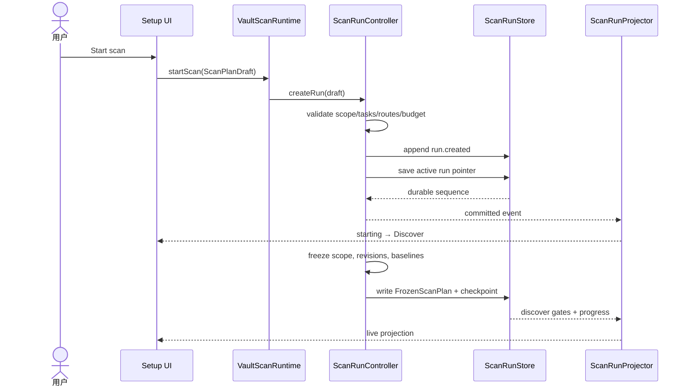
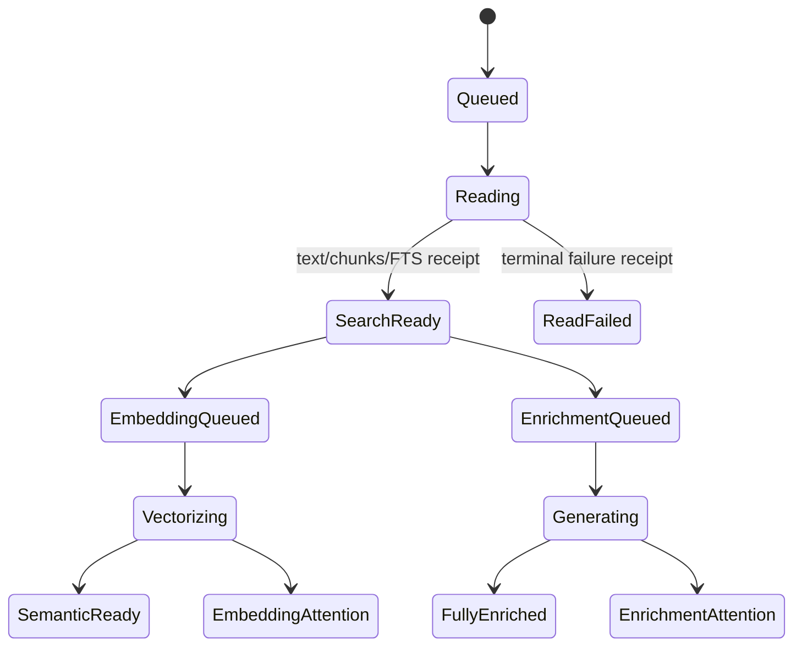
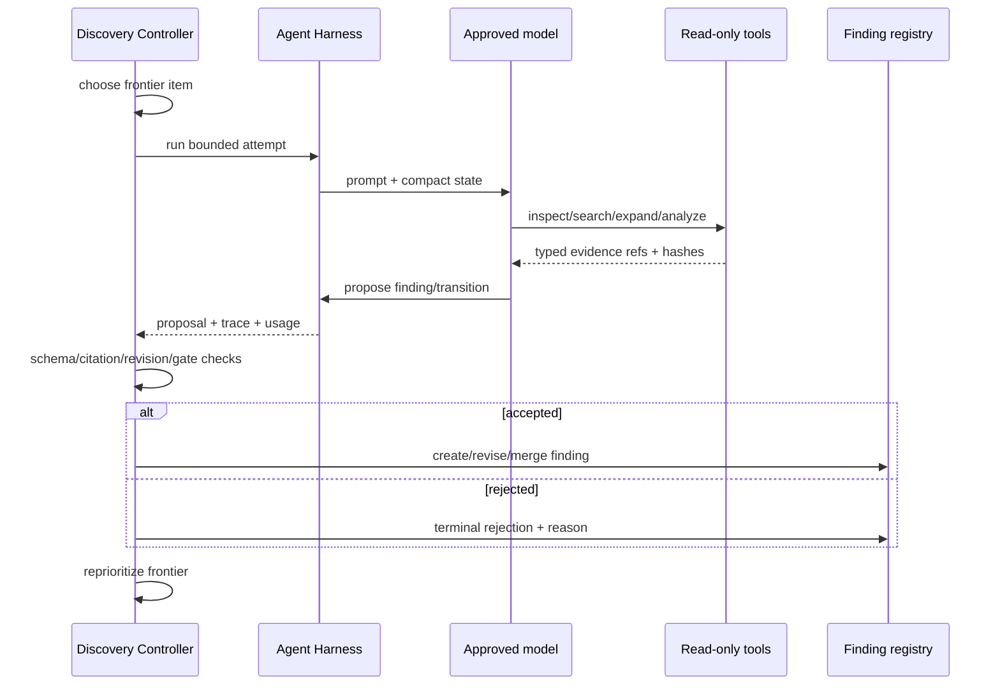
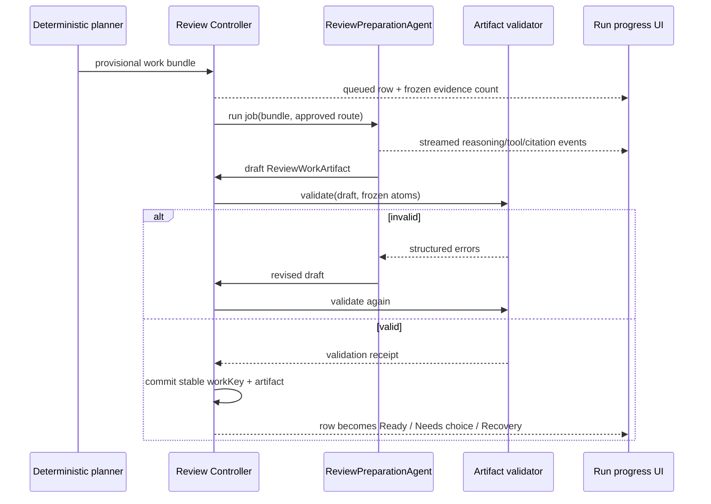

# Scan Vault 前后端运行总图

> 状态：目标生产合同的可读解释层  
> 日期：2026-08-23  
> 读者：产品设计者、前端工程师、后端/Agent 工程师  
> 视觉版：[`Scan Vault：从开始到可审核产物`](../../gstack/vault-scan-runtime-atlas-2026-08-23/index.html)

## 1. 先说人话：点下 Start scan 后到底发生什么

用户在 Setup 做三件事：圈定内容、选择要做的工作、为每种 AI 工作批准模型路线。点击 `Start scan` 后，系统先把这些选择和当时的文件版本冻结成一份不可变计划。后面的运行只能使用这份计划，暂停恢复也不能偷偷扩大范围或换模型。

随后系统执行五个用户可理解的阶段：

1. **Discover**：冻结文件、版本、Index/Graph 基线、路线、预算和工作图。这一步是准备运行，不是发现 Community。
2. **Build Index**：每个文件分别建立全文、Embedding 和逐文件 AI 增强。全文通常最快；另外两条 lane 可以在文件全文准备好后开始，不必等待整个 Vault。
3. **Vault-wide discovery**：第一个真正的 Agent 会话。Agent 围绕冻结证据反复搜索、扩图、比较和提出 finding；Relationship、Community、Hub、Bridge 是发现类型，不是四个固定步骤。
4. **Prepare review**：第二个真正的 Agent 会话。它把已验证 findings 和确定性问题转成稳定的 review work、问题、选项、解释和 citations；每份产物必须通过系统 validator。
5. **Publish**：不再调用模型，只把已验证的 Index 汇总、findings、review work、usage 和 receipts 原子发布为 Completed snapshot。

Completed 之后，用户选择某项工作，系统才会创建具体 proposal；用户继续接受并 Apply 后才允许写用户文件，然后必须 re-index 和 Verify。**Scan 本身从头到尾不改用户文件。**

## 2. 一张总链路

```mermaid
flowchart LR
    U["用户：Scope / Tasks / Models"] --> S["Start scan"]
    S --> D["1 Discover\n冻结计划与版本"]
    D --> I["2 Build Index\n全文 / Embedding / AI enrich"]
    I --> E["Evidence manifest\nIndex + lint + graph facts"]
    E --> V["3 Vault-wide discovery\n反复调查 Agent"]
    V --> R["4 Prepare review\n产物生成 Agent"]
    R --> P["5 Publish\n原子发布"]
    P --> C["Completed\n可审核任务与 receipts"]
    C --> Q["Owner choice"]
    Q --> G["Proposal / exact diff"]
    G --> A["Apply"]
    A --> X["Re-index + Verify"]
```



这张图只表示产品因果。后端实际是一张带依赖和并行的 DAG：Build Index 三条 lane 会交错；deterministic collectors 可以增量工作；Vault-wide discovery 只有在 evidence floor 达标后才能启动；Prepare review 必须等待 Index 终态和 Discovery completion receipt。

## 3. 谁负责什么

| 角色 | 只负责 | 不能做 |
|---|---|---|
| React Workspace | 呈现 projection、发出用户命令、切换 inspection | 自己算业务进度、自己生成任务 |
| `VaultScanRuntime` | app-owned composition，连接 controller、ports、Harness、store | 在 service 层藏全局 singleton |
| `ScanRunController` | 父状态机、DAG、checkpoint、预算和阶段 gate | 代替 Agent 推理、直接写用户文件 |
| `BuildIndexController` | 三条 Index lane、route pool、per-file receipts | Vault 级综合推理 |
| `VaultDiscoveryController` | frontier、investigation、finding 验证与完成门 | 让模型自行宣布完成 |
| `ReviewPreparationController` | atoms、provisional graph、jobs、workKey 和 artifact gate | 在 Publish 现场临时 derive task |
| `CompletedPublisher` | 提交已经冻结的 publish package并 read-back | 调模型、生成新 finding/task |
| Agent Harness | bounded attempt、工具、权限、trace、预算 | 拥有整个 Scan 或 stage 完成权 |
| Generated output store | JSON/JSONL canonical state 与 immutable artifacts | 用 SQLite 充当昂贵 AI 产物唯一真值 |
| SQLite/Index | 可重建全文、vector、filters 和查询 projection | 覆盖 canonical receipts/artifacts |

## 4. Setup：用户配置的三步

### 4.1 Step 1 — Choose scan scope

前端允许选择：

- changes since last scan；
- selected files/folders/file types/Communities/saved work；
- entire Vault。

后端此时只形成 `ScanPlanDraft.scope`，不会开始扫描。动态选择最终必须解析成明确路径；Start 后保存的是具体路径与版本，不是一个会继续变化的“Community 名称”。

界面需要在点击开始前告诉用户：预计文件数、不可读/排除数、选中范围与受影响 context。Step 1 不是模型调用。

### 4.2 Step 2 — Choose scan tasks and Index outputs

用户选择的是产品结果，不是内部函数：

- Knowledge Index；
- Content health；
- Relationships & Communities；
- Reviewable follow-up。

Knowledge Index 下再选本次输出层，例如 Full-text、Embeddings、summary、AI tags、entities 或信号。Task selection 会编译为：

- enabled deterministic checks；
- enabled Index layers；
- discovery objectives；
- Prepare review policy。

未选中的任务不应在运行中凭 Agent 兴趣被重新打开。

### 4.3 Step 3 — Review AI models

这里批准的是 operation → route policy，而不是给整个 Scan 只选一个模型。典型 operation 包括：

- `plan-scan`；
- `embedding-refresh`；
- `file-summaries` / `ai-tags`；
- Vault-wide discovery；
- Prepare review work shaping / artifact drafting。

每个 route policy 可包含本地与多个远端候选、fallback、并发上限和重试策略。运行时每个 attempt receipt 都记录计划路线和实际路线。Run progress 只展示路线与 receipt，不再提供 picker。

### 4.4 Start 按钮的前端行为

前端提交 `ScanPlanDraft` 后立即进入 `starting`，按钮不可重复触发；只有收到 `run.created` 和首个 durable checkpoint 后，页面才进入 Run progress。模型不可用、scope 无法解析或计划不完整时留在 Setup，并把原因放到对应行，而不是打开一个注定失败的运行页。

## 5. Start scan 时序



任何内存 UI 都不能领先于 durable event 显示“已经完成”。崩溃发生在 event 与 snapshot 之间时，恢复通过 event replay 补齐。

## 6. Stage 1 — Discover：真正的运行准备

Discover 是确定性 controller，包含四个 gate：

1. **Scope frozen**：规范化路径，读取 mtime/hash，记录排除和不可读项。
2. **Evidence baseline pinned**：固定现有 Index revision、graph revision、last scan cursor。
3. **Execution plan resolved**：把 tasks 编译为 DAG，解析路线池、预算、retry 与 provider capacity。
4. **Work graph published**：为可知的工作建立 manifests 与 ProgressPlan，写第一个 checkpoint。

可选的 `plan-scan` 模型可以建议优先级和预算，但它失败不能改变 scope 或阻止确定性计划继续。Discover 结束产物是：

- `FrozenScanPlan`；
- `FrozenScopeManifest`；
- `WorkGraphManifest`；
- `ProgressPlan`；
- source revision refs；
- route fingerprints。

这一步的百分比由四个 durable gate 决定，每个 25%，不是按计时器走。

## 7. Stage 2 — Build Index：三条逐文件 lane

### 7.1 文件状态链



Full-text 完成一个文件就发出 `document.search-ready`。Embedding 和 AI enrichment 都订阅它，所以同一时间可能是：文件 A 已 fully enriched，文件 B 正 embedding，文件 C 正全文读取。

### 7.2 Full-text search

输入是冻结路径和 source revision。系统读取可支持文档、提取 text、切 passages、提取本地关键词并更新 FTS projection。输出：

- normalized text/chunks；
- searchable passages；
- FTS receipt；
- parse/read failure receipt。

这条 lane 是本地 I/O/CPU pool，显示 docs/min 或 bytes/sec。它不调用大模型，也不等待 Embedding provider。

### 7.3 Embeddings

输入是 search-ready chunks。route scheduler 按 Setup 冻结的 embedding routes 选择当前有容量的候选：本地通常 `maxConcurrency=1`，远端用有界 batch/sliding window。输出 vector/chunk receipts，并记录 actual model route。

同一文件在相同 source revision、schema、layer 和 route fingerprint 下已有成功 receipt 时返回 `already-current`，不会重复收费。

### 7.4 AI enrichment

输入是文件 text/chunks 和启用的输出清单。它为单个文件生成 summary、AI tags、entities 或 file-level signals。它不是 Vault-wide reasoning，也不会在这里决定 Community。

可以把使用相同 route 的 summary 与 tags 合并为一次 provider 请求；不同文件/route 可并行。每个文件仍必须拥有独立 terminal receipt，UI 的 Current files 行显示实际模型而不是在 lane 标题后写一个固定模型。

### 7.5 Build Index 完成

分母在 Discover 时冻结：

```text
所有 enabled document-layer work units
= 文件数 × 启用层数（再扣除有明确 unavailable receipt 的不适用层）
```

146 个文件、三层时是 438。成功、失败、skipped 和 unavailable 都属于 terminal disposition，因此阶段可以以 `completed-with-attention` 结束；Search ready 不被慢层失败阻塞。

## 8. Evidence assembly：进入 Vault-wide 前系统先准备什么

这是 AI work 的第一段，不增加第六个用户阶段。确定性 collectors 产生：

- content-health/lint findings；
- broken-reference facts；
- explicit link/tag/folder facts；
- graph snapshot、centrality、cluster candidates、path facts；
- Index failed/unavailable receipts；
- historical findings/Communities/workKey；
- source revision refs。

`EvidenceManifest` 给每个 unit 一个 accounted 状态。Vault-wide discovery 的 Agent 只能读取 manifest 内允许的 evidence refs，不能直接无限遍历 Vault，也不能把自己的文本当证据。

默认 evidence floor 要求全文终态、graph snapshot 固定、目标的强依赖可用或明确 unavailable。Embedding/AI enrichment 可按政策继续追赶，但 pending 必须显式写入 manifest。

## 9. Stage 3 — Vault-wide discovery：第一个 Agent 会话

### 9.1 它为什么不是固定 pipeline

Agent 维护的是 investigation frontier，不是 Relationship → Community → Hub → Bridge 的步骤条。一次真实顺序可能是：

```text
relationship → community boundary → relationship → bridge path
→ counter-evidence → hub role → relationship revision → completion check
```

每轮 controller 选择当前价值最高的 investigation，启动一个有预算的 Agent attempt。Attempt 可以输出流式 reasoning 和 tool events，但只有 controller 验证过的 finding 才进入顶部 discoveries。

### 9.2 一轮怎样运行



### 9.3 Agent 可用的工具

**状态与证据**

- `discovery_get_state`：读 compact frontier、coverage、findings 和 blockers。
- `discovery_inspect_evidence`：按 ref 读 passage、graph fact、history 或 revision。
- `discovery_search_evidence`：在冻结 FTS/vector projection 内检索。
- `discovery_expand_graph`：读有界邻域、路径和 truncation receipt。

**确定性分析**

- `discovery_rank_relationships`：提出值得调查的候选，不直接宣布关系成立。
- `discovery_compare_community_boundary`：比较 cluster/历史边界与漂移。
- `discovery_measure_node_roles`：测 Hub、broker、outlier 等角色。
- `discovery_trace_bridge_paths`：验证桥接路径、替代路径和脆弱性。

**调查与 Finding**

- `discovery_open_investigation`；
- `discovery_update_investigation`；
- `discovery_propose_finding`；
- `discovery_propose_finding_transition`；
- `discovery_request_completion_check`。

这些工具没有用户文件 writer。模型也拿不到任意 shell、任意 Vault write 或直接“完成 stage”的工具。

### 9.4 如何结束

Agent 只能请求 completion check。Controller 检查：evidence accounted、每个 objective 有 required probe、高优先 frontier 为空、retained findings 都有 citations/revision/validation、稳定窗口内没有高价值新增、无运行中工具、预算有明确结算。

Finding 数量、token 数、reasoning 长度和 tool call 数都不能直接当进度。预算耗尽但未收敛时，剩余项必须变成有原因的 blocker，阶段只能 `completed-with-attention`。

## 10. Stage 4 — Prepare review：第二个 Agent 会话

### 10.1 它不是 Publish 的小尾巴

这一步负责生产 Completed 里真正能打开、能理解、能决定的 review work。输入来自：

- validated discovery findings；
- deterministic lint/content-health findings；
- Index failure/unavailable receipts；
- stale/recovery conditions；
- previous workKey、owner choice 与 source revisions。

输入 atoms 冻结后，晚到的 finding 只能进入下一次 Scan。

### 10.2 六步产物管线

1. **Normalize**：统一 typed atoms、去重、保留 provenance。
2. **Provisional plan**：系统按 owner surface、owner question、write boundary、verification kind 和 anchors 建图。
3. **Partition jobs**：冲突图把共享 atom/workKey/owner choice 的工作串行，无冲突 bundles 可并行。
4. **Agent preparation**：`ReviewPreparationAgent` 对歧义 work 做 merge/split/defer，并为普通 reviewable work 起草 artifact。
5. **Validate and revise**：系统 validator 返回 citation、schema、identity、boundary 和 exit-condition 错误；Agent 修订直到通过或 terminal attention。
6. **Freeze package**：Controller 生成 stable workKey、task plan、receipts 和 immutable `ReviewPreparationPackage`。

### 10.3 一项 Review work 怎样出现



因此 UI 的依赖关系必须很明显：流输出属于当前 job；**对应 job 还没完成和验证时，上面的 Review work 行不能提前显示 ready。**

### 10.4 Agent 工具

**读取**

- `review_get_state`；
- `review_inspect_finding_bundle`；
- `review_compare_existing_work`；
- `review_search_evidence`。

**提出产物**

- `review_propose_task_group`；
- `review_propose_task_transition`；
- `review_draft_artifact`。

**校验与提交**

- `review_request_publish_check`；
- `review_submit_validated_artifact`。

Agent 不可 apply proposal、不改 Markdown、不绕过 validator，也不能把 session transcript 当最终 artifact。

### 10.5 到底需要几个 Agent

一个 Scan 中是 **一个统一的 ReviewPreparationAgent session，0..N 个 bounded jobs**，不是 11 个 task-kind Agents。0 findings 时 0 job；普通 reviewable work 至少一个 drafting job；复杂或互不冲突 bundles 可并行，但 canonical commit 串行。

Completed 后用户要求具体改文件时，才可能启动独立 `ProposalDraftAgent`。它不属于 Scan，也不能被算进 Prepare review 的完成。

## 11. Stage 5 — Publish 与 Completed

Publish 的输入必须已经冻结并通过 gate：

- Build Index summary 与 receipts；
- Discovery summary 与 artifact refs；
- `ReviewPreparationPackage`；
- usage、planned/actual routes、warnings、blockers。

固定提交顺序：

1. 写 immutable Completed body；
2. append `run.publish-prepared`；
3. 原子更新 current pointer；
4. append `run.completed`；
5. read-back checksum、task count、workKey uniqueness 和 artifact reachability。

Publish 不允许调模型，不允许现场运行 `deriveMaintenanceTasks()`。失败进入 `recoverable`，重试同一个 package，不能重新花 AI 成本。

Completed 页面只是已发布 snapshot 的 projection，展示：运行时长/usage/receipts、自动完成事项、Ready for review、Needs your choice、Needs recovery。它不会在 render 时继续生成任务。

## 12. Completed 之后：Proposal、Apply、Re-index、Verify

`Ready for review` 在 Completed 中表示 validated `ReviewWorkArtifact` 已存在；它不等于源文件 diff 已经存在。

用户作出 choice 后：

1. `prepareProposal(taskId)` 读取 owner choice、source revision 和 artifact；
2. deterministic exact patch 或独立 Proposal Agent 产生 revision-guarded diff；
3. proposal 页面显示 before/after 与影响文件；
4. Apply 前重新验证 SHA-256/source revision；
5. 只写用户明确接受的 changes；
6. 写 apply receipt；
7. 对受影响文件 re-index；
8. 用 fresh detector/verifier 验证原 finding 是否关闭；
9. 只有验证通过 task 才进入 `verified`。

这条链是 Scan 后工作流，不能把 owner choice 或写入权前移到 Scan。

## 13. 进度、ETA 与“没有总数的 Agent 工作”

### 13.1 顶部 overall percent

Discover 冻结 versioned ProgressPlan，默认全局 credits：Discover 15、Build Index 40、Vault-wide discovery 33、Prepare review 10、Publish 2。Overall percent 是 durable earned credits 的和，并保持单调。

这不是时间占比；ETA 单独计算。

### 13.2 各阶段真实分母

| 阶段 | 分母/earned gate |
|---|---|
| Discover | 4 个 durable gates |
| Build Index | frozen enabled document-layer units |
| Vault-wide discovery | evidence boundary、objective sweep、coverage、candidate dispositions、convergence、completion receipt |
| Prepare review | atoms freeze 后的 normalize、plan、Agent jobs、validation、package freeze credits |
| Publish | atomic pointer + read-back gate |

Vault-wide 没有“预计会发现 49 个 finding”这种总数，因此不拿 findings 做分母。Agent 每写一段话也不会涨百分比。只有系统能验证的 gate/receipt 才赚 progress credits。

Prepare review 采用两次 denominator freeze：atoms 未冻结前显示准备中；provisional graph/jobs 冻结后才显示明确分母。新增 job 不允许让百分比倒退。

### 13.3 ETA

ETA 由独立 estimator 读取真实吞吐：全文 files/bytes EMA、Embedding route chunks/sec、Enrichment route docs/min、Discovery investigation duration/frontier pressure、Prepare review job/revision distribution。全局 ETA 取 DAG 关键路径，不把 lane 时间相加。

Agent frontier 变大或 provider 限流时 ETA 可以增加；样本不足显示范围或 `Estimating`。这是诚实变化，不应该用动画伪装稳定。

## 14. Pause、Resume、Stop

点击 Pause：controller 立即停止派发新 work，活动工作在 document receipt、tool result、finding commit 或 review job commit 等安全点结束，然后持久化 queue/frontier/budget/sequence/percent。UI 先显示 `pausing`，完成后才显示 `paused`。

Resume 验证 FrozenScanPlan fingerprint 和 source revisions，复用成功 receipts；没有 terminal receipt 的远端调用用新 attempt 重试。成功 work 不重复收费。

Stop 产生 `stopped-partial`，保留成功 Index 和机器事实，但不从不完整 findings 自动制造正常 Completed task list。若用户要包装部分结果，应是显式 child session。

## 15. 前端页面与后端状态怎样对上

| 页面 | 读取 | 发出命令 | 退出条件 |
|---|---|---|---|
| Scan setup | scope candidates、task config、route candidates、estimates | update draft、select route、start | `run.created` durable |
| Run / Discover | gate receipts、FrozenScanPlan summary | pause/stop、inspect stage | work graph checkpoint |
| Run / Build Index | lane projection、current files、actual route、receipts | pause/stop、inspect file | selected layers terminal |
| Run / Vault-wide | discoveries projection、session events、coverage/frontier | pause/stop、inspect finding/citation | controller completion receipt |
| Run / Prepare review | review rows、job stream、validation state | pause/stop、inspect work | package validated/frozen |
| Run / Publish | staged body、pointer/read-back gate | retry publish when recoverable | completed pointer committed |
| Completed | immutable Completed snapshot | open task/receipt/new scan | user navigates away |
| Work queue / task | canonical work + owner choices | choose/prepare proposal | proposal or resolved choice |
| Proposal | revision-guarded diff | accept/reject/apply | write receipt or cancel |

前端只有一个 `ScanRunProjector`。它根据 domain state 与 durable events产生标题、overall progress、stage menu、lane、stream、usage 和 controls。React 不再从零散数字自行拼一个业务状态。

## 16. “Endpoint”完整分类

这里的 endpoint 不是假造 REST URL，而是五类可调用边界：UI command、domain command、Index port、Agent tool、storage/publish port。

### 16.1 UI / Runtime commands

| Endpoint | 输入 | 结果/副作用 |
|---|---|---|
| `getSnapshot()` | 无 | 当前 projection；只读 |
| `subscribe(listener)` | listener | durable projection 更新通知 |
| `selectOperationRoute(op, candidate)` | setup operation + candidate | 只改当前 Setup draft route |
| `startScan(draft)` | scope/tasks/outputs/routes | 创建 run、冻结后进入 Discover |
| `requestPause()` | active run | 停止派发，等待 checkpoint |
| `resumeScan()` | paused run | 恢复同一 run/snapshot |
| `requestStop()` | active run | 收束为 stopped-partial |
| `inspectStage(stageId)` | stage id | 只切 UI inspection，不改执行 |
| `choose(task,item,choice)` | owner choice | Scan 后记录选择 |
| `prepareProposal(taskId)` | chosen task | 创建 guarded proposal |
| `applyProposal(proposalId)` | selected diff | revision check 后写入 |
| `verifyTask(taskId)` | applied task | re-index + fresh verification |

### 16.2 Controller commands

| Endpoint | Caller | 产物 |
|---|---|---|
| `createRun` | Runtime | run identity + first event |
| `freezePlan` | Scan controller | FrozenScanPlan/manifests |
| `dispatchReadyWork` | scheduler | bounded work attempts |
| `commitReceipt` | lane/Agent callback | idempotent terminal receipt |
| `checkpointRun` | pause/recovery | resumable domain snapshots |
| `requestStageCompletion` | domain controller | system gate decision |
| `preparePublishPackage` | Review controller | immutable package ref |
| `publishCompleted` | parent controller | pointer + completed event |

### 16.3 Index and deterministic ports

| Endpoint | 读取 | 输出 |
|---|---|---|
| `runCoreIndex` | frozen files | text/chunks/FTS receipts |
| `runPendingVectorIndexEnrichment` | search-ready chunks + route | vector receipts/errors |
| `runPendingLlmIndexEnrichment` | file text + selected outputs + route | summary/tag/entity receipts |
| `runContentHealthCollectors` | frozen files/revisions | lint typed findings |
| `runBrokenReferenceCollector` | explicit links + paths | broken/stale ref facts |
| `runGraphMaintenance` | frozen graph inputs | graph revision/facts |
| `measureRolesAndCommunities` | graph snapshot | candidates, not final findings |
| `getIndexStatus` | local projection | readiness and revision |
| `countIndexedDocuments` | frozen paths | exact current intersection count |

### 16.4 Discovery tools

完整工具是第 9.3 节列出的 13 个 typed tools。所有 search/inspect/expand 都受 snapshot、limit、source hash 和 truncation receipt 约束；所有 propose/transition 都只是 proposal，最终 commit 归 Discovery Controller。

### 16.5 Prepare review tools

完整工具是第 10.4 节列出的 9 个 typed tools。Draft 工具不等于发布；只有 validator receipt 和 controller commit 能让 work row 前进。

### 16.6 Storage / Publish ports

| Endpoint | 作用 |
|---|---|
| `appendRunEvent` | 写有 sequence/idempotency key 的 JSONL event |
| `writeImmutableArtifact` | 写 Frozen plan/evidence/finding/review/completed body |
| `saveRunCheckpoint` | 保存小型可恢复 snapshot 与 pointers |
| `stageCompletedBody` | 准备 publish body，不改变 current pointer |
| `commitCompletedPointer` | 原子切换 current projection |
| `readBackCompleted` | checksum、count、identity 和 reachability 校验 |
| `rebuildProjection` | canonical JSON/JSONL → SQLite/query projection |

## 17. 产物与写入边界

| 产物 | 何时生成 | Carrier | 用户文件？ |
|---|---|---|---:|
| FrozenScanPlan | Discover | immutable JSON | 否 |
| Run events | 全程 | per-run JSONL | 否 |
| FTS/vector projection | Build Index | SQLite/local index | 否 |
| AI per-file knowledge | Build Index | registered machine artifact/projection | 否 |
| EvidenceManifest | AI work 开始 | immutable JSON | 否 |
| Discovery findings | Agent + controller validation | immutable JSON + events | 否 |
| ReviewWorkArtifact | Prepare review | immutable JSON | 否 |
| ReviewPreparationPackage | Prepare review 完成 | immutable JSON | 否 |
| Completed body | Publish | immutable JSON + pointer | 否 |
| Owner choice | Completed 后 | canonical JSON/JSONL | 否 |
| Proposal diff | choice 后 | guarded proposal artifact | 否 |
| Accepted source edit | Apply | Vault file | **是，需显式操作** |
| Verification receipt | Re-index/Verify | canonical record | 否 |

SQLite 丢失后应能从 canonical artifacts/events 重建，不重新调用模型。用户同步边界依照 generated artifact registry；机器 JSON/JSONL 与本地 projection 不自动物化为 Markdown。

## 18. 146 文件例子

1. 用户选 `changes since last scan`，得到 146 文件；选三层 Index、Relationships & Communities、Reviewable follow-up；为 embedding、file enrichment、Discovery、Prepare review 批准路线。
2. Discover 冻结 146 条 source revision、route pools 和 438 个 Index work units。
3. Full-text 11 秒内完成。此时 Search 已可用；Embedding 与 AI enrich 继续。
4. 文件 `Research synthesis.md` 的全文 receipt 到达后，remote embedding batch 和 local enrichment 分别接手；UI 两条 lane 显示不同 actual model。
5. collectors 固定 graph revision，产生 links、centrality、cluster candidates 和 7 个 content-health findings。
6. evidence floor 达标，Discovery Agent 先调查 research ↔ interviews，随后比较 Community 边界，再回到一个 bridge path；最终 retained 12 findings、rejected 5 candidates、2 blockers。
7. Prepare review 冻结所有 atoms，系统 planner 建 9 个 provisional work bundles。Agent 合并其中两个重复 bundle，起草 8 份 artifacts；一份 citation 失败后修订通过，最终发布 7 个 review works + 1 recovery work。
8. Publish 原子提交 Completed body，页面显示 `7 tasks need you`、自动完成 receipts、2 blockers 和 usage。
9. 用户在一个 property work 里接受 6 项，系统创建 exact diffs；Apply 前 1 个文件 revision 已变化，所以 5 项写入、1 项 fail closed。随后 re-index 和 verifier 关闭 5 项，冲突项回到 recovery。

这条例子中，“完成 Scan”只表示冻结计划里的工作已经得到 terminal disposition 并发布，不表示所有建议都成功，也不表示用户文件已经被修改。

## 19. 当前代码与目标合同的差距

当前 `VaultIntelligenceRuntime` 是可运行基础，但还不是这份目标：

- `VaultScanStageId` 仍只有 `discover | index | ai | publish`，缺独立 `prepare-review`；
- `executeRun()` 在 Discover 后直接并行 `performIndex()` 与 `performAi()`，没有显式 evidence floor/DAG；
- `performAi()` 把多个 operation 按模型合并成 shared Vault Review session，还没有 frontier/finding controller；
- `performPublish()` 仍现场调用 `deriveVaultMaintenanceTasks()`，没有 ReviewPreparationAgent 与 artifact validation gate；
- `runMobiusGlobalMaintenance()` 仍在 Publish，应该前移到 evidence assembly；
- 当前 progress 混合文件/operation/publish unit，不能表达动态 Agent gates 与两次 denominator freeze；
- 当前 canonical run state 仍需迁到 per-run events + immutable artifacts。

可以复用：app-owned runtime composition、Index ports、AgentLoop/CapabilityRunner、GeneratedOutputRuntime、owner choice/proposal/apply/verify 安全链、Setup route picker。

## 20. 实现完成的判定

只有同时证明以下事项，才算实现了这条链：

1. Setup scope/tasks/routes 在 FrozenScanPlan 后不可变。
2. 每个 enabled work unit 都有 terminal disposition 和 receipt。
3. 两个 Agent 会话的 tools、budget、checkpoint、completion gate 可审计。
4. Prepare review 的 stream、job、artifact、validation 和 UI row 有直接因果。
5. Publish 不调模型、不生成新任务，失败可重试同一 package。
6. Pause/restart 不重复成功的昂贵调用。
7. Overall percent 只由 durable system receipts 计算且不倒退。
8. Scan 前后用户文件 hash 一致。
9. Completed 中每个 task 都能回到 evidence、revision、route/usage receipt 与 stable workKey。
10. 只有显式 Proposal → Apply 才写用户文件，并在之后 re-index + Verify。

## 21. 证据与效力

本图册的目标行为由以下合同共同约束：

- [`Scan Vault 端到端生产运行设计`](./2026-08-23-scan-vault-end-to-end-runtime-design.md)
- [`Vault-wide Discovery Harness`](./2026-08-23-vault-wide-discovery-harness-design.md)
- [`Prepare review`](./2026-08-23-vault-scan-review-preparation-design.md)
- [`生产实现范围`](../plans/2026-08-23-scan-vault-production-implementation-scope.md)
- [`完整 Workspace Mock`](../../gstack/vault-intelligence-workspace-2026-08-12-v2/index.html)

当前代码事实来自 `src/core/types/vault-intelligence.ts`、`src/app/vault-intelligence/VaultIntelligenceRuntime.ts`、`src/ui/view/vault-intelligence/VaultIntelligenceWorkspace.tsx` 和 `templates/config/vault-intelligence.json`。Mock 与文档定义的是目标生产合同；当前代码差距必须显式实现，不能反过来把临时四阶段结构当产品定义。

