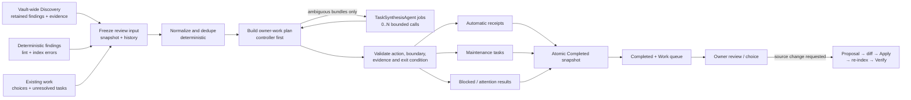

# Vault Scan：Prepare review 与 Maintenance task 生成设计

> 状态：Owner design · implementation-ready contract
>
> 范围：Vault-wide Discovery 结束后，到 Completed / Work queue 发布前
>
> 配套设计：[Vault-wide Discovery Harness 技术设计](./2026-08-23-vault-wide-discovery-harness-design.md)
>
> 不包含：Build Index、Discovery 内部调查、Proposal Apply、用户文件写入、视觉 Mock 实现

## 1. 结论

Vault-wide Discovery 之后确实缺少一个独立步骤：

```text
Build Index
→ Vault-wide Discovery
→ Prepare review
→ Completed
→ Owner review / choice
→ Proposal / Apply / Verify（仅在需要时）
```

`Prepare review` 的工作不是“继续发现”，也不是“提前生成所有文件 diff”。它负责把已经冻结的事实、finding、错误和历史未结工作整理成三类结果：

1. Peak 已安全完成的事项和 receipt；
2. 真正需要 owner 处理的 maintenance task；
3. 无法安全形成任务、需要注意或重试的 blocked result。

它应该有独立进度，但仍属于同一个 Scan run 和同一个 Run progress 页面，不应增加新的顶层导航页。

Agent 数量也不等于任务数量。建议只有：

- **一个确定性的 `ReviewPreparationController`**，拥有状态、进度、去重、发布和完成条件；
- **一个可复用的 `TaskSynthesisAgent` 定义**，只在分组或说明存在歧义时被调用 0 到 N 次；
- **零个“每种任务一个 Agent”**；
- 后续生成真实 diff 的 `ProposalDraftAgent` 属于 owner 做出选择后的 Proposal 阶段，不属于本步骤。

所以一次 Scan 可以得到 0、3、11 或 30 个 maintenance tasks；也可能完全不用 AI。当前 Mock 中的 11 行只是评审数据，不能成为 Agent 数量或生产任务数量的合同。

## 2. 先区分四种东西

当前最容易混淆的是把 finding、task、suggestion 和 proposal 都叫作“可 review 信息”。它们必须分开：

| 对象 | 含义 | 谁生成 | 是否可写用户文件 |
|---|---|---|---|
| `Finding` | 有证据支持的异常、关系、结构变化或风险 | detector / Discovery Harness | 否 |
| `Maintenance task` | owner 可以执行并关闭的一项工作 | Prepare review | 否 |
| `Suggestion` | 对 task 的建议选择、解释或排序 | 规则或 TaskSynthesisAgent | 否 |
| `Proposal` | 具体、可审核、带 revision guard 的 source diff | owner 选择后的 Proposal 阶段 | 只有显式 Apply 后才写 |

一个 finding 不一定产生 task：

- 已自动安全处理的 finding 变成 receipt；
- 重复或被替代的 finding 不再生成新任务；
- 仅供 Vault map 展示、没有 owner action 的 finding 留在 Discovery 结果中；
- 多个 finding 可以合并成一项 owner work；
- 一个 finding 也可能因 owner surface 或退出条件不同而拆成多项 work。

`Ready for review` 不能表示“AI 已经说了几句话”。只有真实的 review artifact 已存在并通过校验时，task 才能进入这个状态。

## 3. 当前实现为什么不够

当前代码已经有重要的安全边界，但生成过程仍然是隐藏的。

### 3.1 已有的正确边界

- [`VaultMaintenanceTask`](../../../src/core/types/vault-intelligence.ts) 已保存 atomic items、evidence、owner choice、workflow 和 suggestion receipt。
- [`prepareProposal`](../../../src/app/vault-intelligence/VaultIntelligenceRuntime.ts) 只在 owner 已选择 proposal-boundary outcome，并且 detector 提供精确 patch、source revision 仍匹配时，才生成 `ready-review` diff。
- AI Tags、Summary、Embedding 和 graph machine facts 是 Peak-owned knowledge，不应被包装成 owner task。
- Proposal、Apply、re-index、Verify 已经是独立于 Scan 的写入路径。

这些边界必须保留。

### 3.2 当前缺口

1. `operationExecutionGroup()` 把 `relationship-discovery`、`semantic-review`、`community-analysis`、`hub-bridge-analysis`、`file-proposals` 和 `maintenance-synthesis` 合并为同一次 Vault Review execution。
2. [`performPublish`](../../../src/app/vault-intelligence/VaultIntelligenceRuntime.ts) 才调用 `deriveVaultMaintenanceTasks()`；用户看不到 normalization、dedupe、grouping、drafting 和 validation。
3. [`deriveVaultMaintenanceTasks`](../../../src/ui/view/vault-intelligence/VaultIntelligenceModel.ts) 逐个遍历 11 个 config task kinds，并生成固定的 `maintenance:${kind}`；这相当于“一种 kind 最多一个大桶”，不是动态 owner-work planning。
4. Vault Review action / gap 通过固定 switch 映射到 task kind；AI 标题和 refs 还参与 identity，容易因一次措辞变化产生不稳定 identity。
5. `publish` 的 progress 只有一个终点 unit，无法解释“正在整理多少 findings、计划出多少 tasks、哪些正在 AI drafting、哪些校验失败”。

因此当前 Completed 能展示任务，但没有诚实回答任务是怎样生成的。

## 4. 端到端流程



### 4.1 五个内部阶段

1. **Normalize**：把 lint finding、index error、Discovery finding、旧 task 和 receipts 转成统一 review atoms。
2. **Plan**：确定哪些 atom 自动关闭、哪些合并、哪些拆开、哪些复用现有 task、哪些暂时 blocked。
3. **Draft**：仅对歧义 task group 生成 owner-facing title、建议和简洁说明。
4. **Validate**：验证每项 task 是否真的有 owner action、owner surface、write boundary 和退出条件。
5. **Publish**：原子保存 Completed snapshot、receipts、task updates 和 unresolved input ledger。

前四步是 `Prepare review`；第五步是很短的 publish commit，不需要再伪装成一个长 AI 阶段。

## 5. 输入与输出合同

### 5.1 冻结输入

```ts
interface ReviewPreparationInput {
  scanRunId: string;
  discoverySnapshotId: string;
  discoveryFindingRefs: string[];
  deterministicFindingRefs: string[];
  indexErrorRefs: string[];
  automaticReceiptRefs: string[];
  existingTaskRefs: string[];
  ownerChoiceRefs: string[];
  scopeRevision: string;
}
```

输入在阶段开始时冻结。新的 Vault edit 不应悄悄改变本次 denominator；它只会让相关 task 进入 stale / recovery，或触发下一次 Scan。

所有输入 atom 在完成时必须有且只有一个 disposition：

```ts
type ReviewAtomDisposition =
  | 'automatic-receipt'
  | 'assigned-to-task'
  | 'merged-duplicate'
  | 'superseded'
  | 'informational-only'
  | 'excluded-by-policy'
  | 'blocked';
```

### 5.2 输出

```ts
interface ReviewPreparationResult {
  inputSnapshotId: string;
  dispositions: ReviewAtomDispositionRecord[];
  automaticReceipts: ReviewReceipt[];
  taskPlan: ReviewTaskPlan;
  publishedTaskIds: string[];
  blockedResults: ReviewBlockedResult[];
  agentReceipts: TaskSynthesisReceipt[];
  completedAt: number;
}
```

`Completed` 展示的是这个 result 的投影，而不是重新从 UI 文案推断状态。

## 6. Maintenance task 到底怎样生成

### 6.1 Task 不是 detector category

一个 task 必须同时满足五个条件：

1. **一个明确的 owner question / action**；
2. **一个明确的 owner surface**，例如 Property review、Composer、Community workspace 或 Recovery；
3. **一个明确的 write boundary**：Peak-owned、proposal、no-change 或 recovery；
4. **一组兼容的 objects / choices**，可以被同一次 owner decision 正确处理；
5. **一个可验证的退出条件**。

缺少任何一项，都不能直接进入 Work queue。

### 6.2 分组规则

Controller 先做确定性分组：

```text
candidate group key =
  owner surface
  + owner question
  + write boundary
  + verification kind
  + canonical object anchors
```

- 同一文件的 20 个 property findings 可以是一个 task 中的 20 个 atomic items。
- 63 个 broken references 可以按同一 owner question 成为一个 task，并在内部提供 Target / File 投影。
- 两个都叫 Community 的 finding，如果一个是 Peak-owned membership、一个要求修改 source note，就不能硬合并。
- 同一种 task kind 如果对应不同 project、不同 owner surface 或不同验证方式，可以拆成多个 task。
- 不同 finding kinds 如果共同回答同一个 owner question，可以合并成一个 task。

### 6.3 稳定身份与跨 Scan 去重

模型不能提供 canonical task ID。Controller 根据规范化 anchor 生成稳定 `workKey`：

```ts
interface ReviewTaskGroup {
  workKey: string;              // controller-derived
  kindId: string;               // config catalog, not the identity
  ownerSurfaceId: string;
  ownerQuestionId: string;
  writeBoundary: 'peak-owned' | 'proposal' | 'no-change' | 'recovery';
  verificationKind: string;
  atomRefs: string[];
  state: 'planning' | 'drafting' | 'validating' | 'ready' | 'blocked';
}
```

若已有 active task 具有相同 `workKey`：

- 新 atom 合入已有 task；
- 已消失 atom 按证据状态解决或保留 stale history；
- owner choice 永远优先于新的 AI suggestion；
- 已 verified task 只有在出现实质新证据时才能 reopen；
- 不创建第二个重复 task。

### 6.4 任务数量何时可知

任务数量不是 Scan 开始时的 denominator。

- Normalize 期间：只能显示 `Organizing findings`，不能承诺“将生成 11 项”。
- Task plan 首次冻结后：显示 `11 tasks planned`。
- 若 validator 合并、拆分或拒绝 group，必须发布 plan revision receipt，UI 数量可以变化一次并说明原因。
- Draft 阶段开始后，planned task denominator 应稳定；新发现不得偷偷加入本次运行。

11 个 config kinds 只是允许的 task catalog，不是每次运行的 output list。

## 7. Agent 设计

### 7.1 需要几个 Agent

| 组件 | 数量 | 性质 | 负责 |
|---|---:|---|---|
| `ReviewPreparationController` | 1 | 确定性应用层控制器 | ledger、分组、进度、预算、状态、发布 |
| `TaskSynthesisAgent` | 1 个定义，0..N jobs | 有界 Agent | 歧义分组、owner-facing wording、suggestion |
| Validator | 1 | 纯代码 gate | schema、evidence、boundary、dedupe、exit condition |
| `ProposalDraftAgent` | 本阶段 0 | 后续独立能力 | owner 选择后生成具体 proposal artifact |

这里的 `0..N jobs` 不表示创建 N 个不同 Agent persona。它是同一个 capability，针对不同 ambiguity bundle 多次调用。

示例：

```text
42 retained findings
→ 31 个可确定性归类
→ 8 个重复或 informational
→ 3 个 ambiguity bundles
→ TaskSynthesisAgent 被调用 3 次
→ 最终形成 7 个 tasks
```

另一次运行可能是：

```text
18 deterministic findings
→ 规则全部可归类
→ 0 次 Agent 调用
→ 2 个 tasks + 5 个 automatic receipts
```

### 7.2 为什么不设计 11 个 category Agents

- task kind 不是执行阶段；
- 同一个 owner task 可能跨多个 finding kinds；
- Agent 之间会重复读取同一证据、产生不同 identity 和互相冲突的分组；
- 小 Vault 的成本和等待时间会被无意义放大；
- 本来能用确定性代码完成的 dedupe、boundary 和 state transition 不应交给模型。

### 7.3 并发

- 本地模型默认串行；
- remote route 可以使用有界 rolling pool；
- 并发单位是互不重叠的 ambiguity bundle，不是 task kind；
- 同一 `workKey` 或共享 atomic item 的 jobs 必须串行；
- controller 只在 job 完成并通过 validator 后提交结果。

## 8. TaskSynthesisAgent 的工具

Agent 不应拿到“生成全部任务”的黑盒工具。工具必须让它能够反复观察、比较、提出方案，同时由 controller 保留最终控制权。

### 8.1 读取工具

#### `review_get_state`

返回当前 bundle、plan revision、预算、现有 task matches 和尚未解决的 validator 问题。

#### `review_inspect_finding_bundle`

按稳定 refs 读取 findings、evidence、counter-evidence、对象 anchors 和 source revisions。只读冻结 snapshot。

#### `review_compare_existing_work`

查找相同或相近 `workKey` 的 active / verified / stale task，并返回 owner choices 和 history。防止每次 Scan 重复创建工作。

### 8.2 提议工具

#### `review_propose_task_group`

提出一个 group，包括 atom refs、owner question、owner surface、boundary、exit condition 和理由。不能指定 canonical ID。

#### `review_propose_task_transition`

提出 `merge | split | revise | defer | informational`，并说明原 group refs 和目标 refs。

#### `review_propose_task_copy`

只生成简短 title、owner question、choice wording 和 suggestion rationale。关键状态和数量不从文案解析。

### 8.3 校验工具

#### `review_request_publish_check`

要求 controller 运行 deterministic validator，并返回逐条可修复错误。Agent 可以据此修订 proposal，但不能绕过错误。

### 8.4 明确禁止的工具

- `generate_all_tasks`
- `mark_scan_completed`
- `mark_task_ready_review`
- 任意 Vault write / rename / delete
- 直接修改 owner choices
- 直接设置 stable ID、impact、confidence 或 completion percent

这些都是 controller 或后续显式 owner workflow 的职责。

## 9. 进度怎样控制

这个阶段需要独立进度，而且它可以比 Discovery 更精确，因为输入已经冻结。

### 9.1 两次冻结 denominator

**第一次冻结：Review atoms**

Discovery snapshot 关闭后，冻结 `totalInputAtoms`。Normalize 每处理一个 atom，就得到一个明确 disposition 或进入 candidate group。

```text
input progress = accounted atoms / total input atoms
```

**第二次冻结：Task plan**

Grouping plan 通过首轮完整性检查后，冻结 `plannedGroups` 和 `plannedAgentJobs`。

```text
draft progress = terminal groups / planned groups
agent progress = terminal jobs / planned agent jobs
```

这里的 terminal 包括 ready、blocked、merged、excluded 和 failed；成功数量必须单独显示，不能把失败冒充成功。

### 9.2 总进度

UI 可以给一个 phase percent，但只在第一次 denominator 冻结后出现：

```text
Prepare review progress =
  normalized input units
  + terminal planned groups
  + terminal Agent jobs
  + validation units
  + one atomic publish unit
```

每种 unit 的数量来自冻结 plan，不使用 finding 数、token 数或模型自报“42%”。plan revision 只能由 controller 产生，并留下 receipt；percent 必须单调不回退。

在 task plan 尚未冻结前，界面显示 `Planning review work` 和 activity，而不是一个虚假的百分比。

### 9.3 ETA

ETA 由真实 route 和 job type 的历史吞吐估算：

```text
remaining ETA =
  deterministic units × local EMA
  + queued remote jobs / effective concurrency × route EMA
  + validation units × validator EMA
```

- 本地 deterministic work 通常显示秒级；
- remote Agent jobs 显示范围，例如 `2–4 min`；
- route 变化、rate limit 或 retry 后重算范围；
- 没有足够历史时显示 `Estimating…`，不造一个精确秒数；
- elapsed、estimated remaining 和 target 需同时常驻。

### 9.4 暂停、停止与失败

- **Pause**：停止派发新 Agent job；在当前 tool / provider 边界 checkpoint。
- **Resume**：从 persisted plan revision 和 ledger 恢复，不重做已 accepted job。
- **Stop**：保存 partial preparation result，未处理 atoms 显式标为 blocked / unprocessed。
- **Agent failure**：确定性 receipts 和已验证 tasks 仍有效；失败 bundle 可 retry 或发布为 attention。
- **Validator failure**：task 不得进入 ready，错误常驻在 UI。

## 10. 界面合同

### 10.1 页面位置

`Prepare review` 是 Run progress 的最后一个有内容阶段。它不是新顶层 tab，也不是 Completed 上突然弹出的后台工作。

Run steps 建议为：

```text
Discover → Build index → Vault-wide discovery → Prepare review → Completed
```

如果 Build Index 与 Discovery 允许重叠，顶部可以继续表达 lanes；但 `Prepare review` 只能在本次 review input snapshot 冻结后开始。

### 10.2 Header

左侧：

- `Preparing work for review`
- 百分比，或 plan 未冻结前的 `Planning…`
- 一条 phase progress bar
- elapsed、estimated remaining、paused/running 状态

右侧竖向三行常驻数字：

```text
Findings accounted     42 / 42
Tasks planned           7
Ready / attention       5 / 2
```

`Tasks planned` 只有在 plan freeze 后出现。数字旁不堆 description；定义和算法放在 hover / focus disclosure。

### 10.3 主体

主体使用一个纵向 task draft list，不使用很多颜色的小卡片：

```text
Preparing work for review

  Organize Research interview records       12 files    Validating
  Repair broken references                  63 refs     Drafting · Claude Sonnet 4
  Review Community membership                9 notes    Ready
  Recover unreadable documents               3 files    Needs attention
```

每行只保留：

- owner-facing task title；
- 影响对象数量；
- 当前状态；
- 当前正在处理该 bundle 的 model（只有真实 AI job 活跃时）；
- 展开后才显示 evidence、grouping reason、write boundary 和 validation detail。

统一状态：`Grouping | Drafting | Validating | Ready | Needs attention`。不要把 detector 名、内部 kind、token receipt 或两层解释文字常驻在主列表。

### 10.4 Session log

Task list 下方保留一个 session log，显示真实控制器事件：

```text
14:03:12  Accounted for 42 retained findings
14:03:13  Reused 2 existing owner tasks
14:03:14  Grouping 3 ambiguous finding bundles
14:03:31  Merged duplicate bridge findings into one owner task
14:03:42  Validation blocked one task: no executable owner action
```

- Agent reasoning 可以流式显示为普通 log text，但不自动成为 task；
- cited evidence 是独占整行，不做左右两栏；
- log 不自动追踪滚动，避免晃眼；
- 新事件追加到底部，并提供未读计数 / `Jump to latest`；
- task 产生或状态变化时，上方对应纵向 row 更新，不再额外堆彩色 discovery cards。

### 10.5 Completed 的含义

Completed 页面不负责现场生成 tasks。它只读取已经原子发布的 snapshot：

- Run details；
- Completed automatically receipts；
- Maintenance tasks that need you；
- Needs attention / recovery；
- actual AI usage 和 preparation receipts。

如果 Prepare review 以 partial 状态结束，标题应为 `Scan completed with attention`，不能把未处理 findings 静默丢掉。

## 11. Task 状态与真实 artifact

```mermaid
stateDiagram-v2
    [*] --> planning
    planning --> needsChoice: task published; owner outcome required
    planning --> recovery: executable recovery path
    planning --> blocked: no safe owner action or missing evidence
    needsChoice --> needsProposal: owner selects proposal boundary
    needsChoice --> verified: Peak-owned or no-change choice verified
    needsProposal --> readyReview: actual guarded proposal artifact exists
    readyReview --> applying: explicit owner Apply
    applying --> reindexing
    reindexing --> verifying
    verifying --> verified: fresh verification passes
    verifying --> recovery: conflict or verification failure
    blocked --> planning: evidence or policy changes
```



关键规则：

- `needs-choice`：有证据和合法 choices，但没有 source diff。
- `needs-proposal`：owner 已选 proposal-boundary outcome，proposal 尚未生成。
- `ready-review`：真实 artifact 已存在；不能只靠 AI summary 进入该状态。
- `recovery`：有可执行 recovery scope 和验证方式。
- `verified`：fresh verification 已通过，不等于“用户点过接受”。

## 12. 完成 Gate

Controller 只有在以下条件全部成立时，才能发布正常 Completed：

1. 每个 frozen input atom 都有 disposition；
2. 每个 published task 都有 stable `workKey`；
3. 每个 task 都有 owner question、owner surface 和 compatible object set；
4. 每个 task 都有 write boundary 和 verifiable exit condition；
5. evidence refs 均来自 frozen snapshot，source revisions 可追溯；
6. 没有与现有 active work 重复的 task；
7. owner choices 和 previous verified history 没有被模型覆盖；
8. `ready-review` task 确实有可读的 review artifact；
9. failures、blocked atoms 和 skipped AI jobs 均未被隐藏；
10. Completed snapshot、task changes、receipts 和 plan revision 原子持久化。

不满足 1、5、7、8 或 10 时禁止普通 Completed；可发布 `completed-with-attention` 或保持可恢复的 failed checkpoint。

## 13. 建议的数据状态

```ts
interface ReviewPreparationSession {
  id: string;
  scanRunId: string;
  status:
    | 'planning'
    | 'running'
    | 'pausing'
    | 'paused'
    | 'completed'
    | 'completed-with-attention'
    | 'stopped-partial'
    | 'failed';
  inputSnapshotId: string;
  inputLedger: ReviewAtomLedger;
  plan: ReviewTaskPlan | null;
  planRevision: number;
  agentJobs: TaskSynthesisJob[];
  validation: ReviewValidationState;
  progress: ReviewPreparationProgress;
  events: ReviewPreparationEventRef[];
  updatedAt: number;
}

interface ReviewPreparationProgress {
  phase: 'normalizing' | 'grouping' | 'drafting' | 'validating' | 'publishing';
  terminalUnits: number;
  successfulUnits: number;
  failedUnits: number;
  skippedUnits: number;
  totalUnits: number | null;
  percent: number | null;
  elapsedMs: number;
  remainingRangeMs: [number, number] | null;
  frozenAt: number | null;
}
```

`percent: null` 是合法状态，表示 plan 尚未冻结，而不是 0%。

## 14. 现有代码的迁移方向

### Slice 1：状态与 truth contract

- 在 Scan stage 中加入技术 stage `prepare-review`；用户文案为 `Prepare review`。
- 引入 `ReviewPreparationSession`、input ledger、task plan、job receipts 和 progress ledger。
- 11 个 `tasks` config 继续作为允许的 kind / choice catalog，不再代表输出数量。
- 为 task 增加 stable `workKey`，同时保留现有 task ID 的迁移读取。

### Slice 2：Controller 与确定性 planner

- 从 [`performPublish`](../../../src/app/vault-intelligence/VaultIntelligenceRuntime.ts) 移出 task derivation。
- 把现有 lint / index error / review evidence adapter 转成 review atoms。
- 实现 disposition、existing-task reconciliation、owner choice preservation 和 completion gate。
- 初期可以保持“一种 kind 一个 group”的兼容 planner，但必须通过新 ledger 暴露过程；随后再启用真正动态 group。

### Slice 3：Agent capability

- 在 app layer 组合 `TaskSynthesisAgent` capability；复用现有 Agent Harness，不创建 service singleton。
- 注册本设计中的 typed tools 和 schema。
- 从 shared Vault Review execution group 移除 `file-proposals` / `maintenance-synthesis`；Discovery 只输出 findings。
- 只对 controller 标记为 ambiguous 的 bundles 调用模型。

### Slice 4：Run progress UI

- 加入独立 Prepare review header、纵向 draft list 和 non-follow session log。
- Pause / Resume / Stop 继续控制同一个 Scan run。
- Completed 只读取 published snapshot，不在 render 时重新 derive tasks。

### Slice 5：Proposal 边界收口

- 保留现有 `prepareProposal()` 的 deterministic exact-patch 安全路径。
- 对需要复杂生成的 task，在 owner choice 后路由到独立 Proposal capability。
- `ready-review` 必须绑定 proposal artifact ID，修正任何 label-only 状态。

## 15. 验证矩阵

| 场景 | 必须证明 |
|---|---|
| 0 findings | 0 task、0 Agent call、正常 Completed |
| 全确定性 findings | 正确 tasks / receipts，0 Agent call |
| 多 finding 合一 | 一个 stable workKey，原子项不丢失 |
| 一 finding 拆分 | 不同 owner surface / exit condition 形成不同 tasks |
| 重复 Scan | 复用 active task，不复制；owner choices 保留 |
| 已 verified work 出现新证据 | 有条件 reopen，并保留历史 |
| local model | jobs 串行，ETA 使用 local throughput |
| remote model | bounded pool，互斥 workKey 不并发 |
| pause / resume | plan revision 和 accepted jobs 不重做 |
| Agent failure | deterministic result 保留，失败 bundle 显式 attention |
| stale source | proposal 不进入 ready-review，task 进入 recovery |
| fake ready-review | 没有 artifact ID 时 validator 拒绝 |
| partial stop | 未处理 atoms 可枚举、可恢复、不静默丢失 |
| Completed publish crash | 原子恢复，不出现 task 与 receipt 半发布 |

自动测试至少覆盖 planner property tests、identity stability、cross-scan reconciliation、progress monotonicity、pause/resume、Agent tool permission、artifact gate 和 atomic publish。真实 Obsidian 还要验证 Run progress 滚动、Pause/Resume、展开详情、focus 恢复和 Completed 路由；在得到真实宿主证据前必须保留 `INTERACTION NOT VERIFIED`。

## 16. 明确拒绝的方向

- 不设计 11 个 task-specific Agents。
- 不把 11 个 config kinds 当固定输出任务。
- 不让 Discovery Agent 一边发现、一边直接发布 Work queue。
- 不用 finding 数、token 数或 reasoning 字数冒充完成度。
- 不在 plan 未冻结时显示虚假的百分比或 ETA。
- 不把 AI suggestion 叫作 proposal。
- 不在没有实际 diff / review artifact 时显示 `Ready for review`。
- 不为这个阶段创建新的顶层 Workspace、右侧 drawer 或一堆分类彩色卡片。
- 不允许模型直接改 task identity、owner choices、completion state 或用户文件。

## 17. Owner 可见的最终心智

用户只需要理解这条因果链：

```text
Peak 找到了什么
→ Peak 正在把它们整理成少量可处理的工作
→ 哪些已自动完成
→ 哪些需要我决定
→ 我决定之后，才会产生具体 Proposal
→ 我确认 Apply 之后，才会改文件并重新验证
```

因此，`Prepare review` 不是多余的一步。它是把灵活、反复的 Vault-wide investigation 转换为稳定、可恢复、可审核 owner work 的必要边界。
