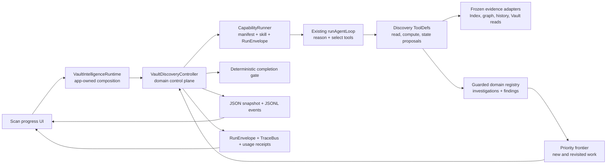
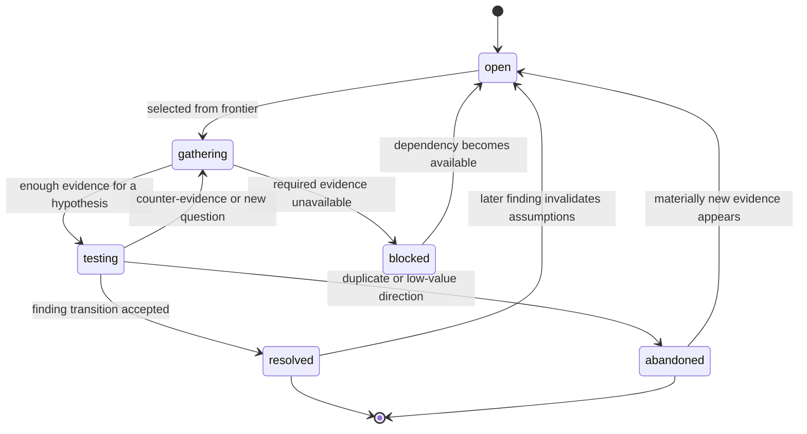
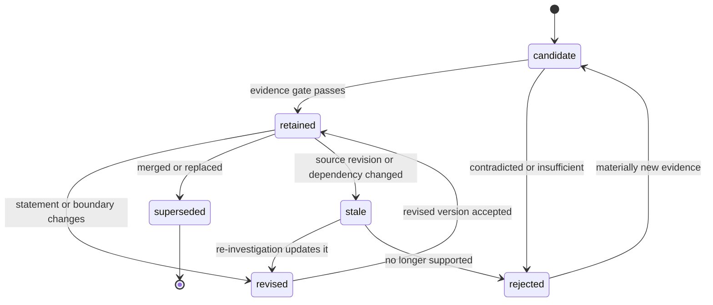

# Vault-wide Discovery Harness 技术设计

> 状态：Owner design · implementation-ready contract
> 范围：Vault Scan 的 Vault-wide discovery 阶段
> 不包含：Build Index、最终 maintenance synthesis、任何用户文件写入、UI 视觉重设计

## 1. 结论

Vault-wide discovery 不应该被实现成一条固定的：

```text
Relationships → Communities → Hubs → Bridges → Done
```

也不能只靠模型重复调用几个“大而全”的发现工具，最后由模型说“我觉得够了”。正确形态是：

> **固定的外层控制器 + 可自由往返的内部调查过程。**

外层由系统掌握：冻结输入、工具许可、预算、checkpoint、证据账本、进度、停止条件和 receipt。内部由 Agent 掌握：下一步调查什么、调用哪个工具、是否回头验证旧结论、是否合并或推翻已有发现。

本设计不创建第二套通用 Agent Harness。它在现有 [`CapabilityRunner`](../../../src/service/capabilities/CapabilityRunner.ts)、[`runAgentLoop`](../../../src/service/agents/harness/loop/AgentLoop.ts)、[`PermissionGuard`](../../../src/service/agents/harness/permission/PermissionGuard.ts)、[`TraceBus`](../../../src/service/agents/harness/trace/events.ts) 和 [`RunEnvelope`](../../../src/service/run-envelope/types.ts) 上增加一个 Vault Discovery 领域控制器。

用户在界面里看到的“反复思考、不断发现、流式 reasoning、发现数量变化、剩余时间、暂停恢复”，都必须来自这个控制器的真实状态，而不是 mock 动画或模型自报进度。

## 2. 要解决的问题

一次真实调查可能是：

```text
先发现一条关系
→ 它改变了某个 Community 的边界
→ 新边界暴露一个 Hub
→ Hub 又让前一条关系显得不可靠
→ 回去补证据
→ 合并两条重复关系
→ 再发现一条 Bridge
→ 没有高价值的未解决方向后结束
```

因此分类只描述“发现是什么”，不能描述“执行到哪一步”。Relationships、Communities、Hubs、Bridges 可以任意交错、重复出现，也可以在后续证据出现时被修订、合并、否定或替代。

现有实现已经提供通用循环、工具调用、预算、流事件和中止能力，但当前 Vault Review 仍有四个缺口：

1. [`VaultReviewSession`](../../../src/service/copilot/vault/VaultReviewSession.ts) 以 round 为主，是否继续主要依赖 `submit_review.continue`；没有系统拥有的 investigation frontier。
2. [`CopilotOutputCollector`](../../../src/service/copilot/CopilotOutputCollector.ts) 主要向数组追加输出；不能表达 finding 的 revise、merge、supersede、reject 和 reopen。
3. [`vaultHarnessTools`](../../../src/service/agents/vault/vaultHarnessTools.ts) 适合读取文件和既有 graph facts，但缺少面向调查的证据、差异、路径与生命周期工具。
4. [`VaultIntelligenceRuntime`](../../../src/app/vault-intelligence/VaultIntelligenceRuntime.ts) 当前将多个 Vault-wide operation 共用一次 Review execution，再以 stream event / structured item 数量展示进展；这不是 evidence coverage，也不能证明调查收敛。

## 3. 设计目标与非目标

### 3.1 设计目标

- Agent 可以在不同发现类型之间反复往返，而不是执行固定 stage list。
- 每个结论都能追溯到冻结 snapshot 内的证据。
- 新证据可以让旧 finding 重新进入调查，而不是只能不断追加新卡片。
- 进度来自已核查证据范围和真实工作队列，不来自 token 数或 finding 数。
- 暂停后能从同一调查状态继续，但不尝试恢复半截 provider stream。
- Budget 用尽、依赖失败或用户停止时，保留明确的 partial result 和未覆盖范围。
- discovery 只写 Peak-owned machine state；用户文件始终不变。

### 3.2 非目标

- 不设计 Build Index 的全文、embedding、per-file enrichment 管线。
- 不在本阶段生成 Split、Merge notes、改 frontmatter 等最终维护方案。
- 不把 reasoning 文本当作证据或 finding。
- 不要求一次运行发现固定数量的 Relationship / Community / Hub / Bridge。
- 不用一个“总完成百分比”掩盖 coverage、open investigations 和 budget 三种不同事实。
- 不允许 Agent 直接宣布整个 run 已完成。

## 4. 核心架构



### 4.1 各层职责

| 层 | 负责 | 不负责 |
|---|---|---|
| `VaultIntelligenceRuntime` | 创建、暂停、恢复、停止同一个 Scan run；注入依赖；持久化 | 选择下一条调查方向 |
| `VaultDiscoveryController` | frontier、账本、状态转移、预算、checkpoint、stop gate、UI projection | 生成自然语言判断 |
| `CapabilityRunner` | 校验 capability / skill、选择 Harness backend、承载 RunEnvelope | 维护 Discovery 领域状态 |
| `runAgentLoop` | reasoning、选工具、执行 bounded model/tool steps、stream events | 决定领域完成度和持久状态 |
| Discovery ToolDefs | 读取、确定性计算、提交受校验的状态提议 | 绕过 snapshot、直接改用户文件 |
| Registry / Store | 唯一 canonical investigations/findings/events | 从 prose 猜测状态 |

### 4.2 一次运行不是一个永不结束的 provider request

一个 Discovery session 可以包含多个 `loop attempt`：

```text
Discovery session D-42
  ├─ loop attempt A1：12 steps → checkpoint
  ├─ loop attempt A2：预算续片 → checkpoint
  └─ loop attempt A3：resume 后继续 → completed
```

每个 attempt 通过一个 `vault.discovery.investigate` capability 进入 `CapabilityRunner`，再由已有 `hermes-harness` backend 使用 `runAgentLoop`。领域 session ID 保持不变，provider stream 结束后才开始下一片。这样可以：

- 在 step/tool 边界安全 checkpoint；
- 避免序列化模型内部状态；
- pause / app restart 后用 canonical state 重建 prompt；
- 对每次 provider 调用保留独立 route、token、费用和错误 receipt。

## 5. 领域状态合同

以下是建议的最小状态，不是最终文件布局：

```ts
interface VaultDiscoverySession {
  id: string;
  scanRunId: string;
  snapshotId: string;
  status:
    | 'preparing'
    | 'running'
    | 'pausing'
    | 'paused'
    | 'completed'
    | 'completed-with-attention'
    | 'stopped-partial'
    | 'failed';
  evidence: EvidenceLedger;
  investigations: Record<string, Investigation>;
  findings: Record<string, FindingRecord>;
  frontier: FrontierItem[];
  attempts: DiscoveryAttemptReceipt[];
  convergence: ConvergenceState;
  budget: DiscoveryBudgetState;
  checkpointSeq: number;
  updatedAt: number;
}

interface EvidenceLedger {
  manifestRef: string;          // frozen eligible-unit manifest; avoid one huge snapshot array
  eligibleUnitCount: number;
  inspectedRefs: string[];      // unique; revisits do not increment coverage
  excludedRefs: EvidenceExclusion[];
  failedRefs: EvidenceFailure[];
  derivedFactRefs: string[];
}

interface Investigation {
  id: string;
  question: string;
  state: 'open' | 'gathering' | 'testing' | 'blocked' | 'resolved' | 'abandoned';
  priority: number;
  evidenceRefs: string[];
  hypothesisRefs: string[];
  findingRefs: string[];
  parentInvestigationId: string | null;
  revisitCount: number;
  openedByEventId: string;
  updatedAt: number;
}

interface FindingRecord {
  id: string;
  identityKey: string;          // semantic dedupe key, stable across retries
  kindId: string;               // catalog-owned, not execution order
  state: 'candidate' | 'retained' | 'revised' | 'superseded' | 'rejected' | 'stale';
  statement: string;
  evidenceRefs: string[];
  counterEvidenceRefs: string[];
  confidence: number;           // controller-derived, never trusted from model prose
  investigationRefs: string[];
  supersedes: string[];
  version: number;
  updatedAt: number;
}
```

`kindId` 由 Discovery finding catalog 校验。首批可以注册 `relationship`、`community`、`hub`、`bridge`、`structural-gap` 和 `anomaly`，但 controller 永远不按这个列表排执行顺序。catalog、阈值、优先级权重和停止参数应来自 `templates/config/`，不能散落硬编码在 runtime 中。

Evidence denominator 也不能被含糊定义成“整个 Vault 的所有可能信息”。冻结 manifest 必须列出本次可核算的 evidence units，例如 eligible file revisions、graph partitions、Community boundary versions 和 history windows。Passage 是 file revision 下的 drill-down evidence，不应在开始前把数十万 passages 全部复制进 session JSON。manifest 本身可以独立持久化并由 `manifestRef` 引用。

`identityKey`、`priority` 和 `confidence` 都由 controller 根据 catalog 和规范化 anchors 计算。Agent 可以提交建议值和理由，但不能自己决定 canonical identity、调高优先级或把一句“高置信度”变成 0.95。

### 5.1 Investigation 生命周期



### 5.2 Finding 生命周期



Finding 数可以下降：两条 finding 被合并时，旧记录进入 `superseded`，canonical retained count 从 2 变 1。UI 不能把“累计写过多少卡片”冒充当前 discoveries。

## 6. 控制循环

```text
1. 冻结 evidence universe 和 graph/index revision
2. 用确定性 seed facts 创建初始 frontier
3. 选择当前最高价值、未被 lease 的 investigation
4. 运行一个 bounded AgentLoop attempt
5. Agent 读取证据、调用计算工具、提交状态提议
6. Controller 校验提议并原子写入 event + snapshot
7. 新 finding 或 finding transition 计算 invalidation / revisit effects
8. 更新 frontier、coverage、EMA、budget 和 convergence
9. 执行 deterministic completion gate
10. 若未完成且有预算，开始下一个 attempt；否则 checkpoint / partial stop
```

Agent 每轮拿到的不是全部历史 prose，而是一个紧凑的 `DiscoveryContext`：

- 当前 investigation 和为什么它排在最前；
- 当前 retained findings 及最近 transitions；
- 未检查 evidence buckets；
- 可用工具及预算；
- 最近一次 completion gate 未通过的具体原因；
- 必须引用 evidence ref、不得将 reasoning 直接发布为 finding 的规则。

### 6.1 Frontier 优先级

优先级不是固定分类顺序，建议由以下信号组成：

```text
priority = impact
         × uncertainty
         × expected_information_gain
         × dependency_unblock_value
         ÷ estimated_cost
```

实际权重由配置提供。Controller 只排序；Agent 可以通过 `defer` 提议降低某项优先级，但不能删除未解决工作。以下事件会新增或重新打开 frontier item：

- 新 graph fact 与 retained finding 冲突；
- Community boundary 变化影响已有 Hub / Bridge；
- 两条 findings 共享 identity 或证据范围，可能需要 merge；
- evidence source revision 改变；
- 某个 blocked dependency 恢复；
- completion gate 发现 coverage hole 或高优先级 open investigation。

## 7. 工具设计

工具应该是“可组合的调查原语”，而不是隐藏固定流程的 `discover_everything`，也不是把内部 registry 完全交给模型随意改。

### 7.1 所有工具的共同合同

每次调用都必须带入或由 execution context 注入：

- `snapshotId`：只能读取本次冻结 revision；domain tool wrapper 应闭包注入 session context，不必为了一个采用者扩大通用 `ToolExecCtx`；
- `investigationId`：所有工作属于明确调查；
- `idempotencyKey`：重试不产生重复状态和重复计费归属；
- `evidenceRefs`：输出必须引用可解析证据；
- `costEstimate` / actual receipt：用于预算和 ETA；
- `coverageEffect`：声明新检查的 evidence refs，不能靠 controller 猜；
- `invalidationHints`：哪些已有 finding 可能需要 revisit；
- `AbortSignal`：pause / stop 可以在工具边界生效。

工具业务失败返回现有 `ToolResult` 的 `{ ok: false, recoverable }`，不把 recoverable error 变成整个 session crash。

### 7.2 状态与证据工具

| 工具 | 用途 | 关键输出 |
|---|---|---|
| `discovery_get_state` | 查看当前 frontier、findings、coverage 和 gate blockers | compact state projection；不返回全部 transcript |
| `discovery_inspect_evidence` | 按 ref 读取文件 passage、graph fact、历史 finding 或 revision | typed evidence bundle + source hash |
| `discovery_search_evidence` | 在冻结的全文 / vector projection 中找新证据 | ranked evidence refs；明确 query mode |
| `discovery_expand_graph` | 查看节点、finding 或 Community 的有界邻域与路径 | nodes、edges、boundary refs、truncation receipt |

`inspect` 和 `search` 分开：前者验证已知 evidence ref，后者探索未知候选。`expand_graph` 不返回整库大图，必须有 hop、node、edge 上限。

### 7.3 确定性分析工具

| 工具 | 回答的问题 | 为什么独立存在 |
|---|---|---|
| `discovery_rank_relationships` | 哪些语义/显式关系值得调查？ | 返回候选和分数，不直接宣称关系成立 |
| `discovery_compare_community_boundary` | 当前 cluster、历史 cluster 或假设边界有什么变化？ | Community 是版本化边界，不是静态标签 |
| `discovery_measure_node_roles` | 哪些节点具有 Hub、broker、outlier 等结构角色？ | 角色可以同时存在，不把所有中心性压成 Hub |
| `discovery_trace_bridge_paths` | 两个区域实际通过哪些路径连接，是否脆弱或冗余？ | Bridge 需要路径与替代路径证据，不能只看一个分数 |

这些工具只输出 deterministic candidates / facts。关系、Community、Hub、Bridge 是否成为用户可见 finding，必须经过 Investigation 和 Finding gate。

首批实现应复用现有 structural analysis repo、全文/向量检索和 digest adapters。不要把 [`vault_get_clusters / vault_get_bridges / vault_find_gaps`](../../../src/service/agents/vault/vaultHarnessTools.ts) 原样当作最终工具合同：它们适合摘要读取，但没有 snapshot、history diff、coverage 或 invalidation 语义。

### 7.4 调查与 Finding 工具

| 工具 | 模型提交什么 | Controller 做什么 |
|---|---|---|
| `discovery_open_investigation` | 问题、触发证据、建议优先级、parent | 去重、校验范围、写入 frontier |
| `discovery_update_investigation` | hypothesis、证据、反证、建议状态 | 校验合法 transition；不能跳过 evidence gate |
| `discovery_propose_finding` | anchors、kind、statement、证据/反证、confidence rationale | 计算 identity / confidence；决定 create / revise / merge review |
| `discovery_propose_finding_transition` | revise、merge、supersede、reject、reopen 及原因 | 验证引用、版本和 transition；原子更新 registry |
| `discovery_request_completion_check` | Agent 认为当前没有更高价值方向及理由 | 只触发 deterministic gate；Agent 无权直接结束 |

这五个是 `kind: 'meta'` 的 Peak-owned state tools，不写用户文件。模型提交 proposal，controller 才是状态真值所有者。

### 7.5 不应该提供的工具

- `find_all_relationships`：范围和停止含义不清，容易变成一次大调用。
- `discover_communities_then_hubs`：把分类顺序重新写死。
- `mark_run_complete`：把产品完成判定交给模型。
- `write_summary_to_note` / `fix_bridge`：越过 discovery 的用户文件边界。
- `emit_log_line`：session log 应从真实 reasoning/tool/state event 投影，不让模型制造假活动。

### 7.6 Specialist workers

第一版不需要按 Relationships / Communities / Hubs / Bridges 建四个长期 Agent。那会把固定流程换成固定角色。

如果后续需要并行，使用现有 subagent 能力创建同一种 **bounded evidence investigator**：

- 输入是一条 investigation package，不是类别名称；
- 只有 read / deterministic compute 工具；
- 有独立 step、token、tool-call budget；
- 只能返回 evidence-backed hypothesis，不能写 Finding registry；
- Parent controller 统一处理冲突、merge 和 stop gate；
- 本地模型 route 默认串行；远端 route 只有在 provider capacity 和预算允许时才并发。

这样并行度是执行策略，不会改变发现语义。

### 7.7 一段真实循环会长什么样

```text
Controller：初始 frontier 有“Product 与 Research 是否存在未记录关系？”
Agent：inspect evidence → 读三篇来源
Agent：rank relationships → 得到关系 candidate，不是 finding
Agent：open investigation → 验证这条关系是否稳定
Agent：compare community boundary → 发现两侧边界也在变化
Controller：自动新增 Community investigation
Agent：propose finding → retained relationship R1
Controller：R1 使旧 Hub H3 的成员假设失效，reopen H3 investigation
Agent：measure node roles → H3 仍是 Hub，但范围应收窄
Agent：propose finding transition → revise H3
Agent：trace bridge paths → 新增 Bridge B2
Agent：request completion check
Controller：拒绝结束，因为还有 18 个未 accounted evidence units
Agent：继续处理剩余 frontier；coverage 和 findings 稳定后再次请求
Controller：全部 gate 通过，完成
```

这里没有“先跑完 Relationship 阶段再跑 Community 阶段”。分类随证据出现，controller 只保证每一步可验证、可恢复、可停止。

## 8. 证据、Candidate 与 Finding 的区别

```text
Evidence：冻结 snapshot 中可复查的原始或派生事实
Candidate：deterministic tool 提出的待调查对象
Hypothesis：某个 Investigation 内暂时的解释
Finding：通过证据门槛、拥有稳定 identity 和生命周期的产品结果
Recommendation：下一阶段基于 Finding 产生的 owner-facing 建议
```

Discovery 到 Finding 为止。Recommendation 属于后续 maintenance synthesis，不能在本阶段偷偷混入。

一个 finding 至少需要：

- 一个稳定 `identityKey`；
- 至少一个 supporting evidence ref；
- 明确 evidence scope 和 snapshot revision；
- confidence 的计算依据；
- 与已有 finding 的 dedupe / conflict 结果；
- 产生它的 investigation；
- 可被 stale / revised / rejected 的生命周期。

Reasoning delta 可以出现在 session log，但永远不自动成为 evidence。模型说“我发现了一个 bridge”仍只是 prose，直到 tool proposal 被 registry 接受。

## 9. 进度、ETA 与预算

Discovery 不存在一个天然、精确的“完成了 42% 的思考”。界面需要并列展示三个不同事实，不能混成一个数字。

### 9.1 Evidence coverage

```text
coverage = unique accounted eligible evidence / frozen eligible evidence

accounted = inspected + explicitly excluded + terminal failed
```

- denominator 在 snapshot 冻结时确定；
- 同一 evidence 被反复查看只计算一次；
- 只调用高层 digest 不等于底层文件全部 inspected；
- exclusion 和 failure 分开显示，不能算成“成功完成”；
- source revision 改变会让相关 evidence / finding stale，但不会偷偷改本 run 的 denominator。

coverage 回答“证据范围看了多少”，不回答“结论是否已经稳定”。

### 9.2 Investigation convergence

单独展示：

- `open / gathering / testing / blocked` 数量；
- 最近 N 个 controller cycles 的 new / revised / merged / rejected transitions；
- 当前最高优先级和 completion blockers；
- retained finding 数及分类投影。

UI 可以写 `Still investigating 3 open questions` 或 `Findings are stabilizing`，但除非有经过验证的模型，不把 convergence 显示为伪精确百分比。

### 9.3 ETA

ETA 来自 controller 的实际 work estimates：

```text
remaining work = unaccounted evidence buckets
               + open investigation estimated units
               + expected revisit units

ETA range = remaining work / effective throughput
```

`effective throughput` 使用同 route、同工具类型的滚动 EMA，并计入：

- provider queue / latency；
- 当前实际 concurrency；
- tool 类型差异；
- retry / revisit rate；
- local serial 与 remote pool 的容量差异。

样本不足时显示 `Calculating time remaining`。之后显示范围，例如 `about 3–5 min`，不显示每个 token 都跳动的秒级伪精度。暂停时 ETA 冻结并注明 paused；route 或 concurrency 变化后重新进入 calculating。

### 9.4 Budget

Budget 至少包括：

- max model steps；
- max tool calls；
- max input/output tokens；
- max cost；
- max wall time；
- max evidence expansion；
- max revisit count per investigation；
- max concurrent workers by route class。

通用 `AgentLoopBudget` 仍限制单个 attempt；Discovery budget 累计整个 session。单个 attempt 因 `max_steps` 结束不代表 Discovery 完成。

## 10. 完成判定

Agent 调用 `discovery_request_completion_check` 后，controller 检查：

1. frozen evidence 已达到配置要求的 accounted coverage；
2. 没有超过阈值的 open / gathering / testing investigation；
3. frontier 为空，或剩余项都低于明确的 value/cost 阈值；
4. 最近 N 个 cycles 没有高影响 new / revised / reopened finding；
5. retained findings 都通过 evidence、dedupe 和 version gate；
6. required deterministic probes 没有未处理失败；
7. 没有 in-flight tool / worker；
8. checkpoint 已持久化；
9. 没有用户 pause / stop 请求。

结果分为：

| 结果 | 含义 |
|---|---|
| `completed` | coverage、frontier、convergence 和 required probes 都通过 |
| `completed-with-attention` | 核心调查收敛，但存在明确 excluded / failed / blocked 范围 |
| `stopped-partial` | 用户停止或 session budget 用尽；保留覆盖与未完成范围 |
| `failed` | canonical state / snapshot / required controller 不可恢复失败 |

Provider error、单个 evidence parse failure、单条 investigation abandoned 默认不是整个 run 的 `failed`。

## 11. Pause、Resume、Stop 与幂等性

### 11.1 Checkpoint 边界

以下事件后必须写 checkpoint：

- tool result 已完成；
- investigation transition 被接受；
- finding transition 被接受；
- budget / coverage / ETA projection 更新；
- AgentLoop attempt 完成；
- pause / stop 被请求。

checkpoint 包含 registry、frontier、evidence ledger、budgets、attempt receipts 和最后一个 durable event sequence。它不包含半截 reasoning delta 或 provider 私有状态。

### 11.2 Pause

- status 先进入 `pausing`；
- 不再 lease 新 investigation；
- read-only 短工具可以完成并提交 receipt，长工具收到 abort；
- 当前 provider stream 在安全边界取消；
- provider 已接收的请求可能仍产生费用；receipt 必须记录 observed usage、unknown usage 或 cancelled-at，而不能承诺 abort 等于零费用；
- durable checkpoint 完成后变为 `paused`；
- UI 显示最后完成的调查动作和仍在 frontier 的工作。

### 11.3 Resume

- 复用同一个 `sessionId / snapshotId`；
- 创建新的 `attemptId / loopId`；
- 从 snapshot + event tail 重建 compact context；
- idempotency key 防止重放 tool result 或 finding transition；
- 若原 Vault 已变化，本 run 仍以冻结 snapshot 继续；新 revision 只标记后续 freshness，不静默改变本 run。

### 11.4 Stop

Stop 不是 Pause 的别名。Stop 形成 `stopped-partial` receipt，记录：

- coverage、excluded、failed；
- retained / stale findings；
- 未完成 investigations；
- 已花费 token / cost；
- 是否允许用户以后创建 linked continuation run。

## 12. 持久化与写入边界

建议扩展现有 [`VaultIntelligenceRecordStore`](../../../src/app/vault-intelligence/VaultIntelligenceRecordStore.ts) 所拥有的 canonical carrier：

- JSON snapshot：当前 Discovery session projection；
- partitioned JSONL events：investigation、finding、coverage、attempt、pause/resume 事件；
- SQLite：只做可重建查询 projection / analytics，不做 canonical lifecycle truth；
- RunEnvelope：run lifecycle、progress、error、artifact pointer；
- TraceBus：step/tool/provider-visible analysis 的短期可观察流和 debug evidence。

当前通用 RunEnvelope 的 `RunStatus` 没有 `paused`。第一版由 Discovery session 保存 `pausing / paused` 真值，RunEnvelope attempt 在暂停时以 `cancelled` 收口并携带 domain checkpoint artifact；不要为了本功能偷偷改变全局 RunEnvelope enum。若以后多个 capability 都需要 durable pause，再单独扩展共享合同。

新增持久 writer 前必须在 generated artifact registry 注册 output ID、carrier、sync policy、index policy 和 materialization rule。

Discovery 允许写入：

- Peak-owned Investigation / Finding registry；
- Peak-owned graph / structural candidate versions；
- session events、receipts、usage、trace references。

Discovery 不允许写入：

- Markdown 正文；
- frontmatter；
- wikilink；
- 用户 Tags；
- 用户确认的 Community identity；
- maintenance Proposal 的 apply result。

## 13. UI 数据投影合同

本设计不改 UI，但当前 standalone mock 应最终只消费以下真实 projection：

```ts
interface VaultDiscoveryProgressView {
  status: VaultDiscoverySession['status'];
  coverage: {
    accounted: number;
    eligible: number;
    percent: number;
    inspected: number;
    excluded: number;
    failed: number;
  };
  investigations: {
    active: DiscoveryInvestigationView[];
    openCount: number;
    blockedCount: number;
  };
  findings: {
    retained: DiscoveryFindingView[];
    countsByKind: Record<string, number>;
    recentTransitions: DiscoveryFindingTransitionView[];
  };
  eta: {
    state: 'calculating' | 'available' | 'paused' | 'unknown';
    minMs?: number;
    maxMs?: number;
  };
  sessionLog: DiscoveryLogEvent[];
  completionBlockers: string[];
  usage: VaultScanUsage;
}
```

Session log 按真实事件追加：provider 明确提供的 analysis/text stream、tool start/result、investigation transition、finding transition、checkpoint、warning。UI 可以为了可读性合并连续 delta，但不要求或暴露模型私有 chain-of-thought；也不能自动滚动追踪、制造假 log、或把 description 小字堆在每一行。

顶部 Relationships / Communities / Hubs / Bridges 数量是 `retained findings by kind` 的投影；点击一种类型时打开具体 findings，而不是再生成一排小标签。

## 14. 与现有代码的落点

建议的最小文件边界：

```text
src/app/vault-intelligence/
  VaultDiscoveryRuntime.ts              # app-owned composition and lifecycle

src/service/vault-discovery/
  VaultDiscoveryCapability.ts           # manifest + compiled skill + backend input
  VaultDiscoveryController.ts           # control loop
  VaultDiscoveryCompletionGate.ts       # pure stop predicates
  VaultDiscoveryProgress.ts             # coverage / ETA / UI projection
  VaultDiscoveryPrompt.ts               # TemplateManager-backed prompt assembly
  tools/
    buildDiscoveryTools.ts
    evidenceTools.ts
    graphTools.ts
    investigationTools.ts
    findingTools.ts
  registry/
    InvestigationRegistry.ts
    FindingRegistry.ts
    FrontierQueue.ts
  ports/
    VaultDiscoveryPorts.ts

src/core/types/
  vault-discovery.ts                     # pure serializable contracts

templates/config/
  vault-discovery.json                   # thresholds, weights, limits, catalogs

templates/prompts/
  vault-discovery-system.md
  vault-discovery-attempt.md
```

迁移原则：

- `VaultReviewSession` 暂时保留给已有 Auto Review surface；Discovery 不继续扩展它的 round/collector 语义。
- `VaultMetaAgentStream` 中可复用 model route、Harness stream adapter 和 Vault read tool adapter。
- Discovery attempt 走 `CapabilityRunner → hermes-harness → runAgentLoop`；不要再新增一条直接 provider orchestration 路径。
- 新 Controller 通过 app composition 注入 Search、Index、StructuralAnalysis、History、storage 和 model runner ports；不能新增 service module singleton 或 `AppContext.getInstance()` 捷径。
- `VaultIntelligenceRuntime.performAi()` 最终只调用一个 Discovery capability，而不是把多个 operation ID 拼成“共享执行后全部 completed”。
- 当前 operation IDs 可以保留为 setup / route capability hints，但不能继续当运行时 stage sequence。

## 15. 实现顺序

### Slice 1：状态与纯控制器

- 增加 serializable state、registries、frontier、transition guards。
- 增加 coverage 和 completion gate 的纯函数测试。
- 用 deterministic fake tools 跑出“1 → 2 → 1 → 3 → revise 1 → complete”的黄金事件序列。
- 不接真实模型，不改 UI。

### Slice 2：只读证据与确定性工具

- 接 frozen snapshot、Search、graph、history adapters。
- 实现四组 evidence / deterministic tools 和 receipts。
- 验证所有返回值有 snapshot、evidence、truncation、coverage metadata。

### Slice 3：Harness attempt 与持久恢复

- 通过现有 `runAgentLoop` 执行 bounded attempts。
- 接 PermissionGuard、TraceBus、RunEnvelope、usage 和 abort。
- 注册 `vault.discovery.investigate` capability manifest、compiled skill 和 Harness backend contract。
- 写 JSON snapshot + JSONL event checkpoint；实现 restart / resume。

### Slice 4：Finding transitions 与 UI projection

- 接 propose / revise / merge / reject / reopen。
- 输出 current retained counts、具体 findings、session log、coverage、ETA range 和 blockers。
- 将 standalone mock 的假数据替换为这个 projection contract 时，再单独进行 UI 实现评审。

### Slice 5：可选 worker pool

- 只有单 controller 在真实大 Vault 上出现明显吞吐瓶颈时才实施。
- 先支持 remote bounded workers；local route 默认 serial。
- worker 只交 hypothesis，所有 canonical transition 仍由 parent controller 执行。

## 16. 测试与验收

### 16.1 必须通过的状态测试

- discovery 可以产生 `relationship → community → relationship → hub → bridge` 的交错序列。
- 新 Community boundary 能 reopen 已 resolved 的 Hub investigation。
- 两条重复 finding merge 后 retained count 减少，历史仍可审计。
- counter-evidence 可以把 retained finding 变为 revised 或 rejected。
- Agent 请求完成但 coverage 不足时，gate 拒绝并返回具体 blocker。
- finding 数不再增加，但仍有高优先级 open investigation 时不能完成。
- budget 用尽得到 `stopped-partial`，不能得到 `completed`。

### 16.2 必须通过的恢复测试

- 每个 tool result 后 crash，resume 不重复状态 transition。
- provider stream 中断时，已持久 tool receipts 保留，半截 reasoning 被丢弃。
- pause 不 lease 新工作；resume 保持 session / snapshot identity，创建新 attempt。
- Vault 在 pause 期间变化时，旧 run 仍可复现，新 revision 不污染旧 evidence denominator。

### 16.3 必须通过的进度测试

- 重读同一 evidence 不增加 coverage。
- excluded / failed 进入 accounted，但不进入 inspected / successful。
- open investigation 增加时 ETA 可以扩大，但 coverage 不倒退。
- route / concurrency 改变后 ETA 回到 calculating，再形成新范围。
- UI finding counts 始终等于 current retained registry projection，不等于累计事件数。

### 16.4 必须通过的安全测试

- 全部 Discovery tools 都不能写用户文件。
- 非 snapshot evidence ref 被拒绝。
- stale version 的 finding transition 被拒绝。
- 工具重试使用同 idempotency key 时只产生一个 canonical event。
- 模型 prose、reasoning 或伪造路径不能绕过 evidence gate。

### 16.5 需求追踪

| 产品要求 | 设计合同 | 验收证据 |
|---|---|---|
| 发现类型可以反复交错 | Investigation frontier + kind-independent controller | 黄金序列状态测试 |
| 能看到具体 Relationship / Community 等 | versioned Finding registry + retained projection | UI count / detail projection test |
| 能流式看到过程 | Harness stream + domain transition events | ordered event trace test |
| 不把类别做成固定 stage | primitive tools + no category agents | tool catalog / integration source audit |
| 有可信进度与剩余时间 | frozen evidence coverage + ETA range | progress property tests |
| 可以暂停、恢复、停止 | tool-boundary checkpoint + session/attempt split | crash / pause / resume tests |
| 新发现能推翻旧发现 | revise / merge / supersede / reject / reopen | Finding state-machine tests |
| Agent 足够灵活但不会乱跑 | adaptive frontier inside deterministic budgets and gate | budget / completion blocker tests |
| 不修改用户文件 | read/meta-only discovery permission boundary | negative write tests |

## 17. 风险与保护

| 风险 | 保护 |
|---|---|
| Agent 在低价值方向无限循环 | per-investigation revisit cap、value/cost frontier、session budget、deterministic gate |
| 工具太粗导致假灵活 | primitive tools、typed receipts、candidate ≠ finding |
| 工具太碎导致调用成本过高 | compact state、bounded evidence bundle、同 investigation 内批量 refs |
| finding 不断追加且无法纠错 | stable identity、version、merge/supersede/reject/reopen |
| 进度看起来精确但不可信 | coverage / convergence / budget 分开，ETA 用范围 |
| Pause 后重复付费或重复输出 | attempt identity、idempotency、tool-boundary checkpoint |
| 并行 worker 相互冲突 | worker read-only，parent 单写 registry，乐观版本校验 |
| 老 Vault Review 与新 Discovery 双重真值 | 明确迁移 owner；Discovery registry 成为 Scan 阶段唯一 canonical truth |

## 18. 被否决的方案

### 固定四阶段 pipeline

易解释，但不能表达回访、反证和交叉影响；会直接违背产品所需的 A-point 循环。

### 一个自由 Agent + Vault read/search 工具

表面最灵活，但没有 coverage、dedupe、生命周期和 stop gate；结果不可恢复，也无法证明“完成”。

### 四个类别 Agent 并行

吞吐看起来高，但会把共享 evidence 拆成四个信息孤岛，冲突最后仍需第五个 Agent 猜着合并。

### Finding 数量驱动进度

Finding 可能增、减、merge、reject，数量与剩余工作没有单调关系。

### 保存完整 model transcript 作为 checkpoint

provider 兼容性差、体积大、不可保证可恢复；canonical domain state 和 event log 才是可迁移真值。

## 19. Owner 还需确认的产品参数

架构不依赖这些答案，但实现前需要在 config 中确定：

- entire Vault 的最低 evidence coverage 是 100%，还是允许明确抽样策略；
- `completed-with-attention` 可接受的 excluded / failed 上限；
- 默认 cost / wall-time budget；
- convergence window 使用多少 controller cycles；
- remote worker 最大并发，以及本地模型是否始终为 1；
- 首批 finding kind catalog 是否包含 `structural-gap` 与 `anomaly`；
- stopped partial 是否允许继续同 session，还是创建 linked continuation run。

## 20. 最终验收句

这个 Harness 只有在下面这句话成立时才算设计正确：

> Agent 可以自由决定下一步调查路线，并且可以反复回来修正旧结论；但它不能绕过证据、预算、状态机、checkpoint、写入边界和系统拥有的完成判定。
