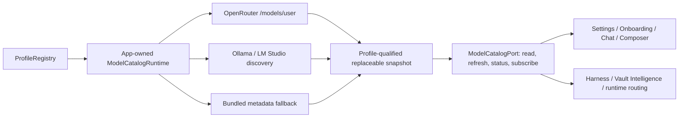

# Unified Provider Model Catalog Runtime

**Status:** Implemented on 2026-08-24; real-Obsidian interaction not verified because no CDP listener was available
**Primary reader:** Peak Assistant maintainer implementing provider and model-selection surfaces
**Implementer:** Codex
**Reviewer:** Peak Assistant owner

## Problem

Peak currently presents several incompatible model-list truths. The bundled model catalog, an optional OpenRouter JSON URL, local-provider discovery, onboarding connection evidence, and screen-local refresh effects can each mutate or interpret the model list independently. A screen can therefore show old OpenRouter entries such as `o1` or `o3` even when the configured key can access newer models. Registry mutation is also append-only, so a model removed upstream remains visible.

This is a data-ownership defect, not a picker rendering defect.

## Evidence baseline

| Path | Current role | Defect |
| --- | --- | --- |
| `main.ts` + `ModelRegistry.loadFromTemplateManager` | Loads bundled/static provider metadata | Static fallback can be mistaken for live availability |
| `openrouter-catalog.ts` | Pulls owner-supplied JSON/Gist | Not filtered by the configured OpenRouter account |
| `fetchOpenRouterEmbeddingModels.ts` | Pulls only embedding models | Does not populate the current text-model list and omits auth |
| `refreshLocalProfileModelCatalogs.ts` | Screen-invoked discovery | Misnamed, append-only, and not an app-owned runtime |
| onboarding connection evidence | Merges returned model ids | Makes onboarding an accidental catalog producer |
| Settings/Chat/Composer/Onboarding/Vault Intelligence | Read the singleton directly | No shared refresh state or reactive revision |

OpenRouter documents `GET /api/v1/models/user` as the authenticated list filtered by the current user's provider preferences, privacy settings, and guardrails. That endpoint is the availability authority for each OpenRouter profile.

## Impact Contract

### Primary metric

Reduce production model-list refresh ownership to exactly one app-owned runtime. Every model picker and route-candidate projection must read a snapshot from that runtime or its narrow read port.

### Required tracks

1. Fetch current OpenRouter models with the profile's API key from `/models/user`; never generate text to discover or validate a catalog.
2. Qualify dynamic catalogs by profile so two endpoints or keys cannot leak models into each other.
3. Replace successful dynamic snapshots instead of append-only merging, while retaining last-known-good data after a failed refresh.
4. Expose refresh status, revision, and subscription from one runtime.
5. Migrate Settings, Onboarding, Chat Studio, Composer, Harness, and Vault Intelligence reads/refreshes to the shared port.
6. Reconcile removed models: they disappear from choices, while an already persisted binding remains visible as unavailable rather than being silently reassigned.
7. Preserve bundled catalogs only as explicit metadata/bootstrap fallback for providers without live discovery; never label them as the current OpenRouter account catalog.

### Forbidden scope

- Do not delete provider profiles, role bindings, aliases, or hidden-model preferences.
- Do not choose a replacement model by catalog order.
- Do not use a generation request for connection testing or model discovery.
- Do not add a service-layer runtime singleton or expand `AppContext.getInstance()` dependency shortcuts.
- Do not include unrelated roadmap or pre-launch-document edits in the implementation commit.

### Minimum acceptable delta

No UI surface may directly fetch or merge OpenRouter/local model lists. No onboarding flow may mutate the catalog from connection-test evidence. OpenRouter choices must originate from a successful profile-authenticated snapshot or a clearly stale last-known-good snapshot.

### Stop and commit rule

If a second production refresh owner remains, report the result as partial and do not claim the wave complete. Commit only after focused catalog tests, the full test suite, and production build pass; real Obsidian interaction is a separate acceptance gate.

## Target architecture

The runtime is composed once at the app layer and bound in `AppRuntimeRegistry`. React receives only `ModelCatalogPort` through `ServiceContext`. Core selection functions continue to operate on a narrow catalog-reader interface, keeping them deterministic and testable.

## Data contract

Each dynamic profile owns one catalog id: `<kind>:<profile-id>`. A successful refresh produces:

- exact upstream model set;
- normalized metadata and capabilities;
- `refreshedAt` and source identity;
- monotonically increasing runtime revision.

A failed refresh records an error without changing the model snapshot. An empty authenticated OpenRouter data array is an authoritative empty snapshot. The legacy local adapters retain their last-known snapshot on an empty result because they cannot yet distinguish an empty server from a transport failure. Concurrent refreshes for the same profile are deduplicated.

OpenRouter metadata mapping:

- `id` and `name` become the stable model id and display name;
- `architecture.input_modalities` drives vision/PDF/audio/video input flags;
- `architecture.output_modalities` drives model type;
- `supported_parameters` drives tool/reasoning capability only when explicitly declared;
- `context_length` and `top_provider.max_completion_tokens` drive token limits;
- `pricing.prompt` and `pricing.completion` remain provider-reported per-token strings.

Unknown capability values remain unknown/false for positive filters; names are never used to invent capabilities.

## Compatibility and rollback

Existing static provider buckets remain readable for providers with no discovery adapter. The legacy OpenRouter JSON fields remain loadable for settings compatibility during this change but cease to own availability. Rollback consists of unbinding the runtime and restoring the previous refresh adapter; profile settings and model bindings are unchanged.

## Verification and traceability

| Requirement | Evidence |
| --- | --- |
| OpenRouter auth and endpoint | HTTP-port unit test asserts GET `/models/user` + bearer and no POST |
| Exact replacement | Registry/runtime test proves removed upstream models disappear |
| LKG on failure | Runtime test proves failed refresh retains prior snapshot and exposes error |
| Profile isolation | Two-profile test proves catalogs do not cross-contaminate |
| Single producer | Source contract rejects UI imports of discovery/registry mutation helpers |
| Reactive UI | Hook/component test or source contract verifies `useSyncExternalStore` subscription |
| No silent reassignment | selection test preserves unresolved explicit binding behavior |
| Build integrity | focused tests, `npm test`, `npm run build` |
| Real host behavior | CDP picker inspection; otherwise `INTERACTION NOT VERIFIED` |
