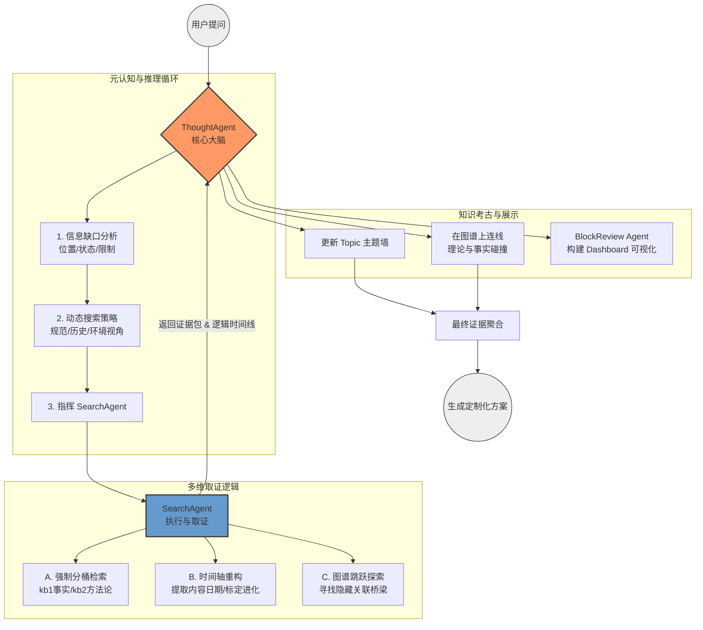
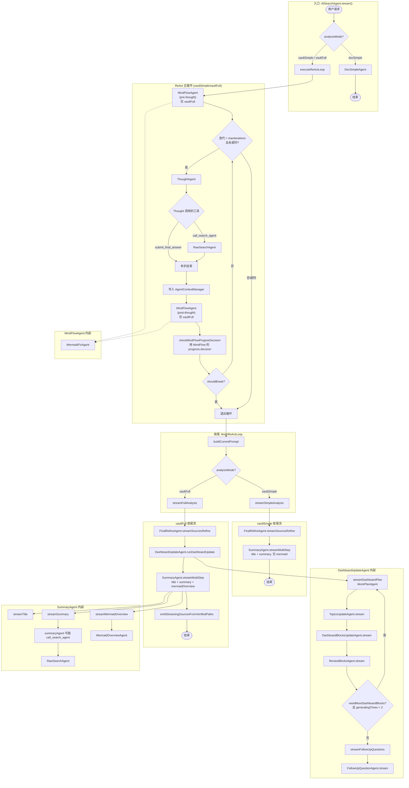

 
 # 背景和目的

- RAG 效果依然不好，不能看到很多内容，一个是慢，一个是会漏掉
- 记录 RAG 的 bad case 不要每次全都交给 cursor，自己得记录一下，否则就没啥用了

# badcase 列表

## query: `我的独立开发产品 idea 的综合评价 给我快速致富路 给我符合我的现状的方案`

我设想的能够完成的任务目标：

- 能够找到我的所有想法，并且给一些实行路径建议，能够知道我自己之前的规划
- 能够找到我的 prd 的 key note，的方法论
- 能够分析出来我在新西兰，我要找工作
- 能够知道我过去一年干了什么，是在学校，做了哪几个项目
- 能够知道我在很久以前就在有独立开发的想法，现在和以前的区别，以前在干什么等
- 能够知道我做过哪些尝试
- 能够知道我的技术栈

## query: 我的 AI 相关的研究 调研 现状 建议

## query: 搜索 document drawer

## query: 我过去几年工作 学习 生活的经历 总结我的思想进化过程 为什么走到今天 展望未来 请你仔细阅读我的知识库完成

## query: 我值得一些的文章，给我一个列表，因为我知识库里很多东西其实

## query: 我的 peak assistant 的 todo 和规划建议

## query: 我如何构建个人影响力

## query: 关于我的工程实践 和我独立开发的结合的建议

## query: prompt 工程的相关内容

# 分析

- **逻辑推演能力缺失**：无法通过“现状+知识”推导出“定制化策略”。
- **证据聚合能力缺失**：结论没有实证支持，像在背书。
- **真实时间线坍塌**：被迁移文件的 Metadata 欺骗。
- **权重分配失衡**：方法论（死的）权重太高，实践与情绪（活的）权重太低。
- 用户的 Query 是极其模糊、高概括的，而有价值的背景信息却深埋在零散、非结构化的碎碎念笔记里
- AI 默认把你的知识库当成了“离线维基百科”，而你希望它把它当成你的“第二大脑”。
- AI 目前的表现更像是一个 **“只会翻书的馆员”**，而不是 **“了解你的合伙人”**。
- 目前 Agent 很依赖初始 Query。要让它 Walk，它必须学会**“根据当前节点改写 Query”**。

### 严重的“知识复读”

- **问题表现**：它在教你什么是 MVP、什么是利基市场，但这些方法论本来就在你的 `kb2-learn-prd` 库里。
- **用户痛点**：你不需要 AI 给你科普你已经掌握的知识，你需要它基于这些知识去**审视你具体的 Idea**。它忽略了你作为“开发者”这个主体的具体状态（身在纽国、正在找工、转行背景）。

## 细节缺失

- 它提到你“技术栈储备丰富”，但说不出你具体在学校做了哪几个项目。它把你的能力标签化了，但没有实例支撑。

## 具体的“事”被抽象的“法”掩盖了

你提到的“学校做的几个项目”和“具体的独立开发尝试”被 AI 用**方法论**给稀释了。

- **用户想看到：** “针对你学校项目 X 中用到的并发处理技术，可以迁移到你的独立开发 Idea Y 中。”
- **现在的实际：** RAG 优先抓取了 `kb2-learn-prd` 下的方法论（如何发现需求、如何评估） ，因为它觉得这些笔记“相关性得分”最高。结果就是：AI 用你写的“方法论笔记”来指导你，却漏掉了你日记里最真实的、承载了你**具体能力**的项目记录 。

## 身份识别 Profile 信息丢失

- **身份识别（Identity Blindness）**：报告里完全没提到 **New Zealand (NZ)**。这是一个巨大的 Context 缺失，导致它给出的“致富路”根本不符合当地的市场环境或你的签证/求职现状。
- 这导致了各种物理信息的丢失，例如 **“身在新西兰”** 与 **“正在找工作”** ——在报告中完全隐身了

## 检索维度的“关键词局限”

目前的检索逻辑过于依赖**语义匹配**，导致了“信息孤岛”。

- **问题表现**：当你问“独立开发评价”时，系统只会去搜带有“独立开发”、“产品评估”标签的笔记。
- **漏掉的内容**：它自动过滤掉了日记（Diary）、项目进展（Log）和个人简历类信息。
- **后果**：由于这些个人背景笔记里可能没写“独立开发”这个关键词，RAG 就认为它们不相关。所以它不知道你在新西兰，也不知道你过去一年在学校做了什么。

## 时间线感知

系统无法区分 **“过去的尝试”** 与 **“现在的目标”**。

- **问题表现**：它把 2024 年的想法和 2026 年的现状混为一谈。
- **用户痛点**：你想要的是一个“进化史”的对比（以前干了什么，现在有什么进步，以前的失败教训是什么），但 AI 给出的结果是静态的、没有时间维度的。
- 另外，可能我们的文档的 meta 信息没有体现他真正的创建时间，例如我一篇文档写的是我在 2019 年在干什么，但是这个文档是我 2023 年创建的，因为当时我通过知识库迁移新建了文件，复制了内容
- **动机演变（Evolution Ignorance）**：它没能对比出“以前的独立开发想法”和“现在的想法”有什么质的区别（比如从单纯的技术实现到现在的市场驱动）。

### 只有“切片”，没有“电影”：消失的进化时间线

你想看到“过去一年在干什么”、“以前和现在的区别”，但 AI 只给了你一个**“知识快照”**。

- **用户想看到：** “你 2024 年的想法是 A，当时因为技术/市场原因没做成；现在你学了 Agile Scrum 和新的技术栈 ，你的新 Idea B 在逻辑上比以前更成熟了。”
- **现在的实际：** 检索系统把你的历史笔记（Diary）和现在的 PRD 放在同一个“平面”处理 。它没法识别笔记的**修改时间**或**心路历程**，导致它无法分析出你“尝试过哪些、失败在哪里”，只是把你写过的技术栈（React, Java）机械地罗列了一遍
- 目前的 LLM 默认所有检索回来的文档都是“现在”发生的。它缺乏对“时间轴”的理解，导致 2019 年的旧想法干扰了 2026 年的决策。

## 缺乏“跨库联想”的深度：信息孤岛

你的笔记库分为“生活笔记 (kb1)”和“产品学习 (kb2)”，目前的检索显然在这两扇门之间迷路了。

- **用户想看到：** AI 能把 `kb1-life-notes` 里的求职焦虑、学校作业进度，与 `kb2-learn-prd` 里的变现策略结合 。
- **现在的实际：** 检索结果过度偏向 `kb2`（因为关键词匹配度高） 。它没能识别出你的**技术栈（React, Java）**其实是你在学校项目或过去尝试中磨练出来的实战技能，而不仅仅是笔记里的几个名词 。

## RAG 的“短视”性

- 标准 RAG 只管 Top-K 匹配。它不懂“关联性”。如果你的 NZ 坐标写在 CV 里，而致富方案写在 PRD 里，RAG 没法自动把它们拼在一起，除非你强制它执行“跨库联合检索”。
- 向量搜索（Embedding）在处理几百字的结构化文档时很强，但在处理你那几千条“碎碎念”时极其软弱，因为碎碎念的语义密度太低。

## raw search agent 的问题

- **“关键词匹配”的惯性太强**：在 `Pattern 1` 中，它虽然有 `graph_traversal`，但那是放在 `local_search` 之后的可选步骤。Agent 的本能是“既然搜到了，我就提交”，它没有“通过一个节点去发现背后隐藏脉络”的**好奇心**。
- **缺乏“关联跳跃”的动机**：Prompt 里写的是 `Search First, Read Sparingly`，这会导致 Agent 疯狂刷搜索工具，但它搜索的 Query 始终围绕着用户输入的初始词（如“独立开发”），而不会根据图谱返回的节点（如“新西兰生活”）去动态调整搜索方向。
- **图谱被当成了“结果展示”而非“路径线索”**：目前的逻辑里，Graph 只是用来寻找 `candidate notes`，而不是用来寻找 `contextual bridges`（上下文桥梁）。

# 优化措施

- 完善图谱利用：
  - Index 阶段，使用一个廉价模型（如 Flash 或小型本地模型）定期扫描你的碎碎念，提取出每个 document 里的 event，各种琐碎的的事情，建立起来边到 graph 里，找到隐含的碎碎念等，从而得到的是有价值的数据！因为用户的很多想法是碎碎念的，但是这些碎片化想法对用户来说实际上非常重要的。用 LLM 周期性地（或在后台）对知识库里的碎片进行 **“实体-事件”聚合**。 **建立“主题索引” (Theme Index)**：在检索时，如果 Query 涉及到“找工作”，系统不仅搜文档，还会优先触碰“求职专题”下的所有碎碎念集合。
  - **自动化标签化（不是手动标签）**：让 AI 自动扫描碎片，提取出：“这 50 条笔记都在讨论‘新西兰求职遇到的挫折’”、“这 20 条笔记是关于‘对 AI 导航站的灵感’”。
- Prompt 里，非常注意时间，地点，事件，人物等等的关联！尤其是时间，要解决我们那种文档迁移和新建的问题，我们是能够通过 LLM 解
- 去掉 obsidian 的详细描述，仅仅让 agent 知道是在一个知识图谱，用户知识库里就行
- RawSearchAgent
  - 现在只信 index 后的 `ctime/mtime`，让 `RawSearchAgent` 在提取内容时，多做一步指令：“从正文中提取时间线证据，重新标定该片段的真实时间（Real_Time），而非系统时间。”。
  - ~~search 时候，一个文档可能有多种内容，重新进行切片，作为 source 而不是一整个文档。~~ -- 会大大耗费 token，后面我们可以进行 chunk 处理，现在不做。
  - 务必携带每个 source 的位置信息，潜在图信息，对每个 source 最起码做一些图检索，从而给 thoughtAgent 一些基本的图视觉，从而达到一定的引导效果
  - 特别强调注意时间性内容
  - 特别强调注意空间物理性内容
  - 不要让它仅仅去搜“答案”，要让它去搜“关联”。你可以将 Prompt 中的指令从“搜索关键词”改为 “追踪线索”。 “当你通过 `local_search` 找到一个高价值节点后，**严禁**直接结束。你必须：调用 `inspect_note_context` 查看该节点的元数据（标签、所在文件夹、前后文）。识别该节点连接的**非同质化节点**（例如：一个技术笔记连接到了一个生活随笔）。强制执行一次 `graph_traversal(include_semantic_paths: true)`，并针对新发现的关联节点（如地理位置、情绪词）发起一轮全新的 `local_search`。”
  - 时间轴还原：忽略系统创建时间。在 summary 中标注：‘此笔记正文提到日期为 2019 年，属于历史背景’。
  - 关联上报：在 submit_final_answer 的证据包里，除了内容，必须包含该节点在图谱中的邻居 Tag（如：此节点连接了 #NZ #求职）。"
  - 自动爬取：若搜到的 Top 1 笔记在 Graph 中有邻居节点，自动把邻居节点的标题也塞进 summary。
  - 目的：这就是给 ThoughtAgent 喂“线索”，勾引它去调用 graph_traversal。
  - 你是 SearchAgent，任务是提供高密度证据包。
- ThoughtAgent
  - ~~强制一开始是 planner ，专门拆解问题。它看到 Query 后，不急着查库，而是先生成一份“检索清单”：“我需要知道用户的地理位置、求职现状、技术储备以及历史失败案例”，最大化的审视问题。AI 先问自己：“要回答这个问题，我需要了解用户的哪些核心背景？”（通常是：坐标、目标、当前限制、技术栈）。~~
  - ~~在调用工具前，请自我评估：‘如果要给出一个具有**高决策参考价值**的回答，我目前的上下文是否足以区分出这对于 **\[当前用户\]** 还是 **\[任何普通人\]** 是有效的？’。如果答案是后者，请优先检索用户的个人偏好和现状特征。~~
  - ~~“在处理决策建议类请求时，必须先获取 `User_Profile`。如果内存中没有，请使用 `call_search` 检索关于‘地理位置、当前职业状态、主线任务’的笔记。”~~ 现在有了 user profile
  - ~~“对比检索到的同一主题在不同时间点的记录，描述用户的动机演变，而非简单并列。”~~
  - 请检查该片段是否关联了重要的图谱节点。如果该片段是碎片化的碎碎念，你必须指挥 SearchAgent 执行 `query_graph_neighbors` 以获取其背后的背景节点（如位置、情绪、特定项目事件）
  - “你现在需要获取信息。请记住：一个完美的答案需要‘理论’与‘实践’的平衡。请不要只搜索 Query 的字面意思。请尝试从以下三个维度同时发起检索：规范性视角（这事儿在书本上该怎么做？）历史性视角（用户以前是怎么做的？有哪些碎碎念或失败记录？）环境性视角（用户现在身处何种物理和时间限制中？）”
  - 强制每一步都输出 graph topic sources 等，表明在思考，同时注释掉现在我们使用 graph traversal 的显示，这不太好，太多了，仅仅 debug 用，暂时注释掉。
  - ~~当你发现多个时间点的同类笔记（如：独立开发想法）时，你禁止只总结它们。你必须对比它们，并回答：用户在逻辑上有了哪些具体的进化？哪些旧想法被抛弃了？为什么？~~
  - 引导学会 Query 改写机制
    - **旧模式**：Query A -> Search -> Result -> Submit.
    - **新模式（Walking）**：Query A -> Search -> Node X -> **Extract Context from Node X (e.g., "NZ")** -> **New Query B (Idea + NZ)** -> Search -> Result.
    - 可以强制生成多次 query，强制生成的 query 的多样性
  - 将图谱转化为“联想驱动器” (ThoughtAgent)。现在的 reuslt 的 Graph 只是用来展示结果，没参与思考。 **建议：** 赋予 ThoughtAgent 使用 **“图谱跳跃（Graph Walk）”** 来寻找证据的权力。每次去 chat 的时候在 system prompt 里告诉 thought 现在的 result
  - thought agent 之前的内容的讨论：
    - ~~你是 xxx 角色，正在干什么，目标是什么~~
    - 保留 use the same language as the users messages If the USER explicitly requests a language, follow that request.
    - 去掉 tool input id 等等的要求，这些在 tool 描述里会有的
    - 去掉 dashboard protocol 的书写，这些在 tool 描述里会有的，我们只在这里强调通用的高层次的能力
    - You MUST call call_search_agent at least once before submit_final_answer\*\* when the user asks for vault analysis, knowledge discovery, or content synthesis. Do NOT respond with only clarification questions, a preliminary framework, or "I need more info" without searching. If information seems incomplete, search first with your best interpretation—then note limitations in the answer. Exception: only skip search for purely meta requests (e.g. "stop", "cancel") or when the user explicitly asks to clarify the task itself.
    - 不要出现任何的 tool 的名称，专有的名词，例如 obsidian 例如 search agent 等等，仅仅引导功能
    - Broader reading (IMPORTANT) Request comprehensive search—ask rather than minimal coverage
    - Year/time-range queries (CRITICAL) When the user asks about a year or time range (e.g. "what happened in 2025"), do NOT restrict SearchAgent to a single subdirectory. Instruct SearchAgent to cover multiple case. and adjust to the result returned
    - Exploratory queries (CRITICAL) Each call_search_agent MUST use a **different search angle**. Do NOT repeat the same few keywords. Use discovered context to drive the next query
    - After finding sources, grah nodes, analysis them to get new search query. to search. 这样能搜到更详细更系统的知识
    - Vary query style: first call = broad (user intent); later calls = narrow and contextual (specific paths, concept names, folder structure from prior results)
    - Never batch all updates for the end. After each meaningful SearchAgent return, immediately convert at least one piece of evidence into a dashboard update. If you discover a new source, add it now. If you discover a new edge, add it now. Do not wait for the next iteration. After each useful evidence return, incrementally use result-update tools
  - raw search agent 之前的内容讨论
    - 没有 Output Language 的限制
    - Critical Constraints (anti-hallucination) NEVER invent file paths, note titles, or links. Only use what you can derive from tool outputs.When uncertain, explicitly mark uncertainty and ask the ThoughtAgent to validate via additional tool calls. Prefer fewer, stronger candidates over many weak ones.
- 预设一些问题类别的搜索 prompt 和人格特征
  - 用户搜索的问题种类也服从二八原则，百分之八十的搜索类别都是类似的，我们针对这些问题写一些标准化 prompt 增强效果
- Plan 的价值体现出来了，这和 thought agent 分开了，thought agent 和 search agent 分开有价值，是因为一个要去专门负责搜调用各种工具的执行者--最机械化的执行者，一个专门负责统筹安排是否达到目的的判断--上层 planner 的执行者，具有一定的统筹能力，thought agent 和 plan agent 分开也有价值，因为 plan agent 可以单独的 prompt 去思考问题，去判断问题需要什么，去改写 query，去丰富 query。当然，我们可以交给 thought agent 单独完成这个事情。但是由于我们现在也是调用很多词 thought Agent 和 searchAgent 本质也是调用了特别多次，怎么减轻和解决也是我们需要思考的。当然，我们可以动态替换 prompt 来达成效果。
- 分离 block agent
  - 因为 block agent 和主要搜索没啥关系感觉，或者我们最后单独 review 一波，作为构建 dashboard ，这个 agent 一大作用就是提出问题，解决问题
  - 强制 block review agent 多给一些建议，多生成一些不同的 mermaid 图，给一些资料。不同类别的思考是不同的图。
- GPT 说的一个词比较好：宪法级 prompt

# 目标架构

# mess

prompt 需要大量调优，在完成 refactor 后，立刻进行 prompt 调优，因为现在输出的内容太多非常侧重于引用内容，给出综合性见解和批判和内容本身的非常少，内容可能引用对了，但是就是不说对应的话，而是说类似于 `您在xxx说了xxx`，其实应该更自然的说 `您是xxx的人，思想是xxx，目标和经历是xxx，这些在我阅读您的文章 xxx 的时候都可以感受到，从网络上各种例子来看xxxx，所以xxxx` 等等等的语气，这样更有用啊

你首先要看明白我的 AISearchAGent 是怎么运作的，多少个 agent ，react 流程是什么，我怀疑你没有太看懂，虽然你给的建议很多都不错了
另外，生成给  Dashboard/Summary 的证据提示时，tool  结果被直接跳过，我同意确实可以把基础信息调用了哪些 tool 传递进去，但是我不是仍然传递了 current Result 给下一次生成嘛，

### 你的核心诉求（综合  Untitled-6.md  全文）

- 整体目标：把 AI Analysis  做到稳定、可用、可观测、产出有价值。具体包含：UI  展示更干净、Streaming  体验更像“实时工作台”、Mermaid  概览不再空/不再解析报错、图谱可交互且不“糊成一团”、最终结果能可靠自动保存。

### 你明确的“原则/约束”

- 前缀去除只影响展示层：UI  里不出现任何  type:  前缀（file:/concept:/tag:/topic:/document:…），但内部唯一性不动（node.id、edge.source/target、normalize/去重逻辑都保持），避免破坏已有假设。

- sources 路径严格：path  必须来自证据/可验证路径列表，必须包含  .md，禁止模型猜路径；但同时你又要求 sources  必须“至少有输出”（避免 UI  空白）。

- 用户等待必须有价值：分析过程要持续产出（Summary  真流式、阶段性“整理产出”、减少重复  blocks）。

### 你要解决的关键问题（按模块归类）

- Graph（图谱）可用性与展示

- 去掉所有节点展示里的  type:  前缀（写入阶段清理  title/label，不改  id）。

- file/document 节点点击必须能打开真实文档路径（避免  file:${normalizeSpecialKey(path)}  这类导致点击失效的情况）。

- concept 节点必须用 Lucide Frame icon 风格渲染（参考  inspector/GraphSection.tsx  的 tag 展示风格）。

- 修复“节点挤在左上角一团”（布局/坐标/力导向模拟等导致的聚团问题）。

- Streaming UI  体验（你要的是工作台式布局）

- Streaming 态重构为：左侧变更日志 +  右侧图。

- Blocks  区域移到下方，并与  Completed  态使用同一套自由排列逻辑（不要混在左侧滚动区）。

- 去掉外层对图的  max-height  硬限制，改由  KnowledgeGraphSection  统一管理高度/overflow（并作为可配置入口供  Streaming/Completed  复用）。

- IncrementalContent  增加  dashboardBlocks  的 Added/Removed diff 面板（展示哪些  block 新增/删除；UI 文案英文）。

- Mermaid 概览稳定性

- 你遇到的主要痛点是：overview  图太简单/甚至空，以及解析报错。

- 诉求包括两层：

- 工具层 sanitize/normalize  兜底（去  Mermaid Error:  行、修复带  .  的  node id、强制  label 引号化、HTML entity decode  等）。

- 更强的“生成约束  + 自动修复/重试链路”（让概览图不空且可渲染，必要时走修复流程）。

- Dashboard Blocks（内容质量  + 稳定写入  + 去重）

- blocks 不要再以“问题列表”为主，而要输出综合性回答内容（结论/建议/权衡/下一步为主，最多少量  follow-up questions）。

- 修复  add_dashboard_blocks  因字段缺失导致中断（典型是缺  markdown / renderEngine）。

- blocks 去重要贯穿全链路（写入、Review、渲染/Store  侧兜底），规则以  title+engine  起步，再做内容相似度（latest wins）。

- Summary 真流式  + 可观测性

- Summary 必须在 streaming 过程中持续增长（delta），不是结束才出现。

- 增加调试/统计与  pk-debug  类  trace：关键  agents 的  prompt/输出可被追踪，run  结束输出汇总（带截断保护），便于定位“为什么没有 delta”。

- Steps UI 的“重复拼接  + 不自动结束”

- 修复同一  stepId  的  ui-step  事件被前端当成  delta  不断拼接导致的重复文案。

- complete  时必须能正确清掉当前 step，避免最后一步一直计时/一直 running。

- AI Analysis 自动保存可靠性

- “最近 analysis 都没有自动保存”的问题要修。

- 保存失败要对用户可见（Notice/提示），并提供合理的  folderPath fallback、以及空态引导（让用户知道发生了什么/怎么补救）。

- AI analysis  期间排除“历史分析目录”干扰

- 你的新要求是：AI analysis  的本地搜索/图工具链排除  settings.search.aiAnalysisAutoSaveFolder  下的自动保存分析文档，减少“自我引用”污染；并且最好有设置开关。

- Planner/调度策略（提速 + 强制不空）

- 你希望引入“先  plan 后执行”的轻量 planner（结构化输出），减少不必要的更新。

- 同时你又要求：必须强制至少输出一次 topics/sources/graph（即使 evidence  少/simple mode），避免 UI 三块空白。

# 这个 AI Analysis Vault 模式的本质作用

这个模式不是“搜索”，它的本质是 **“数字化分身的意识流重组”**。

1. **数字分身的“离线思考”**： 你平时忙于输入（写笔记），这个模式是让你**“出窍”**，以一个旁观者的视角看自己的思想。
2. **知识的“非线性复利”**： 普通笔记是线性的（按时间排）。这个模式的作用是**“撞击”**。它让 2021 年的挫折和 2026 年的机会撞在一起，产生新的火花。
3. **心理支持与理智锚点**： 在你迷茫（如“如何快速致富”）时，它通过调取你过去的智慧（如《Decades of Wisdom》）来稳住你的情绪。
4. **应对“知识过载”的清理（The "De-clutter" moment）**：
5. **迷茫与复盘时刻（The "Who am I" moment）**：
   - 当你觉得最近很忙但没进展时。
   - 当你问：“我这半年到底在折腾什么？我离我的 FIRE 目标更近了吗？”
6. **重大决策的决策支持（The "Should I" moment）**：
   - 当你想做一个新产品，但不知道自己是否有足够的能力储备和时间窗口。
   - 场景：辞职前、开始一个长达半年的开发项目前。
7. **建立新连接的“头脑风暴”（The "What's Next" moment）**：
   - 当你读了一本新书，想知道它如何能融入你已有的 PeakAssistant 系统。
8. **应对“知识过载”的清理（The "De-clutter" moment）**：
   - 当你收集了太多 AIGC 的信息，感到焦虑，需要 Agent 帮你把这些废话剔除，只留下对你有用的干货。

# 0218 优化

## 引导更多有用内容

- 矛盾发现 库里说你“想追求快速致富”，但另一篇笔记说“你想花更多时间陪家人”。Agent 应该指出：“你的致富路径可能会压缩你的家庭时间，这与你 2024 年的年度计划冲突。”
- 盲区提醒 强制增加一节——“关于这个问题，你的知识库中还缺少什么？” （比如：你有很多 AI 技术笔记，但完全没有营销笔记）
- 头脑风暴 当你读了一本新书，想知道它如何能融入你已有的 PeakAssistant 系统。
- 挑衅性质：不要只做总结，要尝试挑战我的想法，找出我逻辑中的漏洞，并基于我没写下来的‘盲区’向我提问。
- 挖掘“反向知识”：发现你“没写下来”的东西。“请分析我实现快速致富目标的‘最短路径’中，目前缺少的关键拼图。是市场洞察？是付费转化路径？还是某种特定的技术实现？”
- 情感与状态的“预警机” (Emotional & State Audit) - 分析不同时间段笔记的语气、词汇密度和项目进度。**深度洞察**：Agent 可能会告诉你：“在 2025 年 12 月的开发日志中，你的语气显得非常焦虑且陷入了过度工程，而最近的笔记显得更有方向感。这种变化背后的驱动力是什么？”**作用**：这不再是知识回顾，这是**心理复盘**。它能帮你识别出什么样的环境或思维模式能让你最高效。
- “跨时空对话”模式 (The "Time-Travel" Debate) 让 Agent 扮演“两年前的你”和“现在的你”进行辩论。逻辑：提取你 2020 年关于职业的思考（如你上传的文件中提到的）和 2026 年的 AI 实践。建议方案：“请让 2020 年那个在找工作、对未来迷茫的我，来评价一下 2026 年正在做 PeakAssistant 的我。他会感到欣慰吗？他会给出什么样的警示？”作用：这种戏剧性的呈现方式会极大地拓宽回答的内容，并产生极强的情感连接。
- 建立“知识的折旧”机制 (Knowledge Pruning)一个好的知识库不仅要增加，还要剪枝。逻辑：让 Agent 识别哪些笔记已经过时，或者哪些想法已经被你现在的实践证明是错误的。建议方案：“找出我库中那些已经‘折旧’或被我现在的逻辑推翻的陈旧观点，并建议我是否应该对它们进行重构或存档。”
- 深度拷问：“你 2023 年的某个观点与现在的分析结果不符，要聊聊这个转变吗？”
- 实操落地：“我已经分析了你的 Idea，需要我为你生成一份基于该 Idea 的具体执行排期表吗？”
- 添加 dashboard 类型，例如 todo list，例如 suggest questions，

人类的大脑：擅长产生灵感、感知情绪（这是你写笔记的时候）。
AI Analysis Vault：擅长执行逻辑审计、长程记忆搜索、矛盾检测（这是 Agent 分析的时候）。
用户（你）会在以下情况下产生 **“肌肉记忆”** 去点击它：
“由于信息过载导致的决策瘫痪”：当你收集了 50 篇关于某个 AI 框架的文章，脑子乱了。你需要这个 Agent 帮你“清空缓存”，把这 50 篇文章提炼成你自己的 agentResult。
“冷启动一个新项目”：当你开始写代码前。你不需要去翻文件夹，直接 Analysis 一下，它把 sources、graph 和 blocks 喂到你嘴边。
“寻找迷失的自我”：每隔一个月，分析一下近期的日记。这是一种**“数字疗愈”**，帮助你确认自己是否还在通往 FIRE 的正确轨道上。

## 对 dashboard 的更新

- 流式写入 + 后置精化：对 graph 、sources 的更新，我们改成只要在搜索过程中出现结果，就写到 graph 和 sources 里，这样不用再去生成一次，减少了生成时间，提高了效率。但是呢，为了生成 sources 的原因、生成 graph 的 concept 等等内容，我们最后再去进行一次 llm 调用去补充内容和重排序，重排序 sources 并且补充 reason。这样能大大提高效率
- steps 下面，整个块，左侧上方是 topic 下方是 sources 和 dashboard update 的增删简陋信息，右侧是 graph -- graph 应该允许去 hops 扩展，这个整个块高度固定，给用户一个 dashboard 更新的进度感知
  - 强制 graph 的写入是一个一个节点添加的，
  - 然后下面 dashboard sources 远远不断的去更新

# 0220 优化方案

> 关于 GraphAgent KnowledgeGraphSection

我们现在的问题有，GraphAgent 仅仅是在解析和输出一堆节点，没有逻辑，或者逻辑不强，另外，用户看到的也比较杂乱。时机也仅仅是在 ThoughtAgent 的一轮 ReAct 后调用的。
我们优化一下，将 GraphAgent 变成思考驱动者，并且我们去展示他的思维轨迹。把对应的 Knowledge Graph (KG) 从一个“静态的结果展示组件”提升到了“AI 思考轨迹的视觉载体”。

- 它不再每轮重绘，而是不断 emit `Patch`（增加思考节点、连接新证据）。
- **动态删除**：当 `ThoughtAgent` 发现某条路径不通时，`GraphAgent` 发送淡出指令（节点不会被删除，只是边和节点淡化），体现“剪枝”过程。关于“历史思考节点”：不需要删除。保留它们正是“思考延展树”的精华所在。我们可以通过 透明度（Opacity） 或 颜色深浅 来区分：当前正在思考的节点“高亮/闪烁”，已完成的路径“半透明回退”，形成一个漂亮的思维星图。
- 当前正在思考的节点“高亮/闪烁”，已完成的路径“半透明回退”，形成一个漂亮的思维星图。
- 当输出节点的时候，摄像机平滑追踪 + 思考脉冲。能极大地缓解用户在等待 LLM 响应时的焦虑感。用户看到的不再是一个转圈的 Loading，而是一个正在拼命工作的“大脑”。
- 让用户看见“我是怎么想的、我正在看哪”。
- graphAgent 和 dashboardAgent 不再是隶属关系，graphAgent 类似于 ThoughtAgent 思考的前置步骤，驱动着思考，记录着思考。
- 我们的 graph 的 node 和 edge 的类型和 label 和效果不是简单的只有现在几个类型。至少要有完整的体现思考的类型。
  - Thinking (脉冲闪烁中)：对应 ThoughtAgent 正在处理的线索。高频脉冲闪烁 + 镜头聚焦 ThoughtAgent 正在处理该线索，对应当前的推理上下文。
  - Exploring (半透明延展)：对应潜在的搜索方向。半透明延展 + 虚线连接 基于当前节点预测的搜索方向或潜在挖掘点。
  - Verified (常亮)：已证实并沉淀为知识。常亮 + 实体高亮 已通过工具（Search/Doc）获取确凿证据并沉淀。
  - Pruned (淡出/删除)：被判定为无效或冗余的思考路径。主干思考路线，高亮 edge 灰度淡化 + Opacity 降低 逻辑不通或冗余的路径。保留但不干扰主视觉，体现“延展树”的剪枝。
  - Main Path 加粗 Edge + 流光效果 标记出最终通往结论的核心逻辑链条。
  - 当 MindFlow Agent 产生 Thinking 状态的 Patch 时，前端自动计算该节点的 Bounding Box，平滑平移 Camera，并施加轻微的 Zoom 效果。
- 挂载能力：支持在节点上挂载 File、Concept、Tag，点击节点即可在侧边栏或 Dashboard 中联动跳转。
- 从“被动接收者”变为“思维引导者”：由于 Graph 记录了历史思考节点（思考延展树），它现在可以把整个图的状态作为 Context 反馈给 ThoughtAgent。这能有效防止 AI 在同一个循环里“鬼打墙”，更好地引导它往未探索的领域延展。
- GraphAgent 在 ThoughtAgent 思考前就会进行一次，然后 ThoughtAgent 每走一步，GraphAgent 也要在 UI 上画出一笔。
- 关于展示，我们的图上可以挂载 file ，可以挂载 concept，可以挂载各种 tag 等
- 实际上，这个好像一个思维导图了，完全可以使用 mermaid 代替了，不需要这个 graph 展示了， graph 在这里好像没啥作用。但是力导向图更加炫酷，交互感更强，有更多操作空间，所以我们不去改变。但是，我们可以引导 GraphAgent 输出思维导图，使用 mermaid ，我们再去解析这个 mermaid 到 graph patch 格式，去更新到我们的图里，渲染使用我们自己的 graph 。这样 mermaid 的格式比较简单，好引导，生成的内容我们转化一遍也好控制。这样确定性更高，然后也能用到比较灵动的 graph 组件。这样可能需要解析 mermaid 的 AST，我明确知道有类似的类库的其实
- MindMap 思维导图，GraphAgent 进化成了 MindFlow 。或许我们可以给他改名字叫做 MindFlow Agent

我们要驱动 react loop 思考进行多次，不断反思当前的结果。

- 思考用户真正想要什么
- 现在的结论有没有没有解决的问题
- 内容是否足够完善，符合用户特征和习惯
- 把 thoughtAgent 的 text-extra 输出当成临时的 summary ，每一次 loop 的 summary 都会存储下来，每次给下一次 GraphAgent 思考的内容就是这些 summary，每次驱动的 graph 输入，以及历史结果搜索工具 等。存储机制：每一轮的 text-extra 作为临时 Summary 存入 Memory，作为下一轮思考的输入。

Graph Refine Agent：移至最后阶段。负责“整理战场”，把凌乱的思考树优化成整洁的知识图谱，处理重叠节点，美化布局。

不限制轮数是走向强 AI 代理的必经之路。你只需要把 “什么时候停” 这个权力，从硬编码的 maxIterations 移交给 MindFlow Agent 的逻辑判断。
指标 B：目标对齐度 (Goal Alignment)在每一轮的反思环节，让 Agent 自问：“用户真正想要解决的 $X$ 个子问题，是否在思考树上都有了 `Verified` 路径？” 强制反思 (Critique Step): 在每一轮中，强制包含一个 Self-Correction 字段。“我刚才尝试了路径 A，但发现结果太宽泛，下一轮我将聚焦于具体的 B 技术细节。”
指标 C：在超过 n 次 loop 后，引入一个 额外的 LLM 进行判断，到底是否生成完成。
当循环进行到第 5 轮以上时，用户可能会好奇“到底还要多久”。
进度预估：MindFlow Agent 可以输出一个 Estimated Completeness（预估完成度）。
状态切换：当它决定继续增加轮次时，UI 可以提示：“正在深度挖掘隐藏线索...”、“正在对比交叉证据...”。

> 其他流程优化

- 我们砍掉了中间的 sourcePlan 和 topicPlan：Loop 中间态：只有 Thought + Graph Patch。极速响应，用户实时看到思考树在闪烁和长出枝蔓。
  - 当然 topic 还是会增长---但是改成第一次生成一次，每隔 n 个 loop 生成一次，即 topicPlan 每搁 n 次生成。
  - sources 还是会拦截 tool 的 verified paths
  - topic plan 其实好像没啥用，我们直接去生成就行？这样能避免中间的大量无效调用。最重要的还是 block plan
- block 也会在中间生成，但是和 topic 类似，每隔 n 个 loop 生成一次，即 Block plan 每隔 n 次生成，第一次不生成
  - 而且每次必须生成多种类型的 block，仍然是先进行 plan，再去生成 block，每隔内容要足够完善，完整，有内容区分度，使用我们预设的很多视角
  - 尽量多一些表现形式，图谱等
- sources 最后去生成一次 reasoning
  - sourcePlan 貌似没啥用，因为这个就是最后再去 refine review 的
  - 另外，允许批量更新 sources 的 reason，尤其是关联度特别低的，我们不需要输出 reason ，只需要先识别出来特别低关联度的就行。我们引导 agent 先识别处理一批关联度特别低的 sources 列表，然后我们批量给他们附上 0 分或者 LLM 打的几分，不需要他输出 reasoning。也就是先让 agent 输出 source-score 的 pair 表
  - 然后我们再针对 top n 生成 reasoning 内容，当然，reasoning 内容要尽量有价值一些
- 另外，给我们的 souerces section 一个 graph 视图，这个视图里就是所有这些列出来的 sources ，他们的之间的连线，这类似 GraphSection 组件的能力了,这样好用又好看又炫酷
- 改进 overview mermaid 的返回，使用 ui-signal 从而可以流式输出。set 内容仍然通过 result 去 set 当前，但是我们可以流式使出 mermaid overview 了啊
- TopicPlan：不再每轮生成。初始化生成一次，随后每隔 $n$ 次循环更新一次，确保主题大方向不跑偏。
- BlockPlan：第一次不生成。每隔 $n$ 次生成一次，要求生成多种类型的 Block（图谱、对比、深度解析），确保内容厚度。
- SourcePlan：完全从循环中删除。

# 继续分析案例

分析 download 里的两个案例 json

- raw search agent 就没有很好的完成任务！他给出的内容很多都是不可靠的，都是不全面的。我们可以使用 vaultSimple 模式先进行着调试。
  - 具体表现例如，让她输出所有的 AI 研究现状，他不知道我的现状，不知道我的所有独立开发 idea ，不知道我的所有 AI 相关的文档，只是最关心 PeakAssistant

看录制的视频，继续优化 AISearchAgent
让 graph 视图更加好，体现思考过程
让 summary 能流失输出
让 dashboard 输出的内容更多，更有 mermaid
让 summary 的内容更加丰富，现在太短了，我都不知道为什么
让 follow up 能够输出更多的内容，我现在让他 列出来所有的我的 idea 都列不出来
现在是流程都有了，效果还是不行，UI 都差不多好搞了

# 案例分析

@Untitled-2:1-6701 我们来仔细分析下这个 trace 文件，我发现的问题有，我问的问题是 "我的独立开发产品 idea 的综合评价 给我快速致富路 给我符合我的现状的方案
我的独立开发产品 idea 的综合评价 给我快速致富路 给我符合我的现状的方案"，在我的设想中，
我设想的能够完成的任务目标：

- 能够找到我的所有想法，并且给一些实行路径建议，能够知道我自己之前的规划
- 能够找到我的 prd 的 key note，的方法论
- 能够分析出来我在新西兰，我要找工作
- 能够知道我过去一年干了什么，是在学校，做了哪几个项目
- 能够知道我在很久以前就在有独立开发的想法，现在和以前的区别，以前在干什么等
- 能够知道我做过哪些尝试
- 能够知道我的技术栈

@Untitled-2:230-654 这个 explore folder 确实找到了我所有的想法，但是下面却没有使用，反而大量的使用 how to know my idea is good 那个文档， RawSearchAgent 好像不是很在意这些其他 idea 文档
方法论好像确实找到了 但好像后面找到的也不算多，也没有更加综合
当然，我觉得很大的一个问题也在于，thought agent 没有分解好任务，他传递下去的 query 任务太多了， @Untitled-2:68-80 按照常理，人的思考逻辑，应该先找 独立开发产品 idea，再找个人技能 现状 相关，再找类似我的原则性等等，这些任务目标实际视需要拆解的。或许我们可以让 thoughtAgent 先大概扫一眼知识库张什么样式，或者让她驱动 rawSearchAgent 先扫一眼知识库大概张什么样子，然后他就能知道我们能在知识库里找到：我的所有想法，我有 prd 方法论，我有自己的日记，技术栈记录，想法记录等等，然后他可能能更好的规划

这是 vaultSimple 模式，我觉得不需要引入我的 MIndFlowAgent，因为他目的是驱动思考展示思考，但是 thoughtAgent 本身其实是应该具有拆解任务，分析任务 规划的能力的，这两个规划 agent，在 vaultSimple 下我们有一级规划，在 vaultFull 下是两级，我认为是没问题的

然后就是，summaryAgent 最后给得内容也太少了 @Untitled-2:6662-6670 也许是我们喂给他的 内容太少了？ @Untitled-2:6649-6653 毕竟只有这一点，而且他没有意识去使用 call search history，去仔细阅读，总之，他分析的内容太少太少，相当于完全浪费我们之前那么多 rawsearchagent 和 thoughtAgent 的分析

### 1. ThoughtAgent 的任务拆解与“全局扫视”能力

问题：ThoughtAgent 把一个包含“想法评价”、“致富路径”、“现状方案”的复杂需求，打包成一个巨大的 query 丢给了 RawSearchAgent。这导致 RawSearchAgent 在执行时迷失了重点，且由于一次性要找的东西太多，往往只能抓到最表层的匹配（比如那个  how to know if my idea is good  文档）。

优化方案：

- 引入“侦察（Reconnaissance）”阶段：在正式搜索前，强制要求 ThoughtAgent 先驱动 RawSearchAgent 进行一次“全库概览”（利用  explore_folder  根目录或  recent_changes），了解知识库的大致结构。

- 强制任务拆解：在 ThoughtAgent 的 Prompt 中明确：严禁直接转发用户原始长 query。必须将其拆解为：1. 寻找核心对象（Idea 列表）；2. 寻找背景上下文（现状、位置、经历）；3. 寻找方法论（PRD、原则）。

### 2. RawSearchAgent 对“发现物”的利用率

问题：explore_folder  已经列出了几十个 idea 文件，但 RawSearchAgent 却视而不见，只盯着一个文档读。这是因为它的“贪婪搜索”逻辑太强，一旦找到一个高分匹配，就停止了对其他同类项的探索。

优化方案：

- 强化“同类项扫描”指令：在 RawSearchAgent 的 Prompt 中加入：如果  explore_folder  或  local_search  发现了一系列相关的实体（如多个 Idea 文件），必须至少抽样读取 3-5 个，而不是只读一个。

- 证据多样性要求：明确要求 Evidence Pack 必须包含不同维度的证据，不能只有方法论，必须有具体的实例内容。

### 3. SummaryAgent 的“贫血”问题

问题：SummaryAgent 拿到的 Context 太少（只有一堆路径和一小段摘要），导致它最后给出的结论非常泛泛，完全没有体现出之前搜索到的“新西兰”、“找工作”、“具体项目”等细节。

优化方案：

- 丰富  Summary Context：在  AISearchAgent.ts  中，不仅传递路径，还要把  RawSearchAgent  每一轮返回的  Evidence Pack 核心内容（CandidateNotes 的摘要、NewContextNodes）完整地喂给 SummaryAgent。

- 增强“历史意识”：让 SummaryAgent 意识到它必须整合所有轮次的发现，而不是只看最后一轮。

# 继续分析

- 首先 mindFlow 的决策在 vaultFull 下好像没有驱动分析
  - mindFlow 为什么没有在第一个分支里生成，查找所有独立开发产品 idea 这个分叉
- ~~其次 好像生成的内容里，尤其是 snapshot 有太多的 quot 这种占位符~~
  - ~~在 Handlebars 里：{{variable}}：会对输出做 HTML 转义，" → &quot;，< → &lt; 等，使用三括号可以不用转义~~

# 继续分析

- 引导 Mindflow 输出的内容不要每个 block 那么长，不要太喜欢纯粹纵向或者纯粹横向布局 mermaid ，保持图性视觉均衡，balance ，这样用户方便查看这个图
- Mindflow 最好输出一次当前已经发现了什么，然后我们交给下一次 thought agent 去使用，这样能引导 thought agent 去发现别的，去思考别的，不要针对一个内容反复去思考，thought agent 现在这样好像不知道之前有什么？诶 等会儿，不是有 history message 嘛！为什么没使用上！
  - 好像是 stopwhen 导致的，因为有 stepcount=1 导致在查询 search inspector 前输出了 text-delta 后就不输出 text-delta 了，然后没有 text-delta 累计，就会导致 memory 里没有有价值的内容。后面就都没啥价值
  - 我发现好像完全不需要 stopwhen 控制 step 数量，因为这个会限制思考，我不限制，反正他们肯定也会一直执行下去，会自己决定，这样反而更灵活更好？没那么多强制了。
- mermaid 输出内容不要做各种转换了，优先使用 llm 输出的原始内容！

# 现有流程

# 如果没有 thought agent

缺乏自适应调整：搜索是一个高度不确定的过程。如果第一次搜索没搜到，RawSearch 只是个工具，它不知道该换个关键词，还是该拆解问题。

信息过载：RawSearch 返回的是海量原始数据，如果没有 ThoughtAgent 进行初步筛选和逻辑串联，直接传给最后的 SummaryAgent，上下文窗口会充斥大量噪音。

ThoughtAgent 的角色是“中层管理”：它负责解读 MindFlow 的宏观指令，并根据 RawSearch 的实时反馈调整下一秒的操作。

ThoughtAgent 的职责不仅仅是调用工具，它更像是一个带状态的决策引擎。

MindFlow (司令部)：制定战略目标——“查清对手的底牌”。

ThoughtAgent (前线指挥官)：这一层最关键！ 他看到侦察兵（SearchAgent）回来说“正门进不去”，他要决定是“绕到后门”还是“强攻”。如果没有他，侦察兵只会一遍遍撞正门。

RawSearchAgent (侦察兵)：负责跑路、翻墙（调用 graph_traversal、local_search），并把看到的细节记录下来。

这种架构的“防迷路”机制：
防止死循环：ThoughtAgent 记录了 Self-Correction，它会意识到：“我已经在 path/to/dir 搜了 3 次了，侦察兵报上来的都是 not found，我不能再下达同样的命令了。”

减少幻觉：RawSearchAgent 只负责提供 Extracted Snippets。ThoughtAgent 基于这些事实进行推理，大大降低了直接生成答案时的胡编乱造。

为什么不建议再加一个 Summary Agent？
你刚才考虑“再用一个 Agent 汇总所有内容”，这其实是 “用更多的 Agent 掩盖架构缺陷”，会带来以下问题：

延迟倍增：每一轮都要多等一个模型调用。

上下文丢失：Summary Agent 可能会丢失掉某些细微的搜索线索，因为它不是决策者。

更好的做法是：让决策者（ThoughtAgent）更聪明，让执行者（RawSearchAgent）更懂反馈。

只有最后一层 summary agent 才需流式输出

在你的这个 `MindFlow` 驱动的闭环架构中，**内容的累计方式直接决定了最后 Summary 的质量**。如果累计得太琐碎（全是原始搜索结果），Summary 会迷失在细节里；如果累计得太笼统，Summary 会显得空洞。

# 如何优化 AISearchAgent

改进后：

ReAct 循环负责发现与割肉，MemoryManager 卷宗负责承载与积累，ReActFinishStep 的一系列 SummaryAgent 总结负责加工与呈现

- 让 AISearch 从一个“搜索引擎”进化为一个真正的“研究员”
- 搜索和读取都在 ReAct 阶段完成了，Summary 阶段几乎是纯生成，响应极快。

这套设计，本质上是：

- 用审计（MindFlow）约束探索（Thought），
- 用证据（Evidence Pack）约束生成（Summary）。

这已经不是“Agent Prompt Engineering”，
而是研究流程工程（Research Workflow Engineering）。

> web search

我们如何引入 web search 适配我们的这套架构呢？好像只需要简单改改 prompt 就行

不要把 Web Search 看作特殊工具，而是将其视为 **`RawSearchAgent` 的一个“外部索引分片”**。

- **架构适配**：在 `RawSearchAgent` 的工具包里增加一个 `web_search` 工具。
- **Prompt 调整**：在 `MindFlow` 的 `Instruction` 中增加一个维度：**数据源偏好**。
  - _示例指令_：“由于本地库缺乏 2024 年后的数据，请 ThoughtAgent 优先调用 Web Search 获取最新的 A 公司财报摘要，然后再回到本地库寻找关联的分析笔记。”
- **物流一致性**：Web Search 返回的内容也必须经过“割肉”处理。强制要求它抓取网页后，通过 `jina-reader` 或类似工具转化为 Markdown，由 `RawSearchAgent` 提取 500 字 Snippet 后存入事实库。

> `AgentContextManager` 不应该只是 `messages[]` 的堆砌，它应该维护一个 **`InternalDossier`** 对象：

The Water Tank Model 这个 memory manager 是一个漏斗 Funnel

- **底层 (Raw Logs)**：存放 ReAct 过程中所有的工具调用原始输出。这些内容在 `finishReActLoop` 之后可以被丢弃或压缩，不传给 Summary。
- **中层 (Extracted Knowledge)**：由 `RawSearchAgent` 提炼出的 `evidence_pack` 片段。这是 Summary 的主要“食材”。
- **顶层 (Contextual Map)**：`MindFlow` 的规划轨迹。它告诉 Summary：“我们本来要做 1, 2, 3，最后做到了 1 和 2，3 没做成”。

内容：

| **模块**               | **内容**                               | **来源**       | 作用                                                                         |
| ---------------------- | -------------------------------------- | -------------- | ---------------------------------------------------------------------------- |
| **任务地图 (Map)**     | 初始目标 + MindFlow 每次的进度更新     | MindFlow       |                                                                              |
| **逻辑链条 (Chain)**   | 每一轮 ThoughtAgent 的推理 + 搜索意图  | ThoughtAgent   | 让最后的总结不仅有答案，还能解释 **“我是如何一步步推导出来的”**。            |
| **事实库 (Facts)**     | 所有的 `evidence_pack`（包含原文片段） | RawSearchAgent |                                                                              |
| **验证路径 (Sources)** | 所有查阅过的文件 ID 和 URL             | RawSearchAgent | 确保 Summary 时每一个观点都能带上 `[[file_path]]` 这种 Obsidian 风格的引用。 |

- **不要指望路径**：SummaryAgent 读取路径是非常慢的。**规则是：如果 RawSearchAgent 这一轮觉得这个文件重要，它就必须吐出至少 500 字的精华内容存入水箱。**
- 累计逻辑:
  - **去重**：如果多个循环读了同一个文件，只保留最高质量的片段。
  - **压缩**：当循环超过 5 次，将前 2 轮的详细片段进行一次“摘要压缩”，腾出上下文窗口给最新的发现。
  - 压缩不是 Summary 的事，是 Memory 的事。Evidence Pack 需要：合并同类项标注“被 superseded”保留最新、最权威版本
- 每一轮循环都必须留下带原文的证据（Evidence with Content） _todo 格式是什么样子的？_
- 我们现在要区分开 evidence path 和 所有工具调用过程中结果包含的 path

> MindFlowAgent

Prompt 必须专注于 “状态差异分析 (Delta Analysis)”。

- ✅tool output: 输出：Target-Gap Analysis（目标-差距分析）。记录到上下文：它不仅要判断是否 break，还要输出：“当前已知 A 和 B，尚缺 C 的具体参数，请 ThoughtAgent 下一轮重点突破 C”。已证事实 (Confirmed): 根据内存，列出当前已 100% 确认的信息点。未知缺口 (Gaps): 针对用户原始问题，还有哪些维度是完全空白的？无效路径 (Pruned): 哪些搜索尝试已经证明是死路？（在 Mermaid 中标注为 pruned）。本轮指令 (Instruction): 基于以上分析，给 ThoughtAgent 一个不含模糊词的指令（例如：不要说“继续搜索”，要说“去搜索 X 文件的第二章以获取 Y 参数”）。
- ✅tool output: 结构化“指令 (Instruction)”
  - ✅在 MindflowProgress 里加上 instruction 字段，引导 ThoughtAgent
  - ✅ MindFlow 给 ThoughtAgent 的 instruction 最好包含三个要素：寻找什么 + 去哪里找 + 避开哪里。
  - ✅ 例子：“寻找 A 公司的研发占比，重点查看 financial_reports/ 目录，避开已经搜过的 news/ 文件夹。” Prompt 话术：“目前已获取的确定性事实：{{analysisResult.evidence}}”。
- ✅tool-output: 每一轮 `post-thought` 产生的 `progress.decision` 和 `reasoning` 非常重要。让 Summary 知道哪些问题已经彻底解决，哪些是尝试了但没找到结果的。还要例如 “当前任务完成了 60%，还差“竞争对手分析”。”
- ✅tool-output: MindFlow 的决策记录：把 MindFlow 每一轮的“进度评估”也存入水箱。这样 Summary 才知道哪部分是确定性的结论，哪部分是搜不到的遗憾。
- ✅prompt-system: 当你想决定 `decision: stop` 时，请先检查：当前收集到的证据片段（Snippets）是否足以支撑一个深度总结？如果只有路径而没有具体事实文字，你必须命令 ThoughtAgent 再进行一轮 `content_reader` 操作来提取文字，然后再结束任务。
- ✅prompt-system: 避免“复读机”决策
  - ✅在给 MindFlow 的指令中，加入一个硬约束：
  - ✅"If the 'last_search_evidence' is identical to the previous one, you MUST **change your 'instruction' strategy** or consider 'break' to avoid infinite loops."
- ✅ prompt-system: 引导 MindFlow 在 Prompt 结尾思考这三个问题：
  - “我是不是在原地打转？”（如果连续两轮没有 Knowledge Status 的更新，强制 Break）。
  - “现有的米够煮饭了吗？”（如果已经能回答 80%，且边际效应递减，进入 Summary）。
  - “信息之间是否有冲突？”（如果有矛盾，下一轮指令是“去伪存真”）。
- ✅ prompt-system: 我们一开始应该也得给 MindFlowAgent 输入用户整个 vault 的简要描述，从而让它知道大概能搜索到什么，例如 vault 的 sctructure, top tags, top categories, 用户 profile, 用户写的知识库描述等。这让 `MindFlow` 能够判断一个问题在本地库里是“极大概率有”还是“需要去网上找”，从而给出更精准的指令。
- ✅ prompt-system: Prompt 应该侧重于让 MindFlow 扮演一个\*\*“无情的审计员”。它不负责找答案，它负责审计 `ThoughtAgent` 带回来的证据是否支撑 `userQuery`。只要证据不完整，它就必须指出具体的 Gap（缺口），这才是给 `ThoughtAgent` 最好的驱动力。明确禁止它做三件事（写进系统 Prompt）：❌ 不允许提出模糊指令 ❌ 不允许复述已有事实 ❌ 不允许“继续搜索看看”
- ✅ prompt variables: 负责审计 `ThoughtAgent` 带回来的证据是否支撑 `userQuery`。
- ✅ prompt variables: 如果把所有历史 RawSearch 结果都丢进去，Token 会爆炸。需要一套**“记忆压缩”策略**
  - ✅Facts Only：不要把 RawSearch 吐出来的原始 Snippets 全给 MindFlow，只给它提炼过的事实清单。
  - ✅Rolling Window: getThoughtInfoForMindFlowInput
	  - ✅只保留最近 2 个 thought agent Loop 的详细推理过程，
	  - ✅更早的推理只保留一个“结论摘要”。第 1 到 N-2 轮：只从 AgentContextManager 提取 MindflowProgress 的 statusLabel 和 confirmed_facts。
  - ✅🤔Deduplication：在交给 MindFlow 之前，由 ContextManager 先把重复的、矛盾的信息过滤掉。
- ✅prompt variables: A. 任务上下文 (Task Context) 目标回顾 (Mission Objective)
  - ✅输入：从 AgentContextManager 获取的原始 userQuery。核心内容：最初的用户问题是什么？当前的阶段性任务是什么？
  - ✅目的：锚定**最终目标**，防止 Agent 陷入局部搜索的死循环。防止 Agent 在搜索过程中被某个有趣的细节带偏，确保始终朝着终点走。
- ✅prompt variables: B. 存量知识快照 (Inventory Snapshot) 存量分析 (Knowledge Status / Inventory) --- 战报
  - ✅输入：利用你代码里的 this.agentContextManager.getAnalysisResult()。
  - ✅要求：不仅列出已找到的文件路径，还要提取已确认的“核心结论点”。
  - ✅核心内容：基于之前的 Loop，我们已经确切**知道了什么**？（从 Evidence Packs 中提炼）。
  - ✅格式建议：`已确认: xxxx \n 已确认: xxxx \n 待确认:xxxx\n `
- prompt variables: C. 最新尝试反馈 (The Latest Loop Trial) 变量更新 (The Latest Loop Delta)
  - ✅输入：获取 AgentMemory 中最后一次的 Thought 和其对应的 Tool Result（即 RawSearch 的反馈）。
  - ✅核心内容：刚刚结束的这一轮里，RawSearchAgent 到底带回了什么新东西？ThoughtAgent 的逻辑是否走通了？
  - ✅关键点：你需要告诉 MindFlow 这一轮搜索是**“有效击中”、“空手而归”还是“发现新线索”**。
  - ✅动作：{{last_thought_action}} 发现：{{last_raw_search_evidence_summary}} 困境：{{any_tool_errors_or_empty_results}}
  - ✅**做决策**的最重要依据。如果这一轮没搜到东西，MindFlow 就要**决定是“换个路子”还是“到此为止”**。

> ThoughtAgent

在已知任务目标 + 已知缺口的前提下，决定下一次“搜索行动”

prompt 应该包含什么：

- ✅prompt-system: 只保留“行动决策所需”的最小集。现在的 ThoughtAgent 容易写成小作文，这是错的。
- ✅prompt-system: 明确禁止。背景科普。总结式语言。复述已有 facts
- ✅prompt system: 可以强制采取思维链：Observation、Reasoning、Action、Self-Correction
- ✅prompt system: 你必须优先遵循由 MindFlowAgent 提供的最新 instruction。在每一轮思考（Thought）的开头，请先复述一遍你理解的本轮目标。如果搜索结果为空，你必须在下一次调用工具前进行 Self-Critique，解释为什么之前的搜索方向可能错误。
- ✅prompt system: 需要避免 houghtAgent 开始“迎合 MindFlow”。表现为：只按指令机械执行；不再提出新 hypothesis。我们有工具可以提交这个。
- ✅prompt system: If no new information was found, perform a self-correction.
- ✅prompt-variables: Mission（原始任务锚点） 防止它迷路
  - ✅user_query: string
  - ✅current_subtask: string // MindFlow 给的
- ✅prompt-variables:Instruction（来自 MindFlow 的硬指令）这是 ThoughtAgent 的“军令”
  - ✅goal: string // 这一轮要补什么？
  - ✅target: string // 去哪里找？
  - ✅avoid: string // 明确不能再搜的
  - ✅ThoughtAgent 必须服从 instruction 只能在“如何执行”上做选择，不能改目标
- ✅prompt-variables: Inventory Snapshot（压缩后的已知事实）不是全文，是“我们已经知道什么”
  - ✅confirmed_facts: string // 已确认结论
  - ✅open_gaps: string // 还缺什么
  - ✅给 snippet、不给 quote、不给全文 Thought 不需要“读材料”，它只需要知道有没有、缺不缺
- ~~prompt-variables: Last Attempt Feedback（上轮失败/成功信息）防止原地打转 `last_attempt?: {action: string；result: "hit" | "empty" | "error"；note: string}`~~
- ✅prompt-variables: ThoughtAgent 明确不接收的东西：❌ 原文内容。❌ Evidence snippet。❌ 文件全文。❌ Web 搜索结果。一旦给了，它就会开始“读”，就会越权
- tool-output:
	- ✅Action-Plan (调用 call search agent 的 tool 的参数要记录，这里有原因)
		- ✅这个理由在 call search agent 里包含了。基于 MindFlow 的新指令，决定去哪个文件夹、搜哪个词。强制输出一段“本轮搜索理由”。
		- ✅在调用 call_search_agent 的工具参数里增加 reasoning_before_call 字段。效果：即便它在流式输出中没说话，由于工具调用是必须成功的，这段推理也会被记录在 Context 中。
	- ✅在最终还要输出一段我们发现了什么，新的工具 tool
	- ✅兜底逻辑：当前就有
		- reasoning chunks: 即便 ThoughtAgent 没有对用户吐字，它的内部 reasoning 也必须记入上下文。内容：这一轮我为什么要搜这个？（例如：“为了验证 A 公司的营收构成，我需要寻找更细分的财报报表”）。作用：帮助最后的 Summary 理解这些事实之间的因果关系
		- 这会强制模型在进入工具调用逻辑前，先填充 `thoughtTextChunks`。
	- ✅最终的提交：
		- Summarize what you learned from the last tool result.
		- ~~Explain why the current tool call is necessary to reach the goal.~~ 这个在调用 call search agent 的时候就完成了
	- ✅self_check 在 Thought Prompt 里允许一个字段：“如果你认为 MindFlow 的指令有逻辑风险，请明确指出”。
		- 需要避免 houghtAgent 开始“迎合 MindFlow”。表现为：只按指令机械执行；不再提出新 hypothesis

> RawSearchAgent (每轮的搬运工)：

它是“屠宰工”，不是搜索引擎。RawSearch 只干三件事：

- 读取内容
- 提取事实
- 塞进 EvidencePack

prompt system：

- ✅生成 evidence pack 的控制：
	- ✅你必须从内容中提取 可被引用的事实句
	- ✅每个事实必须附带 原文 quote
	- ✅如果没有 500 字可用内容，本轮 status = FAILED
	- ✅为了防止最后 `SummaryAgent` 被一大堆乱七八糟的证据淹没，建议你在 `RawSearchAgent` 提交内容时，强制要求它给事实贴标签
	- ✅没有 evidence_pack = 本轮失败

prompt variables:

- ✅Search Task（来自 ThoughtAgent）绝对不允许 RawSearch 自己想查什么 `search_task: {query: string；reasoning: string   // ThoughtAgent 给的“为什么查”}`
- ✅Task Context（当前研究主题）防止它乱摘无关内容 `task_context: {mission_objective: string；current_focus: string}`
- ✅Accumulated Knowledge（轻量版）。只是为了判断“是不是新东西”。existing_facts: string // claim 列表即可。⚠️ 不给完整 evidence，不给 snippet。它只需要知道“这是不是重复”
- ✅明确不接收的东西：❌ MindFlow 的决策逻辑。❌ 是否该继续 / 停止。❌ 总体策略判断。RawSearch 永远不做“值不值得”判断

tool-output:

- ✅产出：`Structured Evidence Pack`。`RawSearchAgent` 执行完毕后，调用 `contextManager.accumulateSearchEvidence`
- ✅核心改进：它必须负责“割肉”。在每一轮结束前，RawSearch 必须把这一轮读到的核心文件内容，提取成带有引用的事实切片（Facts with Quotes），存入 `AgentContextManager`。加入 `content_snippets` 。**必须做事实提取** （这是本次优化最大的点之一）每当 RawSearch 使用 content_reader 读取一个文档后，必须把与当前任务最相关的 500-800 字原文/精简摘要 塞进这个列表。这样 AgentContextManager 每一轮累加的不仅是路径，而是实打实的数据。

> FinalRefineAgent

FinalRefine 的职责（预处理阶段）：
在 ReAct 循环结束后，FinalRefineAgent 检查 InternalDossier。如果它发现某个关键文件路径被 ThoughtAgent 反复提及，但在事实库中缺失具体片段（因为 RawSearch 没提取好），它会自动静默触发一次批量读取，把内容填补进去。

✅它是“补洞机器人”，不是研究员

✅prompt ： 如果某个 confirmed_fact 没有对应 EvidencePack.snippet，请调用 content_reader 补齐。 不得引入新主题，不得新增结论。

✅核心任务：检查“卷宗”完整性。Prompt 关键点："你是一个审稿人。请对比 MindFlow 最终确认的‘事实清单’与现有的‘内容切片’。如果发现某个关键事实（如：A 的营收数据）只有路径描述而没有 Context Snippet 原文，请立即调用 content_reader 进行补全。你的目标是确保接下来的 SummaryAgent 不需要进行任何检索就能写出深度报告。"
- ~~如果文档有 summary 那么我们可以不去让 fine agent 再去生成了~~ 不行，因为这个生成的 reasoning 是和本次搜索更加相关的内容
- 如果没有就去生成
- ✅生成的时候其实也不用去读取很多内容，仅仅从 evidence pack 里读取就行了，这里面有 snippet 的

> SummaryAgent

不建议给 SummaryAgent 具有“发现（Discovery）”能力的工具（如搜索、跳转链接）。但可以给 SummaryAgent 一个“放大镜（Loupe）”工具：

- **工具名**：`get_full_content(path)`
- **逻辑**：SummaryAgent 此时手里已经有了 `AgentContextManager` 汇总的所有 `Evidence Pack`。如果在写最后报告时，它发现某个 `snippet` 刚好断在关键位置，它可以调用这个工具，直接读取该 Path 的全文进行补全。
- **优点**：这不叫“搜索”，这叫“查阅已发现的卷宗”。这样既保证了 Summary 的深度，又不会让它跑偏去搜新东西。
- 不要指望 summaryAgent 去读取路径：SummaryAgent 读取路径是非常慢的。规则是：如果 RawSearchAgent 这一轮觉得这个文件重要，它就必须吐出至少 500 字的精华内容存入水箱。
- 不要让 SummaryAgent 去做复杂的链路追踪，让它做一个“博学且严谨的编辑”。
- 减少 summaryAgent 的搜索逻辑的原因：
  - `MindFlow + ThoughtAgent` 已经完成了“发现（Discovery）”阶段。如果 Summary 发现还需要搜索，说明之前的 ReAct 循环没有真正“完成”，那是 `MindFlow` 的判断失误。
  - Summary 阶段用户已经等待了很久，如果它又开始新一轮搜索，会导致总时长失控。Summary 应该专注于**“综合（Synthesis）”**。
  - Summary 拿着已有的证据包（Evidence Pack）进行总结，其事实性是可控的。如果允许它再搜索，它可能会为了补全某个段落而产生新的查询，破坏之前的逻辑一致性。

`SummaryAgent` 的 Prompt 应该包含：

- **Verified Fact Sheet**：所有循环中累积的、去重后的事实。
- **Source Map**：所有的引用路径，方便 Summary 生成 `[[source_id]]`。
- **Logical Conclusion**：基于 `MindFlow` 最后一次评估给出的全局结论。

> 缺失字段的补齐

- 我们不能指望每一个我们想要的字段，例如每个 evidence 的 summary 都会被生成，所以我们需要有后置检查，如果为空就要去重新生成，但是这一步我们是在每一步结束后都去检查呢，还是最后 FinalRefineAgent 再去呢，我感觉好像得是每一步，因为他们是自包含的，因为他们自己本身比较原子化，需要自己确保自己的输出合理
- 原子化的 Agent 必须对自己的输出负责。

在复杂的 Agent 编排中，**“谁产生，谁负责”**（Ownership）和**“就近闭环”**（Local Feedback Loop）通常比“事后补救”要高效得多。

- **上下文新鲜度 (Context Freshness)**： `RawSearchAgent` 刚刚读完文档，它的 Context（KV Cache）里还存着那些原文。如果等全部 Loop 结束再让 `FinalRefineAgent` 来补齐，可能需要重新加载大量文档，浪费 Token 且增加延迟。
- **质量守恒 (Quality Propagation)**： `MindFlow` 依赖上一轮的 `evidence_pack` 来做决策。如果这一轮的 `summary` 或 `facts` 是空的，`MindFlow` 就会因为“信息缺失”做出错误的判断（比如误以为没搜到，导致重复搜索）。
- **原子化与解耦**： 正如你所说，每个 Agent 应该是原子化的。一个输出不完整的 `RawSearchAgent` 就像一个只搬了箱子但不报清单的搬运工，会给下游增加不必要的解析逻辑。

补齐思路：

- 工具层的“强校验”（第一道防线）
- ThoughtAgent 的“审计指令” 例如："如果你发现 `RawSearchAgent` 返回的证据只有路径没有摘要，你必须在下一轮动作中强制要求它针对该路径执行 `content_reader` 并补齐 `evidence_pack`。"
- FinalRefineAgent 的剩余价值：不再是“修理工”，而是“装修工”。**动作**：它不再去补齐缺失字段，而是负责**“全局去重”**和**“冲突消解”**。比如第一轮说 A 是 10，第三轮说 A 是 11，它负责决定最后 Summary 怎么写。

**调用一个极快的、低成本的通用模型（比如 GPT-4o-mini 或 Flash）**
“非阻塞式的数据打捞”。
从“执行失败”到“语义补救”
即便 RawSearchAgent 作为一个整体任务失败了（比如工具报错或没按格式返回），但它在执行过程中流出的“碎料”（Reasoning Chunks、Tool Inputs/Outputs）依然是有价值的。 我们可以利用一个通用的 Agent（比如一个轻量级的清洗模型）把这些“碎料”拼凑、提炼成原本缺失的字段。
不让 RawSearchAgent 重新跑（太贵太慢），而是把这一轮的 Delta Streams 丢给一个通用 Agent，让它做一次 “文本到结构化数据的映射（Text-to-JSON Mapping）”。
这种做法在工业级 Agent 框架中被称为 “数据脱水与对齐（Data Dehydration & Alignment）”。它不再是补救“失败”，而是规范“产出”。
这种方式最适合处理 “过程存在，结果缺失” 的情况：
格式坍塌：LLM 输出的 JSON 坏了。
强制中断：用户中断了任务，但我们想保留已有的中间发现。
字段偷懒：LLM 在 Reasoning 里写得很全，但 submit 的参数填得很敷衍。
利用中间过程的 Delta 来补救缺失字段）是非常棒的 容错设计
让你的系统从 “原子化成功（Atomic Success）” 变成了 “尽力而为的成功（Best-effort Success）”。对于 AI Search 这种长链路任务，这能大幅提升“哪怕出错了也要有产出”的确定性。
第一优先级（原地自救）：通过我们在上一个问题讨论的“工具报错拦截”，让 RawSearchAgent 自己修正。这能保证逻辑的一致性。
第二优先级（通用打捞）：如果 RawSearchAgent 彻底崩溃（比如超时、Token 溢出或多次重试失败），再启动你的 “通用补救 Agent”。它读取这一轮残留的 Text Delta 和 Tool Output，做最后的数据提取。

**至少 thoughtAgent RawSearchAgent 需要这个通用 agent**
MindFlow 也需要，他的 instruction 需要引导 thought 的

> 每个 Agent 具有的能力

- thoughtAgent: `search_analysis_context` (来自 `AgentContextManager`): 让它能检索之前的“卷宗”，防止重复劳动。
- MindFlowAgent : `search_analysis_context`: 审计当前“事实库”里有没有足够的原文（Snippets）。
- FinalRefineAgent: `content_reader`: 批量读取工具。它不需要复杂的搜索工具，只需要能够根据路径直接读取内容的权限。**任务**：检查 `InternalDossier`。如果发现 MindFlow 标记为“关键”但 RawSearch 没提取原文的路径，直接调用 `content_reader` 补齐。
- SummaryAgent get_full_content(path): “放大镜”工具。限制：只能读取 InternalDossier 中已记录的路径。用于在写作时发现 Snippet 长度不足以支撑细节时，进行最后一次“精准查阅”。

---

- 我们不要考虑什么 legacy 全部删除，全部废弃，都使用最新的 @src/core/schemas/agents/search-agent-schemas.ts:72-75
- 更新 agent tool 和 各种写法 review
- ⭐️⭐️⭐️⭐️⭐️一个重要问题，自己忘记了 ai-sdk 的 agent 的一个特性了，那就是只有一轮调用，基本都是一开始 reasoning 然后 text-delta 然后 tool 调用，例如 raw search 基本都是调用完，然后返回给 thought 控制权，thought 也无法读取结果，得在下一轮才能应用这个结果，以前我们没有 submit evidence pack 的时候，raw search 的结果都传不出来啊，毕竟他不知道结果是什么？等等，好像不是，因为我们在 agent 的参数里没有写 stopwhen，如果写了就是 multi
	- The `stopWhen` parameter controls when to stop execution when there are tool results in the last step. By default, agents stop after a single step using `stepCountIs(1)`.
	- By default, agents run for a single step (stopWhen: stepCountIs(1)). In each step, the model either generates text or calls a tool. If it generates text, the agent completes. If it calls a tool, the AI SDK executes that tool.
	- To let agents call multiple tools in sequence, configure `stopWhen` to allow more steps. After each tool execution, the agent triggers a new generation where the model can call another tool or generate text
	- [Agents: Loop Control](https://v5.ai-sdk.dev/docs/agents/loop-control)
	- 也就是每一次 step 都是新的 generation，默认情况下，要么生成一次内容，要么调用一次 tool，如果定义了 stopwhen 就会开始循环 generation 知道满足条件
	- prepareStep 能控制每一个 generation，ai-sdk 会自己收集所有 message 传入下一次调用。
	- 所以我们的 hasToolCall submitFinalAnswer 是结束这种多 generation 的必要措施

# 新优化的继续优化

- MindFlow 倾向于不输出 trace progress 有时候，我们现在在 prompt 里强制，外加 retry condition 检测
- ThoughtAgent 和 RawSearchAgent 认不清自己的定位，这可能是由于缺失前面输出 instruction 导致的，但是我们还是要强化他的认知
- 我们可以充分利用 prepareStep 啊，如果是 tool 的输入，检测到没有指定字段的时候，强制性引导 LLM 下一次必须输入！或者更简单的，反正我们的 tool 调用是会再返回给 agent 的，我们在 tool 里就该定义好错误消息，这样就可以让下一次提交正确的消息了！！！或者更简单的，这是不是就是 zod parse 可以控制的，因为我们现在全是 optional ! 我们害怕不是 Optional 会导致整个流程失败，实际上不会，他只会吧错误消息返回给 agent llm 去矫正下一次输出！！！！！！！！！！！！！！！！！！！！！！！！！！！
- 
- 
- 我们得给 thought agent 知道 rawsearchagent 有什么 tool，一个士兵拥有强大的单兵作战能力，但是怎么使用是前线指挥官下令的，是 thought agent 下令的，thought agent 不会去执行这些能力，但是他得知道这些能力！至少现在来说，一开始就去指定去读取某个特定文档效率太低了。
	- mindflow 呢？
- sources 在 content reader 后没有触发
- ~~为什么要查找 chatfolder 的那个文档，mindflow 拿到了 vault 结构，认为那个有用，所以指挥 thought 去查看。~~
- ~~thoughtAgent 也需要去检查 tool 必须调用才能 stop 否则下一次 mindflow 拿不到结果~~
- 为什么第二次的 mindflow 拿到 rolling window 的时候只有 Status Label 这一句话？

设定 mindflow 战略家 thought 战术指挥官 rawSearch 士兵 的三层指挥体系，类似打仗一样 [[peakassistant-prompt-优化三阶agent调用-mindflow-thought-rawsearch]]

~~我们需要自己写一个改动plan指引 agent 去编码，现在的搞得有点乱，每次都会丢点东西~~
[[peakassistant-三阶段太慢了-继续优化]]

0228才想起来要单个单个 agent 的测试，节省 token，使用 devtools 去测试，这有点难绷。。。

explore_folder 进行路径压缩，节省 token, 不要写大量重复前缀，要去压缩！
statistics要加上双向链接的数量的排名

todo 实际上我们需要给 doc statistics 加上双链计数统计，尽可能给 statistics 多点数据，然后 explore folder 也能更加有价值和有意义的用到他们，给 mindflow 等需要全库视野的agent提供清晰的视野，
todo 还有就是 doc statistics 最好有 path 这样能方便各个地方搜索的时候，方便快捷的筛选各种统计信息，筛选某个目录下的xxxx top和最低的，空间换时间和复杂度。

todo 一开始的 vault map 至关重要！！！能提供一个初始指引，还有就是用户的 vault description 也至关重要。
所以，架构本身很简单，和人也一样，给地图，大概定位，去查找，给结论！地图很关键！！！
我们也要写产品文档的时候说明，为什么这个很重要，怎么样利用，怎么样去写，写结构，写目录组织方式，写重要节点，加速AI去search。
find key notes 这种工具的重要性也体现出来了，这是图谱定位工具啊都是，另外得给 agent 更多图谱搜索工具其实。
从面 到枝干 到点，这一套十分重要。我们的 short summary 等工具也得整好，这样能加速。
另外就是预先生成的双链--semantic的，定时写入的

todo 我们可能可以动态 prompt 注入，在 mindflow 里最后引导去单独生成 mermaid 或许这样更加专一专业一些。

是否有可能强制性一开始先调用 graph 去广泛探索，这样会降低通用性嘛，好像不会。。这是很有用的？

实施强制的 chatfolder 隔离措施，单独存放 chatfolder 下的 ai analysis 和 conv 数据的 sqlite 文件，这样基本都能支持了，inspector view 的支持，search 跨库查询的支持，ai analysis 的分析支持。

todo 相似度搜索，向量搜索有很大进步空间，现在做的太差了

[[peakassistant-两阶段也不快-第一性原理-再次反思系统]]
哎，我发现了，我这个陷入这个泥潭的原因之一，是自己之前想要做灵感地图那种点缀，展开，闪亮效果，导致的，因为想要那样的效果所以导致了出现有多 agent，但是这种偏移导致了问题本身无法解决。
