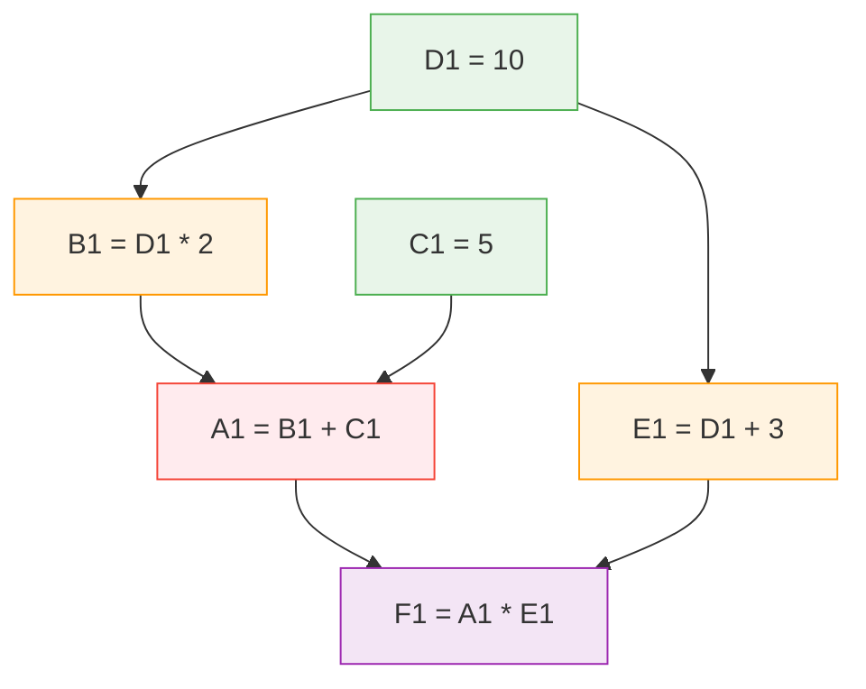
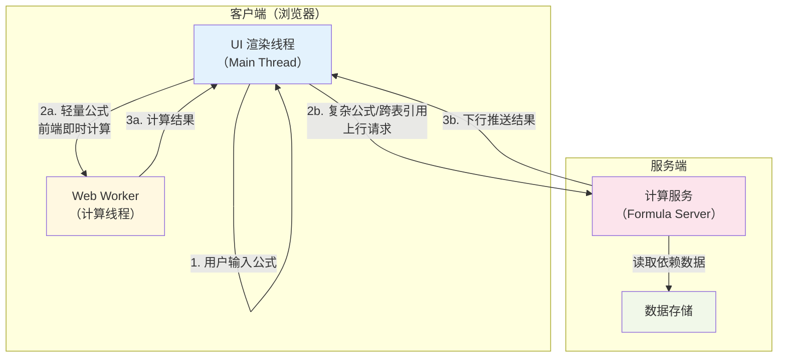

## 引言：为什么公式引擎如此复杂

大多数人对电子表格公式的第一印象停留在 `=SUM(A1:A10)` 这样的简单求和。但当你深入审视 Excel 或 Google Sheets 的公式系统时，会发现它本质上是一门**图灵完备的编程语言**——拥有变量（单元格引用）、函数（400+ 内置函数）、条件分支（IF/IFS）、递归（LAMBDA + 自引用）、甚至数组运算（动态数组公式）。

这意味着公式引擎的实现远不止"解析一个表达式然后算出结果"那么简单。它需要解决的核心问题包括：

- **解析与编译**：将用户输入的公式字符串转换为可执行的内部表示
- **依赖管理**：维护百万级单元格之间的引用关系图
- **增量计算**：当一个单元格变化时，精准地只重新计算受影响的上游单元格
- **并发与协同**：多人同时编辑公式时的冲突处理和一致性保证
- **性能**：在毫秒级响应时间内完成上述所有工作

本文将从计算链路、依赖图管理、异步计算架构和性能优化四个维度，系统地拆解在线电子表格公式引擎的工程实现。

## 一、公式计算的完整链路

一条公式从用户键入到最终渲染结果，要经历六个阶段。我们先从全局视角看清整条链路，再逐一深入。


### 1.1 词法分析：从字符串到 Token 流

当用户在单元格中键入以 `=` 或 `+` 开头的内容，公式引擎的第一道工序是**词法分析（Tokenization）**。这一步将原始字符串拆解为有意义的 Token 序列。

以 `=SUM(A1:B3)+AVERAGE(C2:C5)` 为例，词法分析器会产出如下 Token：

| Token 类型 | 值 | 说明 |
|:---|:---|:---|
| FUNCTION | SUM | 内置函数名 |
| LPAREN | ( | 左括号 |
| RANGE | A1:B3 | 单元格范围引用 |
| RPAREN | ) | 右括号 |
| OPERATOR | + | 加法运算符 |
| FUNCTION | AVERAGE | 内置函数名 |
| LPAREN | ( | 左括号 |
| RANGE | C2:C5 | 单元格范围引用 |
| RPAREN | ) | 右括号 |

词法分析阶段需要处理的边界情况远比想象的多：负号与减号的歧义（`-A1` vs `A1-B1`）、字符串字面量中的特殊字符（`"He said ""hello"""`）、R1C1 与 A1 两种引用风格的兼容，以及跨表格引用的 `Sheet2!A1` 语法等。

### 1.2 语法解析：中缀表达式到逆波兰表达式（RPN）

词法分析之后，需要将 Token 流转换为便于程序求值的内部表示。业界主流方案有两种：

- **抽象语法树（AST）**：树状结构，直观但遍历开销较大
- **逆波兰表达式（RPN / 后缀表达式）**：线性结构，求值时只需一个栈，效率更高

许多电子表格引擎选择 RPN 作为内部表示。以 `AVERAGE(SUM(A1,A2), B1) + 50 + B20` 为例，经过中缀转后缀（Shunting-yard 算法）后得到：

```
[A1, A2], SUM, [B1], AVERAGE, 50, +, B20, +
```

这个过程需要正确处理运算符优先级（`*` `/` 高于 `+` `-`）、函数调用的参数列表、以及括号的嵌套层级。核心算法是经典的 Dijkstra 调度场算法（Shunting-yard Algorithm），使用一个运算符栈和一个输出队列来完成转换。

一个值得注意的工程细节是**括号匹配校验**。在实际实现中，需要排除字符串字面量内的括号字符，避免将 `"He said (hello)"` 中的括号误计入匹配检查：

```
括号匹配 = 总左括号数 - 字符串内左括号数 == 总右括号数 - 字符串内右括号数
```

### 1.3 依赖分析：提取引用范围

解析公式的同时，引擎会提取出该公式引用的所有单元格范围（FormulaRange）。这些范围信息是后续构建依赖图的基础。

例如 `=SUM(A1:B3)+AVERAGE(C2:C5)` 会提取出两个依赖范围：`A1:B3` 和 `C2:C5`。这意味着当这两个范围内的任意单元格发生变化时，当前公式都需要重新计算。

### 1.4 拓扑排序：确定计算顺序

有了依赖关系，下一步是对所有需要重新计算的单元格进行拓扑排序（Topological Sort），确保每个单元格在其依赖的所有上游单元格计算完成后才被计算。这一步的具体实现将在第二节"依赖管理"中详细展开。

### 1.5 公式求值：遍历 RPN 执行计算

拓扑排序确定了计算顺序后，引擎按序对每个脏单元格进行求值。RPN 的求值过程简洁高效：维护一个值栈，从左到右扫描 RPN 序列，遇到操作数则入栈，遇到运算符或函数则弹出相应数量的操作数执行运算后将结果入栈。

求值过程中有一个重要的区分：**立即计算与惰性计算**。

- **立即计算（Immediate Evaluation）**：大多数函数（如 SUM、AVERAGE）属于这一类，遍历 RPN 时直接求值
- **惰性计算（Lazy Evaluation）**：部分函数（如 IF）只需计算分支之一，不需要提前求值所有参数

在混合场景中，如果依赖图中同时出现立即计算和惰性计算的函数，下游的惰性计算函数会将上游也"拉"成惰性模式——即"一懒俱懒"策略。具体实现是：立即计算函数在取值时发现 Range 中包含了尚未计算的脏单元格，就自动退化为惰性计算，将求值推迟到所有依赖项就绪后统一处理。

### 1.6 结果写入与渲染

求值完成后，引擎会生成一批 Mutation（数据变更操作），更新对应单元格的 `computedValue` 字段。这些 Mutation 在计算完成的回调中被批量应用到模型上，最终触发前端的渲染更新。

公式单元格在模型中存储两类信息：
- `a1Formula_`：原始公式字符串，如 `=SUM(A1:B3)+1`
- `computedValue`：服务端或前端计算后返回的计算结果值

非公式单元格则只存储 `userEnteredValue`（用户直接输入的值）。

## 二、依赖管理：DAG 与脏区传播

依赖管理是公式引擎中最具工程挑战的部分。一张大型电子表格可能包含数十万个公式，它们之间的依赖关系构成一个复杂的有向无环图（DAG）。

### 2.1 依赖图的数据结构

来看一个具体的例子：



在这个例子中，如果用户修改了 D1 的值，引擎需要按照以下顺序重新计算：

1. **D1**（被修改的源头）
2. **B1 = D1 * 2** 和 **E1 = D1 + 3**（直接依赖 D1，可并行）
3. **A1 = B1 + C1**（依赖 B1）
4. **F1 = A1 * E1**（依赖 A1 和 E1，需要等两者都完成）

这就是拓扑排序的价值——它保证了每个节点在被计算时，其所有依赖已经就绪。

### 2.2 依赖图的双向维护

实际工程中，依赖图需要同时维护两个方向的链路：

- **下游链（Forward）**：一个公式单元格依赖哪些范围——用于行列插入/删除时动态调整引用范围
- **上游链（Backward）**：一个单元格被哪些公式所依赖——用于变更传播时快速找到所有受影响的上游

这两个方向的链路由不同的模块维护：

- **RangeFormulasUpdater**：维护单向的下游链。当发生行列变化（如插入行）时，通过 `adjustRangesAfterInsert` 方法实时更新所有受影响的范围引用。例如，插入一行后，`A1:A10` 可能需要更新为 `A1:A11`
- **SupportedCellsManager**：维护双向链，用于快速查找某个单元格变更影响的所有上游公式。它结合了 HashMap 和 R-tree 两种数据结构来提升检索效率

R-tree 的引入是一个关键的工程决策。单元格引用本质上是二维空间中的矩形区域（Range），R-tree 天然适合高效地回答"哪些 Range 包含了坐标 (row, col)"这类空间查询。相比朴素的 HashMap 遍历，R-tree 可以将范围查询的时间复杂度从 O(n) 降低到 O(log n)。

### 2.3 脏区收集与传播

当用户编辑一个单元格时，引擎需要找出所有需要重新计算的单元格——即"脏区（Dirty Cells）"。这个过程分为两步：

**第一步：收集种子脏区。** 用户直接编辑的单元格就是种子脏区，它们在写入操作执行时被添加到 `dirtyRangesTrackers` 中。

**第二步：探索衍生脏区。** 引擎从种子脏区出发，沿着依赖图的上游链逐层传播，使用 R-tree 查询找出所有间接受影响的单元格。这个过程在 `TransitiveDirtinessExplorer.exploreInternal` 中完成，本质上是依赖图上的一次广度优先搜索（BFS）或深度优先搜索（DFS）。

探索完成后，所有脏单元格被送入拓扑排序，产出计算顺序，然后逐一求值。

### 2.4 循环依赖检测

如果 A1 引用了 B1，而 B1 又引用了 A1，就形成了循环依赖。引擎必须在拓扑排序阶段检测出这种情况，并将涉及循环的单元格标记为错误状态（通常显示为 `#REF!` 或 `#CIRCULAR!`），而不是让计算陷入无限循环。

检测方法是标准的图论算法：在拓扑排序过程中，如果存在入度无法归零的节点，说明存在环。

### 2.5 动态依赖：编译时 vs 运行时

上述的依赖图是通过静态分析公式构建的——类似编程语言的"编译时"分析。但某些公式（如 OFFSET、INDIRECT）的引用范围需要在运行时才能确定，这就引入了**动态依赖**的概念。

以 `=OFFSET($D$15, ROW($D$15:$D$18)-ROW($D$15), 1, 3)` 为例，OFFSET 的返回范围取决于其参数的计算结果，在解析阶段无法确定。

引擎处理动态依赖的策略是：

1. 先按静态依赖完成第一轮计算
2. 在产生动态结果的函数求值完毕后，如果发现额外影响了其他单元格，将这些单元格以 `newlyDirtyCells` 的形式再走一遍依赖探索和拓扑排序
3. 将动态依赖结果缓存到图中——因为大多数返回范围的函数，其范围在多次计算中通常是稳定的

这种"多轮清脏"的设计保证了动态依赖的正确性，同时通过缓存避免了不必要的重复计算。

## 三、异步计算架构

在线电子表格面临一个核心架构决策：**公式在哪里算？** 不同的选择带来完全不同的工程挑战。



### 3.1 三种计算模式

**模式一：纯服务端计算。** 所有公式都发送到服务端计算，结果通过下行协议推送回客户端。

- 优点：数据一致性有保障，跨表格引用天然支持
- 缺点：网络延迟明显，用户输入到看到结果可能有数百毫秒的延迟；网络传输体积大

**模式二：纯前端计算。** 所有公式都在浏览器端计算。

- 优点：响应速度快，无网络延迟
- 缺点：大数据量场景下性能受限；跨表格引用需要额外的数据加载机制

**模式三：混合计算（主流方案）。** 简单公式在前端即时计算，复杂公式或跨表引用发送到服务端。

在混合计算架构中，前端计算引入了一个关键的时序问题：用户编辑后前端立即计算出结果并更新了界面，但服务端的计算结果随后也到达了——如果两者不一致怎么办？主流解决方案是"前端计算结果为临时态，服务端结果到达后以服务端为准"，同时通过版本号机制避免旧版本的服务端结果覆盖新版本的前端计算。

### 3.2 Web Worker 隔离计算

在前端计算模式中，公式求值可能涉及大量计算（如对数万个单元格求和），如果放在主线程执行会阻塞 UI 渲染，导致界面卡顿。

解决方案是将计算任务放到 Web Worker 中执行：

1. 主线程接收用户输入，将公式和相关数据序列化后发送给 Worker
2. Worker 在独立线程中完成解析、依赖分析和求值
3. 计算完成后将结果发回主线程，更新模型和视图

这种架构需要注意的是 Worker 中的数据同步问题——Worker 中需要维护一份单元格数据的副本，或者通过 SharedArrayBuffer 共享内存。

### 3.3 依赖追踪缓存（TrackerMap）

无论是前端还是服务端计算，一个关键的优化手段是建立 **TrackerMap**——即依赖追踪的缓存映射。

没有 TrackerMap 的情况下，每次有单元格变更，引擎都需要重新遍历整个依赖图来找出受影响的单元格，这在大规模表格中会导致严重的性能问题。TrackerMap 预先构建了从"被依赖单元格"到"依赖它的公式"的反向索引，使得脏区收集的时间复杂度从依赖图的全量遍历降低到了直接查表。

## 四、性能优化实践

### 4.1 核心性能指标

在深入优化策略之前，先明确公式引擎需要关注的核心指标：

| 指标 | 目标值 | 说明 |
|:---|:---|:---|
| 单公式计算延迟 | < 16ms（一帧） | 简单公式应在一帧内完成，用户无感知 |
| 批量计算吞吐 | > 10万 cells/s | 打开大表格时的初始计算速度 |
| 依赖图查询 | O(log n) | 通过 R-tree 实现的范围查询 |
| 循环依赖检测 | O(V + E) | 拓扑排序中的环检测，V 为节点数，E 为边数 |
| 增量更新比例 | > 95% | 单次编辑后只重算受影响的单元格 |
| 内存占用（依赖图） | < 200MB / 百万公式 | 依赖图的空间效率 |
| Worker 通信开销 | < 2ms / 次 | 主线程与 Worker 间的序列化/反序列化 |
| 动态依赖额外轮次 | ≤ 2 轮 | 动态依赖导致的额外清脏轮次 |

### 4.2 优化策略一：增量计算

最重要的优化策略是**只计算变化的部分**。当用户修改一个单元格时，引擎不应该重新计算整张表格的所有公式，而是通过依赖图精准定位受影响的单元格，只重算这些脏单元格。

在实际的大型表格中，一次单元格编辑影响的公式通常不超过总公式数的 5%。增量计算将每次编辑的计算量从 O(所有公式) 降低到 O(受影响的公式)。

### 4.3 优化策略二：R-tree 加速范围查询

前面提到，依赖图的查询核心问题是"给定一个坐标 (row, col)，找出所有包含这个坐标的 Range"。这是一个经典的空间查询问题。

朴素方案是遍历所有注册的 Range，逐一检查是否包含目标坐标，时间复杂度 O(n)。引入 R-tree 后，查询效率提升到 O(log n)，在百万级 Range 的场景下性能差异显著。

### 4.4 优化策略三：惰性求值

对于包含条件分支的公式（如 `=IF(A1>0, VLOOKUP(...), 0)`），如果 A1 > 0 不成立，则完全不需要计算 VLOOKUP 这个开销较大的分支。惰性求值避免了不必要的计算开销。

前面提到的"一懒俱懒"策略则是另一个维度的优化：当依赖链上同时存在立即计算和惰性计算的函数时，将上游统一退化为惰性计算，通过集中批处理来减少中间状态的维护开销。

### 4.5 优化策略四：计算结果缓存

对于确定性函数（给定相同输入必然返回相同输出），引擎可以缓存计算结果。当函数的所有输入都未变化时，直接返回缓存值，跳过求值过程。

动态依赖的范围缓存也是这一策略的体现——大多数 OFFSET 类函数的返回范围在多次计算中是稳定的，缓存后避免了重复的依赖图更新。

### 4.6 优化策略五：并行计算

在拓扑排序的结果中，同一层级的节点之间没有依赖关系，可以并行计算。例如在前面的例子中，B1 和 E1 处于同一层级，可以在 Worker 中并行求值。

服务端计算引擎还可以利用多核 CPU 进一步提升并行度，将不同的子图分配到不同的线程中计算。

## 五、开源实现对比

了解了原理之后，我们来看看几个典型的开源实现是如何处理这些问题的。

| 项目 | 语言 | 公式解析策略 | 依赖管理 | 特点 |
|:---|:---|:---|:---|:---|
| HyperFormula | TypeScript | 自研解析器 + AST | 完整依赖图 + 增量计算 | 高性能，支持命名范围、数组公式 |
| formula.js | JavaScript | 独立函数实现 | 无（纯函数库） | 400+ Excel 函数的 JS 实现 |
| x-spreadsheet | JavaScript | Shunting-yard → RPN | 运行时递归解析 | 轻量级，适合嵌入场景 |
| Luckysheet | JavaScript | 公式转 JS eval | 无完整依赖图 | 功能全面但公式引擎相对简单 |
| ReoGrid | C# (.NET) | 自研解析器 | 内置依赖追踪 | 桌面端高性能 |

### x-spreadsheet 的轻量级实现

x-spreadsheet 采用了经典的 Shunting-yard 算法将中缀表达式转为后缀表达式，然后用栈求值。它的实现简洁直观，但没有建立完整的依赖图，而是在每次渲染单元格时递归解析所有引用——这在小规模场景下足够用，但在大型表格中会导致大量重复计算。

它的循环依赖检测也采用了简单的"调用栈追踪"方案：在递归求值时维护一个 `cellList`，如果发现当前单元格已在列表中（说明出现了循环），直接返回 0。

### Luckysheet 的 eval 方案

Luckysheet 采用了一个大胆的策略：将公式解析为 JavaScript 表达式，然后直接用 `eval()` 执行。

例如 `=SUM(A1:B2)` 会被转换为：

```javascript
luckysheet_function.SUM.f(luckysheet_getcelldata('A1:B2'))
```

这种方案开发效率极高——不需要自己实现求值引擎，复杂的嵌套公式也能自然处理。但它带来了安全风险（`eval` 可执行任意代码）和性能问题（每次求值都需要解析和编译 JavaScript 字符串）。

### HyperFormula 的工业级实现

HyperFormula 是目前开源社区中最接近工业级的方案。它实现了完整的依赖图管理、增量计算、命名范围支持、数组公式，以及 400+ Excel 兼容函数。

它的依赖图使用了邻接表 + 拓扑排序的经典方案，在单元格变更时只重新计算受影响的子图，实现了真正的增量计算。

## 六、多人协同场景下的特殊挑战

在线电子表格与离线 Excel 的一个根本区别是**多人协同编辑**。这给公式引擎带来了额外的挑战：

**冲突处理：** 当两个用户同时编辑同一个单元格时，后发送到服务端的操作会覆盖前者。公式操作也遵循同样的规则——最终以服务端接收到的最后一个版本为准。

**依赖图的并发更新：** 用户 A 插入了一行，导致公式引用范围需要调整；同时用户 B 在被插入行的位置写入了新公式。两个操作需要通过 OT（Operational Transformation）或 CRDT 算法正确合并。

**计算时序：** 前端为了用户体验会立即计算并显示结果，但其他用户的编辑可能在网络传输过程中改变了依赖数据。引擎需要在服务端结果到达后正确地更新或回退前端的临时计算结果。

## 七、总结

电子表格公式引擎是一个看似简单实则深邃的工程系统。它横跨编译原理（表达式解析）、图论（依赖管理与拓扑排序）、并发编程（异步计算与协同）和性能工程（增量计算与空间索引）四大领域。

回顾全文的核心要点：

1. **完整链路**：用户输入 → 词法分析 → RPN 生成 → 依赖提取 → 拓扑排序 → 求值 → 渲染，六个阶段环环相扣
2. **依赖管理**：双向链路 + R-tree 空间索引 + 增量脏区传播，是大规模表格性能的关键
3. **立即 vs 惰性**：两种求值策略的灵活切换，在正确性和性能之间取得平衡
4. **动态依赖**：通过多轮清脏 + 结果缓存解决运行时才能确定引用范围的问题
5. **异步架构**：主线程 / Worker / 服务端的三层计算架构，兼顾响应速度和数据一致性

对于正在构建类似系统的工程师，建议在项目早期就做好以下设计：

- 选择合适的内部表示（RPN vs AST），这决定了求值引擎的复杂度上限
- 依赖图的数据结构要支持增量更新，不要在每次编辑后全量重建
- 从第一天就把 Worker 隔离纳入架构，避免计算阻塞 UI
- 循环依赖检测和错误传播要作为一等公民来设计，而不是事后补丁

公式引擎的复杂性在于，它看起来是一个"计算器"，但实际上是一个完整的编程语言运行时。理解这一点，是设计好公式引擎的第一步。
