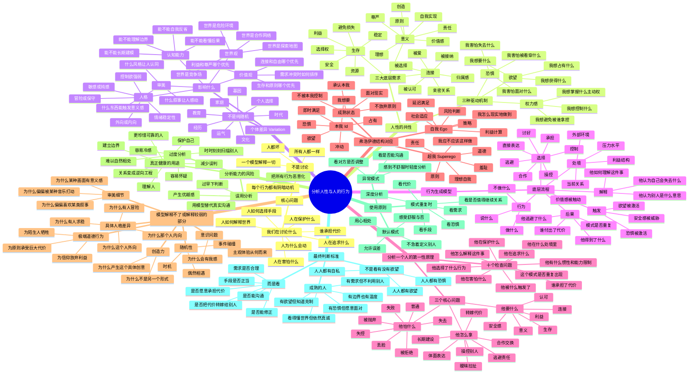
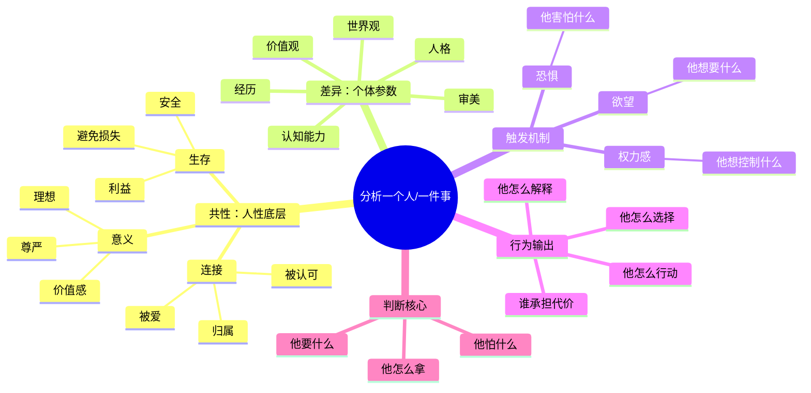
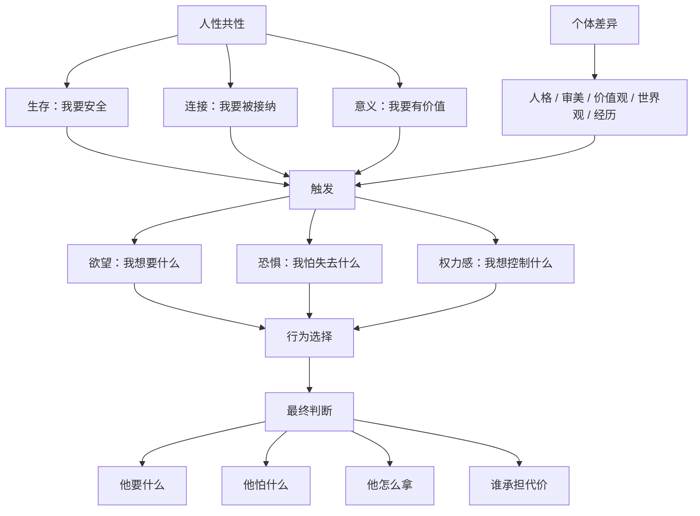

看TA展示什么，需要什么，面对弱者的态度，生气的样子，付出的样子，思考的样子，面对利益损失的样子，掌握权力的样子，说话的风格

试探

分类这个人到一个朋友类型，到一个已知情况的类型，慢慢观察，记录他的一切行为。

可以，下面这个是**综合我们这整段“人性/分析人/关系风险”的思维导图**。你可以直接复制到支持 Mermaid 的地方，比如 Obsidian、Typora、Notion 插件、Mermaid Live Editor。



最压缩版其实就这一句：

> **人性决定人会追求安全、连接和价值；个体差异决定他觉得什么能满足这些；人格成熟度决定他会用什么方式去拿，以及是否让别人替他承担代价。**

哈哈哈哈对，这张图是“资料库版”，不是“思维导图版”。  
你要的是**一眼能抓住骨架**的，不是把所有细节都塞进去。

我给你重画一个**极简主干版**：



这个版本的核心逻辑是：

```text
人性共性：决定人会被什么东西驱动
个体差异：决定他会被什么具体东西触发
触发机制：决定他当下为什么动
行为输出：决定他具体怎么做
判断核心：看他怎么满足自己，以及谁承担代价
```

更狠一点，可以压成这个：



我觉得你真正应该记的不是那张大图，而是这个：

> **共性是：人都追求生存、连接、意义。**  
> **差异是：每个人觉得什么能带来这些东西不一样。**  
> **分析是：看他要什么、怕什么、怎么拿、谁承担代价。**

这个就够用了。

这个问题很关键。你不是要“读心”，而是要建立一个**低误判的观察系统**。

最重要的一句先放前面：

> **不要试图从一句话判断一个人。要从“重复模式 + 利益场景 + 压力场景 + 边界反应”判断。**

人平时都能装得像个人，真正的信息通常出现在四种地方：

```text
1. 他想得到东西的时候
2. 他害怕失去东西的时候
3. 他拥有一点权力的时候
4. 你拒绝他、设边界、让他失望的时候
```

---

# 1. 怎么看一个人的欲望？

欲望不是只看他说“我想要什么”，而是看：

> **他会主动靠近什么？反复谈什么？羡慕什么？嫉妒什么？愿意为什么付出代价？**

## 观察点

### **A. 他反复展示什么**

一个人总展示什么，通常说明他想被别人用什么认可。

比如：

|他反复展示|可能欲望|
|---|---|
|钱、消费、车、房|地位、优越感、安全感|
|人脉、认识谁|影响力、身份感|
|异性缘、暧昧经历|吸引力确认|
|苦难、委屈|被照顾、被补偿、道德优势|
|聪明、见识、观点|智力优越感、话语权|
|善良、付出|道德认可、关系控制可能性|

不是说展示就一定有问题，而是它会暴露他的**价值货币**。

---

### **B. 他羡慕谁、看不起谁**

这个很准。

一个人羡慕的人，往往代表他的欲望方向。  
一个人看不起的人，往往代表他的价值排序。

比如：

- 羡慕有钱人：资源/安全/地位欲望强。
    
- 羡慕万人迷：吸引力/认可欲望强。
    
- 羡慕自由职业者：自主权欲望强。
    
- 看不起“普通人”：特殊性/优越感需求强。
    
- 看不起“老实人”：可能崇拜强者/利益效率。
    

---

### **C. 他愿意为啥花时间、钱、精力**

别听他说重视什么，看他资源投向哪里。

```text
时间投向 = 真实优先级
金钱投向 = 真实欲望
情绪投向 = 真实执念
```

嘴上说重视成长，天天沉迷炫耀，那成长不是核心欲望。  
嘴上说重视感情，但从不付出时间，那关系不是核心优先级。

---

# 2. 怎么看一个人的恐惧？

恐惧通常不会直接说出来，它会伪装成：

> 愤怒、控制、逃避、讨好、炫耀、冷漠、攻击。

最锋利的问题是：

> **如果他不这样做，他最怕发生什么？**

## 常见映射

|表面行为|可能恐惧|
|---|---|
|总是控制别人|怕失控、怕被抛弃、怕不安全|
|总是贬低别人|怕自己不够好|
|特别爱炫耀|怕不被看见、怕普通|
|不敢承诺|怕承担责任、怕失去选择权|
|一被质疑就暴怒|怕权威/价值感被挑战|
|过度讨好|怕被讨厌、怕关系断裂|
|习惯冷处理|怕冲突、怕暴露真实想法|
|说话永远留后路|怕负责、怕被抓住把柄|
|极度敏感别人评价|怕羞耻、怕丢脸|

---

## 看恐惧最好的场景：小挫折

不是大灾大难，是小挫折更真实。

比如：

- 他被拒绝时什么反应？
    
- 他被纠正时什么反应？
    
- 他没被优先考虑时什么反应？
    
- 他计划被打乱时什么反应？
    
- 他输了、丢脸、没占到便宜时什么反应？
    

成熟的人可能会不爽，但能调整。  
危险的人会把小挫折变成大攻击。

---

# 3. 怎么看一个人的权力感？

权力感不是“他有没有权力”，而是：

> **他一旦能影响你，会怎么使用这种影响力。**

这非常重要。

## 观察点

### **A. 他如何对待弱者和服务人员**

不是鸡汤，是真的很准。

看他对：

- 服务员
    
- 外卖员
    
- 前台
    
- 新人
    
- 比他弱的人
    
- 求助他的人
    

是什么态度。

因为这些场景里，他比较不需要伪装。

如果他对上讨好，对下傲慢，这个人的权力观大概率有问题。

---

### **B. 他会不会制造不确定性**

关系里最常见的权力感手段就是：

```text
不给明确答案
忽冷忽热
让你猜
让你等
让你证明
让你内耗
```

这种人可能不是真的强，而是通过制造不确定性来获得掌控感。

尤其要警惕：

> **他让你一直想：“我到底哪里做错了？”**

这就是权力不对称开始形成。

---

### **C. 他被你拒绝后怎么反应**

这个是判断人的黄金测试。

你可以不用大拒绝，生活里小边界就够了：

- “今天不方便。”
    
- “这个我不想聊。”
    
- “我不太接受这种说法。”
    
- “我需要想一下。”
    
- “这件事我不答应。”
    

看他反应：

|反应|说明|
|---|---|
|尊重你的拒绝|边界感好|
|失望但能接受|正常人|
|开始冷暴力|惩罚你|
|开始道德绑架|想控制你|
|开始贬低你|自尊脆弱|
|反复逼问|不尊重边界|
|表面答应，之后报复|危险|

**一个人怎么对待你的“不”，比怎么对待你的“好”更能说明问题。**

---

# 4. 认识新人时：别急着分析，先做四个轻测试

不是故意设局，而是在正常相处中观察。

## **测试一：小边界测试**

表达一个小拒绝，看他是否尊重。

> “今天我不太想出去。”  
> “这个话题先不聊。”  
> “我不太喜欢这样。”

重点看：他是尊重，还是继续推进。

---

## **测试二：小分歧测试**

轻微不同意他，看他能不能讨论。

> “我不太这么看。”  
> “这个我有点不同意见。”

重点看：他是好奇，还是立刻防御、嘲讽、压你。

---

## **测试三：小麻烦测试**

看他是否有基本责任感。

比如约好时间、分工、借东西、一起办件小事。

重点看：

- 是否守时
    
- 是否提前说明变化
    
- 是否甩锅
    
- 是否让别人收拾烂摊子
    

小事里的责任感，通常会放大到大事里。

---

## **测试四：小利益测试**

有一点点利益冲突时，看他怎么处理。

比如：

- 谁多付一点钱
    
- 谁多走一点路
    
- 谁迁就谁时间
    
- 功劳怎么分
    
- 信息是否透明
    

重点看他是不是**永远让别人吃亏**。

---

# 5. 防范一个人：看“模式”，不是看单点

危险信号不是一次两次，而是重复出现。

## 高风险模式

### **A. 需求很强，但不明说**

他想要陪伴、认可、帮助、资源，但不直接表达，而是通过暗示、委屈、冷脸、试探让你给。

这种人容易让你累。

---

### **B. 受益很多，但不承担责任**

他享受你的帮助、情绪价值、资源、人脉、时间，但一到承担关系责任就模糊。

这类人本质是：

> **拿的时候很清楚，负责的时候很糊涂。**

---

### **C. 永远有理由，永远不修正**

解释可以有，关键是有没有改变。

如果一个人每次伤害你后都说：

> 我不是故意的。  
> 我太累了。  
> 我以前经历不好。  
> 我就是这样。  
> 你想太多了。

但行为从不变，那解释就是烟雾弹。

---

### **D. 让你越来越不像自己**

这是非常强的信号。

如果和一个人相处后，你长期变得：

- 更焦虑
    
- 更自我怀疑
    
- 更小心翼翼
    
- 更想证明自己
    
- 更不敢表达不满
    
- 更害怕失去他
    

就要警觉。

健康关系应该让你更稳定，不是更像在考试。

---

# 6. 判断一个人，最终看这四句话

你可以把所有分析压缩成四问：

## **第一，他要什么？**

钱、认可、爱、地位、控制、刺激、安全感、意义感？

## **第二，他怕什么？**

怕拒绝、怕丢脸、怕失控、怕普通、怕负责、怕被看穿？

## **第三，他怎么拿？**

表达、交换、合作、建设？  
还是欺骗、暧昧、压迫、操控、甩锅？

## **第四，谁承担代价？**

他自己承担？  
双方公平承担？  
还是总让你承担？

这四问足够用了。

---

# 7. 但要防止自己过度分析

给你一个很稳的原则：

> **先按普通人处理，后按模式修正。**

也就是：

```text
第一次：可能是误会
第二次：值得注意
第三次：这是模式
```

不要一次就给人判死刑。  
但也不要一个模式出现三五次了还替他找借口。

---

# 8. 最实用的识人公式

```text
一个人的真实人格
=
他在欲望面前的克制
+
他在恐惧面前的诚实
+
他在权力面前的善意
+
他在犯错之后的修正能力
```

尤其最后一个很关键：

> **人都会有问题，但不是所有人都会修正。**

所以你认识新的人，不需要一上来就看穿他。

你只需要慢慢观察：

> 他想要的时候，会不会体面？  
> 他害怕的时候，会不会诚实？  
> 他有优势的时候，会不会善良？  
> 他做错的时候，会不会修正？

这四个问题，基本能把大多数人筛出来。

[[识人测试]]
