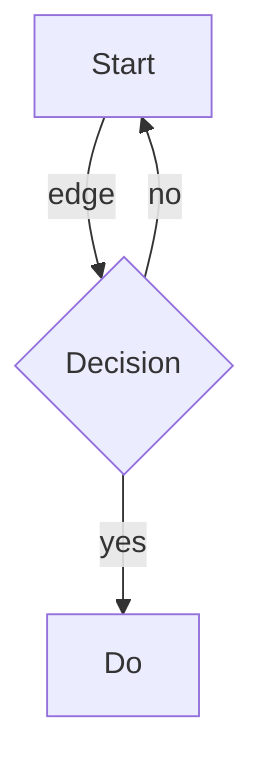

%% top-level Obsidian comment block
spanning multiple lines
that must be preserved verbatim %%

# H1 标题 with trailing spaces   

Normal paragraph with **bold**, _italic_, `inline code`, [[Wiki Link]], [[Target|Alias]], and an embed ![[Some Drawing.excalidraw]] plus ![[note#heading]].

> [!warning] Nested callout torture
> outer body
>> [!info]- Collapsed nested
>> deep body with `code`
>>> triple nested
> back to outer

<div style="color:red" data-x='y'>
  <span>Raw HTML block</span>
  <!-- html comment -->
</div>

Inline math $E = mc^2$ and block math:

$$
\int_0^\infty e^{-x^2}\,dx = \frac{\sqrt{\pi}}{2}
$$

| Col A | Col B | 中文列 |
|:------|:-----:|-------:|
| a1    | b1    | 值1    |
| a2 has \| escaped pipe | b2 | 值2 |

```dataview
TABLE file.mtime AS "Modified"
FROM #spike
WHERE contains(file.name, "torture")
SORT file.mtime DESC
```



```js
// fenced code with markdown-looking content inside
const s = "# not a heading";
const t = `> not a quote [[not a link]]`;
```

    // indented code block (4 spaces)
    preserve me exactly

- [ ] task unchecked
- [x] task checked
  - nested bullet with %%inline comment%%
1. ordered
2. list

Term
: definition-list-ish (non-standard)

Footnote reference[^1] and another[^long].

[^1]: footnote body
[^long]: multi-line
    footnote continuation

Text with a hard  
line break (two trailing spaces above).

---

***

A line with HTML entity &amp; &lt;tag&gt; and a raw & ampersand.

~~strikethrough~~ and ==highlight== (Obsidian) and #inline-tag/nested.

Link with title [text](https://example.com "the title") and autolink <https://example.org>.

Final line without trailing newline at EOF