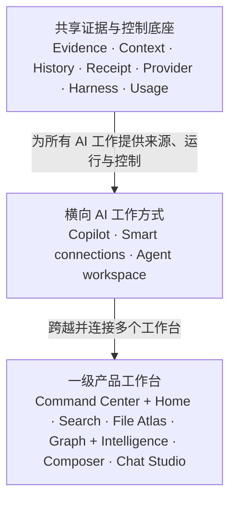

# Peak Assistant Landing Page 与 README 内容 Brief

> 文档用途：交给品牌设计师、网页设计师、内容设计师或其他 AI，作为重新设计 Peak Assistant 项目页与同步整理 README 的内容依据。
>
> 文档性质：内容 Brief、产品叙事约束与真实性边界。它不是网页结构稿、视觉规范、开发任务书，也不是要求沿用现有页面的改版清单。
>
> 更新日期：2026-08-08
>
> 阅读规模：约 3.2 万字符；完整阅读约 65 分钟。产品定位、一级工作台与宣传优先级集中在 [3.4–3.7 节](#34-核心判断工作方式不等于产品目录)，可在 10 分钟内完成决策阅读。

## 1. 先读这一段

设计者可以完全舍弃当前 Landing Page 的布局、组件、动效和视觉语言，也可以重写本文提供的工作文案。真正不可丢失的是：产品定位、用户理解顺序、核心能力、差异、证据、状态边界、Free 原则和信任信息。

这次设计不需要把现有网站“修得更漂亮”。它需要重新回答一个更基础的问题：一个第一次听说 Peak Assistant 的 Obsidian 用户，为什么会在几十秒内理解它、相信它，并愿意继续了解或从源码安装？

最终页面应让用户形成一个清楚认知：

> Peak Assistant 不是给 Obsidian 再加一个聊天框，而是把搜索、知识连接、Graph、Copilot、Agent 工作、生成能力和 AI 控制连接到同一个 Vault-aware 工作空间中，并让证据与用户控制权贯穿整个过程。

本文不规定：

- 页面必须分成多少段；
- 应采用什么配色、字体或网格；
- 必须使用卡片、时间线、3D、宇宙、天文或任何特定视觉母题；
- 必须沿用当前网站中的图片、文案或功能排序；
- 每项能力必须获得同等篇幅。

设计者应依据理解效率决定表现方式，只要最终结果通过本文的内容验收即可。

## 2. 文档的读者与预期产出

### 2.1 这份 Brief 给谁使用

主要读者是：

- 重新设计 GitHub Pages 项目页的人；
- 为项目制作交互概念、演示素材或品牌图形的人；
- 重写公开文案的人；
- 需要在不了解全部代码的情况下准确表达产品的 AI；
- 后续维护 Pages 与 GitHub README 一致性的人。

### 2.2 读完后应能做什么

读者应该能够：

- 用一句话准确解释 Peak Assistant；
- 知道哪些能力必须出现，哪些只能作为未来方向出现；
- 组织出一条从“用户问题”到“可信结果”的页面叙事；
- 为每个重要声明选择真实产品证据，而不是只加形容词；
- 在 Pages 与 README 之间保持定位一致，同时让两者承担不同任务；
- 自由完成视觉设计，而不因为缺少产品背景而猜错方向。

## 3. 产品定义

### 3.1 产品类别

Peak Assistant 是一个面向 Obsidian 的、证据感知的 AI 工作空间。

它以用户的 Vault 为工作环境，以用户拥有的 Markdown 和原生文件为主要事实源，把以下工作连接起来：

- 找到内容；
- 看见内容之间的关系；
- 理解整个知识库的结构与健康状态；
- 在原文附近写作和修改；
- 运行较长的对话、Agent 与项目任务；
- 生成图片、视频、音乐和语音相关内容；
- 选择和控制不同 AI Provider、工具、权限与成本边界。

### 3.2 首要传播句

当前可继续使用的主句是：

> **Your whole vault. Connected.**

它表达的是“整个 Vault 被连接为一个工作系统”，不是单纯的 Graph 连线，也不是只表示语义搜索。

中文解释可以是：

> **让整个 Vault 真正连接起来。**

设计者可以提出更好的主句，但新主句至少要同时容纳：

- 整个 Vault，而不是当前聊天窗口；
- 关系与证据，而不是孤立生成；
- 搜索、理解、创作和行动的连续性；
- 用户仍然拥有文件、Provider 选择和最终决定权。

### 3.3 最短产品说明

可作为工作底稿：

> Peak Assistant is an evidence-aware AI workspace for Obsidian. Search and map knowledge, find hubs and gaps, write with Copilot, run project conversations, generate media, and route AI work across the providers you choose—without giving up your Markdown.

中文含义：

> Peak Assistant 是为 Obsidian 设计的证据感知 AI 工作台：搜索并绘制知识关系、发现 Hub 与 Gap、用 Copilot 写作、运行项目对话、生成媒体，并把不同 AI 任务路由到用户选择的 Provider，同时不放弃 Markdown 所有权。

这不是最终必须逐字使用的文案，但任何替代版本都不应退化为以下泛化表达：

- AI assistant for Obsidian；
- Chat with your notes；
- Unlock your knowledge；
- Boost your productivity；
- All-in-one AI workspace。

这些句子可以作为辅助描述，不能单独承担产品差异。

### 3.4 核心判断：工作方式不等于产品目录

Peak 有三种横向 AI 工作方式：Copilot、Smart connections 和 Agent workspace。它们帮助新用户理解 AI 如何参与工作，但不能代替完整产品结构。

如果公开页面只展示这三种方式，会产生三个问题：

- Command Center + Home 会被误解成辅助入口，而不是独立的返回工作与组织工作空间；
- File Atlas、Search 和 Graph 会被压缩成 Smart connections 下的一组功能标签；
- Peak Composer 与 Chat Studio 会被误解成 Copilot 和 Agent 的示例界面，而不是能够独立承担完整任务的一级工作台。

因此，Peak 的公开产品结构固定为三层：

阅读这张图时需要注意：

- 用户实际进入的是一级产品工作台，不是抽象的 AI 工作方式；
- 同一个工作台可以承载多种工作方式，例如 Composer 同时承载 Copilot 和 Smart connections；
- Evidence、Context 与 Receipt 是跨工作台连续性的基础，不应被包装成另一个独立用户产品。

### 3.5 六个一级产品工作台

每个一级工作台都需要一个独立、完整、可演示的用户承诺。它们可以在一条工作流里连接，但不能在宣传中互相吞并。

| 一级工作台 | 用户首先要完成的工作 | 不应被误解为 |
| --- | --- | --- |
| **Command Center + Home** | 回到文件、Workspace、Bookmark、Dashboard 和经过策展的 Peak Action | 设置页、命令网格或原生 Command Palette 替代品 |
| **Vault Search + AI Search** | 找到材料、理解结果集合，并检查报告与 Sources | 只有一个输入框的语义搜索 |
| **File Atlas** | 从当前文件看见文档结构、资源和局部知识邻域 | 文件管理器或 Graph 的附属面板 |
| **Graph + Vault Intelligence** | 看见关系并诊断 Hub、Gap、Bridge、Orphan 和 Drift | 装饰性知识网络 |
| **Peak Composer + Copilot** | 在原文附近完成精确、可审阅、可追踪的 AI 修改 | 一组 Rewrite 命令或普通 Markdown 预览器 |
| **Chat Studio** | 用 Project、Resource、Assistant、Agent 和 Artifact 承载较长任务 | 带侧栏的聊天窗口 |

支撑六个工作台的 Control 与 Ownership 产品面包括：

- AI Control Center + My Content；
- Usage Dashboard 与 Provider 配置；
- 数据和持久内容边界。

这些产品面需要公开说明，但不与六个一级工作台争夺同一种 Hero 位置。其中开发中的能力必须单独标注状态。

### 3.6 宣传价值评分

以下评分用于决定各类公开材料的投入顺序。满分为 10；“当前宣传可信度”衡量现阶段对外声明的把握，不代表长期产品潜力。宣传角色不是简单平均分，而是综合用户价值、差异化、演示效果和当前证据后的决策。

| 能力 | 差异化 | 高频价值 | 演示力 | 当前宣传可信度 | 宣传角色 |
| --- | ---: | ---: | ---: | ---: | --- |
| **Vault Search + AI Search** | 9.0 | 10.0 | 10.0 | 8.5 | 主 Hero 与完整故事 |
| **File Atlas** | 9.5 | 9.0 | 9.5 | 7.0 | 独立主章节 |
| **Graph + Vault 结构诊断** | 9.5 | 8.0 | 10.0 | 7.5 | 主 Hero 与独立 Feature Story |
| **围绕当前笔记主动发现材料** | 9.0 | 8.5 | 8.5 | 8.0 | 独立 Feature Story |
| **Peak Composer + Copilot** | 9.0 | 10.0 | 9.5 | 7.0 | 一级主工作台 |
| **Chat Studio** | 9.0 | 9.0 | 9.0 | 8.5 | 一级主工作台 |
| **Command Center + Home** | 8.5 | 9.5 | 9.0 | 7.0 | 一级主工作台 |
| **Agent 与 Multi-provider 平台** | 8.5 | 8.0 | 7.5 | 8.0 | 平台可信度证明 |
| **Media 与结构化 Artifact** | 7.5 | 7.0 | 9.0 | 6.5 | Chat Studio 的扩展证明 |
| **本地、成本与数据控制** | 8.0 | 9.0 | 7.0 | 8.5 | 信任与转化章节 |
| **AI Control Center + My Content** | 9.0 | 8.0 | 8.5 | 5.5 | Closing / Future，不作当前 Hero |

这张表带来四项直接决策：

1. Search、File Atlas 和 Graph 是最强的视觉获客面，但不能因此遮掉 Composer、Chat Studio 与 Command Center。
2. Composer、Chat Studio 与 Command Center 必须分别拥有独立标题、独立截图或演示，以及独立用户结果。
3. Related Materials 和 Vault 结构诊断需要单项宣传，因为它们分别回答“现在还该看什么”和“整个 Vault 哪里断裂”。
4. AI Control Center + My Content 的长期差异化很高，但当前只能进入 Closing / Future 区域。

### 3.7 产品入口顺序与营销顺序不同

产品内部的自然循环可以从 Command Center + Home 开始。用户返回工作后寻找材料、理解结构，进入 Composer 或 Chat Studio，留下结果后再回到 Home。

公开页面不必照搬这个入口顺序。营销内容应按以下顺序建立理解：

1. 用 Search、File Atlas 和 Graph 建立差异；
2. 用 Composer 与 Chat Studio 证明理解能够变成创作和任务结果；
3. 用 Command Center 证明这些工作台可以被组织成每天返回的系统；
4. 用 Provider、Usage、Permission、数据边界和当前成熟度建立信任。

## 4. 用户应在多长时间内理解什么

### 4.1 前 5 秒

用户应该知道：

- 这是 Obsidian 的 AI 工作空间；
- 它面向整个 Vault，而不只是一个聊天框；
- Graph、Search、Copilot 或它们之间的连接是产品的重要差异；
- 页面上存在一个明确的下一步。

### 4.2 前 15 秒

用户应该理解至少两个差异：

- 结论能够回到证据与来源；
- Search、Graph、Composer 和 Chat 不是互不相干的功能页，而是同一条工作链。

理想情况下，用户还会意识到 Peak 同时覆盖三种熟悉心智：Copilot、智能连接和 Agent 工作台。

### 4.3 前 30 秒

用户应该看到至少一个完整结果，而不是只看到产品界面：

- 一个问题如何变成搜索和来源集合；
- 来源如何形成可探索的 Graph；
- Graph 或 Search 中的证据如何继续进入 Composer 或 Chat；
- 用户如何检查、接受、继续或返回原文。

### 4.4 前 60 秒

用户应该能够判断：

- 这个项目是否适合自己的 Vault 工作方式；
- 当前哪些能力已经在源码中，哪些还处于 Preview 或研究阶段；
- 本地功能与 Provider 成本如何区分；
- 数据和文件控制权大致在哪里；
- 如何继续查看 GitHub、安装方式、Roadmap 或演示。

## 5. 核心用户问题

页面不要先从模块名出发。它应先理解用户为什么需要 Peak。

### 5.1 “我的 Vault 里明明有答案，但我找不到了”

用户的真实问题通常不只是关键词不匹配，还包括：

- 记得概念，却不记得文件名；
- 相关材料分散在多个目录和旧项目中；
- 普通搜索返回了列表，却没有解释关系；
- 找到了一篇笔记，但不知道还有哪些上下游材料；
- AI 给了结论，却看不出依据了哪些笔记。

Peak 的回答应体现 Vault Search、AI Search、File Atlas、Graph、Sources 与 Intelligence 是如何协同的。

### 5.2 “我的知识库越来越大，但我不知道它哪里健康、哪里断裂”

用户需要的不只是漂亮的全库 Graph，而是可行动的结构解释：

- 哪些笔记是 Hub；
- 哪些主题之间存在 Gap；
- 哪些 Bridge 很脆弱；
- 哪些笔记是孤立节点；
- 哪些 Cluster 已经过时、漂移或无人维护；
- 为什么系统认为这里有问题；
- 用户下一步可以做什么。

### 5.3 “我希望 AI 帮我写，但不希望它脱离原文或直接乱改”

用户希望 AI 能理解精确选区、Block、Document 和原生对象，同时保留审阅、候选、历史与来源。Peak Composer 与 Copilot 的价值不是“能生成文字”，而是“在内容所在的位置工作，并让修改保持可检查”。

### 5.4 “复杂任务不是问答，它需要项目、资源和过程”

较长任务需要：

- Project 与 Conversation；
- Assistant 与明确上下文；
- File、Resource 与 Artifact；
- Tool、Skill 与 Model Context Protocol（MCP）工具；
- Permission、Budget、Trace 与 Receipt；
- 可继续、可分支、可回看的运行过程。

Chat Studio 与 Peak Harness 应被解释为任务工作台，而不是另一个聊天皮肤。

### 5.5 “我不想被一个模型或一个云平台锁住”

用户可能希望混合使用：

- 本地模型；
- OpenAI-compatible 服务；
- Anthropic、OpenAI、Google、Perplexity、OpenRouter 或其他 Provider；
- 独立的 Embedding、Rerank 与媒体 Provider；
- 自己配置的工具与外部插件命令。

页面不需要在首屏枚举厂商，但必须传达“能力由用户选择的 Provider 承载，Peak 负责连接和控制工作流”。

## 6. 横向 AI 工作方式

### 6.1 三种 AI 工作方式

Peak 可以被理解为三种已被用户熟悉的 AI 工作方式，建立在同一套 Vault-aware 基础上。它们是理解产品的横向切面，不是完整产品目录，也不能替代 3.5 节中的一级工作台。

#### Copilot

从当前内容出发工作。

它关注：

- 精确选区；
- Block；
- Document；
- Table、Base、Canvas 与 Excalidraw 等对象；
- 候选修改；
- Review、History 与 Receipt。

主要载体包括 Peak Composer、Document Copilot、Intelligence 与 History。

#### Smart connections

从当前笔记、Query 或 Graph Region 出发发现相关知识。

它关注：

- 为什么相关；
- 关系来自物理链接、语义、共同引用还是证据；
- 哪些材料值得加入当前任务；
- 如何从发现继续进入写作、分析或维护。

主要载体包括 Vault Search、AI Search、Related Materials、File Atlas、Graph 与 Vault Intelligence。

#### Agent workspace

从任务目标出发运行更长的工作。

它关注：

- Project 与 Conversation；
- Assistant 与 Context；
- Skill、Tool 与 MCP；
- Permission、Budget 与 Trace；
- Artifact、Media 与持久结果。

主要载体包括 Chat Studio、Peak Harness、MCP、Skills、AI Control Center 与 My Content。

### 6.2 三种方式为什么不是三个独立产品

真正的差异来自共享证据层：

1. Search 找到材料并保留来源。
2. 结果可以变成 Graph 或进入 File Atlas。
3. Graph Region 可以成为任务 Context。
4. Context 可以进入 Composer 或 Chat Studio。
5. Agent Run 可以留下 Receipt、History 或持久 Artifact。
6. 用户能够回到源文件检查和继续工作。

页面不一定按这六步排版，但必须让用户感受到“工作在继续”，而不是每张功能图都从零开始。

## 7. 建议优先讲清的完整故事

完整故事比功能数量更能证明价值。以下是内容优先级，不是强制页面布局。

### 7.1 从问题到可检查答案

**用户处境**：Vault 很大，普通关键词搜索无法组织跨笔记答案。

**任务**：提出一个研究问题或项目问题。

**Peak 行为**：

1. Vault Search 和 AI Search 找到候选内容。
2. AI Search 形成报告，同时保留 Sources。
3. 用户检查哪些笔记影响了答案。
4. 结果可以切换为 Graph，继续理解关系。
5. 选中的证据进入 Composer 或 Chat Studio。

**结果**：用户获得的不只是回答，而是一组可以检查、继续和复用的证据。

**需要证明的能力**：Search、AI Search、Sources、Graph、Context handoff。

### 7.2 从一篇笔记看见整个知识邻域

**用户处境**：正在编辑一篇笔记，希望知道相关材料、缺失连接和主题结构。

**任务**：从当前文件出发理解它属于哪些 Hub、连接哪些主题、遗漏了什么。

**Peak 行为**：

1. File Atlas 读取文档结构、Heading、Block、Link 与 Resource。
2. Local Graph 展示一跳或两跳邻域和真实方向。
3. Vault Intelligence 标出 Hub、Gap、Bridge、Orphan 或维护信号。
4. 用户检查解释与证据。
5. 用户回到编辑器、Composer 或新的任务 Context 中继续。

**结果**：Graph 从装饰性的关系图变成理解与行动工具。

**需要证明的能力**：File Atlas、Graph、Vault Intelligence、reveal-to-editor、evidence explanation。

### 7.3 从原文到可审阅的 AI 修改

**用户处境**：希望 AI 重写、补充、拆分、连接或检查内容，但不希望破坏 Markdown。

**任务**：对选区、Block、Document 或原生对象发起 AI 操作。

**Peak 行为**：

1. Peak Composer 获取明确目标和相关 Context。
2. Copilot 产生 Candidate，而不是不可见地覆盖原文。
3. 用户查看 Evidence、Difference、Receipt 或 History。
4. 用户接受、拒绝、调整或继续对话。

**结果**：AI 帮助发生在内容所在的位置，决定权仍在用户手中。

**需要证明的能力**：Composer、Copilot、Candidate、Review、History、Markdown ownership。

### 7.4 从当前笔记主动发现下一份材料

**用户处境**：正在读写一篇笔记，但不知道 Vault 中还有哪些材料与当前工作真正相关。

**任务**：以当前 Document、focused Block 或 Graph Region 为锚点，发现值得继续阅读或加入任务的来源。

**Peak 行为**：

1. Related Materials 根据当前工作检索候选材料。
2. 用户预览内容并检查相关原因，而不是只看到相似度分数。
3. 用户保留、移除或打开候选来源。
4. 选中的材料进入 File Atlas、Graph、Composer 或 Chat Studio。

**结果**：用户无需先想出搜索词，也能从当前工作自然走向下一批有价值的材料。

**需要证明的能力**：Related Materials、Inspector、Evidence、Context handoff。

### 7.5 从 Home 回到一项真实工作

**用户处境**：文件、Workspace、Bookmark、Dashboard 与插件动作分散，用户每天需要重新寻找入口。

**任务**：从一个经过个人策展的 Home 返回最近工作、固定空间或常用 Peak Action。

**Peak 行为**：

1. Command Center + Home 展示用户组织过的目标和动作。
2. 搜索在保留策展结构的同时，补充未配置命令的发现能力。
3. 用户直接返回对应文件、Workspace、Dashboard 或工作台。

**结果**：Peak 不再是一组分散功能，而是一个可以每天进入和返回的工作系统。

**需要证明的能力**：Home、curated groups、Destination、Command fallback、native Command Palette coexistence。

### 7.6 从 Project 到可继续的 Agent 结果

**用户处境**：复杂任务无法通过一次问答完成，需要资源、工具、过程、权限和可回看的结果。

**任务**：在 Chat Studio 中组织一个多步骤项目任务。

**Peak 行为**：

1. Project 与 Conversation 保留任务边界。
2. Resource、Attachment 和 Assistant 形成明确上下文。
3. Agent 使用经过授权的 Tool、Skill 或 MCP 能力运行。
4. Artifact、Variant、Branch、Trace 与 Receipt 保留结果和过程。

**结果**：用户得到的不是一次性聊天，而是可以继续、分支、检查和复用的项目工作。

**需要证明的能力**：Chat Studio、Peak Harness、Permission、Artifact、History。

### 7.7 支撑性和未来故事

以下内容可以作为扩展证明或产品地平线，但不能替代六个一级工作台：

- 从文本任务生成或编辑媒体，并留下可追溯结果；
- 用 Provider、Usage、Permission 和 Receipt 解释控制边界；
- 展示 AI Control Center + My Content 的收口方向；
- 展示 Peak Sheet 对结构化材料的长期延伸，并明确它仍是研究候选。

## 8. 必须完整覆盖的能力

这一章是覆盖清单，不代表这些内容要被做成同样大小的功能卡。设计者应根据核心故事决定主次，并把次要能力放在总览、交互地图、渐进展开或后续章节中。

### 8.1 Vault Search 与 AI Search

**用户价值**：从大规模 Vault 中找到正确材料，并知道结果为什么相关。

**需要体现的内容**：

- 全文、模糊、向量、Metadata 等多种检索信号；
- List、Tree 与 Graph 三种结果理解方式；
- Query Parser / Refine 一类查询辅助；
- AI Search 的计划、运行、报告与 Sources；
- 结果进入 Chat、Composer、File Atlas 或持久 Artifact；
- 当前查询可以回看，而不是每次重新开始。

**面向普通用户的重点**：不要在主叙事中堆 PPR、Co-citation、rerank 等术语。先说明“结果不只是排名列表，而是带来源、结构和后续动作的工作空间”。技术细节可以作为可信度补充。

**当前状态表达**：基础能力在当前源码中；具体 Provider、Embedding 和 Web Search 能力取决于配置。

### 8.2 File Atlas

**用户价值**：从当前文件出发理解文档内部结构和外部知识邻域。

**需要体现的内容**：

- Work-file rail；
- Heading、Block、Link、Resource 与文档结构；
- 当前光标或对象与原文之间的定位；
- 一跳、两跳 Local Graph；
- Link Direction、Semantic Toggle 与不同 Layout；
- 回到编辑器或把材料交给其他工作面的能力。

**面向普通用户的重点**：Atlas 不是“又一个文件管理器”。它把当前文件、文档结构和知识邻域放在同一个理解空间中。

**当前状态表达**：Preview；基础路径和 Graph 已存在，但真实 Obsidian 交互 QA 仍在收口。

### 8.3 Graph

**用户价值**：看见关系、理解关系、利用关系继续工作。

**必须体现的 Graph 类型**：

- Search Result Graph：把一次搜索结果变成证据地图；
- File Atlas Graph：理解当前文件的一跳、两跳邻域；
- Vault Intelligence Graph：暴露结构洞、脆弱 Bridge、孤立内容和维护机会；
- AI Graph Artifact：保存带 Evidence、Parent 与 Version 的不可变 Graph 结果；
- Advanced Graph：Nebula、Source–Sink、Healing Ray 等研究方向，不能当作已发布功能。

**必须体现的关系差异**：

- 物理 Link；
- Semantic relation；
- Co-citation；
- Evidence edge；
- Community；
- Direction；
- Hub、Gap 与 Bridge。

**面向普通用户的重点**：Graph 必须回答“我看到了什么、为什么会这样、接下来能做什么”，而不是只证明系统能画很多节点。

**当前状态表达**：Graph 基础能力在源码中；部分交互仍在 QA；Advanced Graph 属于研究方向。

### 8.4 Vault Intelligence 与 Knowledge Intelligence

**用户价值**：把知识结构变成可解释、可处理的维护建议。

**需要体现的内容**：

- Find Hub；
- Find Gap / structural hole；
- Fragile Bridge；
- Missing Backlink；
- Orphan note；
- Stale Hub；
- Abandoned Cluster；
- Drift 与其他结构维护信号；
- 信号对应的 Evidence、解释和 Review 入口。

**面向普通用户的重点**：不要把这些词变成一串检测器名称。需要至少用一个例子解释：系统发现了什么、依据是什么、用户可以如何修复或继续研究。

**当前状态表达**：主要结构信号路径在当前源码中；更高级的语义 Finding、解释性 Overlay 与部分 Review 流程仍需继续完善。

### 8.5 Peak Composer、Copilot 与 Intelligence

**用户价值**：在源内容附近完成 AI 写作、检查和修改，同时保持可审阅。

**需要体现的内容**：

- 无损 Markdown 编辑方向；
- Selection、Block 与 Document 级 AI；
- Table、Base、Canvas、Excalidraw 等对象级能力；
- Candidate、Difference、Review、Receipt 与 History；
- Related Materials 与 Intelligence；
- 从 Search、Graph 或 Chat 带入 Context；
- 修改不应被表达成无条件、不可撤回的自动覆盖。

**面向普通用户的重点**：Copilot 的核心不是“帮你写更多字”，而是“理解精确目标、带着证据提出修改，让用户决定是否接受”。

**当前状态表达**：Preview；基础能力、视觉工作面和部分对象路径已经存在，finding producer、related refresh 和完整 owner QA 仍在收口。

### 8.6 Chat Studio 与 Agent 工作

**用户价值**：把长任务组织为可持续的项目工作，而不是一次性对话。

**需要体现的内容**：

- Project、Conversation 与 Branch；
- Assistant；
- File、Resource、Attachment 与 Artifact；
- Tool、Skill 与 MCP；
- Permission、Budget、Trace 与 Receipt；
- 结构化输出和媒体结果；
- Retry、Variant、History 与任务延续；
- Peak Harness 负责统一 Agent 运行与控制边界。

**面向普通用户的重点**：不要先解释 AgentLoop 或 runtime。先展示一个较长任务怎样获得明确资源、可见步骤、工具权限和可复用结果。

**当前状态表达**：主要 Chat Studio 与 Agent 路径在当前源码中；真实付费 Provider、部分媒体和更完整人工矩阵仍受凭据或 QA 约束。

### 8.7 Command Center + Home

**用户价值**：快速回到最常用的空间、文件和 Peak Action。

**需要体现的内容**：

- Home；
- File、Workspace、Bookmark 与 Dashboard 入口；
- 分组的 Peak Action；
- 用户自己的 Customize、排序、命名和图标选择；
- 与 Obsidian 原生 Command Palette 并存，而不是替代它；
- 全局搜索可以发现未配置命令，但精选主页仍保持用户策展逻辑。

**面向普通用户的重点**：Command Center 是个人化启动器和 Home，不是又一套 AI Planner，也不是把所有命令塞进一个网格。

**当前状态表达**：Build 和 focused tests 已验证；真实键盘、焦点、拖动和可见 Geometry 仍需实机验收。

### 8.8 AI Control Center + My Content

**用户价值**：让模型、工具、权限、预算和输出规则真正对应到用户发起的 AI 动作；同时集中管理用户明确保存的 Peak 结果。

**需要体现的内容**：

- Action 级模型选择；
- Tool 与 Approval；
- Budget 与 Output；
- Provider / Profile 路由；
- Custom Prompt 与 Chat Assistant 是不同的可管理对象；
- My Content 只展示用户显式保存、导出或 Materialize 的内容；
- 内部 JSON、JSONL、SQLite、Index、Cache 与 Telemetry 不应被包装成用户内容。

**面向普通用户的重点**：Control Center 不是一个看起来能设置很多东西、但设置不会影响运行的假面板。公开页面只有在配置真实接入运行时后，才能使用“统一控制所有 AI 行为”之类的强声明。

**当前状态表达**：开发中。已有正式设计和生产计划，不能按已发布功能展示。

### 8.9 Multi-provider AI Platform

**用户价值**：用户选择由谁完成某类 AI 工作，而不是被 Peak 锁进单一模型。

**需要体现的内容**：

- Provider Profile；
- 不同 workload / role 的路由；
- Text、Agent、Embedding、Rerank 与 Media 能力分工；
- Local Runtime 与 Cloud Provider 可以并存；
- OpenAI-compatible endpoint；
- Peak Harness、Permission、Budget 与 Trace；
- MCP、Skill 与经过授权的外部插件命令；
- Provider 不应反向拥有 Peak 的权限、轨迹和会话协议。

**面向普通用户的重点**：可以说“bring your provider”或“route each kind of work to the provider you choose”，但不要暗示所有 Provider、所有模型和所有能力组合都已逐一实测。

**当前状态表达**：多 Provider 基础平台在当前源码中；Provider Capability Gateway 仍在继续收敛。

### 8.10 图片、视频、音乐与语音

**用户价值**：让生成和理解媒体成为项目工作的一部分，而不是跳到另一个孤立工具。

**需要体现的内容**：

- Image generation；
- Image edit、Reference 与 Mask；
- Video generation；
- Music generation；
- Text-to-speech（TTS）；
- Audio / Video understanding；
- 异步 Job、成本确认、取消、重试与恢复；
- Receipt、Artifact、Gallery 或 Resources 中的结果归属。

**面向普通用户的重点**：媒体生成应与项目 Context、来源、结果和 Provider 选择连接起来。不要只放一组漂亮生成图，让用户看不出这是 Peak 的工作流。

**当前状态表达**：主要路径已构建；部分真实付费 Provider 调用、额度、端点和跨环境行为尚未完整验证。

### 8.11 Peak Sheet

**用户价值方向**：在自由表格工作面上，把 Markdown table 或其他结构化材料转换为稳定 Dataset，继续进行公式、计算、图表和多视图工作。

**长期需要体现的内容**：

- 自由单元格与区域公式；
- 公式栏与选区统计；
- 数字、日期、对齐、换行与条件格式；
- Dataset 与稳定 Schema；
- AI Formula 与 ComputePlan；
- Preview / Accept；
- Table、Chart 以及后续多视图；
- revision-safe 更新，而不是整份数据无保护覆盖。

**面向普通用户的重点**：Peak Sheet 不能被描述成简单 Dataview 表格，也不能只是一张静态数据表。它的方向是自由 Spreadsheet 与结构化 Dataset / Compute 的结合。

**当前状态表达**：研究候选，没有可对外承诺的 Dataset runtime。它可以作为产品地平线出现，不能成为“立即安装即可使用”的证据。

### 8.12 Onboarding、Index、Usage 与存储治理

**用户价值**：知道系统是否准备好、哪些能力在本地运行、哪些任务会产生 Provider 成本，以及结果保存在哪里。

**需要体现的内容**：

- First-run setup；
- Fast、Semantic 与 Full Index 模式；
- Provider readiness；
- Usage Dashboard 与成本估算；
- Debug Receipt / Trace；
- 用户文件、持久机器记录和可重建索引之间的边界；
- 失败、缺少凭据或不支持时应明确显示，而不是静默降级。

这些内容通常不是吸引用户的第一故事，但它们是建立信任的重要证据。

## 9. Graph 的专门内容原则

Graph 是 Peak 最有辨识度、也最容易被设计成空洞装饰的能力。它应获得足够分量，但必须服务理解。

### 9.1 Graph 必须回答四个问题

每一处 Graph 展示至少应让用户知道：

1. 当前图的中心对象是什么；
2. 节点和边代表什么；
3. 为什么系统认为这些内容相关；
4. 用户可以从图上继续做什么。

### 9.2 Graph 的价值层次

Graph 可以依次证明：

- **导航**：从当前结果到相关文件；
- **解释**：看见方向、语义、共同引用和证据；
- **诊断**：发现 Hub、Gap、Bridge、Orphan、Cluster 与 Drift；
- **行动**：打开来源、构建 Context、进入 Composer、发起 Chat 或创建持久 Graph Artifact；
- **历史**：比较 Graph Version，而不是让一次 AI 结果消失。

### 9.3 不合格的 Graph 表达

以下内容不能单独证明 Graph 能力：

- 大量随机节点在背景中移动；
- 不解释含义的发光连线；
- 只为了“未来感”存在的 3D 球体；
- 节点很多，却没有当前文件、查询或任务中心；
- 使用生成海报代替真实 Graph 交互；
- 只说“Knowledge Graph”，不说明能发现或完成什么。

### 9.4 Advanced Graph 的边界

Nebula、Source–Sink、Healing Ray 等方向可以承担品牌想象或 Roadmap 叙事，但必须明确是研究方向。设计概念可以大胆，产品声明必须克制。

## 10. Free、本地能力与可持续支持

### 10.1 用户应理解的事实

- Peak Assistant 是开源项目；
- 当前没有 Peak 订阅费；
- 当前没有按笔记数量或 Peak 使用量收费；
- Fast Index、本地 read model、文件导航和其他设备内工作区能力不会产生 Peak 账单；
- 云端 AI、Embedding、Web Search 和媒体生成可能由用户配置的 Provider 收费；
- 支持本地 Runtime 的能力可以继续使用本地方案；
- 当前没有启用付款、赞助或 Buy me a coffee 入口。

### 10.2 推荐公开表达

英文工作文案：

> **Local-first. No Peak subscription.**
>
> Core on-device workflows run on your machine. Provider-backed AI may carry costs from the provider you choose.

英文补充文案：

> Supporting the project will remain optional. Future support may help cover maintainer tools, model access, and validation infrastructure. No payment link is active today.

中文含义：

> **本地优先，不收 Peak 订阅费。** 核心设备内工作流在用户自己的机器上运行；由 Provider 承载的 AI 能力可能产生对应 Provider 的费用。

### 10.3 支持项目的表达边界

支持信息不应成为页面主角，也不应让用户感觉本地免费能力只是收费前的诱饵。

可以说明未来的自愿支持将帮助覆盖：

- 维护工具；
- 模型访问；
- 开发与验证基础设施；
- 真实 Provider 测试成本。

内部可以把 Claude Code、Codex 或其他开发模型订阅理解为这些维护成本的一部分；公开页面暂时不需要逐个点名，也不应承诺支持款的具体用途，除非未来已有正式支持入口和透明说明。

当前更合适的行动是：

- Star；
- 提供认真反馈；
- 提交可复现 Issue；
- 在清晰 Scope 内贡献代码、文档或测试。

## 11. 数据、隐私与用户控制权

信任信息不应只藏在 FAQ。页面和 README 都需要让用户知道 Peak 的基本边界。

### 11.1 用户拥有的内容

Markdown 和 Vault 内原生文件继续是用户拥有的主要 source of truth。页面可以强调 Markdown ownership，但不要暗示所有外部格式都已经具备完整编辑能力。

### 11.2 持久机器记录

Conversation、Report、Receipt、Review、History 等机器事实使用 JSON 或分区 JSONL 等持久记录。它们不应被伪装成用户手写笔记。

### 11.3 可重建状态

SQLite、全文索引、Embedding、Cache 和本地诊断属于可重建投影或派生状态，不是用户文档的 canonical truth。

### 11.4 Provider 请求

用户发起的某个动作可能把完成该动作所需的 Prompt、笔记片段、附件或 Query 发送给用户配置的 AI、Embedding、Web Search、Media 或外部工具服务。

不能笼统宣称“所有数据永不离开设备”。更准确的表达是：

- 本地能力可以保持在设备内；
- Provider-backed 动作取决于用户选择和配置；
- 页面应引导用户同时查看相应 Provider 的数据政策；
- 缺少凭据或权限时，应显示真实状态而不是静默绕过。

### 11.5 修改与审阅

可以表达“修改以可检查为目标”“Candidate、History 与 Receipt 帮助用户审阅”。当前 Preview 不应承诺所有功能、所有文件类型和所有失败路径都能完美回滚。

## 12. 当前成熟度与公开状态语言

页面必须让“产品方向很大”与“当前仍是开发预览”同时成立。

### 12.1 全局状态

Peak Assistant 当前是 **Development Preview**：

- 仅支持 Obsidian Desktop；
- 仍在积极开发；
- 尚未进入 Obsidian Community Plugins；
- 尚无官方二进制 Release package；
- 当前安装方式是从源码构建；
- 部分能力已通过源码测试和 Production build，但真实 Obsidian 交互 QA 仍在收口。

### 12.2 建议统一使用的四类状态

#### Current source

表示能力的主要实现存在于当前源码中。它不自动等于稳定公开 Release，也不自动证明所有 Provider 和真实交互组合都已验收。

#### Preview / QA closing

表示主要工作面或路径已经存在，但数据闭环、真实宿主交互、凭据验证或人工矩阵仍在收口。

#### In development

表示已有正式方向、设计或生产计划，不能作为当前可用能力承诺。

#### Research direction

表示经过研究或原型探索的产品方向，不代表实施承诺或发布时间。

### 12.3 当前能力状态摘要

**Current source 为主**：

- Vault Search 与 AI Search；
- Vault Intelligence 的主要结构信号；
- Chat Studio 与 Agent 基础；
- Multi-provider 平台基础；
- Onboarding、Index、Usage、Storage 与 Trace 基础；
- 多类 Graph 的基础能力。

**Preview / QA closing**：

- File Atlas；
- Peak Composer、Copilot 与 Intelligence；
- Graph 的部分真实交互；
- Command Center + Home；
- 部分媒体 Provider 路径。

**In development**：

- AI Control Center + My Content；
- Provider Capability Gateway 的进一步统一；
- Composer Intelligence 数据闭环；
- 更完整的媒体与真实 Provider 验证。

**Research direction**：

- Peak Sheet；
- Advanced Graph；
- Peak File Workspace；
- Peak Share / Review / Forms / Portal；
- 外部来源同步；
- Context Inspector；
- Conversation Intelligence；
- 本地 Workflow、Template 与 Focus 系统。

### 12.4 不得混淆的证据

- Mock 不等于 Production UI；
- 生成图不等于真实产品截图；
- Source exists 不等于公开 Release；
- Build passed 不等于真实 Obsidian 交互通过；
- 测试通过不等于所有 Provider 凭据和计费路径通过；
- Roadmap 不等于已交付；
- 研究报告不等于实施承诺。

## 13. Pages 与 README 的分工

### 13.1 Pages 的任务

Pages 主要负责：

- 快速建立产品想象；
- 让用户看到最强差异；
- 展示一到三条完整工作闭环；
- 证明 Graph、Evidence、Copilot 与 Agent 如何连接；
- 建立本地优先、用户控制与真实状态的第一层信任；
- 引导用户前往 GitHub、安装、演示、文档或 Roadmap。

Pages 不应承担全部安装细节、架构说明、开发命令和长篇限制清单。

### 13.2 README 的任务

README 主要负责：

- 再次确认产品定位；
- 提供靠前的真实演示；
- 让用户判断当前成熟度；
- 给出可执行的源码安装步骤；
- 解释数据、隐私、费用和限制；
- 提供能力地图和 Roadmap；
- 帮助用户提交 Issue、参与贡献或继续阅读技术文档。

README 不应只是 Pages 文案的复制，也不应从编译命令、目录结构或作者故事开始。

### 13.3 二者必须一致的内容

Pages 与 README 必须共享：

- 一句话定位；
- 核心差异；
- 主要能力命名；
- Development Preview 状态；
- 安装现实；
- Free / Provider cost 边界；
- 隐私与文件所有权原则；
- 当前能力、开发中能力与研究方向的区分。

## 14. 内容层级原则

### 14.1 先结果，再能力，再技术

推荐理解顺序是：

1. 用户遇到了什么问题；
2. Peak 带来了什么结果；
3. 哪些工作面共同完成了结果；
4. Evidence、Graph、Provider 与 Storage 如何让结果可信；
5. 用户怎样开始。

首屏不需要解释 RAG、PPR、AgentLoop、SQLite projection 或 storage carrier。

### 14.2 完整覆盖不等于平均分配

所有主要能力都必须可被发现，但不应争夺同一级注意力。

建议按宣传任务分配注意力：

- **建立差异**：Search、File Atlas、Graph 与 Vault Intelligence 负责最快证明 Peak 不只是 Chat with your notes；
- **证明日常价值**：Peak Composer、Chat Studio、Command Center + Home 分别证明创作、长任务和返回工作的完整性，每项都需要独立内容；
- **证明主动智能**：Related Materials 回答当前工作周围还有什么值得看，Vault 结构诊断回答整个知识库哪里需要处理；
- **建立信任**：Multi-provider、Permission、Usage、Receipt、Free、本地边界和安装状态解释控制权；
- **展示地平线**：AI Control Center、Peak Sheet、Advanced Graph 与其他未来能力必须明确状态。

设计者可以调整顺序，但不应让 Roadmap 能力压过当前可证明的核心体验。

### 14.3 一项声明对应一个证据

例如：

- “Evidence-aware” 应由 Sources、Receipt、Graph edge explanation 或回到原文的操作证明；
- “Whole vault” 应由 Search、Atlas、Intelligence 或跨工作面 Context 证明；
- “In control” 应由 Candidate Review、Permission、Provider、Budget 或明确状态证明；
- “Connected” 应由 Search → Graph → Composer / Chat 的连续流证明；
- “Local-first” 应由本地 Index、Storage boundary 和 Provider 选择说明证明。

## 15. 文案原则

### 15.1 用结果语言，不用库存语言

与其写：

> Semantic search, vector index, graph view, AI agent, MCP, multi-provider.

更适合写：

> Ask across your vault, inspect the notes behind the answer, map their relationships, and continue with the right context in Composer or Chat.

技术名词可以在用户已经理解结果后出现。

### 15.2 不使用无法证明的绝对词

谨慎使用或避免：

- complete；
- perfect；
- fully private；
- zero cost；
- supports every model；
- replaces every plugin；
- production-ready；
- automatic rollback for everything；
- the ultimate Obsidian AI。

### 15.3 大小写与标签

使用产品或技术的自然拼写：Peak Assistant、File Atlas、AI Search、Chat Studio、Graph、MCP、JSONL。

不要用大段全大写标签制造层级。数字用于明确顺序、数量和版本；字母用于真正平行的方案或分支；Current source、Preview、In development、Research direction 等状态用文字表达。不要在同一层级随意混用数字、字母、罗马数字和全大写缩写。

### 15.4 控制文字密度

页面不是把本文全部放上去。本文负责保证内容不丢，最终页面应进行编辑：

- 一个标题只传达一个判断；
- 一个段落只解释一个重点；
- 一条能力描述尽量说明用户结果；
- 重复的状态和免责声明集中表达；
- 详细技术、安装、限制和长清单交给 README 或文档；
- 用真实演示承担原本需要多段文字解释的内容。

### 15.5 一级能力的工作文案

以下句子是方向稿，不是必须逐字发布的最终文案。它们的作用是约束每个一级能力必须表达独立用户结果。

| 能力 | 英文工作标题 | 必须传达的结果 |
| --- | --- | --- |
| **Vault Search + AI Search** | **One result set. Three ways to understand it.** | 用户不仅找到文件，还能通过 List、Tree、Graph、Sources 和 Report 理解结果 |
| **File Atlas** | **See inside the file — and beyond it.** | 当前文件的结构、资源和知识邻域进入同一个工作空间 |
| **Graph + Vault Intelligence** | **See where knowledge gathers — and where it breaks.** | Graph 能解释 Hub、Gap、Bridge、Orphan 和后续行动 |
| **Related Materials** | **Discover what the current work should connect to next.** | 系统围绕当前笔记主动找材料，并允许用户检查相关原因 |
| **Peak Composer** | **AI edits you can inspect before they become your words.** | AI 在原文附近提出可审阅修改，用户保留最终决定权 |
| **Chat Studio** | **Projects, resources, agents, and artifacts in one workspace.** | 较长任务拥有稳定上下文、过程和可继续结果 |
| **Command Center + Home** | **Return to the work that matters.** | 用户从个人化 Home 回到空间、文件和可信动作 |
| **Control 与 Ownership** | **Choose the model, tool, and boundary for each kind of work.** | Provider、Permission、Usage、Budget 和保存边界由用户掌握；强声明取决于当前实现状态 |

## 16. 产品证据与素材原则

这部分只约束证据质量，不限制设计风格。

### 16.1 素材需要证明什么

每张图、每段动画或每个交互都应至少证明以下一种信息：

- 用户输入了什么；
- Peak 找到了什么；
- 来源在哪里；
- Graph 关系是什么意思；
- 用户如何继续；
- 修改如何被审阅；
- 任务如何留下结果；
- 当前状态或限制是什么。

### 16.2 真实截图与概念图

- 真实产品截图应选择有代表性的内容和干净状态，不应直接使用测试垃圾数据；
- 截图不应为了填满空间而失真放大；
- Mock、概念图和研究原型必须明确标注，不能冒充 Production；
- 生成图可以提供世界观、气氛和抽象解释，但不能替代真实产品证据；
- 如果参考图中存在天文、网络或知识节点元素，可以拆解和重新创作，不需要把整张海报原样放入页面；
- Motion、3D 和粒子效果只有在帮助解释关系、状态或任务推进时才有内容价值。

### 16.3 演示应能静音理解

主演示最好不依赖旁白。即使没有声音，用户也应看懂：

1. 任务；
2. 系统动作；
3. Evidence 或关系；
4. 结果；
5. 下一步。

## 17. 对同类产品的学习原则

可以学习成熟 Obsidian AI 产品怎样快速建立熟悉感，例如：

- 用户一眼就知道 Copilot 在当前文档中工作；
- Related / Connections 能解释“为什么相关”；
- Chat 能让用户明确当前上下文和模型；
- 安装、Provider 和限制信息足够清楚；
- 主演示只讲一个高价值任务。

但不要复制：

- 对方的页面结构；
- 具体插画、图形、文案或动效；
- 对方独有的视觉识别；
- 把竞品名称直接写进公开宣传；
- 通过“我们包含了某某插件”来定义 Peak。

公开表达应回到用户心智：Peak 有 Copilot、智能连接、Graph 和 Agent 工作空间，而且这些能力共享 Evidence、Context 与 Control。

### 17.1 内部竞品判断使用完整用户合同

内部研究不能因为竞品出现相似按钮、命令或功能名称，就直接判断它拥有与 Peak 等价的能力。比较结论需要拆到完整用户合同，并把证据不足的项目标为“未知”或“部分支持”。

| 能力类别 | 判断完整支持所需的最小证据 | 不能直接视为等价的情况 |
| --- | --- | --- |
| **原文内 AI 编辑与审阅** | 精确 Selection / Block / Document 作用域；在源内容附近产生修改；存在 Candidate 或 Difference；支持 Accept / Reject；存在恢复、History 或 Receipt | 读取当前笔记、提供 Rewrite 命令、在 Chat 中返回一段替换文本 |
| **围绕当前笔记发现材料** | 当前工作作为实时锚点；候选材料可预览；相关原因可检查；来源可保留、移除或交给下一工作台 | 一次语义搜索、只有相似度数字、无后续动作的 Related list |
| **Graph 与结构诊断** | 节点和边有明确含义；关系可解释；能发现 Hub / Gap / Bridge / Orphan 等结构；可以从发现进入来源或行动 | 只有全库节点图、随机语义连线、无法说明下一步 |
| **Agent workspace** | Project / Conversation 边界；Resource / Tool / Permission；运行过程可见；Artifact / History 可继续 | 能调用一个 Agent、只有终端输出、一次性 Chat session |
| **Command Center + Home** | 用户策展结构；文件和工作空间入口；分组 Action；搜索作为补充；与原生 Command Palette 共存 | 扁平命令搜索、快捷键列表、静态 Dashboard |

这一规则尤其适用于 Composer：有“编辑”能力不等于有完整 Composer，有“当前笔记上下文”也不等于有原文内审阅工作台。公开页面不需要展示这张竞品表，但内部评分、定位和文案必须遵守同一判断标准。

## 18. 未来能力如何出现

未来能力的作用是展示产品方向，不是制造当前功能很多的错觉。

### 18.1 当前收口

可以描述为正在完善：

- AI Control Center + My Content；
- Provider Capability Gateway；
- Composer Intelligence；
- Command Center 实机验收；
- Chat / Media Provider 验证；
- Graph 和 File Atlas 的真实交互收口。

### 18.2 已设计方向

可以描述为下一阶段设计：

- 面向 Image、HTML、PDF 的 Peak File Workspace；
- 共享键盘导航系统；
- Ambient Current Work State；
- 更完整的存储治理与内容管理。

### 18.3 研究地平线

可以描述为研究方向：

- Peak Sheet；
- Advanced Graph；
- Peak Share / Review / Forms / Portal；
- 外部来源同步；
- Context Inspector；
- Conversation Intelligence；
- 本地 Workflow、Template 与 Focus 系统。

未来章节应尽量回答“这会把核心闭环延伸到哪里”，而不是只列产品名。

## 19. 行动入口

### 19.1 当前真实可用的主要行动

- View on GitHub；
- Build from source；
- Read the docs；
- View roadmap；
- Watch the repository；
- Star；
- Report an issue；
- Contribute。

### 19.2 安装入口的真实性

当前没有官方二进制包，也没有 Obsidian Community Plugins 安装入口。因此不能把按钮写成会直接完成安装的 “Install now”。

更准确的表达包括：

- Build from source；
- View source install；
- Get the development preview；
- Watch for the first release。

### 19.3 行动命名的一致性

相同行为应使用相同文案。不要让 “Get Peak”“Try now”“Start”“Install” 最后都指向同一个源码说明，也不要让同名按钮跳向不同目标。

## 20. Landing Page 内容骨架

以下是一套内容骨架，不是强制版式。设计者可以合并、拆分或重新排序。

### 20.1 Opening

需要包含：

- 产品名；
- 一句话定位；
- 最短价值说明；
- 一个最能证明差异的动态或静态证据；
- GitHub / source preview 行动；
- Development Preview 的轻量提示。

### 20.2 Search、File Atlas 与 Graph

先用最有辨识度的证据建立产品差异：

- 同一结果集合如何在 List、Tree 与 Graph 中被理解；
- File Atlas 如何从当前文件进入文档结构、资源和局部邻域；
- Graph 如何从导航进入关系解释和 Vault 结构诊断；
- Sources、Inspector 或原文跳转如何证明这些关系不是视觉装饰。

这一章可以包含 Search → Evidence → Graph 的完整闭环，但不能把 File Atlas 压缩成 Search 的一个标签。

### 20.3 Peak Composer

用一段独立内容证明：

- AI 能在 Selection、Block、Document 或原生对象附近工作；
- 修改先成为 Candidate 或可检查结果；
- 用户可以 Review、Accept、Reject、继续或回看 History；
- Markdown 与源内容所有权不会被隐藏。

Composer 不能只在 Search → Composer 的流程末端出现一次，也不能只用“write with AI”概括。

### 20.4 Chat Studio

独立内容需要证明：

- Project 与 Conversation 保留任务边界；
- Assistant 与 Resource 形成明确上下文；
- Agent、Tool 与 Permission 让运行过程可理解；
- Artifact 与 Branch 让结果可以继续使用。

Chat Studio 不能被归入“Broader platform”，因为它本身就是一级用户工作台。

### 20.5 Command Center + Home

独立内容需要展示用户如何从经过策展的 Home 返回工作。可以出现的目标包括：

- File 与 Workspace；
- Bookmark 与 Dashboard；
- 经过策展的 Peak Action。

需要明确它与原生 Command Palette 并存。默认价值来自个人组织和返回工作，而不是收集最多命令。

### 20.6 跨工作台连续性

在主要工作台已经分别讲清后，再解释三种横向 AI 工作方式：

- Copilot 在当前内容附近工作；
- Smart connections 围绕当前工作发现材料与结构；
- Agent workspace 承载项目级任务；
- Evidence、Context、History 与 Receipt 让工作可以跨 Search、Graph、Composer 和 Chat Studio 继续。

三种方式用于解释连接关系，不再承担完整产品目录的职责。

### 20.7 Trust 与 platform

说明：

- Local-first；
- No Peak subscription；
- Provider costs are user-selected；
- Markdown ownership；
- Review / Permission / Receipt；
- Multi-provider、MCP、Skills 与经过授权的外部命令；
- Image / Video / Music / Voice 如何作为任务结果进入 Chat Studio 或 Artifact；
- 当前 Development Preview 和安装现实。

### 20.8 Horizon

以清楚状态展示：

- AI Control Center；
- Peak Sheet；
- Advanced Graph；
- File Workspace；
- Peak Share 和其他研究方向。

### 20.9 Final action

用户应能直接前往：

- GitHub；
- Source build instructions；
- Roadmap；
- Docs；
- Issue / contribution。

## 21. README 内容骨架

README 应比 Pages 更重视可信度和可执行性。

建议包含：

1. 产品名称与一句话定位；
2. 当前状态徽标；
3. 主演示；
4. 为什么是 Peak；
5. Search、File Atlas、Graph 与 Vault Intelligence；
6. Peak Composer；
7. Chat Studio；
8. Command Center + Home；
9. Copilot / Smart connections / Agent workspace 如何跨工作台连接；
10. 完整能力地图与状态；
11. 快速开始；
12. Free、Provider 成本与可持续维护；
13. 数据、隐私与控制权；
14. 项目状态与已知限制；
15. Roadmap；
16. 开发与贡献；
17. License 与独立项目声明。

README 的主演示不应是打开设置、填写 API Key 或快速扫过菜单。它应展示最强的用户结果，并在没有声音时仍可理解。

## 22. 内容反目标

最终设计不应出现以下问题：

- 用户看完仍只知道“这是一个 AI 插件”；
- 第一屏同时介绍十几个同等重要的功能；
- 页面变成一堵卡片墙或功能库存；
- Graph 很炫，但用户不知道节点、边和动作的含义；
- 插入一张生成海报后就把它当作核心产品演示；
- 大量大写标签、内部代号和技术名词压过用户结果；
- 文字重复解释截图中已经清楚的内容；
- 只展示界面，没有任务输入和结果；
- 只展示生成结果，看不出 Evidence、Context 或 Provider；
- 把 Mock、Roadmap 或研究能力写成可用功能；
- 把 Build 通过写成真实交互已验收；
- 宣称完全免费，却不说明 Provider 可能收费；
- 宣称完全本地，却不说明 Provider-backed 动作可能发送所需内容；
- 把支持项目写成求赞助；
- 使用不存在的安装入口；
- Pages 与 README 对产品状态说法不一致；
- 视觉效果抢走对产品用途的理解。

## 23. 最终验收

### 23.1 理解测试

找一位不了解 Peak 的 Obsidian 用户，只看页面前一段后询问：

- 这是什么？
- 它和普通 AI Chat 插件有什么不同？
- Graph 能帮你做什么？
- 它会怎样使用你的笔记？
- 下一步去哪里？

如果回答仍是“一个功能很多的 Obsidian AI 插件”，内容层级尚未成立。

### 23.2 能力覆盖测试

最终页面或与 README 的组合必须能找到以下内容：

- Atlas / File Atlas；
- Vault Search 与 AI Search；
- Peak Composer 与 Copilot；
- Chat Studio 与 Agent；
- Command Center + Home；
- AI Control Center + My Content；
- Image、Video、Music 与 Voice；
- Multi-provider；
- MCP、Skills 与外部工具；
- Vault / Knowledge Intelligence；
- Hub、Gap、Bridge、Orphan 与 Drift；
- 多类 Graph 与 AI Graph Artifact；
- Peak Sheet；
- Onboarding、Index、Usage、Storage 与 Trace；
- 后续 File Workspace、Peak Share、Advanced Graph 等方向。

覆盖不要求同等篇幅，但不能让任何核心产品支柱彻底消失。

### 23.3 真实性测试

逐条检查公开声明：

- 能否在当前源码、README 或 Roadmap 中找到依据；
- 是否把 Current source、Preview、In development 和 Research direction 区分开；
- 图片是否明确是 Production、真实截图、Mock 还是概念图；
- 安装行动是否符合当前实际；
- Free 与 Provider cost 是否同时被解释；
- 本地与外部 Provider 的数据边界是否准确；
- 是否避免了用户数、性能、覆盖率和成熟度的虚假数字。

### 23.4 转化测试

用户应能在任何重要阅读节点找到一致的下一步，并能在一分钟内决定：

- 查看 GitHub；
- 阅读源码安装；
- 查看 Roadmap；
- Watch / Star；
- 提交 Issue；
- 暂时等待正式 Release。

### 23.5 创作自由测试

最终方案不需要看起来像当前网站，也不需要逐段对应本文。如果设计者能用更少文字、更强演示或更好的交互准确完成相同理解目标，应优先采用更好的方案。

## 24. Source of truth 与维护方式

本 Brief 提供稳定的产品叙事和内容边界，但不替代当前状态文档。

在发布或更新公开页面前，应重新核对：

- [English README](../README.md)：公开英文产品说明、安装与状态；
- [中文 README](../README.zh-CN.md)：中文公开说明；
- [Current Roadmap](../docs/roadmap.html)：当前产品状态快照；
- [Progress Log](../docs/progress.md)：历史实施流水；
- [Generated Artifact Registry](../docs/conventions/generated-artifact-registry.md)：存储与产物边界；
- 项目实际源码、测试和真实 Obsidian QA 证据。

如果 Brief 与 Roadmap 的状态不一致，以当前 Roadmap 和最新源码证据为准，并同步修正 Pages、README 与本 Brief。Progress Log 用于理解历史，不应被当作当前功能清单。

## 25. 最终原则

Pages 负责让用户产生兴趣并建立产品想象。

README 负责让用户建立信任、理解限制并开始使用。

演示负责证明产品真的能完成一条有价值的工作闭环。

Graph 负责让关系变得可理解、可检查、可行动，而不是只制造视觉奇观。

Free 与 local-first 负责降低进入门槛，但不能掩盖用户自己选择的 Provider 可能产生费用。

Roadmap 负责展示方向，但不能借用未来能力夸大当前成熟度。

最终标准不是页面是否堆满功能、是否足够炫，或者是否看起来像某个成熟竞品，而是：

> 用户是否迅速理解 Peak Assistant 能为整个 Vault 做什么，是否看到了可信证据，是否愿意继续尝试，并且不会被错误的成熟度、费用或隐私声明误导。
